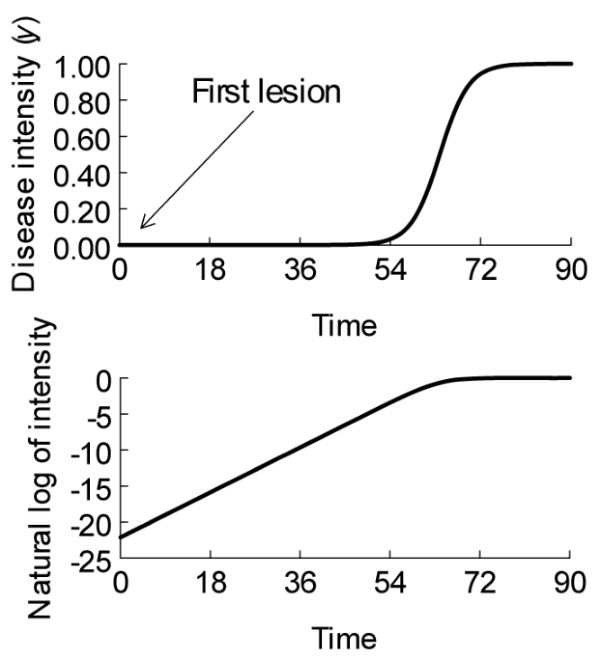

# The Study of Plant Disease Epidemics {#sec-intro}

> *"Chemical industry and plant breeders have forged fine tactical weapons; but only epidemiology sets the strategy."*
> — J. E. Vanderplank

---

## 1.1 การระบาดของโรคพืช (Plant Disease Epidemics) {#sec-intro-epidemics}

พืชรอบตัวเราอ่อนไหว (sensitive) ต่อเชื้อก่อโรคหลากหลายชนิด ไม่ว่าจะเป็นเชื้อรา, โอไมซีต (ราน้ำ), แบคทีเรีย, ไวรัส, ไวรอยด์ ไปจนถึงไส้เดือนฝอย (Agrios, 2005) มีการบันทึกไว้ในหนังสือของ Farr และคณะ (1989) ว่า แค่เฉพาะในสหรัฐอเมริกาประเทศเดียว ก็มีเชื้อราและโอโอไมซีตที่ก่อโรคในพืชมากกว่า 13,000 ชนิดเข้าไปแล้ว และทำให้เกิดโรคตามมาเกิน 75,000 โรค (เพราะเชื้อชนิดเดียวอาจลามไปติดพืชได้หลายชนิด) พืชผลหรือไม้ป่าแต่ละชนิดอาจต้องเจอศึกรอบด้านจากเชื้อก่อโรคกว่า 200 ชนิดจากทั่วโลก ทว่าในพื้นที่หนึ่ง ๆ ปกติแล้วเรามักจะต้องรับมือและควบคุมโรคระบาดตัวฉกาจจริง ๆ อยู่ราว 5–20 โรคในแต่ละปี (Madden and Wheelis, 2003)

ผลกระทบจากโรคพืชเหล่านี้ไม่ใช่เรื่องเล่น ๆ โดยเฉพาะผลผลิตที่หดหายและงบประมาณในการควบคุมโรคที่บานปลาย (James et al., 1991; Teng and Ohima, 1983) แม้ตลอดศตวรรษที่ผ่านมา มนุษย์พัฒนามีความก้าวหน้าในการจัดการโรคพืช ไม่ว่าจะปรับปรุงพันธุ์พืชให้ทนทาน คิดค้นสารเคมีและชีวภัณฑ์ควบคุมโรค รวมถึงสารพัดวิธีเขตกรรม (Fry, 1982; Strange, 1993) แต่ความจริงก็คือ โรคพืชหลายชนิดยังคงยากจะควบคุมด้วยวิธีที่มีต้นทุนจับต้องได้ ไม่ว่าจะในประเทศพัฒนาแล้วหรือกำลังพัฒนาก็ตาม

จริงอยู่ที่การเห็นต้นไม้ที่มีค่ามีราคาเป็นโรคเพียงต้นเดียวอาจดูเป็นเรื่องใหญ่ เช่น ต้นเอล์มเก่าแก่ใจกลางเมืองที่ติดเชื้อ Ophiostoma ulmi จนเป็นโรคดัตช์เอล์ม แต่ในเชิงภาพรวมแล้ว การติดเชื้อในพืชเพียงต้นเดียวยังไม่ใช่แก่นสำคัญ เพราะจุดวิกฤตของโรคพืชมักเกิดขึ้น เมื่อมันเริ่มระบาดไปทั่วทั้งแปลง ทั้งป่า หรือกระจายไปตามส่วนต่าง ๆ ของพืช (เช่น ใบหรือผล) ในวงกว้าง แต่ต่างจากโรคระบาดรุนแรงในสัตว์ที่เราพอจะกวาดล้างให้สิ้นซากได้ แต่ในพืชมีน้อยโรค ที่จะถูกกำจัดจนหมดจริง ๆ (Madden and Wheelis, 2003; NRC, 2003) นั่นแปลว่า ในพื้นที่เพาะปลูก มักจะมี “เชื้อตั้งต้น” แฝงตัวอยู่เสมอ เป้าหมายของการจัดการโรคพืชจึงไม่ใช่การทำให้เชื้อกลายเป็นศูนย์ แต่เป็นการคุม disease intensity ให้อยู่ในระดับต่ำ หรือเหมือนที่ Merrill (1977) เคยกล่าวไว้ว่า “preventing an intolerable build-up of disease within a population.” หรือ  "คือการป้องกันไม่ให้การสะสมของโรคพุ่งทะลุเพดานจนประชากรพืชทนไม่ไหว" ซึ่งคำว่า "ทนไม่ไหว" นั้นแค่ไหน ก็ขึ้นอยู่กับมูลค่าของผลผลิตและความเสียหายที่โรคนั้นสร้างขึ้น

นอกจากนี้ เรายังสามารถมองปัญหานี้ในมุมของ “ประชากรเชื้อก่อโรค” ควบคู่ไปกับประชากรพืชที่ติดเชื้อได้ด้วย เหมือนที่ Vanderplank เคยเปิดประเด็นไว้ในบทแรกของหนังสือปี 1963 ไว้อย่างน่าสนใจว่า:

 “In order to control rust in wheat fields (caused by Puccinia graminis f.sp. tritici) one must stop, or at least retard, the growth of millions or billions of rust pustules on thousands or millions of wheat plants. The fate of a single wheat plant and the growth of a single pustule are relatively trivial details in a large picture.” หรือ "การจะควบคุมโรคราสนิมในแปลงข้าวสาลี (ที่เกิดจากเชื้อ Puccinia graminis f.sp. tritici) เราต้องหยุดยั้งหรือชะลอการเติบโตของตุ่มราสนิมนับล้านหรือนับพันล้านตุ่ม บนต้นข้าวสาลีนับหมื่นนับล้านต้น ชะตากรรมของข้าวสาลีเพียงต้นเดียว หรือการโตของตุ่มราเพียงตุ่มเดียว เป็นเพียงเศษเสี้ยวเล็กน้อยในภาพใหญ่เท่านั้น"

ดังนั้น หากเราต้องการเข้าใจโรคพืชในระดับมหภาค การทำนายการระบาด การประเมินความเสียหายต่อผลผลิต และท้ายที่สุดคือการควบคุมโรคได้อย่างมีประสิทธิภาพ การศึกษาโรคพืชในระดับ “ประชากร” จึงเป็นหัวใจสำคัญอย่างหลีกเลี่ยงไม่ได้ (Jones, 1998b)

## 1.2 แนวคิดพื้นฐานบางประการ (Some Concepts) {#sec-intro-concepts}

#### 1.2.1 การระบาดของโรค (Epidemics)

ถ้าจะให้เข้าใจง่ายที่สุด **ระบาดวิทยา (Epidemiology)** ก็คือศาสตร์ที่ว่าด้วยการศึกษา **"การระบาด (Epidemic)"** นั่นเอง นิยามของคำว่าการระบาดมีอยู่หลายแบบ แต่นิยามที่คิดว่าเข้าท่าที่สุดคือ:

> **EPIDEMIC:** "Change in disease intensity in a host population over time and space."

> **การระบาด:** "ความเปลี่ยนแปลงของ disease intensity ในประชากรพืชอาศัย ทั้งในมิติของเวลาและพื้นที่"

เพื่อให้เข้าใจตรงกัน มาทำความเข้าใจ คำที่เป็นองค์ประกอบที่สำคัญสำหรับศาสตร์ หรือวิชานี้:

* **"ความเปลี่ยนแปลง (Change)":** ตอกย้ำว่าการระบาดเป็นกระบวนการที่ไม่หยุดนิ่ง (Dynamic) และหัวใจหลักของการศึกษาก็คือการวัด "อัตราการเปลี่ยนแปลง" เหล่านี้
* **"โรค (Disease)":** ระบุชัดเจนว่าเรากำลังโฟกัสที่ตัวโรคจริงๆ ไม่ใช่ดูแค่ตัวเชื้อก่อโรคหรือต้นพืชเดี่ยวๆ
* **"Disease intensity":** คำกว้าง ๆ ที่ใช้วัดสเกลหรือระดับการเกิดโรค (ครอบคลุมทั้ง incidence และ severity) ซึ่งเราจะไปเจาะลึกนิยามกันในบทถัดไป
* **"ประชากรพืชอาศัย (Host population)":** ย้ำว่าการระบาดเป็นปรากฏการณ์ระดับกลุ่มประชากร ในที่นี้หมายถึงกลุ่มของพืชที่พร้อมจะติดเชื้อก่อโรคชนิดใดชนิดหนึ่ง (หรือหลายชนิด)
* **"เวลาและพื้นที่ (Time and space)":** มิติทางกายภาพสองแกนที่กระบวนการระบาดเกิดขึ้น เพราะในโลกความเป็นจริง disease intensity จะเปลี่ยนไปตามวันเวลาและแตกต่างกันไปตามแต่ละตำแหน่งพื้นที่

นอกจากนี้ Kranz (1990b) ให้คำจำกัดความไว้อย่างกระชับว่า *"การระบาดคือความก้าวหน้าของโรคในมิติเวลาและพื้นที่"* บ่อยครั้งที่คำว่า "พื้นที่" มักถูกตัดทิ้งไป แต่โรคพืชไม่ได้ระบาดรุนแรงเท่ากันทุกหนทุกแห่งในเวลาเดียวกัน ดังนั้นมิติของพื้นที่จึงแฝงอยู่โดยอัตโนมัติอยู่แล้ว

นอกจากนี้ หลายคนมักชอบใช้คำว่า **"การเพิ่มขึ้น (Increase)"** แทนคำว่า "ความเปลี่ยนแปลง" จนกลายเป็น *การเพิ่มขึ้นของ disease intensity ในประชากรพืชตามเวลา* ซึ่งมุมมองนี้ก็มีประโยชน์มากในทางทฤษฎีและปฏิบัติ เพราะเราย่อมอยากรู้ว่าปัจจัยอะไรที่กระตุ้นให้โรคพุ่งทะยานอย่างรวดเร็ว หรือปัจจัยไหนที่จะช่วยสกัดกั้นและกดอัตราการระบาดให้อยู่ในระดับที่พืชพอจะรับไหว ซึ่งแนวคิดนี้จะเป็นหัวใจหลักในบทที่ 4 และ 5

อย่างไรก็ตาม เรายังขอยืนกรานที่จะใช้คำว่า **"ความเปลี่ยนแปลง (Change)"** ในนิยามหลัก มากกว่าคำว่า "การเพิ่มขึ้น" เพื่อให้ครอบคลุมสถานการณ์จริงในธรรมชาติได้ครบทุกมิติ ลองนึกภาพโรคทางใบในพืชยืนต้น แม้ disease intensity จะไต่ระดับขึ้นตลอดฤดูปลูก แต่พอถึงช่วงสิ้นสุดฤดูและพืชเริ่มผลัดใบ ปริมาณโรคก็จะลดฮวบลงตามธรรมชาติ หรือในกรณีที่พืชแตกใบอ่อนชุดใหม่เร็วกว่าอัตราที่เชื้อจะตามไปติด สัดส่วนพื้นที่เนื้อเยื่อที่เป็นโรคก็อาจลดลงได้เช่นกัน ยิ่งไปกว่านั้น ในมิติของพื้นที่ การจะบอกว่าโรคเพิ่มขึ้นหรือลดลงเป็นเส้นตรงทื่อ ๆ (Monotonic) ตลอดเวลานั้น แทบจะเป็นไปไม่ได้เลย

---

**มุมมองของคนทั่วไป กับ นิยามทางวิทยาศาสตร์**

สิ่งที่ต้องขีดเส้นใต้ไว้คือ คำว่า "การระบาด" ในความเข้าใจของคนทั่วไป (รวมถึงนักวิชาการนอกสายระบาดวิทยา) มักให้ความหมายต่างจากนิยามที่ใช้ในที่นี้ พจนานุกรม Merriam-Webster ให้นิยามว่าคือ *"การส่งผลกระทบต่อประชากรจำนวนมหาศาลอย่างผิดหูผิดตา"* หรือ *"การแพร่กระจายอย่างล้นหลาม"* ขณะที่พจนานุกรมโรคพืช (Holliday, 1989) นิยามว่า *"การเพิ่มขึ้นของโรคติดเชื้อในวงกว้างอย่างฉับพลัน"*

ในทางตรงกันข้าม นิยามเชิงปฏิบัติการของเล่มนี้ **ไม่ได้สนใจว่าต้องมีจำนวนมหาศาล หรือต้องลุกลามจนเต็มทุ่งเท่านั้นถึงจะเรียกว่าระบาด** ลองดูตัวอย่างต่อไปนี้แล้วจะเห็นภาพชัดเจน:

สมมติว่าเรามีแปลงมันฝรั่งพันธุ์ที่อ่อนแอต่อโรคอยู่แปลงหนึ่ง มีต้นมันฝรั่งทั้งหมด 4 ล้านต้น ($4 \times 10^6$ ต้น) และกำลังเผชิญหน้ากับ **โรคใบไหม้ (Late blight)** ที่เกิดจากโอโอไมซีต *Phytophthora infestans* ซึ่งถือเป็นโรคพืชที่แพร่ระบาดได้เร็วและรุนแรงที่สุดโรคหนึ่งในโลก (Vanderplank, 1963)

จุดเริ่มต้นของการระบาดมาจากแผลเพียงแผลเดียวบนใบมันฝรั่งเพียงต้นเดียวในแปลง (ความหนาแน่นเท่ากับ $1 / (4 \times 10^6)$) โดยสปอร์อาจปลิวมาจากหัวมันที่ติดเชื้อในละแวกนั้น ข้อมูลจาก van der Zaag (1956) ระบุว่า แผลใบไหม้ 1 แผลจะกินพื้นที่เฉลี่ยประมาณ 0.1% ของเรือนยอดทั้งต้น ($0.001$ หรือ $1/1000$ ของต้นที่แสดงอาการ) แม้ความสัมพันธ์ระหว่างจำนวนแผลกับพื้นที่ใบจะขึ้นกับสายพันธุ์พืชและสายพันธุ์เชื้อ แต่เราขอยกตัวเลขนี้มาเป็นกรณีศึกษา

เราวัด disease intensity ด้วยสัดส่วนของใบที่เป็นแผลทั้งแปลง กำหนดให้เป็นตัวแปร $y$ (บทหน้าจะอธิบายวิธีการวัดรูปแบบต่าง ๆ อย่างละเอียด) และให้เวลาเป็นวัน แทนด้วย $t$ โดยจุดเริ่มระบาดคือ $t = 0$

* เมื่อทั้งแปลงมีแผลเพียง 1 แผล disease intensity จะอยู่ที่ $y = 0.001 / (4 \times 10^6) = 2.5 \times 10^{-10}$
* หากจำนวนแผลเพิ่มขึ้นเป็น "สองเท่าในทุกๆ 2 วัน" เมื่อผ่านไปประมาณ **44 วัน** ทั้งแปลงจะมีแผลเฉลี่ยต้นละ 1 แผล (รวม 4 ล้านแผลทั้งแปลง) ตัวเลขการเพิ่มขึ้นเท่าตัวแบบนี้อาจดูเวอร์ แต่มันคืออัตราการระบาดตามปกติของโรคใบไหม้ในสภาพแวดล้อมที่เหมาะสม (Fry, 1978) ณ วันที่ 44 นี้ ค่า $y$ จะเพิ่งขยับมาแตะที่ **$0.001$** เท่านั้น
* หากโรคลุกลามด้วยความเร็วเท่าเดิม (โดยหักลบผลจากการที่ใบดีเริ่มเหลือน้อยลง ทำให้สปอร์ใหม่เริ่มปลิวไปตกซ้ำบนแผลเดิม) ที่ $t = 64$ วัน โรคจะกินพื้นที่ครึ่งแปลง ($y = 0.5$) จากนั้นที่ $t = 70$ วันจะพุ่งไปถึง $y = 0.90$, ที่ $t = 77$ วันอยู่ที่ $y = 0.99$ และกวาดเกือบเรียบ $y = 0.999$ ในวันที่ **83**

เมื่อนำค่า $y$ มาพล็อตกราฟเทียบกับเวลา $t$ เราจะได้กราฟการพัฒนาของโรค (Disease progress curve) ที่มีหน้าตาเป็นตัวเอส (**S-shaped curve**) ดังแสดงใน @fig-intro-dpc ซึ่งเป็นรูปแบบคลาสสิกของโรคที่ลามจากต้นสู่ต้นหรือใบสู่ใบ

{#fig-intro-dpc}

สังเกตได้ว่า ณ จุดที่มีแผลเฉลี่ยต้นละ 1 แผล ($y = 0.001$) เส้นกราฟแทบจะยังนอนติดแกนศูนย์อยู่เลย ในสถานการณ์จริง นี่คือระดับที่เกษตรกรหรือคนสำรวจแปลงจะเริ่ม "สังเกตเห็น" โรคเป็นครั้งแรก เพราะต้นที่มีแผลก็จะมีแค่ไม่กี่ต้น และต้นส่วนใหญ่ในแปลงยังดูเขียวสดไร้ร่องรอย ถ้าไม่เพ่งมองอย่างละเอียดจริง ๆ แทบไม่มีทางรู้เลยว่ามีเชื้อแฝงอยู่จนกระทั่ง disease intensity ไต่ไปถึง 0.001

จากวันที่ 44 ถึงวันที่ 84 disease intensity เพิ่มขึ้นถึง 1,000 เท่า ในสายตาคนทั่วไป การที่ใบไหม้เกรียมไปทั้งแปลง (100%) ย่อมถูกตราหน้าว่า "เกิดการระบาดครั้งใหญ่" แน่นอน ส่วนตอนที่เชื้อกินพื้นที่แค่ 0.1% ($y = 0.001$) คนทั่วไปคงมองไม่ออกและคิดว่ายังไม่ระบาดด้วยซ้ำ

**แต่ความจริงในเชิงคณิตศาสตร์และชีววิทยาประชากรกลับสวนทางกัน:**
ในช่วง 44 วันแรก โรคได้เพิ่มปริมาณไปแล้วถึง **4 ล้านเท่า** (จาก 1 แผล กระโดดเป็น 4 ล้านแผล หรือจาก $y = 2.5 \times 10^{-10}$ พุ่งมาเป็น $y = 0.001$) การทวีคูณในช่วง 40 กว่าวันแรกนั้นมหาศาลกว่าช่วง 40 วันหลังอย่างเทียบไม่ติด! ในมุมมองของชีววิทยาประชากร กลไกการระบาดตั้งแต่แผลแรกจนถึงแผลที่ 4 ล้าน ไม่ได้ต่างอะไรกับช่วงท้ายเลย และเราสามารถใช้สมการทางคณิตศาสตร์ตัวเดียวที่มีค่าพารามิเตอร์อัตราการเพิ่มคงที่ อธิบายปรากฏการณ์ทั้งหมดตั้งแต่แผลแรกเริ่มผุด จนถึงวันที่ใบไหม้ตายหมดแปลงได้อย่างแม่นยำ

ในทางปฏิบัติ เราจึงไม่สามารถขีดเส้นตายตัวได้เลยว่าตรงไหนคือ "ยังไม่ระบาด" และตรงไหนคือ "เริ่มระบาดแล้ว" เพราะมันคือการเติบโตอย่างต่อเนื่อง (Continuum) หากเราแปลงค่า $y$ เป็นรูป Log แล้วนำมาพล็อตกราฟ (@fig-intro-dpc กราฟล่าง) เส้นกราฟที่ได้แทบจะเป็น "เส้นตรงดิ่งยาว" ตลอดช่วงเวลา จะเริ่มมาชะลอตัวลงก็เฉพาะช่วงท้ายที่ใบดีๆ โดนกินจนหมดเท่านั้น ในทางวิชาชีพ นักโรคพืชมักจะเริ่มศึกษาการระบาดที่ช่วง $y = 0.001$ ถึง $1.0$ แต่ต้องตระหนักไว้เสมอว่า นั่นเป็นเพียงแค่ช่วงต่อของกระบวนการระบาดที่เกิดขึ้นมาก่อนหน้านานแล้ว แต่ข้อจำกัดในการสุ่มตรวจทำให้เรามองไม่เห็นมัน

ดังนั้น **ระดับของ disease intensity ไม่ใช่ตัวตัดสินว่าเกิดการระบาดขึ้นแล้วหรือไม่** โรคจะเบาบางหรือหนักหนา ล้วนเป็นเพียงจังหวะเวลาหนึ่งบนไทม์ไลน์ของการระบาดทั้งสิ้น แต่แน่นอนว่าระดับ disease intensity ที่ต่างกัน ย่อมมีผลต่อ yield loss และความจำเป็นในการฉีดพ่นสารควบคุมที่ไม่เท่ากัน (ซึ่งจะว่ากันต่อในบทที่ 11 และ 12)

และหากต้องการระบุถึงสถานการณ์ที่โรคระบาดรุนแรงกินพื้นที่กว้างขวางระดับทวีปหรือทั่วโลก เราสามารถใช้คำว่า **การระบาดใหญ่ (Pandemic)** ได้ เช่น การระบาดใหญ่ของโรคใบไหม้มันฝรั่งทั่วยุโรปตะวันตกในปี 1845–1846 หรือโรคใบไหม้ข้าวโพดทางตอนใต้ของสหรัฐฯ ในปี 1970 (Horsfall and Cowling, 1978a)

---

#### 1.2.2 ระบาดวิทยา (Epidemiology)

อย่างที่เกริ่นไว้ ระบาดวิทยาคือ การศึกษาการระบาด หากต้องการนิยามที่คมชัดขึ้น Diekmann and Heesterbeek (2000) ให้นิยามว่าเป็น *"การศึกษาการแพร่กระจายของโรคในมิติของพื้นที่และเวลา โดยมีเป้าหมายเพื่อแกะรอยหาปัจจัยที่ก่อให้เกิดหรือส่งเสริมให้เกิดโรคนั้นๆ"* (ใส่ ภาษาอังกฤษด้วย)

และวงการโรคพืชนั้น Kranz (1990b) ให้คำนิยามไว้อย่างลึกซึ้งว่า ระบาดวิทยาคือ *"วิทยาศาสตร์ว่าด้วยประชากรของเชื้อก่อโรค ในประชากรของพืชอาศัย และโรคที่เกิดขึ้นภายใต้อิทธิพลของสิ่งแวดล้อมและการรบกวนของมนุษย์"* ด้วยความที่ เน้นศึกษาในระดับประชากร จึงเปรียบระบาดวิทยาเป็น **นิเวศวิทยาของโรค (Ecology of disease)** ได้

ศาสตร์นี้ยังคงยืนอยู่บนพื้นฐานของ **สามเหลี่ยมโรคพืช (Disease Triangle)** ที่คุ้นเคย ซึ่งประกอบด้วย พืชอาศัย (Host), เชื้อก่อโรค (Pathogen) และสิ่งแวดล้อม (Environment) เพียงแต่มองภาพขยายในระดับ "ประชากร" ไม่ใช่ระดับ "พืชต้นเดียว" ในบางครั้ง สามเหลี่ยมนี้อาจถูกต่อยอดเป็นพีระมิดหรือรูปทรงหลายมิติ เพื่อสะท้อนถึงมิติของเวลา พื้นที่ หรืออิทธิพลของมนุษย์เข้าไปด้วย (Francl, 2001) ก็ได้ และหากจะมองให้ครบรอบด้าน สิ่งแวดล้อมก็สามารถแบ่งย่อยเป็นสิ่งไม่มีชีวิต (เช่น สภาพอากาศ ความชื้นในดิน) และสิ่งมีชีวิต (เช่น แมลงพาหะ) ได้เช่นกัน

และเนื่องจาก **"ประชากร"** ย่อมประกอบขึ้นจาก เชื้อแต่ละเชื้อ ต้นเป็นโรคแต่ละต้น การศึกษาระบาดวิทยาจึงมักต้องเริ่มต้นจากการเก็บข้อมูลของพืชแต่ละต้น เช่น อัตราการสร้างสปอร์ของเชื้อราบนใบพืชแต่ละใบ เพื่อนำมารวบรวมและวิเคราะห์ การเปลี่ยนแปลงของโรคในระดับกลุ่มประชากรภาพใหญ่

---

#### 1.2.3 จะใช้คำไหนดี ระหว่าง Epidemic และ Epiphytotic

ในอดีต นักวิชาการบางคน (เช่น Unger, 1833; Whetzel, 1929; Ryan and Birch, 1978) เคยพยายามผลักดันให้ใช้คำว่า **"Epiphytotic"** แทนคำว่า **"Epidemic"** เมื่อพูดถึงโรคในพืช โดยให้เหตุผลทางรากศัพท์ภาษากรีกโบราณว่า คำว่า *Epidemic* มักแปลว่า "สิ่งที่เกิดขึ้นท่ามกลางผู้คน" (Demos = ประชาชน) แต่ Millar (1978) ก็แย้งไว้อย่างน่าสนใจว่า จริง ๆ แล้วรากศัพท์กรีกคำนี้สามารถแปลกว้าง ๆ ว่า "เกิดขึ้นเหนือประชากร" ซึ่งครอบคลุมทั้งประชากรมนุษย์ สัตว์ และพืชได้เช่นกัน

และ คำว่า *Epidemic* ถูกบันทึกว่าใช้ครั้งแรกโดยฮิปโปเครตีส (ราว 400 ปีก่อนคริสตกาล) และได้รับความนิยมแพร่หลายขึ้นเรื่อย ๆ  Zadoks and Koster (1976) ชี้ว่า ในประวัติศาสตร์โรคพืช ปรมาจารย์ยุคแรกเริ่มอย่าง Duhamel de Monceau (1728), von Martius (1842), Kühn (1858) และ Ward (1901) ต่างก็เลือกใช้คำว่า *Epidemic* ในงานเขียนวิชาการว่าด้วยโรคพืชระดับประชากรมาโดยตลอด

แต่เหตุผลที่หนักแน่นที่สุดในการใช้คำว่า **Epidemic** คือหลักการทาง **ชีววิทยาและพลวัตประชากร** เพราะกลไกและกระบวนการแพร่กระจายของโรคในระดับประชากรของคน สัตว์ และพืช แทบจะถอดรหัสเดียวกันมาเป๊ะ ๆ โมเดลและวิธีการวิเคราะห์ที่ยอดเยี่ยม หลายอย่างที่ใช้กันในปัจจุบัน ก็มีต้นกำเนิดหรือหยิบยืมมาจากโมเดลระบาดวิทยาทางการแพทย์แทบทั้งสิ้น

ดังนั้น แม้การใช้คำว่า *Epiphytotic* จะไม่ได้ผิดเลย แต่ก็ไม่มีความจำเป็นต้องสรรหาคำมาแยกให้ยุ่งยาก และถ้าจะเล่นคำนี้จริง ศาสตร์ที่ศึกษาโรคพืชก็จะต้องถูกเรียกว่า **Epiphytotiology** ซึ่งเป็นคำที่ประหลาดและแทบไม่เคยมีใครในวงการโรคพืชคิดจะใช้เลย

หากจำเป็นต้องระบุให้ชัดเจนว่าเรากำลังศึกษาการระบาดของโรคพืชโดยเฉพาะ คำว่า **Botanical epidemiology (ระบาดวิทยาทางพฤกษศาสตร์)** ถือเป็นคำที่ลงตัวและนิยมใช้มากที่สุด โดยเราจะถือว่า *Botanical epidemiology*, *Plant disease epidemiology* และ *Plant epidemiology* มีความหมายเหมือนกัน
