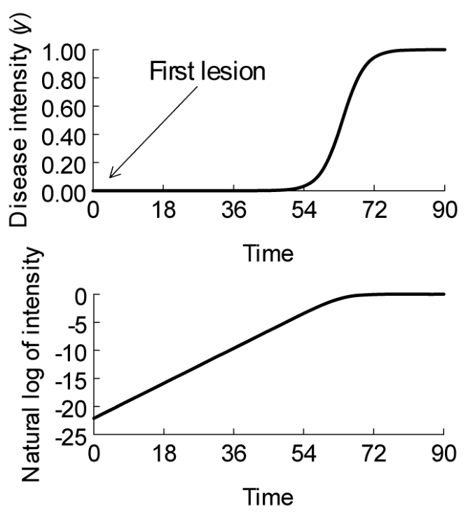

# การศึกษาการระบาดของโรคพืช (The Study of Plant Disease Epidemics) {#sec-intro}

> *"Chemical industry and plant breeders have forged fine tactical weapons; but only epidemiology sets the strategy."*
> — J. E. Vanderplank

---

## 1.1 การระบาดของโรคพืช (Plant Disease Epidemics) {#sec-intro-epidemics}

พืชรอบตัวเราอ่อนไหวต่อเชื้อก่อโรคสารพัดชนิด ไม่ว่าจะเป็นเชื้อรา, โอไมซีต (ราน้ำ), แบคทีเรีย, ไวรัส, ไวรอยด์ ไปจนถึงไส้เดือนฝอย (Agrios, 2005) มีการบันทึกไว้ในหนังสือของ Farr และคณะ (1989) ว่า แค่เฉพาะในสหรัฐอเมริกาประเทศเดียว ก็มีเชื้อราและโอโอไมซีตที่ก่อโรคในพืชมากกว่า 13,000 ชนิดเข้าไปแล้ว และทำให้เกิดโรคตามมาเกิน 75,000 โรค (เพราะเชื้อชนิดเดียวอาจลามไปติดพืชได้หลายชนิด) พืชผลหรือไม้ป่าแต่ละชนิดอาจต้องเจอศึกรอบด้านจากเชื้อก่อโรคกว่า 200 ชนิดจากทั่วโลก ทว่าในพื้นที่หนึ่ง ๆ ปกติแล้วเรามักจะต้องรับมือและควบคุมโรคระบาดตัวฉกาจจริง ๆ อยู่ราว 5–20 โรคในแต่ละปี (Madden and Wheelis, 2003)

ผลกระทบจากโรคพืชเหล่านี้ไม่ใช่เรื่องเล่น ๆ โดยเฉพาะผลผลิตที่หดหายและงบประมาณในการควบคุมโรคที่บานปลาย (James et al., 1991; Teng and Ohima, 1983) แม้ตลอดศตวรรษที่ผ่านมา มนุษย์พัฒนามีความก้าวหน้าในการจัดการโรคพืช ไม่ว่าจะปรับปรุงพันธุ์พืชให้ทนทาน คิดค้นสารเคมีและชีวภัณฑ์ควบคุมโรค รวมถึงสารพัดวิธีเขตกรรม (Fry, 1982; Strange, 1993) แต่ความจริงก็คือ โรคพืชหลายชนิดยังคงยากจะควบคุมด้วยวิธีที่มีต้นทุนจับต้องได้ ไม่ว่าจะในประเทศพัฒนาแล้วหรือกำลังพัฒนาก็ตาม

จริงอยู่ที่การเห็นต้นไม้ที่มีค่ามีราคาเป็นโรคเพียงต้นเดียวอาจดูเป็นเรื่องใหญ่ เช่น ต้นเอล์มเก่าแก่ใจกลางเมืองที่ติดเชื้อ Ophiostoma ulmi จนเป็นโรคดัตช์เอล์ม แต่ในเชิงภาพรวมแล้ว การติดเชื้อในพืชเพียงต้นเดียวยังไม่ใช่แก่นสำคัญ เพราะจุดวิกฤตของโรคพืชมักเกิดขึ้น เมื่อมันเริ่มระบาดไปทั่วทั้งแปลง ทั้งป่า หรือกระจายไปตามส่วนต่าง ๆ ของพืช (เช่น ใบหรือผล) ในวงกว้าง แต่ต่างจากโรคระบาดรุนแรงในสัตว์ที่เราพอจะกวาดล้างให้สิ้นซากได้ แต่ในพืชมีน้อยโรค ที่จะถูกกำจัดจนหมดจริง ๆ (Madden and Wheelis, 2003; NRC, 2003) นั่นแปลว่า ในพื้นที่เพาะปลูก มักจะมี “เชื้อตั้งต้น” แฝงตัวอยู่เสมอ เป้าหมายของการจัดการโรคพืชจึงไม่ใช่การทำให้เชื้อกลายเป็นศูนย์ แต่เป็นการคุมความรุนแรงให้อยู่ในระดับต่ำ หรือเหมือนที่ Merrill (1977) เคยกล่าวไว้ว่า “preventing an intolerable build-up of disease within a population.” หรือ  "คือการป้องกันไม่ให้การสะสมของโรคพุ่งทะลุเพดานจนประชากรพืชทนไม่ไหว" ซึ่งคำว่า "ทนไม่ไหว" นั้นแค่ไหน ก็ขึ้นอยู่กับมูลค่าของผลผลิตและความเสียหายที่โรคนั้นสร้างขึ้น

นอกจากนี้ เรายังสามารถมองปัญหานี้ในมุมของ “ประชากรเชื้อก่อโรค” ควบคู่ไปกับประชากรพืชที่ติดเชื้อได้ด้วย เหมือนที่ Vanderplank เคยเปิดประเด็นไว้ในบทแรกของหนังสือปี 1963 ไว้อย่างน่าสนใจว่า:

 “In order to control rust in wheat fields (caused by Puccinia graminis f.sp. tritici) one must stop, or at least retard, the growth of millions or billions of rust pustules on thousands or millions of wheat plants. The fate of a single wheat plant and the growth of a single pustule are relatively trivial details in a large picture.” หรือ "การจะควบคุมโรคราสนิมในแปลงข้าวสาลี (ที่เกิดจากเชื้อ Puccinia graminis f.sp. tritici) เราต้องหยุดยั้งหรือชะลอการเติบโตของตุ่มราสนิมนับล้านหรือนับพันล้านตุ่ม บนต้นข้าวสาลีนับหมื่นนับล้านต้น ชะตากรรมของข้าวสาลีเพียงต้นเดียว หรือการโตของตุ่มราเพียงตุ่มเดียว เป็นเพียงเศษเสี้ยวเล็กน้อยในภาพใหญ่เท่านั้น"

ดังนั้น หากเราต้องการเข้าใจโรคพืชในระดับมหภาค การทำนายการระบาด การประเมินความเสียหายต่อผลผลิต และท้ายที่สุดคือการควบคุมโรคได้อย่างมีประสิทธิภาพ การศึกษาโรคพืชในระดับ “ประชากร” จึงเป็นหัวใจสำคัญอย่างหลีกเลี่ยงไม่ได้ (Jones, 1998b)

## 1.2 แนวคิดพื้นฐานบางประการ (Some Concepts) {#sec-intro-concepts}

#### 1.2.1 การระบาดของโรค (Epidemics)

ถ้าจะให้เข้าใจง่ายที่สุด **ระบาดวิทยา (Epidemiology)** ก็คือศาสตร์ที่ว่าด้วยการศึกษา **"การระบาด (Epidemic)"** นั่นเอง นิยามของคำว่าการระบาดมีอยู่หลายแบบ แต่นิยามที่คิดว่าเข้าท่าที่สุดคือ:

> **EPIDEMIC:** "Change in disease intensity in a host population over time and space."

> **การระบาด:**"ความเปลี่ยนแปลงของความรุนแรงของโรค ในประชากรพืชอาศัย ทั้งในมิติของเวลาและพื้นที่"

เพื่อให้เข้าใจตรงกัน มาทำความเข้าใจ คำที่เป็นองค์ประกอบที่สำคัญสำหรับศาสตร์ หรือวิชานี้:

* **"ความเปลี่ยนแปลง (Change)":** ตอกย้ำว่าการระบาดเป็นกระบวนการที่ไม่หยุดนิ่ง (Dynamic) และหัวใจหลักของการศึกษาก็คือการวัด "อัตราการเปลี่ยนแปลง" เหล่านี้
* **"โรค (Disease)":** ระบุชัดเจนว่าเรากำลังโฟกัสที่ตัวโรคจริงๆ ไม่ใช่ดูแค่ตัวเชื้อก่อโรคหรือต้นพืชเดี่ยวๆ
* **"ความรุนแรง (Intensity)":** คำกว้างๆ ที่ใช้วัดสเกลหรือระดับการติดเชื้อ ซึ่งเราจะไปเจาะลึกนิยามกันในบทถัดไป
* **"ประชากรพืชอาศัย (Host population)":** ย้ำว่าการระบาดเป็นปรากฏการณ์ระดับกลุ่มประชากร ในที่นี้หมายถึงกลุ่มของพืชที่พร้อมจะติดเชื้อก่อโรคชนิดใดชนิดหนึ่ง (หรือหลายชนิด)
* **"เวลาและพื้นที่ (Time and space)":** มิติทางกายภาพสองแกนที่กระบวนการระบาดเกิดขึ้น เพราะในโลกความเป็นจริง ความรุนแรงของโรคจะเปลี่ยนไปตามวันเวลาและแตกต่างกันไปตามแต่ละตำแหน่งพื้นที่

นอกจากนี้ Kranz (1990b) ให้คำจำกัดความไว้อย่างกระชับว่า *"การระบาดคือความก้าวหน้าของโรคในมิติเวลาและพื้นที่"* บ่อยครั้งที่คำว่า "พื้นที่" มักถูกตัดทิ้งไป แต่โรคพืชไม่ได้ระบาดรุนแรงเท่ากันทุกหนทุกแห่งในเวลาเดียวกัน ดังนั้นมิติของพื้นที่จึงแฝงอยู่โดยอัตโนมัติอยู่แล้ว

นอกจากนี้ หลายคนมักชอบใช้คำว่า **"การเพิ่มขึ้น (Increase)"** แทนคำว่า "ความเปลี่ยนแปลง" จนกลายเป็น *การเพิ่มขึ้นของความรุนแรงของโรคในประชากรพืชตามเวลา* ซึ่งมุมมองนี้ก็มีประโยชน์มากในทางทฤษฎีและปฏิบัติ เพราะเราย่อมอยากรู้ว่าปัจจัยอะไรที่กระตุ้นให้โรคพุ่งทะยานอย่างรวดเร็ว หรือปัจจัยไหนที่จะช่วยสกัดกั้นและกดอัตราการระบาดให้อยู่ในระดับที่พืชพอจะรับไหว ซึ่งแนวคิดนี้จะเป็นหัวใจหลักในบทที่ 4 และ 5

อย่างไรก็ตาม เรายังขอยืนกรานที่จะใช้คำว่า **"ความเปลี่ยนแปลง (Change)"** ในนิยามหลัก มากกว่าคำว่า "การเพิ่มขึ้น" เพื่อให้ครอบคลุมสถานการณ์จริงในธรรมชาติได้ครบทุกมิติ ลองนึกภาพโรคทางใบในพืชยืนต้น แม้ความรุนแรงของโรคจะไต่ระดับขึ้นตลอดฤดูปลูก แต่พอถึงช่วงสิ้นสุดฤดูและพืชเริ่มผลัดใบ ปริมาณโรคก็จะลดฮวบลงตามธรรมชาติ หรือในกรณีที่พืชแตกใบอ่อนชุดใหม่เร็วกว่าอัตราที่เชื้อจะตามไปติด สัดส่วนพื้นที่เนื้อเยื่อที่เป็นโรคก็อาจลดลงได้เช่นกัน ยิ่งไปกว่านั้น ในมิติของพื้นที่ การจะบอกว่าโรคเพิ่มขึ้นหรือลดลงเป็นเส้นตรงทื่อ ๆ (Monotonic) ตลอดเวลานั้น แทบจะเป็นไปไม่ได้เลย

---

**มุมมองของคนทั่วไป กับ นิยามทางวิทยาศาสตร์**

สิ่งที่ต้องขีดเส้นใต้ไว้คือ คำว่า "การระบาด" ในความเข้าใจของคนทั่วไป (รวมถึงนักวิชาการนอกสายระบาดวิทยา) มักให้ความหมายต่างจากนิยามที่ใช้ในที่นี้ พจนานุกรม Merriam-Webster ให้นิยามว่าคือ *"การส่งผลกระทบต่อประชากรจำนวนมหาศาลอย่างผิดหูผิดตา"* หรือ *"การแพร่กระจายอย่างล้นหลาม"* ขณะที่พจนานุกรมโรคพืช (Holliday, 1989) นิยามว่า *"การเพิ่มขึ้นของโรคติดเชื้อในวงกว้างอย่างฉับพลัน"*

ในทางตรงกันข้าม นิยามเชิงปฏิบัติการของเล่มนี้ **ไม่ได้สนใจว่าต้องมีจำนวนมหาศาล หรือต้องลุกลามจนเต็มทุ่งเท่านั้นถึงจะเรียกว่าระบาด** ลองดูตัวอย่างต่อไปนี้แล้วจะเห็นภาพชัดเจน:

สมมติว่าเรามีแปลงมันฝรั่งพันธุ์ที่อ่อนแอต่อโรคอยู่แปลงหนึ่ง มีต้นมันฝรั่งทั้งหมด 4 ล้านต้น ($4 \times 10^6$ ต้น) และกำลังเผชิญหน้ากับ **โรคใบไหม้ (Late blight)** ที่เกิดจากโอโอไมซีต *Phytophthora infestans* ซึ่งถือเป็นโรคพืชที่แพร่ระบาดได้เร็วและรุนแรงที่สุดโรคหนึ่งในโลก (Vanderplank, 1963)

จุดเริ่มต้นของการระบาดมาจากแผลเพียงแผลเดียวบนใบมันฝรั่งเพียงต้นเดียวในแปลง (ความหนาแน่นเท่ากับ $1 / (4 \times 10^6)$) โดยสปอร์อาจปลิวมาจากหัวมันที่ติดเชื้อในละแวกนั้น ข้อมูลจาก van der Zaag (1956) ระบุว่า แผลใบไหม้ 1 แผลจะกินพื้นที่เฉลี่ยประมาณ 0.1% ของเรือนยอดทั้งต้น ($0.001$ หรือ $1/1000$ ของต้นที่แสดงอาการ) แม้ความสัมพันธ์ระหว่างจำนวนแผลกับพื้นที่ใบจะขึ้นกับสายพันธุ์พืชและสายพันธุ์เชื้อ แต่เราขอยกตัวเลขนี้มาเป็นกรณีศึกษา

เราวัดความรุนแรงของโรคด้วยสัดส่วนของใบที่เป็นแผลทั้งแปลง กำหนดให้เป็นตัวแปร $y$ (บทหน้าจะอธิบายวิธีการวัดรูปแบบต่าง ๆ อย่างละเอียด) และให้เวลาเป็นวัน แทนด้วย $t$ โดยจุดเริ่มระบาดคือ $t = 0$

* เมื่อทั้งแปลงมีแผลเพียง 1 แผล ความรุนแรงของโรคจะอยู่ที่ $y = 0.001 / (4 \times 10^6) = 2.5 \times 10^{-10}$
* หากจำนวนแผลเพิ่มขึ้นเป็น "สองเท่าในทุกๆ 2 วัน" เมื่อผ่านไปประมาณ **44 วัน** ทั้งแปลงจะมีแผลเฉลี่ยต้นละ 1 แผล (รวม 4 ล้านแผลทั้งแปลง) ตัวเลขการเพิ่มขึ้นเท่าตัวแบบนี้อาจดูเวอร์ แต่มันคืออัตราการระบาดตามปกติของโรคใบไหม้ในสภาพแวดล้อมที่เหมาะสม (Fry, 1978) ณ วันที่ 44 นี้ ค่า $y$ จะเพิ่งขยับมาแตะที่ **$0.001$** เท่านั้น
* หากโรคลุกลามด้วยความเร็วเท่าเดิม (โดยหักลบผลจากการที่ใบดีเริ่มเหลือน้อยลง ทำให้สปอร์ใหม่เริ่มปลิวไปตกซ้ำบนแผลเดิม) ที่ $t = 64$ วัน โรคจะกินพื้นที่ครึ่งแปลง ($y = 0.5$) จากนั้นที่ $t = 70$ วันจะพุ่งไปถึง $y = 0.90$, ที่ $t = 77$ วันอยู่ที่ $y = 0.99$ และกวาดเกือบเรียบ $y = 0.999$ ในวันที่ **83**

เมื่อนำค่า $y$ มาพล็อตกราฟเทียบกับเวลา $t$ เราจะได้กราฟการพัฒนาของโรค (Disease progress curve) ที่มีหน้าตาเป็นตัวเอส (**S-shaped curve**) ดังแสดงใน @fig-intro-dpc ซึ่งเป็นรูปแบบคลาสสิกของโรคที่ลามจากต้นสู่ต้นหรือใบสู่ใบ

{#fig-intro-dpc}

สังเกตได้ว่า ณ จุดที่มีแผลเฉลี่ยต้นละ 1 แผล ($y = 0.001$) เส้นกราฟแทบจะยังนอนติดแกนศูนย์อยู่เลย ในสถานการณ์จริง นี่คือระดับที่เกษตรกรหรือคนสำรวจแปลงจะเริ่ม "สังเกตเห็น" โรคเป็นครั้งแรก เพราะต้นที่มีแผลก็จะมีแค่ไม่กี่ต้น และต้นส่วนใหญ่ในแปลงยังดูเขียวสดไร้ร่องรอย ถ้าไม่เพ่งมองอย่างละเอียดจริง ๆ แทบไม่มีทางรู้เลยว่ามีเชื้อแฝงอยู่จนกระทั่งความรุนแรงไต่ไปถึง 0.001

จากวันที่ 44 ถึงวันที่ 84 ความรุนแรงของโรคเพิ่มขึ้นถึง 1,000 เท่า ในสายตาคนทั่วไป การที่ใบไหม้เกรียมไปทั้งแปลง (100%) ย่อมถูกตราหน้าว่า "เกิดการระบาดครั้งใหญ่" แน่นอน ส่วนตอนที่เชื้อกินพื้นที่แค่ 0.1% ($y = 0.001$) คนทั่วไปคงมองไม่ออกและคิดว่ายังไม่ระบาดด้วยซ้ำ

**แต่ความจริงในเชิงคณิตศาสตร์และชีววิทยาประชากรกลับสวนทางกัน:**
ในช่วง 44 วันแรก โรคได้เพิ่มปริมาณไปแล้วถึง **4 ล้านเท่า** (จาก 1 แผล กระโดดเป็น 4 ล้านแผล หรือจาก $y = 2.5 \times 10^{-10}$ พุ่งมาเป็น $y = 0.001$) การทวีคูณในช่วง 40 กว่าวันแรกนั้นมหาศาลกว่าช่วง 40 วันหลังอย่างเทียบไม่ติด! ในมุมมองของชีววิทยาประชากร กลไกการระบาดตั้งแต่แผลแรกจนถึงแผลที่ 4 ล้าน ไม่ได้ต่างอะไรกับช่วงท้ายเลย และเราสามารถใช้สมการทางคณิตศาสตร์ตัวเดียวที่มีค่าพารามิเตอร์อัตราการเพิ่มคงที่ อธิบายปรากฏการณ์ทั้งหมดตั้งแต่แผลแรกเริ่มผุด จนถึงวันที่ใบไหม้ตายหมดแปลงได้อย่างแม่นยำ

ในทางปฏิบัติ เราจึงไม่สามารถขีดเส้นตายตัวได้เลยว่าตรงไหนคือ "ยังไม่ระบาด" และตรงไหนคือ "เริ่มระบาดแล้ว" เพราะมันคือการเติบโตอย่างต่อเนื่อง (Continuum) หากเราแปลงค่า $y$ เป็นรูป Log แล้วนำมาพล็อตกราฟ (@fig-intro-dpc กราฟล่าง) เส้นกราฟที่ได้แทบจะเป็น "เส้นตรงดิ่งยาว" ตลอดช่วงเวลา จะเริ่มมาชะลอตัวลงก็เฉพาะช่วงท้ายที่ใบดีๆ โดนกินจนหมดเท่านั้น ในทางวิชาชีพ นักโรคพืชมักจะเริ่มศึกษาการระบาดที่ช่วง $y = 0.001$ ถึง $1.0$ แต่ต้องตระหนักไว้เสมอว่า นั่นเป็นเพียงแค่ช่วงต่อของกระบวนการระบาดที่เกิดขึ้นมาก่อนหน้านานแล้ว แต่ข้อจำกัดในการสุ่มตรวจทำให้เรามองไม่เห็นมัน

ดังนั้น **ขนาดความรุนแรงของโรค ไม่ใช่ตัวตัดสินว่าเกิดการระบาดขึ้นแล้วหรือไม่** โรคจะเบาบางหรือหนักหนา ล้วนเป็นเพียงจังหวะเวลาหนึ่งบนไทม์ไลน์ของการระบาดทั้งสิ้น แต่แน่นอนว่าระดับความรุนแรงที่ต่างกัน ย่อมมีผลต่อผลผลิตและความจำเป็นในการฉีดพ่นสารควบคุมที่ไม่เท่ากัน (ซึ่งจะว่ากันต่อในบทที่ 11 และ 12)

และหากต้องการระบุถึงสถานการณ์ที่โรคระบาดรุนแรงกินพื้นที่กว้างขวางระดับทวีปหรือทั่วโลก เราสามารถใช้คำว่า **การระบาดใหญ่ (Pandemic)** ได้ เช่น การระบาดใหญ่ของโรคใบไหม้มันฝรั่งทั่วยุโรปตะวันตกในปี 1845–1846 หรือโรคใบไหม้ข้าวโพดทางตอนใต้ของสหรัฐฯ ในปี 1970 (Horsfall and Cowling, 1978a)

---

#### 1.2.2 ระบาดวิทยา (Epidemiology)

อย่างที่เกริ่นไว้ ระบาดวิทยาคือ การศึกษาการระบาด หากต้องการนิยามที่คมชัดขึ้น Diekmann and Heesterbeek (2000) ให้นิยามว่าเป็น *"การศึกษาการแพร่กระจายของโรคในมิติของพื้นที่และเวลา โดยมีเป้าหมายเพื่อแกะรอยหาปัจจัยที่ก่อให้เกิดหรือส่งเสริมให้เกิดโรคนั้นๆ"* (ใส่ ภาษาอังกฤษด้วย)

และวงการโรคพืชนั้น Kranz (1990b) ให้คำนิยามไว้อย่างลึกซึ้งว่า ระบาดวิทยาคือ *"วิทยาศาสตร์ว่าด้วยประชากรของเชื้อก่อโรค ในประชากรของพืชอาศัย และโรคที่เกิดขึ้นภายใต้อิทธิพลของสิ่งแวดล้อมและการรบกวนของมนุษย์"* ด้วยความที่ เน้นศึกษาในระดับประชากร จึงเปรียบระบาดวิทยาเป็น **นิเวศวิทยาของโรค (Ecology of disease)** ได้

ศาสตร์นี้ยังคงยืนอยู่บนพื้นฐานของ **สามเหลี่ยมโรคพืช (Disease Triangle)** ที่คุ้นเคย ซึ่งประกอบด้วย พืชอาศัย (Host), เชื้อก่อโรค (Pathogen) และสิ่งแวดล้อม (Environment) เพียงแต่มองภาพขยายในระดับ "ประชากร" ไม่ใช่ระดับ "พืชต้นเดียว" ในบางครั้ง สามเหลี่ยมนี้อาจถูกต่อยอดเป็นพีระมิดหรือรูปทรงหลายมิติ เพื่อสะท้อนถึงมิติของเวลา พื้นที่ หรืออิทธิพลของมนุษย์เข้าไปด้วย (Francl, 2001) ก็ได้ และหากจะมองให้ครบรอบด้าน สิ่งแวดล้อมก็สามารถแบ่งย่อยเป็นสิ่งไม่มีชีวิต (เช่น สภาพอากาศ ความชื้นในดิน) และสิ่งมีชีวิต (เช่น แมลงพาหะ) ได้เช่นกัน

และเนื่องจาก **"ประชากร"** ย่อมประกอบขึ้นจาก เชื้อแต่ละเชื้อ ต้นเป็นโรคแต่ละต้น การศึกษาระบาดวิทยาจึงมักต้องเริ่มต้นจากการเก็บข้อมูลของพืชแต่ละต้น เช่น อัตราการสร้างสปอร์ของเชื้อราบนใบพืชแต่ละใบ เพื่อนำมารวบรวมและวิเคราะห์ การเปลี่ยนแปลงของโรคในระดับกลุ่มประชากรภาพใหญ่

---

#### 1.2.3 จะใช้คำไหนดี ระหว่าง Epidemic และ Epiphytotic

ในอดีต นักวิชาการบางคน (เช่น Unger, 1833; Whetzel, 1929; Ryan and Birch, 1978) เคยพยายามผลักดันให้ใช้คำว่า **"Epiphytotic"** แทนคำว่า **"Epidemic"** เมื่อพูดถึงโรคในพืช โดยให้เหตุผลทางรากศัพท์ภาษากรีกโบราณว่า คำว่า *Epidemic* มักแปลว่า "สิ่งที่เกิดขึ้นท่ามกลางผู้คน" (Demos = ประชาชน) แต่ Millar (1978) ก็แย้งไว้อย่างน่าสนใจว่า จริง ๆ แล้วรากศัพท์กรีกคำนี้สามารถแปลกว้าง ๆ ว่า "เกิดขึ้นเหนือประชากร" ซึ่งครอบคลุมทั้งประชากรมนุษย์ สัตว์ และพืชได้เช่นกัน

และ คำว่า *Epidemic* ถูกบันทึกว่าใช้ครั้งแรกโดยฮิปโปเครตีส (ราว 400 ปีก่อนคริสตกาล) และได้รับความนิยมแพร่หลายขึ้นเรื่อย ๆ  Zadoks and Koster (1976) ชี้ว่า ในประวัติศาสตร์โรคพืช ปรมาจารย์ยุคแรกเริ่มอย่าง Duhamel de Monceau (1728), von Martius (1842), Kühn (1858) และ Ward (1901) ต่างก็เลือกใช้คำว่า *Epidemic* ในงานเขียนวิชาการว่าด้วยโรคพืชระดับประชากรมาโดยตลอด

แต่เหตุผลที่หนักแน่นที่สุดในการใช้คำว่า **Epidemic** คือหลักการทาง **ชีววิทยาและพลวัตประชากร** เพราะกลไกและกระบวนการแพร่กระจายของโรคในระดับประชากรของคน สัตว์ และพืช แทบจะถอดรหัสเดียวกันมาเป๊ะ ๆ แบบจำลองและวิธีการวิเคราะห์ที่ยอดเยี่ยม หลายอย่างที่ใช้กันในปัจจุบัน ก็มีต้นกำเนิดหรือหยิบยืมมาจากโมเดลระบาดวิทยาทางการแพทย์แทบทั้งสิ้น

ดังนั้น แม้การใช้คำว่า *Epiphytotic* จะไม่ได้ผิดเลย แต่ก็ไม่มีความจำเป็นต้องสรรหาคำมาแยกให้ยุ่งยาก และถ้าจะเล่นคำนี้จริง ศาสตร์ที่ศึกษาโรคพืชก็จะต้องถูกเรียกว่า **Epiphytotiology** ซึ่งเป็นคำที่ประหลาดและแทบไม่เคยมีใครในวงการโรคพืชคิดจะใช้เลย

หากจำเป็นต้องระบุให้ชัดเจนว่าเรากำลังศึกษาการระบาดของโรคพืชโดยเฉพาะ คำว่า **Botanical epidemiology (ระบาดวิทยาทางพฤกษศาสตร์)** ถือเป็นคำที่ลงตัวและนิยมใช้มากที่สุด โดยเราจะถือว่า *Botanical epidemiology*, *Plant disease epidemiology* และ *Plant epidemiology* มีความหมายเหมือนกัน

## 1.3 ประวัติศาสตร์แห่งวิชาระบาดวิทยาโรคพืช {#sec-intro-history}

#### 1.3.1 ช่วงเวลาก่อนปี 1963 (Up to 1963)

บทความที่บันทึกประวัติศาสตร์ระบาดวิทยาของโรคพืช มีอยู่หลายชิ้นด้วยกัน โดยเฉพาะงานของ Zadoks and Koster (1976) ที่รวบรวมประวัติศาสตร์ยุคแรกเริ่มของการศึกษาโรคพืชในระดับประชากรไว้อย่างละเอียด พร้อมทั้งแปลตัดตอนข้อความจากเอกสารโบราณมาให้อ่านกันอย่างน่าตื่นตาตื่นใจ นอกจากนี้ยังมีงานของ Cowling and Horsfall (1978), Zadoks (2001) และ Waggoner and Aylor (2000) ที่ให้ข้อมูลที่มีคุณค่าไม่แพ้กัน จึงขอนำเสนอเฉพาะหมุดหมายสำคัญบางช่วงบางตอนเท่านั้น

ย้อนกลับไปเมื่อ 2,400 ปีก่อน ฮิปโปเครตีส (Jones, 1972) เคยเขียนถึงการระบาดของโรคในมนุษย์ เช่น โรคคางทูมและมาลาเรีย โดยชี้ให้เห็นถึงอิทธิพลของสภาพแวดล้อมที่มีต่อการปะทุของโรค ต่อมา ธีโอฟรัสทัส (Theophrastus: 372–287 ปีก่อน ค.ศ.) และพลินี (Pliny: ค.ศ. 23–79) ก็ได้เริ่มบันทึกข้อสังเกตเกี่ยวกับโรคพืช พร้อมทั้งตอกย้ำว่าบทบาทของสภาพแวดล้อมมีผลต่อการเกิดโรคระบาดเช่นเดียวกัน

จากนั้น ผลงานชิ้นเอกที่ล้ำยุคเกินกว่าใครแต่กลับถูกมองข้ามไปหลายร้อยปี ก็ถือกำเนิดขึ้นในปี 1728 โดย Duhamel de Monceau เขาได้เขียนถึงการระบาดในต้นหญ้าฝรั่น (*Saffron crocus*) ที่เกิดจากเชื้อรา *Rhizoctonia violacea* และเสนอวิธีควบคุมโรคโดยอิงจากความรู้เรื่องการระบาด ยิ่งไปกว่านั้น เขายังแสดงหลักฐานว่าโรคนี้น่าจะเกิดจาก "สิ่งมีชีวิตบางอย่าง" ซึ่ง Zadoks and Koster (1976) ยกย่องว่า นี่คือบันทึกการศึกษาระบาดวิทยาของโรคพืชชิ้นแรกในประวัติศาสตร์มนุษยชาติ

ต่อมาในศตวรรษที่ 18 และ 19 อิทธิพลของสภาพแวดล้อม (โดยเฉพาะลมฟ้าอากาศ) ต่อการระบาดโรคพืช โดยเฉพาะโรคราสนิมข้าวสาลี (wheat rust)เริ่มถูกหยิบยกมาศึกษาจริงจังโดยนักคิดหลายท่าน เช่น Fontana และ Tozzetti (Zadoks and Koster, 1976) และในตำราโรคพืชที่น่าจะนับได้ว่าเป็นเล่มแรกของโลก Kühn (1858) ได้เขียนบรรยายความสำคัญของการระบาดของโรคพืชไว้อย่างชัดเจน โดยเปรียบเทียบเทียบเคียงกับการระบาดของโรคในคนและสัตว์ ในยุคนั้น คนส่วนใหญ่ยังเข้าใจคำว่า "การระบาด" ว่าหมายถึงการที่โรคทวีความรุนแรงจนลุกลามใหญ่โตเท่านั้น

กระทั่ง Ward (1901) ได้นำมุมมองเชิงนิเวศวิทยาเข้ามาจับในหนังสือที่ทรงอิทธิพลอย่าง *Diseases in Plants* โดยเขาระบุไว้อย่างน่าคิดว่า:

> *"เมื่อเราเริ่มสืบสาวราวเรื่องว่า อะไรคือเงื่อนไขที่ทำให้พืชผล สวนผลไม้ หรือผืนป่าของเราถูกจู่โจมอย่างรุนแรงและฉับพลัน... ไม่ช้าเราก็จะได้ค้นพบเครือข่ายปัญหาอันซับซ้อนของความสัมพันธ์ที่เกี่ยวพันกัน ระหว่างสิ่งมีชีวิตชนิดหนึ่งกับอีกชนิดหนึ่ง และระหว่างสิ่งมีชีวิตทั้งสองกับสิ่งแวดล้อมที่ไร้ชีวิต ซึ่งสิ่งเหล่านี้เตือนใจเราได้อย่างดีว่า อย่าเพิ่งด่วนสรุปเด็ดขาดว่าสาเหตุของโรคเกิดจากตัวการเดี่ยว ๆ เพียงตัวเดียวลำพัง"*

> _As a matter of fact all epidemiology, concerned as it is with variation of disease from time to time or from place to place, must be considered mathematically, however many variables are implicated, if it is to be considered scientifically at all. … And the mathematical method of treatment is really nothing but the application of careful reasoning to the problems at hand._

---

**จุดเปลี่ยนจาก "บรรยายพรรณนา" สู่ "ตัวเลข การคำนวน และโมเดล"**

ในอดีต ผู้คนมักมุ่งเน้นไปที่การอธิบายหรือทำความเข้าใจการระบาดที่รุนแรงจนเห็นได้ชัดเท่านั้น (เหมือนที่ Ward เรียกว่า "การจู่โจมรุนแรงอย่างฉับพลัน"; "the “severe and apparently sudden attacks”) แต่พอก้าวเข้าสู่ช่วงกลางศตวรรษที่ 20 มุมมองเริ่มเปิดกว้างขึ้น นักวิชาการเริ่มตระหนักถึงความหลากหลายของรูปแบบการระบาด (ทั้งแบบรุนแรงมากและรุนแรงน้อย) ตำราคลาสสิกของ Gäumann เรื่อง *Pflanzliche Infektionslehre (Principles of Plant Infection)* ในปี 1946 (แปลเป็นภาษาอังกฤษปี 1950) ถือว่าตรงจุดมาก Gäumann ระบุไว้ว่า:

> *"...การระบาดมีขอบเขตจำกัดอยู่ 2 ประการ นั่นคือมันมีจุดเริ่มต้นและจุดสิ้นสุด ทั้งในมิติของเวลาและพื้นที่"*

> *“… an epidemic is delimited in two ways; it has a beginning and an end, both in time and space”*

เขายังได้จำแนกวิถีเฉพาะตัวของการระบาดแต่ละแบบ และให้แนวทางเงื่อนไขที่จำเป็นในการเกิดโรคไว้อย่างเป็นระบบ เช่น ต้องมีพืชอาศัยที่อ่อนแอ, เชื้อก่อโรคต้องมีศักยภาพในการขยายพันธุ์สูงและแพร่กระจายได้อย่างมีประสิทธิภาพ และต้องมีสภาพอากาศที่เอื้ออำนวย ซึ่งถือเป็นก้าวแรก ๆ  ในการเปรียบเทียบการระบาดแต่ละแบบ แม้จะยังเป็นในเชิงคุณภาพ (Qualitative) ก็ตาม

ช่วงปี 1945 ถึง 1963 นับเป็นช่วงเวลาหัวเลี้ยวหัวต่อที่สำคัญที่พลิกโฉม ระบาดวิทยาโรคพืช จากการ "พรรณนาเชิงคุณภาพ" ไปสู่ "การวัดและคำนวณเชิงปริมาณ (Quantitative)" อย่างเต็มตัว:

* **Large (1952)** แสดงให้เห็นถึงข้อดีของ "กราฟการพัฒนาของโรค (Disease progress curves)" (แบบเดียวกับ@fig-intro-dpc) ว่ามีประโยชน์อย่างยิ่งในการทำความเข้าใจ เปรียบเทียบการระบาด และประเมินความเสียหายของผลผลิต
* **P. H. Gregory** ทำงานวิจัย เรื่องการแพร่กระจายของสปอร์เชื้อก่อโรค โดยนำแบบจำลองทางฟิสิกส์เข้ามาอธิบายการเคลื่อนที่ หนังสือของเขา *The Microbiology of the Atmosphere* (Gregory, 1961 และฉบับปรับปรุง 1973) กลายเป็นทฤษฎีบูรณาการการฟุ้งกระจายของสปอร์ที่สั่นสะเทือนวงการ และยังคงเป็นตำราที่คู่ควรสำหรับทุกคนที่สนใจศึกษาจุลินทรีย์ในอากาศ (Airborne Microorganisms) มาจนถึงทุกวันนี้
* **Horsfall and Dimond (1960)** บรรณาธิการชุดตำราโรคพืชสามเล่ม(three-volume treatise on plant pathology) ได้ให้เนื้อหา "เล่มที่สามทั้งเล่ม" ให้กับเรื่องโรคพืชในระดับประชากรโดยเฉพาะ เล่มนี้เองที่ทำให้แนวคิดการระบาดวิทยาสมัยใหม่เริ่มลงหลักปักฐาน โดยเน้นหนักไปที่ประชากร, การพยากรณ์โรค, ฟิสิกส์การกระจายสปอร์, ความหนาแน่นของเชื้อตั้งต้น และการสร้างแบบจำลองทางคณิตศาสตร์

---

**Vanderplank: บิดาแห่งระบาดวิทยาโรคพืช**

ไฮไลต์สำคัญในหนังสือเล่มปี 1960 คือบทที่มีชื่อว่า *"Analysis of Epidemics (การวิเคราะห์การระบาด)"* ซึ่งเขียนโดยนักปรับปรุงพันธุ์มันฝรั่งจากแอฟริกาใต้ที่แทบไม่มีใครรู้จักในตอนนั้น **J. E. Vanderplank** (ซึ่งแต่เดิมสะกดว่า van der Plank)

Vanderplank (1960) ได้เสนอแนวคิดสุดแหวก (และดูแปลกประหลาดมากสำหรับนักโรคพืชในยุคนั้น) ว่า: **การระบาดของโรคพืชสามารถสร้างเป็นแบบจำลองทางคณิตศาสตร์ได้!** และการวิเคราะห์ด้วยโมเดลนี่แหละคือหัวใจสำคัญในการทำความเข้าใจการพัฒนาของโรคในระดับประชากร รวมถึงการวางยุทธวิธีในการควบคุมโรค

บทความสั้นๆ ชิ้นนั้นจุดประกายให้ Vanderplank เขียนตำราเล่มเปลี่ยนโลกในปี 1963 ที่มีชื่อว่า **Plant Diseases: Epidemics and Control** หนังสือเล่มนี้ได้ต่อยอดไอเดียเดิมจนกลายเป็นทฤษฎีการระบาดของโรคพืชในเชิง "พลวัตประชากร (Dynamic population processes)" ที่มีข้อมูลเชิงประจักษ์รองรับอย่างแน่นหนา เขาวางหลักการวัดการระบาดด้วย "อัตราการเปลี่ยนแปลง" ผ่านโมเดลทางคณิตศาสตร์แบบไม่เป็นเส้นตรง (Nonlinear mathematical models) ยิ่งไปกว่านั้น เขายังเชื่อมโยงระบาดวิทยาเข้ากับวิธีควบคุมโรคอย่างสมบูรณ์ ทั้งเรื่องการใช้พันธุ์ต้านทาน สารเคมี และการลดปริมาณเชื้อตั้งต้น แนวคิดเรื่อง **ความต้านทานแนวตั้ง (Vertical resistance)** และ **ความต้านทานแนวนอน (Horizontal resistance)** ก็ถือกำเนิดขึ้นจากที่นี่ ก่อนจะถูกขยายความต่อในหนังสือปี 1968 และปรับปรุงในปี 1984 จนกลายเป็นหัวข้อที่ถกเถียงกันต่อมาอีกหลายทศวรรษ

หนังสือปี 1963 ของ Vanderplank เปรียบเสมือน **การถือกำเนิดระบาดวิทยาโรคพืชยุคใหม่** ภายในเวลาไม่กี่ปี ภาควิชาโรคพืชทั่วโลกเริ่มยกให้วิชาระบาดวิทยามีความสำคัญทัดเทียมกับวิชากีฏวิทยา หรือไวรัสวิทยา แม้ในตอนแรก นักโรคพืชหลายคนจะยังเข้าไม่ถึงกับคณิตศาสตร์ที่ซับซ้อน แต่แนวคิดเบื้องหลังสมการเหล่านั้นกลับได้รับการยอมรับอย่างกว้างขวาง ในทศวรรษ 1970 หลักสูตรระดับบัณฑิตศึกษาเริ่มบรรจุวิชาสถิติ คณิตศาสตร์ และการเขียนโปรแกรมคอมพิวเตอร์มากขึ้น จนเกิดนักระบาดวิทยาเชิงปริมาณรุ่นใหม่เข้ามาขับเคลื่อนวงการ ดังที่ Cowling and Horsfall (1978) ได้เขียนเปรียบเปรยไว้อย่างเห็นภาพว่า:

> *“Vanderplank คือชายผู้ จุดประกายระบาดวิทยา ทำให้ความรู้ใหม่ๆ ทะลักล้นออกมาอย่างรวดเร็วจนแผ่ขยายเป็นวงกว้าง ด้วยแรงกระตุ้นของเขา ความคิดเชิงปริมาณได้แพร่กระจายราวกับโรคระบาดไปทั่วงวดวงการโรคพืช และดูเหมือนว่าวงการนี้จะไม่มีวันกลับไปเป็นเหมือนเดิมอีกต่อไป”*

> *Vanderplank is “the man who ‘pulled the bung on the epidemiological barrel’At present new knowledge is spilling out rapidly in everwidening pools of understanding. With his stimulation, quantitative thinking has spread like an epidemic across the field of plant pathology and it appears that the field will never again be the same.”*

แน่นอนว่า Vanderplank ไม่ใช่คนแรกที่เอาคณิตศาสตร์มาใช้ในโรคพืช และไม่ใช่คนแรกที่วาดกราฟการพัฒนาของโรค ก่อนหน้าเขาก็มีนักวิจัยหลายคนที่ศึกษาเรื่องนี้ เช่น Fracker (1936) และ Large (1952) ที่ใช้สถิติวัดอัตราการเพิ่มของโรคตามเวลา หรือ Gregory and Read (1949) ที่ศึกษาการกระจายตัวของโรคตามระยะห่างจากแหล่งเชื้อ อีกทั้งในฝั่งโรคคน ก็มีการพัฒนาโมเดลระบาดวิทยาทางคณิตศาสตร์ที่ซับซ้อนมาก่อนแล้ว เช่น โมเดลสุดคลาสสิกของ Kermack and McKendrick (1927) หรือแบบจำลองมาลาเรียของนายแพทย์ Ronald Ross (1911) ที่ใช้สมการเชิงอนุพันธ์เชื่อมโยงพลวัตของยุงพาหะกับคนติดเชื้อ โดย Ross ได้กล่าวประโยคทองไว้ว่า:

> *"แท้จริงแล้ว ระบาดวิทยาทั้งหมดที่เกี่ยวข้องกับความแปรผันของโรคตามเวลาหรือสถานที่ จำเป็นต้องได้รับการพิจารณาในเชิงคณิตศาสตร์อย่างหลีกเลี่ยงไม่ได้ ไม่ว่าจะมีตัวแปรเข้ามาพัวพันมากมายเพียงใด หากเรายังต้องการให้มันมีสถานะเป็นวิทยาศาสตร์อย่างแท้จริง... และกระบวนการทางคณิตศาสตร์นั้น ก็ไม่มีอะไรอื่นนอกจากการนำเอาการใช้เหตุผลอย่างรอบคอบ มาจับกับปัญหาที่อยู่ตรงหน้านั่นเอง"*

> _As a matter of fact all epidemiology, concerned as it is with variation of disease from time to time or from place to place, must be considered mathematically, however many variables are implicated, if it is to be considered scientifically at all. … And the mathematical method of treatment is really nothing but the application of careful reasoning to the problems at hand._

แม้ Vanderplank จะคุ้นเคยกับโมเดลการพัฒนาของประชากรแบบโลจิสติก (Logistic model) ในทางนิเวศวิทยา (Verhulst, 1838; Pearl and Reed, 1920) แต่ไม่มีหลักฐานชัดเจนว่าเขาได้รับอิทธิพลโดยตรงจากแบบจำลองทางการแพทย์ของ Ross หรือ Kermack and McKendrick อย่างไรก็ตาม งานวิจัยในยุคต่อมาก็พิสูจน์ให้เห็นว่า โมเดลทางการแพทย์ในยุคแรก กับโมเดลโรคพืชที่ Vanderplank ใช้นั้น มีรากฐานและโครงสร้างที่เชื่อมโยงถึงกันอย่างเหนียวแน่น

---

#### 1.3.2 ยุคหลังปี 1963 (After 1963)

หลังจากยุค Vanderplank แล้ว การศึกษาพลวัตของโรคในระดับประชากรเพื่อนำมาวางแผนควบคุมโรคก็กลายเป็น "กระแสนิยม" ของวงการ บุคคลสำคัญที่มีบทบาทวางรากฐานระบาดวิทยาเชิงปริมาณต่อเนื่องยาวนานกว่า 3 ทศวรรษ ได้แก่:

1. **Jan C. Zadoks** จาก Wageningen University (เนเธอร์แลนด์)
2. **Jürgen Kranz** จาก Giessen University (เยอรมนี)
3. **Paul E. Waggoner** จาก Connecticut Agricultural Experiment Station (สหรัฐอเมริกา)
รวมถึง **ภาควิชาโรคพืช มหาวิทยาลัยเพนซิลเวเนียสเตต (Penn State)**

ทั้ง Zadoks และ Kranz ในฐานะอาจารย์มหาวิทยาลัย ได้สร้างลูกศิษย์ลูกหาในสายระบาดวิทยาไว้มากมาย ดูแลโครงการวิจัยในประเทศกำลังพัฒนาเกี่ยวกับการทำนายการระบาดและการกระจายของโรค ทั้งสองยังได้เขียนตำราเล่มสำคัญ (เช่น Kranz, 1974a, 1990a, 2003; Zadoks and Schein, 1979) ที่สร้างแรงบันดาลใจให้นักระบาดวิทยารุ่นต่อมา ขณะที่ภาควิชาโรคพืชที่ Penn State ซึ่งก่อตั้งขึ้นในปี 1963 พอดิบพอดี ก็ได้บรรจุหลักสูตรระบาดวิทยาเชิงประชากรอย่างเข้มข้น ผลิตนักวิจัยและผู้เชี่ยวชาญรุ่นใหม่กระจายไปทั่วสหรัฐฯ และทั่วโลก ส่วน Waggoner แม้จะทำงานในสถานีวิจัยและไม่ได้สอนหนังสือเป็นหลัก แต่ผลงานการสร้างแบบจำลองการระบาดของเขาก็ทรงอิทธิพลต่อวงการอย่างมหาศาล

---

**การมาของคอมพิวเตอร์**

ในยุคปัจจุบันที่คอมพิวเตอร์อยู่รอบตัว เราอาจจะทึ่ง เมื่อรู้ว่าแบบจำลองและการวิเคราะห์ทั้งหมดของ Vanderplank (1963) นั้น **ทำด้วยมือเปล่าโดยไม่มีคอมพิวเตอร์ช่วยแม้แต่เครื่องเดียว!** แต่แน่นอนว่าการใช้แค่ "กระดาษกับปากกา" ย่อมมีขีดจำกัดในการใส่รายละเอียดที่ซับซ้อนของระบบ ้host–pathogen–environment

Waggoner และคณะจึงสร้างจุดเปลี่ยนสำคัญด้วยการพัฒนา **แบบจำลองจำลองสถานการณ์ด้วยคอมพิวเตอร์ (Computer simulation models)** ที่จำลองวงจรชีวิตของโรค (เช่น การติดเชื้อ, การสร้างสปอร์) โดยเชื่อมโยงกับตัวแปรสภาพอากาศแบบเรียลไทม์เพื่อทำนายการระบาด (Waggoner and Horsfall, 1969) ความสำเร็จนี้ จุดกระแสการสร้างโมเดลจำลองสถานการณ์โรคพืชโดยอาศัยหลักการ "การวิเคราะห์ระบบ (Systems analysis)" ตามมาอย่างแพร่หลาย

ทว่า พอเข้าสู่ช่วงปลายศตวรรษที่ 20 กระแสความนิยมในแบบจำลองคอมพิวเตอร์ที่ซับซ้อนจนเกินไปเริ่มคลายตัวลง เพราะนักวิจัยเริ่มตระหนักว่า คำถามพื้นฐานหลายอย่างเกี่ยวกับการระบาด ไม่จำเป็นต้องพึ่งพา ซิมูเลชันขนาดมหึมาเสมอไป ในความเป็นจริง สมการเชิงอนุพันธ์ (Differential equations) ที่รัดกุมและออกแบบมาเป็นอย่างดีเพียงไม่กี่สมการ อาจให้คำตอบเรื่อง "ระดับเกณฑ์การระบาด (Threshold)" หรือ "จุดสิ้นสุดของความเสียหาย" ได้แม่นยำและเข้าใจง่ายกว่ามาก (Jeger, 1986a) ปัจจุบัน คอมพิวเตอร์จึงถูกปรับบทบาทให้เป็นเครื่องมือคู่ใจในการแก้สมการ วาดกราฟ และฟิตติ้งโมเดลเข้ากับข้อมูลจริงทางสถิติมากกว่า

---

#### การเติบโตของระบาดวิทยาโรคพืช

ความเติบโตของศาสตร์แขนงหนึ่ง ดูได้จากการประชุมวิชาการและตำราที่ตีพิมพ์ออกมา ปี 1963 นอกจากจะเป็นปีที่หนังสือของ Vanderplank วางแผงแล้ว ยังเป็นปีที่มีการจัด **การประชุมนานาชาติด้านระบาดวิทยาโรคพืชเป็นครั้งแรก** ที่เมืองโป (Pau) ประเทศฝรั่งเศส โดยเป็นการประชุมอย่างไม่เป็นทางการที่มีผู้เข้าร่วม 40 คนจาก 14 ประเทศ จากนั้นการประชุมครั้งที่สองก็จัดขึ้นที่ Wageningen ประเทศเนเธอร์แลนด์ ในปี 1971 มีผู้เข้าร่วม 74 คนจาก 24 ประเทศ

| ปีที่พิมพ์ | ชื่อหนังสือ | ผู้แต่ง (a) หรือ บรรณาธิการ (e) |
| --- | --- | --- |
| **1974** | *Epidemics of Plant Diseases: Mathematical Analysis and Modeling* | J. Kranz (e) |
| **1978** | *Plant Disease: An Advanced Treatise, Vol. 1: How Disease Develops in Populations* | J. G. Horsfall และ E. B. Cowling (e) |
| **1978** | *Plant Disease Epidemiology* | P. R. Scott และ A. Bainbridge (e) |
| **1979** | *Epidemiology and Plant Disease Management* | J. C. Zadoks และ R. D. Schein (a) |
| **1980** | *Comparative Epidemiology: A Tool for Better Disease Management* | J. Palti และ J. Kranz (e) |
| **1983** | *Plant Virus Epidemiology: The Spread of Insect-borne Viruses* | R. T. Plumb และ J. M. Thresh (e) |
| **1985** | *Advances in Plant Pathology, Vol. 3: Mathematical Modelling of Crop Disease* | C. A. Gilligan (e) |
| **1986** | *Plant Virus Epidemiology: Monitoring, Modelling, and Predicting Outbreaks* | G. D. McLean, R. G. Garrett และ W. G. Ruesink (e) |
| **1986** | *Plant Disease Epidemiology, Vol. 1: Population Dynamics and Management* | K. J. Leonard และ W. E. Fry (e) |
| **1986** | *[Handbook of Plant Disease Epidemiology]* (ฉบับภาษาจีน) | Zeng Shimai (a) |
| **1987** | *Crop Loss Assessment and Pest Management* | P. S. Teng (e) |
| **1988** | *Experimental Techniques in Plant Disease Epidemiology* | J. Kranz และ J. Rotem (e) |
| **1989** | *Plant Disease Epidemiology, Vol. 2: Genetics, Resistance, and Management* | K. J. Leonard และ W. E. Fry (e) |
| **1989** | *The Spatial Components of Plant Disease Epidemics* | M. J. Jeger (e) |
| **1990** | *Epidemics of Plant Diseases: Mathematical Analysis and Modeling* (พิมพ์ครั้งที่ 2) | J. Kranz (e) |
| **1990** | *Introduction to Plant Disease Epidemiology* | C. L. Campbell และ L. V. Madden (a) |
| **1991** | *L’Épidémiologie en Pathologie Végétale* (ฉบับภาษาฝรั่งเศส) | F. Rapilly (a) |
| **1994** | *Epidemiology and Management of Root Diseases* | C. L. Campbell และ D. M. Benson (e) |
| **1996** | *Doenças de Planta Tropicais: Epidemiologia e Controle Econômico* (ฉบับภาษาโปรตุเกส) | A. Bergamin Filho และ L. Amorim (a) |
| **1996** | *Epidemiologie der Pflanzenkrankheiten* (ฉบับภาษาเยอรมัน) | J. Kranz (a) |
| **1997** | *Exercises in Plant Disease Epidemiology* | L. J. Francl และ D. A. Neher (e) |
| **1998** | *The Epidemiology of Plant Diseases* | D. Gareth Jones (e) |
| **2003** | *Comparative Epidemiology of Plant Diseases* | J. Kranz (a) |
| **2006** | *The Epidemiology of Plant Diseases* (พิมพ์ครั้งที่ 2) | B. M. Cooke, D. Gareth Jones และ B. Kayle (e) |

: หนังสือเรียนและตำราอ้างอิงสำคัญด้านระบาดวิทยาโรคพืชที่ตีพิมพ์ตั้งแต่ปี 1970 {#tbl-history-books}

เวิร์กช็อปนานาชาติเหล่านี้จัดขึ้นต่อเนื่องในหลายประเทศ ทั้งสหรัฐฯ (1979, 1983), อิสราเอล (1986), เยอรมนี (1990), เนเธอร์แลนด์ (1994), บราซิล (2001) และฝรั่งเศส (2005) โดยมักจำกัดผู้เข้าร่วมไว้ที่ไม่เกิน 100 คน เพื่อเน้นการแลกเปลี่ยนพูดคุยอย่างทั่วถึง และตั้งแต่ปี 1994 เป็นต้นมา การประชุมนี้ก็ได้เข้ามาอยู่ภายใต้ร่มเงาของคณะกรรมการระบาดวิทยาแห่งสมาคมโรคพืชนานาชาติ (ISPP) อย่างเป็นทางการ

ในแง่ของตำราเรียน หนังสือของ Zadoks and Schein (1979) ถือเป็นตำราระบาดวิทยาทางพฤกษศาสตร์เล่มแรกของโลกที่ถ่ายทอดความสนุกของวิชานี้ ชี้ให้เห็นเสน่ห์ของคณิตศาสตร์ และเชื่อมโยงการจัดการโรคเข้ากับระบาดวิทยาได้อย่างงดงาม (แม้จะเน้นเฉพาะเชื้อราก็ตาม) ต่อมา Campbell and Madden (1990) ได้ขยายขอบเขตให้ครอบคลุมเชื้อก่อโรคทุกกลุ่ม พร้อมปูพื้นฐานการวิเคราะห์ทางสถิติและการสร้างโมเดลไว้อย่างครบถ้วน จนกลายเป็นตำราหลักของวิชาระบาดวิทยาโรคพืชในเวลาต่อมา

---

#### ท้ายเรื่อง

พัฒนาการที่เล่ามาทั้งหมดนี้ เน้นย้ำให้เห็นถึงการเปลี่ยนผ่านของศาสตร์ระบาดวิทยาไปสู่ "การคำนวณเชิงปริมาณ" แม้ว่าในช่วงไม่กี่ทศวรรษที่ผ่านมา ความ hot ของวิชานี้อาจดูเหมือนถูกบดบังไปบ้าง ด้วยกระแสความตื่นตัวของชีววิทยาโมเลกุล (Molecular biology)

แต่ ความเป็นจริงมีอยู่ว่า: **ตราบใดที่ชีววิทยาโมเลกุล (หรือการปรับปรุงพันธุ์แบบดั้งเดิม) ยังไม่สามารถเนรมิตพันธุ์พืชที่มีความต้านทานโรคได้อย่างถาวรและครอบคลุมทุกโรคในทุกพืชผล เมื่อนั้นการระบาดก็จะยังคงเกิดขึ้นอยู่เสมอ** และจะยังคงสร้างผลกระทบอย่างรุนแรงต่อเกษตรกร ผู้บริโภค และสังคมส่วนรวมต่อไป ดังนั้น ระบาดวิทยาโรคพืชจึงยังคงมีความสำคัญสูงสุด ในการช่วยให้เราเข้าใจว่าโรคระบาดเกิดขึ้นได้อย่างไร เมื่อใด และช่วยให้เราตัดสินใจควบคุมโรคได้อย่างมีหลักการ ทั้งในเชิงทฤษฎีและปฏิบัติอย่างแท้จริง
