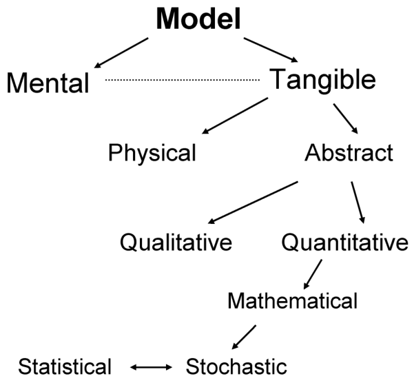
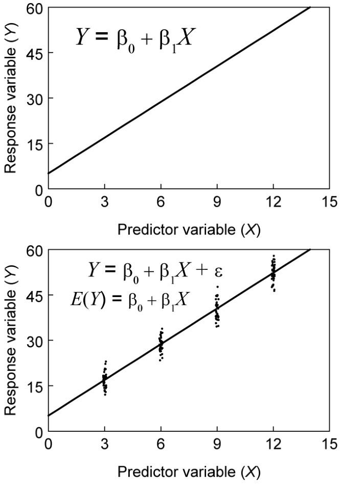
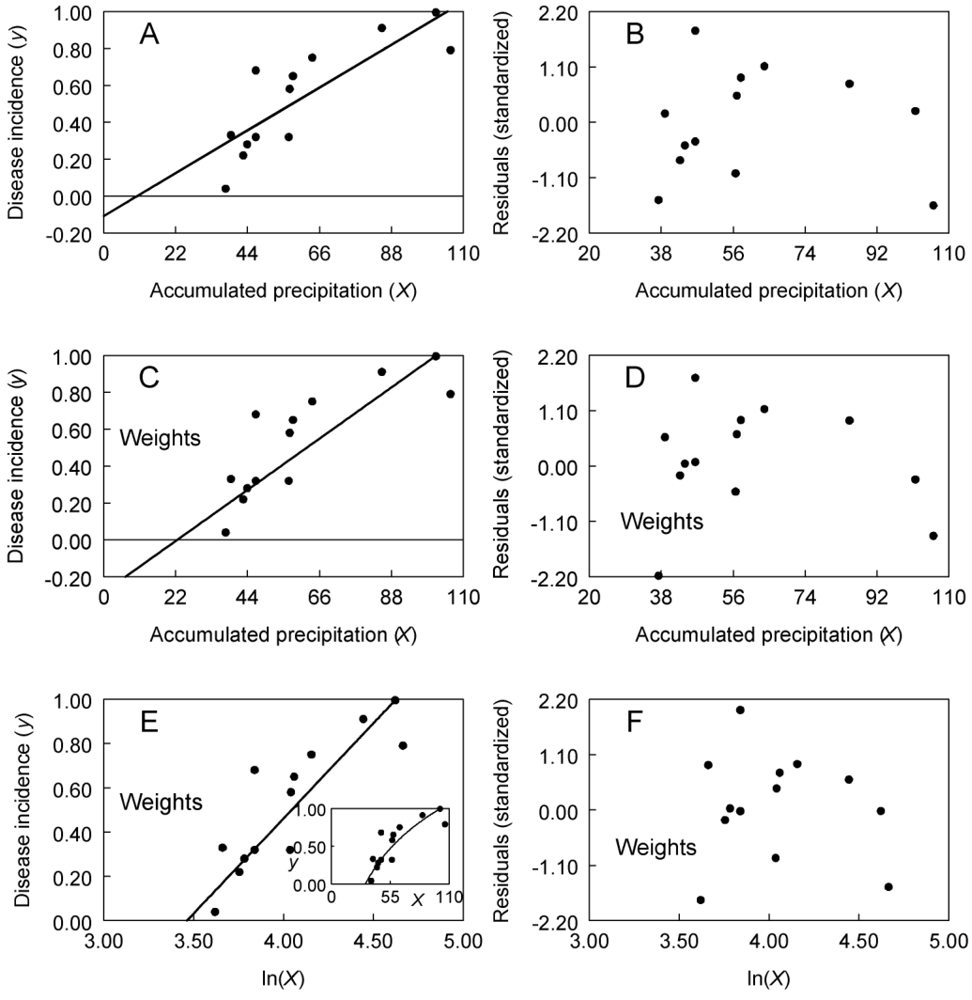
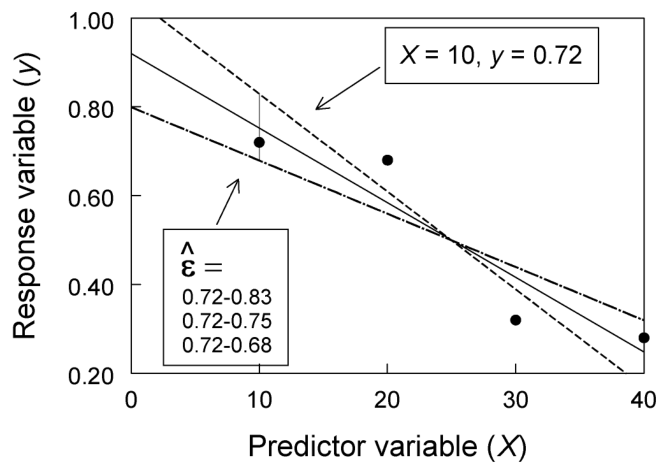
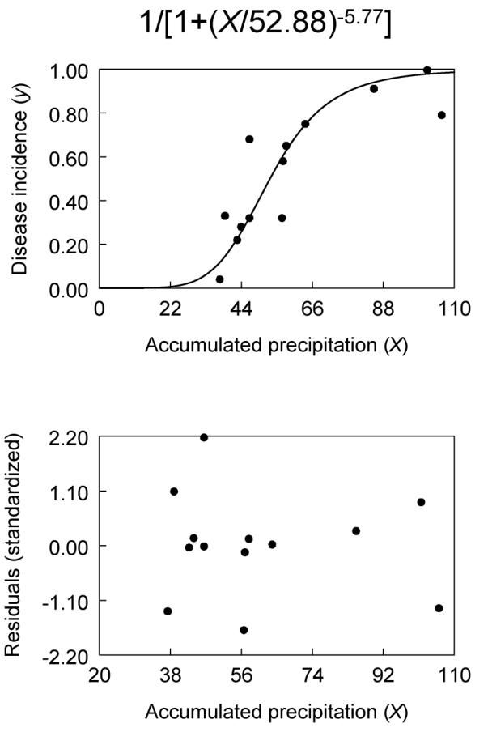
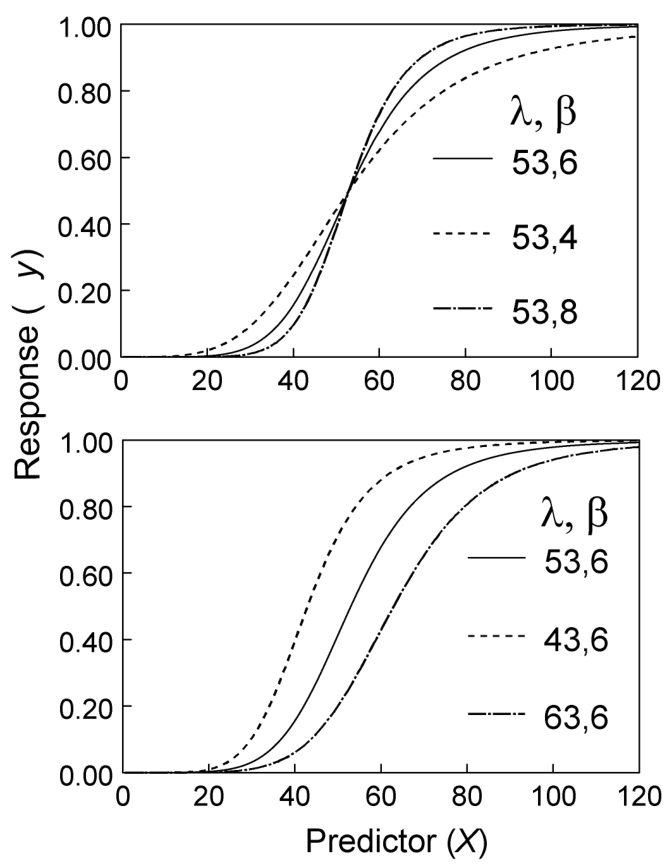
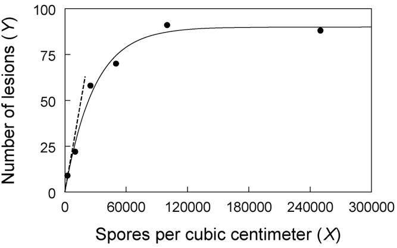
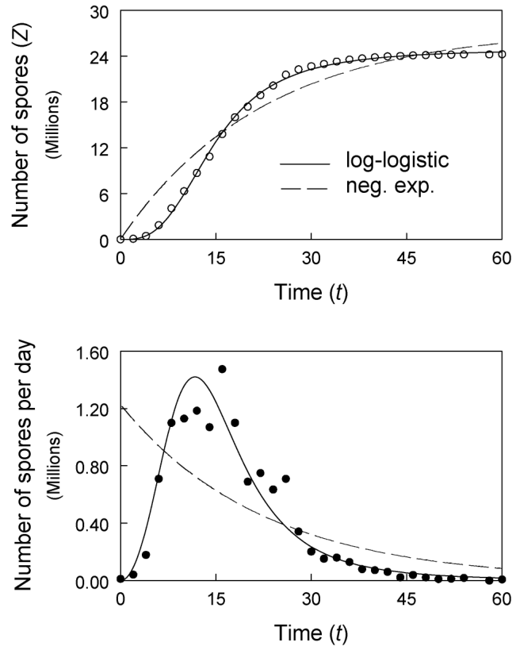
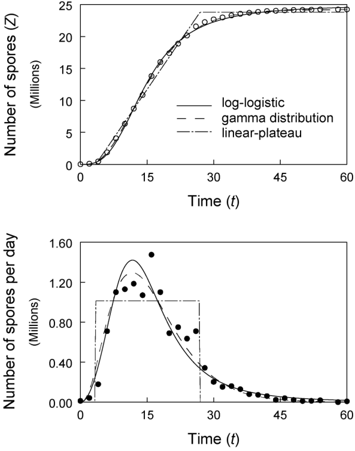

# พื้นฐานการสร้างแบบจำลองเพื่อถอดรหัสการระบาด (Modeling Concepts & Data Fitting) {#sec-modeling-concepts}

> *"อย่ากังวลกับความยากลำบากในวิชาคณิตศาสตร์ของคุณเลย ผมขอรับรองว่าปัญหาคณิตศาสตร์ของผมนั้นหนักหนาสาหัสกว่าของคุณเยอะ"*
> — อัลเบิร์ต ไอน์สไตน์ (Albert Einstein)

---

## 3.1 บทนำ (Introduction)

การระบาดของโรคพืช คือเรื่องราวของการเปลี่ยนแปลง "ความเข้มข้นของโรค" ในประชากรพืชอาศัย ทั้งในมิติของเวลาและพื้นที่ หากประชากรพืชที่เราสนใจมีขนาดเล็กจิ๋ว เราอาจจะเดินลงแปลงแล้วก้มวัดปริมาณโรค (และตัวแปรอื่น ๆ) จากพืชทุก ๆ ต้นได้อย่างครบถ้วน

ทว่าในความเป็นจริง ต่อให้เรามีชุดข้อมูลโรคที่สมบูรณ์แบบขนาดไหน กองตัวเลขมหาศาลเหล่านั้นก็ไม่ได้ช่วยให้เรา "ปิ๊งไอเดีย" เข้าใจกลไกการระบาด หรือช่วยให้เราเล่าผลลัพธ์ให้คนอื่นฟังได้ง่ายขึ้นเลยแม้แต่น้อย

ด้วยเหตุนี้ เราจึงต้องพึ่งพา **แบบจำลอง (Models)** (ซึ่งจะนิยามอย่างละเอียดต่อไป) เพื่อทำหน้าที่ "สรุปรวบยอด" ลักษณะเด่นจากข้อมูลกองโต แบบจำลองจะทำหน้าที่บีบอัดจุดข้อมูลยิบย่อยนับไม่ถ้วน ให้เหลือเพียง **"พารามิเตอร์ของโมเดล (Model terms)"** เพียงไม่กี่ตัว ซึ่งช่วยให้เรามองเห็นภาพรวม เข้าใจปรากฏการณ์ที่กำลังศึกษาได้ลึกซึ้งขึ้น และสื่อสารความเข้าใจนั้นให้โลกรับรู้ได้ง่ายกว่าเดิมอย่างเทียบไม่ติด

ความจริงก็คือ ประชากรพืชที่นักระบาดวิทยาสนใจศึกษา แทบจะไม่เคยเป็นประชากรขนาดเล็กเลย ต่อให้เราจะศึกษาการระบาดในแปลงทดลองเล็ก ๆ ที่เราสามารถนับแผลบนใบได้ทุกใบ เป้าหมายที่แท้จริงของเราคือกลุ่มประชากรที่ใหญ่กว่านั้นมาก เช่น พืชสายพันธุ์เดียวกันที่ปลูกในไร่นาเชิงพาณิชย์นับหมื่นไร่ ซึ่งมีสภาพแวดล้อมคล้ายคลึงกับแปลงทดลองของเรา

พูดง่าย ๆ คือ นักวิจัยมักต้องการนำผลลัพธ์จากข้อมูลชุดเล็ก ๆ ไปประยุกต์ใช้กับประชากรกลุ่มใหญ่ที่เราไม่มีทางลงไปสำรวจได้หมด ดังนั้น **เราจึงต้องการแบบจำลอง** เพื่อเป็นสะพานเชื่อมให้เราสามารถ "อนุมาน (Inference)" พฤติกรรมของประชากรกลุ่มใหญ่ได้ โดยอาศัยข้อมูลเชิงลึกที่มีอยู่อย่างจำกัดนั่นเอง

ระบาดวิทยาคือศาสตร์แห่งการแกะรอย "ความสัมพันธ์" ในระดับประชากร ความสัมพันธ์ระดับรากฐานที่สุดคือ **ความเข้มข้นของโรค ($y$ หรือ $Y$) กับเวลา ($t$)** ซึ่งเมื่อนำมาวาดกราฟ เราจะรู้จักกันในชื่อ **กราฟการพัฒนาของโรค (Disease progress curve)** (ดูภาพ 1.1) ส่วนความสัมพันธ์อื่น ๆ ก็เช่น ความเข้มข้นของโรคเทียบกับระยะห่างจากแหล่งกำเนิดเชื้อ (ความลาดชันของโรค หรือ Disease gradient) หรือการสูญเสียผลผลิตเทียบกับความเข้มข้นโรคเฉลี่ยในแปลง แบบจำลองหลากหลายรูปแบบจะช่วยให้เราดักจับ "แก่นสาร" ของความสัมพันธ์เหล่านี้ให้อยู่ในรูปทรงที่เรียบง่ายและทรงประสิทธิภาพ ช่วยให้การทำความเข้าใจและเปรียบเทียบการระบาดแต่ละครั้งเป็นเรื่องง่ายดาย

โลกของแบบจำลองนั้นกว้างใหญ่ มีหลากหลายรูปแบบและมีชื่อเรียกสารพัด ในบทนี้ เราจะเริ่มต้นด้วยการปูภาพรวมของการสร้างแบบจำลอง จากนั้นจะพาไปทำความรู้จักกับแบบจำลองยอดฮิตที่ใช้กันเป็นประจำในแวดวงระบาดวิทยาโรคพืช ซึ่งจะนำเราไปสู่หัวข้อสำคัญ นั่นคือ **การฟิตติ้งแบบจำลองเข้ากับชุดข้อมูล (Fitting models to data)** เราจะทบทวนแก่นสำคัญของการฟิตติ้งโมเดล โดยเน้นไปที่ระเบียบวิธีที่เรียกว่า **วิธีกำลังสองน้อยที่สุด (Least squares regression methods)**

บทนี้เขียนขึ้นมาโดยตั้งใจมอบให้กับผู้อ่านที่ยังไม่คุ้นเคยกับการสร้างแบบจำลองทางคณิตศาสตร์และสถิติในระบบชีววิทยามากนัก และแม้แต่ท่านที่ช่ำชองเรื่อง Analysis of Variance (ANOVA) และการถดถอยเชิงเส้น (Linear regression) มาอย่างโชกโชน ก็ยังจะได้ประโยชน์จากการอ่านเรื่อง **แบบจำลองไม่เป็นเส้นตรง (Nonlinear models)** เพราะเนื้อหาส่วนนี้มักไม่ค่อยมีสอนในวิชาสถิติขั้นพื้นฐาน

เมื่ออ่านบทนี้จบ คุณจะคุ้นเคยกับภาษาของโมเดลและการฟิตติ้งมากขึ้น และหวังว่าจะทำให้คุณสนุกไปกับการคำนวณเชิงปริมาณของการระบาดในบทต่อ ๆ ไปได้เต็มอิ่มยิ่งขึ้น ท้ายที่สุด คุณจะสามารถนำแบบจำลองบางประเภทไปฟิตติ้งกับชุดข้อมูลจริง และตีความผลลัพธ์ที่ได้ออกมาได้อย่างมั่นใจ
<!-- Modeling Concepts & Data Fitting -->

## 3.2 แบบจำลอง (Models)

### 3.2.1 นิยามและการจำแนกประเภทเบื้องต้น (Definition and general classification)

แบบจำลองสามารถถูกนิยามและจัดกลุ่มได้หลายร้อยแปดวิธี ขึ้นอยู่กับมุมมองและประเภทของงานวิจัย แต่นิยามที่เข้าใจง่ายและใช้ประโยชน์ได้จริงที่สุดคือ: **"แบบจำลอง คือการทำให้ความเป็นจริงเรียบง่ายขึ้น (A simplification of reality)"** (Edminster, 1978) หรือถ้านิยามให้ยาวและรัดกุมขึ้นอีกนิด ก็คือ *"การสะท้อนภาพนามธรรมของปรากฏการณ์หรือกระบวนการจริง โดยเน้นเฉพาะมิติที่ตอบโจทย์หรือเป็นประโยชน์ต่อผู้ใช้งาน"* (Schabenberger and Pierce, 2002)

เหตุผลที่เราต้องมีนิยามนี้ ก็เพราะ "ความเป็นจริง" บนโลกนั้นซับซ้อนเกินกว่าที่เราจะเข้าใจมันได้หมดจดทุกซอกทุกมุม ต่อให้เราบรรลุความเข้าใจอย่างสมบูรณ์แบบได้จริง เราก็คงไม่มีทางรู้ตัวว่าเราเข้าใจมันจนหมดเปลือกแล้ว "ความเป็นจริง" ในที่นี้อาจหมายถึงอะไรก็ได้ ตั้งแต่กลไกการเพิ่มจำนวนของไวรัสในเซลล์พืช ไปจนถึงพลวัตประชากรของการระบาดหลายโรคพร้อมกันในพื้นที่เกษตรเชิงพาณิชย์ขนาดใหญ่ระดับมหภาค

{#fig-model-classification}

ต่อให้เราจะสามารถบรรยายความซับซ้อนของธรรมชาติออกมาได้เป๊ะ ๆ คำบรรยายนั้นก็จะยืดยาวและยุ่งเหยิงเกินกว่าจะนำไปใช้งานได้จริง ดังนั้น การ "ทำเรื่องยากให้เป็นเรื่องง่าย" จึงเป็นสิ่งจำเป็นในการทำความเข้าใจและหาทางรับมือกับโรคระบาด

ด้วยความที่โมเดลคือการย่อส่วนความจริง George E. P. Box (1979) นักสถิติชื่อก้องโลกผู้คลุกคลีกับแบบจำลองมาทั้งชีวิต จึงได้ทิ้งประโยคทองที่คนมักหยิบยกมาอ้างอิงอยู่เสมอว่า:

> *"แบบจำลองทุกตัวล้วนผิดเพี้ยน แต่แบบจำลองบางตัวก็มีประโยชน์ (All models are wrong, but some are useful)"*

ความหมายก็คือ เมื่อความจริงมันซับซ้อนเกินกว่าจะมีโมเดลไหนเก็บรายละเอียดได้ครบ โมเดลทุกตัวย่อมมีความคลาดเคลื่อนหรือไม่สมบูรณ์แฝงอยู่เสมอ แต่นั่นไม่ได้แปลว่าโมเดลจะ "ใช้งานไม่ได้" ภายใต้ขอบเขตหรือจุดประสงค์ที่มันถูกสร้างขึ้น แบบจำลองถูกสร้างขึ้นมาด้วยเป้าหมายหลัก ๆ คือ: **การพรรณนา (Description), การทำความเข้าใจ (Understanding), การพยากรณ์ (Prediction), การเปรียบเทียบ (Comparison) และการสื่อสาร (Communication)** โมเดลหนึ่งตัวอาจเก่งแค่เรื่องเดียว หรืออาจจะครอบคลุมหลายเรื่องพร้อมกันก็ได้ (แต่น้อยนักที่จะเหมาหมดทุกข้อ)

สังเกตไหมว่า ในนิยามทั้งหมดข้างต้น ไม่มีคำว่า "สมการ" "ฟังก์ชัน" หรือ "สูตรคณิตศาสตร์" โผล่มาเลย! แต่ใครที่เคยอ่านงานวิจัยระบาดวิทยาย่อมรู้ดีว่า โมเดลการระบาดร้อยทั้งร้อยมาพร้อมกับสมการเสมอ นั่นก็เพราะโมเดลเหล่านั้นจัดเป็น "แบบจำลองชนิดพิเศษ"

เพื่อความกระจ่าง ลองมาดูระบบการจัดกลุ่มแบบจำลองของ Edminster (1978) ดังที่สรุปไว้ใน@fig-model-classification:
อันดับแรก โมเดลแบ่งออกเป็น **แบบจำลองในจินตนาการ (Mental models)** และ **แบบจำลองรูปธรรม (Tangible models)**

* **แบบจำลองในจินตนาการ:** คือภาพในหัวที่เราวาดขึ้นเพื่อรวบรวมความเป็นจริงอันยุ่งเหยิงให้กลายเป็นภาพที่สมองพอจะรับไหว ภาพเหล่านี้ย่อมแตกต่างกันไปตามประสบการณ์และการศึกษาของแต่ละคน เช่น ภาพการระบาดในหัวของนักระบาดวิทยาย่อมมีรายละเอียดซับซ้อนกว่าภาพในหัวของนักปฐพีวิทยาหรือคุณครูสอนหนังสือ
* **แบบจำลองรูปธรรม:** คือการนำภาพในหัวมา "ถ่ายทอด" ให้ออกมาเป็นสิ่งที่จับต้องหรือสื่อสารกับคนอื่นได้ เช่น การเขียนบรรยาย, วาดโฟลว์ชาร์ต หรือเขียนสมการ ซึ่งยังแบ่งย่อยลงไปได้อีก 2 สาย:
* **แบบจำลองทางกายภาพ (Physical model):** การสร้างสิ่งของขึ้นมาเป็นตัวแทน เช่น โมเดลรถยนต์พลาสติกจำลอง หรือถ้าในชีววิทยาก็คือ โมเดลเกลียวคู่ DNA ที่ต่อขึ้นจากเหล็กและลวดเพื่อใช้อธิบายโครงสร้าง
* **แบบจำลองนามธรรม (Abstract model):** การใช้สัญลักษณ์และกฎเกณฑ์มาอธิบายกระบวนการ ซึ่งถูกแบ่งออกเป็น 2 ประเภทสำคัญ คือ **เชิงคุณภาพ (Qualitative)** และ **เชิงปริมาณ (Quantitative)**

**แบบจำลองเชิงคุณภาพ (Qualitative model)** เป็นการอธิบายกลไกของความเป็นจริงโดยไม่ใช้สมการหรือคณิตศาสตร์เข้ามาเกี่ยวข้องเลย เช่น "วงจรการเกิดโรค (Disease cycle)" (Gäumann, 1946) ที่อธิบายขั้นตอนการติดเชื้อ หรือ "สามเหลี่ยมโรคพืช (Disease triangle)" (Francl, 2001) ที่อธิบายปัจจัยการเกิดโรค

ส่วน **แบบจำลองเชิงปริมาณ (Quantitative model)** หรือที่เรามักเรียกว่า **แบบจำลองทางคณิตศาสตร์ (Mathematical model/Function)** คือการใช้สัญลักษณ์และสมการคณิตศาสตร์มาอธิบายกลไกเหล่านั้น ตัวแปรในโมเดลอาจเป็นแบบต่อเนื่องหรือแบบไม่ต่อเนื่องก็ได้ (ย้อนดูบทที่ 2) ตัวอย่างเช่น แม้เราจะบันทึกผลว่าต้นพืช "เป็นโรค/ไม่เป็นโรค" (ตัวแปรทวิภาค) เราก็สามารถจับมาปั่นในโมเดลเพื่อคำนวณหา "ความน่าจะเป็นที่พืชจะติดโรค" ซึ่งออกมาเป็นตัวเลขต่อเนื่องตั้งแต่ 0 ถึง 1 ได้สบาย ๆ ในหนังสือเล่มนี้ เมื่อเราพูดถึงแบบจำลอง เราจะหมายถึงแบบจำลองทางคณิตศาสตร์แทบจะทั้งหมด

---

### 3.2.2 แบบจำลองเชิงปริมาณ (คณิตศาสตร์): แนวคิดพื้นฐาน (Quantitative models—some general concepts)

วิธีที่ง่ายที่สุดในการทำความเข้าใจเรื่องนี้ คือการวาดสมการคณิตศาสตร์ออกมาเป็น "กราฟ" ลองพิจารณากราฟกรอบบนของ **@fig-model-response-predictor** ซึ่งแสดงความสัมพันธ์ระหว่างตัวแปร 2 ตัว:

* $Y$ เรียกว่า **ตัวแปรตาม (Dependent/Response variable)**
* $X$ เรียกว่า **ตัวแปรอิสระ (Independent/Predictor variable)**

(ในหนังสือเล่มนี้ เรายังคงใช้ $Y$ พิมพ์ใหญ่แทนความเข้มข้นของโรคในหน่วยสัมบูรณ์ และ $y$ พิมพ์เล็กแทนสัดส่วน)

คำว่า "ตัวแปรตาม" และ "ตัวแปรทำนาย (Predictor)" มีที่มาจากแนวคิดที่ว่า ค่า $Y$ จะแปรผันตามค่า $X$ หรือเราสามารถเอาค่า $X$ มาทำนายค่า $Y$ ได้ (แม้ในความเป็นจริง ทั้งสองตัวอาจจะไม่ได้เป็นเหตุและผลกันโดยตรงก็ตาม) ยกตัวอย่างเช่น ถ้า $Y$ คือจำนวนสปอร์ต่อแผล และ $X$ คือขนาดพื้นที่แผล แบบจำลองเชิงปริมาณของความสัมพันธ์นี้อาจเขียนได้ว่า:

$$Y = \beta_0 + \beta_1X \quad \text{(สมการ 3.1)}$$

โดย $\beta_0$ และ $\beta_1$ คือ "ค่าคงที่"
กราฟกรอบบนใน@fig-model-response-predictor ก็คือหน้าตาของสมการ 3.1 นี้นี่เอง (ในกรณีที่ $\beta_1 > 0$)

* เมื่อ $X = 0$, ค่า $Y$ จะเท่ากับ $\beta_0$ ทันที ดังนั้น $\beta_0$ ก็คือ **จุดตัดแกน Y (Intercept)**
* $\beta_1$ คือขนาดของ $Y$ ที่เปลี่ยนไปเมื่อ $X$ ขยับไป 1 หน่วย (เช่น ถ้า $X$ เปลี่ยนจาก 6 เป็น 7, ค่า $Y$ จะเพิ่มขึ้นเท่ากับ $\beta_1$) หรือก็คือ **ความชัน (Slope)**
* ในทางสถิติ เมื่อเราไม่รู้ค่าคงที่เหล่านี้ล่วงหน้า แต่ต้องคำนวณหามาจากข้อมูลจริง เราจะเรียกพวกมันว่า **"พารามิเตอร์ (Parameters)"**

สมการ 3.1 ไม่ใช่วิธีเดียวในการอธิบายกราฟใน@fig-model-response-predictor หากเรานำสมการนี้มาหาอนุพันธ์อันดับหนึ่งของ $Y$ เทียบกับ $X$ ($dY/dX$) เราจะได้:

$$\frac{dY}{dX} = \beta_1 \quad \text{(สมการ 3.2)}$$

พูดง่าย ๆ คือ อัตราการเปลี่ยนแปลงของ $Y$ มีค่าคงที่ เท่ากับค่าพารามิเตอร์ $\beta_1$ พอดิบพอดี (หมายเหตุ: เราจะไม่สอนวิธีหาอนุพันธ์ในหนังสือเล่มนี้)

หรือถ้า $Y$ ไม่ได้เป็น "ผล" จาก $X$ ตรง ๆ แต่แค่แปรผันไปด้วยกัน เราก็สามารถสลับสมการให้ $X$ ขึ้นกับ $Y$ แทนได้:

$$X = \frac{-\beta_0}{\beta_1} + \frac{Y}{\beta_1} \quad \text{(สมการ 3.2a)}$$

{#fig-model-response-predictor}

สมการ 3.1 จัดเป็น **แบบจำลองกำหนดรู้ (Deterministic model)** หมายความว่า ถ้าเรารู้ค่า $X$ และรู้พารามิเตอร์ $\beta$ เราจะสามารถชี้ชัดค่า $Y$ ได้แบบเป๊ะ ๆ ไม่มีคลาดเคลื่อนแม้แต่มิลลิเมตรเดียว! (เช่น ถ้า $X=10$, $Y$ ต้องเท่ากับ $\beta_0 + 10\beta_1$ ห้ามเป็นค่าอื่นเด็ดขาด)

แต่เดี๋ยวก่อน! เราเพิ่งตกลงกันไปว่า "แบบจำลองคือการทำความจริงให้เรียบง่ายลง" ดังนั้น ในโลกความจริงย่อมเป็นไปไม่ได้เลยที่ตัวแปร $Y$ จะวิ่งตามเส้นตรงสมการ 3.1 ได้เป๊ะทุกจุด

ด้วยเหตุนี้ เราจึงต้องเปิดช่องว่างให้ตัวแปร $Y$ สามารถ "ดิ้น" หรือเบี่ยงเบนออกจากเส้นตรง $\beta_0 + \beta_1X$ ได้บ้าง ลองดูกราฟกรอบล่างใน@fig-model-response-predictor เส้นตรงยังคงเป็นเส้นเดิม แต่คราวนี้มีจุดข้อมูล 40 จุดกระจุกตัวกันอยู่ที่ $X$ 4 ตำแหน่ง (3, 6, 9 และ 12) โดยค่าเฉลี่ยของจุดแต่ละกระจุกจะตกอยู่บนเส้นตรงพอดีเป๊ะ

เพื่ออธิบายจุดทุกจุดบนกราฟนี้ เราต้องบวก **"ตัวแปรสุ่ม ($\varepsilon$)"** เพิ่มเข้าไปในสมการเดิม กลายเป็นสมการใหม่คือ:

$$Y = \beta_0 + \beta_1X + \varepsilon \quad \text{(สมการ 3.3a)}$$

ค่า $\varepsilon$ (Epsilon) ย่อมแตกต่างกันไปในแต่ละจุดสังเกต และเราไม่รู้ค่ามันล่วงหน้า เราสามารถมองว่า $\varepsilon$ คือ "แหล่งรวมอิทธิพลของปัจจัยอื่น ๆ ร้อยแปดประการ" ที่ส่งผลต่อ $Y$ แต่ไม่ได้ถูกรวมไว้ในโครงสร้างเส้นตรง $\beta_0 + \beta_1X$ หรือเรียกง่าย ๆ ว่ามันคือ **"ความแปรปรวนที่ไม่สามารถอธิบายได้ (Unexplained variation)"**

ในสมการมาตรฐานลักษณะนี้ เรามักตั้งสมมติฐานให้ตัวแปรสุ่ม $\varepsilon$ มี **ค่าเฉลี่ยเท่ากับ 0** และมีความแปรปรวนคงที่ ($\sigma^2$)
ในทางสถิติ ค่าเฉลี่ยของประชากรเรียกว่า "ค่าคาดหวัง (Expected value)" เขียนแทนด้วย $E(\cdot)$ ดังนั้นเราจึงเขียนได้ว่า $E(\varepsilon) = 0$ นอกจากนี้ยังมักสมมติให้แต่ละค่า $\varepsilon$ มีความเป็นอิสระต่อกัน (ไม่ส่งผลกระทบถึงกัน) และมีการแจกแจงแบบปกติ (Normal distribution) (ซึ่งจะอธิบายในหัวข้อถัดไป) แม้ในความเป็นจริงข้อมูลอาจไม่เป็นไปตามสมมติฐานเหล่านี้เป๊ะ ๆ แต่สถิติก็มีวิธีปรับแก้ให้เสมอ

เมื่อ $Y$ คือผลลัพธ์ที่รวมตัวแปรสุ่ม $\varepsilon$ เข้าไป ตัวแปร $Y$ จึงกลายเป็น "ตัวแปรสุ่ม" ตามไปด้วย สมการ 3.3a จึงถูกอัปเกรดให้กลายเป็น **แบบจำลองสุ่ม (Stochastic model)** (หรืออาจเรียกว่า แบบจำลองทางสถิติ (Statistical model) หากต้องมีการประมาณค่าพารามิเตอร์จากข้อมูลจริง)

ถ้ามองอีกมุมหนึ่ง $\varepsilon$ ก็คือ "ระยะห่าง" ระหว่างค่าที่วัดได้จริง กับค่าที่โมเดลเส้นตรงทำนายไว้ นั่นคือ $\varepsilon = Y - (\beta_0 + \beta_1X)$ บ่อยครั้งเราเรียก $\varepsilon$ ว่า **พจน์ความคลาดเคลื่อน (Error term)** ซึ่งคำว่า Error ในที่นี้ไม่ได้แปลว่า "ทำผิดพลาด" แต่แปลว่ามันมีความเบี่ยงเบนไปจากสิ่งที่โมเดลทำนายไว้ต่างหาก

เมื่อใช้ทฤษฎีทางสถิติหาค่าคาดหวัง (ค่าเฉลี่ย) ของตัวแปรสุ่ม $Y$ จะได้ว่า:

$$E(Y) = E(\beta_0 + \beta_1X + \varepsilon)$$

และเนื่องจากค่าคาดหวังของค่าคงที่ ก็คือตัวมันเอง และ $E(\varepsilon) = 0$ เราจึงลดรูปสมการได้เป็น:

$$E(Y) = \beta_0 + \beta_1X \quad \text{(สมการ 3.3b)}$$

พูดให้เข้าใจง่ายที่สุด แบบจำลองทางสถิติจะถูกมองว่า **"ทำนายได้ถูกต้องเมื่อมองในแง่ของค่าเฉลี่ย"** (ตราบใดที่เราตั้งสมการส่วนโครงสร้างหลักไว้ถูกต้อง)
เพื่อการเรียนรู้ เราอาจเขียนสมการ 3.3a เป็นสมการจำลองได้ว่า:

> **การตอบสนอง (Response) = ส่วนโครงสร้างที่เป็นระบบ + ส่วนความคลาดเคลื่อนแบบสุ่ม**
> หรือ **Response = (Structure) + (Error)**

ส่วนโครงสร้างอาจจะเป็นเส้นตรงง่าย ๆ อย่างในสมการ 3.3a หรืออาจจะเป็นสมการระบาดวิทยาที่ซับซ้อนหยดย้อยก็ได้

กลับมาดูกราฟสมการ 3.1 สมมติว่า $\beta_0 = 5$ และ $\beta_1 = 4$
ที่ $X = 9$, สมการเส้นตรงจะทำนายว่า $Y = 5 + (4 \times 9) = 41$
แต่จุดบนกราฟจริง ๆ ที่ $X = 9$ ไม่ได้มีค่า 41 ทุกจุด สมมติว่ามีจุดหนึ่งโด่งขึ้นไปถึง 47 แปลว่าจุดนี้มีค่าความคลาดเคลื่อน $\varepsilon = 47 - 41 = 6$ เราจึงสามารถเขียนสมการเฉพาะสำหรับจุดนี้ได้ว่า $47 = 5 + (4 \times 9) + 6$

เพื่อไม่ให้สับสนเวลาจดบันทึกค่าของแต่ละจุดสังเกต เราจึงมักห้อยตัวห้อย ($j$) ไว้ที่ตัวแปรที่สามารถเปลี่ยนค่าได้ในแต่ละครั้ง กลายเป็น:

$$Y_j = \beta_0 + \beta_1X_j + \varepsilon_j \quad \text{(สมการ 3.3c)}$$

โดยถ้ามีข้อมูลทั้งหมด $N$ จุด $j$ ก็จะไล่ไปตั้งแต่ 1 ถึง $N$

---

### 3.2.3 การแจกแจงความน่าจะเป็น (Probability distributions)

ตัวแปรสุ่มทุกตัวย่อมมี "การแจกแจงความน่าจะเป็น" ซ่อนอยู่เสมอ แม้ว่าเราจะยังไม่รู้ว่ามันหน้าตาเป็นอย่างไรก็ตาม

* **สำหรับข้อมูลไม่ต่อเนื่อง (Discrete data)** (เช่น จำนวนสปอร์บนแผล): การแจกแจงนี้คือสมการที่บอกโอกาส (ความน่าจะเป็น) ที่จะได้ตัวเลขจำนวนเต็มแต่ละค่าออกมา (โอกาสที่จะเจอ 0 สปอร์, 1 สปอร์ ฯลฯ) ซึ่งมักเรียกว่า *Probability mass function* (คุณสมบัติของมันจะถูกใช้เยอะมากในบทที่ 9 และ 10 เราจึงขอข้ามไปก่อน)
* **สำหรับข้อมูลต่อเนื่อง (Continuous data)**: เนื่องจากค่าที่เป็นไปได้มีนับไม่ถ้วนจนไม่สามารถจับคู่หาความน่าจะเป็นของ "ตัวเลขเป๊ะ ๆ" ได้ การแจกแจงจึงเปลี่ยนไปบอกโอกาสที่ค่าจะตกอยู่ใน "ช่วง (Range)" ใดช่วงหนึ่งแทน เรียกว่า *Probability density function*

ในงานวิเคราะห์ข้อมูล เรามักจะสมมติให้ตัวแปรสุ่มมี **การแจกแจงแบบปกติ (Normal distribution)** หรือทรงระฆังคว่ำคุ้นตา ซึ่งมีสมการฟังก์ชันความหนาแน่นความน่าจะเป็นคือ:

$$f(Y) = \frac{1}{\sigma\sqrt{2\pi}} \exp \left[ -\frac{1}{2} \left( \frac{Y - \mu}{\sigma} \right)^2 \right] \quad \text{(สมการ 3.4)}$$

โดย:

* $\mu$ คือ ค่าเฉลี่ยของ $Y$ [$\mu = E(Y)$]
* $\sigma^2$ คือ ความแปรปรวนของ $Y$ ($\sigma$ คือส่วนเบี่ยงเบนมาตรฐาน)
* $\exp[\cdot]$ คือ ค่า $e$ (ฐานของลอการิทึมธรรมชาติ $e \approx 2.718...$) ยกกำลังด้วยก้อนในวงเล็บ

ที่น่าสนใจคือ สมการ 3.4 นี้ก็ถือเป็น **แบบจำลองสุ่ม (Stochastic model)** ชนิดหนึ่งด้วยเช่นกัน เพราะมันอธิบายความแปรปรวนของข้อมูลผ่านความน่าจะเป็น ซึ่งนอกจากจะมีประโยชน์ล้นเหลือในการฟิตติ้งโมเดลแล้ว ยังถูกนำไปใช้จำลองสถานการณ์ทางชีววิทยา (Simulation) ได้อย่างกว้างขวางอีกด้วย (Renshaw, 1991)

---

### 3.2.4 แบบจำลองนี้ "เป็นเส้นตรง" หรือไม่? (Is the model linear?)

คุณสมบัติที่สำคัญที่สุดอย่างหนึ่งของโมเดลคือ **ความเป็นเส้นตรง (Linearity)** (หรือความไม่เป็นเส้นตรง (Nonlinearity) ซึ่งมักน่าสนใจกว่า) เรื่องนี้อาจฟังดูปวดหัวสำหรับคนที่ไม่ถนัดคณิตศาสตร์ เพื่อให้เห็นภาพง่าย เราจะพิจารณาเฉพาะแบบจำลองกำหนดรู้ (Deterministic model) เป็นหลัก

เวลาเจอโมเดล เราสามารถตั้งคำถามได้ 2 ข้อ:

1. โมเดลนี้ **เป็นเส้นตรงเมื่อเทียบกับ "ตัวแปร (Variables)"** หรือไม่?
2. โมเดลนี้ **เป็นเส้นตรงเมื่อเทียบกับ "พารามิเตอร์ (Parameters)"** หรือไม่?

**1. เป็นเส้นตรงเทียบกับตัวแปร (Linear in the variables):**
โมเดลจะเป็นเส้นตรงในแง่นี้ ก็ต่อเมื่อไม่มีตัวแปรฝั่งขวาถูกจับยกกำลัง, ใส่ฟังก์ชันแปลงร่าง หรือคูณ/หารกันเอง

* $Y = \beta_0 + \beta_1X$ 👉 **เป็นเส้นตรง**
* $Y = \beta_0 + \beta_1X^3$ 👉 **ไม่เป็นเส้นตรง** (เพราะ $X$ โดนยกกำลัง 3) (แต่ถ้าเราเปลี่ยนชื่อให้ $X^3$ เป็นตัวแปรใหม่ชื่อ $X^*$ สมมติฐานความเป็นเส้นตรงก็จะกลับมาทันที)
* $Y = \beta_0 + \beta_1X_1 + \beta_2X_2$ 👉 **เป็นเส้นตรง** (ตัวแปร 2 ตัวบวกกัน)
* $Y = \beta_0 + \beta_1(X_1 \cdot X_2)$ หรือ $Y = \beta_0 + \beta_1(\frac{X_1}{X_2})$ 👉 **ไม่เป็นเส้นตรง** (เพราะจับตัวแปรมาคูณ/หารกันเอง)

สำหรับโมเดล 1 ตัวแปร หากหาอนุพันธ์ของ $Y$ เทียบกับ $X$ แล้วผลลัพธ์ที่ได้ "ไม่มี $X$ หลงเหลืออยู่เลย" แปลว่าโมเดลนั้นเป็นเส้นตรงเมื่อเทียบกับตัวแปร (เช่น สมการ 3.2)

**2. เป็นเส้นตรงเทียบกับพารามิเตอร์ (Linear in the parameters) — *สำคัญที่สุด!***
ในการทำงานกับโมเดล โดยเฉพาะขั้นตอนการประมาณค่าพารามิเตอร์ (ดูหัวข้อ 3.4) เราแทบจะไม่สนเลยว่าโมเดลจะเป็นเส้นตรงกับตัวแปรหรือไม่ **สิ่งที่เราแคร์ที่สุดคือ โมเดลเป็นเส้นตรงกับ "พารามิเตอร์" หรือไม่!**

โมเดลแบบนี้จะต้องเขียนให้อยู่ในรูปของการเอาพารามิเตอร์ไปคูณกับตัวแปร แล้วจับมา "บวกกัน" เป็นทอด ๆ ได้เสมอ (Summation of terms) เช่น:

* $Y = \beta_0 + \beta_1X$ 👉 **เป็นเส้นตรง**
* $Y = \beta_0 + \beta_1X_1 + \beta_2X_2$ 👉 **เป็นเส้นตรง**
* $Y = \beta_0 + \beta_1X + \beta_2X^2 + \beta_3X^3$ 👉 **เป็นเส้นตรง** (แม้ตัวแปรจะยกกำลัง แต่พารามิเตอร์ไม่ได้โดนทำอะไร แค่บวกกันไปเรื่อย ๆ)
* $Y = \beta_0 + \beta_1\ln(X+1)$ 👉 **เป็นเส้นตรง**

ซึ่งสามารถเขียนเป็นสมการรูปทั่วไปได้ว่า:

$$Y = \beta_0 + \beta_1X_1 + \beta_2X_2 + ... + \beta_KX_K \quad \text{(สมการ 3.5e)}$$

(ถ้าเป็นสายคณิตศาสตร์ นิยามก็คือ เมื่อนำไปหาอนุพันธ์ย่อย (Partial derivative) เทียบกับพารามิเตอร์แต่ละตัว ผลลัพธ์ที่ได้จะต้อง "ไม่มีพารามิเตอร์ตัวนั้นเหลืออยู่เลย")

**แล้วโมเดลที่ "ไม่เป็นเส้นตรงเมื่อเทียบกับพารามิเตอร์ (Nonlinear in the parameters)" หน้าตาเป็นอย่างไร?**
คือโมเดลที่ไม่สามารถเขียนแยกก้อนให้บวกกันเรียงแถวตามสมการ 3.5e ได้ เช่น พารามิเตอร์หนีไปอยู่บนเลขชี้กำลัง, มุดเข้าไปอยู่ในฟังก์ชันร่วมกับตัวแปร, หรือพารามิเตอร์คูณ/หารกันเอง ตัวอย่างเช่น (ใช้ตัวอักษรกรีกแทนพารามิเตอร์):

* $Y = \alpha \exp(\beta X)$ 👉 **ไม่เป็นเส้นตรง** (พารามิเตอร์ $\beta$ หนีไปอยู่บนเลขชี้กำลัง)
* $Y = \ln(X - \delta)$ 👉 **ไม่เป็นเส้นตรง** (พารามิเตอร์ $\delta$ มุดอยู่ใน $\ln$)
* $Y = 1 - \exp(- \left[ \frac{X - \delta}{\beta} \right]^\gamma)$ 👉 **ไม่เป็นเส้นตรงอย่างรุนแรง** (Weibull function)

แต่เดี๋ยวก่อน ลองดูสมการนี้:

* $Y = \beta_0 + (\frac{\beta_1}{\beta_2})X$
มันดูเหมือนจะไม่เป็นเส้นตรงเพราะมีพารามิเตอร์หารกันเอง แต่เนื่องจากค่าคงที่หารค่าคงที่ ย่อมได้ค่าคงที่ตัวใหม่ (สมมติให้ชื่อ $\gamma$) สมการนี้จึงลดรูปกลายเป็น $Y = \beta_0 + \gamma X$ ซึ่งกลับมา **เป็นเส้นตรง** หน้าตาเฉย!

ความเป็นเส้นตรงของพารามิเตอร์นี้ มีอิทธิพลต่อความยากง่ายในการประเมินค่าอย่างมหาศาล (โมเดลเส้นตรงคิดง่ายกว่าล้านเท่า)

**การแปลงร่างให้กลายเป็นเส้นตรง (Linearization)**
โมเดลที่ไม่เป็นเส้นตรงบางตัว มีความสามารถพิเศษในการแปลงร่างกลับมาเป็นเส้นตรงได้ด้วยพีชคณิตเบื้องต้น เช่น สมการการเติบโตแบบเอ็กซ์โพเนนเชียล:
$$ Y = \alpha \exp(\beta X) $$
ถ้าเราจับใส่ $\ln$ เข้าไปทั้งสองข้าง จะได้:
$$ \ln(Y) = \ln(\alpha) + \beta X $$
ซึ่งถ้าเราให้ $\ln(Y)$ คือตัวแปรใหม่ชื่อ $Y^*$ และ $\ln(\alpha)$ คือค่าคงที่ใหม่ชื่อ $\alpha^*$ สมการนี้จะกลายเป็นเส้นตรงสมบูรณ์แบบ:
$$ Y^* = \alpha^* + \beta X \quad \text{(สมการ 3.7)} $$
โมเดลที่แปลงร่างได้แบบนี้เรียกว่า **Intrinsically linear**

แต่น่าเสียดายที่โมเดลส่วนใหญ่ในธรรมชาตินั้นดื้อด้าน และไม่สามารถแปลงร่างเป็นเส้นตรงได้ เช่น ฟังก์ชัน Weibull ($Y = 1 - \exp(- \left[ \frac{X - \delta}{\beta} \right]^\gamma)$) แม้เราจะพยายามใส่ $\ln$ ดึงไปดึงมาจนได้:
$$ \ln(-\ln(1-Y)) = -\gamma \ln(\beta) + \gamma \ln(X-\delta) $$
แต่มันก็ยังไม่เป็นเส้นตรงอยู่ดี เพราะพารามิเตอร์ $\delta$ ฝังตัวแน่นหนึบอยู่ใน $\ln$ รวมกับตัวแปร $X$ จนแยกไม่ออก (เว้นเสียแต่ว่าเราจะรู้ค่า $\delta$ ล่วงหน้าจนมันกลายเป็นตัวเลขธรรมดาไปแล้ว) การหาวิธีจำแลงกายโมเดลเหล่านี้เป็นศิลปะแขนงหนึ่ง ซึ่งเราจะได้เห็นตัวอย่างกันอีกครั้งในหัวข้อ 3.5.2
<!-- ทำไมต้องใช้สมการคณิตศาสตร์และสถิติอธิบายความสัมพันธ์ของโรค -->
## 3.3 วิธีการพัฒนาแบบจำลอง (Methods of Model Development)

เราสามารถสร้างแบบจำลองเพื่ออธิบายกระบวนการทางชีววิทยาหรือปรากฏการณ์อื่น ๆ ได้หลากหลายวิธี ซึ่งวิธีการสร้างนี่แหละที่กลายเป็นเกณฑ์จัดกลุ่มแบบจำลองชั้นดีอีกแบบหนึ่ง ในหัวข้อนี้ เราจะเริ่มต้นด้วยการทำความรู้จักกับ 2 แนวทางหลักในการสร้างแบบจำลอง (ในเชิงอุดมคติ) ก่อนจะชี้ให้เห็นว่า ในโลกความเป็นจริง แบบจำลองส่วนใหญ่มักถูกสร้างขึ้นด้วยวิธีลูกผสมระหว่างทั้งสองแนวทางนี้

**แบบจำลองเชิงประจักษ์ (Empirical model)** คือโมเดลที่ถูกสร้างขึ้นมาเพื่อ "อธิบาย" สิ่งที่ตาเห็น ปรากฏการณ์ หรือความสัมพันธ์ระหว่างตัวแปรที่เก็บข้อมูลมาได้ โดยอาศัยหลักการทางสถิติเป็นเครื่องมือหลัก จุดเด่นคือ **มันไม่ได้สนใจทฤษฎีหรือกลไกทางชีววิทยาใด ๆ เลยว่าทำไมตัวแปรตามถึงมีความสัมพันธ์กับตัวแปรทำนายแบบนั้น** พูดง่าย ๆ คือ โมเดลเชิงประจักษ์เกิดมาเพื่อ "ฟิตติ้งให้เข้ากับจุดข้อมูลให้เนียนที่สุดเท่าที่จะทำได้" โดยละทิ้งคำถามที่ว่า อะไรคือกลไกระดับโมเลกุล ชีวเคมี หรือประชากรที่อยู่เบื้องหลังข้อมูลเหล่านั้น

ลองนึกภาพตามว่า ถ้าเรามีแค่จุดข้อมูลในกราฟกรอบล่างของ@fig-model-response-predictor วางอยู่ตรงหน้า โดยที่เราไม่รู้เบาะแสอะไรเลยว่ากลไกเบื้องหลังความสัมพันธ์ระหว่าง $Y$ กับ $X$ คืออะไร สัญชาตญาณแรกของเราย่อมเป็นการหยิบ "สมการเส้นตรง" (เช่น สมการ 3.1) มาขีดลากผ่านจุดเหล่านั้นเพื่อเป็นตัวแทนของข้อมูล ซึ่งสมการเส้นตรงนี้ก็คือตัวอย่างคลาสสิกของโมเดลเชิงประจักษ์นั่นเอง บางครั้งเราอาจเรียกโมเดลกลุ่มนี้ว่า แบบจำลองสหสัมพันธ์ (Correlative models) หรือ แบบจำลองเชิงพรรณนา (Descriptive models)

โมเดลเชิงประจักษ์มีประโยชน์อย่างมหาศาลในงานวิเคราะห์ข้อมูลเบื้องต้น เพื่อดูว่าตัวแปรสองตัว (หรือมากกว่า) มันเกี่ยวข้องกันไหม และใช้เปรียบเทียบผลลัพธ์จากการทดลอง (เช่น แปลงที่ฉีดกับไม่ฉีดยาฆ่าเชื้อรา) ได้ดีมาก นี่คือวิธีการสร้างโมเดลแบบมาตรฐานที่สอนกันในวิชาสถิติและวิเคราะห์ข้อมูลขั้นพื้นฐานแทบทุกแห่ง

สรุปขั้นตอนการสร้างแบบจำลองเชิงประจักษ์:

* **เก็บข้อมูล:** ลงพื้นที่สำรวจหรือจัดแปลงทดลอง เพื่อวัดความเข้มข้นของโรคและตัวแปรอื่น ๆ ที่สนใจ
* **สร้างโมเดลพรรณนา:** เลือกสมการง่าย ๆ (มักจะเป็นสมการเส้นตรง แต่ก็ไม่เสมอไป) มาอธิบายความสัมพันธ์ที่เห็น
* **ประเมินความแม่นยำ:** ทดสอบดูว่าเส้นกราฟที่ลากนั้นฟิตเข้ากับจุดข้อมูลได้ดีแค่ไหน (ดูหัวข้อ 3.4.2)
* **ปรับเปลี่ยนถ้ายังไม่ดีพอ:** ถ้าโมเดลเดิมยังฟิตไม่สวย ก็ลองเปลี่ยนไปใช้สมการเชิงประจักษ์ตัวอื่น (ดูหัวข้อ 3.4.5)
* **นำไปใช้งาน:** เมื่อได้โมเดลที่ฟิตเข้ากับข้อมูลจนน่าพอใจแล้ว ก็เอาไปใช้ทำนายค่า $Y$ ในอนาคต, เปรียบเทียบกรรมวิธีทดลอง หรือดูว่าตัวแปรไหนมีอิทธิพลต่อผลลัพธ์อย่างมีนัยสำคัญ

ในทางตรงกันข้าม **แบบจำลองเชิงกลไก (Mechanistic model)** จะเริ่มเดินจากอีกฝั่งหนึ่งของสะพาน นั่นคือ เริ่มต้นจาก "ทฤษฎี สมมติฐาน หรือคอนเซปต์" ว่าปรากฏการณ์ทางชีววิทยามันน่าจะทำงานอย่างไร **ข้อมูลจริงจะถูกเรียกมาดู "หลังจาก" สร้างโมเดลเสร็จแล้วเท่านั้น!**

สรุปขั้นตอนการสร้างแบบจำลองเชิงกลไก (เชิงปริมาณ):

* **แปลงทฤษฎีเป็นสมการ:** เขียนกลไกการทำงานที่คิดไว้ออกมาเป็นสัญลักษณ์คณิตศาสตร์
* **หาข้อมูลมาทดสอบ:** รวบรวมข้อมูลจริงจากการทดลองใหม่ การสำรวจ หรือจากงานวิจัยเก่า
* **ประเมินการฟิตติ้ง:** เอาสมการที่ตั้งไว้แต่แรก มาทาบลงบนจุดข้อมูลจริง
* **ถ้าไปรอด:** ถ้าโมเดลฟิตกับข้อมูลได้ดี (สอดคล้องกัน) ก็เอาโมเดลไปใช้งานตามเป้าหมายได้เลย
* **ถ้าพัง:** ถ้าเส้นกราฟวิ่งไปคนละทางกับจุดข้อมูล เราต้อง **"ปฏิเสธทฤษฎีตั้งต้น"** แล้วกลับไปนั่งทบทวนใหม่ว่า ทฤษฎีของเรามันผิดพลาดหรือตกหล่นกลไกอะไรไปบ้าง ซึ่งจะนำไปสู่การเขียนโมเดลเชิงกลไกตัวใหม่ขึ้นมาทดสอบอีกรอบ บางครั้งเราอาจเรียกโมเดลกลุ่มนี้ว่า แบบจำลองเชิงอธิบาย (Explanatory), แบบจำลองทางทฤษฎี (Theoretical) หรือแบบจำลองทางกายภาพ/ชีวภาพ (Physical/Biological models)

หลายคนมักถกเถียงและยกย่องว่า โมเดลเชิงกลไกนั้น "เหนือกว่า" โมเดลเชิงประจักษ์ (Diekmann and Heesterbeek, 2000; Waggoner, 1990) ด้วยเหตุผลหลายประการ เช่น ข้อมูลดิบที่เราเก็บมาเพื่อสร้างโมเดลเชิงประจักษ์มักมีข้อบกพร่องแฝงอยู่ อย่างที่เพิ่งคุยกันในบทที่แล้วว่า การวัดความรุนแรงของโรคด้วยสายตาไม่มีทางแม่นยำเป๊ะ 100% ต่อให้วัดได้แม่นยำจริง ข้อมูลที่เราเก็บมาก็เป็นเพียงเศษเสี้ยวเล็ก ๆ ของประชากรทั้งหมด ทำให้การคำนวณ "ค่าเฉลี่ย" ของโรคมีความคลาดเคลื่อนได้ง่าย ขึ้นอยู่กับรูปแบบการกระจายตัวของโรคและจำนวนตัวอย่าง (ดูบทที่ 9 และ 10) ยิ่งไปกว่านั้น จุดตายของโมเดลเชิงประจักษ์คือ **มันมักจะสอบตกอย่างสิ้นเชิงเมื่อต้องพยากรณ์ค่า $Y$ นอกขอบเขตของข้อมูล $X$ ที่ใช้สร้างโมเดล (Extrapolation)**

ในทางทฤษฎี ถ้าเราเข้าใจกลไกของปรากฏการณ์ใดปรากฏการณ์หนึ่งอย่างถ่องแท้ เราก็ควรจะสามารถเขียนโมเดลของมันออกมาได้ (แม้อาจจะถูกทำให้เรียบง่ายลงบ้าง) โดยไม่ต้องพึ่งการดูข้อมูลดิบเลย พันธุศาสตร์ประชากรและระบาดวิทยา ถือเป็นสองสาขาหลักในวิชาชีววิทยา (ไม่ใช่แค่โรคพืช) ที่ใช้โมเดลเชิงกลไกกันอย่างแพร่หลาย (Diekmann and Heesterbeek, 2000; Daley and Gani, 1999)

เรื่องน่าปวดหัวคือ สำหรับพลวัตประชากร โมเดลเชิงกลไกที่มีเหตุมีผลแทบทุกตัว มักจะหลีกเลี่ยงไม่ได้ที่จะต้องอยู่ในรูปของ **"แบบจำลองที่ไม่เป็นเส้นตรงเมื่อเทียบกับพารามิเตอร์ (Nonlinear in the parameters)"** ซึ่งจะกลายเป็นงานช้างทันทีเมื่อเราจำเป็นต้องประมาณค่าพารามิเตอร์บางตัวจากชุดข้อมูลจริง แม้ในหนังสือเล่มนี้จะมีการแทรกโมเดลเชิงกลไกอยู่ทั่วไป แต่เราจะไปเจาะลึกบทบาทของมันในการถอดรหัสการระบาดกันแบบเต็ม ๆ ในบทที่ 5 และ 8

**ความจริงในทางปฏิบัติ: โมเดลลูกผสม (Semi-empirical model)**

ในโลกของการทำงานจริง การพัฒนาแบบจำลองมักจะเป็นการผสมผสานระหว่างทั้งสองแนวทาง โมเดลที่คลอดออกมาแล้ว มักจะไม่ใช่ "ประจักษ์แท้ 100%" หรือ "กลไกแท้ 100%" เสมอไป ยกตัวอย่างเช่น ทฤษฎีที่ใช้สร้างโมเดลเชิงกลไก อาจจะตกผลึกมาจากการนั่งมองจุดข้อมูลและการรันโมเดลเชิงประจักษ์ในอดีตมาก่อน และท้ายที่สุด โมเดลเชิงกลไกก็หนีไม่พ้นต้องถูกนำมาทาบกับข้อมูลจริงเพื่อพิสูจน์ความถูกต้อง (ซึ่งก็คือหลักการของโมเดลเชิงประจักษ์นั่นเอง)

ดังนั้น ในวิชาระบาดวิทยา การสร้างโมเดลส่วนใหญ่จึงตั้งอยู่บนทางสายกลางนี้ ตัวอย่างเช่น ในบทหน้า เราจะหยิบโมเดลเชิงกลไกของ "กราฟการพัฒนาของโรค" มาให้ดูกันหลายรูปแบบ เพื่อนำไปใช้วิเคราะห์ประเมินกลยุทธ์ควบคุมโรคและเปรียบเทียบการระบาด โมเดลเหล่านี้ทุกตัวล้วนถูกประกอบร่างขึ้นมาจาก "หลักการทางชีววิทยาที่แข็งแกร่ง (Biologically sound premises)" (Cousens, 1985) ของพลวัตประชากรโรค โดยไม่ได้สนใจจุดข้อมูลเลยตอนที่คิดค้นขึ้นมา

แต่ปัญหาคือ จนกว่าเราจะนำมันไปเทียบกับข้อมูลจริงในแปลง เราจะไม่มีทางรู้เลยว่าโมเดลกลไกตัวไหนที่ "เข้าท่าและอธิบายสถานการณ์ตรงหน้าได้ดีที่สุด" จุดนี้แหละที่เราต้องหยิบ **"แนวทางเชิงประจักษ์"** กลับมาใช้ โดยเราจะคัดเลือกโมเดลกลไกที่เป็นตัวเต็งไม่กี่ตัว มาทาบฟิตติ้งกับจุดข้อมูลจริง ข้อสังเกตคือ เราไม่ได้สุ่มเลือกสมการอะไรก็ได้บนโลกที่ลากเส้นผ่านจุดได้สวย ๆ มาใช้ แต่เราเลือกเฉพาะสมการที่มีรากฐานทางชีววิทยารองรับเท่านั้น วิธีการสร้างโมเดลแบบนี้เรียกว่า **การสร้างแบบจำลองกึ่งประจักษ์ (Semi-empirical model building)** (Cousens, 1985) ซึ่งเป็นท่ามาตรฐานที่ใช้กันบ่อยที่สุดในระบาดวิทยาพฤกษศาสตร์

เพื่อเป็นการปิดท้ายหัวข้อนี้ เราขอทิ้งท้ายว่า การมานั่งเถียงกันคอเป็นเอ็นว่าโมเดลเชิงประจักษ์หรือเชิงกลไกใครดีกว่ากันนั้น เป็นเรื่องที่เสียเวลาเปล่า! แบบจำลองถูกสร้างมาหลายรูปแบบเพื่อตอบสนองเป้าหมายที่ต่างกัน คำถามที่แท้จริงที่เราควรถามคือ: รูปแบบโมเดลที่เราเลือกใช้นั้น **"ตอบโจทย์"** เป้าหมายการวิจัยของเราหรือไม่? และ (ในขั้นตอนการฟิตติ้ง) วิธีการฟิตติ้งสอดคล้องกับธรรมชาติของตัวแปรสุ่ม รูปแบบกลไกการเกิดโรค และวิธีการเก็บข้อมูลของเราหรือเปล่า?

ตลอดทั้งเล่มนี้ คุณจะได้พบกับแบบจำลองสารพัดรูปแบบ และวิธีฟิตติ้งที่หลากหลายตามไปด้วย เพราะนักโรคพืชศึกษาการระบาดด้วยเหตุผลร้อยแปดประการ คงไม่มีตำราคณิตศาสตร์หรือสถิติเล่มไหนในโลกที่จะรวบรวมโมเดลและวิธีวิเคราะห์ทั้งหมดที่เราใช้ไว้ในเล่มเดียวได้ ดังนั้น ในแต่ละหัวข้อ เราจะคอยชี้เป้าแนะนำหนังสือหรือบทความวิจัยเพิ่มเติม ให้คุณได้ตามไปเจาะลึกเบื้องหลังของแต่ละเรื่องได้อย่างจุใจ

<!-- Model fitting: จับคู่ข้อมูลที่วัดได้จากแปลงจริงกับแบบจำลองทางสถิติ -->
## 3.4 การฟิตติ้งแบบจำลองเชิงเส้นเข้ากับข้อมูล (Fitting of Linear Models to Data)

> *"ข้อมูล! ข้อมูล! ข้อมูล!" เชอร์ล็อก โฮมส์ ร้องตะโกนอย่างหมดความอดทน "ผมไม่สามารถปั้นอิฐโดยไม่มีดินเหนียวได้หรอกนะ!"*
> — เซอร์ อาร์เธอร์ โคนัน ดอยล์ (จากเรื่อง *"The Copper Beeches"*)

### 3.4.1 บทนำ (Introduction)

แม้ว่างานวิจัยระบาดวิทยาบางแขนงจะคลุกคลีกับข้อมูลแค่ในทางอ้อม แต่งานวิจัยเชิงปริมาณส่วนใหญ่นั้นหนีไม่พ้นที่จะต้องทำงานกับ **ข้อมูลจริง (Observed data)** ควบคู่ไปกับ **แบบจำลอง (Models)** ที่ใช้อธิบายข้อมูลเหล่านั้น (ในที่นี้ คำว่า "ข้อมูล" หมายถึงกลุ่มของผลการสังเกตหรือผลการวัดที่เก็บรวบรวมมาได้)

ไม่ว่าแบบจำลองจะถูกสร้างขึ้นมาเพื่อแค่พรรณนาข้อมูลคร่าว ๆ หรือสร้างจากทฤษฎีชีววิทยาที่สลับซับซ้อน ท้ายที่สุดแล้ว แบบจำลองทุกตัวย่อมต้องถูกนำมา **"ฟิตติ้ง (Fitted)"** หรือทาบเข้ากับข้อมูลจริงเสมอ ในหัวข้อนี้ เราจะมาทำความรู้จักกับเทคนิคมาตรฐานในการฟิตติ้งแบบจำลองเข้ากับข้อมูลกันแบบกระชับ (ส่วนเทคนิคอื่น ๆ ที่เฉพาะทางกว่านี้ จะแทรกอยู่ในบทต่อ ๆ ไปตามบริบทการใช้งาน)

เนื้อหาส่วนนี้ตั้งใจเขียนขึ้นเพื่อปูพื้นฐานให้กับผู้อ่านที่ยังไม่คุ้นเคยกับการฟิตติ้งแบบจำลองทางสถิติมากนัก เมื่ออ่านจบ คุณจะตามเนื้อหาในบทอื่น ๆ ได้ทัน และสามารถฟิตติ้งโมเดลเชิงเส้นพื้นฐานได้ด้วยตัวเอง แต่อย่างไรก็ตาม สำหรับผู้ที่ต้องการลุยงานวิจัยระบาดวิทยาอย่างจริงจัง คุณจำเป็นต้องศึกษาเรื่องนี้ให้ลึกซึ้งกว่าที่สรุปไว้ในบทนี้มาก ตำราสถิติชั้นยอดที่แนะนำให้ไปอ่านเพิ่มเติม (แม้จะไม่ได้เขียนมาเพื่อโรคพืชโดยตรง) ได้แก่ Collett (2003), Neter et al. (1983), Draper and Smith (1998) และที่แนะนำเป็นพิเศษคือ Schabenberger and Pierce (2002) เพราะเล่มนี้เจาะจงเฉพาะข้อมูลการเกษตร (พืชและดิน) ล้วน ๆ!

---

### 3.4.2 การถดถอยวิธีกำลังสองน้อยที่สุด: แนวคิดทั่วไป (Least squares regression—general concepts)

การฟิตติ้งแบบจำลองเข้ากับข้อมูล ในทางคณิตศาสตร์ก็คือการ **"ประมาณค่าพารามิเตอร์ (Estimating parameters)"** ในสมการ (เช่น สมการ 3.1) นั่นเอง วิธีการหาค่าพารามิเตอร์ที่ฮิตที่สุดมีอยู่ 2 วิธี คือ **วิธีกำลังสองน้อยที่สุด (Method of least squares)** และ **วิธีความควรจะเป็นสูงสุด (Method of maximum likelihood)** ซึ่งในบางเงื่อนไข ทั้งสองวิธีนี้จะให้ผลลัพธ์ออกมาเท่ากันเป๊ะ ในหัวข้อนี้ เราจะโฟกัสไปที่วิธีกำลังสองน้อยที่สุด และเน้นเฉพาะแบบจำลองที่พารามิเตอร์เป็นเส้นตรง (Linear in the parameters) ซึ่งเรามักเรียกวิธีนี้สั้น ๆ ว่า *การถดถอยกำลังสองน้อยที่สุดเชิงเส้น (Linear least squares)* หรือ *Ordinary least squares regression*

เพื่อให้เห็นภาพชัดเจน เราจะใช้ตัวอย่างจริงจากงานวิจัยโรคพืชมาอธิบาย Jeger and Lyda (1986) ได้ศึกษาความสัมพันธ์ระหว่าง การเกิดโรครากเน่าฝ้าย (ที่เกิดจากเชื้อ *Phymatotrichum omnivorum*) กับสภาพอากาศในรัฐเท็กซัส เป้าหมายคือการสร้างโมเดลพยากรณ์โรคจากข้อมูลสภาพแวดล้อมที่หาได้ง่าย ๆ พวกเขาเก็บข้อมูลการเกิดโรค (Incidence) ในแปลงทดลองทุกปี แล้วสร้างโมเดลเชิงประจักษ์เพื่อทำนายการเกิดโรคจากอุณหภูมิและปริมาณน้ำฝนสะสมตลอดฤดูปลูก

**@fig-model-cotton-scatter A** แสดงความสัมพันธ์ระหว่างการเกิดโรคตอนปลายฤดู ($y$) กับปริมาณน้ำฝนสะสม (หน่วยเซนติเมตร) จนถึงวันที่ 31 สิงหาคม ($X$) พร้อมทั้งลากเส้นแนวโน้ม (Best-fitting line) ผ่านจุดข้อมูล (ข้อมูลดิบดูได้ในภาคผนวกของบทนี้)

{#fig-model-cotton-scatter}

ข้อมูลการเกิดโรค (Incidence) เป็นตัวแปรไม่ต่อเนื่องประเภท **ตัวแปรนับจำนวนที่มีตัวหารตามธรรมชาติ** [คือจำนวนต้นที่เป็นโรค ($Y$) จากจำนวนทั้งหมด ($N$)] (ทบทวนบทที่ 2) ในที่นี้เราจะใช้ $y$ ตัวเล็กแทนสัดส่วนการเกิดโรค ($y = Y/N$) ซึ่งตามปกติ สถิติสำหรับตัวแปรไม่ต่อเนื่องจะมีวิธีฟิตติ้งเฉพาะตัวของมัน (Collett, 2003) แต่อย่างไรก็ตาม หากจำนวนตัวอย่าง ($N$) ที่ใช้สำรวจมีขนาดใหญ่พอ (เช่น $>30$) เราสามารถ "อนุโลม" ให้สัดส่วน $y$ เป็น **ตัวแปรสุ่มแบบต่อเนื่อง** และใช้การแจกแจงความน่าจะเป็นแบบต่อเนื่องมาจับได้เลย ซึ่งเป็นทางลัดที่นิยมใช้กันมาก และเราก็จะใช้วิธีนี้ในบทนี้ด้วย

เราจะมองว่า การเกิดโรค คือผลผลิตจาก 2 ส่วนรวมกัน: ส่วนที่เป็นฟังก์ชันคณิตศาสตร์ของปริมาณน้ำฝน ($X$) และส่วนที่เป็นความคลาดเคลื่อนแบบสุ่ม ($\varepsilon$) ที่มีการแจกแจงแบบปกติ สมมติให้ $g(X)$ คือหน้าตาของฟังก์ชันคณิตศาสตร์นั้น เราสามารถเขียนโมเดลสำหรับจุดข้อมูลที่ $j$ ได้ว่า:

$$y_j = g(X_j) + \varepsilon_j \quad \text{(สมการ 3.7a)}$$

เราตั้งสมมติฐานให้ $\varepsilon$ มีค่าเฉลี่ยเป็น 0 และมีความแปรปรวนคงที่ ($\sigma^2$) และแต่ละค่า $\varepsilon$ เป็นอิสระต่อกัน เมื่อหาค่าคาดหวัง (ค่าเฉลี่ย) ของสมการ 3.7a จะได้:

$$E(y_j) = g(X_j) \quad \text{(สมการ 3.7b)}$$

พูดง่าย ๆ คือ ฟังก์ชัน $g(X)$ ก็คือ **"ค่าเฉลี่ยที่คาดหวังของโรค"** ณ จุด $X_j$ นั่นเอง

หน้าตาของฟังก์ชัน $g(X)$ อาจมาจากทฤษฎีเชิงกลไก หรือมาจากการดูข้อมูล (เชิงประจักษ์) ก็ได้ ในที่นี้เราจะใช้แนวทางเชิงประจักษ์ แม้@fig-model-cotton-scatterA จะฟ้องชัดเจนว่าจุดข้อมูลไม่ได้เรียงเป็นเส้นตรง แต่เพื่อการเรียนรู้ เราจะลองฝืนเอาสมการเส้นตรง $\beta_0 + \beta_1X$ ไปแทนใน $g(X)$ ดูก่อน โมเดลจะกลายเป็น:

$$y_j = \beta_0 + \beta_1X_j + \varepsilon_j \quad \text{(สมการ 3.7c)}$$

หรือ

$$E(y_j) = \beta_0 + \beta_1X_j \quad \text{(สมการ 3.7d)}$$

แม้ว่าพารามิเตอร์ $\beta$ ในธรรมชาติจะเป็นค่าคงที่ที่ตายตัว แต่ **"ค่าประมาณการ (Estimates)"** ที่เราคำนวณได้จากข้อมูลกลับมีสถานะเป็นตัวแปรสุ่ม เพราะถ้าเราทำการทดลองนี้ซ้ำ 10 รอบ เราก็คงได้ตัวเลขประมาณการที่ไม่เท่ากันเลยสักรอบ

---

**หลักการของ Least Squares (กำลังสองน้อยที่สุด)**

หัวใจของการฟิตติ้งด้วยวิธีกำลังสองน้อยที่สุด คือการหาค่าพารามิเตอร์ที่ทำให้ **"ผลรวมของความแตกต่างกำลังสอง"** ระหว่างค่าจริง ($y_j$) กับค่าที่โมเดลทำนาย ($g(X_j)$) มีค่าน้อยที่สุดเท่าที่จะเป็นไปได้! เราให้ $S$ แทนผลรวมของกำลังสองนี้:

$$S = \sum (y_j - g(X_j))^2 \quad \text{(สมการ 3.9a)}$$

และถ้าฟังก์ชันเราคือสมการเส้นตรง (3.7c) ค่า $S$ ก็จะเท่ากับ:

$$S = \sum (y_j - \beta_0 - \beta_1X_j)^2 \quad \text{(สมการ 3.9b)}$$

การฟิตติ้งคือการพยายามหาคู่ตัวเลข $\beta_0$ และ $\beta_1$ ที่จับใส่ลงไปในสมการ 3.9b แล้วทำให้ตัวเลข $S$ ออกมา **"ต่ำที่สุด (Least squares)"** เพื่อแยกความแตกต่างระหว่างพารามิเตอร์จริงที่เราไม่รู้ กับพารามิเตอร์ที่เราประมาณค่ามาได้ เราจะใส่ "หมวก (Hat)" ไว้บนตัวแปรเสมอ (เช่น $\hat{\beta}_0, \hat{\beta}_1$)

เมื่อเราเอาพารามิเตอร์ติดหมวกกลับไปใส่ในสมการ เราจะได้ค่า $y$ ที่โมเดล **"ทำนาย (Predicted / Fitted value)"** ออกมา เขียนแทนด้วย $\hat{y}$:

$$\hat{y}_j = \hat{\beta}_0 + \hat{\beta}_1X_j \quad \text{(สมการ 3.7f)}$$

ส่วนต่างระหว่าง $y$ ของจริง กับ $\hat{y}$ ที่โมเดลทำนาย เราเรียกว่า **ค่าความคลาดเคลื่อนตกค้าง (Residual)** เขียนแทนด้วย $\hat{\varepsilon}_j$:

$$\hat{\varepsilon}_j = y_j - \hat{y}_j \quad \text{(สมการ 3.8)}$$

ในทางทฤษฎี เราอาจจะลองสุ่มตัวเลข $\beta_0$ กับ $\beta_1$ มาสักแสนคู่ ลองลากเส้นเป็นแสนเส้น แล้วดูว่าเส้นไหนให้ค่า $S$ ต่ำที่สุด (ดูภาพจำลองใน **@fig-model-ols-residuals** ที่ลองลากเส้น 3 เส้นเปรียบเทียบกัน โดยเส้นทึบคือเส้นที่ให้ค่าผลรวมกำลังสองน้อยที่สุด)

{#fig-model-ols-residuals}

แต่ในทางปฏิบัติ โชคดีที่คณิตศาสตร์แคลคูลัสได้พิสูจน์สูตรสำเร็จรูปมาให้เราแล้ว เราจึงไม่ต้องมานั่งเดาสุ่มลากเส้นเอง โปรแกรมสถิติทุกตัวบนโลกใช้สูตรนี้คำนวณหาจุดต่ำสุดให้เราได้ในเสี้ยววินาที เมื่อได้เส้นที่ดีที่สุดแล้ว ผลรวมของกำลังสอง (ค่า $S$ ที่ต่ำที่สุดนั้น) จะถูกตั้งชื่ออย่างเป็นทางการว่า **ผลรวมกำลังสองของความคลาดเคลื่อน (Sum of Squares for Error: SSE)** หรือ Residual Sum of Squares:

$$SSE = \sum (y_j - \hat{y}_j)^2 \quad \text{(สมการ 3.10a)}$$

สำหรับสมการเส้นตรง ก็คือ:

$$SSE = \sum (y_j - \hat{\beta}_0 - \hat{\beta}_1X_j)^2 \quad \text{(สมการ 3.10b)}$$

กลับมาที่ตัวอย่างโรครากเน่าฝ้าย เส้นตรงใน@fig-model-cotton-scatterA คือผลลัพธ์จากการรัน Least squares ซึ่งได้สมการออกมาว่า:

$$\hat{y}_j = -0.108 + 0.0105 X_j$$

นั่นคือ $\hat{\beta}_0 = -0.108$ และ $\hat{\beta}_1 = 0.0105$
ถ้าสมมติให้ปริมาณฝนสะสม $X = 60$ มม. โมเดลจะทำนายการเกิดโรคได้เท่ากับ $-0.108 + 0.0105(60) = 0.52$ (หรือ 52%)

เมื่อเอาค่าพารามิเตอร์นี้ไปคำนวณหา SSE จะได้ค่า $SSE = 0.33$
แต่ถ้าดูด้วยตาเปล่าจาก@fig-model-cotton-scatterA ก็รู้แล้วว่าเส้นตรงมันไม่ได้ฟิตกับจุดข้อมูลเลย! (ซึ่งเราจงใจเลือกตัวอย่างนี้มาเพื่อให้เห็นภาพ) ก่อนจะไปลองโมเดลตัวอื่น เรามาวิเคราะห์ผลลัพธ์และหาตัวชี้วัดความแม่นยำกันก่อน

ในสมการเส้นตรง พารามิเตอร์ความชัน ($\hat{\beta}_1 = 0.0105$) คืออัตราการเปลี่ยนของโรคเมื่อฝนเพิ่มขึ้น ส่วนจุดตัดแกน Y ($\hat{\beta}_0 = -0.108$) คือระดับของโรคที่คาดหวังเมื่อฝนสะสมเท่ากับ 0 อ้าว! แล้วทำไมโรคติดลบได้? นั่นเป็นเพราะในข้อมูลจริงเราไม่มีจุดไหนเลยที่ฝนตกน้อยกว่า 30 เซนติเมตร การลากเส้นถอยหลังกลับไปหาเลข 0 (Extrapolation) จึงให้ผลลัพธ์ที่ผิดเพี้ยนได้

ถ้าจะตีความให้เข้าท่า เราอาจคำนวณย้อนกลับว่า **ฝนต้องตกเท่าไร โรคถึงจะเริ่มเกิด ($y=0$)?** ซึ่งจะได้ค่า $\hat{X}_0 = 10.3$ เซนติเมตร (เป็น Threshold ของการเกิดโรค) แต่ก็ต้องระวังให้มาก เพราะค่า 10.3 นี้ก็ยังอยู่นอกขอบเขตของข้อมูลจริงที่เรามีอยู่ดี

---

**การประเมินความแม่นยำด้วย $R^2$**

ถ้าโมเดลเราเทพมาก ทายถูกเป๊ะทุกจุด ค่า SSE จะต้องเท่ากับ 0
ค่า SSE ที่มากกว่า 0 จึงเป็นตัวบอกว่าโมเดลเรายังมี "ส่วนที่อธิบายไม่ได้" หลงเหลืออยู่ แต่ปัญหาคือ ค่า SSE มันจะมากหรือน้อย ขึ้นอยู่กับหน่วยของข้อมูลด้วย (ถ้าโรคเป็นเปอร์เซ็นต์ SSE ก็จะค่านึง ถ้าโรคเป็นจำนวนสปอร์ SSE ก็อาจจะพุ่งปรี๊ด)

เราจึงต้องการ **"ตัวชี้วัดที่ไม่มีหน่วย"** เพื่อบอกว่าโมเดลฟิตดีแค่ไหน วิธีทำคือนำไปเทียบกับ "ความแปรปรวนตั้งต้น" ของข้อมูลทั้งหมดก่อนสร้างโมเดล ซึ่งเรียกว่า **ผลรวมกำลังสองทั้งหมด (Total Sum of Squares: SST)**:

$$SST = \sum (y_j - \bar{y})^2 \quad \text{(สมการ 3.11)}$$

ในเชิงคอนเซปต์ SST ก็คือค่า Error เมื่อเราใช้ฟังก์ชันปัญญาอ่อนที่สุดในการทำนาย นั่นคือการลาก "เส้นตรงแนวนอนที่ค่าเฉลี่ย ($\bar{y}$)" โดยไม่สนค่า $X$ เลยแม้แต่น้อย

สำหรับโมเดลเส้นตรง SSE จะน้อยกว่าหรือเท่ากับ SST เสมอ สัดส่วน $SSE/SST$ จึงบอกเราว่า **มีข้อมูลกี่เปอร์เซ็นต์ที่โมเดลของเรายังอธิบายไม่ได้** และถ้าเราเอาไปลบออกจาก 1 เราก็จะได้ **สัดส่วนของข้อมูลที่โมเดลอธิบายได้สำเร็จ!** ซึ่งตัวเลขทรงพลังตัวนี้ก็คือ **สัมประสิทธิ์การตัดสินใจ (Coefficient of determination: $R^2$)**:

$$R^2 = 1 - \frac{SSE}{SST} \quad \text{(สมการ 3.13)}$$

ค่า $R^2$ จะมีค่าตั้งแต่ 0 ถึง 1 (หรือ 0% ถึง 100%) เสมอ และไม่แคร์ว่าหน่วยของข้อมูลจะเป็นอะไร สำหรับตัวอย่างโรครากเน่าฝ้าย คำนวณ SST ได้ 1.043 ดังนั้น:

$$R^2 = 1 - \frac{0.33}{1.043} = 0.684 \quad \text{(สมการ 3.14)}$$

(หรืออธิบายข้อมูลได้ 68.4%)

---

### 3.4.3 การแจกแจงและสถิติอ้างอิง (Distributional results)

เรามักสมมติให้ตัวแปร $\varepsilon$ (และตัวแปร $y$) มีการแจกแจงแบบปกติ (Normal distribution) ซึ่งจะส่งผลให้พารามิเตอร์ที่ประเมินได้ ($\hat{\beta}$) และค่าทำนาย ($\hat{y}$) มีการแจกแจงแบบปกติไปด้วย

เราสามารถประมาณค่าความแปรปรวนของ $\varepsilon$ ได้ด้วย **ความคลาดเคลื่อนกำลังสองเฉลี่ย (Mean-Square Error: MSE)**:

$$MSE = \frac{SSE}{N - 2}$$

(เหตุที่ต้องหารด้วย $N-2$ เพราะในสมการเส้นตรงเราสูญเสียความอิสระ (Degrees of freedom) ไป 2 ค่าจากการหาพารามิเตอร์ $\beta_0$ และ $\beta_1$)

เมื่อถอดรากที่สองของความแปรปรวน เราจะได้ **ความคลาดเคลื่อนมาตรฐาน (Standard error)** ซึ่งนำไปใช้คำนวณ **ช่วงความเชื่อมั่น 95% (95% Confidence interval)** ของพารามิเตอร์ได้ ตัวอย่างเช่น ช่วงความเชื่อมั่นของความชัน ($\beta_1$) คำนวณได้จาก:

$$\hat{\beta}_1 \pm t_{\alpha/2, df} \times \hat{s}(\beta_1)$$

สำหรับตัวอย่างนี้ ช่วงความเชื่อมั่นของความชันคือ $[0.0057, 0.0153]$

การแปลความหมายง่าย ๆ คือ หากเราทำการทดลองนี้ซ้ำ ๆ นับครั้งไม่ถ้วน 95% ของช่วงความเชื่อมั่นที่เราคำนวณได้ จะครอบคลุมค่าความชันที่แท้จริงของธรรมชาติเอาไว้ และเนื่องจากช่วงนี้ **ไม่ครอบคลุมเลข 0** (ซึ่งหมายถึงการที่ $X$ ไม่มีผลต่อ $Y$) เราจึงสรุปทางสถิติได้ว่า "ปริมาณน้ำฝนมีอิทธิพลต่อการเกิดโรคอย่างมีนัยสำคัญ"

---

### 3.4.4 การประเมินและวิจารณ์แบบจำลอง (Model evaluation)

การจะใช้สถิติด้านบนได้อย่างสบายใจ มีเงื่อนไขข้อเดียวคือ **"โมเดลที่คุณตั้งไว้ต้องถูกต้องและเหมาะสมมาตั้งแต่แรก"**!
การตรวจสอบความถูกต้องนี้เรียกว่า การประเมินแบบจำลอง (Model evaluation) ซึ่งเครื่องมือที่ทรงพลังที่สุดคือการวิเคราะห์ **"ค่าตกค้าง (Residuals, $\hat{\varepsilon}_j$)"**

ถ้าโมเดลที่คุณเลือกคือคนที่ใช่ กราฟที่พล็อตระหว่าง Residual กับตัวแปร $X$ จะต้อง **กระจัดกระจายแบบสุ่ม (Random scatter)** ไม่มีแพทเทิร์นใด ๆ ให้จับทางได้ และเพื่อให้ดูง่าย เรามักจะแปลง Residual ให้เป็นค่ามาตรฐาน (Standardized residual) ซึ่งจะทำให้จุดส่วนใหญ่ตกอยู่ในช่วง –2 ถึง +2 ช่วยให้กวาดตามองหาจุดที่ผิดปกติ (Outliers) ได้ง่ายขึ้น

กลับไปดูภาพ **3.3B** (กราฟ Residual ของสมการเส้นตรงโรครากเน่า) จะเห็นชัดเจนว่าจุดข้อมูลไม่ได้กระจายแบบสุ่ม แต่วิ่งโค้งขึ้นเป็นภูเขา (เพิ่มขึ้นแล้วลดลง) แพทเทิร์นที่ชัดเจนแบบนี้ตะโกนบอกเราว่า **"สมการเส้นตรงผิดเผง! มีความโค้งซ่อนอยู่ในข้อมูลที่คุณยังอธิบายไม่ได้"**

**ปัญหาเรื่องความแปรปรวนไม่คงที่ (Weighted Least Squares)**

มีอีกปัญหาซ่อนอยู่ ข้อมูลโรครากเน่าคือ "สัดส่วน (Proportion)" ซึ่งตามทฤษฎีแล้ว (บท 9 และ 10) ความแปรปรวนของสัดส่วนจะ **ไม่คงที่** แต่จะแปรผันตามรูปพาราโบลา $y(1-y)$ (คือกว้างสุดที่สัดส่วน 50% และแคบลงเมื่อเข้าใกล้ 0 หรือ 100%)

เมื่อความแปรปรวนไม่เท่ากัน จุดข้อมูลที่ 50% ย่อมมีความแม่นยำต่ำกว่าจุดที่ 5% หรือ 95% เราจึงไม่ควรให้ "น้ำหนัก" จุดข้อมูลเหล่านี้เท่ากันหมด! วิธีแก้คือการถ่วงน้ำหนัก (Weights, $w_j$):

$$w_j = \frac{1}{y_j(1 - y_j)} \quad \text{(สมการ 3.15)}$$

แล้วเอาค่า $w_j$ นี้ไปคูณกับความคลาดเคลื่อนกำลังสองแต่ละก้อนในสมการ SSE ก่อนจะหาจุดต่ำสุด วิธีนี้เรียกว่า **Weighted Least Squares (การถดถอยแบบถ่วงน้ำหนัก)** ซึ่งจะให้ความสำคัญ (ดึงกราฟ) ไปหาจุดที่อยู่ใกล้ 0 หรือ 100% มากกว่าจุดตรงกลาง

ภาพ **3.3C** และ **3.3D** แสดงผลลัพธ์จากการรันแบบถ่วงน้ำหนัก ซึ่งได้เส้นกราฟที่ขยับจากเดิมเพียงเล็กน้อย และกราฟ Residual ก็ยังคงโค้งเป็นภูเขาเหมือนเดิม (เพราะปัญหาจริง ๆ ไม่ใช่เรื่องน้ำหนัก แต่คือเรื่องการเลือกสมการผิดตั้งแต่แรก!) แต่เราจะใช้วิธีถ่วงน้ำหนักนี้เป็นมาตรฐานในการวิเคราะห์โมเดลตัวต่อไป

---

### 3.4.5 การปรับแก้และแปลงร่างโมเดล (Model adjustments)

เมื่อสมการเส้นตรง ($Y = \beta_0 + \beta_1X$) ไปไม่รอด เราก็ต้องหาทางปรับแก้ ซึ่งสำหรับข้อมูลทางธรรมชาติที่ไม่ได้มีทฤษฎีบังคับตายตัว การขยับไปลองฟังก์ชันอื่นถือเป็นเรื่องปกติวิสัย

หากกราฟ $y$ กับ $X$ มีลักษณะ **โค้งงอแบบคว่ำลง (Concave)** (ความชันลดลงเมื่อ $X$ มากขึ้น) เหมือนข้อมูลฝ้ายของเรา ท่าไม้ตายที่นิยมที่สุดคือการ **แปลงร่างตัวแปร $X$ (Transformation of $X$)** โดยมักจับ $X$ ไปถอดรากที่สอง ($X^{1/2}$), หาค่าผกผัน ($1/X$), หรือที่ฮิตที่สุดคือการเข้าลอการิทึมธรรมชาติ ($\ln(X)$) (และเพื่อป้องกันการหาค่า $\ln(0)$ เรามักบวกค่าคงที่เล็ก ๆ เข้าไปก่อน เช่น $\ln(X+1)$)

ในที่นี้ เราจะลองแปลงโมเดลด้วย $\ln(X)$ จะได้สมการใหม่คือ:
$$ y_j = \beta_0 + \beta_1\ln(X_j) + \varepsilon_j \quad \text{(สมการ 3.17)} $$

สังเกตว่าสมการนี้ **ยังคงเป็นเชิงเส้นตรงกับพารามิเตอร์** (Linear in the parameters) เพราะมองง่าย ๆ เราแค่เปลี่ยนชื่อ $\ln(X_j)$ ให้เป็นตัวแปรใหม่ชื่อ $X^*$

ผลลัพธ์การฟิตติ้งแสดงใน **@fig-model-cotton-scatterE** (และกราฟ Residual 3.3F) ซึ่งดูสอดคล้องกับข้อมูลดีขึ้นมาก! ได้พารามิเตอร์ออกมาเป็น $\hat{\beta}_0 = -2.97$ และ $\hat{\beta}_1 = 0.858$
ค่า SSE ลดลงอย่างมีนัยสำคัญจาก 2.50 เหลือเพียง 1.72 และค่า $R^2$ ขยับขึ้นเป็น 0.942

แต่อย่าลืมว่า ตอนนี้ความชัน ($\beta_1$) คืออัตราการเปลี่ยนของโรคเมื่อเทียบกับ **$\ln(X)$** ไม่ใช่เทียบกับฝน $X$ แบบตรง ๆ อีกต่อไป (ดูภาพแทรกใน 3.3E จะเห็นว่าเส้นกราฟโค้งรับกับข้อมูลได้สวยงามเมื่อวาดบนสเกล $X$ ปกติ)
และที่สำคัญ จุดตัดแกน X (ฝนขั้นต่ำที่เริ่มเกิดโรค, $X_0$) คำนวณใหม่ได้เท่ากับ:
$$ \hat{X}_0 = \exp(2.97 / 0.858) = 31.9 \text{ เซนติเมตร} $$
ซึ่งค่า 31.9 นี้น่าเชื่อถือและใกล้เคียงกับขอบเขตข้อมูลจริงมากกว่าค่า 10.3 จากโมเดลเส้นตรงทื่อ ๆ แบบเดิมมาก

**ข้อพึงระวังขั้นสุดยอด:**
หากกราฟโค้งแบบหงาย (Convex) เราอาจเลือกแปลงร่างฝั่ง $y$ แทน (เช่น ใช้ $\ln(y)$) **แต่จงจำไว้เสมอว่า คุณไม่สามารถเอาค่า SSE หรือ $R^2$ ของโมเดลที่มี $y$ เป็นตัวแปรตาม ไปเทียบกับโมเดลที่มี $\ln(y)$ เป็นตัวแปรตามได้โดยตรง!!**
เหตุผลก็คือ สเกลทางซ้ายมือของสมการมันกลายเป็นคนละสเกลไปแล้ว (SSE ของ $\ln(y)$ ย่อมน้อยกว่า SSE ของ $y$ แบบเทียบกันไม่ได้ เพราะตัวเลขมันถูกบีบให้เล็กลง) การเปรียบเทียบโมเดลข้ามสเกลจึงต้องระมัดระวังและใช้สถิติชั้นสูงเข้ามาช่วยตัดสินเสมอ

## 3.5 การฟิตติ้งแบบจำลองไม่เป็นเส้นตรงเข้ากับข้อมูล (Fitting of Nonlinear Models to Data)

### 3.5.1 ข้อพิจารณาทั่วไป (General considerations)

อย่างที่เราเกริ่นไปแล้วว่า แนวคิดเชิงทฤษฎีทางระบาดวิทยาหลายทฤษฎี (โดยเฉพาะเรื่องพลวัตประชากร) มักจะนำไปสู่สมการที่พารามิเตอร์ไม่เป็นเส้นตรง (Nonlinear in the parameters) (เช่น สมการ 3.6a) ยิ่งไปกว่านั้น เพื่อให้โมเดลสามารถดักจับคุณสมบัติเด่นของข้อมูลจริงที่ซับซ้อนได้ โมเดลเชิงประจักษ์แบบไม่เป็นเส้นตรงก็มีประโยชน์อย่างมหาศาล ในหัวข้อนี้ เราจะมาทำความรู้จักกับระเบียบวิธีฟิตติ้งโมเดลกลุ่มนี้ ซึ่งขอบอกเลยว่าเป็นเรื่องที่ซับซ้อนและปราบเซียนเอาเรื่อง! ใครที่อยากบรรลุวิชานี้ต้องไปตามอ่านตำราเฉพาะทางเพิ่มเติม (เช่น Madden and Campbell, 1990; Ratkowsky, 1983, 1990; Schabenberger and Pierce, 2002) ส่วนในที่นี้ เราจะใช้ชุดข้อมูลโรครากเน่าฝ้าย (@fig-model-cotton-scatterA) เจ้าเก่า มาเป็นหนูทดลองให้เห็นภาพกระบวนการกัน

แม้ว่าสมการเส้นตรงที่แปลง Log แล้ว (สมการ 3.17) จะอธิบายข้อมูลได้ค่อนข้างดี แต่ก็ยังมี "บาดแผล" ซ่อนอยู่ ซึ่งจะถือว่าเป็นปัญหาหรือไม่ ก็ขึ้นอยู่กับเป้าหมายของงานวิจัย:

1. **ทายว่าโรคติดลบ:** โมเดลทำนายว่าถ้าฝน ($X$) ตกน้อยกว่า 31.9 มม. ค่า $y$ จะติดลบ! แน่นอนว่าเราอาจแก้ตัวดื้อ ๆ ว่า "ก็ให้ 31.9 เป็นค่า Threshold สิ ถ้าน้อยกว่านี้ก็แปลว่าโรคเท่ากับ 0" ข้ออ้างนี้จะฟังขึ้นก็ต่อเมื่อเรามีข้อมูลจริงที่ฝนตกช่วง 0 ถึง 32 มม. แล้วโรคเป็น 0 จริง ๆ แต่ในโลกความจริง เป็นไปได้สูงมากว่าโรคอาจจะไม่ได้เป็นศูนย์ (แค่มีค่าน้อยมาก ๆ) ก็ได้
2. **ทายว่าโรคทะลุ 100%:** ถ้าฝนตกหนัก ๆ โมเดลนี้จะทำนายผลลัพธ์ที่ผิดธรรมชาติสุด ๆ ลองเอาพารามิเตอร์มาคำนวณหาปริมาณฝน ($\hat{X}_1$) ที่ทำให้โรคเต็มแปลง 100% ($y=1$) ดูสิ:

$$1 = -2.97 + 0.858 \ln(\hat{X}_1)$$

$$\ln(\hat{X}_1) = 3.97 / 0.858 = 4.627$$

$$\hat{X}_1 = \exp(4.627) = 102.2$$

นั่นแปลว่าถ้าฝนตกเกิน 102.2 มม. โมเดลจะทำนายว่า $y > 1$ (โรคเกิดกว่า 100%) ซึ่งเป็นไปไม่ได้ในทางกายภาพ!

ทางออกของปัญหาทั้งสองข้อนี้ มี 2 ทางคือ: หาทางแปลงร่าง $y$ ในสมการเส้นตรงเสียใหม่ หรือเปลี่ยนไปใช้ **โมเดลไม่เป็นเส้นตรง (Nonlinear model)** เสียเลย ซึ่งในหัวข้อนี้เราจะลองสวมบทบาทใช้โมเดลไม่เป็นเส้นตรงกันดู

### 3.5.2 วิธีกำลังสองน้อยที่สุดแบบไม่เป็นเส้นตรง (Nonlinear least squares)

หากเราละทิ้งข้อจำกัดเรื่องความเป็นเส้นตรงทิ้งไป ฟังก์ชัน $g(X)$ (จากสมการ 3.7) ที่เหมาะสำหรับตัวแปร $y$ ที่วิ่งอยู่ระหว่าง 0 ถึง 1 นั้นมีให้เลือกใช้มากมาย (ดูบทที่ 5 ใน Schabenberger and Pierce, 2002) แต่เราจะขอหยิบตัวชูโรงแบบ 2 พารามิเตอร์มานำเสนอ นั่นคือ:

$$g(X) = \frac{1}{1 + (X / \lambda)^{-\beta}} \quad \text{(สมการ 3.19)}$$

โดยที่ $\lambda$ และ $\beta$ คือพารามิเตอร์ (ซึ่งต้องมีค่ามากกว่า 0 ทั้งคู่) เมื่อเราเขียนเป็นสมการสถิติเต็มรูปแบบพร้อมบวกค่าความคลาดเคลื่อน $\varepsilon$ เข้าไป จะได้:

$$y_j = \frac{1}{1 + (X_j / \lambda)^{-\beta}} + \varepsilon_j \quad \text{(สมการ 3.20a)}$$

และเมื่อหาค่าคาดหวัง (ค่าเฉลี่ย) จะได้:

$$E(y_j) = \frac{1}{1 + (X_j / \lambda)^{-\beta}} \quad \text{(สมการ 3.20b)}$$

สมการนี้ (และเพื่อน ๆ ในตระกูลเดียวกัน) ฮอตฮิตมากในวงการชีววิทยา ถูกนำไปใช้อธิบายตั้งแต่การดูดซึมธาตุอาหารของพืช ไปจนถึงการตอบสนองของวัชพืชต่อยาฆ่าหญ้า (Brain and Cousens, 1989; Morgan et al., 1975)

ความเท่ของสมการ 3.20 คือพารามิเตอร์ $\lambda$ มีความหมายที่ตีความได้ตรงเป๊ะ! **$\lambda$ คือค่าของ $X$ ที่ทำให้เกิดโรคพอดีครึ่งทาง ($E(y) = 0.5$)** พิสูจน์ง่าย ๆ ด้วยการแทน $X$ ด้วย $\lambda$ ลงในสมการ:

$$E(y) = \frac{1}{1 + (\lambda / \lambda)^{-\beta}} = \frac{1}{1 + (1)^{-\beta}} = \frac{1}{1 + 1} = 0.5$$

ซึ่งการตีความนี้ไม่แคร์ค่า $\beta$ เลย เพราะ 1 ยกกำลังอะไรก็ยังได้ 1 เสมอ!

**การฟิตติ้งด้วยคอมพิวเตอร์แบบลองผิดลองถูก (Iterative search)**

การฟิตติ้งสมการที่ไม่เป็นเส้นตรงนั้นต่างจากสมการเส้นตรงลิบลับ เพราะมัน **ไม่มีสูตรสำเร็จตายตัว (Analytic solution)** ที่จะคำนวณหาจุดต่ำสุดของ SSE ได้ในคลิกเดียว! คอมพิวเตอร์จึงต้องใช้วิธีที่เรียกว่า **Optimization (การหาค่าเหมาะที่สุด)** ซึ่งก็คือกระบวนการ "สุ่มและสืบ" ซ้ำแล้วซ้ำเล่า (Iterative process) เพื่อค่อย ๆ ไต่กราฟลงไปหาจุดที่ SSE ต่ำที่สุด

ข้อควรระวังตัวโต ๆ สำหรับนักวิจัย:

1. โปรแกรมอาจ "หาคำตอบไม่ได้ (Not converge)" ถ้าอัลกอริทึมเดินหลงทาง
2. ถึงโปรแกรมจะขึ้นว่า "Success" ก็ไม่ได้แปลว่าพารามิเตอร์ที่ได้คือจุดต่ำสุดที่แท้จริงเสมอไป!

ความสำเร็จของวิธีนี้ขึ้นอยู่กับ **"การเดาค่าเริ่มต้น (Initial guesses)"** ที่เราต้องป้อนให้คอมพิวเตอร์เป็นจุดสตาร์ต หากเราเดาค่าเริ่มต้นได้แย่มาก โปรแกรมอาจจะเดินไปตก "หลุมพราง" ของ SSE หลุมเล็ก ๆ และทึกทักเอาเองว่าถึงจุดต่ำสุดแล้ว ทั้งที่จริง ๆ ห่างออกไปมีหุบเขา SSE ที่ต่ำกว่านั้นซ่อนอยู่ ดังนั้น นักวิจัยที่ดีจึงต้องลองป้อนค่าเริ่มต้นหลาย ๆ แบบเพื่อเช็กว่ามันวิ่งไปจบที่คำตอบเดียวกันเสมอหรือไม่

{#fig-model-weibull-fit}

เรานำสมการ 3.20a ไปฟิตเข้ากับข้อมูลโรครากเน่าด้วยวิธี Weighted least squares ผ่านโปรแกรม SAS (PROC NLIN) ซึ่งใช้อัลกอริทึม Gauss-Newton โชคดีที่คราวนี้ไม่ว่าจะเดาค่าเริ่มต้นอย่างไร โปรแกรมก็วิ่งมาจบที่คำตอบเดิมเสมอ เราจึงได้พารามิเตอร์ที่มั่นใจได้ดังนี้:

* $\hat{\lambda} = 52.88$ (ฝนตก 53 มม. โรคจะเกิด 50%)
* $\hat{\beta} = 5.77$

โมเดลนี้เจ๋งตรงที่มันอธิบายการไต่ระดับจาก 0 ถึง 1 แบบโค้งตัว S ได้เนียนตา (ดู@fig-model-nonlinear-shapes เพื่อเห็นอิทธิพลของพารามิเตอร์ $\lambda$ ที่เลื่อนกราฟซ้ายขวา และ $\beta$ ที่ปรับความชันของเนิน)

{#fig-model-nonlinear-shapes}

@fig-model-weibull-fit แสดงให้เห็นว่าโมเดลฟิตกับข้อมูลได้สวยงามมาก ค่า SSE เท่ากับ 1.55 (ต่ำกว่าโมเดลเส้นตรงที่แปลง Log เสียอีก) กราฟ Residual (กรอบล่าง) ก็กระจายแบบสุ่มไร้แพทเทิร์น บ่งชี้ว่าเรามาถูกทางแล้ว!
จุดเด่นอีกอย่างคือ ต่อให้ฝนตกน้อยแค่ 10 มม. โมเดลก็ไม่ทายว่าโรคติดลบ (คำนวณได้ $\hat{y} = 6.7 \times 10^{-5}$) และต่อให้ฝนตกถล่มทลายถึง 200 มม. โรคก็ไม่มีทางทะลุ 100% (คำนวณได้ $\hat{y} = 0.99954$)

**ปัญหาปวดหัวของค่า $R^2$ ในสมการไม่เป็นเส้นตรง**

ในขณะที่ $R^2$ คือพระเอกของสมการเส้นตรง แต่มันกลับเป็นตัวเจ้าปัญหาในสมการไม่เป็นเส้นตรง จนตำราบางเล่ม (Ratkowsky, 1990) เชียร์ให้แบนมันทิ้งไปเลย! ปัญหาคือ ในโมเดลไม่เป็นเส้นตรง ค่า SSE อาจจะบังเอิญใหญ่กว่า SST ได้ (ถ้าเราเลือกโมเดลได้ห่วยแตกมาก) ซึ่งจะทำให้ **$R^2$ ติดลบ!**

แต่ถึงกระนั้น เราก็เห็นด้วยกับ Schabenberger and Pierce (2002) ที่มองว่าสูตร $1 - (SSE/SST)$ ยังคงเป็นตัวชี้วัดความฟิตที่ใช้งานได้ดี เพียงแต่เราอาจต้องเรียกมันใหม่ว่า **Pseudo-$R^2$** เพื่อให้ถูกหลักวิชาการ สำหรับตัวอย่างนี้ เราได้ค่า $R^2 = 1 - (1.55/29.51) = 0.947$ ซึ่งถือว่ายอดเยี่ยม

อีกเรื่องที่ต้องพึงระวังคือ สถิติอ้างอิงต่าง ๆ (เช่น การหาช่วงความเชื่อมั่น) ที่เคยใช้ได้ผลดีเลิศในสมการเส้นตรง จะกลายเป็นเพียง **"ค่าประมาณการโดยคร่าว ๆ"** ทันทีเมื่อมาอยู่ในดงของโมเดลไม่เป็นเส้นตรง ทฤษฎีทางสถิติบอกเราว่า ความแม่นยำของพารามิเตอร์เหล่านี้จะเกิดผล 100% ก็ต่อเมื่อเรามีจำนวนตัวอย่างเป็น "อนันต์ (Infinite)" เท่านั้น! แต่ในเมื่อเราทำงานกับข้อมูลที่มีจำกัด เราก็ต้องยอมหลับตาข้างหนึ่ง แล้วถือเสียว่าค่าทางสถิติเหล่านี้เป็นค่าประมาณที่พอเชื่อถือได้

นอกจากนี้ กราฟ Residual ของโมเดลไม่เป็นเส้นตรงอาจจะมีค่าเฉลี่ยไม่เท่ากับ 0 เป๊ะ ๆ และอาจมีความโค้งแฝงอยู่บ้างนิดหน่อยแม้โมเดลจะถูกต้องแล้วก็ตาม (Seber and Wild, 1989) การอ่านกราฟ Residual จึงต้องใช้ประสบการณ์เผื่อใจไว้ด้วย

---

### 3.5.3 การจำแลงกายให้กลับมาเป็นเส้นตรง (Linearized models)

**3.5.3.1 จากเส้นโค้งสู่เส้นตรง (From nonlinear to linear)**

อย่างที่เราเคยคุยกันในหัวข้อ 3.2.4 ว่าโมเดลไม่เป็นเส้นตรงบางตัวนั้นมี "ของวิเศษ" ซ่อนอยู่ นั่นคือมันเป็น **Intrinsically linear** สามารถจับดัดรูปให้กลายเป็นสมการเส้นตรงได้ด้วยพีชคณิตเบื้องต้น! ลองเอาโมเดลโรครากเน่าฝ้าย (สมการ 3.21) มาเป็นตัวอย่าง (สมมติชั่วคราวว่า $\varepsilon = 0$):

$$y = \frac{1}{1 + (X / \lambda)^{-\beta}} \quad \text{(สมการ 3.21)}$$

เราจะทำการ "เล่นแร่แปรธาตุ" ดังนี้:

1. กลับเศษเป็นส่วนทั้งสองข้าง แล้วเอาไปลบ 1 ฝั่งซ้ายจะได้ $(1/y)-1$ ซึ่งเท่ากับ $(1-y)/y$ ส่วนฝั่งขวาจะได้ $(X/\lambda)^{-\beta}$
2. ใส่ฟังก์ชัน $\ln$ คร่อมทั้งสองข้าง จะได้:

$$\ln \left( \frac{1-y}{y} \right) = \ln \left[ \left( \frac{X}{\lambda} \right)^{-\beta} \right] \quad \text{(สมการ 3.22a)}$$

3. ใช้กฎของ Log จัดรูปฝั่งขวาใหม่เป็น $-\beta[\ln(X) - \ln(\lambda)]$
4. นักคณิตศาสตร์ชอบให้ฝั่งซ้ายเป็น $y/(1-y)$ มากกว่า จึงเอา $-1$ คูณตลอดสมการ จะได้รูปสำเร็จคือ:

$$\ln \left( \frac{y}{1-y} \right) = -\beta \ln(\lambda) + \beta \ln(X) \quad \text{(สมการ 3.22b)}$$

ทาดา! นี่มันสมการเส้นตรงชัด ๆ! ฝั่งซ้ายคือฟังก์ชันที่เรียกว่า **Logit ของ $y$** (ตัวแปรใหม่ $y^*$) ส่วนฝั่งขวาคือตัวแปรใหม่ $\ln(X)$ (หรือ $X^*$) มีความชันเท่ากับ $\beta$ และจุดตัดแกน Y เท่ากับ $-\beta \ln(\lambda)$ โมเดลลูกผสมรูปนี้จึงได้ชื่อเพราะ ๆ ว่า **แบบจำลองล็อก-โลจิสติก (Log-logistic model)**

เมื่อได้สมการเส้นตรงแล้ว เราก็แค่เอาตัวแปรสุ่ม $\varepsilon$ ไปแปะต่อท้าย ก็จะได้โมเดลสถิติพร้อมใช้งาน:

$$y_j^* = \beta_0^* + \beta_1 X_j^* + \varepsilon_j \quad \text{(สมการ 3.23b)}$$

*(โดยที่ $\beta_0^* = -\beta \ln(\lambda)$ และ $\beta_1 = \beta$)*

ความจริงแล้ว นี่แหละคือสมการต้นฉบับที่ Jeger and Lyda (1986) ใช้พัฒนาระบบพยากรณ์โรคของพวกเขา!

**3.5.3.2 การฟิตติ้ง (Model fitting)**

พอแปลงร่างเป็นเส้นตรงปุ๊บ เราก็ใช้ Ordinary least squares รันผ่านโปรแกรมสถิติง่าย ๆ ได้เลย (โดยใช้ $y^*$ เป็นตัวแปรตาม และ $\ln(X)$ เป็นตัวแปรทำนาย) ผลลัพธ์ที่ได้คือ:

* $\hat{\beta}_0^* = -19.67$
* $\hat{\beta}_1 = 4.95$
* $SSE = 14.73$, $SST = 50.31$, $R^2 = 0.707$

สังเกตว่า $\hat{\beta}_1$ (4.95) คือค่าประมาณการของ $\beta$ ในสมการไม่เป็นเส้นตรง (3.20a) นั่นเอง ส่วนค่า $\hat{\lambda}$ ก็หาได้ง่าย ๆ จากการแก้สมการจุดตัดแกน Y:

$$-19.67 = -4.95 \ln(\hat{\lambda}) \rightarrow \hat{\lambda} = \exp(19.67 / 4.95) = 53.1$$

ที่น่าสนใจคือ พารามิเตอร์ที่ได้จากวิธี "เส้นตรง" กับ "ไม่เป็นเส้นตรง" **มันไม่เท่ากัน!** ($\beta$: 4.95 vs 5.77, $\lambda$: 53.1 vs 52.88) ซึ่งเป็นเรื่องปกติมากเว้นแต่ว่าจุดข้อมูลจะเป๊ะจน $SSE=0$ และขอย้ำอีกครั้งว่า คุณเอาค่า SSE หรือ $R^2$ ของวิธีนี้ไปเทียบกับวิธีที่ไม่เป็นเส้นตรงไม่ได้เด็ดขาด เพราะสเกลฝั่งซ้ายของสมการมันกลายเป็นคนละหน่วยกันไปแล้ว

**3.5.3.3 ค่าคลาดเคลื่อนซ่อนตัวอยู่ที่ไหน? (Where is the error additive?)**

ประเด็นนี้เป็นจุดปราบเซียนสำหรับนักสถิติมือใหม่! แม้ในแง่ของคณิตศาสตร์บริสุทธิ์ (Deterministic) สมการ 3.21 จะแปลงร่างมาเป็น 3.22b ได้เป๊ะ ๆ แต่ในแง่ของแบบจำลองสถิติ (Stochastic) เรา **ไม่สามารถ** จับสมการไม่เป็นเส้นตรงที่มี $+\varepsilon$ อยู่ข้างหลัง มาจัดรูปทางพีชคณิตให้ออกมาเป็นสมการ Logit ที่มี $+\varepsilon$ ต่อท้ายได้เลย!

ถ้าสมการ Logit (3.23a) จะมี $+\varepsilon$ ห้อยท้ายได้อย่างถูกต้องในทางคณิตศาสตร์ สมการไม่เป็นเส้นตรงต้นทางจะต้องอยู่ในรูปแบบของการ **คูณด้วยความคลาดเคลื่อน** ($\times \varepsilon'$) เท่านั้น:

$$y_j = \frac{1}{1 + (X_j / \lambda)^{-\beta}} \times \varepsilon'_j \quad \text{(สมการ 3.24)}$$

เมื่อเราทำตามขั้นตอนแปลงเป็น Logit เหมือนเดิม ค่าคูณ $\varepsilon'$ จะถูกแยกออกมาอยู่ในรูปของ $-\ln(\varepsilon'_j)$ ซึ่งกลายสภาพเป็น **"พจน์บวก"** ต่อท้ายสมการเส้นตรงในที่สุด ($+\varepsilon$)!

สรุปให้เห็นภาพคือ: **คุณจะเลือกให้ $\varepsilon$ ไป "บวก" อยู่ในสมการไม่เป็นเส้นตรง หรือจะให้มันไป "บวก" อยู่ในสมการเส้นตรง (Logit) ก็ได้... แต่คุณห้ามรวบตึงให้มันบวกได้ทั้งสองที่พร้อมกัน!** ถ้ายืนกรานจะให้มันบวกในสมการเส้นตรง มันจะต้องไปอยู่ในรูปของการ "คูณ" ในสมการต้นทาง

แล้วในทางปฏิบัติเราทำอย่างไร? ตอบแบบกำปั้นทุบดินคือ นักวิจัยส่วนใหญ่ก็แค่ "ทึกทัก" เอาดื้อ ๆ ว่าให้ $\varepsilon$ มันบวกอยู่ในสมการรูปแบบที่ตัวเองถนัดนั่นแหละ (โดยไม่สนหรอกว่าทฤษฎีจะว่าอย่างไร) ซึ่งถ้าข้อมูลมีเยอะพอ เราอาจจะพอเช็กกราฟ Residual ได้ว่าสมมติฐานที่เราทึกทักนั้นมันเนียนพอจะไปวัดไปวาได้หรือไม่

**3.5.3.4 จะเลือกใช้ตัวไหนดี? (Nonlinear or linearized statistical models?)**

นักวิจัยส่วนใหญ่หลงรักสมการเส้นตรง! แม้กลไกธรรมชาติจะตะโกนบอกว่าเป็นโมเดลไม่เป็นเส้นตรง แต่ถ้าแปลงร่างได้ ทุกคนก็พร้อมใจกันดึงมาใช้ในรูปของเส้นตรง เพราะมันคิดเลขง่าย เปรียบเทียบง่าย และพฤติกรรมทางสถิติก็ตรงไปตรงมาเข้าใจง่าย (หนังสือเล่มนี้ก็เน้นใช้แต่สเกลเส้นตรง)

แต่เหรียญย่อมมีสองด้าน หากในธรรมชาติ ค่าความคลาดเคลื่อน ($\varepsilon$) มันดันไปบวกเพิ่มแบบตรง ๆ ในโมเดลกลไกต้นทาง (สมการไม่เป็นเส้นตรง) การที่เราฝืนดัดมันมาเป็นโมเดลเส้นตรงแล้วใช้ Linear least squares จะทำให้ค่าพารามิเตอร์ที่คำนวณได้ เป็นเพียงแค่ "ค่าประมาณหยาบ ๆ" เท่านั้น

วงการระบาดวิทยามักทุ่มเถียงกันคอเป็นเอ็นเรื่องการตั้งโครงสร้างสมการทฤษฎี แต่กลับแทบไม่ค่อยมีใครสนใจเลยว่า "พจน์ความคลาดเคลื่อน (Error structure)" จริง ๆ แล้วมันควรจะไปแทรกตัวอยู่ตรงไหนของสมการ! ท้ายที่สุดแล้ว เนื่องจากแบบจำลองทุกตัวคือการทำให้ความจริงเรียบง่ายลง การที่เราจะพลาดเรื่องพจน์ความคลาดเคลื่อนไปบ้างก็ไม่ใช่เรื่องคอขาดบาดตาย สิ่งที่สำคัญที่สุดคือ โมเดลที่เราเลือกใช้นั้น **"ตอบโจทย์ข้อมูลและเป้าหมายการวิจัยของเราหรือไม่"** เท่านั้นเอง

---

## 3.6 การประยุกต์ใช้งาน (Applications)

เพื่อให้คุ้นเคยกับกระบวนการฟิตติ้งโมเดล เราจะพาไปดูตัวอย่างการประยุกต์ใช้โมเดลไม่เป็นเส้นตรงยอดฮิต 2 รูปแบบ โดยเราจะสมมติว่าความคลาดเคลื่อน $\varepsilon$ เป็นแบบบวกเพิ่มและมีการแจกแจงแบบปกติเสมอ และเพื่อความสบายตา เราจะเขียนแค่สมการแกนหลัก (Deterministic) โดยละตัวห้อย $j$ และพจน์ $+\varepsilon$ เอาไว้ในฐานที่เข้าใจ

### 3.6.1 ความเข้มข้นของโรคเทียบกับความหนาแน่นของเชื้อตั้งต้น (Disease intensity in relation to inoculum density)

งานคลาสสิกของนักระบาดวิทยาคือการจับเชื้อโรคไปใส่พืชด้วยความหนาแน่นต่าง ๆ กัน (เช่น สปอร์/มิลลิลิตร) แล้วดูว่าพืชจะป่วยรุนแรงแค่ไหน ความสัมพันธ์นี้ช่วยบ่งบอกความต้านทานของพืชและความดุร้ายของเชื้อ (Baker, 1978; Gilligan, 1985)

{#fig-model-apple-scab}

ตัวอย่างใน@fig-model-apple-scab กราฟเริ่มต้นด้วยการพุ่งทะยานขึ้นอย่างรวดเร็ว (ฝังเชื้อเยอะ แผลยิ่งเยอะ) แต่พอฝังเชื้อไปถึงจุดหนึ่ง กราฟจะเริ่มโค้งและตัน (เพราะพื้นที่ใบพืชมีจำกัด แผลเบียดกันจนไม่มีที่ให้ขึ้นแล้ว) สมการที่เกิดมาเพื่ออธิบายปรากฏการณ์พุ่งแล้วตันแบบนี้คือ:

$$ Y = \kappa [1 - \exp(-\beta X)] \quad \text{(สมการ 3.27)} $$

* $\kappa$ คือ **เพดานสูงสุด (Asymptote)** หรือความรุนแรงสูงสุดที่เป็นไปได้
* $\beta$ คือ **พารามิเตอร์อัตรา (Rate parameter)** บ่งบอกความชันในการพุ่งชนเพดาน

สมการนี้มีชื่อเรียกหลายชื่อ ทั้ง Mitscherlich model, von Bertalanffy model หรือ Negative exponential model

เมื่อนำสมการนี้ไปฟิตติ้งด้วย PROC NLIN (SAS) จะได้ $\hat{\beta} = 5.8 \times 10^{-5}$, $\hat{\kappa} = 88.3$ และ $R^2 = 0.988$ กราฟโค้งรับกับข้อมูลได้เนียนกริบ (ดู@fig-model-apple-scab)

ความเจ๋งของสมการนี้คือ ถ้าปริมาณเชื้อ ($X$) มีค่าน้อยมาก ๆ ฟังก์ชัน $\exp(-\beta X)$ จะมีค่าใกล้เคียงกับ $1 - \beta X$ ซึ่งเมื่อคูณกระจายเข้าไป จะทำให้สมการแปลงร่างกลายเป็น **สมการเส้นตรง** ทันที: $Y \approx (\kappa\beta)X$ (เส้นตรงทแยงมุมใน@fig-model-apple-scab) ซึ่งในสถานการณ์ระบาดจริงตามธรรมชาติ เชื้อตั้งต้นมักจะมีปริมาณต่ำมาก ความสัมพันธ์แบบเส้นตรงนี้จึงมีความหมายทางระบาดวิทยาอย่างยิ่ง และค่าความชัน $\kappa\beta$ นี่แหละคือ **ประสิทธิภาพการติดเชื้อ (Infection efficiency)** ของเชื้อก่อโรคตัวนั้น!

### 3.6.2 การตอบสนองแบบสะสม (The cumulative response)

เชื้อราและโอไมซีตเมื่อเข้าทำลายพืช จะเริ่มสร้างสปอร์เพื่อแพร่พันธุ์ ช่วงแรกจะสร้างช้า ๆ แล้วค่อย ๆ เร่งสปีดขึ้น ก่อนจะแผ่วลงและหยุดสร้างในที่สุด วิธีหนึ่งในการมองกระบวนการนี้คือการวาดกราฟ **"ปริมาณสปอร์สะสมเมื่อเวลาผ่านไป"**

{#fig-model-rust-spores}

เมื่อเราลองเอาข้อมูลมาเทียบกับ 2 โมเดลที่เรามี:

1. **Negative exponential (เส้นประ):** ฟิตได้ห่วยมาก ทายเกินจริงทั้งตอนต้นและตอนปลาย แต่ทายต่ำไปตรงกลางกราฟ (Pseudo-$R^2 = 0.942$)
2. **Log-logistic (เส้นทึบ, สมการ 3.28):** ฟิตได้เข้าท่ามาก!

$$ Z = \frac{\kappa}{1 + (t / \lambda)^{-\beta}} \quad \text{(สมการ 3.28)} $$

คำนวณได้ $\hat{\beta} = 4.09$, $\hat{\lambda} = 14.8$ วัน (เวลาที่สปอร์ถูกสร้างมาแล้วครึ่งหนึ่ง) และ $\hat{\kappa} = 24.9 \times 10^6$ สปอร์ (เพดานสปอร์สูงสุดที่แผลหนึ่งจะสร้างได้) (Pseudo-$R^2 = 0.9988$)

หากดูที่กราฟกรอบล่าง (สปอร์ใหม่รายวัน) จะยิ่งเห็นชัดว่า Negative exponential พังพินาศแค่ไหน เพราะมันทายว่าสปอร์รายวันจะพุ่งสูงสุดตั้งแต่วันแรก แล้วค่อย ๆ ดิ่งลง ซึ่งผิดจากความเป็นจริงทางชีววิทยาหน้ามือเป็นหลังมือ! ในขณะที่ Log-logistic โค้งรับเป็นรูปภูเขาได้สมจริงกว่ามาก

**โมเดลขั้นเทพ (และท่ายาก)**
แม้ Log-logistic จะทำงานได้ดี แต่ในโลกของคณิตศาสตร์ชีววิทยา ยังมีโมเดลอีกมากมายที่ถูกสร้างมาจากรากฐานของทฤษฎีที่ลึกซึ้งกว่านั้น

ถ้าเรามองว่า "สปอร์ 25 ล้านสปอร์" คือประชากรกลุ่มหนึ่ง และ $T$ คือ "เวลาที่สปอร์แต่ละตัวถูกสร้างขึ้น" การที่เวลา $T$ ไม่สามารถติดลบได้ เราอาจใช้ **การแจกแจงแบบแกมมา (Gamma distribution)** มาอธิบายได้ ความน่าจะเป็นที่สปอร์ตัวหนึ่งจะถูกสร้างเสร็จก่อนเวลา $t$ คือการหาพื้นที่ใต้กราฟ (อินทิเกรต) ของฟังก์ชันแกมมา ตั้งแต่ $0$ ถึง $t$:

$$ Z = \kappa \int_0^t G(x; \eta, \lambda) dx \quad \text{(สมการ 3.29)} $$

เรื่องตลกร้ายคือ สมการนี้ **ไม่มีวิธีเขียนออกมาเป็นสมการปกติได้โดยไม่ติดเครื่องหมายอินทิเกรต (No analytical solution)!** แต่โชคดีที่โปรแกรมสถิติอย่าง SAS สามารถคำนวณพื้นที่ใต้กราฟนี้ให้เราเสร็จสรรพ ผลลัพธ์คือมันฟิตกับข้อมูลได้สมบูรณ์แบบไร้ที่ติยิ่งกว่า Log-logistic เสียอีก (ดู@fig-model-compare-cumulative)

{#fig-model-compare-cumulative}

และเพื่อความสนุก เรายังสามารถอธิบายข้อมูลนี้ด้วย **Segmented model (โมเดลแบบหักข้อศอก)** (สมการ 3.30a) ได้ด้วย โมเดลนี้มองโลกแบบกำปั้นทุบดิน:

* ช่วงแรก (ก่อน $\alpha_0$): สปอร์ = 0
* ช่วงกลาง ($\alpha_0$ ถึง $\alpha_1$): สปอร์เพิ่มขึ้นเป็นเส้นตรงเป๊ะ ๆ
* ช่วงปลาย (หลัง $\alpha_1$): สปอร์คงที่ตลอดกาล

กราฟจะออกมาเหมือนเอาไม้บรรทัดมาหักต่อกันเป็น 3 ท่อน (ดูเส้นหักศอกใน@fig-model-compare-cumulative) แม้กราฟนี้จะดูแข็งทื่อและไม่แนบเนียนเท่าโมเดลอื่น แต่ในบางโจทย์วิจัยที่ต้องการแค่ "ตัดจบ" ช่วงเวลาที่สำคัญ โมเดลหักข้อศอกนี้ก็มีประโยชน์และถูกนำไปใช้จริงบ่อยครั้งทีเดียว

---

## 3.7 วิธีความควรจะเป็นสูงสุด (Maximum Likelihood)

แม้ Least squares จะเป็นพระเอกตลอดกาล แต่ถ้าข้อมูลเราไม่ได้เป็นเส้นตรง และไม่ได้แจกแจงแบบปกติเสมอไป เรายังมีพระรองสุดหล่อที่ชื่อ **Maximum Likelihood Estimation (MLE)**

หลักการของ MLE คือการหาพารามิเตอร์ที่ทำให้ "ความน่าจะเป็น (Probability)" ที่เราจะได้เห็นข้อมูลชุดนี้ เกิดขึ้นได้ **สูงที่สุด!** (สมมติว่าคุณมีลูกเต๋าอยู่ลูกนึง ทอย 10 ครั้งออกหน้าหกไป 9 ครั้ง MLE จะทำหน้าที่คำนวณหาว่า ลูกเต๋าลูกนี้ถูกถ่วงน้ำหนักมาด้วยสูตรไหน ถึงจะทำให้ผลลัพธ์ประหลาด ๆ แบบนี้เกิดขึ้นได้ง่ายที่สุด)

ความว้าวคือ ถ้าข้อมูลของเรามีการแจกแจงแบบปกติ (Normal distribution) และความแปรปรวนคงที่ **ผลลัพธ์พารามิเตอร์ที่ได้จากวิธี MLE จะมีค่าเท่ากับวิธี Least Squares แบบจุดต่อจุด!**

แต่ถ้าข้อมูลคุณเป็นแบบทวิภาค (Binomial) หรือการนับ (Poisson) MLE จะฉีกหนีไปให้พารามิเตอร์ที่เหมาะสมและแม่นยำกว่า Least Squares อย่างเห็นได้ชัด (ข้อเสียคือสมการมันแก้ยากมาก และคอมพิวเตอร์ต้องใช้เวลาคำนวณแบบสุ่มหาจุดต่ำสุดนานกว่า) โมเดลที่ใช้หลักการนี้ร่วมกับฟังก์ชันจำแนกการแจกแจง จะถูกเรียกว่า **Generalized linear models (GLMs)** ซึ่งเราจะได้เห็นความเก่งกาจของมันเต็ม ๆ ในบทที่ 4 และ 10

---

## 3.8 บทสรุปและโหมโรงสู่บทถัดไป (Discussion and Prelude to Later Chapters)

แบบจำลองคือกล่องเครื่องมือวิเศษของนักวิทยาศาสตร์ สำหรับนักระบาดวิทยาโรคพืช เราใช้มันพรรณนา ทำความเข้าใจ พยากรณ์ และเปรียบเทียบการระบาด แม้ความสนใจลึก ๆ ของเราจะวนเวียนอยู่กับพฤติกรรม "แบบกำหนดรู้ (Deterministic)" ของโรค แต่เนื่องจากปรากฏการณ์ทางชีววิทยามี "การสุ่ม (Stochasticity)" แฝงอยู่เสมอ เราจึงต้องผนวกพจน์ความคลาดเคลื่อนลงไป ทำให้เรากำลังเล่นอยู่กับ **แบบจำลองทางสถิติ** อยู่ตลอดเวลา ไม่ว่าจะรู้ตัวหรือไม่ก็ตาม

การหาความแปรปรวนของความคลาดเคลื่อน (เช่น SSE) คือกุญแจสำคัญที่ไขไปสู่การหาความเที่ยงของพารามิเตอร์ การทดสอบสมมติฐาน และการเปรียบเทียบปัจจัยต่าง ๆ

ในบทที่ 4–9 เราจะเอาโมเดลพวกนี้ไปลุยวิเคราะห์การระบาดจริงในสมรภูมิ "มิติเวลา" และ "มิติพื้นที่" และในบทที่ 12 จะเอาไปผูกกับความเสียหายของผลผลิต

สิ่งสุดท้ายที่อยากฝากไว้ นอกเหนือจากทฤษฎีทางคณิตศาสตร์สถิติที่ปวดหัวแล้ว ปรัชญาเบื้องหลังการสร้างโมเดลก็สนุกไม่แพ้กัน ในบทที่ 5 เราจะเห็นโมเดลที่ใช้ปรัชญา **วิเคราะห์รวม (Analytical approach)** คือใช้สมการอนุพันธ์แค่ไม่กี่ตัว แต่ทรงพลังพอจะอธิบายผลลัพธ์การระบาดได้นับร้อยรูปแบบ ในขณะที่อีกฝั่งหนึ่งใช้ปรัชญา **แยกส่วน (Reductionist/Simulation approach)** คือการแตกหักการระบาดออกเป็นร้อย ๆ ชิ้น (เช่น ลมปลิว สปอร์ตก ใบแก่ ใบอ่อน) สร้างโมเดลย่อยร้อยตัว แล้วจับมาซิมูเลชันรวมกัน (ซึ่งเคยฮิตมากในยุค 70-80s)

ประเด็นคือ **โมเดลของเราควรจะซับซ้อนแค่ไหนถึงจะพอดี?**
คำตอบจาก Buckland et al. (1997) คือ: *"ถ้าคุณมีข้อมูลเยอะ คุณก็ซัพพอร์ตโมเดลที่ซับซ้อนได้ แต่ถ้าข้อมูลน้อย คุณก็ต้องใช้โมเดลที่เรียบง่าย การคัดเลือกโมเดลคือกระบวนการหา **'โมเดลที่ประมาณการได้ใกล้เคียงที่สุด'** โดยต้องยอมรับความจริงข้อหนึ่งให้ได้ว่า ข้อมูลที่คุณมี ไม่มีวันชี้ตัว 'โมเดลที่เป็นสัจธรรมความจริง' ได้เลย"*

<!-- ตรวจสอบความแม่นยำของสมการ และเปรียบเทียบพารามิเตอร์ระหว่างแปลงหรือฤดูกาลที่ต่างกัน -->
