# ทฤษฎีพลวัตประชากรโรคพืชขั้นสูง (Theoretical Temporal Epidemiology) {#sec-theoretical-temporal}

> *"โดยสัญชาตญาณแล้ว นักคณิตศาสตร์มักจะมุ่งมั่นสร้างทฤษฎีที่เป็นนามธรรมและครอบคลุมในวงกว้าง ด้วยความหวังที่ว่า เมื่อทฤษฎีดังกล่าวเกิดขึ้นมาแล้ว เราจะสามารถนำมันไปใช้งานจริงได้เพียงแค่กำหนดรายละเอียดและตัดทอนบางส่วนออกไป แต่นักระบาดวิทยาที่ทำงานภาคสนามกลับต้องเริ่มต้นจากรายละเอียดอันสับสนวุ่นวายของความเป็นจริง เพื่อค้นหาว่าข้อความทั่วไปแบบใดกันแน่ที่จะสามารถสรุปแก่นแท้ของสถานการณ์เหล่านั้นได้อย่างถูกต้องแม่นยำ"*
> — E. C. Pielou (1977, Mathematical Ecology)

---

## 6.1 บทนำ (Introduction) {#sec-tt-intro}

 {#sec-tt-intro}
ในบทที่ผ่านมา เราได้พิจารณาแบบจำลอง (Models) ที่มีความซับซ้อนเพิ่มขึ้นเรื่อยๆ เพื่ออธิบายลักษณะต่างๆ ของพลวัตการเกิดโรคพืช (Plant disease dynamics) นอกเหนือจากประเด็นอื่นๆ แล้ว เรายังได้แสดงให้เห็นว่าคุณสมบัติของการระบาดที่เป็นประโยชน์หลายประการ สามารถทำความเข้าใจได้ง่ายๆ ผ่านแบบจำลองที่เรียบง่าย (แต่มีสูตรการคำนวณที่รัดกุม) ทีนี้เราจะขยับไปพิจารณาความซับซ้อนเพิ่มเติมของการระบาดที่มักจะมีบทบาทสำคัญในบางสถานการณ์

ในหัวข้อ 6.2 เราจะนำเรื่อง "การเจริญเติบโตของพืช (Crop growth)" เข้ามาใส่ในแบบจำลอง หัวข้อนี้จะแนะนำสถานการณ์การเติบโตของพืช 2 รูปแบบหลัก ซึ่งจะทำหน้าที่เป็นบทนำให้คุณได้เห็นถึงพลวัตของโรคอันหลากหลายที่สามารถเกิดขึ้นได้เมื่อ "ขนาด" ของประชากรโฮสต์ (Host population) มีการเปลี่ยนแปลง

ในหัวข้อ 6.3 เราจะเจาะลึกรายละเอียดของการติดเชื้อระยะแรก (Primary infections) ซึ่งเป็นจุดเริ่มต้นของการระบาด เราจะมาถกกันว่า พลวัตของโรคจะเปลี่ยนไปอย่างไรหากการติดเชื้อระยะแรกนี้เกิดขึ้นอย่างต่อเนื่องตลอดช่วงการระบาด แทนที่จะเกิดขึ้นแค่ตอนเริ่มต้นเพียงอย่างเดียว ซึ่งกรณีพิเศษของแบบจำลองลักษณะนี้ก็คือ แบบจำลองสำหรับโรคพืชแบบวงจรเดียว (Monocyclic disease)

ในหัวข้อ 6.4 เราจะนำองค์ความรู้ที่ได้จากหัวข้อก่อนหน้ามาศึกษาโรคพืชที่มีสาเหตุจากไวรัส โดยเฉพาะในสถานการณ์ที่เชื้อโรคถูกถ่ายทอดจากต้นที่ติดเชื้อไปยังต้นที่แข็งแรงผ่านพฤติกรรมการกินอาหารของแมลงพาหะ (Vectors) ซึ่งมักจะเป็นแมลงศัตรูพืช (เช่น เพลี้ยอ่อน และ เพลี้ยจักจั่น) ในหัวข้อนี้เราจะศึกษาผลกระทบของการถ่ายทอดโรคผ่านแมลงพาหะที่มีต่อการพัฒนาของการระบาด และใช้ระบบนี้เพื่อสาธิตให้เห็นว่าแบบจำลองสามารถนำมาประยุกต์ใช้เพื่อประเมินกลยุทธ์การควบคุมโรคได้อย่างไร

ในหัวข้อ 6.5 เราจะขยายความเนื้อหาบางส่วนจากบทนี้และบทที่แล้ว เพื่อเจาะลึกมิติอื่นๆ ของการระบาดของโรคพืช โดยเฉพาะอย่างยิ่ง เราจะพูดถึงสถานการณ์ที่ความเข้าใจต่อการระบาดนั้นต้องอาศัยเครื่องมือที่เหนือไปกว่าแค่การวิเคราะห์ทางคณิตศาสตร์ และผลลัพธ์จะได้มาก็ต่อเมื่อใช้โปรแกรมคอมพิวเตอร์เข้าช่วยเท่านั้น ท้ายที่สุด ในหัวข้อ 6.6 เราจะปิดท้ายบทด้วยการพูดคุยถึงวิธีการปรับสมการเชิงอนุพันธ์ (Differential-equation models) บางตัวให้เข้ากับข้อมูลจริง (Model fitting) ทั้งทางตรงและทางอ้อม

## 6.2 แบบจำลองที่รวมการเจริญเติบโตของพืชปลูก (Models with Crop Growth) {#sec-tt-crop-growth}

ในบทที่ผ่านมา เราได้ตั้งสมมติฐานว่าความหนาแน่นของประชากรพืชอาศัย (Host population density) มีค่าคงที่ตลอดช่วงการระบาด แน่นอนว่าในความเป็นจริง พืชปลูกย่อมมีการเจริญเติบโตเมื่อเวลาผ่านไป ดัชนีพื้นที่ใบ (Leaf area index) หรือมวลรากก็มีการเปลี่ยนแปลงแบบพลวัต (Dynamic) อย่างเห็นได้ชัด 

อย่างไรก็ตาม ในช่วงเวลาจำกัดที่เกิดการระบาด การเปลี่ยนแปลงขนาดของพืชอาศัยอาจมีเพียงเล็กน้อย ดังนั้น สมมติฐานที่ว่าขนาดของพืชอาศัยคงที่จึงสมเหตุสมผลอยู่บ้าง 

สำหรับสถานการณ์ที่ถือว่าพืชทั้งต้นเป็นหนึ่งหน่วยของพืชอาศัย (เช่น ในกรณีของโรคที่เข้าทำลายระบบท่อลำเลียง (Systemic diseases)) ขนาดของพืชอาศัยอาจยังถือว่าคงที่ได้ในแง่ที่ว่าจำนวนต้นพืชทั้งหมดไม่ได้เปลี่ยนแปลง (แม้ว่าพื้นที่ใบ ฯลฯ จะเปลี่ยนไปก็ตาม)

ในตอนนี้ เราจะมาพูดคุยถึงแบบจำลองที่รวมเอาการเพิ่มและลดความหนาแน่นของพืชปลูกเข้ามาพิจารณาด้วย เช่นเดียวกับก่อนหน้านี้ เราจะนำเสนอในรูปแบบของ จำนวนหน่วย (Individuals) ที่แข็งแรงและเป็นโรค แม้ว่าคำว่า "จำนวนหน่วย" ในที่นี้จะหมายถึงพื้นที่ต่อตารางหน่วยของเนื้อเยื่อพืชอาศัยก็ตาม 

พลวัตของพืชปลูกที่เป็นพืชอาศัยนั้นอาจเกิดจากการปลูก การเจริญเติบโตของพืช และการเก็บเกี่ยว 

เอกสารวิชาการเกี่ยวกับแบบจำลองที่รวมการเจริญเติบโตของพืชปลูกนั้นมีมากมาย ในที่นี้เราจะให้ได้เพียงภาพรวมทั่วไปของเรื่องนี้ เพื่อเป็นการปูพื้นฐานสำหรับการอ่านงานวิจัยในหัวข้อนี้ต่อไป สำหรับการอ่านเพิ่มเติม แนะนำให้ศึกษาจาก Gilligan (2002 และเอกสารอ้างอิงในนั้น) และสำหรับทฤษฎีทางคณิตศาสตร์ แนะนำให้ศึกษาจาก Edelstein-Keshet (1988 และเอกสารอ้างอิงในนั้น)

โดยทั่วไป แบบจำลองที่รวมการเจริญเติบโตของพืชปลูกสามารถแบ่งได้เป็น 2 ประเภทหลัก 

ประเภทแรกอธิบายการเจริญเติบโตของพืชปลูกเป็นกระบวนการต่อเนื่อง (Continuous process) ซึ่งมักทำได้โดยการเพิ่มพจน์การเจริญเติบโต (Growth term) เข้าไปในสมการเชิงอนุพันธ์ (Differential equation) สำหรับความหนาแน่นของหน่วยพืชที่แข็งแรง พลวัตของแบบจำลองประเภทนี้ส่วนหนึ่งสามารถศึกษาได้โดยใช้เทคนิคการวิเคราะห์ (Jeger and van den Bosch, 1994b) และนำไปสำรวจเพิ่มเติมในเชิงตัวเลข 

ประเภทที่สองอธิบายการปลูกและการเก็บเกี่ยวในเวลาที่กำหนดไว้แน่นอนในแต่ละปี และจำลองระดับโรคเริ่มต้น ณ ตอนต้นฤดูปลูก โดยให้เป็นฟังก์ชันของระดับโรคในตอนปลายฤดูปลูกก่อนหน้า (Madden and van den Bosch, 2002) แบบจำลองเหล่านี้มักจะถูกศึกษาในเชิงตัวเลขเท่านั้น แม้ว่าดังที่เราจะเห็นต่อไป ว่าจุดวิกฤตสำหรับการพัฒนาของโรคระบาด (Thresholds for epidemic development) สามารถหาได้ในเชิงวิเคราะห์ก็ตาม

### 6.2.1 การเจริญเติบโตของพืชปลูกแบบต่อเนื่อง (Continuous crop growth) {#sec-tt-cont-growth}

 {#sec-tt-cont-growth}

แบบจำลองโรคระบาดที่รวมพจน์พลวัต (Dynamic term) สำหรับหน่วยพืชที่แข็งแรง หรือบางครั้งรวมทั้งที่แข็งแรงและเป็นโรค ถูกนำมาใช้โดยผู้เขียนหลายท่านเพื่อวัตถุประสงค์หลายประการ 

วัตถุประสงค์เหล่านี้รวมถึง:

* **เพื่อนำมาคำนวณการเปลี่ยนแปลงของพืชอาศัย:** เช่น ดัชนีพื้นที่ใบ มวลราก หรือลักษณะการเจริญเติบโตอื่นๆการเปลี่ยนแปลงของดัชนีพื้นที่ใบ มวลราก หรือลักษณะการเจริญเติบโตอื่นๆ ของพืชปลูกอย่างเหมาะสม ในแปลงใดแปลงหนึ่ง หรือการเจริญเติบโตในภูมิภาคที่พืชปลูกถูกปลูกในช่วงเวลาใกล้เคียงกัน
* **

เพื่อประมาณระบบการปลูกพืชแบบต่อเนื่อง (Continuous cropping):** ซึ่งมีการปลูกและเก็บเกี่ยวหมุนเวียนต่อเนื่องตลอดปี เช่น เกษตรเขตร้อน (Continuous cropping systems) ซึ่งพืชปลูกจะถูกปลูกและเก็บเกี่ยวอย่างต่อเนื่อง ดังเช่นที่พบในระบบเกษตรเขตร้อนหลายแห่ง ดังที่เราจะเห็นในส่วนที่ 6.4 นี่คือวิธีการที่ใช้บรรยายการระบาดของไวรัสในแปลงมันสำปะหลัง เป็นต้น
* **

เพื่อบรรยายถึงพืชยืนต้น (Perennial crops):** ซึ่งพืชบางส่วนถูกตัดแต่งหรือเก็บเกี่ยวทุกปี และมีการแตกกิ่งก้านหรือปลูกใหม่ทดแทน (Perennial crops) ซึ่งพืชบางส่วนจะถูกเก็บเกี่ยวทุกปี และมีการปลูกพืชใหม่ทดแทน ตัวอย่างเช่น การปลูกป่าไม้ หรือสถานเพาะชำไม้ประดับ
* **เพื่อใช้เป็นค่าประมาณการปลูกพืชตามฤดูกาลหลายรอบ:** โดยมีช่วงเวลาเพาะปลูกและเก็บเกี่ยวแน่นอนในแต่ละปีในหลายฤดูปลูก โดยที่มีการปลูกและการเก็บเกี่ยวเกิดขึ้นในเวลาที่แน่นอนของแต่ละปี แม้ว่าการบรรยายการปลูกพืชตามฤดูกาลด้วยพจน์การเจริญเติบโตของพืชแบบต่อเนื่องอาจดูหยาบไปบ้าง แต่จงจำไว้ว่าในบทที่ผ่านมา เราได้รับความเข้าใจเชิงคุณภาพอย่างลึกซึ้งเกี่ยวกับการระบาดของโรคพืชจากแบบจำลองที่เรียบง่าย และผลลัพธ์เชิงคุณภาพเหล่านี้ก็สามารถนำไปประยุกต์ใช้กับแบบจำลองที่ซับซ้อนขึ้นได้

#### 6.2.1.1 การสร้างแบบจำลอง (Model derivation)

เราจะใช้สมการแบบจำลอง H-L-I-R 5.30 จากบทที่แล้วเป็นจุดเริ่มต้น และขยายความเพื่อรวมการเจริญเติบโตของพืชปลูกเข้าไป วิธีที่น่าจะง่ายที่สุดในการรวมการเจริญเติบโตของพืชปลูกคือการเพิ่มพจน์การเจริญเติบโตเข้าไปในสมการสำหรับความหนาแน่นของหน่วยพืชที่แข็งแรง:
$$

\frac{dH(t)}{dt} = r_H H(t) \left( 1 - \frac{H(t)}{H_{max}} \right)
$$

สังเกตว่านิพจน์นี้เป็นแบบเดียวกับในสมการการเจริญเติบโตแบบลอจิสติก (Logistic growth curve) ที่กล่าวถึงในบทที่ 4 

ในการตีความการเจริญเติบโตของพืชปลูกของเราในปัจจุบัน พารามิเตอร์ $H_{max}$ แสดงถึงความหนาแน่นสูงสุดของพืชปลูกในแปลง และ $r_H$ คือพารามิเตอร์อัตราการเจริญเติบโต (Growth rate parameter) ของพืชปลูก 

ฟังก์ชันลอจิสติกถูกเลือกมาใช้ที่นี่เพียงเพื่ออธิบายการเพิ่มขึ้นอย่างต่อเนื่องของความหนาแน่นรวมของพืชปลูกเมื่อเวลาผ่านไป 

ในกรณีที่ไม่มีโรค ความหนาแน่นของพืชปลูกรวมและพืชปลูกที่แข็งแรงจะเท่ากัน ซึ่งจะเพิ่มขึ้นตามเส้นโค้งรูปตัว S (S-shaped curve) ไปจนถึงค่าสูงสุด $H_{max}$ 

เมื่อแทนค่าการอธิบายการเจริญเติบโตของพืชปลูกนี้ลงในแบบจำลอง เราจะได้แบบจำลองดังนี้:
$$

\frac{dH(t)}{dt} = r_H H(t) \left( 1 - \frac{H(t)}{H_{max}} \right) - \beta H(t) I(t)
$$

$$

\frac{dL(t)}{dt} = \beta H(t) I(t) - \omega L(t)
$$

$$

\frac{dI(t)}{dt} = \omega L(t) - \mu I(t)
$$

การคำนึงถึงการเจริญเติบโตของพืชปลูกโดยใช้แบบจำลองเช่นนี้จะมีความเหมาะสมเมื่อความหนาแน่นรวมของพืชอาศัยแปรผันอย่างมากในระหว่างการระบาด ตัวอย่างเช่น โรคระบาดที่มีพารามิเตอร์อัตราการถ่ายทอดโรค (Transmission rate parameter) $\beta$ ต่ำ และโรคเพิ่มขึ้นตั้งแต่ระยะที่พืชงอกไปจนถึงการเก็บเกี่ยว 

แน่นอนว่า เมื่อ $r_H = 0$ สมการ 6.3 จะลดรูปลงเป็นสมการ 5.30 (พืชอาศัยคงที่)

อีกหนึ่งแบบจำลองการเจริญเติบโตของพืชที่ใช้บ่อย จะจับใจความสำคัญของระบบการปลูกพืชแบบต่อเนื่องดังที่กล่าวมาข้างต้น 

สมมติว่ามีการปลูกพืชใหม่อย่างต่อเนื่อง โดยความหนาแน่นของพืชใหม่ที่ปลูกต่อหน่วยเวลาคือ $\sigma$ ระยะเวลาการเจริญเติบโตของพืชปลูกเท่ากับ $1/\eta$ หน่วยเวลา 

นี่หมายความว่าความน่าจะเป็นต่อหน่วยเวลาที่พืชจะถูกเก็บเกี่ยวเท่ากับ $\eta$ เพื่อทำความเข้าใจความสัมพันธ์ระหว่างอัตราการเก็บเกี่ยวและระยะเวลาการเจริญเติบโต โปรดดูการอภิปรายเกี่ยวกับความสัมพันธ์ระหว่างระยะเวลาที่สามารถแพร่เชื้อได้ (Infectious period) และความน่าจะเป็นต่อหน่วยเวลาที่จะสิ้นสุดระยะเวลาแพร่เชื้อ ในส่วน 5.2.2.2 สมการ 6.2 จะกลายเป็น:
$$

\frac{dH(t)}{dt} = \sigma - \eta H(t)
$$

ณ จุดนี้ เราจะละสมการแบบจำลองที่อธิบายหมวดหมู่ที่ถูกกำจัด (Removed category) ไว้ก่อน ในส่วน 6.2.1.3 เราจะอภิปรายเรื่องหมวดหมู่ที่ถูกกำจัดในรายละเอียด 

เพื่ออธิบายอัตราการเจริญเติบโตของพืชปลูก มีการใช้พจน์แบบจำลองหลายแบบ (Gilligan, 2002 และเอกสารอ้างอิงในนั้น; ดูเพิ่มเติม Jeger and van den Bosch, 1994b) 

แบบที่ใช้บ่อยที่สุดสำหรับการศึกษาเชิงทฤษฎีอาจจะเป็นแบบนี้ อย่างไรก็ตาม สังเกตว่าในที่นี้ไม่ได้มีเฉพาะหน่วยพืชที่แข็งแรงเท่านั้นที่ถูกเก็บเกี่ยว (หรือตาย) แต่หน่วยพืชในระยะฟักตัว (Latent) และระยะแพร่เชื้อ (Infectious) ก็ถูกเก็บเกี่ยว (หรือตาย) เช่นกัน 

จำเป็นต้องเพิ่มลักษณะนี้เข้าไปในแบบจำลอง และเพิ่มพจน์ $-\eta L(t)$ และ $-\eta I(t)$ เข้าไปในสมการสำหรับความหนาแน่นของหน่วยพืชระยะฟักตัวและระยะแพร่เชื้อ ตามลำดับ แบบจำลองจะอยู่ในรูป:
$$

\frac{dH(t)}{dt} = \sigma - \eta H(t) - \beta H(t) I(t)
$$

$$

\frac{dL(t)}{dt} = \beta H(t) I(t) - (\omega + \eta) L(t)
$$

$$

\frac{dI(t)}{dt} = \omega L(t) - (\mu + \eta) I(t)
$$

วิธีการแสดงการเจริญเติบโตของพืชอาศัยแบบนี้ สามารถใช้สำหรับพืชยืนต้นได้เช่นกัน โดยมีการงอกของใบหรือยอดใหม่อย่างต่อเนื่อง และการตายหรือความชราของใบเก่า (ทั้งที่เป็นโรคและแข็งแรง)

ในหัวข้อต่อไป เราจะวิเคราะห์สมการแบบจำลอง 6.3 ในรายละเอียด 

สมการแบบจำลอง 6.5 แสดงพลวัตบางอย่างที่คล้ายคลึงกัน และเราจะอภิปรายเฉพาะจุดวิกฤตสำหรับการพัฒนาของโรคระบาดสำหรับแบบจำลองนี้เท่านั้น

#### 6.2.1.2 การจำลองแบบจำลอง (Model simulations)

 ดังแสดงใน @fig-tt-cont-sim เราแสดงพลวัตของหน่วยพืชที่แข็งแรง ระยะฟักตัว และระยะแพร่เชื้อ สำหรับช่วงค่าพารามิเตอร์อัตราการถ่ายทอดโรค $\beta$ โดยเริ่มต้นที่เวลา $t = 0$ ด้วยการติดเชื้อเริ่มต้นเล็กน้อย ชุดกราฟใน @fig-tt-cont-sim แสดงช่วงของพลวัตที่สามารถพบได้สำหรับแบบจำลองนี้

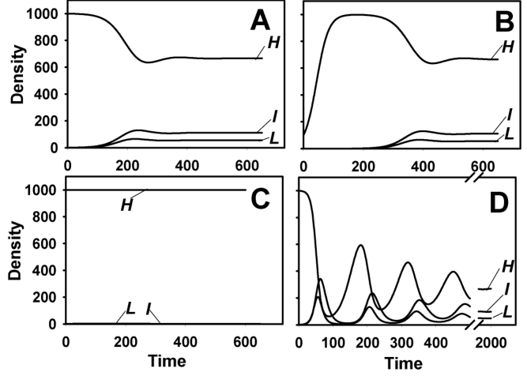{#fig-tt-cont-sim}
 สำหรับพารามิเตอร์อื่นๆ ความหนาแน่นของหน่วยพืชที่แข็งแรง ระยะฟักตัว และระยะแพร่เชื้ออาจแตกต่างกัน แต่พลวัตเชิงคุณภาพ (Qualitative dynamics) ยังคงเหมือนเดิม

การจำลองแสดงให้เห็นว่าเมื่อ $\beta$ มีค่าน้อย จะไม่เกิดโรคระบาด ในขณะที่ค่า $\beta$ มากขึ้น จะเกิดโรคระบาด 

เห็นได้ชัดว่ามีจุดวิกฤตสำหรับการพัฒนาโรคระบาด ในส่วน 5.2 เราก็พบพฤติกรรมจุดวิกฤตเช่นนี้ 

และคำถามที่น่าสนใจคือความสัมพันธ์ระหว่างจุดวิกฤตในแบบจำลองความก้าวหน้าของโรค (Disease progress models) ที่พืชอาศัยคงที่ กับจุดวิกฤตในแบบจำลองที่รวมการเจริญเติบโตของพืชปลูกเป็นอย่างไร เราจะหารือเรื่องนี้ในส่วนถัดไป

ในระยะเริ่มต้นของการระบาด ความหนาแน่นของหน่วยพืชในระยะฟักตัวและแพร่เชื้อดูเหมือนจะเพิ่มขึ้นแบบเอกซ์โพเนนเชียลอีกครั้ง 

เช่นเดียวกับสถานการณ์จุดวิกฤต เป็นเรื่องน่าสนใจที่จะถามว่าค่า $r_E$ คืออะไร และเกี่ยวข้องกับค่า $r_E$ สำหรับแบบจำลองความก้าวหน้าของโรคที่ศึกษาในส่วน 5.2 อย่างไร

ในกรณีตัวอย่างของการจำลอง 

ความหนาแน่นของหน่วยพืชที่แข็งแรงจะลดลงในตอนแรกเมื่อ $H_0$ อยู่ที่หรือใกล้เคียงกับ $H_{max}$ จากนั้นจะผันผวนอยู่ช่วงหนึ่งสำหรับค่าพารามิเตอร์บางค่า และในที่สุดก็จะเข้าสู่ระดับคงที่ 

เมื่อ $H_0$ น้อยกว่า $H_{max}$ มาก $H(t)$ จะเพิ่มขึ้นในตอนแรก ผันผวน และจากนั้นเข้าสู่ระดับคงที่ (รูป 6.1B) 

ในบางกรณี อาจใช้เวลานานมากในการเข้าสู่ระดับคงที่ (เช่น รูป 6.1D) 

ระดับคงที่นี้เรียกว่า สภาวะคงตัว (Steady state) หรือค่าสมดุล (Equilibrium value) ในทางคณิตศาสตร์ สภาวะคงตัวสำหรับตัวแปร $X$ คือค่าที่ $dX/dt = 0$ 

สำหรับหน่วยพืชในระยะฟักตัวและระยะแพร่เชื้อ ก็จะเห็นรูปแบบที่คล้ายกันคือ เพิ่มขึ้นในตอนแรก อาจมีความผันผวน และสุดท้ายจะคงที่อยู่ที่ค่าสภาวะคงตัว 

เมื่อดูเผินๆ สิ่งนี้อาจดูคล้ายกับพลวัตที่เราพบสำหรับแบบจำลองความก้าวหน้าของโรคในส่วน 5.2 อย่างไรก็ตาม มีความแตกต่างที่สำคัญมาก ในแบบจำลองความก้าวหน้าของโรคที่ไม่รวมการเจริญเติบโตของพืชอาศัย ความหนาแน่นของหน่วยพืชระยะฟักตัวและแพร่เชื้อในที่สุดจะลดลงเป็นศูนย์ (เพราะสุดท้ายแล้วหน่วยพืชที่ติดเชื้อทั้งหมดจะกลายเป็นกลุ่มที่ถูกกำจัด) ในแบบจำลองปัจจุบันนี้ ความหนาแน่นในกลุ่มระยะฟักตัวและแพร่เชื้อจะไม่ลดลงจนเหลือศูนย์ แต่จะลู่เข้าหาความหนาแน่นที่มากกว่าศูนย์ 

ความแตกต่างนี้ แน่นอนว่าเกิดจากการรวมเอาการเจริญเติบโตของพืชปลูกเข้ามาในสมการแบบจำลอง 6.3 การหลั่งไหลเข้ามาอย่างต่อเนื่องของหน่วยพืชใหม่ที่แข็งแรงจะหล่อเลี้ยงให้เกิดโรคระบาด และทำให้ความหนาแน่นของระยะฟักตัวและแพร่เชื้อไม่ลดลงเหลือศูนย์ 

เมื่อมีหน่วยแพร่เชื้ออยู่ในระบบอย่างต่อเนื่อง ก็จะเกิดการติดเชื้อใหม่อย่างต่อเนื่อง (ตราบใดที่ยังมีหน่วยพืชที่ปลอดโรค)

#### 6.2.1.3 หมวดหมู่ที่ถูกกำจัด (The removed category)

ความหนาแน่นของสถานะที่ถูกกำจัด $R(t)$ และความหนาแน่นรวมที่สอดคล้องกันของหน่วยพืชที่ติดเชื้อ $Y(t)$ มักจะถูกนำมารวมในแบบจำลองการเจริญเติบโตของพืชแบบต่อเนื่องดังที่แสดงในสมการ 6.1 น้อยกว่า 

ทั้งนี้เพราะ เมื่อมองแวบแรก อาจเกิดปรากฏการณ์ประหลาดขึ้น 

พิจารณาสถานการณ์ที่เราเพิ่มสมการมาตรฐานสำหรับความหนาแน่นของหน่วยพืชที่ถูกกำจัด เข้าไปในสมการแบบจำลอง 6.3 หรือ 6.5 สมการนี้เขียนได้เป็น:
$$

\frac{dR(t)}{dt} = \mu I(t)
$$

ดังที่เราได้พูดคุยกันไว้ข้างต้น ความหนาแน่นของหน่วยพืชที่แพร่เชื้อได้ในที่สุดจะเข้าสู่สภาวะคงตัวด้วยค่า $I > 0$ 

ซึ่งหมายความว่าด้านขวามือของสมการ 6.6 จะกลายเป็นค่าคงที่ที่มากกว่า 0 ซึ่งก็จะส่งผลให้ความหนาแน่นของหน่วยพืชที่ถูกกำจัดจะเพิ่มขึ้นอย่างต่อเนื่องไม่มีที่สิ้นสุด เช่นเดียวกันกับจำนวนโรคทั้งหมด $Y(t) = L(t) + I(t) + R(t)$ 

เหตุผลนี้ชัดเจน: ตราบใดที่มีหน่วยพืชแข็งแรงใหม่เข้าสู่ประชากร และมีหน่วยแพร่เชื้ออยู่รอบๆ หน่วยพืชที่แข็งแรงก็จะติดเชื้อ (สมมติว่า $\beta > 0$) และในที่สุดก็จะสิ้นสุดอยู่ในหมวดหมู่ที่ถูกกำจัด

มีสองสถานการณ์ที่ต้องแยกแยะในกรณีนี้ 

ในสถานการณ์แรก สถานะที่ถูกกำจัด เป็น สถานะที่เกี่ยวข้องตลอดช่วงการระบาด และสมการ 6.6 คือคำอธิบายที่ถูกต้องสำหรับสถานะนี้ 

ตัวอย่างเช่น สถานการณ์นี้ใช้ได้หากเราศึกษาการระบาดภายในฤดูปลูกฤดูเดียว โดยที่หน่วยพืชที่ถูกกำจัดนั้นเป็นเพียงเนื้อเยื่อใบที่ตายแล้วและยังคงอยู่บนต้นพืชไปจนสิ้นสุดฤดูปลูก 

เมื่อสิ้นสุดฤดูปลูกที่มีความยาวจำกัด ความหนาแน่นของหมวดหมู่ที่ถูกกำจัดอาจมีค่ามากแต่ไม่ถึงขั้นอนันต์ (เนื่องจากเวลาจำกัด) ความหนาแน่นของหมวดหมู่ที่ถูกกำจัดสามารถคำนวณง่ายๆ โดยใช้สมการ 6.6 ไม่ว่าการระบาดจะเข้าใกล้สภาวะคงตัวหรือไม่ (ในรูปของ $H, L,$ และ $I$) เมื่อสิ้นสุดฤดูปลูก จะต้องตัดสินจากผลการจำลอง

ในสถานการณ์ที่สอง หน่วยพืชในสถานะที่ถูกกำจัดสามารถถูกนำออก (คือ ถูกกำจัด) ไปจากระบบทางกายภาพได้ ตัวอย่างเช่น ในแบบจำลองของเราที่อธิบายโดยสมการ 6.5 หน่วยพืชจะถูกเก็บเกี่ยวรวมทั้งหน่วยพืชที่ถูกกำจัดด้วย สมการเชิงอนุพันธ์สำหรับความหนาแน่นของหน่วยพืชที่ถูกกำจัดจะกลายเป็น:
$$

\frac{dR(t)}{dt} = \mu I(t) - \eta R(t)
$$

ในสถานการณ์นี้ ความหนาแน่นของหน่วยพืชที่ถูกกำจัด (ซึ่งยังไม่ถูกเอาออกจากระบบในทางกายภาพ) จะเข้าสู่ค่าสภาวะคงตัวด้วยตัวมันเองในระยะยาว ซึ่งสามารถคำนวณได้จาก
$$

\bar{R} = \frac{\mu}{\eta} \bar{I}
$$

(ดังจะอธิบายรายละเอียดเพิ่มเติมในหัวข้อย่อยถัดไป การขีดฆ่าบนตัวแปรแสดงถึงสภาวะคงตัว) 

อีกตัวอย่างหนึ่งที่หน่วยพืชที่ถูกกำจัดถูกนำออกจากระบบคือ เมื่อใบร่วงหล่นจากต้นพืชและวัสดุใบนั้นถูกย่อยสลายโดยจุลินทรีย์ หรือถูกไส้เดือน แมลง หรือสิ่งมีชีวิตอื่นๆ กิน 

ในกรณีนั้น สมมติว่าแต่ละหน่วยพืชที่ถูกกำจัดมีความน่าจะเป็นคงที่ต่อหน่วยเวลา $\delta$ ที่จะร่วงหล่นและถูกย่อยสลายหรือถูกกิน สมการเชิงอนุพันธ์สำหรับความหนาแน่นของหน่วยพืชที่ถูกกำจัดจะกลายเป็น:
$$

\frac{dR(t)}{dt} = \mu I(t) - \delta R(t)
$$

และสภาวะคงตัวของความหนาแน่นนี้คือ
$$

\bar{R} = \frac{\mu}{\delta} \bar{I}
$$

#### 6.2.1.4 สภาวะคงตัวและจุดวิกฤตสำหรับการพัฒนาของโรคระบาด (Steady states and thresholds for epidemic development)

ดังที่กล่าวมาแล้ว สภาวะคงตัวจะเกิดขึ้นเมื่อความหนาแน่นของหน่วยพืชที่แข็งแรง ระยะฟักตัว และระยะแพร่เชื้อไม่มีการเปลี่ยนแปลง 

การไม่มีการเปลี่ยนแปลงหมายความว่าอัตราการเปลี่ยนแปลงในความหนาแน่นของพวกมันคือ $dH(t)/dt$, $dL(t)/dt$, และ $dI(t)/dt$ ตามลำดับ ล้วนเป็นศูนย์ ความหนาแน่นจึงไม่ใช่ฟังก์ชันของเวลาอีกต่อไป และเราจะแทน $H(t)$, $L(t)$ และ $I(t)$ ด้วย $\bar{H}$, $\bar{L}$, และ $\bar{I}$ ตามลำดับ แทนค่าเหล่านี้ลงในสมการแบบจำลอง 6.3 ร่วมกับค่า 0 สำหรับอัตราการเปลี่ยนแปลง เราจะได้
$$

0 = r_H \bar{H} \left( 1 - \frac{\bar{H}}{H_{max}} \right) - \beta \bar{H} \bar{I}
$$

$$

0 = \beta \bar{H} \bar{I} - \omega \bar{L}
$$

$$

0 = \omega \bar{L} - \mu \bar{I}
$$

ชุดสมการนี้แก้ได้ง่าย และหลังจากการจัดรูปทางพีชคณิตบางอย่าง ก็แสดงให้เห็นว่ามี 3 คำตอบ
$$

\bar{H} = 0, \quad \bar{L} = 0, \quad \bar{I} = 0
$$

$$

\bar{H} = H_{max}, \quad \bar{L} = 0, \quad \bar{I} = 0
$$

$$

\bar{H} = \frac{\mu}{\beta}, \quad \bar{L} = \frac{\mu}{\omega} \frac{r_H}{\beta} \left( 1 - \frac{\mu}{\beta H_{max}} \right), \quad \bar{I} = \frac{r_H}{\beta} \left( 1 - \frac{\mu}{\beta H_{max}} \right)
$$

สภาวะคงตัวแรกที่ความหนาแน่นทั้งหมดเป็นศูนย์ ไม่ค่อยน่าสนใจสำหรับจุดประสงค์ของเรา 

อย่างไรก็ตาม มันคือสภาวะคงตัวที่แท้จริงของระบบ หากไม่มีพืชอาศัยที่แข็งแรง ก็จะไม่มีการพัฒนาของประชากรพืชอาศัยที่แข็งแรง (สังเกตว่าในแบบจำลองลอจิสติกที่เลือกใช้สำหรับ $H$ จะไม่มีการเพิ่มขึ้นของ $H$ หาก $H$ เป็น 0) หากไม่มีพืชอาศัยที่แข็งแรง โรคก็จะไม่สามารถตั้งตัวได้ และความหนาแน่นเหล่านี้ก็จะยังคงเป็นศูนย์

สภาวะคงตัวที่สองและสามเป็นสิ่งที่น่าสนใจจากมุมมองของเรา 

ในสภาวะคงตัวที่สอง พืชอาศัยอยู่ที่ความหนาแน่นสูงสุด และโรคไม่มีอยู่ในระบบ 

สภาวะคงตัวที่สามเป็นสภาวะที่เกิดโรคระบาดแล้ว เนื่องจากความหนาแน่นของหน่วยพืชระยะฟักตัวและแพร่เชื้อไม่สามารถเป็นลบได้ (ตามคำนิยาม) สภาวะคงตัวนี้จึงมีความหมายทางชีววิทยาก็ต่อเมื่อ $\bar{L}$ และ $\bar{I}$ มากกว่าหรือเท่ากับศูนย์ ซึ่งหมายความว่านิพจน์ในวงเล็บทางด้านขวามือของสมการสภาวะคงตัวเหล่านี้จะต้องมากกว่าหรือเท่ากับศูนย์ นั่นคือ
$$

1 - \frac{\mu}{\beta H_{max}} > 0
$$

หรือจัดรูปใหม่
$$

\frac{\beta H_{max}}{\mu} > 1
$$

แน่นอนว่า ด้วยอสมการนี้ เราได้พบจุดวิกฤตสำหรับการพัฒนาของโรคระบาดแล้ว 

จะมีสภาวะคงตัวที่มีโรคปรากฏอยู่เมื่อปริมาณนี้มีค่ามากกว่าศูนย์ และไม่มีสภาวะคงตัวที่มีโรคปรากฏอยู่เมื่อปริมาณนี้มีค่าน้อยกว่าศูนย์ การที่ปริมาณนี้เท่ากับศูนย์จะทำหน้าที่เป็นจุดวิกฤต

เป็นเรื่องปกติที่จะถามว่า: สิ่งนี้เปรียบเทียบกับจุดวิกฤตสำหรับการพัฒนาของโรคระบาดที่พบในแบบจำลองที่ไม่รวมการเจริญเติบโตของพืชปลูก ซึ่งกำหนดไว้ในสมการ 5.23 ได้อย่างไร?

ด้วยการจัดเรียงสมการ 6.15 ความสัมพันธ์ก็จะชัดเจนขึ้น เราพิจารณาอสมการ:
$$

\frac{\beta H_{max}}{\mu} > 1
$$

ซึ่งหลังจากการจัดเรียงนิพจน์ใหม่ จะกลายเป็น:
$$

\frac{\beta}{\mu} H_{max} > 1
$$

นิพจน์รูปแบบสุดท้ายนี้เหมือนกับสมการ 5.23 ทุกประการ โดยที่ $H_0$ จะถูกแทนที่ด้วย $H_{max}$ 

หากไม่มีการเจริญเติบโตของพืชอาศัย ความหนาแน่นเริ่มต้นของพืชอาศัย $H_0$ คือ ความหนาแน่นของพืชอาศัยสูงสุดที่เป็นไปได้ ดังนั้นจึงมีความหมายที่เทียบเท่ากันของ $H_0$ และ $H_{max}$ 

เราจะไม่ทบทวนและตีความปริมาณนี้ทีละขั้นตอนอีกครั้ง แต่ชัดเจนว่า $\beta H_{max} / \mu$ คือค่าระดับการสืบพันธุ์พื้นฐาน (Basic reproduction number), $R_0$, ของโรคในสถานการณ์นี้ ($R_0 = \beta H_{max} / \mu$) ดังนั้น เราจึงสรุปได้ว่าจุดวิกฤตสำหรับการพัฒนาของโรคระบาดนั้นเหมือนกันสำหรับสมการแบบจำลอง 6.3 (พืชอาศัยเติบโต) และสมการ 5.30 (พืชอาศัยคงที่)ต่ำกว่าจุดวิกฤต เมื่อ $R_0 < 1$ จะไม่เกิดโรคระบาด และระบบจะลู่เข้าสู่สมการสภาวะคงตัว 6.13 (ซึ่งในที่สุดทุกหน่วยจะปลอดโรค) สภาวะคงตัวของระบบแสดงไว้ใน@fig-tt-steady-state เป็นฟังก์ชันของ $\beta$ สำหรับค่า $\beta$ ที่น้อยกว่าค่าวิกฤต (ด้วยค่า $H_{max}$ ที่เลือกและ $\mu$ ประมาณ 0.00025) จะไม่มีโรคปรากฏในระบบที่สภาวะคงตัว ความหนาแน่นของพืชอาศัยที่แข็งแรงที่สภาวะคงตัวจะลดลงเมื่อ $\beta$ เพิ่มขึ้น (สำหรับ $R_0 > 1$) สำหรับค่า $\beta$ ที่มากกว่าแต่ใกล้เคียงกับค่าวิกฤต (และพารามิเตอร์อื่นๆ ที่เลือกในสมการ 6.14) ความหนาแน่นของหน่วยพืชระยะฟักตัวและแพร่เชื้อจะเพิ่มขึ้นเมื่อ $\beta$ เพิ่มขึ้น สิ่งนี้เกิดจากการสูญเสียประชากรที่แข็งแรงจากโรค (กล่าวคือ การแทนที่หน่วยพืชที่แข็งแรงด้วยหน่วยพืชระยะฟักตัวหรือระยะแพร่เชื้อ) สำหรับค่า $\beta$ ที่มากกว่า 0.0004 โดยประมาณ (ด้วยค่าพารามิเตอร์อื่นที่เลือกในสมการ 6.14) ความหนาแน่นของหน่วยพืชระยะฟักตัวและแพร่เชื้อจะ ลดลง เมื่อ $\beta$ เพิ่มขึ้น เมื่อ $\beta$ มีค่ามากกว่า 0.0004 (ในตัวอย่างนี้) ประชากรที่แข็งแรงไม่สามารถสร้างหน่วยพืชที่แข็งแรงใหม่ได้เร็วพอที่จะทำให้ค่า $L$ และ $I$ เพิ่มขึ้นตามอัตราการถ่ายทอดโรคที่เพิ่มขึ้นที่ความหนาแน่นสมดุล กล่าวอีกนัยหนึ่ง ความหนาแน่นของหน่วยพืชที่แข็งแรงมีขนาดเล็กพอที่จะรองรับความหนาแน่นที่น้อยของหน่วยพืชระยะฟักตัวและแพร่เชื้อเท่านั้นความหนาแน่นที่สภาวะคงตัวหรือสมดุลของหน่วยพืชที่แข็งแรงยังสามารถแสดงได้เป็น ดังแสดงใน @fig-tt-steady-states:

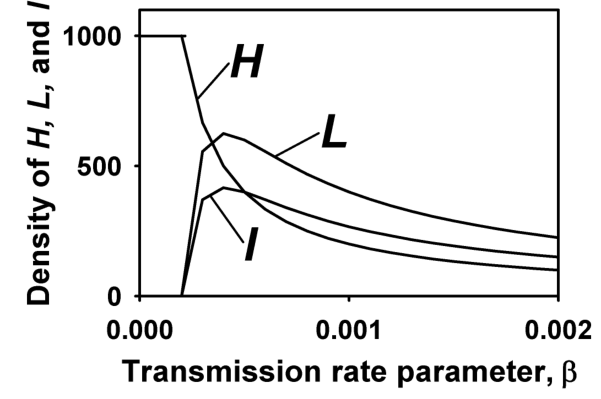{#fig-tt-steady-states}

$$

\bar{H} = \frac{H_{max}}{R_0}
$$

โดยพิจารณาจากสูตรของ $R_0$ ($= \beta H_{max} / \mu$) สูตรนี้มักได้มาจากการคำนวณสภาวะคงตัวสำหรับความหนาแน่นของหน่วยพืชที่แข็งแรง น่าเสียดายที่นิพจน์นี้ไม่ได้เป็นจริงเสมอไปสำหรับ ทุก แบบจำลองของพลวัตโรคระบาดที่รวมการเจริญเติบโตของพืชอาศัย

การเปรียบเทียบผลลัพธ์ในที่นี้กับผลลัพธ์ที่ได้จากแบบจำลองที่ไม่มีการเจริญเติบโตของพืชอาศัย (ส่วนที่ 5.2 ของบทที่แล้ว) จะเป็นประโยชน์ แน่นอนว่าไม่มีสภาวะคงตัวหากปราศจากการเจริญเติบโตของพืชอาศัย ในทางกลับกัน $H(t)$ ($= H_0 - Y(t)$) จะเข้าใกล้ค่า เส้นกำกับ (Asymptotic value) เมื่อพืชที่เป็นโรคทั้งหมดถูกกำจัดออก (ระดับสุดท้าย; $H_{\pm}$) สมการ 5.27 นิยามระดับสุดท้ายของโรคในรูปของสัดส่วน แต่ด้วยพีชคณิตเล็กน้อยสามารถแสดงค่า $H_{\pm}$ สำหรับแบบจำลอง H-L-I-R (ซึ่งโดยพื้นฐานแล้วเหมือนกับสมการ 5.11 สำหรับแบบจำลองรุ่นที่ไม่ต่อเนื่อง (Discrete generation model)) ในแง่การปฏิบัติ $H_{\pm}$ สำหรับขนาดพืชอาศัยคงที่ เทียบเท่ากับสภาวะคงตัว $H$ สำหรับพืชอาศัยแบบพลวัต เพราะตัวแปรทั้งสองเป็นตัวชี้วัดจำนวนพืชอาศัยปลอดโรคในระยะยาวเมื่อเวลาไม่ได้เป็นข้อจำกัด (อย่างไรก็ตาม ทั้งสองค่าไม่ได้เหมือนกันในทางคณิตศาสตร์) เพื่อการเปรียบเทียบ ลองพิจารณาสถานการณ์ที่ $H_0 = H_{max} = 1000$ พิจารณาตัวอย่างผลลัพธ์ต่อไปนี้:R0​H±​Hˉ1.54206702.02004003.060333จากค่าตัวอย่างเพียงไม่กี่ค่า ก็เห็นได้ชัดว่า หากมีการเติบโตของพืชอาศัย ในระยะยาวจะมีจำนวนพืชที่ปลอดโรคมากกว่ากรณีที่พืชอาศัยไม่เติบโต สำหรับค่าระดับการสืบพันธุ์พื้นฐานที่กำหนด เหตุผลที่เป็นเช่นนี้ก็เพราะเมื่อมีการเติบโตของพืชอาศัย จะมีพืชใหม่ที่แข็งแรงถูกเติมเข้ามาในระบบอย่างต่อเนื่อง แต่ถ้าพืชอาศัยไม่เติบโต ย่อมไม่มีการเปลี่ยนแปลงความหนาแน่นรวมของพืชอาศัย6.2.1.5 การเพิ่มขึ้นของโรคในระยะเริ่มต้น (Initial disease increase) แม้จะไม่ได้แสดงให้เห็นที่นี่ เราขอบันทึกไว้ว่าการเพิ่มขึ้นของโรคในระยะเริ่มต้น เมื่อเริ่มมีโรคระบาดด้วยความหนาแน่นของพืชที่ติดเชื้อน้อยมากๆ จะเพิ่มขึ้นแบบเอกซ์โพเนนเชียล (Exponential) ด้วยพารามิเตอร์อัตรา $r_E$ โดยสมการของ $r_E$ จะเป็นสมการเดียวกับที่ใช้ในแบบจำลอง H-L-I-R (สมการ 5.30) สำหรับกรณีที่พืชอาศัยไม่เติบโต (ดูสมการ 5.36) เมื่อแทนที่ $H_0$ ด้วยความหนาแน่นสูงสุดของพืชอาศัย $H_{max}$6.2.1.6 จุดวิกฤตของการเกิดโรคระบาดของสมการแบบจำลองที่ 6.5 (Threshold of epidemic development of model equation 6.5) คราวนี้เรากลับมาที่สถานการณ์การเติบโตของพืชอาศัยรูปแบบที่สอง ที่มีการปลูกใหม่ (หรือการเติบโตของพืชใหม่) ควบคู่ไปกับการเก็บเกี่ยว (หรือการสูญเสียพื้นที่พืชอาศัยจากการตาย) ซึ่งสรุปอยู่ในสมการ 6.5 โดยใช้กรรมวิธีที่เราศึกษาในส่วน 6.2.1.3 เราคำนวณหาสภาวะคงตัวของแบบจำลอง จะพบว่าสภาวะคงตัวที่มีโรคปรากฏอยู่คือสภาวะที่:พืชอาศัยที่ติดเชื้อในระยะฟักตัว ก่อนที่จะถูกเก็บเกี่ยว (หรือตาย) เท่ากับ $\omega/(\omega+\eta)$ ระยะเวลาเฉลี่ยที่พืชติดเชื้ออยู่ในระยะฟักตัวคือ $1/(\omega+\eta)$ และเมื่อพืชเข้าสู่ระยะแพร่เชื้อแล้ว มันจะทำให้เกิดการติดเชื้อใหม่ $\beta\sigma/\eta$ ครั้งต่อหน่วยเวลา เนื่องจากพืชแพร่เชื้อสามารถสิ้นสุดระยะแพร่เชื้อ หรือถูกเก็บเกี่ยว หรือตายได้ ระยะเวลาเฉลี่ยที่พืชแพร่เชื้อได้คือ $1/(\mu+\eta)$ ดังนั้น พืชที่เข้าสู่ระยะแพร่เชื้อแล้ว โดยเฉลี่ยจะก่อให้เกิดการติดเชื้อใหม่ $\beta(\sigma/\eta)/(\mu+\eta)$ ครั้ง ดังนั้น ปริมาณทางซ้ายมือของสมการ 6.21 ก็คือ จำนวนการติดเชื้อใหม่เฉลี่ยที่เกิดจากพืชติดเชื้อใหม่ 1 ต้น เมื่อมันไปอยู่ท่ามกลางประชากรที่ไวต่อการรับเชื้ออย่างเต็มที่ นั่นก็คือ $R_0$

เมื่อแทนที่ $\sigma/\eta$ ด้วย $H_{max}$ เราสามารถเขียน $R_0$ ได้ดังนี้:
$$

R_0 = \frac{\beta H_{max}}{\mu+\eta} \frac{\omega}{\omega+\eta}
$$

ความหนาแน่นของหน่วยพืชระยะฟักตัวและแพร่เชื้อจะมีค่ามากกว่าศูนย์ก็ต่อเมื่อ
$$

\frac{\beta \sigma}{\eta(\mu+\eta)} \frac{\omega}{\omega+\eta} > 1
$$

นิพจน์นี้ตีความได้ง่ายที่สุดหากเราจัดรูปใหม่เป็นอสมการ
$$

\frac{\beta (\sigma/\eta)}{\mu+\eta} \frac{\omega}{\omega+\eta} > 1
$$

เพื่อทำความเข้าใจสิ่งนี้ อันดับแรก ลองพิจารณาระบบในกรณีที่ไม่มีโรค ในสถานการณ์นี้ สมการเชิงอนุพันธ์ที่ใช้อธิบายความหนาแน่นของพืชที่แข็งแรงคือ
$$

\frac{dH(t)}{dt} = \sigma - \eta H(t)
$$

สมการนี้มีความหนาแน่นคงตัวของพืชแข็งแรงที่ $\bar{H} = \sigma/\eta$ (นั่นคือ เมื่อเวลาผ่านไปนานๆ $H(t)$ จะเข้าใกล้ $\sigma/\eta$) ดังนั้นสัดส่วน $\sigma/\eta$ จึงมีบทบาทเช่นเดียวกับความหนาแน่นสูงสุดของพืชอาศัย $H_{max}$ ในสมการ 6.17 เราจึงอาจเขียนทางขวามือของสมการ 6.22 ได้เป็น $\eta(H_{max} - H(t))$ ตอนนี้ ลองนึกภาพว่าเรานำพืชที่เพิ่งติดเชื้อ 1 ต้น ไปใส่ไว้ท่ามกลางประชากรพืชแข็งแรงทั้งหมด เนื่องจากเราได้เพิ่มตัวแปรการเก็บเกี่ยวหรือการตายลงในสมการแบบจำลอง 6.5 ดังนั้นพืชติดเชื้อทุกต้นจะไม่ผ่านระยะฟักตัวและกลายเป็นพืชแพร่เชื้อเสมอไป มีโอกาสที่พืชติดเชื้อจะถูกเก็บเกี่ยว (หรือตาย) ก่อนจะเข้าสู่ระยะแพร่เชื้อ พืชที่ติดเชื้อระยะฟักตัวมีความน่าจะเป็นต่อหน่วยเวลาที่ $\omega$ ที่จะสิ้นสุดระยะฟักตัวและกลายเป็นพืชแพร่เชื้อ และมีความน่าจะเป็นต่อหน่วยเวลาที่ $\eta$ ที่จะถูกเก็บเกี่ยว (หรือตาย) สิ่งนี้หมายความว่า ความน่าจะเป็นที่พืชจะสิ้นสุดระยะฟักตัวและเข้าสู่ระยะแพร่เชื้อคือ
$$

\frac{\omega}{\omega+\eta}
$$

เมื่อ $\eta = 0$ สมการนี้จะลดรูปลงเป็นนิพจน์ของ $R_0$ ในแบบจำลองที่มีการเจริญเติบโตของพืชแข็งแรงแบบลอจิสติก ข้อแตกต่างนี้เป็นเพียงเพราะในที่นี้เรากำหนดการเก็บเกี่ยวหรือการตายของพืชอาศัยไว้ในทุกหมวดหมู่ เช่นเดียวกับแบบจำลองก่อนหน้าสำหรับการเจริญเติบโตของพืชอาศัย $H_{max}$ มีบทบาทเดียวกับ $H_0$ เมื่อไม่มีการเจริญเติบโตของพืชอาศัย (ดังนั้นความหนาแน่นของพืชอาศัยแข็งแรงเริ่มต้น จึงเท่ากับความหนาแน่นสูงสุดของพืชอาศัยแข็งแรง) จากพีชคณิตเล็กน้อย จะแสดงให้เห็นว่าค่าคงตัวของ $H$ กำหนดโดย $\bar{H} = H_{max} / R_0$ (ด้วย $R_0$ จากสมการ 6.23) ซึ่งเหมือนกับที่พบในกรณีการเจริญเติบโตแบบลอจิสติก (สมการ 6.18)การใช้สมการ 6.5 สำหรับโรคระบาดควบคู่กับสมการ 6.7 สำหรับการตาย/การเก็บเกี่ยวพืชที่ถูกกำจัด เป็นเรื่องตรงไปตรงมา การใช้ $\eta(H_{max} - H(t))$ สำหรับสมการ $dH(t)/dt$ มีประโยชน์ ดังที่ได้พูดคุยกันไปแล้วด้านบน เราขอปล่อยให้เป็นแบบฝึกหัดสำหรับผู้อ่านในการสำรวจแบบจำลองนี้ต่อไป ผู้อ่านควรจะค้นพบได้ว่าเมื่อโรคระบาดเริ่มต้นด้วยค่าผลรวมของ $H$ และ $I$ เริ่มต้น เท่ากับค่าสูงสุด ($H_0 + I_0 = H_{max} = \sigma/\eta$) จะ ไม่มี การเปลี่ยนแปลงสุทธิในความหนาแน่น รวม ของพืชอาศัย ($dH(t)/dt + dL(t)/dt + dI(t)/dt + dR(t)/dt = 0$) ซึ่งหมายความว่าความหนาแน่นของพืชอาศัยทั้งหมดจะไม่เปลี่ยนแปลงตลอดการระบาด แม้ว่าจะมีการสร้างพืชแข็งแรงใหม่ขึ้นมา (และแน่นอนว่ามีการตายของพืชในทุกสถานะด้วย) จากสถานการณ์นี้ เราสามารถคำนวณหาความรุนแรงของโรคที่สภาวะคงตัวได้โดยง่าย ($Y = H_{max} - H$) โดยเฉพาะอย่างยิ่ง จากสมการ 6.18 สำหรับค่าสภาวะคงตัวของพืชแข็งแรง จะได้ว่า $\bar{Y} = H_{max} (1 - 1/R_0)$ และ $\bar{y} = \bar{Y} / H_{max} = (1 - 1/R_0)$ สามารถแสดงให้เห็นได้อย่างง่ายดายว่า ค่าสภาวะคงตัว $\bar{y}$ น้อยกว่าค่าเส้นกำกับ $y_{\pm}$ เมื่อไม่มีการเจริญเติบโตของพืชอาศัย6.2.1.7 บทสรุปส่งท้าย (Concluding remarks) ส่วนนี้เกี่ยวกับแบบจำลองที่มีการเจริญเติบโตของพืชปลูกแบบต่อเนื่อง ได้แสดงให้เห็นถึงลักษณะพื้นฐานบางประการของโรคระบาดที่มีขนาดของพืชอาศัยไม่คงที่ เห็นได้ชัดว่าคุณลักษณะบางอย่างคล้ายคลึงกับที่เราพบในบทก่อนหน้านี้เกี่ยวกับแบบจำลองความก้าวหน้าของโรคที่ไม่มีการเจริญเติบโตของพืชอาศัย แต่คุณลักษณะอื่นๆ ก็เป็นสิ่งใหม่ แนวคิดเรื่องระดับการสืบพันธุ์พื้นฐาน (Basic reproduction number) และบทบาทของมันในการเป็นจุดวิกฤตของโรคระบาดนั้นเหมือนกันในทุกแบบจำลองเหล่านี้ ความหนาแน่นของหน่วยพืชแข็งแรง ระยะฟักตัว และระยะแพร่เชื้อ ในที่สุดก็จะเข้าสู่ระดับคงที่ ไม่ช้าก็เร็ว และเราได้แสดงให้เห็นถึงวิธีการคำนวณสภาวะคงตัวเหล่านี้แล้วแบบจำลองที่กล่าวถึงในที่นี้ มีจุดร่วมที่เหมือนกันคือ ความหนาแน่นของพืชแข็งแรง ฟักตัว และแพร่เชื้อ จะเข้าสู่ความหนาแน่นคงตัวในที่สุด อย่างไรก็ตาม สิ่งนี้ไม่ได้เกิดขึ้นเสมอไปในทุกกรณี ในแบบจำลองบางประเภท ความหนาแน่นของตัวแปรเหล่านี้จะไม่ได้ตกลงสู่สภาวะคงตัว แต่จะผันผวนอยู่ตลอดเวลา ไม่ว่าจะเป็นรูปแบบปกติที่มีแอมพลิจูด (Amplitude) และคาบเวลาคงที่ หรือความผันผวนแบบไม่เป็นระบบ (อาจมีลักษณะกลาหล (Chaotic)) การอภิปรายสถานการณ์นี้ในรายละเอียดจะเกินขอบเขตของหนังสือเล่มนี้ เราขอแนะนำให้อ่านหนังสือของ Edelstein-Keshet (1988) สำหรับการศึกษาเชิงลึกเพิ่มเติมสภาวะคงตัวของระบบสมการเชิงอนุพันธ์มักจะคำนวณได้ง่าย ในเอกสารเชิงทฤษฎีทั่วไป เมื่อสภาวะคงตัวสำหรับ $L$ และ $I$ อยู่สูงกว่า 0 จะถือว่าโรคมี การตกค้าง อยู่ (Persist) (Mollison, 1995) ดังนั้น เกณฑ์การตกค้าง (Persistence criterion) ก็คือค่าของจุดวิกฤตที่ต้องผ่านเพื่อให้โรคยังคงอยู่ในระบบ การที่สมการสภาวะคงตัวจะมีความสำคัญต่อการระบาดของโรคพืชหรือไม่นั้น เป็นอีกประเด็นหนึ่ง ดังที่รูป 6.1 แสดงให้เห็น ต้องใช้ระยะเวลาหนึ่งก่อนที่ระบบจะเข้าใกล้สภาวะคงตัว การที่ระบบจะเข้าสู่สภาวะคงตัวภายในช่วงเวลาที่แบบจำลองกำหนดหรือไม่นั้น ขึ้นอยู่กับค่าพารามิเตอร์ และกรอบเวลาที่เกี่ยวข้องในระบบที่สนใจ โดยเฉพาะอย่างยิ่งเมื่อใช้แบบจำลองอย่างสมการ 6.3 เพื่ออธิบายการเติบโตของการระบาดภายในฤดูปลูกเดียว เป็นไปได้อย่างยิ่งว่าเมื่อสิ้นสุดฤดูปลูก การระบาดอาจยังอยู่ห่างจากสภาวะคงตัว ภายใต้สถานการณ์ดังกล่าว การคำนวณหาค่า $Y$ (หรือ $H$, หรือ $I$) ในเวลาที่เจาะจงจะมีความหมายมากกว่า ซึ่งโดยทั่วไปแล้วจะต้องใช้วิธีการแก้สมการเชิงอนุพันธ์เชิงตัวเลข

### 6.2.2 การปลูกพืชตามฤดูกาล (Seasonal cropping) {#sec-tt-seasonal}

 {#sec-tt-seasonal}

ระบบการเพาะปลูกจำนวนมากเป็นไปตามฤดูกาล พืชจะถูกปลูกและเก็บเกี่ยวในช่วงเวลาที่แน่นอนของแต่ละปี 

การปลูกช่วยเพิ่มความหนาแน่นของต้นพืชที่อ่อนแอต่อโรคอย่างรวดเร็ว 

การเก็บเกี่ยวจะลดความหนาแน่นของต้นพืชที่อ่อนแอ และความหนาแน่นของพืชระยะฟักตัว แพร่เชื้อ และถูกกำจัดลงอย่างรวดเร็ว 

ในช่วงระหว่างการเก็บเกี่ยวและการปลูก โรค (เชื้อโรค) ต้องเอาชีวิตรอดบนเศษพืชที่เหลือในแปลง ในดิน หรือในสถานที่อื่นๆ (ตัวอย่างเช่น ในวัชพืชยืนต้นที่ติดเชื้อ) สถานการณ์นี้นำไปสู่แบบจำลองการพัฒนาของโรคระบาดในสภาพแวดล้อมตามฤดูกาล ในส่วนนี้ เราจะพูดถึงหนึ่งในแบบจำลองเหล่านี้อย่างละเอียด มีวิธีการทางคณิตศาสตร์เพียงไม่กี่วิธีที่สามารถนำมาวิเคราะห์ระบบเหล่านี้ในหลายๆ ฤดูกาล และการจำลองมักจะเป็นเครื่องมือหลักในการศึกษาแบบจำลองเหล่านี้ อย่างไรก็ตาม เราจะแสดงให้เห็นว่าจุดวิกฤตสำหรับการพัฒนาของโรคระบาดสามารถคำนวณได้อย่างชัดเจนสำหรับแบบจำลองดังกล่าว แนวทางที่แสดงใช้แบบจำลองที่ถูกทำให้ง่ายขึ้นจากที่นำเสนอโดย Madden and van den Bosch (2002) แนวทางอื่นๆ ได้ถูกตีพิมพ์โดย Gubbins and Gilligan (1997), Shaw (1994), และ Thrall et al. (1997) ดังที่ได้กล่าวไว้ในบทที่ 4 บางครั้งอาจใช้คำว่า โรคระบาดหลายปี (Polyetic) เพื่ออธิบายการระบาดในช่วงฤดูปลูกหลายฤดู6.2.2.1 การสร้างแบบจำลอง (Model derivation) เมื่อเริ่มฤดูปลูก จะมีการปลูกพืชด้วยความหนาแน่น $H_0$ ฤดูปลูกมีความยาว $T$ หน่วยเวลา และในช่วงฤดูปลูกจะเกิดโรคระบาดขึ้น เราใช้สมการ 5.18 ซึ่งเราได้ศึกษาไปแล้วในส่วน 5.2.2 เป็นแบบจำลองการพัฒนาของโรคระบาดในช่วงฤดูปลูก แทนที่จะใช้แบบจำลอง H-I-R เราอาจใช้แบบจำลอง H-L-I-R หรือแม้แต่แบบจำลองที่ใช้พื้นฐานพืชกำลังเติบโต แต่เราเลือกแบบที่ง่ายกว่าเพื่อจุดประสงค์ในการนำเสนอเมื่อสิ้นสุดฤดูปลูก ในเวลา $t = T$ พืชจะถูกเก็บเกี่ยว ในเวลานี้ความหนาแน่นของพืชระยะแพร่เชื้อและถูกกำจัดจะเป็น $I(T)$ และ $R(T)$ ตามลำดับ ในระหว่างการเก็บเกี่ยว พืชเหล่านี้ส่วนใหญ่จะถูกกำจัดหรือทำลาย และจะมีเพียงส่วนน้อยที่หลงเหลืออยู่ในแปลงหรือในดินเป็นเศษซากพืช ในช่วงเวลาที่ไม่มีการปลูกพืช พืชที่เหลือเหล่านี้ต้องเผชิญกับสภาพที่ไม่เหมาะสม (เช่น อุณหภูมิต่ำ ความชื้น ฯลฯ) ดังนั้นจากพืชเหล่านี้ จะมีเพียงส่วนน้อยที่รอดชีวิตไปจนถึงต้นฤดูปลูกถัดไป ยิ่งไปกว่านั้น เชื้อโรคอาจดำรงชีวิตแบบกินซาก (Saprophytically) ในช่วงเวลานี้ ทำให้แนวคิดเรื่องพืชที่เป็นโรคเริ่มไม่ชัดเจน (แม้ว่าเราจะยังคงถือว่าเชื้อโรคที่รอดชีวิตนี้ เป็นหน่วยของพืชที่เป็นโรคเพื่อจุดประสงค์ในการสร้างแบบจำลองได้) บ่อยครั้งที่เชื้อราที่ก่อโรคพืช จะเข้าสู่ระยะสืบพันธุ์แบบอาศัยเพศบนซากพืชในช่วงที่ไม่มีการปลูกพืชยิ่งไปกว่านั้น หน่วยแพร่เชื้อบางประเภท (สปอร์) จะถูกปล่อยออกมาจากพืชที่ติดเชื้อก็ต่อเมื่อมันเน่าเปื่อยตามกาลเวลาเท่านั้น โรคเหี่ยวเวอร์ทิซิลเลียม (Verticillium wilt) ของมันฝรั่งเป็นตัวอย่างหนึ่ง ซึ่งไมโครสเคลอโรเทีย (Microsclerotia) จะถูกปล่อยลงดินเมื่อเนื้อเยื่อมันฝรั่งเน่าเปื่อย (Powelson and Rowe, 1993) ดังนั้น แม้ว่า $R(T)$ อาจถูกคัดออกจากการระบาดในปัจจุบัน แต่พืชเหล่านี้อาจยังมีส่วนก่อให้เกิดโรคระบาดในฤดูกาลถัดไป พืชในระยะแพร่เชื้อและถูกกำจัดที่รอดชีวิตในช่วงที่ไม่มีการปลูกพืช มีความน่าจะเป็น $\xi_I$ และ $\xi_R$ ตามลำดับ ดังนั้น ความหนาแน่นของ “พืช” ที่สร้างเชื้อโรคเมื่อเริ่มต้นการระบาดครั้งถัดไป คือ $\xi_I I(T) + \xi_R R(T)$ (การลดลงอย่างค่อยเป็นค่อยไปแบบเอกซ์โพเนนเชียลของพืชที่เป็นโรคตลอดช่วงที่ไม่มีการปลูกพืชก็สามารถจำลองในรูปแบบที่เทียบเท่ากันได้) เมื่อเริ่มต้นฤดูปลูกใหม่ จะมีการปลูกพืชด้วยความหนาแน่น $H_0$ อีกครั้ง และกระบวนการแพร่ระบาดก็เริ่มต้นขึ้นใหม่ "พืช" ที่ผลิตเชื้อแต่ละหน่วยจำนวน $[\xi_I I(T) + \xi_R R(T)]$ จะสร้างการติดเชื้อเบื้องต้นจำนวน $\gamma$ การติดเชื้อเพื่อเริ่มการระบาดในฤดูปลูกใหม่ ต้นพืชติดเชื้อเริ่มแรกทั้งหมดในแบบจำลองจะอยู่ในระยะแพร่เชื้อ ดังนั้น เงื่อนไขเริ่มต้น (Initial conditions) สำหรับต้นฤดูกาลถัดไปคือ $I(0) = \gamma [\xi_I I(T) + \xi_R R(T)]$, $R(0) = 0$, และ $H(0) = H_0$, โดยที่พจน์ $I(T)$ และ $R(T)$ คือของฤดูกาลก่อนหน้า จากนั้นการระบาดจะดำเนินต่อไปเป็นเวลา $T$ หน่วยเวลาจนถึงจุดสิ้นสุดของฤดูปลูกถัดไป และกระบวนการจะเกิดซ้ำ เราเพิ่มตัวห้อย (Subscript) อีกตัวเข้าไปใน $I_0$ เพื่อบ่งบอกลำดับฤดูกาล; $I_{0,0}, I_{0,1}, I_{0,2}$ และอื่นๆเรายังคงรักษาแนวคิดของต้นพืช (Individuals) สำหรับสถานการณ์ทั้งระหว่างฤดูกาลและภายในฤดูกาลเพื่อความง่ายในการนำเสนอ ดังที่อ้างถึงข้างต้น $\xi_I I(T) + \xi_R R(T)$ สามารถตีความได้กว้างขึ้น (โดยขยายนิยามของพารามิเตอร์) ให้เป็นหัวเชื้อตั้งต้นทั้งหมด (Total primary inoculum) ที่พร้อมใช้งานตอนต้นของฤดูกาลถัดไป ซึ่งอยู่ในรูปฟังก์ชันของต้นพืชที่เป็นโรคตอนสิ้นสุดฤดูกาลปัจจุบัน สำหรับแบบจำลองการปลูกพืชตามฤดูกาลที่เรากำลังพิจารณา เราต้องแยกความแตกต่างของระดับการสืบพันธุ์พื้นฐาน (Basic reproduction numbers) 2 ค่า อย่างแรก ดังที่เราได้เห็นในส่วน 5.2.2 แบบจำลองสำหรับการระบาดภายในฤดูปลูกมีค่า $R_0$ ตามที่ให้ไว้ในสมการ 5.23 เราจะใช้นิพจน์ $R_{0(within)}$ สำหรับค่านี้6.2.2.2 การจำลองแบบจำลอง (Model simulations) @fig-tt-seasonal-dynamics แสดงผลการจำลองหลายชุดสำหรับแบบจำลอง โดยมีค่าพารามิเตอร์อัตราการถ่ายทอดโรคภายในฤดูกาล $\beta$ แตกต่างกัน ในเชิงแนวคิด การจำลองไม่ได้ซับซ้อน ภายในแต่ละฤดูกาล ใช้สมการ 5.18 แก้ปัญหา สิ่งที่เพิ่มเติมเข้ามาคือ $I_0$ ในแต่ละปี จะขึ้นอยู่กับความหนาแน่นของ $I$ และ $R$ ตอนปลายปีก่อนหน้า รวมถึงพารามิเตอร์ $\gamma$, $\xi_I$, และ $\xi_R$สำหรับค่า $\beta$ ที่มีค่าน้อย การระบาดของโรคจะไม่เกิดขึ้น ซึ่งแสดงให้เห็นว่ามีจุดวิกฤต (Threshold) สำหรับการเกิดโรคระบาด เมื่อมีการระบาดของโรค ความหนาแน่นของต้นพืชระยะแพร่เชื้อและถูกกำจัดจะเพิ่มขึ้นในระหว่างฤดูปลูก และจะเปลี่ยนแปลงอย่างกะทันหันในตอนสิ้นสุดฤดูปลูกเมื่อมีการเก็บเกี่ยว ค่า $\beta$ ยิ่งมาก การเพิ่มขึ้นของโรคระบาดก็จะยิ่งชัน และการลดลงจากฤดูปลูกหนึ่งไปสู่อีกฤดูกาลหนึ่งก็จะชันตามไปด้วย

$$

R_{0(within)} = \frac{\beta H_0}{\mu}
$$

ค่า $R_{0(within)}$ นี้ไม่เหมือนกับค่า $R_0$ ของแบบจำลองโรคระบาดหลายฤดูกาลของเรา ซึ่งจะแทนด้วย $R_{0(multi)}$ค่า $R_{0(multi)}$ สำหรับหลายฤดูกาลสามารถคำนวณได้ดังนี้: สมมติว่าเราเริ่มต้นในปีที่ 0 ด้วยความหนาแน่นเบื้องต้นของพืชระยะแพร่เชื้อเพียงเล็กน้อย $I(0) = I_{0,0}$ เราจะคำนวณนิพจน์สำหรับการติดเชื้อเริ่มต้นในปีต่อๆ ไปอย่างเจาะจง $I_{0,0}, I_{0,1}, I_{0,2}, I_{0,3}$ ฯลฯ อย่างที่เราเคยใช้ก่อนหน้านี้ ในสถานการณ์ที่ความหนาแน่นของต้นพืชระยะแพร่เชื้อมีค่าน้อยมาก

ในระยะเริ่มต้นของการระบาด ความหนาแน่นของพืชแข็งแรงสามารถประมาณค่าได้อย่างดีด้วยความหนาแน่นเริ่มต้น $H_0$ สมการแบบจำลองภายในฤดูกาล 5.18 จึงกลายเป็น6.2.2.3 จุดวิกฤตสำหรับการพัฒนาของโรคระบาด (Threshold for epidemic development) ดังที่เราได้เห็นในแบบจำลองทั้งหมดจนถึงตอนนี้ จุดวิกฤตสำหรับการเกิดโรคระบาดคือระดับการสืบพันธุ์พื้นฐาน $R_0
$$

$ \frac{dI(t)}{dt} = \beta H_0 I(t) - \mu I(t) = (\beta H_0 - \mu) I(t)
$$

$$

\frac{dR(t)}{dt} = \mu I(t)
$$

ข้อควรสังเกตคือ เราไม่ได้เขียนสมการสำหรับ $dH(t)/dt$ ออกมา เนื่องจากในที่นี้เราสนใจเฉพาะระยะเริ่มต้นที่ $H(t) \approx H_0$ ดังนั้น $dH(t)/dt \approx 0$ สมการแรกของสมการ 6.25 คือสมการการเติบโตแบบเอกซ์โพเนนเชียล (Exponential growth) ซึ่งมีคำตอบคือ:
$$

I(t) = I_{0,0} e^{(\beta H_0 - \mu)t}
$$

เมื่อแทนสมการนี้ลงในสมการที่สองของ 6.25 เราจะพบว่า
$$

\frac{dR(t)}{dt} = \mu I_{0,0} e^{(\beta H_0 - \mu)t}
$$

สมการนี้สามารถหาคำตอบได้อย่างง่ายดายโดยการอินทิเกรตจาก $0$ ถึง $t$ โดยเมื่อพิจารณาว่าเงื่อนไขเริ่มต้นสำหรับ $R$ คือศูนย์ เราจะได้คำตอบสำหรับฤดูกาลที่ 0 คือ
$$

R(t) = I_{0,0} \frac{\mu}{\beta H_0 - \mu} \left( e^{(\beta H_0 - \mu)t} - 1 \right)
$$

เมื่อใช้สมการ 6.26 และ 6.28 เงื่อนไขเริ่มต้นสำหรับฤดูปลูกถัดไป, $I_{0,1} = \gamma [\xi_I I(T) + \xi_R R(T)]$, จะนำไปสู่
$$

I_{0,1} = \gamma \left[ \xi_I e^{(\beta H_0 - \mu)T} + \xi_R \frac{\mu}{\beta H_0 - \mu} \left( e^{(\beta H_0 - \mu)T} - 1 \right) \right] I_{0,0}
$$

สมการ 6.29 ได้มาอย่างง่ายดายโดยการคูณสมการ 6.26 สำหรับ $I(T)$ ด้วย $\gamma \xi_I$ และสมการ 6.28 สำหรับ $R(T)$ ด้วย $\gamma \xi_R$ เมื่อใช้วิธีการเดียวกัน เราสามารถคำนวณเงื่อนไขเริ่มต้นสำหรับปีที่ 2 ได้เป็น:
$$

I_{0,2} = \gamma \left[ \xi_I e^{(\beta H_0 - \mu)T} + \xi_R \frac{\mu}{\beta H_0 - \mu} \left( e^{(\beta H_0 - \mu)T} - 1 \right) \right] I_{0,1}
$$

และโดยทั่วไป สำหรับการติดเชื้อเบื้องต้นในปีที่ $n+1$ เราจะได้
$$

I_{0,n+1} = \gamma \left[ \xi_I e^{(\beta H_0 - \mu)T} + \xi_R \frac{\mu}{\beta H_0 - \mu} \left( e^{(\beta H_0 - \mu)T} - 1 \right) \right] I_{0,n}
$$

สมการนี้มีรูปแบบเหมือนกับสมการ 5.4 ทุกประการ โดยที่ความหนาแน่นในฤดูกาลหน้า จะเท่ากับความหนาแน่นของฤดูกาลนี้ คูณด้วยค่าคงที่ อย่างไรก็ตาม ในตอนนี้มีการผสมผสานพารามิเตอร์ที่ซับซ้อนรวมอยู่ในคำว่า "ค่าคงที่" เมื่อปฏิบัติตามเหตุผลเดียวกับสมการ 5.4 ในส่วนที่ 5.2.1.3 เราสรุปได้ว่าโรคระบาดจะเกิดขึ้นเมื่อ
$$

\gamma \left[ \xi_I e^{(\beta H_0 - \mu)T} + \xi_R \frac{\mu}{\beta H_0 - \mu} \left( e^{(\beta H_0 - \mu)T} - 1 \right) \right] > 1
$$

และจะไม่มีโรคระบาดเกิดขึ้นเมื่อปริมาณนี้มีค่าน้อยกว่า 1 กล่าวอีกนัยหนึ่ง จะมีโรคระบาดในหลายฤดูกาลเมื่อ $I_{0,n+1} / I_{0,n} > 1$ ดังนั้นเราจึงได้นิพจน์สำหรับค่าระดับการสืบพันธุ์พื้นฐานหลายฤดูกาล, $R_{0(multi)}$ เพื่อทำให้ความสัมพันธ์ระหว่างสองค่าระดับการสืบพันธุ์พื้นฐานมีความชัดเจนยิ่งขึ้น เราจะแทนนพจน์สำหรับ $R_{0(within)}$ (สมการ 6.24) ลงในนิพจน์สำหรับ $R_{0(multi)}
$$

$ R_{0(multi)} = \gamma \left[ \xi_I e^{\mu(R_{0(within)}-1)T} + \xi_R \frac{1}{R_{0(within)}-1} \left( e^{\mu(R_{0(within)}-1)T} - 1 \right) \right]
$$

ดังแสดงใน @fig-tt-r0-multi แสดง $R_{0(multi)}$ ที่สัมพันธ์กับ $R_{0(within)}$

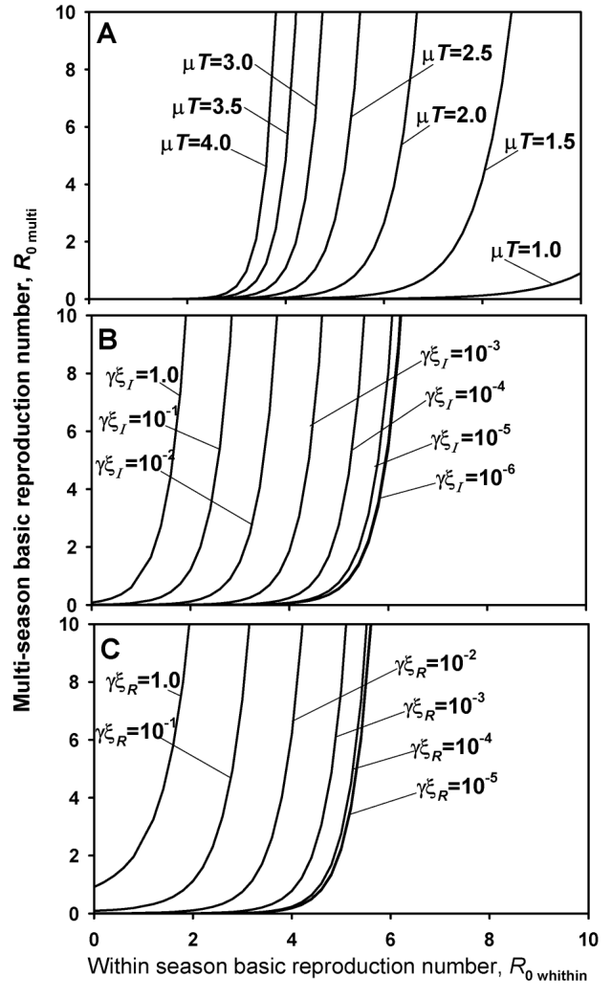{#fig-tt-r0-multi}
 สำหรับช่วงของพารามิเตอร์ตัวอื่น@fig-tt-r0-multi แสดงให้เห็นอย่างชัดเจนว่าค่า $R_{0(within)}$ ที่มากกว่า 1 ไม่ได้หมายความโดยตรงว่า $R_{0(multi)}$ จะต้องมากกว่า 1 ด้วย แม้ว่าการเพิ่มขึ้นของ $R_{0(within)}$ จะนำไปสู่การเพิ่มขึ้นของ $R_{0(multi)}$ ก็ตาม 

ความยาวของฤดูปลูก, $T$, ระยะเวลาการแพร่เชื้อเฉลี่ย, $1/\mu$, การอยู่รอดของเชื้อโรคในระหว่างสองฤดูปลูกที่ต่อเนื่องกัน, $\xi_I$ และ $\xi_R$, และประสิทธิภาพของการติดเชื้อเริ่มต้นเมื่อเริ่มฤดูกาลแต่ละครั้ง, $\gamma$, ทั้งหมดล้วนมีผลกระทบสำคัญต่อ $R_{0(multi)}$ เมื่อ $R_{0(within)} < 1$ จะต้องมีค่า $\gamma\xi_I$ และ/หรือ $\gamma\xi_R$ ที่สูงมากๆ ซึ่งหมายความว่าจะต้องมีความน่าจะเป็นในการรอดชีวิตข้ามฤดูกาล ($\xi$) ที่สูงมาก และ/หรือประสิทธิภาพการติดเชื้อเริ่มต้น ($\gamma$) ที่สูงมาก เพื่อให้มีค่า $I_0$ เพิ่มขึ้นในหลายปีต่อมา ข้อควรสังเกตคือ ความสัมพันธ์นั้นไม่เป็นเชิงเส้นอย่างมาก ในลักษณะที่ความเพิ่มขึ้นเพียงเล็กน้อยใน $R_{0(within)}$ อาจทำให้เกิดความเพิ่มขึ้นอย่างมหาศาลใน $R_{0(multi)}$ นอกจากนี้ $R_{0(within)}$ อาจมีค่าค่อนข้างมาก (ตัวอย่างเช่น $>5$) แต่โรคก็ยังอาจหายไปในหลายปี เนื่องจากโอกาสการรอดชีวิตข้ามฤดูกาลต่ำหรือโอกาสการติดเชื้อจากเชื้อโรคที่รอดชีวิตต่ำสิ่งสำคัญที่ควรย้ำคือ สมการ 6.25 และคำตอบ (สมการ 6.26 และ 6.28) ถูกกำหนดขึ้นภายใต้สถานการณ์ที่ความหนาแน่นของต้นพืชแข็งแรงไม่เป็นปัจจัยจำกัด ซึ่งนี่เป็นสถานการณ์ที่ตรงเป๊ะกับการนำไปใช้ในการกำหนดจุดวิกฤตของโรคระบาด อย่างไรก็ตาม ดังแสดงใน @fig-tt-seasonal-sim ถูกสร้างขึ้นโดยใช้สมการ 5.18

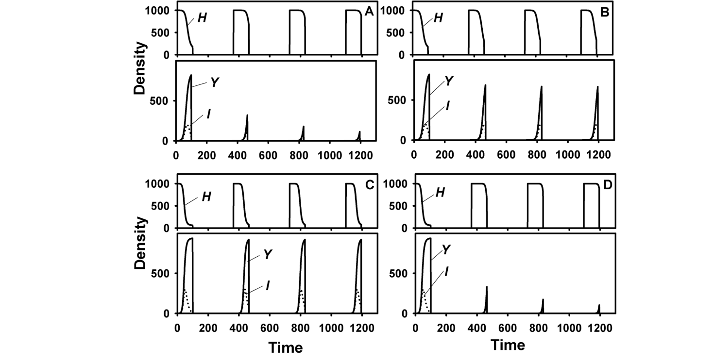{#fig-tt-seasonal-sim}
 ที่ให้ภาพรวมที่กว้างกว่าสำหรับพลวัตภายในฤดูกาล (ซึ่งมีการปรับตัวตามปริมาณการลดลงของ $H(t)$) และไม่ได้ใช้สมการ 6.26 และ 6.286.2.2.4 บทสรุปส่งท้าย (Concluding remarks) มีแบบจำลองเกี่ยวกับพลวัตตามฤดูกาลหลายชิ้นในเอกสารวิชาการที่รวมเอาแง่มุมเพิ่มเติมของโรคระบาดข้ามหลายฤดูกาลเข้าไป (Gubbins and Gilligan, 1997; Gilligan, 2002; Madden and van den Bosch, 2002) สิ่งหนึ่งที่น่าสนใจคือ แบบจำลองเหล่านี้สามารถนำระยะเวลาของการฟักตัวและการแพร่เชื้อ (Latent and infectious periods) ภายในแต่ละฤดูกาลมาใช้ร่วมพิจารณาได้ และยังสามารถนำหัวเชื้อ (Inoculum) ในดิน หรือตัวแปรในช่วงโรคระบาดมาพิจารณาอย่างชัดเจน นอกจากนี้ สมมติฐานแบบง่ายๆ ที่ตั้งว่าพืชป่วยที่รอดชีวิตขึ้นอยู่กับความหนาแน่น ณ เวลา $t = T$ ก็เป็นสิ่งที่สามารถผ่อนปรนให้ยืดหยุ่นขึ้นได้ โดยทั่วไปแล้ว อาจไม่มีการแก้ปัญหาเชิงวิเคราะห์อย่างลงตัว (Analytical solutions) สำหรับค่าความหนาแน่นสุดท้ายของโรคในหลายฤดูกาล, อัตราการเพิ่มขึ้นของ $I_{0,n}$ ในแต่ละฤดูกาล, หรือผลลัพธ์อื่นๆ อย่างไรก็ตามในบางสถานการณ์$R_{0(multi)}$ สัมพันธ์กับค่าความหนาแน่นสุดท้ายของ $Y$ ที่เกิดขึ้นซ้ำๆ ในทุกฤดูกาล นั่นก็คือ $Y(T)$ (Madden and van den Bosch, 2002) หมายความว่า เมื่อ $R_{0(multi)} > 1$ ความรุนแรงของโรค ณ สิ้นฤดูกาล หรือ $Y(T)$ จะสามารถไปถึงระดับที่ดูเหมือนมีเสถียรภาพได้หลังจากผ่านไปไม่กี่ฤดูกาล ซึ่งเราสามารถประมาณค่านี้ได้จากหลักการของ $R_{0(multi)}$ (Madden and van den Bosch, 2002) ด้วยบทนำสั้นๆ ในส่วนนี้ เราหวังว่าจะช่วยสร้างภาพรวมที่ชัดเจนเพียงพอ เพื่อให้ผู้ที่สนใจสามารถนำไปเป็นความรู้พื้นฐานในการอ่านบทความวิจัยที่สำคัญๆ ต่อไป ยังคงจำเป็นต้องมีการวิจัยเพิ่มเติมอีกมาก ทั้งในเชิงทฤษฎีและเชิงทดลอง (หรือจากการสังเกต) เพื่อพัฒนาความเข้าใจที่เป็นทางการมากยิ่งขึ้นเกี่ยวกับโรคพืชที่เกิดสะสมมาหลายฤดูกาลปลูก ความเข้าใจดังกล่าวจะช่วยสร้างความชัดเจน ในการกำหนดกลยุทธ์ระยะยาวเกี่ยวกับการจัดการโรค ตัวอย่างเช่น หากต้องการจัดการโรคชนิดหนึ่ง การมุ่งไปลดค่า $\beta H_0$ (การระบาดภายในฤดูกาล) กับการไปลดโอกาสการรอดชีวิตของหน่วยแพร่เชื้อข้ามฤดูกาล (Between-season survival) วิธีไหนจะมีประสิทธิภาพมากกว่ากัน?

## 6.3 บทบาทของการติดเชื้อปฐมภูมิ (The Role of Primary Infection) {#sec-tt-primary}

 {#sec-tt-primary}

ในหัวข้อ 5.2 และ 6.2 แบบจำลองของเรากำหนดให้การระบาด (epidemic) เริ่มต้นโดยการมีจำนวนสิ่งมีชีวิตที่ติดเชื้อหรือเป็นโรคแบบทันทีทันใด (instantaneously) ณ เวลา $t = 0$ ตัวอย่างเช่น ในแบบจำลอง H-L-I-R (สมการ 5.30) การเริ่มต้นการระบาดด้วยจำนวนผู้ติดเชื้อรายใหม่ $I_0$ จะถูกกำหนดด้วยเงื่อนไข: $H(0) = H_0$, $L(0) = 0$, $I(0) = I_0$ และ $R(0) = 0$ ดังนั้น ความหนาแน่นของจำนวนผู้เป็นโรคในตอนเริ่มต้น $Y(0) = Y_0 = L(0) + I(0) + R(0)$ จึงมีค่าเท่ากับ $I_0$ นั่นเอง แหล่งที่มาของหน่วยการติดเชื้อ (infectious units) ที่เป็นจุดเริ่มต้นการระบาดนั้นอาจเป็นสปอร์ในดิน แมลงพาหะนำไวรัส (viruliferous insect vectors) ที่อพยพเข้ามา หรือวัชพืชข้ามปีที่ติดเชื้อในพื้นที่นั้นๆ แนวทางการกำหนดการติดเชื้อปฐมภูมิ (primary infections) เพื่อเริ่มต้นการระบาดนี้เป็นเรื่องปกติในการสร้างแบบจำลองการระบาดของโรคแบบโพลีไซคลิก (polycyclic diseases) ทั้งในสัตว์ มนุษย์ และพืช (Anderson and May, 1991; Daley and Gani, 1999) แนวคิดหลักก็คือ เมื่อมีเวลาเพียงพอ การติดเชื้อทุติยภูมิ (secondary infections) จะเข้ามา "บดบัง" (overshadow) เหตุการณ์ในช่วงเริ่มต้น โดยเฉพาะอย่างยิ่งถ้าค่า $I_0$ มีขนาดเล็กมาก และค่า $\beta$ ไม่ได้เล็กจนเกินไป แต่อย่างไรก็ตาม ในบางกรณีการสมมติให้การระบาดเริ่มต้นแบบฉับพลันทันทีก็อาจไม่สมจริงเสมอไป เป็นไปได้ว่าการติดเชื้อปฐมภูมิอาจเกิดขึ้นอย่างต่อเนื่องเป็นระยะเวลายาวนาน และอาจเกิดขึ้นพร้อมๆ กับการติดเชื้อรายใหม่ (แบบทุติยภูมิ) ที่เกิดจากการแพร่กระจายจากสิ่งมีชีวิตหนึ่งไปยังอีกสิ่งมีชีวิตหนึ่ง (ไม่ว่าจะเป็น ต้นพืช ราก ใบ ฯลฯ)ขอยกตัวอย่างเช่น การระบาดของโรคจุดใบอ่อน (light leaf spot) ในเรพซีด (oilseed rape) ซึ่งเกิดจากเชื้อรา Pyrenopeziza brassicae นั้น จะเริ่มต้นขึ้นจากแอสโคสปอร์ (ascospores) ที่ถูกสร้างขึ้นบนเศษซากพืชที่หลงเหลืออยู่ในแปลงจากปีที่แล้ว (ถือเป็นการติดเชื้อปฐมภูมิ) แอสโคสปอร์เหล่านี้จะถูกปล่อยออกมาตั้งแต่ช่วงประมาณเดือนกันยายนยาวไปจนถึงเดือนมกราคมของปีถัดไป โดยอัตราการปล่อยแอสโคสปอร์จะเพิ่มขึ้นจากศูนย์ในช่วงก่อนเดือนกันยายน ไปจนถึงจุดสูงสุด แล้วจึงค่อยๆ ลดลงจนเกือบเป็นศูนย์ในช่วงเดือนกุมภาพันธ์ (Papastamati et al., 2002; Gilles et al., 2000, 2001) อีกตัวอย่างหนึ่งคือโรค take-all ในข้าวสาลี ซึ่งเกิดจากเชื้อรา Gaeumannomyces graminis (Bailey and Gilligan, 1999) การติดเชื้อปฐมภูมิของโรคนี้จะเกิดขึ้นเมื่อรากพืชเจริญเติบโตชอนไชไปในดินและสัมผัสกับเชื้อเริ่มต้น (inoculum) ซึ่งกระบวนการนี้จะกินระยะเวลายาวนาน จากนั้นการติดเชื้อทุติยภูมิที่รากจึงจะเกิดตามมาเมื่อรากที่แข็งแรงไปสัมผัสกับรากที่เป็นโรคกระบวนการเริ่มต้นการระบาดแบบไม่ทันทีทันใดที่เกิดจากการติดเชื้อปฐมภูมินี้ สามารถนำไปผนวกรวมกับแบบจำลองต่างๆ ที่เราได้พูดถึงไปแล้วในบทนี้ได้ ดังที่คุณจะได้เห็นต่อไปนี้ ในแง่หลักการแล้ว มันคือการรวมเอาแบบจำลองสำหรับการระบาดแบบโพลีไซคลิกและแบบโมโนไซคลิก (monocyclic) (ดูหัวข้อ 4.4.2) เข้าด้วยกันเป็นแบบจำลองสมการเดียว อย่างไรก็ตาม ผลลัพธ์ที่ได้จากการรวมแบบจำลองลักษณะนี้ต่อพลวัตของการเกิดโรคที่ทำนายไว้นั้น จะค่อนข้างซับซ้อนและมีความชัดเจนน้อยกว่า เมื่อเทียบกับผลลัพธ์ของแบบจำลองโพลีไซคลิกหรือโมโนไซคลิกแบบเดี่ยวๆ แนวทางที่เรากำลังจะแนะนำนี้ได้รับการศึกษาอย่างลึกซึ้งและกว้างขวางมาแล้ว ผลงานชิ้นสำคัญๆ ในแวดวงนี้มาจาก Gilligan และคณะ (เช่น Truscott et al., 1997; Gilligan and Kleczkowski, 1997; Gilligan, 2002 และเอกสารอ้างอิงอื่นๆ ในนั้น) เช่นเดียวกับหัวข้อก่อนๆ เราจะขอปูพื้นฐานเกี่ยวกับงานศึกษาเหล่านี้ ชี้ให้เห็นถึงปรากฏการณ์ที่น่าสนใจบางอย่าง และแนะนำแหล่งข้อมูลเพิ่มเติมสำหรับผู้ที่สนใจศึกษาต่อเราจะใช้คำว่า หน่วยการติดเชื้อปฐมภูมิ (primary infectious units) เพื่อเรียกหน่วยการติดเชื้อที่เป็นตัวก่อให้เกิดการติดเชื้อปฐมภูมิ ซึ่งโดยหลักแล้ว หน่วยเหล่านี้ก็คือเชื้อเริ่มต้นหรือเชื้อปฐมภูมิ (initial หรือ primary inoculum) นั่นเอง ผู้อ่านสามารถย้อนกลับไปดูหัวข้อ 4.3 ในบทที่ 4 สำหรับคำอธิบายที่สมบูรณ์ยิ่งขึ้นเกี่ยวกับแนวคิดเหล่านี้ ในตัวอย่างของโรคจุดใบอ่อน หน่วยการติดเชื้อปฐมภูมิก็คือแอสโคสปอร์ และเราสามารถใช้คำว่า หน่วยการติดเชื้อทุติยภูมิ (secondary infectious units) เพื่อเรียกเชื้อ (ในนิยามอย่างกว้าง) ที่ถูกสร้างขึ้นระหว่างรอบการระบาดในปัจจุบัน ซึ่งมีศักยภาพในการแพร่กระจายและทำให้พืชต้นอื่นๆ ติดเชื้อได้

### 6.3.1 การอนุมานแบบจำลอง (Model derivation)

เราจะใช้แบบจำลอง H-L-I-R ที่ได้กล่าวถึงในหัวข้อ 5.2.3 เป็นพื้นฐานในการอธิบาย หากเราตั้งสมมติฐานว่าการติดเชื้อปฐมภูมิทั้งหมดถูกนำเข้าสู่แปลงปลูก หลังจาก $t = 0$ เราจะได้เงื่อนไขเริ่มต้น (initial conditions) เป็น $H(0) = H_0$, $L(0) = 0$, $I(0) = I_0 = 0$ และ $R(0) = 0$ การติดเชื้อปฐมภูมิเหล่านี้จะถูกนำเข้าไปในแบบจำลองสมการที่ 5.30 ในรูปแบบของสมการจำลอง (pseudo-equation) ดังนี้:การติดเชื้อปฐมภูมิย่อมเกิดจากหน่วยการติดเชื้อปฐมภูมิที่ถูก "ปล่อย" เข้าสู่ระบบโดยเริ่มตั้งแต่เวลา $t = 0$ คำว่า "การปล่อย" ในที่นี้ควรทำความเข้าใจในความหมายกว้างๆ ว่าคือจำนวนเชื้อต่อพื้นที่ หรือปริมาตรต่อหน่วยเวลา ทั้งในดินหรือบนพื้นผิว และอาจครอบคลุมถึงในพื้นที่ข้างเคียง ซึ่งพร้อมที่จะมาสัมผัสกับโฮสต์ (host) ที่ยังแข็งแรงอยู่ เชื้อเหล่านี้อาจถูกสร้างขึ้นมาทั้งหมดตั้งแต่รอบการระบาดก่อนหน้านี้ (ดังที่อภิปรายไว้ในหัวข้อ 6.2 สำหรับการระบาดแบบข้ามฤดูกาล) หรืออาจถูกสร้างขึ้นมาใหม่จริงๆ ก็ได้ (เช่น จากการเจริญแบบแซปโพรไฟต์ (saprophytic growth) ของเชื้อโรค) ระหว่างช่วงก่อนฤดูปลูกหรือแม้กระทั่งในช่วงที่กำลังมีการระบาดอยู่ เราสามารถกำหนดให้ความหนาแน่นของหน่วยการติดเชื้อปฐมภูมิที่พร้อมใช้งานต่อหน่วยเวลา ณ เวลา $t$ มีค่าเท่ากับ $x(t)$ ฟังก์ชันนี้สามารถมีได้หลายรูปแบบ อย่างในตัวอย่างโรคจุดใบอ่อนบนเรพซีดที่กล่าวไปข้างต้น กราฟของ $x(t)$ จะมีลักษณะเป็นรูปคล้ายระฆังคว่ำ (bell-shaped curve) สำหรับเชื้อก่อโรคหลายๆ ชนิด เราสามารถสมมติได้ว่า $x(t)$ จะมีค่าสูงสุดในช่วงเริ่มต้นการระบาด ($t = 0$) และจะค่อยๆ ลดลงเข้าใกล้ 0 เมื่อ $t$ เพิ่มขึ้นเนื่องจากการตายของเชื้อ จำนวนของโฮสต์ที่แข็งแรงต่อหน่วยพื้นที่ที่ถูกสัมผัสโดยหน่วยการติดเชื้อปฐมภูมิจะถูกกำหนดด้วยค่า $\theta H(t)$ ดังนั้น จำนวนต่อหน่วยพื้นที่ของหน่วยการติดเชื้อปฐมภูมิที่เข้ามาสัมผัสกับโฮสต์ที่แข็งแรงต่อหน่วยเวลา จึงมีค่าเท่ากับ $x(t)\theta H(t)$ หน่วยการติดเชื้อปฐมภูมิที่สัมผัสกับโฮสต์ที่แข็งแรงจะมีโอกาส (ความน่าจะเป็น) $\psi_p$ ที่จะทำให้โฮสต์นั้นติดโรค สังเกตว่าความน่าจะเป็นในการติดเชื้อนี้อาจแตกต่างไปจากความน่าจะเป็นในการติดเชื้อของหน่วยการติดเชื้อทุติยภูมิ เราจึงเติมตัวห้อย $p$ ไว้ที่ $\psi$ ตัวอย่างเช่น มีงานวิจัยแสดงให้เห็นว่าหน่วยการติดเชื้อปฐมภูมิของโรคจุดใบอ่อนในเรพซีด (แอสโคสปอร์) มีความน่าจะเป็นในการทำให้เกิดการติดเชื้อได้สูงกว่าหน่วยการติดเชื้อทุติยภูมิ (โคนิเดีย (conidia)) (Gilles et al., 2001) อัตราการติดเชื้ออันเนื่องมาจากหน่วยการติดเชื้อปฐมภูมิจึงเป็น:และแบบจำลองสมการที่ 6.34 จะกลายเป็น:โดยที่ $\beta$ ($=\theta \psi \alpha$) ยังคงเป็นอัตราการถ่ายทอดโรค (transmission rate) สำหรับการติดเชื้อทุติยภูมิดังเช่นที่ผ่านมา และตามที่เรามักจะทำในบทนี้ เราจะติดตามการเปลี่ยนแปลงของความหนาแน่นรวมของการติดเชื้อ (ความรุนแรงของโรคโดยรวม) ตั้งแต่เริ่มการระบาด ซึ่งก็คือ $Y(t) = L(t) + I(t) + R(t)$ สมการเชิงอนุพันธ์ (differential equation) สำหรับปริมาณนี้คือ:นิพจน์ด้านหลังในสมการที่ 6.37 แสดงให้เห็นอย่างชัดเจนว่า $x(t)$ สำหรับการติดเชื้อปฐมภูมิ มีบทบาทในแบบจำลองเทียบเท่ากับ $\alpha I(t)$ สำหรับการติดเชื้อทุติยภูมิมีกรณีพิเศษบางกรณีที่สามารถอธิบายได้โดยตรงจากสมการที่ 6.37 ซึ่งน่าสนใจและควรค่าแก่การพิจารณา หาก $\beta = 0$ แสดงว่าไม่มีการติดเชื้อทุติยภูมิเกิดขึ้น และพัฒนาการของโรค (disease progress) จะเป็นแบบโมโนไซคลิก (monocyclic) อย่างสมบูรณ์ (ดูหัวข้อ 4.4.2) ขึ้นอยู่กับค่าของ $\psi_p$, $\theta$ และ $x(t)$ ปริมาณ $Y(t)$ อาจจะคงอยู่ในระดับต่ำ หรืออาจพุ่งขึ้นไปจนถึงค่าสูงสุดที่เป็นไปได้ ($H_0$) เมื่อสิ้นสุดช่วงการระบาด หากปริมาณหน่วยการติดเชื้อปฐมภูมิที่พร้อมใช้งานมีค่าคงที่ (นั่นคือ $x(t) = x_0$) และ $\beta = 0$ แบบจำลองจะลดรูปลงเหลือเพียง: $dY(t)/dt = \theta \psi_p x_0 H(t) = \theta \psi_p x_0[H_0 - Y(t)]$ ซึ่งจะเหมือนกันทุกประการกับแบบจำลองโมโนโมเลคิวลาร์ (monomolecular model) (สมการ 4.8) ที่ใช้สำหรับโรคแบบโมโนไซคลิก (โรคแบบดอกเบี้ยเชิงเดี่ยว (simple interest)) ในบทที่ 4 (โดยที่ $Y = yH_0$) กล่าวง่ายๆ ก็คือ พารามิเตอร์ $r_M$ ของแบบจำลองโมโนโมเลคิวลาร์มีค่าเทียบเท่ากับ $\theta \psi_p x_0$ นั่นเอง การลดลงของปริมาณเชื้อ ความน่าจะเป็นในการสัมผัสกับโฮสต์ และ/หรือ ความน่าจะเป็นในการก่อให้เกิดการติดเชื้อเมื่อสัมผัสโฮสต์ ล้วนส่งผลให้ค่า $r_M$ ลดลง ค่า $r_M$ ที่สูงกว่าหมายถึงความชันของกราฟ $\ln[1/(1-(Y/H_0))]$ เทียบกับ $t$ ที่ชันขึ้น แต่หากมีเวลาเพียงพอ $Y$ ก็สามารถเพิ่มขึ้นไปจนถึง $H_0$ (หรือ $y$ เข้าใกล้ 1) ได้เสมอ สำหรับค่า $r_M$ ที่เป็นบวกใดๆ ตราบใดที่ $x(t)$ มีค่าคงที่ ($x_0$)หาก $\beta > 0$ และ $\theta \psi_p x_0 > 0$ การระบาดนี้จะเกิดจากส่วนผสมของทั้งกระบวนการแบบโพลีไซคลิกและโมโนไซคลิกเข้าด้วยกัน เมื่อหลายปีก่อน Brassett และ Gilligan (1988) ได้ใช้แบบจำลองผสม (mixture model) ในเวอร์ชันที่ถูกทำให้เรียบง่ายลงนี้เพื่อศึกษาการระบาดของโรคราก วิธีทำให้ง่ายขึ้นในทางปฏิบัติคือการใช้ฟังก์ชันลอจิสติก (logistic function) (ดูหัวข้อ 4.4.3) สำหรับส่วนของการระบาดที่เป็นโพลีไซคลิก แทนที่จะใช้สมการคู่ควบ H-L-I-R ที่ซับซ้อนกว่าในที่นี้ หรือใช้สัญลักษณ์ในปัจจุบันของเราเขียนได้เป็น: $dY(t)/dt = [\Upsilon Y(t) + r_M] H(t)$ โดยที่ $\Upsilon = r_L / H_0$ และ $r_M = \theta \psi_p x_0$ แบบจำลองนี้มีผลเฉลยเชิงวิเคราะห์ (analytical solution) (ดูเพิ่มเติมในหัวข้อ 9.5 ของ Campbell and Madden, 1990) ซึ่งช่วยให้สามารถประมาณค่าพารามิเตอร์อัตราจากชุดข้อมูลได้โดยตรง (และค่อนข้างง่าย)แต่สิ่งที่เราจะมุ่งเน้นในที่นี้คือสมการแบบจำลองทั่วไปที่ 6.37 ซึ่งมาพร้อมกับสมมติฐานที่สมจริงกว่า นั่นคือปริมาณหน่วยการติดเชื้อปฐมภูมิที่พร้อมใช้งาน $x(t)$ ไม่ได้มีค่าคงที่ และใช้โครงสร้าง H-L-I-R สำหรับส่วนที่เป็นโพลีไซคลิก (เมื่อ $\beta > 0$) ซึ่งสะท้อนความเป็นจริงได้ดีกว่า โปรดสังเกตว่า หากจะให้ผลคูณ $\theta \psi_p x(t)$ คงที่ในขณะที่ $x(t)$ มีการเปลี่ยนแปลง ค่าใดค่าหนึ่งระหว่าง $\theta$ หรือ $\psi_p$ จะต้องแปรผันตามเวลาในลักษณะที่ทำให้ผลคูณทั้งสามตัวนี้คงที่ เนื่องจากกรณีดังกล่าวแทบจะเป็นไปไม่ได้เลย (เว้นแต่จะใช้เป็นค่าประมาณ) เราจึงมักจะคาดการณ์ได้ว่าเส้นโค้งพัฒนาการของโรค (disease progress curves) จะมีรูปแบบที่ซับซ้อนกว่าที่พบในแบบจำลอง H-L-I-R ล้วนๆ, แบบจำลองโมโนโมเลคิวลาร์, หรือแบบจำลองผสมระหว่างลอจิสติกและโมโนโมเลคิวลาร์ (ที่มีค่า $r_M$ คงที่) ดังที่กล่าวไว้ในย่อหน้าก่อนหน้า หรือแม้แต่แบบจำลองผสมระหว่าง H-L-I-R และแบบจำลองโมโนไซคลิกที่ $x$ คงที่ในบรรดารูปแบบที่เป็นไปได้ทั้งหมดของ $x(t)$ เราจะพิจารณาเฉพาะสมการการสลายตัวแบบเอกซ์โพเนนเชียล (exponential decay) เท่านั้น หรือกล่าวอีกนัยหนึ่ง เราสมมติว่าค่า $x$ จะลดลงในระหว่างการระบาด จากค่าสูงสุดที่ $t = 0$ นิพจน์สำหรับ $x$ คือ:โดยที่ $x_0$ คือค่าของ $x$ ณ เวลา $t = 0$ และ $\kappa$ คือพารามิเตอร์ (มีหน่วยเป็น 1/เวลา) (และแน่นอนว่าในกรณีพิเศษคือ $\kappa = 0$ จะได้เป็น $x(t) = x_0$) ผลรวม ของจำนวนหน่วยการติดเชื้อปฐมภูมิทั้งหมดที่จะเข้าสู่ระบบต่อหน่วยพื้นที่ตลอดช่วงเวลาที่เป็นไปได้ทั้งหมด หรือ $\Re$ จะมีค่าเท่ากับค่าคงที่ นัยยะของสมการ 6.39 คือปริมาณเชื้อปฐมภูมิที่พร้อมใช้งานมีอยู่อย่างจำกัด และเมื่อเชื้อทั้งหมดถูกปล่อยออกมาแล้ว จะไม่มีโฮสต์รายใดสามารถติดเชื้อจากเชื้อปฐมภูมิได้อีก และหาก $\beta= 0$ ด้วย การระบาดก็จะยุติลง ณ จุดนี้

### 6.3.2 การจำลองแบบจำลอง (Model simulations)

ดังแสดงใน @fig-tt-primary-sec-sim แสดงผลการจำลองหลายรูปแบบจากแบบจำลองสมการที่ 6.36 และ 6.37

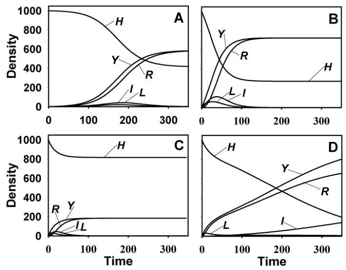{#fig-tt-primary-sec-sim}
 โดยใช้สมการ 6.38 สำหรับ $x(t)$ ในทุกกรณี $\kappa = 0.052/$วัน ซึ่งเป็นค่าที่พบโดย Bailey and Gilligan (1999) นั่นหมายความว่าจะมีเชื้อทั้งหมด $\Re = 19.23 x_0$ หน่วยถูกปล่อยออกมาในช่วงเวลาอันยาวนาน เพื่อความสะดวก เราใช้ $x_0 = 1/$วัน ยกเว้นในรูปที่ 6.5A จะใช้ค่า $\theta \psi_p x_0$ ที่ไม่ใช่ศูนย์ค่าเดียวสำหรับทุกแบบจำลองการระบาด ในรูปที่ 6.5A ค่า $\theta \psi_p x_0 = 0$ (อาจเกิดจาก $\theta = 0$ หรือ $\psi_p = 0$) ซึ่งหมายความว่าการระบาดเป็นแบบโพลีไซคลิกล้วนๆ กราฟนี้สอดคล้องกับรูปที่ 5.7A ที่ได้อภิปรายไปแล้ว ($H_0 = 1000$, $I_0 = 1$; $\beta H_0 = 0.15/$วัน, $1/\omega = 5$, และ $1/\mu = \iota = 10$) ค่า $R_0$ คือ 1.5 รูปที่ 6.5B ใช้พารามิเตอร์โพลีไซคลิกชุดเดียวกัน แต่เพิ่มองค์ประกอบโมโนไซคลิกเข้ามา ($\theta \psi_p x_0 = 0.0105/$วัน) เนื่องจากการมีส่วนร่วมของหน่วยการติดเชื้อปฐมภูมิต่อการระบาดเมื่อเวลาผ่านไป ความเข้มข้นของโรค ($Y(t)$) จึงสูงขึ้นตลอดช่วงเวลา และกราฟของ $Y(t)$ เทียบกับ $t$ จะมีรูปร่างคล้ายตัว $S$ น้อยกว่าที่เห็นใน@fig-tt-primary-simA{#fig-6-5}รูปที่ 6.5C แสดงการระบาดสำหรับสถานการณ์เดียวกับรูปที่ 6.5B ยกเว้นว่า $\beta = 0$ ($R_0 = 0$); นั่นคือกราฟแสดงการระบาดแบบโมโนไซคลิกล้วนๆ ที่มีค่า $\theta \psi_p x(t)$ ลดลงเรื่อยๆ ดังที่อภิปรายไว้ในหัวข้อย่อยก่อนหน้า ค่า $Y$ สุดท้ายจะน้อยกว่า $H_0$ เพราะ $x(t)$ ลดลงสู่ค่า 0 เมื่อเวลาผ่านไป ซึ่งหมายความว่าท้ายที่สุด $dY(t)/dt$ จะลดลงเหลือศูนย์ ตัวอย่างเช่น ด้วยค่า $\kappa$ ที่เลือกใช้ $x(50)$ จะมีค่าเพียง $0.074 x_0$ สังเกตว่าในทางเทคนิคแล้ว ยังคงมีโฮสต์ที่ติดเชื้อแฝง แพร่เชื้อได้ และถูกนำออกอยู่ในการระบาดนี้ อย่างไรก็ตาม เนื่องจากอัตราการถ่ายทอดโรค (อัตราการติดเชื้อทุติยภูมิ) เป็น 0 ในกรณีนี้ จึงไม่มีการติดเชื้อใหม่ๆ เกิดขึ้นจากโฮสต์ที่แพร่เชื้อได้รูปที่ 6.5D แสดงกระบวนการโมโนไซคลิกเช่นเดียวกับในรูปที่ 6.5B และ C แต่มีค่า $\beta H_0$ ต่ำกว่ามาก ($0.01/$วัน) และมีพารามิเตอร์ระยะเวลาเฉลี่ยในการแพร่เชื้อ $1/\mu$ ($=1000$) ยาวนานกว่าที่แสดงใน@fig-tt-primary-simB สำหรับองค์ประกอบโพลีไซคลิก ค่า $R_0$ สำหรับส่วนโพลีไซคลิกของการระบาดนี้ค่อนข้างสูง ($=10$) ซึ่งหมายความว่าแม้จะไม่มีส่วนที่เป็นโมโนไซคลิก ค่า $Y(t)$ ก็จะเข้าใกล้ $H_0$ หากมีเวลาเพียงพอ เนื่องจากค่า $\beta H_0$ มีขนาดเล็ก การติดเชื้อใหม่ในช่วง 30-40 วันแรกจึงเกิดจากหน่วยการติดเชื้อปฐมภูมิเป็นหลัก และระยะเริ่มต้นของการระบาดในรูปที่ 6.5C และ D จึงมีความคล้ายคลึงกันมาก กราฟการพัฒนาของโรคเริ่มแบนราบลงเล็กน้อยในช่วงประมาณวันที่ 40 เนื่องจากเชื้อปฐมภูมิลดลง ($x(t)$) จากนั้นจะเห็นได้ว่า $Y(t)$ เพิ่มขึ้นอีกครั้งเมื่อการติดเชื้อทุติยภูมิเริ่มมีผลต่อกราฟการพัฒนาของโรคอย่างเห็นได้ชัด เนื่องจากการขาดหน่วยการติดเชื้อปฐมภูมิในช่วงเวลาที่มากกว่า 40 (ในตัวอย่างนี้) การพัฒนาของโรคหลังจากเวลานี้ในรูปที่ 6.5D (เช่นเดียวกับในรูปที่ 6.5B) จึงเกือบจะเป็นแบบ H-L-I-R ล้วนๆ แตกต่างจากสถานการณ์ในรูปที่ 6.5B การชะงักชั่วคราวของ $Y$ ใน@fig-tt-primary-simD สามารถสังเกตเห็นได้ชัดเจนเนื่องจากอัตราการเพิ่มของโรคที่ช้าซึ่งเป็นผลจากการติดเชื้อทุติยภูมิ (เพราะ $\beta$ ต่ำ)ระดับสุดท้ายสำหรับการระบาดที่มีทั้งองค์ประกอบโมโนไซคลิกและโพลีไซคลิกสามารถระบุได้อย่างชัดเจน การแสดงที่มาของสมการนั้นเกินขอบเขตของบทนี้ แต่ผู้อ่านสามารถอ้างอิง Metz (1978b) สำหรับที่มาในบริบทของแบบจำลอง Kermack and McKenrick การแสดงที่มานี้มีการอธิบายในบริบทของวิชาพยาธิวิทยาพืชโดย Segarra et al. (2001) ระดับสุดท้ายของการระบาดสามารถคำนวณได้จาก:ดังแสดงใน @fig-tt-final-severity แสดงระดับสุดท้ายของการระบาดในฐานะฟังก์ชันของ $R_0$

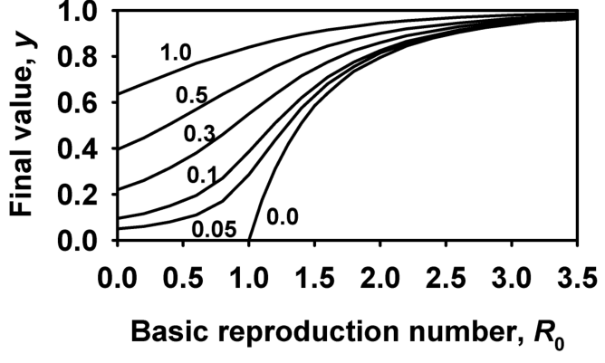{#fig-tt-final-severity}
 สำหรับค่า $\theta \psi_p \Re$ ต่างๆ โปรดสังเกตว่า $\theta \psi_p \Re$ สามารถถือเป็นปริมาณรวมของหน่วยการติดเชื้อปฐมภูมิที่ปล่อยออกมาต่อหน่วยพื้นที่ต่อโฮสต์หนึ่งตัว ที่เข้าไปสัมผัสและทำให้โฮสต์ติดเชื้อได้จริง สำหรับการจำลองในรูปที่ 6.5:เมื่อ $\theta \psi_p \Re = 0$ การระบาดจะเป็นแบบ H-L-I-R ล้วนๆ และค่า $y$ สุดท้ายที่ได้จากสมการ 6.39 จะเท่ากับค่าที่ได้จากสมการ 5.27 ค่า $y$ สุดท้ายจะเพิ่มขึ้นตามค่า $\theta \psi_p \Re$ ที่เพิ่มขึ้นที่ค่า $R_0$ ใดๆ

### 6.3.3 บทวิจารณ์ (Discussion)

ดังที่ได้กล่าวไปแล้วในบริบทของการจำลองข้างต้น การคำนวณค่าระดับการสืบพันธุ์พื้นฐาน ($R_0$) สำหรับองค์ประกอบโพลีไซคลิกของการระบาดนั้นทำได้อย่างตรงไปตรงมา อย่างไรก็ตาม การจะเกิดโรคระบาดหรือไม่ (เมื่อมีความเป็นไปได้ที่จะเกิดการติดเชื้อจากทั้งหน่วยติดเชื้อปฐมภูมิและทุติยภูมิ) ขึ้นอยู่กับทั้งค่า $R_0$ และการรวมกันของพารามิเตอร์สำหรับองค์ประกอบโมโนไซคลิกของการระบาด กล่าวอีกนัยหนึ่งคือ ค่า $R_0$ อาจยังคงน้อยกว่า 1 ได้ แต่ยังคงมีการเพิ่มขึ้นของ $Y$ ตามเวลา ดังที่แสดงใน @fig-tt-primary-sec-simC (หรือในบทที่ 4 สำหรับโรคแบบโมโนไซคลิก) การที่เส้นโค้งการระบาดจะยังคงมีระยะการเติบโตแบบเอกซ์โพเนนเชียลโดยประมาณหรือไม่ (เหมือนในแบบจำลองที่อภิปรายในหัวข้อ 5.2 สำหรับการระบาดแบบโพลีไซคลิกล้วนๆ) นั้น ขึ้นอยู่กับความสมดุลระหว่างองค์ประกอบปฐมภูมิ/โมโนไซคลิก และทุติยภูมิ/โพลีไซคลิกของการระบาด แน่นอนว่ากระบวนการแบบโมโนไซคลิกส่งผลให้เกิดการเพิ่มขึ้นของ $Y$ ในรูปแบบที่ไม่เป็นเอกซ์โพเนนเชียล

ที่ค่า $R_0 > 3$ การเพิ่มขึ้นของหน่วยติดเชื้อปฐมภูมิจะทำให้ค่า $y_\pm$ เพิ่มขึ้นเพียงเล็กน้อยเท่านั้น ทั้งนี้เนื่องจากองค์ประกอบโพลีไซคลิกมีบทบาทเด่นอย่างมากเมื่อ $R_0$ มีค่าสูง ผลกระทบของ $\theta\psi_p\Re$ จะเห็นได้อย่างชัดเจนเมื่อ $R_0$ มีค่าต่ำ ซึ่งเป็นช่วงที่ค่า $y_\pm$ จะค่อนข้างต่ำหากไม่มีการไหลเข้ามาของหน่วยติดเชื้อปฐมภูมิ (ดังแสดงใน @fig-tt-final-severity) สังเกตว่า $y_\pm$ สามารถมีค่ามากกว่า 0 ได้แม้ว่าค่า $R_0$ จะอยู่ระหว่าง 0 ถึง 1 อันเนื่องมาจากอิทธิพลของหน่วยติดเชื้อปฐมภูมิ ตัวอย่างเช่น เมื่อ $R_0 = 0$ และ $\theta\psi_p\Re = 0.2$ จะมีหน่วยพืชประมาณ 20% ที่กลายเป็นโรคในที่สุด ($y_\pm \approx 0.2$) ใน @fig-tt-final-severity ซึ่งสอดคล้องกับผลการจำลองที่แสดงใน @fig-tt-primary-sec-simC ในทำนองเดียวกัน ที่ $R_0 = 1.5$ และ $\theta\psi_p\Re = 0.2$ ค่า $y_\pm \approx 0.72$ ก็สอดคล้องกับผลการจำลองใน @fig-tt-primary-sec-simB

คำถามสุดท้ายที่เราจะกล่าวถึงในที่นี้คือ: เมื่อไหร่ที่เราควรให้ความสำคัญกับการพิจารณาส่วนผสมระหว่างกระบวนการโมโนไซคลิกและโพลีไซคลิก? ไม่มีคำตอบที่เป็นทางการ แต่แนวทางนั้นชัดเจนจากผลลัพธ์เชิงตัวเลขและเชิงวิเคราะห์บางส่วน สำหรับการระบาดที่มีส่วนของโพลีไซคลิกชัดเจน การเพิ่มความซับซ้อนโดยการใส่ส่วนของโมโนไซคลิกเข้าไปจะแทบไม่เกิดประโยชน์อะไรหากค่า $\beta H_0$ และ/หรือ $R_0$ มีค่าสูง (สูงกว่าในการจำลองของ @fig-tt-primary-sec-sim) เว้นแต่ว่าค่า $\theta\psi_p\Re$ จะสูงมาก นอกจากนี้ สำหรับการระบาดที่มีส่วนของโมโนไซคลิกชัดเจนซึ่งเกิดขึ้นเป็นเวลานาน (เช่น ตลอดระยะเวลาของฤดูปลูก) และมีค่า $\theta\psi_p\Re$ ปานกลางหรือสูงขึ้นไป การเพิ่มความซับซ้อนด้วยการใส่ส่วนของโพลีไซคลิกเข้าไปในแบบจำลองจะเกิดประโยชน์น้อยมากเมื่อ $R_0$ มีค่าต่ำมาก โดยเฉพาะอย่างยิ่งสำหรับการระบาดที่มีระยะเวลาสั้น ซึ่งแทบไม่มีเวลาให้ผลสะสมแบบทวีคูณของการระบาดแบบโพลีไซคลิกส่งอิทธิพลได้มากนัก ตามที่คาดไว้ สถานการณ์ก้ำกึ่งที่มีค่า $R_0$ และ $\theta\psi_p\Re$ ปานกลาง คือจุดที่แบบจำลองแบบผสมผสานจะมีคุณค่าอย่างยิ่ง ตัวอย่างเช่น โรคทางรากพืชเมื่อหน่วยพืชอาศัยที่เราสนใจคือราก (หรือส่วนของราก) ไม่ใช่ทั้งต้น แต่หากหน่วยของพืชอาศัยที่พิจารณาคือทั้งต้น โอกาสที่การระบาดจะเป็นแบบโมโนไซคลิกจะมีสูงกว่ามาก ซึ่ง Gilligan (2002) ได้ทบทวนประเด็นนี้ไว้อย่างละเอียดถี่ถ้วน

เพื่อสรุปหัวข้อนี้ เราขอชี้ให้เห็นว่าความเชื่อมโยงระหว่างแบบจำลอง H-L-I-R (สมการ 5.30) และแบบจำลองในหัวข้อนี้ (สมการ 6.36) นั้นแนบแน่นกว่าที่คิด เมื่อใช้สมการ 6.38 สำหรับ $x(t)$ สามารถแสดงในทางคณิตศาสตร์ได้ว่า เมื่อ $\kappa$ เข้าสู่อนันต์ และ $\theta\psi_p$ เข้าสู่อนันต์ ในลักษณะที่อัตราส่วน $\theta\psi_p/\kappa$ มีค่าคงที่ ($=\aleph$) แล้ว $\aleph x_0 H_0$ จะกลายเป็นความหนาแน่นเริ่มต้นของหน่วยพืชที่ติดเชื้อ ($L(0)$) และ $x(t)$ จะเท่ากับ 0 ทันทีหลังจาก $t = 0$ ด้วยประสิทธิภาพการติดเชื้อที่สูงแต่มีการสูญเสียเชื้อเริ่มต้นอย่างรวดเร็ว ระยะโมโนไซคลิกจึงมีอายุสั้นมาก กล่าวอีกนัยหนึ่งก็คือ การพิจารณาสมการ 6.36 ในฐานะแบบจำลองทั่วไปร่วมกับสมมติฐานเพิ่มเติมในที่นี้ นำไปสู่นิพจน์ที่เป็นทางการสำหรับสภาวะเริ่มต้นของการระบาดแบบโพลีไซคลิกล้วนๆ ในแง่ของความหนาแน่นของเชื้อเริ่มต้นและวิธีการที่เชื้อเหล่านี้เข้าทำลายโฮสต์

## 6.4 การระบาดของโรคที่มีการถ่ายทอดผ่านแมลงพาหะ (Epidemics with Vector Transmission) {#sec-tt-vectors}

เชื้อก่อโรคพืชหลายชนิดถ่ายทอดจากพืชที่ติดเชื้อไปยังต้นที่แข็งแรงผ่านพฤติกรรมการกินอาหารของแมลงพาหะ (Vectors) ซึ่งมักจะเป็นแมลงศัตรูพืช (เช่น เพลี้ยอ่อน เพลี้ยจักจั่น เพลี้ยกระโดด และด้วงบางชนิด) (Nault, 1997; Madden et al., 2000b) ไฟโตพลาสมา (Phytoplasmas) สไปโรพลาสมา (Spiroplasmas) และโพรแคริโอตอื่นๆ บางชนิด (เช่น เชื้อสาเหตุของโรค Pierce's disease ในองุ่น) ก็มีการถ่ายทอดผ่านพาหะเช่นเดียวกัน สัตว์ขาปล้องอื่นๆ (เช่น ไร) และสิ่งมีชีวิตอื่นๆ (เช่น ไส้เดือนฝอย เชื้อรา) ก็อาจถ่ายทอดไวรัสบางชนิดได้ แต่ในที่นี้เราจะมุ่งเน้นเฉพาะพาหะที่เป็นแมลงเท่านั้น

เมื่อแมลงพาหะดูดกินน้ำเลี้ยงจากพืชที่ติดเชื้อ มันสามารถรับไวรัสเข้ามาได้หากความเข้มข้นของไวรัสในพืชมีปริมาณสูงพอ สำหรับโรคไวรัสพืชหลายๆ ชนิด ไวรัสพืชแทบจะไม่มีหรือมีผลน้อยมากต่อตัวแมลงพาหะ (Nault, 1997) และเมื่อแมลงนั้นไปดูดกินน้ำเลี้ยงจากพืชต้นที่แข็งแรง ไวรัสก็สามารถถูกถ่ายทอด (Inoculated) เข้าสู่พืชต้นใหม่ และทำให้เกิดการติดเชื้อขึ้น โรคไวรัสพืชมักเป็นโรคที่แพร่กระจายไปทั่วทั้งต้น (Systemic) หมายความว่าเมื่อเกิดการติดเชื้อ ไวรัสจะสามารถเพิ่มจำนวนและเคลื่อนที่ไปทั่วทั้งต้นพืชได้ เนื่องจากการติดเชื้อไวรัสเป็นแบบทั้งระบบ คำนิยามธรรมชาติของ "หนึ่งหน่วยปัจเจก" สำหรับโรคเหล่านี้จึงหมายถึงพืชทั้งต้น และในหัวข้อนี้เราจะใช้คำว่า "ต้นพืช" (Plant) แทนคำว่า "หน่วยปัจเจก" (Individual) เพื่อความสะดวกในการสื่อสาร

ระยะฟักตัว (Latent period) ในต้นพืช คือเวลาที่ไวรัสต้องใช้ในการเพิ่มจำนวนและการเคลื่อนที่ภายในต้นพืช จนกระทั่งมีความเข้มข้นของไวรัสเพียงพอที่จะทำให้แมลงพาหะตัวหนึ่งสามารถรับเชื้อไปได้ ส่วนระยะเวลาการแพร่เชื้อ (Infectious period) ในต้นพืชจะสิ้นสุดลงเมื่อความเข้มข้นของไวรัสในต้นพืชลดลง จนกระทั่งแมลงพาหะไม่สามารถรับเชื้อไวรัสได้อีกต่อไปเมื่อมาดูดกินน้ำเลี้ยง สำหรับโรคไวรัสพืชที่มีแมลงเป็นพาหะ จะมีรูปแบบหรือชั้นของการถ่ายทอดโรคขั้นพื้นฐาน 4 รูปแบบ ซึ่งได้รับการอภิปรายในบริบททางระบาดวิทยาโดย Madden et al. (2000b) รูปแบบเหล่านี้จำแนกตาม: (1) ระยะเวลาที่พาหะยังคงสามารถแพร่เชื้อได้หลังจากได้รับไวรัสมาจากพืช และ (2) กลไกทางสรีรวิทยาของการถ่ายทอดเชื้อ (เช่น ไวรัสมีการเพิ่มจำนวนในตัวแมลงพาหะหรือไม่) ในแง่ของพลวัตประชากร รูปแบบการถ่ายทอดโรคจะเป็นตัวกำหนดระยะฟักตัวและระยะแพร่เชื้อในตัวแมลงพาหะโดยตรง รวมถึงกำหนดอัตราที่แมลงพาหะจะได้รับเชื้อจากพืชที่ติดเชื้อ (หรืออัตราที่มันถ่ายทอดเชื้อสู่พืชที่แข็งแรง) ในที่นี้เราจะพิจารณาเพียงรูปแบบย่อยบางส่วนจากความเป็นไปได้ทั้งหมด

เนื่องจากแบบจำลองทั้งหมดเป็นการลดรูปความซับซ้อนของความเป็นจริง จึงเป็นไปได้อย่างยิ่งที่เราจะสร้างแบบจำลองและวิเคราะห์การระบาดของโรคไวรัสพืชโดยไม่ต้องคำนึงถึงประชากรของแมลงพาหะอย่างชัดเจน ตัวอย่างเช่นในบทที่ 4 และงานวิจัยอื่นๆ (เช่น Chan and Jeger, 1994; Madden and Campbell, 1986; Madden et al., 1987b; Nutter, 1997; Zhang et al., 2000a) ยกตัวอย่างเช่น หากนำแบบจำลอง H-L-I-R (สมการ 5.30) มาใช้ พารามิเตอร์การถ่ายทอดโรค $\beta$ จะเป็นฟังก์ชันของปัจจัยต่างๆ เช่น อัตราการรับเชื้อและการถ่ายทอดเชื้อไวรัส ตลอดจนความหนาแน่นของประชากรแมลงพาหะ ความสัมพันธ์เชิงฟังก์ชันนี้อาจมีความซับซ้อนอย่างยิ่งขึ้นอยู่กับชนิดของการถ่ายทอดโรค (Madden and Campbell, 1986) ในหัวข้อนี้ เรามีความสนใจที่จะขยายแบบจำลองที่ได้พิจารณามาแล้ว ให้เชื่อมโยงประชากรของแมลงพาหะเข้ากับประชากรของพืชที่เป็นโรคโดยตรง เพื่อสร้างความเข้าใจที่ลึกซึ้งยิ่งขึ้นเกี่ยวกับการระบาดของโรคไวรัสพืช

เพื่อเป็นการปูพื้นฐานเข้าสู่แบบจำลองไวรัส-พาหะ เราจะอภิปรายแบบจำลองทั่วไปเวอร์ชันหนึ่งที่ได้รับการพัฒนา (ในหลากหลายรูปแบบ) เพื่อศึกษากลยุทธ์การจัดการโรคไวรัส (Chan and Jeger, 1994; Holt and Chancellor, 1996; Holt et al., 1997, 1999; Jeger and Thresh, 1993; Jeger et al., 1998, 2002, 2004; Zhang et al., 2000a,b; Madden et al., 1990b, 2000b) แบบจำลองนี้มีความคล้ายคลึงกับแบบจำลองแรกสำหรับโรคที่ถ่ายทอดผ่านพาหะในมนุษย์ ซึ่งพัฒนาขึ้นโดย Ross (1911, 1915) เพื่อศึกษาโรคมาลาเรีย เมื่อใดก็ตามที่เราพลอตกราฟความหนาแน่นของพืชที่แข็งแรงและติดเชื้อ หรือจุดวิกฤตสำหรับการพัฒนาของโรคระบาด เราจะใช้ค่าพารามิเตอร์ที่นำมาใช้กับโรคไวรัสใบด่างมันสำปะหลัง (Cassava mosaic virus disease) เป็นหลัก โรคนี้ได้รับความสนใจอย่างกว้างขวางเนื่องจากการระบาดใหญ่ที่รุนแรงมาก ซึ่งสร้างความเสียหายอย่างมหาศาลต่อผลผลิตตลอดทศวรรษที่ผ่านมาในทวีปแอฟริกา (เช่น Otim-Nape et al., 2000)

การอภิปรายการพัฒนาแบบจำลองสำหรับระบบไวรัส-พาหะในที่นี้ ยังมีวัตถุประสงค์เพิ่มเติมในการร่างขั้นตอนสำคัญบางประการ ในการสร้างแบบจำลองสำหรับโรคพืชโดยใช้ระบบสมการเชิงอนุพันธ์คู่ควบ จากนั้นจึงสำรวจคุณสมบัติของแบบจำลอง รวมถึงการทำนายของแบบจำลองสำหรับค่าพารามิเตอร์ต่างๆ

### 6.4.1 การสร้างแบบจำลอง (Model derivation)

ประชากรโฮสต์ถูกแบ่งออกเป็นพืชที่แข็งแรงและพืชที่แพร่เชื้อได้ เช่นเคย ความหนาแน่นของพืชที่แข็งแรงกำหนดด้วย $H(t)$ และของพืชที่แพร่เชื้อได้คือ $I(t)$ ดังนั้นเราจึงสมมติว่าระยะแฝงคือ 0 และระยะแพร่เชื้อมีค่าเป็นอนันต์ (คือยาวนานเท่ากับหรือมากกว่าช่วงการระบาด) นี่เป็นการทำระบบให้เรียบง่ายอย่างเห็นได้ชัด แต่ทำให้เราพิจารณาพลวัตในระยะยาวได้ แบบจำลองนี้เป็นการลดความซับซ้อนที่ยอมรับได้เสมอเมื่อระยะแฝงที่แท้จริงมีช่วงสั้นและระยะแพร่เชื้อมีช่วงยาว ประชากรพาหะถูกแบ่งออกเป็นพวกที่ไม่มีไวรัสและพวกที่มีไวรัส โดยที่คำว่าพาหะที่มีไวรัส (viruliferous) หมายถึงพาหะที่รับไวรัสมาจากการดูดกินพืชที่แพร่เชื้อได้ และ (มีศักยภาพ) สามารถถ่ายทอดไวรัสเมื่อไปดูดกินพืชที่แข็งแรง ความหนาแน่นของพาหะที่ไม่มีไวรัสกำหนดด้วย $X(t)$ และพาหะที่มีไวรัสคือ $Z(t)$ เราจึงกำลังสมมติว่าไม่มีระยะแฝง (หรือเพื่อความเรียบง่ายคือมีระยะแฝงที่สั้นมาก) ในตัวพาหะ และระยะแพร่เชื้อยาวนานมาก พลวัตของระบบไวรัส-พาหะถูกแสดงไว้ใน @fig-tt-vector-diagram

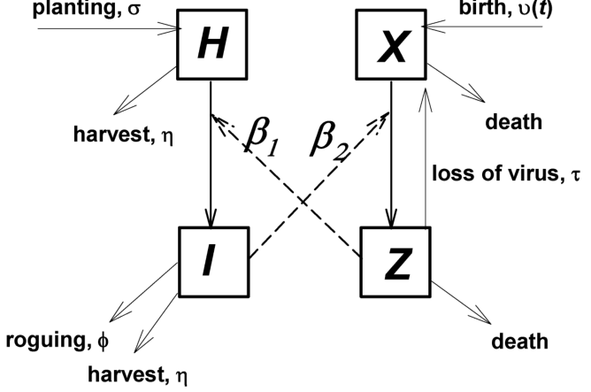{#fig-tt-vector-diagram}
ในแบบจำลอง $H(t)$ เพิ่มขึ้นจากการปลูกพืชใหม่และลดลงจากการเก็บเกี่ยวพืช ส่วนนี้ของแบบจำลองคล้ายกับแบบจำลองโพลีไซคลิกแบบโฮสต์มีการเปลี่ยนแปลง (dynamic-host) ในหัวข้อ 6.2 (สมการ 6.5) ซึ่งใช้สำหรับพื้นที่ขนาดค่อนข้างใหญ่ในช่วงเวลาที่ยาวนาน (มีการปลูกและเก็บเกี่ยวหลายครั้ง) ความหนาแน่นของพืชที่แข็งแรงยังลดลงด้วยเมื่อพืชติดไวรัสจากการที่พาหะมีไวรัสมาดูดกิน สิ่งนี้ถูกอธิบายในสมการจำลอง:{#fig-6-7}ตัวห้อย $H$ อ้างอิงถึงการเก็บเกี่ยวพืชที่แข็งแรง $I(t)$ เพิ่มขึ้นจากการติดเชื้อที่ทำให้ความหนาแน่นของพืชที่แข็งแรงลดลง และลดลงจากการเก็บเกี่ยวและการตายของพืชที่เป็นโรค สมการจำลองที่อธิบายพลวัตความหนาแน่นของพืชที่เป็นโรคจึงเป็นดังนี้:ตัวห้อย $I$ หมายถึงต้นพืชที่แพร่เชื้อได้ เช่นเดียวกับแบบจำลองในหัวข้อ 6.2.1 เราสมมติว่ามีอัตราการปลูกคงที่ $\sigma$ และอัตราการเก็บเกี่ยวคงที่ $\eta$ ซึ่งให้พจน์ดังนี้:สังเกตว่า $\eta$ สามารถเป็นอัตราการตายของพืชที่เกิดจากปัจจัยอื่นๆ ทั้งหมดนอกเหนือจากโรค (ดังนั้นจึงเหมือนกันทั้งพืชที่แข็งแรงและติดเชื้อ) อันที่จริง $\eta$ อาจเป็นผลรวมของอัตราการเก็บเกี่ยวและอัตราการตายตาม "ธรรมชาติ" (ตราบใดที่การตายตามธรรมชาติไม่ได้ขึ้นอยู่กับสถานะการติดเชื้อ) พืชที่เป็นโรคอาจตายเพราะโรค หรือหากมีการเริ่มโครงการสุขาภิบาล ก็อาจถูกถอนทิ้ง (roguing) โดยเกษตรกร เราสมมติว่ามีความน่าจะเป็นคงที่ $\phi$ ต่อหน่วยเวลาที่พืชที่เป็นโรคจะถูกนำออกจากระบบอันเนื่องมาจากโรค พจน์ของอัตราการตายจึงเป็น:สำหรับอัตราที่พืชที่แข็งแรงกลายเป็นพืชที่แพร่เชื้อ เราสมมติว่ามีอัตราการถ่ายทอดโรคคงที่ $\beta_1$ และพจน์การติดเชื้อจะอยู่ในรูปของ:เมื่อแทนค่าสมการ 6.43–6.45 ลงในสมการ 6.41 และ 6.42 แบบจำลองที่อธิบายประชากรพืชจึงอยู่ในรูปแบบ:โปรดสังเกตว่าสมการนี้แตกต่างจากสมการ 5.18 ที่ไม่มีพาหะเข้ามาเกี่ยวข้องอย่างไร ในพจน์ของอัตราการสัมผัสสำหรับการติดเชื้อของพืชโฮสต์ ค่า $I(t)$ ถูกแทนที่ด้วย $Z(t)$ ซึ่งเป็นความหนาแน่นของพาหะที่มีไวรัส เรา สามารถ พิจารณากรณีพิเศษที่ความหนาแน่นของโฮสต์รวมไม่มีพลวัต (หากไม่มีโรค) ซึ่งหมายถึงการใช้ $\eta = 0$ เพื่อไม่ให้มีการปลูกหรือการเก็บเกี่ยว อย่างไรก็ตาม สำหรับสถานการณ์ระยะยาวที่เราสนใจในที่นี้ที่มีการปลูกและเก็บเกี่ยวใหม่ การลดความซับซ้อนนี้ไม่มีประโยชน์ เราจึงพิจารณาเฉพาะกรณีที่ $\eta > 0$ความหนาแน่นของพาหะที่ไม่มีไวรัส (ปราศจากไวรัส) $X(t)$ เพิ่มขึ้นจากการเกิด (ฟัก, ลอกคราบ ฯลฯ) ของพาหะ และลดลงจากการตายของพาหะ นอกจากนี้ ความหนาแน่นของพาหะที่ไม่มีไวรัสยังลดลงเมื่อมีการรับไวรัสโดยพาหะที่ดูดกินพืชที่เป็นโรค และความหนาแน่นก็เพิ่มขึ้นเมื่อพาหะที่มีไวรัสสูญเสียไวรัสที่รับมา ซึ่งถูกอธิบายโดย:จำนวนของพาหะที่มีไวรัส $Z(t)$ เพิ่มขึ้นจากการที่พาหะที่ไม่มีไวรัสได้รับเชื้อเมื่อดูดกินพืชที่เป็นโรค และลดลงจากการที่พาหะที่มีไวรัสสูญเสียไวรัสและการตายของพาหะ สมการจำลองสำหรับกลุ่มนี้คือ:ในขณะนี้ เราจะกำหนดอัตราการเกิดของแมลงพาหะด้วยฟังก์ชันทั่วไป $\upsilon(t)$ แมลงพาหะแต่ละตัวมีความน่าจะเป็น $\Xi$ ต่อหน่วยเวลาที่จะตาย จะได้ว่า:พาหะที่มีไวรัสมีความน่าจะเป็น $\tau$ ต่อหน่วยเวลาที่จะสูญเสียไวรัส ซึ่งนำไปสู่:หากย้อนกลับไปดูการอภิปรายในหัวข้อ 5.2.2.2 และ 5.2.3.1 เกี่ยวกับระยะแฝงและระยะแพร่เชื้อที่สัมพันธ์กับความน่าจะเป็นต่อหน่วยเวลาในการออกจากหมวดหมู่ เราจะพบว่าสมมติฐานนี้บ่งบอกว่าระยะเวลาเฉลี่ยที่พาหะสามารถแพร่เชื้อได้มีค่าเท่ากับ $1/\tau$สำหรับอัตราที่พาหะได้รับไวรัส เราจะใช้พจน์ที่คล้ายคลึงกับอัตราที่พืชติดเชื้อจากการดูดกินของพาหะ โดยอธิบายการรับไวรัสที่ขึ้นอยู่กับความหนาแน่นของพาหะที่ไม่มีไวรัสและพืชที่เป็นโรคดังนี้:สังเกตว่าอัตราการรับไวรัสเป็นฟังก์ชันของผลคูณของความหนาแน่นระหว่างพาหะที่ไม่มีไวรัสและพืชที่เป็นโรค ดังนั้น สมการแบบจำลองสำหรับพลวัตของประชากรพาหะคือ:ตอนนี้เราจำเป็นต้องระบุอัตราการเกิด (การฟัก, ลอกคราบ) ของพาหะในรายละเอียดเพิ่มเติม ในที่นี้เราจะพิจารณาเฉพาะไวรัสพืชที่ไม่มีผลต่อชีววิทยาของพาหะ Madden et al. (2000b) และเอกสารอ้างอิงในนั้น ได้ครอบคลุมประเด็นนี้อย่างกว้างขวางมากขึ้น ดังนั้น ความหนาแน่นรวมของพาหะ $X(t) + Z(t)$ จะไม่ขึ้นอยู่กับไวรัสหรือความหนาแน่นของพืชที่แข็งแรงและพืชที่เป็นโรค สมมติฐานง่ายๆ ที่เราตั้งขึ้นได้เพื่อคำนวณอัตราการเกิดคือแมลงพาหะทุกตัวที่ตายไปจะถูกแทนที่ด้วยพาหะตัวใหม่ผ่านการเกิดในประชากร นั่นหมายความว่าเราสมมติให้ประชากรพาหะมีขนาดคงที่ ซึ่งเราจะแทนด้วยตัวแปร $P$ พูดอีกอย่างก็คือ ความหนาแน่นรวมของพาหะถือเป็นพารามิเตอร์ ไม่ใช่ตัวแปร การที่ประชากรพาหะรวมคงที่นี้ชี้ให้เห็นว่า:การหาอนุพันธ์ของสมการ 6.53 เทียบกับเวลาจะได้:เมื่อ $P$ เป็นค่าคงที่ นั่นเป็นเพราะอัตราการเปลี่ยนแปลงรวมของประชากรพาหะจะต้องเป็น 0 หาก $P$ ไม่เปลี่ยนแปลง แน่นอนว่า อัตราการเปลี่ยนแปลงของพาหะที่ไม่มีไวรัสและมีไวรัสสามารถไม่ใช่ศูนย์ได้ทั้งคู่แม้ว่าผลรวมจะเป็นศูนย์ เมื่อแทนสมการ 6.52 ลงในสมการ 6.54 เราจะพบว่า:ซึ่งสามารถเขียนใหม่ได้เป็น:ดังนั้น เราจึงได้ $\upsilon(t) = \Xi P$ และเมื่อแทนสิ่งนี้ในสมการ 6.52 เราก็จะกำหนดแบบจำลองได้สมบูรณ์สมมติฐานเกี่ยวกับความหนาแน่นคงที่ของประชากรพาหะนำไปสู่ผลลัพธ์ที่ช่วยให้เราทำระบบให้ง่ายขึ้น: สมการพาหะอันหนึ่งได้กลายเป็นสิ่งที่ไม่จำเป็น เพื่อให้เห็นภาพนี้ ลองเขียนสมการ 6.53 ใหม่ในรูปแบบ $X(t) = P - Z(t)$ แทนค่านิพจน์นี้สำหรับ $X(t)$ ในสมการสำหรับ $dZ(t)/dt$ เราจะพบว่า:และตามสมการ 6.54 ค่า $dX(t)/dt$ ก็จะได้เป็น $-dZ(t)/dt$ ดังนั้น อัตราการเปลี่ยนแปลงความหนาแน่นของพาหะที่มีไวรัสสามารถถูกคำนวณได้อย่างเป็นอิสระจากความหนาแน่นของพาหะที่ไม่มีไวรัส (นั่นคือ ไม่มี $X$ อยู่ในสมการ 6.57 สำหรับอัตราการเปลี่ยนแปลงของ $Z$) สังเกตว่าเมื่อใดก็ตามที่เรารู้ความหนาแน่นของพาหะที่มีไวรัส $Z(t)$ ความหนาแน่นของพาหะที่ไม่มีไวรัสก็คำนวณได้อย่างง่ายดายจาก $X(t) = P - Z(t)$ เมื่อนำชิ้นส่วนทั้งหมดมาประกอบเข้าด้วยกัน แบบจำลองพลวัตการระบาดของโรคไวรัส-พาหะก็คือ:สมการ 6.58 เป็นรูปแบบหนึ่งของแบบจำลองการระบาดที่มีการเติบโตของโฮสต์ (ดูหัวข้อ 6.2) ซึ่งถูกขยายความให้ครอบคลุมถึงการถ่ายทอดโรคโดยพาหะ โปรดสังเกตว่าหากไม่มีการถอนพืชทิ้ง (หรือการตายที่เกิดจากการติดเชื้อ) ของพืชที่เป็นโรค ($\phi = 0$) ความหนาแน่นรวมคงที่ของพืช $H_{\max}$ ($= H + I$) จะคงอยู่ตลอดช่วงการระบาด หากความหนาแน่นเริ่มต้นของโฮสต์ ($H_0 + I_0$) มีค่าเท่ากับ $H_{\max}$ อย่างไรก็ตาม เราไม่ได้จำกัดให้แบบจำลองนี้ใช้ได้เฉพาะกรณีที่มีความหนาแน่นของโฮสต์คงที่ นอกจากนี้ยังควรสังเกตด้วยว่า ความหนาแน่นของต้นพืชที่ถูกถอนทิ้ง [$B(t)$] สามารถนับรวมไว้อย่างเจาะจงโดยใช้สมการเพิ่มเติมในสมการ 6.58 สำหรับ $dB(t)/dt$ ($=+\phi I(t)$) แต่ไม่จำเป็นต้องแสดงออกอย่างโจ่งแจ้งเช่นนั้น

### 6.4.2 การจำลองแบบจำลอง (Model simulations)

ดังแสดงใน @fig-tt-vector-sim (คอลัมน์ซ้ายมือ) แสดงชุดของผลการจำลองจากแบบจำลองสมการ 6.58

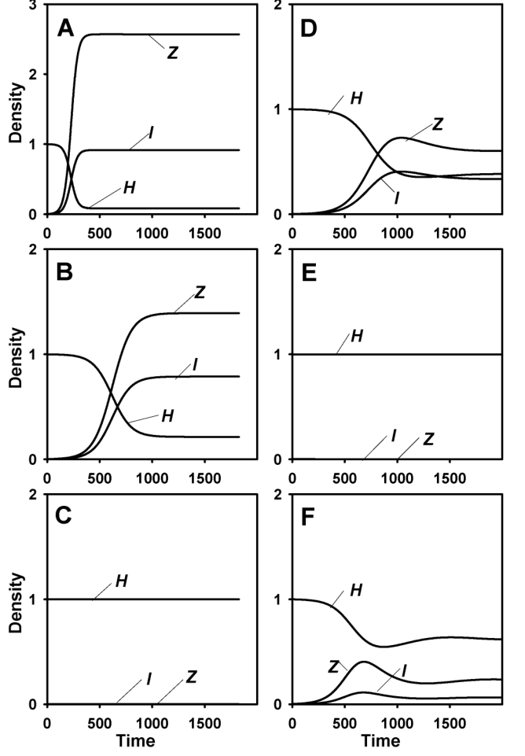{#fig-tt-vector-sim}
 สำหรับค่าพารามิเตอร์อัตราการปลูกเชื้อ (inoculation rate) $\beta_1$ ที่แตกต่างกัน ในกรณีที่ไม่มีการถอนทิ้ง (roguing/removal) พืชที่เป็นโรค ($\phi = 0$) เราสมมติว่าอัตราการรับเชื้อและอัตราการปลูกเชื้อมีค่าเท่ากัน (ซึ่งสมเหตุสมผลสำหรับไวรัสพืชหลายชนิด [Madden et al., 2000b]) การระบาดเริ่มต้นที่ $I_0 = 1$ (ดังนั้น $H_{\max} = 1000$), $P = 50$ และ $Z_0 = 0$ (เพื่อให้พาหะทั้งหมดปราศจากไวรัส) ค่าของความหนาแน่นพืชที่พล็อตถูกปรับสเกลใหม่เป็น 0-1 เพื่อให้แสดงบนกราฟเดียวกันกับพาหะที่มีไวรัสได้อย่างชัดเจน สำหรับค่า $\beta_1$ ที่น้อยมากๆ จะไม่มีการระบาดเกิดขึ้น ในขณะที่ค่าที่สูงกว่าจะเกิดการระบาด เปอร์เซ็นต์ของพืชที่ติดเชื้อจะสูงมากเมื่อ $\beta_1$ สูง แต่ก็เป็นไปตามที่พบในการระบาดแบบโพลีไซคลิกทั่วไป (ดูหัวข้อ 5.2 และ 6.2) คือไม่ใช่ทุกต้นที่ติดเชื้อ สถานะคงที่ (steady state) ปรากฏให้เห็นเมื่อพืชที่ติดเชื้อที่สูญเสียไป (จากการเก็บเกี่ยว) สมดุลกับการปลูกใหม่ ยิ่งไปกว่านั้น ยังมีพฤติกรรมจุดเปลี่ยน (threshold behavior) ที่ชัดเจนสำหรับการพัฒนาของการระบาด ซึ่งคล้ายคลึงอย่างมากกับพฤติกรรมจุดเปลี่ยนสำหรับโรคที่แพร่กระจายโดยตรงจากพืชสู่พืช การจำลองยังแสดงให้เห็นว่าหลังจากเริ่มต้นการระบาด ความหนาแน่นของพืชที่ติดเชื้อดูเหมือนจะเพิ่มขึ้นแบบเอกซ์โพเนนเชียลตามเวลาในช่วงเริ่มต้นของการระบาด (เมื่อ $\beta_1$ สูงพอให้เกิดการระบาด)

คอลัมน์ขวามือของรูปที่ 6.8 สอดคล้องกับค่า $\beta_1 = \beta_2 = 0.008/$วัน (เหมือนกับรูปที่ 6.8B) แต่กำหนดให้ $\phi > 0${#fig-6-8}(บ่งบอกถึงการนำพืชที่เป็นโรคออกไป) ค่า $\phi$ ขนาดเล็ก ($=0.0025/$วัน) ทำให้ความหนาแน่นของพืชที่เป็นโรคต่ำลงตลอดรอดฝั่ง (@fig-tt-vector-simD) เมื่อเทียบกับสถานการณ์ที่มี $\phi = 0$ นอกจากนี้ ความหนาแน่นของพืชที่เป็นโรคยังเพิ่มขึ้นจนถึงจุดสูงสุดก่อนที่จะลดลงเล็กน้อยสู่สถานะคงที่ที่ชัดเจน เมื่อเพิ่มอัตราการถอนทิ้งเป็น $\phi = 0.015/$วัน จะไม่มีการระบาดเกิดขึ้น (@fig-tt-vector-simE) อย่างไรก็ตาม หากความหนาแน่นพาหะถูกเพิ่มขึ้นเป็นสองเท่า ($P = 100$) ที่อัตราการถอนทิ้งระดับสูงนี้ การระบาดก็จะเกิดขึ้นได้ (@fig-tt-vector-simF) แม้ว่าความหนาแน่นของพืชที่ติดเชื้อจะยังค่อนข้างต่ำก็ตาม

### 6.4.3 สภาวะคงตัวและจุดวิกฤตสำหรับการพัฒนาของโรคระบาด (Steady states and thresholds for epidemic development)

ความหนาแน่นในสภาวะคงตัว (Steady state density) ของต้นไม้ที่แข็งแรง, ต้นไม้ที่แพร่เชื้อได้ (ในแบบจำลองนี้จะมีความหมายเหมือนกับต้นไม้ที่ติดเชื้อ เนื่องจากระยะฟักตัวเท่ากับ 0 และไม่มีข้อจำกัดเรื่องระยะเวลาแพร่เชื้อ) และแมลงพาหะที่มีเชื้อไวรัส (Viruliferous vector) สามารถคำนวณได้ด้วยวิธีเดียวกันกับที่ได้อธิบายไว้ในหัวข้อ 6.2.1.3 เมื่อกำหนดให้อัตราการเปลี่ยนแปลงทั้งหมดเท่ากับศูนย์ และแทนที่ $H(t)$, $I(t)$ และ $Y(t)$ ด้วย $H$, $I$ และ $Z$ ตามลำดับ เราจะพบว่าสภาวะคงตัวสามารถคำนวณได้จาก:จากการแก้สมการชุดนี้ เราจะพบสภาวะคงตัวของระบบอยู่ 2 สภาวะ ได้แก่สังเกตว่าเราได้ประหยัดพื้นที่ในสมการด้านบนโดยการแสดงความหนาแน่นของต้นไม้ที่แข็งแรงและแมลงพาหะที่มีเชื้อในรูปของความหนาแน่นของต้นไม้ที่ติดเชื้อ สมการ 6.60 คือสภาวะคงตัวเมื่อไม่มีโรคระบาดเกิดขึ้น ตามที่ได้กล่าวไปในหัวข้อ 6.2.1.5 ความหนาแน่นของต้นไม้ที่แข็งแรงจะลู่เข้าสู่ $H_{\max}$ เมื่อไม่มีโรคระบาด สำหรับค่าเริ่มต้นของ $H$ ใดๆ ที่ไม่เป็นศูนย์ (นี่คือเหตุผลว่าทำไม $H_{\max} = \sigma/\eta$) ส่วนชุดของสภาวะคงตัวชุดที่สองนั้นจะสอดคล้องกับช่วงเวลาที่มีโรคระบาดเกิดขึ้น (สมการ 6.61) เช่นเดียวกับที่เราได้อภิปรายในหัวข้อ 6.2.1.3 สภาวะคงตัวเหล่านี้จะมีความหมายในทางชีววิทยาก็ต่อเมื่อค่าความหนาแน่นทั้งหมดนี้มีค่ามากกว่าหรือเท่ากับศูนย์ ซึ่งเมื่อใช้หลักพีชคณิตคำนวณดูแล้ว เราจะพบว่าความหนาแน่นในสภาวะคงตัวทั้งสามค่าจะมีค่ามากกว่าศูนย์ก็ต่อเมื่อโดยที่ $H_{\max} = \sigma/\eta$ เราได้จัดรูปสมการในลักษณะที่ช่วยให้สามารถตีความได้ง่ายขึ้น (มีขั้นตอนทางพีชคณิตหลายขั้นตอนทีเดียวกว่าจะได้นิพจน์นี้ออกมา)

ด้านซ้ายของสมการ 6.62 คือ ค่าความสามารถในการถ่ายทอดโรคพื้นฐาน (Basic reproduction number, $R_0$) สำหรับโรคไวรัสที่แสดงในแบบจำลองการระบาดสมการ 6.58 ในกรณีที่ประชากรโฮสต์มีการเปลี่ยนแปลงแบบพลวัต (Dynamic host) โรคระบาดจะยังคงอยู่ต่อไปได้ (นั่นคือ ค่า $I(t)$ จะยังคงมากกว่า 0) ก็ต่อเมื่อ $R_0 > 1$ เราสามารถอธิบายเรื่องนี้ให้เห็นภาพง่ายๆ ได้ดังนี้ ลองจินตนาการถึงสถานการณ์ที่มีแมลงพาหะที่มีเชื้อเพียงหนึ่งตัวบินเข้ามาในแปลงเพาะปลูกที่ยังปลอดโรค แต่มีประชากรแมลงพาหะที่ไม่มีเชื้ออาศัยอยู่ แมลงพาหะที่มีเชื้อตัวนี้จะแพร่เชื้อให้กับต้นไม้ $\beta_1 H_{\max}$ ต้นต่อหน่วยเวลา หากเราย้อนกลับไปดูหัวข้อ 5.2.2.2 และ 6.2.1.6 เราจะทราบว่าโดยเฉลี่ยแล้ว แมลงพาหะที่มีเชื้อจะมีเชื้ออยู่ในตัวเป็นระยะเวลา $1/(\Xi + \tau)$ หน่วยเวลา (กล่าวคือ ไม่ตายก็ทำไวรัสหลุดหายไป) ดังนั้น จำนวนต้นไม้ทั้งหมดที่แมลงพาหะตัวนี้สามารถแพร่เชื้อได้ก่อนที่ระยะการมีเชื้อจะสิ้นสุดลง ก็คือส่วนแรกของสมการด้านซ้ายมือในสมการ 6.62

ต่อไป เรามาพิจารณาที่ฝั่งของต้นไม้ที่ติดเชื้อบ้าง (ซึ่งในแบบจำลองนี้ ต้นไม้ที่ติดเชื้อสามารถแพร่เชื้อต่อได้) ต้นไม้ที่ติดเชื้อแต่ละต้นจะมีแมลงที่ยังปลอดเชื้อบินมาเกาะและรับไวรัสไปจนกลายเป็นแมลงที่มีเชื้อ ในระยะนี้ ประชากรแมลงโดยรวมยังถือว่าปลอดเชื้อทั้งหมด (ยกเว้นแค่ตัวเดียวที่บินเข้ามาในตอนแรก) ดังนั้น จำนวนแมลงพาหะที่ได้รับเชื้อต่อหน่วยเวลาต่อต้นไม้ที่แพร่เชื้อได้หนึ่งต้น จะมีค่าเท่ากับ $\beta_2 P$ หากอ้างอิงจากหัวข้อ 5.2.2.2 อีกครั้ง เราจะทราบว่าโดยเฉลี่ยแล้ว ต้นไม้จะอยู่ในระยะแพร่เชื้อได้นาน $1/(\eta + \phi)$ หน่วยเวลา (กล่าวคือ ต้นไม้อาจถูกเก็บเกี่ยวหรือถูกถอนทิ้งไป) ดังนั้น จำนวนแมลงทั้งหมดที่ได้รับไวรัสจากต้นไม้ที่ติดเชื้อหนึ่งต้น ก่อนที่ต้นไม้นั้นจะถูกจัดการจากการเก็บเกี่ยวหรือการถอนทิ้ง จะเท่ากับส่วนที่สองของสมการด้านซ้ายมือในสมการ 6.62 ผลคูณของสองพจน์นี้ จึงสามารถตีความได้ว่า มันคือ "จำนวนของแมลงที่มีเชื้อรุ่นใหม่ที่เกิดจากแมลงที่มีเชื้อตั้งต้น 1 ตัว" โดยมีต้นไม้ที่ติดเชื้อทำหน้าที่เป็นตัวกลาง ในขณะที่แมลงตัวแรกถูกล้อมรอบด้วยต้นไม้และแมลงที่ยังแข็งแรงปลอดโรคทั้งหมด ซึ่งคำอธิบายนี้สามารถมองกลับมุมกันได้ว่า มันคือจำนวนของต้นไม้ที่ติดเชื้อต้นใหม่ที่เกิดจากต้นไม้ติดเชื้อตั้งต้น 1 ต้น โดยมีแมลงพาหะเป็นตัวกลาง เมื่อต้นไม้ที่ติดเชื้อถูกนำเข้ามาในกลุ่มต้นไม้ที่ปลอดโรคและยังไม่มีแมลงที่มีเชื้อเลย เห็นได้อย่างชัดเจนว่า ถ้าจำนวนของ "ผู้ติดเชื้อใหม่" ต่อผู้ติดเชื้อหนึ่งราย มีค่ามากกว่า 1 โรคจะเกิดการระบาดขึ้น ในทางกลับกัน ถ้ามีค่าน้อยกว่า 1 ก็จะไม่มีการระบาดเกิดขึ้น ด้วยเหตุนี้ เราจึงได้พบกับจุดวิกฤต (Threshold) สำหรับการพัฒนาของโรคระบาดในระบบไวรัส-แมลงพาหะเป็นที่เรียบร้อยแล้ว

การนำสมการของ $R_0$ ในส่วนนี้ไปเปรียบเทียบกับสมการ 6.23 ซึ่งได้มาจากสถานการณ์โฮสต์แบบพลวัตที่คล้ายคลึงกัน (แต่ไม่เหมือนกันทั้งหมด) ในหัวข้อ 6.2 ถือเป็นเรื่องที่มีประโยชน์มากทีเดียว เนื่องจากในที่นี้ไม่มีระยะฟักตัว พจน์ที่มี $\omega$ ในสมการ 6.23 จึงไม่ปรากฏในสมการนี้ นอกจากนี้ ในแบบจำลองอย่างง่ายสำหรับโรคไวรัสระบาดนี้ เรายังไม่ได้พิจารณาเรื่องระยะเวลาการแพร่เชื้อ ซึ่งมีค่าเทียบเท่ากับการสมมติว่า ต้นไม้ที่ติดเชื้อจะยังคงสามารถแพร่เชื้อได้ตลอดไปจนกระทั่งถูกเก็บเกี่ยว ด้วยเหตุนี้ จึงไม่มีค่า $\mu$ ในการคำนวณ $R_0$ รอบนี้ (สมการ 6.62) และเนื่องจากเราได้พิจารณาเรื่องการถอนต้นที่ติดเชื้อทิ้ง (Roguing) ไว้ล่วงหน้าแล้ว ค่า $\phi$ จึงมีบทบาทในการกำหนด $R_0$ ในลักษณะเดียวกันกับค่า $\mu$ ในสมการ 6.23 ประการสุดท้าย พจน์ $\beta H_{\max}$ ในสมการ 6.23 จะถูกแทนที่ด้วยผลคูณสี่ตัวแปร นั่นคือ $\beta_1\beta_2 H_{\max} P$ สาเหตุที่เป็นเช่นนี้ก็เพราะการระบาดของโรคนั้นขึ้นอยู่กับความหนาแน่นของทั้งฝั่งโฮสต์และพาหะ และขึ้นอยู่กับอัตราที่พาหะได้รับและส่งต่อไวรัสนั่นเอง

### 6.4.4 ข้อสังเกตบางประการเกี่ยวกับการจัดการโรค (Some notes on disease management)

ดังที่กล่าวไปก่อนหน้านี้ เราได้เลือกค่าพารามิเตอร์สำหรับการจำลองแบบเพื่อสะท้อนให้เห็นภาพของสถานการณ์โรคไวรัสใบด่างมันสำปะหลัง (Cassava mosaic virus) ที่มีแมลงหวี่ขาว (Bemisia tabaci) เป็นพาหะ ตามที่ระบุในคำอธิบายใต้ภาพ พารามิเตอร์ทั้งหมดจะมีหน่วยของเวลาเป็น "วัน" และหน่วยของพื้นที่เป็น "ตารางเมตร" โดยทั่วไปแล้ว ความหนาแน่นของแมลงหวี่ขาว ($P$) จะอยู่ที่ประมาณ 50 ถึง 500 ตัวต่อตารางเมตร (ดูเพิ่มเติมที่ Jeger et al., 2004 และแหล่งอ้างอิงอื่นๆ สำหรับที่มาของค่าเหล่านี้) ในการศึกษาเรื่องการจัดการโรคไวรัส มักจะมีกลยุทธ์ 3 ประการที่ถูกนำมาใช้สำหรับโรคนี้และโรคที่คล้ายคลึงกัน (ดู Jeger et al., 2004 สำหรับภาพรวมในหัวข้อนี้):

การถอนต้นที่เป็นโรคทิ้ง (Roguing): เรื่องนี้เคยถูกพูดถึงตอนพัฒนาแบบจำลองมาแล้ว แต่เราจะขอขยายความเพิ่มเติม การทำงานจะเริ่มจากการตรวจแปลงเพาะปลูกเป็นระยะๆ เมื่อพบต้นไม้ที่แสดงอาการของโรคก็จะถอนและทำลายทิ้ง ในแบบจำลองของเรา โครงการสุขาภิบาลลักษณะนี้จะสะท้อนผ่านตัวพารามิเตอร์ $\phi$ ซึ่งเป็นผลคูณระหว่างจำนวนรอบในการตรวจสอบต่อหน่วยเวลา กับความน่าจะเป็นที่ผู้ตรวจสอบ (เกษตรกร) จะสังเกตเห็นและถอนต้นที่ติดเชื้อออกไปได้ จากประสบการณ์ของนักพัฒนาพื้นที่ที่ได้คลุกคลีกับเกษตรกรรายย่อยที่ปลูกมันสำปะหลังในแอฟริกา พบว่าเกษตรกรจะเต็มใจตรวจสอบแปลงอย่างมากที่สุดแค่เดือนละครั้งเท่านั้น (Fauquet and Fargette, 1990) ถ้าพวกเขาสามารถจำแนกต้นที่ติดเชื้อได้ถูกต้องทั้งหมด 100% พารามิเตอร์การถอนทิ้ง $\phi$ จะมีค่าประมาณ 0.03 ต่อวัน แต่เนื่องจากการตรวจหาต้นที่ติดเชื้อไม่ได้ง่ายดายขนาดนั้น และในความเป็นจริงก็มักจะมีต้นติดเชื้อหลายต้นที่เล็ดลอดสายตาไปในระหว่างการตรวจตรา เราจึงกำหนดให้ค่า $\phi = 0.02$ เป็นค่าที่สูงที่สุดที่เป็นไปได้

สายพันธุ์ที่ต้านทานโรค (Resistant cultivars): หลายองค์กรกำลังดำเนินการปรับปรุงพันธุ์มันสำปะหลังให้มีความต้านทานต่อไวรัสใบด่างมันสำปะหลัง ปัจจุบันเริ่มมีการนำสายพันธุ์เหล่านี้บางส่วนมาใช้บ้างแล้ว แต่การพัฒนาในด้านนี้ก็ยังคงดำเนินต่อไป ระดับความต้านทานไวรัสของต้นไม้จะแสดงผ่านพารามิเตอร์ $\beta_1$ และ $\beta_2$ ซึ่งคืออัตราการรับเชื้อและอัตราการส่งเชื้อจากแมลงพาหะตามลำดับ สายพันธุ์ต้านทานที่มีความน่าจะเป็นน้อยกว่าที่จะติดเชื้อเมื่อสัมผัสกับพาหะที่มีเชื้อ จะมีค่า $\beta_1$ ต่ำกว่า ส่วนสายพันธุ์ที่ส่งผลให้พาหะที่ยังไม่มีเชื้อมีโอกาสได้รับเชื้อน้อยลงเมื่อสัมผัสกับต้นไม้ที่ติดเชื้อ จะมีค่า $\beta_2$ ที่ต่ำกว่าเช่นกันการลดความหนาแน่นของพาหะ (Reducing vector density): ในพืชบางชนิด การลดความหนาแน่นของพาหะอาจทำได้ผ่านการใช้โปรแกรมสารกำจัดศัตรูพืชที่เจาะจงเป้าหมายอย่างเหมาะสม หรือผ่านการปรับเปลี่ยนหลักวิชาการเกษตรในระบบ การลดความหนาแน่นของแมลงพาหะนี้จะสะท้อนอยู่ในพารามิเตอร์ $P$ ของแบบจำลองแล้ววิธีไหนล่ะที่จะเวิร์คที่สุดในการจัดการกับไวรัสใบด่างมันสำปะหลัง? หนึ่งในวิธีหาคำตอบก็คือ การประเมินดูว่าในระยะยาวแล้ว เราจะสามารถ "กวาดล้าง" โรคในพื้นที่นั้นๆ ให้หมดไปได้หรือไม่ คำว่า 'การกวาดล้าง' (Eradication) ในที่นี้ หมายความว่าการระบาดจะต้องไม่เกิดขึ้นเลย (ในระดับสเกลของเวลา/พื้นที่ที่เรากำลังสนใจ) เราสามารถตอบคำถามข้อนี้ได้โดยการพิจารณาไปที่ค่า $R_0$ (สมการ 6.62) ควบคู่ไปกับสภาวะคงตัวของความหนาแน่นของต้นที่แข็งแรง, ต้นที่ติดเชื้อ และความหนาแน่นของแมลงพาหะที่มีเชื้อไวรัส{#fig-6-9}

ใน @fig-tt-vector-thresholds เราได้พลอตกราฟโดยให้อัตราการถอนทิ้ง $\phi$ อยู่บนแกนนอน

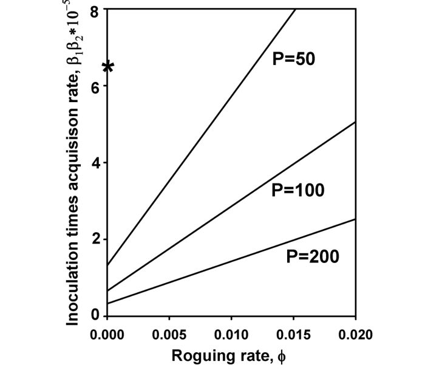{#fig-tt-vector-thresholds}
 (Abscissa) และผลคูณของพารามิเตอร์การรับและแพร่เชื้อ $\beta_1\beta_2$ อยู่บนแกนตั้ง (Ordinate) เส้นต่างๆ ในกราฟคือตำแหน่งที่ $R_0 = 1$ เส้นเหล่านี้จึงทำหน้าที่เสมือนเส้นแบ่งพรมแดน ระหว่างกลุ่มตัวแปรที่จะก่อให้เกิดโรคระบาด กับกลุ่มตัวแปรที่จะทำให้ไม่เกิดการระบาด ในภาพจะเห็นการวาดเส้นแยกตามระดับความหนาแน่นของแมลงพาหะ ($P$) ทั้ง 3 ระดับ การรวมกลุ่มพารามิเตอร์ที่ตกอยู่ในโซนเหนือเส้นกราฟจะนำไปสู่การพัฒนาของโรคระบาด ส่วนโซนใต้เส้นกราฟก็จะไม่มีการระบาด (แน่นอนว่า ทั้งหมดนี้อยู่บนสมมติฐานที่ว่าตัวแบบจำลองนั้นถูกต้องเหมาะสม) ตัวอย่างเช่น ลองพิจารณาสถานการณ์ที่ $P = 50$, $\beta_1\beta_2 = 6.4 \times 10^{-5}$ โดยที่ไม่มีการถอนต้นที่ป่วยทิ้งเลย ($\phi = 0$) ซึ่งสอดคล้องกับการจำลองแบบในภาพที่ 6.8B การจับคู่ของค่า $\beta_1\beta_2$ และ $\phi$ นี้จะตกอยู่เหนือเส้นกราฟ ส่งผลให้เมื่อไวรัสถูกนำเข้ามาในระบบ การระบาดจะก่อตัวขึ้น (ดังที่ได้แสดงผลการคำนวณเชิงตัวเลขในภาพที่ 6.8) แต่ถ้าเราเพิ่มอัตราการถอนทิ้งขึ้นไปให้สูงกว่าประมาณ 0.012 ต่อวัน การรวมตัวของพารามิเตอร์ชุดนี้ก็จะลดระดับลงไปอยู่ใต้เส้นจุดวิกฤตของกราฟที่ $P = 50$ และการระบาดก็จะไม่เกิดขึ้น (แสดงด้วยตัวเลขสำหรับ $\phi = 0.015$ ในภาพที่ 6.8E) สัญลักษณ์รูปดาวบนแกนตั้งนั้นใช้แทนชุดพารามิเตอร์ "มาตรฐาน" เริ่มต้นที่ถูกเลือกมาสำหรับการวิเคราะห์ในตัวอย่างนี้ ซึ่งจำลองสถานการณ์ที่มีการปลูกสายพันธุ์ที่อ่อนแอและไม่มีการจัดการถอนต้นที่ป่วยทิ้งจากกราฟจะเห็นได้ว่าการใช้กลยุทธ์การถอนต้นไม้ทิ้งเป็นมาตรการจัดการโรค เพียงอย่างเดียว จะสามารถป้องกันโรคระบาดได้ก็ต่อเมื่อความหนาแน่นของแมลงหวี่ขาว ($P$) มีค่าค่อนข้างต่ำเท่านั้น เมื่อกำหนดให้พารามิเตอร์อื่นๆ เป็นค่ามาตรฐาน (เช่น $\beta_1$ และ $\beta_2$) การถอนต้นที่ป่วยทิ้งลำพังจะกวาดล้างโรคได้เมื่อ $P = 50$ แต่จะไม่สามารถควบคุมโรคได้เลยในระดับ $P$ ค่าอื่นๆ ที่แสดงในภาพ ยกตัวอย่างเช่น ถ้า $\beta_1\beta_2 = 6.4 \times 10^{-5}$ โรคระบาดจะเกิดขึ้นสำหรับทุกค่าของ $\phi$ ทันทีที่ $P$ มีค่าตั้งแต่ 100 ขึ้นไป ดังนั้น หากต้องการให้สายพันธุ์ต้านทานสามารถกวาดล้างโรคได้สำเร็จ มันจะต้องลดค่าผลคูณ $\beta_1\beta_2$ ให้เหลือน้อยกว่า 20% ของค่าที่พบในสายพันธุ์ที่อ่อนแอ เช่น ในกรณีที่ $P = 50$ และ $\phi = 0$ (ไม่มีการถอนทิ้ง) ค่า $\beta_1\beta_2$ จะต้องถูกลดจาก $6.4 \times 10^{-5}$ ลงมาที่ $1.8 \times 10^{-5}$ หรือต่ำกว่า จึงจะสามารถป้องกันการระบาดได้ ซึ่งต้องยอมรับว่าการจะลดค่าพารามิเตอร์ลงขนาดนี้ด้วยวิธีการปรับปรุงพันธุ์นั้น ดูจะมีความเป็นไปได้น้อยมาก

เราจึงสรุปได้ว่า กลยุทธ์การควบคุมโรคแบบเดี่ยวๆ ไม่น่าจะนำไปสู่การกวาดล้างโรคได้ ทว่าหากเรานำสองกลยุทธ์มาใช้ผสมผสานกัน มันจะกลายเป็นความหวังที่ยิ่งใหญ่เลยทีเดียว! การเพิ่มอัตราการถอนทิ้งให้เข้าใกล้จุดสูงสุดที่เป็นไปได้ (0.02 ต่อวัน) ควบคู่ไปกับการนำสายพันธุ์ต้านทานมาปลูกเพื่อดึงให้ค่า $\beta_1\beta_2$ ลดลงเหลือประมาณ 60% ของค่าในสายพันธุ์ที่อ่อนแอ (ลดลงเหลือ $4 \times 10^{-5}$) จะสามารถกวาดล้างโรคได้ชะงัดนัก แม้ว่า $P$ จะทะลุไปถึง 100 ก็ตาม ในกรณีที่ $P$ ต่ำกว่านั้น (=50) แม้ว่าเราจะถอนต้นทิ้งในอัตราปานกลาง ($\phi = 0.01$) มันก็ยังคงสามารถกวาดล้างโรคได้อยู่ดี หากเราลดค่า $\beta_1\beta_2$ ให้อยู่ที่ $4 \times 10^{-5}$ ได้ ทั้งนี้ ผลการทดลองจำนวนมากได้ยืนยันแล้วว่า การลดความหนาแน่นของประชากรพาหะด้วยการใช้สารฆ่าแมลงนั้นเป็นเรื่องที่ยากมาก (Palumbo et al., 2001; Dittrich et al., 1990) ดังนั้น การลดความหนาแน่นของแมลงพาหะจะมีประสิทธิภาพอย่างแท้จริงในการควบคุมโรค ก็ต่อเมื่อนำไปใช้ร่วมกับการลด $\beta_1\beta_2$ และการเพิ่มอัตราการถอนทิ้ง $\phi$ เท่านั้น

ใน @fig-tt-vector-steady-states เราได้พลอตกราฟความหนาแน่นของต้นที่แข็งแรงและต้นที่ติดเชื้อ

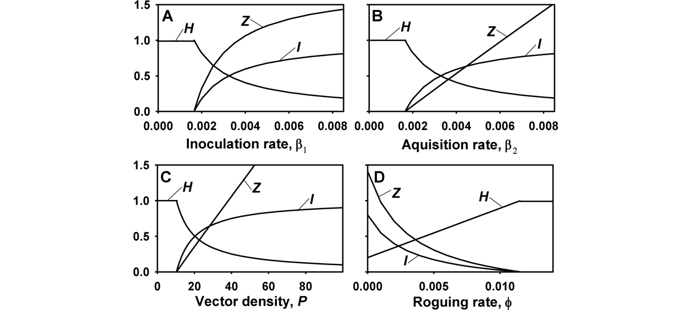{#fig-tt-vector-steady-states}
 (= ต้นที่แพร่เชื้อได้ในกรณีนี้) ตลอดจนความหนาแน่นของพาหะที่มีเชื้อ โดยแสดงเป็นฟังก์ชันของพารามิเตอร์สำหรับการจัดการโรคทั้งสี่ตัว กราฟในลักษณะนี้มีประโยชน์มากสำหรับการประเมินผลลัพธ์ที่จะตามมา เมื่อเราพบว่าการระบาดไม่สามารถป้องกันได้ ($R_0 > 1$) ค่ามาตรฐานของพารามิเตอร์ที่ไม่ได้แสดงในกราฟจะสอดคล้องกับค่าของสายพันธุ์ที่อ่อนแอ ($\beta_1 = \beta_2 = 0.008$/วัน) โดยไม่มีการถอนทิ้ง ($\phi = 0$) และกำหนดให้มีความหนาแน่นของแมลงพาหะ 50 ตัวต่อต้น ภาพเหล่านี้แสดงให้เห็นว่าความหนาแน่นของต้นไม้ที่แข็งแรงจะเพิ่มขึ้นจนเกือบเป็นเส้นตรงเมื่อเทียบกับอัตราการถอนทิ้ง จนกระทั่ง $\phi \approx 0.01$/วัน จากนั้น $\phi$ จะไม่ส่งผลใดๆ ต่อค่า $H$ อีกต่อไป (เนื่องจากสภาวะคงตัวมีค่าเท่ากับ $H_{\max}$ ทำให้โรค "สูญพันธุ์" ไปในที่สุด) (ภาพที่ 6.10D) นอกจากนี้ ค่า $H$ ยังเพิ่มขึ้นตามความหนาแน่นของแมลงพาหะที่ลดลง ทว่าความสัมพันธ์นี้ไม่ได้แปรผันตรงแบบเส้นตรง อันที่จริง การลดจำนวน $P$ จาก 100 จนถึงประมาณ 40 แทบจะไม่ได้สร้างความเปลี่ยนแปลงใดๆ ให้กับค่า $H$ เลย (ภาพที่ 6.10A) แต่เมื่อค่า $P$ ต่ำลงกว่านั้น $H$ จะพุ่งสูงขึ้นอย่างรวดเร็ว สำหรับฝั่งพารามิเตอร์ที่สะท้อนถึงความต้านทานของโฮสต์อย่าง $\beta_1$ และ $\beta_2$ นั้น แสดงให้เห็นถึงความสัมพันธ์กับค่า $H$ (ภาพที่ 6.10A, B) ในลักษณะที่คล้ายกับที่เราพบใน $P$ นั่นคือ การปรับลด $\beta_1$ หรือ $\beta_2$ ลงเพียงเล็กน้อยจากค่าปกติที่ 0.008/วัน ส่งผลกระทบต่อค่า $H$ เพียงน้อยนิด โดยที่{#fig-6-10}ค่า $H$ จะเปลี่ยนแปลงอย่างเห็นได้ชัดก็ต่อเมื่อตัวพารามิเตอร์ถูกปรับลดลงกว่า 50% ขึ้นไปเท่านั้น (ซึ่งเข้าใกล้ระดับที่จะนำไปสู่การกวาดล้างโรค) ดังนั้น ในกรณีที่โรคยังไม่ถูกกวาดล้างและเราจำเป็นต้องใช้มาตรการควบคุมโรคเพียง อย่างเดียว การใช้วิธีถอนต้นทิ้งจะมีประสิทธิภาพสูงกว่าการพึ่งพาสายพันธุ์ต้านทาน และแน่นอนว่าการใช้มาตรการร่วมกันย่อมจะให้ผลลัพธ์ที่มีประสิทธิภาพเหนือชั้นยิ่งกว่า (แม้ว่าจะไม่ได้แสดงข้อมูลไว้ในที่นี้ก็ตาม)

### 6.4.5 บทสรุปส่งท้าย (Concluding remarks)

ในหัวข้อนี้ เราได้ทำความรู้จักกับแบบจำลองอย่างง่ายสำหรับพลวัตในระบบไวรัส-แมลงพาหะ ด้วยการใช้พารามิเตอร์จากโรคใบด่างมันสำปะหลัง เราได้สาธิตให้เห็นถึงการประยุกต์ใช้แบบจำลองเพื่อประเมินผลของกลยุทธ์การควบคุมต่างๆ ต่อการระบาด และนำไปสู่ข้อสรุปบางประการเกี่ยวกับการจัดการโรค แต่อย่างไรก็ดี เราขอเตือนไว้สักนิดว่า คงไม่ฉลาดนักหากเราจะนำผลลัพธ์จากแบบจำลองง่ายๆ นี้ไปใช้งานจริงโดยไม่ศึกษาเพิ่มเติม แบบจำลองอื่นๆ ที่ใช้อธิบายระบบของโรคใบด่างมันสำปะหลังภายใต้สมมติฐานที่แตกต่างกัน ควรจะถูกนำมาศึกษาควบคู่กันด้วย เพื่อยืนยันว่าข้อสรุปของเรานั้นครอบคลุมและสามารถประยุกต์ใช้ได้กับแบบจำลองอื่นๆ ด้วยหรือไม่ (ตามที่เราได้เห็นในหัวข้อ 5.2) แบบจำลองหลายตัว ซึ่งบางตัวก็มีรายละเอียดซับซ้อนกว่าในที่นี้มาก ล้วนผ่านการศึกษามาแล้วทั้งสิ้น (เช่น Holt et al., 1997, 1999; Jeger et al., 1998, 2002, 2004; Zhang et al., 2000b, Madden et al., 2000b) แต่จุดมุ่งหมายหลักของแบบจำลองอย่างง่ายในบทความนี้ ก็คือการทำให้เห็นภาพว่า เราจะสามารถใช้แบบจำลองพลวัตของโรคเพื่อประเมินมาตรการควบคุมได้อย่างไร หรือเพื่อชี้ให้เห็นถึงความน่าจะเป็นที่การควบคุมบางอย่างจะได้ผลจริงแบบจำลองที่เราเพิ่งศึกษาไปยังมีข้อจำกัดในหลายด้าน ดังที่เกริ่นไว้ตอนต้นหัวข้อนี้ เราไม่ได้เผื่อปัจจัยเรื่องระยะฟักตัวและระยะแพร่เชื้อในฝั่งของโฮสต์ต้นไม้ และเราก็ไม่ได้คิดรวมเรื่องระยะฟักตัวในตัวของแมลงพาหะด้วย ทั้งๆ ที่ทั้งระยะฟักตัวและระยะแพร่เชื้อในแมลงพาหะ รวมไปถึงพารามิเตอร์อย่าง $\beta_1$ และ $\beta_2$ ล้วนเป็นปัจจัยพื้นฐานที่สำคัญยิ่งในการจำแนกประเภทของไวรัสพืช งานวิจัยของ Jeger et al. (1998, 2004) และ Madden et al. (2000b) ได้แสดงให้เห็นถึงความเชื่อมโยงระหว่างคุณสมบัติการส่งผ่านเชื้อเหล่านี้ กับวิธีการควบคุมที่มีประสิทธิภาพสูงสุดสำหรับไวรัสพืชแต่ละประเภทประการสุดท้าย การประเมินกลยุทธ์การควบคุมของเรายังไม่ได้นำเอาต้นทุนในการพัฒนามาตรการควบคุม (เช่น ต้นทุนการปรับปรุงพันธุ์) และต้นทุนในการนำมาตรการไปปฏิบัติจริงมาพิจารณา ประเด็นเรื่องต้นทุนและผลประโยชน์ที่ได้รับจะมีการกล่าวถึงบ้างในบทที่ 11 อย่างไรก็ตาม การอธิบายรูปแบบการระบาดในบทนั้นค่อนข้างตื้นเขินกว่ามาก และเรายังคงต้องอาศัยความพยายามอีกมากทีเดียว ในการที่จะเชื่อมโยงทฤษฎีการตัดสินใจทางเศรษฐศาสตร์ (Economic decision theory) เข้ากับการทำแบบจำลองพลวัตประชากรของการระบาดในโรคพืช

## 6.5 พลวัตในช่วงเปลี่ยนผ่านและความซับซ้อนอื่นๆ (Transitional Dynamics and Other Complexities) {#sec-tt-complexities}

 {#sec-tt-complexities}

### 6.5.1 แบบจำลองที่เราได้พิจารณาไปแล้ว (Models considered so far)

ในบทนี้และบทที่ผ่านมา เราได้แสดงให้เห็นแล้วว่า การทำความเข้าใจต่อระบาดวิทยาโรคพืชอย่างลึกซึ้งสามารถทำได้ โดยอาศัยสมการเชิงอนุพันธ์เพียงไม่กี่สมการ กับพารามิเตอร์ที่นิยามไว้อย่างชัดเจนเพียงไม่กี่ตัว เมื่อการเติบโตและการตายของโฮสต์ไม่ใช่ปัจจัยหลักในช่วงเวลาที่เราสนใจ แบบจำลองในบทที่ 4 สำหรับโรคที่ระบาดซ้ำได้หลายรอบ (Polycyclic diseases) จะสามารถถูกขยายขอบเขตให้ครอบคลุมถึงระยะฟักตัวและระยะแพร่เชื้อได้ง่ายๆ ทำให้เราได้แบบจำลองสำหรับ $dY(t)/dt$ [หรือ $dH(t)/dt$] ที่สมจริงยิ่งขึ้น เมื่อเทียบกับแบบจำลองลอจิสติกและอื่นๆ ที่คล้ายคลึงกัน โดยเนื้อแท้แล้ว ผลลัพธ์สำคัญๆ จะสามารถแสดงออกมาในรูปของพารามิเตอร์ $\omega$, $\mu$, และ $\beta H_0$ แม้ว่าตัวหลังสุดอาจจะพิจารณาในรูปแบบของผลคูณจากพารามิเตอร์ย่อยๆ อย่าง ($\alpha\theta\psi$) ก็ตาม ความซับซ้อนที่เพิ่มเข้ามา เช่น การเติบโตและการตายของโฮสต์ รวมถึงการผสานเอากระบวนการแบบ Polycyclic และ Monocyclic (การติดเชื้อปฐมภูมิ) ในแต่ละช่วงเวลาเข้ามาด้วยกัน และการพัฒนาของการระบาดในพืชล้มลุกตลอดหลายปี ล้วนสามารถถูกผนวกรวมเข้าไปในแบบจำลองได้ตามที่ผู้วิจัยต้องการ เพื่อตอบโจทย์วัตถุประสงค์และรูปแบบของการพัฒนาโรค บ่อยครั้งที่เส้นโค้งความก้าวหน้าของโรคที่ได้จากแบบจำลองนี้มักจะออกมาเป็นรูปตัวเอส (Sigmoid curve) โดยเฉพาะกับโรค Polycyclic ในกรณีที่ไม่มีการเจริญเติบโตของโฮสต์เข้ามาเกี่ยวข้อง ผลลัพธ์พื้นฐานที่สำคัญคือ ในหลายๆ สถานการณ์ของโรคที่แพร่กระจายแบบดอกเบี้ยทบต้น เราสามารถนิยามสิ่งเหล่านี้ได้ (ผ่านพารามิเตอร์ไม่กี่ตัว หรือพารามิเตอร์แบบผสม): (1) จุดวิกฤตสำหรับการพัฒนาของโรคระบาด; (2) อัตราการเพิ่มขึ้นแบบเอกซ์โพเนนเชียลในช่วงต้นของการระบาด (หากมีโรคระบาดเกิดขึ้น); และ (3) ค่าสัดส่วนสุดท้ายของสิ่งมีชีวิตที่ป่วยเป็นโรค (หรือค่าสภาวะคงตัวของ $H$ หากโฮสต์เป็นแบบพลวัต) ซึ่งค่าความสามารถในการถ่ายทอดโรคพื้นฐาน ($R_0$) ถือเป็นพารามิเตอร์ลูกผสมระดับกุญแจสำคัญที่มีคุณค่าอย่างมหาศาล หากเราสามารถสร้างแบบจำลองได้อย่างเหมาะสม ผลลัพธ์จากการรวมกลุ่มพารามิเตอร์เฉพาะก็สามารถถูกคำนวณออกมาได้ด้วยเครื่องคิดเลขธรรมดา หรือแม้กระทั่งการคิดด้วยมือเปล่า แน่นอนว่าการใช้โปรแกรมสเปรดชีตจะช่วยอำนวยความสะดวกได้มาก แต่ก็ไม่ได้ถึงกับเป็นสิ่งที่ขาดไม่ได้บางครั้ง นักวิจัยอาจต้องการผลลัพธ์ที่ลึกซึ้งไปกว่าเพียงแค่สามประเด็นหลักที่กล่าวมาข้างต้น โดยเฉพาะอย่างยิ่ง ความอยากรู้อยากเห็นในเรื่องของความหนาแน่น หรือสัดส่วนของกลุ่มตัวอย่างที่ติดเชื้อในแต่ละช่วงเวลาใดเวลาหนึ่งระหว่างที่โรคกำลังระบาด โดยไม่ใช่แค่สนใจเฉพาะเวลาที่ $t$ มีค่าน้อยมากๆ หรือมากสุดๆ เท่านั้น คำว่า พลวัตในช่วงเปลี่ยนผ่าน (Transitional dynamics) บางครั้งจะถูกนำมาใช้เพื่อกล่าวถึงพลวัตของประชากรที่อยู่ตรงกลางระหว่างค่า $t$ ที่น้อยและมาก (กล่าวคือ ระหว่างค่า $y(t)$ ขนาดเล็กและขนาดใหญ่) เนื่องจากพืชหลายชนิดมีช่วงเวลาเก็บเกี่ยวที่ไม่ได้ยาวนานพอจะรอให้การระบาดไปถึงระดับสุดท้าย (Asymptotic) หรือถึงขั้นสภาวะคงตัวได้ เราจึงต้องการค่าการคำนวณของ $Y(t)$ [หรือค่าความหนาแน่นอื่นๆ เช่น $H(t)$] ในช่วงเวลาระหว่างทางด้วย (กล่าวคือ พ้นระยะเริ่มต้นไปแล้ว ซึ่งเป็นจุดที่การใช้แบบจำลองเอกซ์โพเนนเชียลมาประมาณค่าเริ่มจะไม่สมเหตุสมผลอีกต่อไป) โดยทั่วไปแล้ว การคำนวณแบบนี้จำเป็นต้องพึ่งพาวิธีการหาค่าปริพันธ์เชิงตัวเลข (Numerical integration techniques) เนื่องจากปกติแล้วสมการในบทนี้หรือบทก่อนหน้า มักจะไม่มีผลเฉลยเชิงวิเคราะห์ตายตัว (กล่าวคือเราไม่สามารถเขียนค่า $Y(t)$ ในรูปฟังก์ชันของ $t$ ได้โดยไม่ต้องใส่เครื่องหมายอินทิกรัลลงไป) เรื่องนี้เคยเป็นข้อจำกัดชิ้นโตในการประยุกต์ใช้แบบจำลองการระบาดบางประเภท แต่ในปัจจุบันข้อจำกัดนี้เริ่มมีความสำคัญลดน้อยถอยลงไปมาก เนื่องจากมีการพัฒนาโปรแกรมคอมพิวเตอร์ที่ค่อนข้างใช้งานง่าย (เช่น MATHCAD และ MATHEMATICA) ซึ่งสามารถใช้หาผลเฉลยของสมการเชิงอนุพันธ์แบบคู่ควบเชิงตัวเลขได้อย่างแม่นยำ กราฟความสัมพันธ์ระหว่างความหนาแน่นกับเวลาทั้งหมด ล้วนถูกพลอตขึ้นมาโดยใช้หลักการของปริพันธ์เชิงตัวเลขทั้งสิ้น (ดูตัวอย่างภาพที่ 5.5, 5.7, 6.1, 6.3, 6.5, 6.8)ตามที่ได้ชี้ให้เห็นในแบบจำลองหลายรูปแบบในหัวข้อ 5.2 กราฟความสัมพันธ์ระหว่าง $Y(t)$ กับ $t$ มักจะออกมาเป็นรูปตัวเอส (S-shaped) (ดูภาพที่ 5.7) เมื่อการระบาดเริ่มต้นขึ้นโดยมีความหนาแน่นของผู้ติดเชื้อในระดับต่ำ ซึ่งชี้ให้เห็นว่าแบบจำลองลอจิสติก หรือแบบจำลองความก้าวหน้าของโรคอื่นๆ ที่คล้ายคลึงกัน ก็น่าจะดูสมเหตุสมผลดีที่จะนำมาใช้อธิบายการระบาดได้ อันที่จริง การวิเคราะห์ที่เจาะลึกกว่าในเนื้อหาบทเหล่านี้แสดงให้เห็นว่า แบบจำลองลอจิสติก (หรือแนวๆ นั้น) สามารถ นำมาใช้เพื่ออธิบายพลวัตของโรคได้อย่างคร่าวๆ แม้ว่าแบบจำลองตั้งต้นจะถูกออกแบบให้พิจารณาเงื่อนไขที่สมจริงอย่าง การมีข้อจำกัดด้านระยะเวลาที่สามารถแพร่เชื้อได้ และระยะฟักตัวที่ไม่เป็นศูนย์ก็ตาม ซึ่งนี่ก็เป็นสิ่งที่เราพอจะคาดเดาได้อยู่แล้ว เนื่องจากเส้นโค้งความก้าวหน้าของโรคจากงานวิจัยหลายๆ เล่ม ก็ถูกอธิบายด้วยแบบจำลองลอจิสติกได้อย่างครบถ้วนสมบูรณ์ (ดูตัวอย่างในบทที่ 4) และถ้าหากแบบจำลองในบทนี้ไม่สามารถจำลองภาพที่ใกล้เคียงกับการสังเกตปรากฏการณ์จริงของโรคพืชระบาดได้ มันก็คงจะเป็นแบบจำลองที่มีปัญหาหนักทีเดียวระดับความคล้ายคลึงกันระหว่างเส้นโค้งความก้าวหน้าของโรคที่ถูกสร้างขึ้นโดยแบบจำลอง H-L-I-R (ยกตัวอย่าง) กับแบบจำลองลอจิสติกนั้น จะขึ้นอยู่กับค่าพารามิเตอร์ $1/\omega$, $1/\mu$ และ $\beta$ เป็นหลัก ดังที่แสดงใน @fig-tt-logit-scale กราฟของค่า Logit เมื่อเทียบกับเวลา $t$

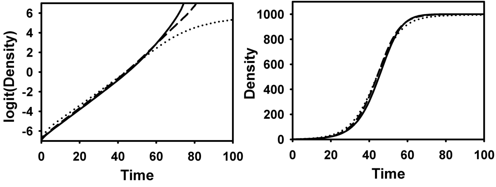{#fig-tt-logit-scale}
 อาจจะออกมาค่อนข้างตรงตลอดช่วงเวลาจริง ซึ่งบ่งชี้ให้เห็นถึงผลลัพธ์ที่คล้ายคลึงกันอย่างยิ่งยวด ระหว่างแบบจำลองที่เรียบง่ายกับแบบจำลองที่มีความซับซ้อนกว่า หรือในบางครั้ง กราฟ Logit ก็อาจจะโค้งไปทางซ้ายหรือขวาได้ แม้ว่ากราฟของค่า $Y(t)$ เทียบกับ $t$ จะยังคงเป็นรูปตัวเอสก็ตาม{#fig-6-11}สังเกตว่าในกราฟ เราจะคำนวณค่า Logits ด้วยสมการ $\ln[y(t)/(1 - y(t))]$ โดยที่ $y(t) = Y(t)/H_0$ และเราจงใจเลือกค่าพารามิเตอร์สำหรับแบบจำลอง H-L-I-R ให้สะท้อนถึงการเบี่ยงเบนออกจากความสัมพันธ์แบบลอจิสติก ในช่วงที่ความหนาแน่นของโรคอยู่ในระดับสูง โดยส่วนใหญ่แล้ว การผสมผสานของกลุ่มพารามิเตอร์จากแบบจำลอง H-L-I-R (และแบบจำลองที่เกี่ยวข้องอื่นๆ ในกรณีที่ไม่มีการเติบโตของโฮสต์) มักจะให้ผลลัพธ์ออกมาเป็นเส้นตรงสำหรับกราฟ Logitการมีค่าเฉลี่ยระยะการแพร่เชื้อที่ยาวนานมากๆ ($\iota = 1/\mu$) มักจะทำให้เส้นโค้ง Logit โค้งงอไปทางซ้าย ในขณะที่ค่าเฉลี่ยระยะเวลาแพร่เชื้อที่สั้นมากๆ ก็มักจะทำให้เส้นโค้ง Logit โค้งไปทางขวาเล็กน้อย โดยทั่วไปแล้ว ความโค้งงอของเส้นกราฟมักจะเป็นประเด็นก็ต่อเมื่อค่า $y(t)$ เริ่มมีขนาดใหญ่เท่านั้น ค่า $R_0$ ของกราฟทั้งสามเส้นในภาพที่ 6.11 มีค่ามากกว่า 5 ทำให้ระดับของโรคในสัดส่วนขั้นสุดท้ายใกล้เคียงกับ 1 เสมอ หากมีใครสนใจอยากจะประมาณค่าในแบบจำลองการระบาดที่สมจริงมากขึ้น เมื่อค่า $R_0$ มีค่าน้อย (แต่ยังคงมากกว่า 1) เราขอแนะนำให้ประยุกต์ใช้แบบจำลองลอจิสติกในเวอร์ชันที่ครอบคลุมกว่า [กล่าวคือ มีตัวพารามิเตอร์สำหรับค่า $y$ สูงสุด ($= K$)] (ตามสมการ 4.47) และให้ใช้ค่า $y_{\pm}$ จากสมการ 5.27 แทนค่า $K$ (Segarra et al., 2001) แล้วค่า Logit จะมีหน้าตาเป็น $\ln[y(t)/(y_{\pm} - y(t))]$เมื่อเปรียบเทียบสมการสำหรับ $dY(t)/dt$ ของแบบจำลองลอจิสติก (สมการ 4.51a) และแบบจำลอง H-L-I-R (เพื่อเป็นตัวอย่าง; สมการ 5.31) โดยตรงแล้ว เราจะพบว่าแบบจำลองทั้งสองจะไม่มีวันเท่ากันได้เลยตลอดช่วงค่า $Y$ (หรือ $H$) ทั้งหมด เนื่องจากอัตราการระบาดในแบบจำลองลอจิสติกจะขึ้นอยู่กับจำนวนของตัวอย่างที่ป่วยเป็นโรคทั้งหมด $Y(t)$ ในขณะที่แบบจำลอง H-L-I-R ซึ่งสมจริงกว่า จะมีอัตราที่ขึ้นอยู่กับจำนวนของกลุ่มที่แพร่เชื้อได้เท่านั้น $I(t)$ ซึ่งเรื่องนี้เราเคยได้พูดถึงไปแล้วบางส่วนในหัวข้อ 5.2.3.1 ค่า $Y(t)$ และ $I(t)$ จะไม่มีทางเท่ากันได้ เว้นเสียแต่ว่า $\omega = 1/\omega = 0$ และ $\iota = 1/\mu = \pm \infty$ แต่อย่างไรก็ตาม แบบจำลองลอจิสติกยังคงสามารถใช้ประมาณค่าล่วงหน้าได้อย่างดีเยี่ยม สำหรับแบบจำลองที่มีความสมจริงและซับซ้อนมากยิ่งขึ้น ดังที่เราได้แนะนำไว้ในบทนี้ ทว่าด้วยซอฟต์แวร์คณิตศาสตร์ที่ใช้งานง่ายขึ้นมากในปัจจุบัน การหาผลเฉลยเชิงตัวเลขให้กับแบบจำลอง H-L-I-R รวมไปถึงแบบจำลองอื่นๆ ที่ใกล้เคียงกันหรือซับซ้อนกว่า (เช่น มีเรื่องการเจริญเติบโตของโฮสต์) จึงถือเป็นแบบฝึกหัดที่ค่อนข้างสมเหตุสมผลและสามารถทำได้จริง (แม้จะไม่ได้ง่ายดายนัก) ซึ่งช่วยลดความจำเป็นในการ "บีบบังคับ" ให้การวิเคราะห์ต้องจำกัดอยู่แค่ในกรอบของลอจิสติก (หรือแนวทางที่คล้ายกัน) ลงไปได้ไม่น้อยทีเดียว

### 6.5.2 แบบจำลองที่ซับซ้อนยิ่งขึ้น (More complicated models)

แบบจำลองการระบาดทั้งหมดที่พิจารณาในบทนี้ สามารถถูกต่อยอดหรือขยายขอบเขตออกไปได้ตามความจำเป็น เพื่อให้ตอบโจทย์วัตถุประสงค์ของผู้วิจัย ซึ่งวิธีที่ตรงไปตรงมาที่สุดในการทำเช่นนี้ก็คือ การแปลงพารามิเตอร์ให้เป็นตัวแปร (Variables) โดยให้ตัวแปรเหล่านี้ต้องพึ่งพาพารามิเตอร์ตัวอื่นๆ ยกตัวอย่างเช่น โดยทั่วไปแล้ว เพื่อความสะดวก เรามักจะอนุมานว่าค่า $\beta$ (หรือ $\beta H_0$) เป็นค่าคงที่ อย่างไรก็ดี องค์ประกอบบางส่วนหรือทั้งหมดของ $\beta$ ($\alpha$, $\psi$ หรือ $\theta$) ก็อาจจะกลายร่างไปเป็นฟังก์ชันที่ผูกติดอยู่กับค่า $H$, $t$ หรือตัวแปรอื่นๆ ได้เช่นกัน ซึ่งประเด็นนี้ก็ได้พูดถึงไปแล้วคร่าวๆ ในหัวข้อ 5.3 และในที่นี้ เราจะขอยกตัวอย่างสถานการณ์ที่เป็นไปได้มาพูดคุยกันเพียงสัก 2-3 กรณีเท่านั้นในบางระบบ ความอ่อนแอ (Susceptibility) ของพืชผลอาจจะลดน้อยลงเมื่อเวลาผ่านไป เนื่องจากต้นไม้หรือเนื้อเยื่อพืชเจริญเติบโตเต็มที่ขึ้น ในแง่หนึ่ง สิ่งนี้อาจหมายความว่าความน่าจะเป็นที่หน่วยแพร่เชื้อจะทำให้เกิดการติดเชื้อเมื่อสัมผัสกับต้นพืชที่แข็งแรง ($\psi$) ก็จะค่อยๆ ลดลงตามกาลเวลาด้วยเช่นกัน ดังนั้น $\psi$ จึงถูกแทนที่ด้วยฟังก์ชัน $\psi(t)$ (อ้างอิงจาก Kleczkowski et al., 1996; Gilligan, 2002) นอกจากนี้ ยังมีความเป็นไปได้ว่าความน่าจะเป็นที่หน่วยแพร่เชื้อจะสัมผัสกับพืชที่เป็นโฮสต์ ($\theta$) อาจเป็นฟังก์ชันของความหนาแน่นโฮสต์เริ่มต้น ($H_0$) หรือแม้กระทั่งความหนาแน่นโฮสต์รวม ณ เวลาใดๆ ($M = L + I + R + H$) ในกรณีที่พืชโฮสต์มีลักษณะแบบพลวัต หากสามารถกำหนดความสัมพันธ์ที่สมเหตุสมผลระหว่างตัวแปรได้ เราก็จะเปลี่ยนพารามิเตอร์ $\theta$ ให้กลายเป็นฟังก์ชัน $\theta(H_0)$ หรือ $\theta(M)$ ในแบบจำลอง ยิ่งไปกว่านั้น อัตราการผลิตหน่วยแพร่เชื้อ ($\alpha$) ก็อาจจะกลายมาเป็นฟังก์ชันของความหนาแน่นของการติดเชื้อ หรืออาจเป็นฟังก์ชันของความรุนแรงของโรคโดยรวมอย่าง $\alpha(Y)$ เลยก็ได้ในบางกรณี เรายังคงสามารถวิเคราะห์แบบจำลองที่ถูกขยายผลเหล่านี้เชิงวิเคราะห์ (Analytically) ได้ โดยใช้วิธีการทางคณิตศาสตร์แบบทั่วๆ ไป ดังที่ได้อภิปรายไว้ในหัวข้อย่อยก่อนหน้าของบทนี้ อย่างไรก็ตาม โดยส่วนใหญ่แล้วการวิเคราะห์มักจะอิงจากผลเฉลยเชิงตัวเลขของสมการ ดังที่กล่าวไปข้างต้นในเรื่องพลวัตช่วงเปลี่ยนผ่าน ซึ่งผลที่ออกมาอาจทำให้เราพบว่าการใช้ "ค่าคงที่" กลับให้ผลลัพธ์ที่ใกล้เคียงกันกับตอนที่ใช้ตัวแปรที่ซับซ้อนกว่าในแบบจำลองเสียอีก "พารามิเตอร์" ในแบบจำลองที่ง่ายกว่านั้น จึงสามารถถูกพิจารณาให้เป็นตัวแทนเชิง "ค่าเฉลี่ย" ของตัวแปรแฝงต่างๆ (เช่น ค่าเฉลี่ยของ $\psi(t)$ ตลอดช่วงเวลาหนึ่ง) สิ่งที่ควรต้องตระหนักไว้เสมอคือ "แบบจำลองง่ายๆ" ในบทนี้และบทก่อนหน้า ที่ใช้จำนวนพารามิเตอร์เพียงหยิบมือ สามารถ ใช้อธิบายภาพรวมการระบาดของโรคได้อย่างสมจริง ทั้งนี้อาจเป็นเพราะความผันผวนบางอย่างของตัวแปรแต่ละพจน์ได้เกิดการ "หักล้าง" (Cancel out) กันไปโดยเฉลี่ย ตัวอย่างเช่น แม้ว่า $\psi$, $\alpha$ และ $\theta$ ล้วนขึ้นอยู่กับเวลา หรือขึ้นอยู่กับความหนาแน่นของผู้ที่ติดเชื้อ แต่ผลคูณของตัวแปรเหล่านี้ ($=\beta$) ก็อาจจะยังคงเป็นค่าคงที่ได้อย่างสมเหตุสมผลเมื่อประเมินตามช่วงเวลา (ในฐานะค่าประมาณ) ขึ้นอยู่กับทิศทางความเชื่อมโยงของปัจจัยต่างๆ นั่นเองยังมีเรื่องการขึ้นต่อกันของ "พารามิเตอร์" อีกประการหนึ่งที่เห็นได้ชัดและจำเป็นต้องนำมาอภิปราย นั่นคือองค์ประกอบเรื่องสถานที่หรือเชิงพื้นที่ (Spatial component) ในการเกิดโรคระบาด นอกเหนือจากประโยคกว้างๆ บางส่วนที่เคยกล่าวไปแล้ว ที่ผ่านมาเราแทบจะไม่ได้สนใจเลยว่าผู้ติดเชื้อจะกระจายตัวไปตามพื้นที่ต่างๆ อย่างไร ในขณะที่ความหนาแน่นของโรคเพิ่มสูงขึ้นตามเวลา ความน่าจะเป็นที่หน่วยแพร่เชื้อจะสัมผัสกับโฮสต์เป้าหมาย ($\theta$) ย่อมขึ้นอยู่กับระยะทาง ($s$) ระหว่างจุดที่หน่วยแพร่เชื้อ (เช่น สปอร์) ถูกสร้างขึ้น กับตำแหน่งของพืชโฮสต์เป้าหมายนั้นอย่างชัดเจน โดยทั่วไปแล้ว ยิ่งระยะทางไกลเท่าไร โอกาสในการสัมผัสเชื้อก็จะยิ่งลดน้อยลงเท่านั้น เพื่อที่จะรวมเอาปัจจัยความเกี่ยวเนื่องนี้เข้ามาพิจารณาอย่างครบถ้วน เราจำเป็นจะต้องสร้างแบบจำลองพลวัตของ $Y$ (หรือ $H$ ฯลฯ) ที่ครอบคลุมเรื่อง พื้นที่ (Space) และ เวลา (Time) อย่าง ชัดเจน (Explicit) เรื่องนี้จะถูกนำไปอธิบายในรายละเอียดในบทที่ 8 หลังจากที่เราได้ปูพื้นฐานแนวคิดและการวิเคราะห์เกี่ยวกับระดับการแพร่กระจายของโรค (Disease gradients) ในบทที่ 7 ไปแล้ว ประเด็นนี้นับว่ามีความสำคัญอย่างยิ่ง โดยเฉพาะเมื่อผู้ป่วยกระจุกตัวอยู่เฉพาะในพื้นที่จำกัด (Foci) ทำให้บางส่วนของแปลงเพาะปลูกยังคงปลอดโรค ในขณะที่พื้นที่ส่วนอื่นกลับมีความหนาแน่นของผู้ป่วยในระดับสูง ภายใต้สถานการณ์นี้ พืชที่แข็งแรงซึ่งอยู่ห่างไกลจากแหล่งโรคจะมีความน่าจะเป็นในการสัมผัสกับหัวเชื้อ แตกต่างไปจากพืชที่อยู่ใกล้กับจุดศูนย์กลางการระบาดอย่างสิ้นเชิง อย่างไรก็ตาม ด้วยรูปแบบการกระจายตัวของโรคแบบสุ่ม (ดูบทที่ 9) ปัญหาในแง่ของการทำแบบจำลองเชิงเวลา (Temporal modeling) จะมีลดน้อยลงไป เพราะระยะห่างระหว่างพืชที่ป่วยและพืชที่แข็งแรงจะมีหลากหลายระยะทาง ซึ่งถูก "เกลี่ยถัวเฉลี่ย" กันไป (ในบางสถานการณ์) ทำให้เรายังคงสามารถอนุโลมให้ใช้ค่าคงที่ (ค่าเฉลี่ย) สำหรับ $\theta$ ในแบบจำลองเชิงเวลาของโรคระบาดได้ พูดง่ายๆ ก็คือ พืชที่ปลอดโรคแต่ละต้น จะมีระยะห่างจากพืชที่ป่วยไม่แตกต่างกันมากนัก

### 6.5.3 แบบจำลองสถานการณ์ด้วยคอมพิวเตอร์? (Computer simulation modeling?)

สภาพแวดล้อมทางกายภาพและชีวภาพย่อมส่งผลกระทบต่อค่าพารามิเตอร์ต่างๆ ในแบบจำลองที่นำเสนอในบทนี้อย่างแน่นอน ยกตัวอย่างเช่น ในโรคที่เกิดจากเชื้อรา ความยาวเฉลี่ยของระยะฟักตัว ($\omega$), อัตราการสร้างสปอร์ ($\alpha$) และความน่าจะเป็นในการติดเชื้อ ($\psi$) ล้วนผูกพันอยู่กับอุณหภูมิ และโดยเฉพาะสองปัจจัยหลังนั้น ก็ยังได้รับอิทธิพลจากความชื้นอิสระ (Free moisture) ด้วยเช่นกัน (อ้างอิงจาก Kolnaar and van den Bosch, 2001; Lalancette et al., 1988a, b) นอกจากนี้ การระบาดของไวรัสพืชโดยส่วนใหญ่ยังขึ้นอยู่กับความหนาแน่นและพฤติกรรมของแมลงพาหะที่ติดเชื้อด้วย หากไม่นับรวมข้อยกเว้นบางประการ แบบจำลองในบทนี้และบทที่ผ่านมา ล้วนยังไม่ได้ลงลึกไปถึงระดับการขึ้นต่อกันของพารามิเตอร์ กับตัวแปรทางสภาพแวดล้อมเหล่านี้แบบชัดๆ เลย การละเลยตัวแปรขับเคลื่อนต่างๆ (Driving variables) เหล่านี้ไป ในความเป็นจริงแล้ว มันก็คือการที่ผู้วิจัยเลือกใช้ค่าแบบ "ค่าเฉลี่ย" สำหรับพารามิเตอร์ (โดยเฉลี่ยมาจากสภาพแวดล้อมต่างๆ กัน) ซึ่งวิธีการเช่นนี้นับว่ามีประโยชน์มากทีเดียว เนื่องจากแบบจำลองที่อาศัยพารามิเตอร์เพียงไม่กี่ตัว ก็มักจะเพียงพอแล้วสำหรับการอธิบายลักษณะการระบาดของโรคแต่แน่นอนล่ะ บรรดานักวิจัยมักจะสนใจอย่างจริงจังในประเด็นที่ว่า สภาพแวดล้อมมีผลต่อการพัฒนาของโรคภายใต้เงื่อนไขเฉพาะเจาะจงต่างๆ อย่างไร หากเราไม่ได้ทึกทักไปเองว่าความผันแปรของตัวแปรทางสภาพแวดล้อมเหล่านี้ จะมีลักษณะเป็นระบบระเบียบไปตามกาลเวลา จนสามารถใช้แบบจำลองง่ายๆ อธิบายได้ หรือไม่ได้ทึกทักเอาว่า ตัวแปรขับเคลื่อนทางสภาพแวดล้อมเหล่านี้ไม่มีการเปลี่ยนแปลงเลย (ดังเช่นที่เราได้ตั้งสมมติฐานขนาดตัวของพาหะรวมในแบบจำลองไวรัสพืชในหัวข้อ 6.4) การสร้างแบบจำลองพลวัตประชากรของโรคพืชก็จะยากขึ้นอีกระดับ เมื่อเทียบกับแนวทางต่างๆ ที่ได้พูดคุยไปแล้วในบทนี้ ในสถานการณ์เช่นนี้ การจำลองเชิงตัวเลข (Numerical simulation) มักจะเป็นหนทางเดียวที่เป็นไปได้ ซึ่งโดยทั่วไปแล้วจะต้องอาศัยการนำรูปแบบแอนะล็อกเวลาแบบไม่ต่อเนื่อง (Discrete-time analogues) ของแบบจำลองพลวัตประชากรมาใช้ โดยที่ค่าความเปลี่ยนแปลงใหม่ๆ ของตัวแปรขับเคลื่อนทางสภาพแวดล้อม จะถูกป้อนเข้าไปในแบบจำลองตามมาตราส่วนเวลาที่สอดคล้องกัน (เช่น วัน, ชั่วโมง ฯลฯ) ผลลัพธ์ที่ได้มักจะถูกแสดงออกมาอย่างเรียบง่ายในรูปแบบกราฟความหนาแน่นของโรคกับเวลา (Reynolds and Arneson, 1997)ประเด็นเรื่องความผันแปรของสภาพแวดล้อมนี้ นำทางเราตรงดิ่งไปสู่หัวข้อของการจำลองสถานการณ์ด้วยคอมพิวเตอร์ ซึ่งอิงตามหลักการของการวิเคราะห์ระบบ (Systems analysis) ประเด็นนี้มีการทบทวนไว้ในบทที่ 12 ของ Campbell and Madden (1990) และในผลงานของ Teng (1981), Zadoks (1971) และ Waggoner (1978) บางครั้งแนวทางนี้อาจถูกเรียกว่า การสร้างแบบจำลองสถานการณ์ (Simulation modeling) หรือ การจำลองแบบด้วยคอมพิวเตอร์ เพื่อเป็นการตอกย้ำว่าวิธีการนี้จำเป็นต้องพึ่งพาโปรแกรมคอมพิวเตอร์เป็นหลัก และบางทีเราก็เรียกแบบจำลองประเภทนี้ง่ายๆ ว่าตัวจำลอง (Simulators) อย่างไรก็ตาม ผู้อ่านควรระมัดระวังเมื่อพบเห็นคำว่า การจำลอง (Simulation) ท้ายที่สุดแล้ว คำว่าการจำลองก็อาจถูกนำไปใช้เพื่อเรียกถึงกระบวนการสร้างเส้นโค้งความก้าวหน้าของโรคในบทนี้ได้เช่นกัน เนื่องจากผลเฉลยเชิงวิเคราะห์ไม่สามารถครอบคลุมในทุกช่วงเวลา แต่ ณ จุดนี้ เรากำลังเจาะจงพูดถึงแบบจำลองที่มีสมการเชื่อมโยงกันเป็นจำนวนมาก (อาจจะมากเป็นร้อยๆ สมการ) พร้อมด้วยพารามิเตอร์จำนวนมหาศาล (หลายสิบ หลายร้อยตัว หรืออาจจะมากกว่านั้น) ที่พยายามจะใช้อธิบายการพัฒนาของโรคในแต่ละช่วงเวลา ซึ่งมักจะมีความเกี่ยวข้องกับสภาพแวดล้อม หรือปัจจัยภายนอกอื่นๆ (เช่น การใช้สารกำจัดเชื้อรา เป็นต้น)ในเชิงประวัติศาสตร์แล้ว แบบจำลองสถานการณ์ที่อิงระบบประเภทนี้ มีความสำคัญอย่างมากในศาสตร์ระบาดวิทยาของโรคพืช เนื่องจากแบบจำลองในยุคบุกเบิกของ Waggoner and Horsfall (1969) รวมไปถึงแบบจำลองรุ่นถัดมาในยุค 1970s เป็นต้นมา ได้ช่วยสาธิตให้เห็นถึงลักษณะเชิงปริมาณของศาสตร์แขนงนี้ และพิสูจน์ให้เห็นว่าเราสามารถที่จะสำรวจและทำความเข้าใจพลวัตของโรคได้ด้วยการใช้แบบจำลอง โดยทั่วไปแล้ว ในการสร้างแบบจำลองมักจะใช้แนวทางแบบลดทอน (Reductionist approach) ซึ่งหมายความว่าเราจะจับเอาโรคระบาดมาซอยย่อยออกเป็นองค์ประกอบเล็กๆ หลายๆ ส่วน (Components) สร้างแบบจำลองขึ้นมาเพื่อรองรับแต่ละส่วนย่อยนั้น แล้วค่อยประกอบร่างแบบจำลองสถานการณ์ขึ้นมาใหม่ ด้วยการเชื่อมโยงแบบจำลองเดี่ยวๆ เหล่านี้เข้าด้วยกันในโปรแกรมคอมพิวเตอร์ คำศัพท์ต่างๆ ที่ใช้เรียกขานก็ได้รับอิทธิพลมาจากศาสตร์ด้านการวิเคราะห์ระบบอย่างเต็มที่ (de Wit and Rabbinge, 1979)แบบจำลองประเภทนี้จะมีประโยชน์สูงสุดก็ต่อเมื่อนักวิจัยต้องการคำตอบที่ เฉพาะเจาะจง สำหรับคำถามที่ เฉพาะเจาะจง เท่านั้น กล่าวคือ แบบจำลองจากคอมพิวเตอร์จะมีประโยชน์ในการช่วยประเมินความรุนแรงของโรค ภายใต้ตัวแปรโปรไฟล์รายชั่วโมงหรือรายวันเฉพาะจุด ไม่ว่าจะเป็นอุณหภูมิ, ความชื้นสัมพัทธ์, ความชื้นบนพื้นผิว และปริมาณน้ำฝนตลอดฤดูกาลเพาะปลูก เมื่อพืชผลที่มีความเปราะบางเฉพาะทางถูกปลูกขึ้น และมีการใช้สารกำจัดเชื้อราอย่างไม่สม่ำเสมอเพื่อรับมือกับปัจจัยเสี่ยงที่ตรวจสอบพบ แบบจำลองชั้นยอดบางส่วนที่เคยได้รับการตีพิมพ์ ได้แก่ ผลงานของ Bruhn and Fry (1981), Andrade-Piedra et al. (2005), Gilligan (1994), Gilligan et al. (1994) และ Irwin et al. (2000) อย่างไรก็ดี แบบจำลองประเภทนี้ไม่ได้มีประโยชน์เลยในแง่ของการนำมาพัฒนาความเข้าใจทั่วไปเกี่ยวกับโรคระบาด และใช้ยืนยันลักษณะต่างๆ ของพลวัตประชากร อย่างเช่น การหาจุดวิกฤตของการระบาด และระดับของโรคขั้นสุดท้ายที่มีส่วนสัมพันธ์กับกระบวนการเบื้องหลัง โดยเฉพาะอย่างยิ่ง หลักการเกิดโรคระบาดที่ได้กล่าวถึงในบทนี้และบทที่ผ่านมา ล้วนไม่เคยถูกอธิบายความกระจ่างโดยการใช้แบบจำลองที่มีความซับซ้อนเหล่านี้เลยผู้แต่งหนังสือเล่มนี้เป็นผู้ที่มีความเชื่อมั่นอย่างแรงกล้าในหลักการแห่ง ความเรียบง่าย (Parsimony) ของแบบจำลอง ซึ่งก็คือการรักษาแบบจำลองให้มีความเรียบง่ายมากที่สุดเท่าที่จะเป็นไปได้ โดยที่ยังคงตอบสนองวัตถุประสงค์ของผู้วิจัยได้อย่างครบถ้วน เราเห็นพ้องด้วยกับปรัชญาที่ก้าวล้ำของ Mollison (1995) ที่ว่า "เราตั้งเป้าที่จะค้นหากลุ่มตัวแปรเพียงไม่กี่ตัวที่จะมากำหนดความเปลี่ยนแปลง และพยายามที่จะอธิบายมันออกมาในรูปแบบของพารามิเตอร์ที่เรียบง่าย แต่สามารถตีความทางนิเวศวิทยาได้อย่างชัดเจนที่สุดเท่าที่จะทำได้" ในบทที่ 4 เราได้แสดงให้เห็นว่าสมการเพียงสมการเดียว ก็เพียงพอแล้วสำหรับการประยุกต์ใช้ในหลากหลายเป้าประสงค์ ไม่ว่าจะเป็นการหาปริมาณอัตราการเพิ่มขึ้นของโรค ไปจนถึงการเปรียบเทียบผลลัพธ์ของระบาดวิทยาในแต่ละวิธีรักษาที่ต่างกัน ในบทนี้ เราได้พิสูจน์ให้เห็นอีกครั้งว่า การใช้องค์ประกอบเพียง 2 ถึง 4 ส่วน (สมการเชิงอนุพันธ์ที่เชื่อมโยงกัน) ร่วมกับพารามิเตอร์เพียงเล็กน้อย (เช่น $\beta$, $\omega$ และ $\iota$) ก็สามารถนำไปสู่ความเข้าใจอย่างถ่องแท้ในกระบวนการระบาดของโรค ซึ่งสามารถนำไปปรับใช้ได้กับระบบก่อโรค (Pathosystems) อันหลากหลาย และเอื้อให้สามารถทำนายความหนาแน่นของโรคในบางระยะของการระบาดได้อย่างแม่นยำ แนวทางทั่วไปที่เราเลือกใช้ก็คือ การเริ่มต้นจากแบบจำลองที่เรียบง่ายที่สุดเท่าที่จะเป็นไปได้ จากนั้นค่อยขยายขอบเขตของมันออกไปให้กว้างขึ้นเพียงพอที่จะตอบคำถามที่นักวิจัยสนใจ สำหรับบทสนทนาเปรียบเทียบแบบเจาะลึกระหว่างแบบจำลองสถานการณ์ กับแบบจำลองที่เราใช้ในบทนี้ (ซึ่งมักจะเรียกว่าแบบจำลองเชิงวิเคราะห์ หรือ Analytical models) ผู้อ่านสามารถหาอ่านเพิ่มเติมได้ในงานของ Jeger (1986a)

### 6.5.4 ความน่าจะเป็นเชิงสุ่ม (Stochasticity)

ตามที่ได้อธิบายไว้ในส่วนแรกของบทที่ 4 สาเหตุที่เรามุ่งเน้นไปที่การใช้แบบจำลองเชิงกำหนด (Deterministic models) เพื่อใช้อธิบายการระบาดของโรคพืช ก็เป็นเพราะว่าจำนวนประชากรของพืชในแปลงปลูกทั่วไปนั้นมีขนาดใหญ่มหาศาล แต่เมื่อใดก็ตามที่ขนาดประชากรมีจำนวนน้อย หรือเราเบนความสนใจไปที่แต่ละปัจเจกบุคคล มากกว่าผลรวมหรือผลเฉลี่ยของภาพรวม แบบจำลองเชิงสุ่ม (Stochastic models) ก็จะก้าวเข้ามามีบทบาทและทำประโยชน์ได้ดีกว่า แบบจำลองในบทนี้สามารถถูกปรับเปลี่ยนให้อยู่ในรูปแบบของโมเดลเชิงสุ่มได้ ทว่าก็ต้องแลกมาด้วยความซับซ้อนของแบบจำลองที่ทวีคูณเพิ่มขึ้นด้วย (ดูเพิ่มเติมที่ Daley and Gani, 1999; Renshaw, 1991) ยิ่งไปกว่านั้น ผลลัพธ์ของจุดวิกฤตและระดับสุดท้ายของการระบาดก็สามารถถูกสร้างขึ้นภายใต้กรอบแนวคิดเชิงสุ่มได้เช่นกัน สำหรับผู้ที่สนใจลึกซึ้งในประเด็นนี้ งานวิจัยของ Gibson et al. (1999) และ Filipe and Gibson (1998) ได้แสดงให้เห็นว่า เราสามารถนำแบบจำลองเชิงสุ่มมาใช้เพื่อทำความเข้าใจพลวัตการระบาดในเชิงเวลา (Temporal) หรือเชิงพื้นที่-เวลา (Spatio-temporal) ได้อย่างไรความซับซ้อนที่เพิ่มขึ้นมาเป็นพิเศษของแบบจำลองเชิงสุ่มนั้น ไม่ได้มีความจำเป็นต่อการสร้างความเข้าใจในประเด็นหลักของบทนี้เลย เราจึงไม่เห็นความจำเป็นที่จะต้องหยิบยกประเด็นนี้มาพูดคุยให้ยืดยาว ดังที่ Diekmann and Heesterbeek (2000) ได้แสดงให้เห็นแล้วว่า เราสามารถนำแบบจำลองเชิงกำหนดมาใช้จัดการกับประเด็นปัญหาที่น่าสนใจมากมายในการศึกษาพลวัตของโรค และแบบจำลองเชิงกำหนดก็ยังสามารถให้ผลลัพธ์เป็นเส้นโค้งความก้าวหน้าของโรคที่มีความหลากหลายมากมายมหาศาล ทว่าอย่างไรก็ดี แบบจำลองเชิงสุ่มก็ยังคงมีคุณค่าสำหรับการประยุกต์ใช้ในบางเรื่อง เช่น การประเมินดูว่าต้องอาศัยขนาดหรือความหนาแน่นวิกฤตของประชากร เชื้อก่อโรค (Pathogen) ในระดับไหน (ซึ่งตรงกันข้ามกับจำนวนประชากรโฮสต์, $H_0$) การระบาดจึงจะเกิดขึ้นได้ ตลอดจนการประเมินระยะเวลาเฉลี่ยที่โรคจะสูญพันธุ์หรือสูญสลายไปในระบบพลวัต (Daley and Gani, 1999; Shaw, 1994)

เรื่องความน่าจะเป็นเชิงสุ่มและความแปรปรวน จะถูกนำมากล่าวถึงอีกครั้งในบริบทที่แตกต่างออกไป ในช่วงหลังของหนังสือเล่มนี้ ภายใต้หัวข้อว่าด้วยการวิเคราะห์รูปแบบเชิงพื้นที่ (Spatial pattern analysis) (บทที่ 9)

## 6.6 การประมาณค่าพารามิเตอร์ (Parameter Estimation) {#sec-tt-param-est}

 {#sec-tt-param-est}

แม้ว่าจุดเน้นย้ำในบทนี้ จะพุ่งเป้าไปที่การประเมินผลลัพธ์ของการระบาดจากค่าพารามิเตอร์ที่เป็นที่ทราบกันอยู่แล้ว (กล่าวคือ จากข้อสมมติฐานเกี่ยวกับปฏิกิริยาระหว่างเชื้อก่อโรคและโฮสต์) แต่สำหรับชุดเงื่อนไขเริ่มต้นที่ถูกกำหนดมา เราสามารถนำแนวทางที่เน้นย้ำไว้ในบทที่ 4 มาประยุกต์ใช้ และประมาณค่าพารามิเตอร์ออกมาให้เห็นชัดๆ จากเส้นโค้งความก้าวหน้าของโรคที่เราได้สังเกตการณ์มา เพื่อให้ผู้อ่านได้รับทราบข้อมูลในเรื่องนี้ เราจะขอปิดท้ายบทนี้ด้วยการสนทนากันถึงเรื่องการประมาณค่าพารามิเตอร์ โดยเพื่อความกระชับ เราจะจำกัดความสนใจอยู่แค่เพียงแบบจำลองประเภท H-L-I-R เท่านั้น (กล่าวคือ ไม่พิจารณาการเติบโตของโฮสต์ และเชื้อปฐมภูมิ

### 6.6.1 การประมาณค่าพารามิเตอร์โดยไม่ใช้การจับคู่ความสอดคล้องของเส้นโค้งโดยตรง (Estimating parameters without direct curve fitting)

ข้อได้เปรียบในเชิงปฏิบัติของแบบจำลองที่สมจริงในบทนี้ก็คือ ในทางหลักการแล้ว เราสามารถประมาณค่า (หรือกะประมาณ) พารามิเตอร์แยกต่างหากจากเส้นโค้งความก้าวหน้าของโรคที่เราสังเกตการณ์มาได้ ในสมการเชิงอนุพันธ์ของแบบจำลอง H-L-I-R จะมีพารามิเตอร์ที่เกี่ยวข้องอยู่ 3 ตัวด้วยกัน ได้แก่ $\omega$ (หรือ $1/\omega$), $\iota$ (หรือ $1/\mu$) และ $\beta$ แม้ว่าตัวหลังสุดจะเป็นผลคูณของพารามิเตอร์อีก 3 ตัวก็ตาม ($\beta=\alpha\theta\psi$) การอินทิเกรตสมการเชิงอนุพันธ์แบบคู่ควบ (สมการ 5.30) จะทำให้เกิดค่าคงที่ของการอินทิเกรต (ดังที่เคยคุยกันไปแล้วในเรื่องแบบจำลองการเติบโตของประชากรในบทที่ 4) ซึ่งค่านี้สามารถพิจารณาให้เป็นพารามิเตอร์เพิ่มเติมที่ต้องนำมาประมาณค่าได้ อย่างไรก็ตาม ณ ที่นี้เราจะถือซะว่าค่า $y_0$ เป็นค่าที่ทราบอยู่แล้ว ทั้ง $\omega$ และ $\iota$ สามารถประเมินได้โดยตรงจากการศึกษาแบบควบคุม (เช่น ลองดูที่ Kolnaar and van den Bosch, 2001; บทที่ 8 ใน Vanderplank (1963) และแหล่งอ้างอิงที่ระบุในนั้น) หรือไม่ก็ประเมินจากการสังเกตการณ์ตัวอย่างที่ติดเชื้อในระหว่างที่มีโรคระบาดที่เราสนใจ นั่นคือ เราสามารถเฝ้าสังเกตการณ์ต้นไม้ที่ได้รับการปลูกเชื้อ (ที่ใบ ฯลฯ) อย่างต่อเนื่อง เพื่อดูว่าสปอร์รอบใหม่จะถูกสร้างขึ้นในบาดแผลเมื่อไหร่ และการเฝ้าสังเกตการณ์เพิ่มเติมก็จะช่วยบอกเราได้ว่าเมื่อไหร่บาดแผลที่เก่ากว่า จะหยุดการสร้างสปอร์ใหม่เสียที กระบวนการนี้อาจจะน่าเบื่อไปสักนิดสำหรับเชื้อโรคบางประเภท สำหรับโรคไวรัสพืชที่มีแมลงเป็นพาหะ วิธีการจะยิ่งทวีความซับซ้อนมากขึ้นไปอีก เนื่องจากเราจะต้องนำต้นไม้ที่เพิ่งรับเชื้อไปให้แมลงพาหะที่ยังไม่มีเชื้อเกาะและดูดกินน้ำเลี้ยงในช่วงเวลาต่างๆ (จากนั้นก็นำแมลงพาหะเหล่านี้ไปทดลองแพร่เชื้อกับต้นที่แข็งแรงอีกที) เพื่อประเมินดูว่า เมื่อไหร่ที่แมลงพาหะจะได้รับเชื้อเป็นครั้งแรก และเมื่อไหร่ที่มันจะไม่สามารถรับเชื้อไวรัสจากต้นที่ป่วยได้อีกต่อไป ข้อมูลที่ถูกนำเสนอเกี่ยวกับเรื่องระยะฟักตัวนั้นมีมากกว่าระยะการแพร่เชื้อเสียอีก เพราะดูเหมือนว่าบรรดานักวิจัยจะสนใจในการหาค่า $\iota$ ทางตรงน้อยกว่า สาเหตุที่เป็นเช่นนี้อาจจะมาจากข้อเท็จจริงที่ว่า กว่าที่สิ่งมีชีวิตหนึ่งๆ จะหมดสภาพการแพร่เชื้อ มันอาจจะต้องกินเวลานานมากนั่นเอง ซึ่งเป็นไปได้ว่า $\iota$ อาจจะเทียบเท่ากับอายุขัยทั้งหมดของพืชเลยทีเดียวการประเมินหาค่า $\beta$ (หรือ $\beta H_0$) มักจะต้องอาศัยการพิจารณาไปที่ตัวพารามิเตอร์องค์ประกอบทั้งสามตัว ($\alpha\theta\psi$) อัตราการสร้างสปอร์ต่อพื้นที่หนึ่งหน่วยของโฮสต์ที่ติดเชื้อจะทำให้เราได้ค่าประมาณของ $\alpha$ ส่วนค่าประมาณของ $\psi$ จะหาได้จากการให้พืชได้รับความหนาแน่นของหัวเชื้อ (Inoculum) ในระดับต่างๆ แล้วนับจำนวนของบาดแผลรอยโรค หารด้วยจำนวนของสปอร์ (ตราบใดที่ความหนาแน่นของเชื้อยังไม่สูงจนเกินไป) ในบางแง่มุมแล้ว การประมาณค่า $\theta$ อาจจะเป็นภารกิจที่ท้าทายที่สุดก็เป็นได้ ซึ่งเมื่อผู้อ่านได้อ่านบทที่ 7 และบทที่ 8 ต่อไป ก็จะเห็นภาพได้อย่างชัดเจนขึ้น ว่าการศึกษาเรื่องการกระจายตัวของสปอร์ จะสามารถนำมาใช้ประเมินความน่าจะเป็นที่สปอร์จะสัมผัสกับโฮสต์ ตามระยะห่างจากตัวอย่างที่ติดเชื้อได้อย่างไรดังที่ได้ระบุไว้ในหัวข้อ 6.5 และในที่อื่นๆ "ค่าคงที่" ทั้งหมดในแบบจำลอง มีแนวโน้มที่จะเป็นแค่ตัวแทน "ค่าเฉลี่ย" ของตัวแปรแฝงต่างๆ ซึ่งอาจจะวัดค่าได้หรือไม่ได้ก็สุดแล้วแต่ และค่าทั้งหมดนี้ก็ต้องพึ่งพาสภาพแวดล้อมทั้งสิ้น พารามิเตอร์การส่งผ่านเชื้ออย่าง $\beta$ อาจจะเป็นตัวแปรที่มีความเปราะบางและขึ้นอยู่กับสภาพแวดล้อมแบบเฉพาะเจาะจงมากที่สุด ซึ่งนี่หมายความว่า มันอาจจะเป็นไปไม่ได้เลย ที่เราจะนำข้อมูลที่มีอยู่ก่อนหน้านี้ อย่างเรื่องอัตราการสร้างสปอร์ ประสิทธิภาพในการติดเชื้อ และอื่นๆ มาใช้ประเมินหาค่าที่เป็นตัวแทนสำหรับเส้นโค้งความก้าวหน้าของโรคใดโรคหนึ่ง แม้ว่าองค์ประกอบบางส่วนของ $\beta$ จะเป็นที่ทราบค่ากันอย่างค่อนข้างแน่ชัดแล้วก็ตาม (สมมติว่าเป็นค่า $\psi$) องค์ประกอบตัวอื่นๆ ก็อาจจะยังเป็นปริศนา (เช่น $\theta$) ดังนั้น เราจะทราบค่า $\beta$ ได้อย่างมากก็แค่ระดับค่าคงที่สัดส่วน (Proportionality constant) เท่านั้น การจับคู่เชื่อมโยง (Fitting) แบบจำลอง H-L-I-R เข้ากับเส้นโค้งความก้าวหน้าของโรค จึงเป็นวิธีที่จะช่วยประเมินค่าที่แท้จริงของ $\beta$ ภายใต้ชุดสถานการณ์ที่กำหนดให้ ออกมาได้อย่างตรงไปตรงมาอัตราการถ่ายทอดเชื้อก็ยังคงมีความสำคัญสำหรับเชื้อก่อโรคที่มีแมลงพาหะด้วยเช่นกัน (รวมไปถึงสถานการณ์ที่ซับซ้อนอื่นๆ ที่เราจะยังไม่พูดถึงในที่นี้) เพื่อความสะดวก เราได้แสดงตัวอย่างเฉพาะแบบจำลองไวรัส-พาหะ ในกรณีที่มีการเติบโตของโฮสต์ควบคู่กันไปด้วยเท่านั้น (ในหัวข้อ 6.4) ซึ่งอันที่จริง เราสามารถเลือกประยุกต์ใช้แบบจำลอง H-L-I-R แบบส่วนขยายที่มีระดับความหนาแน่นของโฮสต์คงที่แทนก็ได้เช่นกัน (ลองดูที่ Madden et al., 2000b) พารามิเตอร์ผลคูณ $\beta_1\beta_2$ (ดูสมการ 6.58) ก็แสดงบทบาทที่เทียบเคียงได้กับบทบาทของ $\beta$ ในแบบจำลอง H-L-I-R มาตรฐานที่เรียบง่ายกว่า พารามิเตอร์สำหรับความน่าจะเป็นในการรับเชื้อและการแพร่เชื้อ ก็สามารถหาค่าออกมาได้เช่นกัน (หรืออย่างน้อยก็หาได้ในระดับค่าคงที่สัดส่วน) โดยการประเมินจากงานศึกษาเชิงควบคุม เพื่อหาสัดส่วนของพาหะที่รับไวรัสมาจากต้นที่ป่วย ภายใต้เงื่อนไขเวลาในการดูดกินน้ำเลี้ยงที่คงที่ ($\beta_2$) หรือสัดส่วนของพืชที่ติดเชื้อ เมื่อต้องสัมผัสกับพาหะที่มีเชื้อ โดยจำกัดเวลาในการดูดกินน้ำเลี้ยงที่ตายตัว ($\beta_1$) สำหรับรายละเอียดเพิ่มเติม สามารถศึกษาได้จากงานของ Jeger et al. (1998) และ Madden et al. (2000b)

### 6.6.2 การฟิตแบบจำลองเข้ากับข้อมูล (Fitting models to data)

ในอดีต การฟิตแบบจำลอง (Model fitting) เช่น สมการ 5.30 เข้ากับเส้นโค้งความก้าวหน้าของโรคโดยตรงนั้นถือเป็นเรื่องที่ยากเข็ญมาก การจับคู่แบบจำลองจำเป็นต้องอาศัยโปรแกรมคอมพิวเตอร์สำหรับการประมาณค่าพารามิเตอร์ของแบบจำลองไม่เป็นเชิงเส้น (Nonlinear models) ซึ่งเป็นกระบวนการทำซ้ำ (Iterative process) (ดูบทที่ 3) ซึ่งกระบวนการนี้จะต้องสามารถคำนวณผลเฉลยเชิงตัวเลขให้กับสมการเชิงอนุพันธ์ที่เกี่ยวโยงกัน ในแต่ละขั้นตอนของการทำซ้ำ ควบคู่ไปด้วย กล่าวอีกนัยหนึ่งก็คือ การประมาณค่าพารามิเตอร์เป็นกระบวนการที่ต้องทำซ้ำซ้อนกันสองชั้น (Doubly iterative process) 

แต่ด้วยความช่วยเหลือจากโปรแกรมอย่าง PROC MODEL ของ SAS (ซึ่งเป็นส่วนหนึ่งของแพ็กเกจ SAT/ETS) ผนวกกับคอมพิวเตอร์ที่รวดเร็วในยุคปัจจุบัน เรื่องนี้จึงไม่ได้เป็นอุปสรรคชิ้นเบ้อเริ่มอย่างในอดีตอีกต่อไป อย่างไรก็ตาม จากประสบการณ์ของเรา เราพบว่าปัญหาทั่วๆ ไปในการรันกระบวนการวิธีกำลังสองน้อยที่สุดแบบไม่เป็นเชิงเส้น (Nonlinear least squares) หรือแบบควรจะเป็นสูงสุด (Maximum likelihood) (ตามที่ได้สนทนากันไปในบทที่ 3 และ 4) มักจะทวีความรุนแรงมากขึ้นเมื่อแบบจำลองไม่เป็นเชิงเส้นเกิดมีสมการเชิงอนุพันธ์พ่วงเข้ามาเป็นโขยง เห็นได้อย่างชัดเจนว่า (ลองดูงานของ Madden et al., 1987b สำหรับการประยุกต์ใช้วิธีการดังกล่าวในยุคแรกเริ่มกับสมการเชิงอนุพันธ์ชุดอื่น)

ด้านล่างนี้ เราจะสาธิตการจับคู่สอดคล้อง (Fitting) ระหว่างสมการ 5.30 กับข้อมูลแบบตรงๆ กัน แต่ก่อนอื่นเลย เราอยากจะขอเน้นย้ำถึงทางเลือกอื่นในเชิงปฏิบัติ ดังที่ได้กล่าวไปแล้วในหัวข้อ 6.5.1 เส้นโค้งความก้าวหน้าของโรคสำหรับโรคระบาดซ้ำแบบ Polycyclic มักจะสามารถอธิบายได้อย่างสมเหตุสมผลด้วยแบบจำลองลอจิสติก ผ่านการใช้พารามิเตอร์ $r_L$ ซึ่งก็เป็นที่ประจักษ์ชัดแล้วในบทที่ 4 ว่าเมื่อค่า $y(t)$ อยู่ในระดับต่ำ $r_L \approx r_E$ และในหลายๆ ส่วนของหัวข้อ 5.2 เรายังได้แสดงให้เห็นแล้วว่าค่า $r_E$ สามารถประเมินหาออกมาจากพารามิเตอร์ของแบบจำลองที่สมจริงกว่าได้อย่างไร (เช่น สมการ 5.35–5.37) ด้วยเหตุนี้ เราจึงสามารถดำเนินการได้ดังนี้: (i) นำแบบจำลองลอจิสติกมาฟิตเข้ากับข้อมูล โดยใช้เทคนิคมาตรฐานแบบเส้นตรงหรือไม่เป็นเส้นตรง (ดูหัวข้อย่อย 4.62–4.64); (ii) นำค่าประมาณของ $r_L$ (สำหรับชุดข้อมูลทั้งหมด) มาใช้เป็นค่าประมาณของ $r_E$ (สำหรับประเมินกรณีที่ความรุนแรงของโรคต่ำ); และ (iii) นำสมการที่เกี่ยวข้องสำหรับ $r_E$ มาประเมินหา $\beta H_0$ เมื่อมีค่าสมมติฐานของ $\omega$ และ $\iota$ อยู่แล้ว และนำกลุ่มพารามิเตอร์นี้ไปใช้หาค่าประมาณของ $R_0$; และ (iv) หากต้องการ เราก็สามารถสร้างเส้นโค้งความก้าวหน้าของโรคขึ้นมาสำหรับแบบจำลอง H-L-I-R (สมการ 5.30) ได้ โดยอ้างอิงจากค่าประเมินของ $\beta H_0$ ที่หามาจาก $r_E$กระบวนการเหล่านี้ถูกนำมาสาธิตให้ดูเป็นขวัญตาสำหรับการระบาดของโรคไวรัสใบด่างยาสูบ ซึ่งเราเคยพิจารณากันมาแล้วในบทที่ 4 (ดูภาพที่ 4.13) เชื้อโรคชนิดนี้คือ Tobacco etch virus (TEV) ซึ่งแพร่กระจายผ่านเพลี้ยอ่อนแบบ Non-persistent (ไวรัสติดอยู่ที่ส่วนปากของแมลงแบบไม่ถาวร) สิ่งนี้หมายความว่าทั้งระยะฟักตัวและระยะแพร่เชื้อในตัวพาหะนั้นสั้นกระจุ๊ดจู๋มาก โดยเพลี้ยอ่อนจะได้รับไวรัสและทำหลุดลอกออกจากส่วนของท่อเจาะดูด (Stylets) อย่างต่อเนื่อง ดังที่แสดงโดย Madden et al. (2000b) เงื่อนไขนี้ช่วยลดทอนความซับซ้อนของการสร้างแบบจำลองได้อย่างมาก เพราะเราไม่จำเป็นต้องนำประเด็นเรื่องกรอบเวลามาคิดคำนวณในฝั่งของประชากรพาหะเลย เมื่อเราตัดเรื่องประชากรพาหะออกจากการคำนวณโดยตรง (ดังที่แสดงในที่นี้) ค่า $\beta$ ของสมการ 5.30 ก็จะสะท้อนภาพรวมไปถึงความน่าจะเป็นร่วมที่ไวรัสจะถูกดึงมาจากพืชป่วย และถูกนำไปแพร่ใส่พืชที่แข็งแรง ตลอดจนความหนาแน่นของประชากรพาหะด้วย เช่นเดียวกับที่เคยทำในงานของ Madden and Campbell (1990) เราจะทึกทักเอาว่าระยะฟักตัว $\omega = 7$ วัน (หรือ $\omega= 1/7$) แม้ว่าจะไม่มีหลักฐานยืนยันแน่ชัดถึงความยาวนานของระยะการแพร่เชื้อในพืช แต่ก็มีความเป็นไปได้ว่าเมื่อพืชสามารถแพร่เชื้อได้แล้ว มันจะคงสภาพนั้นไว้ตลอดไปจนจบวิกฤตการระบาด ด้วยเหตุนี้ ในขั้นต้นเราจึงสมมติให้ $\iota = 50$ วัน (หรือ $\mu = 1/50$)แบบจำลองลอจิสติกที่มีค่า $K = 1$ สร้างความพอดีระดับดีเยี่ยมกับเส้นโค้งความก้าวหน้าของโรค เราจะนำเอาค่าประเมินที่ได้จากการคำนวณแบบกำลังสองน้อยที่สุดแบบถ่วงน้ำหนักและไม่เป็นเชิงเส้น (Nonlinear weighted least squares) มาใช้งาน:0.0247). จากความสอดคล้องอย่างยอดเยี่ยมในแบบจำลองลอจิสติก เราจึงสามารถสรุปได้ว่า $\hat{r}_E = 0.314$/วัน เมื่อค่า $y(t)$ อยู่ในระดับต่ำ และเมื่อนำสมการ 5.38 มาใช้ (ด้วยค่า $m = (7 + 50)/(2 \times 7 \times 50) = 0.081$) เราจะได้ค่าประมาณของ $\beta H_0$ ที่ 1.03/วัน ซึ่งจะนำไปสู่ค่าประมาณของ $R_0$ (สมการ 5.33) ที่ 51.5 

ผู้อ่านสามารถเห็นได้อย่างชัดเจนใน @fig-tt-pepper-fit ว่าผลเฉลยเชิงตัวเลขของสมการ 5.33

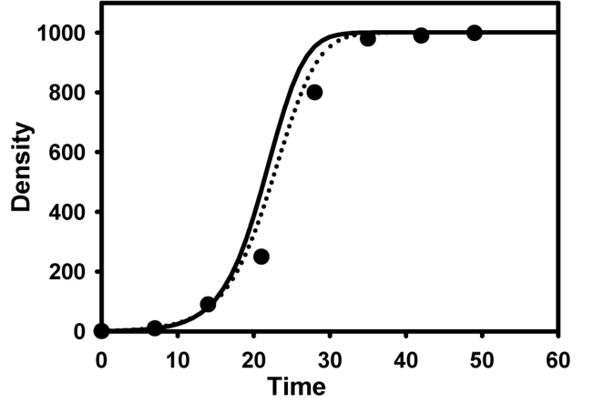{#fig-tt-pepper-fit}
 ที่ประยุกต์ใช้ร่วมกับพารามิเตอร์เหล่านี้ ให้ผลลัพธ์การจับคู่สอดคล้องกับข้อมูลที่ยอดเยี่ยมเพียงใด อาจมีคนสงสัยว่า: แล้วถ้าค่าประมาณของ $\mu$ ผิดเพี้ยนไปจากความจริงแบบสุดกู่ล่ะจะเป็นอย่างไร ปรากฏว่าในกรณีนี้ ค่าประมาณของ $\beta H_0$ นั้นมีความยืดหยุ่นทนทานต่อข้อผิดพลาดใน $\mu$ เป็นอย่างดี ยกตัวอย่างเช่น หากเราเปลี่ยนมาใช้ $\mu = 1/25$ ในสมการ 5.38 เราก็ยังคงได้ค่าประมาณ 1.05/วัน และถ้าลองเปลี่ยนไปใช้ค่า $\mu = 1/100$ แทน เราก็จะได้ค่าประมาณ 1.02/วัน สำหรับการประเมินค่า $\beta H_0$หลังจากนั้น เราได้ทำการฟิตสมการ 5.33 เข้ากับข้อมูลไวรัสใบด่างยาสูบโดยตรง (โดยใช้ค่า $\omega = 1/7$ และ $\mu = 1/50$ อีกครั้ง) ผ่านกระบวนการ MODEL ของโปรแกรม SAS เราใช้ค่าประมาณของ $y_0$ จากแบบจำลองลอจิสติกเป็นตัวตั้งต้นความรุนแรงของโรค ค่าประมาณของ $\beta H_0$ ที่ได้ออกมาคือ 0.85/วัน (ค่าความคลาดเคลื่อนมาตรฐาน s.e. = 0.017) ซึ่งน้อยกว่าค่าประมาณแบบที่ไม่ได้ใช้วิธีฟิตโมเดลตรงๆ (ตามด้านบน) เพียงเล็กน้อยเท่านั้น ด้วยค่าประมาณของตัวพารามิเตอร์ส่งผ่านเชื้อนี้ เส้นกราฟยังคงสามารถจับคู่กันได้อย่างพอดิบพอดีกับข้อมูลที่มีอยู่ (ดูที่เส้นประไข่ปลาในภาพที่ 6.12) ส่วนค่าสัมประสิทธิ์การตัดสินใจ (Coefficient of determination, $R^2$) ก็ทะยานขึ้นไปสูงปรี๊ดเกินกว่า 0.999 ในขณะที่ค่าประมาณ $R_0$ อยู่ที่ 42.5 ซึ่งถึงแม้ว่าตัวเลขนี้จะน้อยกว่า 51.5 ที่เราเพิ่งประเมินไปก่อนหน้า แต่ทั้งสองค่านี้ก็ยังมีค่าลอยลำห่างจากจุดที่ทำให้ $y_{\pm} \approx 1$ อยู่มากโข{#fig-6-12}ความพยายามที่จะดันทุรังประเมินค่า $\beta H_0$, $\mu$ และ $\omega$ ไปพร้อมๆ กันผ่านกระบวนการ MODEL นั้น มักจะสร้างปัญหาชวนปวดหัว หากเรามีชุดข้อมูลเหลือเฟือเพียงแค่หยิบมือ จากประสบการณ์ของเราบอกได้เลยว่า เราควรจะต้องมีบันทึกการประเมินการระบาดมากกว่าแปดครั้งขึ้นไป จึงจะสามารถทำการประมาณค่าพารามิเตอร์ทั้งสามตัวของสมการ 5.33 ได้สำเร็จรุล่วงผ่านวิธีการหาค่าที่เหมาะสมที่สุดแบบไม่เป็นเชิงเส้น (Nonlinear optimization methods) สิ่งที่ช่วยเพิ่มความท้าทายเข้าไปอีกก็คือ ด้วยความรุนแรงของโรคในขั้นสุดท้ายที่ระดับ $\sim 1$ การรวมตัวกันของกลุ่ม $\beta H_0$ และ $\mu$ อันหลากหลาย ล้วนสามารถให้ผลลัพธ์ในระดับที่สูงลิ่วเท่าเทียมกันได้หมด นี่เป็นเพราะค่า $y_{\pm} \approx 1$ จะถูกสร้างขึ้นมาทันที เมื่อค่า $R_0$ อะไรก็ตามมีค่าทะลุ 5 ขึ้นไปในแบบจำลอง H-L-I-R ดังนั้น ในชุดข้อมูลจึงมีร่องรอยให้ตามสืบอยู่น้อยมาก (ยิ่งกว่านั้น หนึ่งในสามของข้อมูลที่มี ยังเป็นข้อมูลของ $y \ge 0.98$ เสียอีก) ที่จะใช้สำหรับ ยกตัวอย่างเช่น การจำแนกความแตกต่างระหว่างค่า $R_0$ ที่ 10, 20, 50 หรือสูงกว่านั้น อันที่จริง การที่เราทึกทักให้ค่า $\mu = 0$ กลับนำไปสู่อัตราการส่งผ่านเชื้อที่ระดับ 0.80/วัน ซึ่งก็แทบจะไม่ได้แตกต่างไปจากการให้ค่า $\mu = 1/50$ เลยแม้แต่น้อยในปัจจุบัน การใช้วิธีกำลังสองน้อยที่สุดแบบไม่เป็นเส้นตรง (Nonlinear least squares) หรือความควรจะเป็นสูงสุด (Maximum likelihood) เพื่อประมาณค่าพารามิเตอร์ให้กับแบบจำลอง H-L-I-R หรือแบบจำลองสมการเชิงอนุพันธ์คู่ควบสำหรับพลวัตประชากรอื่นๆ โดยตรงนั้น เริ่มเป็นที่นิยมอย่างแพร่หลายมากขึ้น ซึ่งนี่ถือเป็นการเปิดประตูสู่โอกาสใหม่ๆ ในการเชื่อมโยงการศึกษาทฤษฎีทางระบาดวิทยา เข้ากับการสังเกตการณ์ความก้าวหน้าของโรคในพืชล้มลุกและพืชยืนต้น Gilligan (2002, รวมไปถึงแหล่งอ้างอิงที่อยู่ในนั้น) ได้สาธิตให้เห็นถึงความเชื่อมโยงอันยอดเยี่ยมเหล่านี้เอาไว้ อย่างไรก็ดี ปัญหาจุกจิกทั่วๆ ไปในการประยุกต์ใช้วิธีจับคู่สอดคล้องกับโมเดลแบบไม่เป็นเส้นตรง เมื่อนำไปเทียบกับการใช้แบบจำลองเส้นตรง (ดูการสนทนาในบทที่ 3 และ 4) มักจะบานปลายใหญ่โตขึ้น เมื่อแบบจำลองไม่เป็นเส้นตรงเกิดมีสมการเชิงอนุพันธ์พ่วงเข้ามาเป็นโขยง เห็นได้อย่างชัดเจนว่าการประยุกต์ใช้งานวิจัยทางสถิติ ยังคงเป็นที่ต้องการอย่างยิ่งในการช่วยประเมินคุณสมบัติการแจกแจงของตัวพารามิเตอร์ ซึ่งถูกประเมินขึ้นโดยอาศัยวิธีการอันซับซ้อนแต่ทรงพลังเหล่านี้ ผลลัพธ์อันทรงคุณค่าที่จะได้จากงานวิจัยทางสถิติใหม่ๆ (ซึ่งเกี่ยวข้องกับการประเมินค่าพารามิเตอร์ทั้งทางตรงและทางอ้อม) ก็คือการประเมินชี้วัดว่า ความไม่แน่นอนในพารามิเตอร์ของแบบจำลอง (เช่น $\alpha$) ที่ได้รับมาจากข้อมูลการระบาดที่อื่นๆ หรือจากการระบาดในปัจจุบัน จะส่งผลกระทบต่อความแม่นยำและความเที่ยงตรงของค่า $R_0$ เชิงทำนายในทิศทางใด
