# มิติเชิงพื้นที่ของการระบาด: การแพร่กระจายของเชื้อและความลาดชันของโรค (Pathogen Dispersal and Disease Gradients) {#sec-disease-gradients}

> *"สรรพสิ่งล้วนเกี่ยวข้องกัน แต่สิ่งที่อยู่ใกล้กันย่อมมีความเกี่ยวข้องกันมากกว่าสิ่งที่อยู่ไกลกัน"*
> — W. R. Tobler (กฎข้อที่หนึ่งของภูมิศาสตร์)

---

## 7.1 บทนำ (Introduction) {#sec-dg-intro}

 {#sec-dg-intro}

 {#sec-dg-intro}

การระบาดของโรค (Epidemics) เป็นกระบวนการระดับประชากรที่เกิดขึ้นทั้งในมิติของเวลาและพื้นที่ (ดูบทที่ 1) อย่างไรก็ตาม ในสามบทที่ผ่านมา เราได้ละเว้นองค์ประกอบด้านพื้นที่ของการระบาดไว้ก่อน เพื่อสร้างกรอบแนวคิดทั่วไปในการอธิบายและวิเคราะห์พัฒนาการของโรคเมื่อเวลาผ่านไป ทว่าโดยทั่วไปแล้ว โรคพืชย่อมมีการแพร่กระจายเชิงพื้นที่ไปพร้อมๆ กับการเพิ่มขึ้นตามเวลา และความเข้าใจเรื่องการระบาดของโรคพืชจะไม่อาจสมบูรณ์ได้เลยหากปราศจากการพิจารณาพัฒนาการของโรคในแง่มุมนี้

การแพร่กระจายของโรค (Disease spread) เป็นผลมาจากการแพร่กระจายของแหล่งเชื้อ (Inoculum dispersal) คำว่า การแพร่กระจาย (Dispersal) หมายถึงการเคลื่อนที่ของหน่วยติดเชื้อ (Infectious units) (เช่น สปอร์) ของเชื้อก่อโรคจากที่หนึ่งไปยังอีกที่หนึ่ง หรือการเคลื่อนที่ของหน่วยติดเชื้อจากแหล่งกำเนิดไปยังตำแหน่งอื่นๆ (Campbell and Madden, 1990) ในบทนี้และบทอื่นๆ เราจะถือว่าคำว่า ส่วนขยายพันธุ์ (Propagules), หน่วยขยายพันธุ์ (Propagative units) และหน่วยของแหล่งเชื้อ (Units of inoculum) มีความหมายเทียบเท่ากับหน่วยติดเชื้อ (Infectious units)

เนื่องจากหน่วยขยายพันธุ์ส่วนใหญ่มักเคลื่อนที่ไปได้ในระยะทางสั้นๆ การติดเชื้อใหม่จึงมักเกิดขึ้นใกล้กับบริเวณที่มีการติดเชื้ออยู่ก่อนแล้ว ส่งผลให้ความรุนแรงของโรค (Disease intensity) ในบางพื้นที่มักจะสูงกว่าพื้นที่อื่น

หากแหล่งเชื้อในระยะเริ่มต้นกระจุกตัวอยู่ในบริเวณเดียว เราสามารถศึกษาการแพร่กระจายได้โดยการวัดการตกตะกอนของสปอร์ (Spore deposition) บนพื้นผิว (เช่น ใบ ดอก) ในระยะห่างต่างๆ จากแหล่งกำเนิดเชื้อ (Inoculum source)

ในทำนองเดียวกัน หากสิ่งมีชีวิตที่เป็นโรคกระจุกตัวอยู่ในจุดโฟกัส (Focus) บริเวณหนึ่งในระยะเริ่มต้น การแพร่กระจายของโรคสามารถประเมินได้จากการวัดความรุนแรงของโรคในระยะห่างต่างๆ จากแหล่งกำเนิดโรคเริ่มต้น สถานการณ์ลักษณะนี้จะถูกนำมาพิจารณาในบทนี้และบทถัดไป อย่างไรก็ตาม หากมีแหล่งกำเนิดเชื้อหลายแห่ง หรือมีสิ่งมีชีวิตที่เป็นโรคกระจายอยู่หลายจุดตั้งแต่เริ่มเกิดการระบาด การวัดการแพร่กระจายของโรคอาจทำได้ไม่ง่ายนัก (แม้ว่ากระบวนการทางชีววิทยาที่เกิดขึ้นจะเหมือนกันก็ตาม) เหตุผลก็คือ เราจะไม่มีทางรู้ได้เลยว่าสปอร์ที่ตกลงมานั้นมาจากไหน หรือแหล่งกำเนิดเชื้อใดเป็นตัวสร้างสปอร์ที่ทำให้เกิดการติดเชื้อในสิ่งมีชีวิตตัวใหม่ ณ ตำแหน่งนั้นๆ ในสถานการณ์เช่นนี้ มักจะต้องใช้วิธีการเชิงพื้นที่รูปแบบอื่นในการอธิบายลักษณะการระบาด (ดูบทที่ 9)

เมื่อย้อนกลับไปพิจารณาแบบจำลองและการวิเคราะห์ในบทที่ผ่านๆ มา เราจะเห็นถึงความสำคัญขององค์ประกอบด้านพื้นที่ของการระบาดได้อย่างชัดเจน

ยกตัวอย่างเช่น ในกรณีของโรคที่มีวงจรเดียว (Monocyclic diseases) ความน่าจะเป็นต่อหนึ่งหน่วยเวลาที่หน่วยของแหล่งเชื้อจะไปสัมผัสกับโฮสต์และก่อให้เกิดการติดเชื้อ (ดูหัวข้อ 4.4.2) นั้นเป็นฟังก์ชันของระยะห่างระหว่างแหล่งเชื้อกับโฮสต์ (Function of the distance) นอกจากนี้ ความน่าจะเป็นที่สปอร์ซึ่งสร้างขึ้นบนแผล (Lesion) ระหว่างการระบาดของโรคที่มีหลายวงจร (Polycyclic disease) จะเดินทางไปถึงโฮสต์อีกต้นหนึ่ง ก็เป็นฟังก์ชันของระยะห่างระหว่างสิ่งมีชีวิตที่เป็นโรคกับโฮสต์ "ต้นอื่นๆ" เช่นกัน การกำหนดให้ค่าความน่าจะเป็นเหล่านี้เป็นค่าคงที่ (Constants) เท่ากับเป็นการตั้งสมมติฐานว่าการระบาดนั้นมีความเป็นเนื้อเดียวกันในเชิงพื้นที่ (Homogeneous in space) หรือก็คือมีแหล่งกำเนิดเชื้อและ/หรือสิ่งมีชีวิตที่ติดเชื้อกระจายตัวอยู่อย่างสม่ำเสมอทั่วทั้งประชากรโฮสต์ ซึ่งสมมติฐานดังกล่าวไม่สอดคล้องกับความเป็นจริง เมื่อการระบาดเริ่มต้นขึ้นจากแหล่งกำเนิดเชื้อเพียงแหล่งเดียว (หรือสองสามแหล่ง) ที่จำกัดอยู่เฉพาะบางพื้นที่

บัดนี้ เราจะมาพิจารณาองค์ประกอบด้านพื้นที่ของการระบาดอย่างเจาะลึก โดยเฉพาะในบทนี้ที่จะเน้นไปที่การอธิบายลักษณะการแพร่กระจายของโรคจากแหล่งกำเนิดเชื้อ (ดั้งเดิม) เพียงแหล่งเดียว เราจะนำเสนอแบบจำลองที่ค่อนข้างเรียบง่ายพร้อมทั้งอภิปรายถึงคุณสมบัติของแบบจำลองเหล่านั้น รวมถึงแสดงวิธีการประมาณค่าพารามิเตอร์ของแบบจำลอง (Model parameters) และวิธีการเปรียบเทียบการแพร่กระจายของการระบาดตั้งแต่สองเหตุการณ์ขึ้นไปโดยอาศัยแบบจำลองที่ปรับแก้แล้ว (Fitted models) ทั้งนี้ เราตั้งสมมติฐานว่าผู้อ่านได้ทำความเข้าใจเนื้อหาในบทที่ 4 เกี่ยวกับการอธิบายลักษณะการระบาดในเชิงเวลามาแล้ว โดยเฉพาะแนวคิดที่เกี่ยวข้องกับการปรับแก้แบบจำลองทางสถิติ (Statistical model fitting) และการเปรียบเทียบ ดังนั้น หากแนวคิดใดซ้ำซ้อนกัน เราจะไม่ขอกล่าวซ้ำถึงรายละเอียดของวิธีการทางสถิติที่ได้นำเสนอไปแล้วในบทที่ 4

ในบทถัดไป เราจะใช้วิธีการที่เน้นกลไก (Mechanistic approach) มากยิ่งขึ้น เพื่อทำความเข้าใจการแพร่กระจายของโรคผ่านการเคลื่อนที่ของแหล่งเชื้อ ในบทนั้น เราจะต่อยอดสมการอัตรา (Rate equations, $dy/dt$) สำหรับการระบาดจากบทที่ 5 โดยจะผนวกฟังก์ชันระยะทาง (Distance functions) เข้าไปในพจน์ของความน่าจะเป็นที่สปอร์ซึ่งเริ่มต้นจากจุดหนึ่งจะไปสัมผัสกับโฮสต์ในอีกจุดหนึ่งอย่างชัดเจน จากนั้นในบทที่ 9 เราจะเปลี่ยนแนวทางและแสดงให้เห็นว่าเราสามารถอธิบายรูปแบบเชิงพื้นที่ของการระบาดได้อย่างไร โดยไม่จำเป็นต้องอ้างอิงถึงแหล่งกำเนิดเชื้ออย่างเจาะจง

## 7.2 ความลาดชันของการแพร่กระจายและความลาดชันของโรค (Dispersal and Disease Gradients) {#sec-dg-gradients}

### 7.2.1 แนวคิดพื้นฐาน (Concepts)

การศึกษาเรื่องการแพร่กระจายของสปอร์ (Spore dispersal) มีความสำคัญอย่างมากในหน้าประวัติศาสตร์ของวิทยาการระบาดของโรคพืช (Plant disease epidemiology) อันที่จริง ก่อนที่แนวคิดของ Vanderplank (1963) จะเริ่มเป็นที่ยอมรับ คำว่า “วิทยาการระบาด” (Epidemiology) มักถูกใช้เพื่ออธิบายถึงการศึกษาสปอร์ของเชื้อก่อโรคในชั้นบรรยากาศ ซึ่งรวมถึงการศึกษาการเคลื่อนที่ของสปอร์ไปยังบริเวณติดเชื้อแห่งใหม่ และสภาพแวดล้อมที่ส่งผลต่อการสร้าง การเคลื่อนที่ และการงอกของสปอร์

Gregory (1968, 1973) เป็นผู้บุกเบิกในการศึกษาด้านการแพร่กระจายของสปอร์ แนวคิดและหลักการหลายอย่างที่เขาได้พัฒนาขึ้นยังคงใช้ได้จริงจนถึงปัจจุบันและสะท้อนให้เห็นในบทนี้ ผลงานของ Gregory ยังเป็นฟันเฟืองสำคัญที่นำไปสู่การก่อตั้งสาขาวิชาวิทยาศาสตร์แขนงใหม่ที่เรียกว่า ชีววิทยาอากาศ (Aerobiology) ซึ่งมุ่งเน้นศึกษาทุกแง่มุมของสปอร์ ละอองเรณู และสิ่งมีชีวิตอื่นๆ ในชั้นบรรยากาศ แม้ว่าในปัจจุบัน วิทยาการระบาดของโรคพืชจะครอบคลุมเนื้อหาที่กว้างไกลกว่าแค่เรื่องของการแพร่กระจาย แต่กระบวนการนี้ก็ยังคงเป็นองค์ประกอบหลักที่สำคัญยิ่งต่อพัฒนาการของโรค

การแพร่กระจายของหน่วยขยายพันธุ์หรือหน่วยติดเชื้อ (เช่น สปอร์) เกี่ยวข้องกับกระบวนการปลดปล่อย (Liberation หรือ Takeoff), การพัดพา (Transport หรือ Flight) และการตกตะกอน (Deposition หรือ Landing) คำศัพท์เหล่านี้ได้รับอิทธิพลอย่างมากจากการศึกษาการเคลื่อนที่ของสปอร์ในชั้นบรรยากาศ แต่แน่นอนว่าการแพร่กระจายก็เกิดขึ้นในดินเช่นกัน แม้ว่าระยะทางมักจะสั้นกว่ามากก็ตาม นอกจากนี้ คำว่าแหล่งเชื้อ (Inoculum) ยังต้องถูกพิจารณาในความหมายที่กว้างกว่าเพียงแค่สปอร์ เพื่อให้ครอบคลุมถึงการเคลื่อนที่ของเซลล์แบคทีเรียและเชื้อก่อโรคที่อาศัยสัตว์ขาปล้อง (Arthropods) หรือพาหะนำโรค (Vectors) ชนิดอื่นๆ ดังที่ได้กล่าวไว้ในบทที่ 4 ว่าในหนังสือเล่มนี้ เราจงใจใช้คำจำกัดความของ "แหล่งเชื้อ" อย่างหลวมๆ เพื่อให้สามารถรองรับการเคลื่อนที่ของพาหะที่รับเอาไวรัสพืช (Plant viruses), สไปโรพลาสมา (Spiroplasmas), ไฟโตพลาสมา (Phytoplasmas) และเชื้อก่อโรคอื่นๆ มาแล้ว

การปลดปล่อยแหล่งเชื้อ (Liberation of inoculum) เกี่ยวข้องกับการหลุดของสปอร์หรือเซลล์ออกจากสิ่งมีชีวิตที่เป็นโรค แล้วถูกปล่อยเข้าสู่ตัวกลางพัดพา (Transport medium) (ได้แก่ อากาศ น้ำ หรือดิน) การพัดพา (Transport) เกี่ยวข้องกับการเคลื่อนที่ของแหล่งเชื้อผ่านตัวกลางที่มีความปั่นป่วน (Turbulent medium) เช่น อากาศหรือน้ำ ส่วนการตกตะกอน (Deposition) คือการที่แหล่งเชื้อหลุดออกจากตัวกลางพัดพาและตกลงบนพื้นผิว (เช่น ใบไม้) โดยสรุปแล้ว การแพร่กระจายเป็นทั้งกระบวนการทางฟิสิกส์และทางชีววิทยา และงานวิจัยในหัวข้อนี้มักจะมีลักษณะเป็นสหวิทยาการ (Interdisciplinary) ในหนังสือเล่มนี้ เราจะไม่เจาะลึกถึงหลักการทางฟิสิกส์ของการแพร่กระจายของแหล่งเชื้อ แต่ขอแนะนำผู้อ่านที่สนใจให้ไปศึกษาเพิ่มเติมจากเอกสารอ้างอิงที่มีความสมบูรณ์และละเอียดรอบด้านหลายฉบับ (Aylor, 1999 และเอกสารอ้างอิงในนั้น; Ferrandino, 1993; Madden, 1992; McCartney and Fitt, 1985)

แทนที่จะมุ่งเน้นไปที่รายละเอียดทางชีวฟิสิกส์ (Biophysical details) ของการเคลื่อนที่ของแหล่งเชื้อ เราจะสรุปกระบวนการแพร่กระจายผ่าน ความลาดชันของโรค (Disease gradient) ซึ่งก็คือการเปลี่ยนแปลง (โดยทั่วไปหมายถึงการลดลง) ของความรุนแรงของโรคหรือจำนวนการติดเชื้อเมื่อเทียบกับระยะห่างจากแหล่งกำเนิดเชื้อ อย่างไรก็ตาม มีข้อควรระวังประการหนึ่งที่ต้องกล่าวถึงในที่นี้ ความลาดชันของโรคอาจเกิดได้จากหลายสาเหตุ ตัวอย่างเช่น อาจเกิดความลาดชันของอุบัติการณ์โรคราก (Root disease incidence) จากฝั่งหนึ่งของแปลงเกษตรไปยังอีกฝั่งหนึ่งอันเนื่องมาจาก ความลาดชันของสภาพแวดล้อม (Environmental gradient) อย่างเช่นความชื้นในดินที่ลดลง เราจะไม่กล่าวถึงความลาดชันของสภาพแวดล้อมในลักษณะดังกล่าว แต่จะจำกัดขอบเขตการอภิปราย (เป็นส่วนใหญ่) ไว้เฉพาะความลาดชันของโรคที่เกิดจากการแพร่กระจายเท่านั้น

บ่อยครั้งที่มีการใช้คำว่า ความลาดชันของการแพร่กระจาย (Dispersal gradient) เพื่ออธิบายความลาดชันของโรคอันเกิดจากความแปรผันในการตกตะกอนของแหล่งเชื้อเมื่อเทียบกับระยะห่างจากแหล่งกำเนิดเชื้อ หากขยับไปดูเหตุการณ์ก่อนหน้านั้นเล็กน้อย เราสามารถพิจารณา ความลาดชันของการตกตะกอน (Deposition gradient) โดยตรงได้ ซึ่งเป็นตัวชี้วัดปริมาณสปอร์ต่อหน่วยพื้นที่หรือความยาวเทียบกับระยะห่างจากแหล่งกำเนิดเชื้อ และเมื่อนำความหนาแน่นของสปอร์ (หรือหน่วยติดเชื้อ) นี้ไปคูณกับค่าปัจจัยประสิทธิภาพการติดเชื้อ (Infection efficiency factor) ก็จะได้เป็นจำนวนการติดเชื้อเมื่อเทียบกับระยะทาง (ซึ่งก็คือความลาดชันของโรค)

โดยทั่วไป ความลาดชันที่สังเกตพบอาจเกิดจากการผสมผสานกันระหว่างการแพร่กระจายของแหล่งเชื้อและความลาดชันของสภาพแวดล้อม ดังนั้น นักวิจัยจึงควรระมัดระวังไม่ตีความข้อมูลความลาดชันของโรคมากเกินจริง (Over-interpreting) หากยังไม่มีหลักฐานแน่ชัดว่าการแพร่กระจายเป็นสาเหตุหลักที่ทำให้เกิดการเปลี่ยนแปลงอย่างเป็นระบบของโรคในเชิงพื้นที่ เนื่องจากนี่คือหนังสือที่ว่าด้วยโรคในประชากรพืช เราจึงมุ่งเน้นไปที่ความลาดชันของโรคเป็นหลัก และจะตั้งสมมติฐานในบทนี้ว่าความลาดชันดังกล่าวเป็นผลมาจากการแพร่กระจาย นั่นคือ เราถือว่าความลาดชันของโรคก็คือความลาดชันของการแพร่กระจาย (Dispersal gradient) โดยเราสามารถแบ่งประเภทของความลาดชันของการแพร่กระจายได้เป็นแบบปฐมภูมิ (Primary) และแบบทุติยภูมิ (Secondary) ใน ความลาดชันแบบปฐมภูมิ (Primary gradient) การติดเชื้อทั้งหมดล้วนเกิดจากสปอร์ (หรือหน่วยติดเชื้ออื่นๆ) ที่มาจากแหล่งกำเนิดเชื้อโดยตรง กล่าวอีกนัยหนึ่งก็คือ ความลาดชันแบบปฐมภูมิเกิดจากการแพร่กระจายปฐมภูมิ (Primary spread) ของโรค (จากแหล่งเชื้อเริ่มต้น ซึ่งในสถานการณ์นี้ตั้งอยู่ในตำแหน่งที่กำหนดไว้ชัดเจน) ส่วนใน ความลาดชันแบบทุติยภูมิ (Secondary gradient) การติดเชื้อเกิดจากแหล่งเชื้อที่ถูกสร้างขึ้นในบริเวณอื่นที่นอกเหนือไปจากแหล่งกำเนิดดั้งเดิม พูดง่ายๆ คือ ความลาดชันแบบทุติยภูมิจะเกิดขึ้นเมื่อมีการแพร่กระจายทุติยภูมิ (Secondary spread) ของโรคระหว่างการระบาด ซึ่งจะพบได้ในกลุ่มโรคที่มีหลายวงจร (Polycyclic diseases) (ดูบทที่ 4)

ตามปกติแล้ว พืชที่เป็นโรคจะไม่สามารถเคลื่อนที่ได้ ด้วยเหตุนี้ การแพร่กระจายของโรคพืชจึงไม่เหมือนกับการแพร่กระจายของแมลงจากแปลงหนึ่งไปยังอีกแปลงหนึ่งเสียทีเดียว แต่สิ่งที่เคลื่อนที่ได้คือแหล่งเชื้อ (Inoculum) และดังที่ได้กล่าวไว้ในบทนำ (หัวข้อ 7.1) ว่าการแพร่กระจายของโรคนั้นถือเป็นผลลัพธ์มาจากการแพร่กระจายของแหล่งเชื้อ กล่าวอีกนัยหนึ่ง พื้นที่ที่เต็มไปด้วยพืชที่เป็นโรค และความรุนแรงของโรค ณ ระยะห่างจากแหล่งกำเนิดเชื้อที่กำหนด ล้วนเพิ่มขึ้น (อย่างน้อยก็ส่วนหนึ่ง) จากกระบวนการแพร่กระจายนี้ ในแง่นี้ การแพร่กระจายของโรคจึงเปรียบได้กับการขยายตัวของประชากรสัตว์ในกรณีที่พ่อแม่พันธุ์ไม่ได้ย้ายถิ่นฐาน แต่ลูกหลานเป็นฝ่ายเคลื่อนย้ายออกไปยังพื้นที่ใหม่แทนตัวอย่างของความลาดชันของโรคแสดงไว้ใน @fig-dg-examples ซึ่งคัดเลือกมาเพื่อให้เห็นถึงความหลากหลายของระบบความสัมพันธ์ระหว่างเชื้อก่อโรคและพืชอาศัย

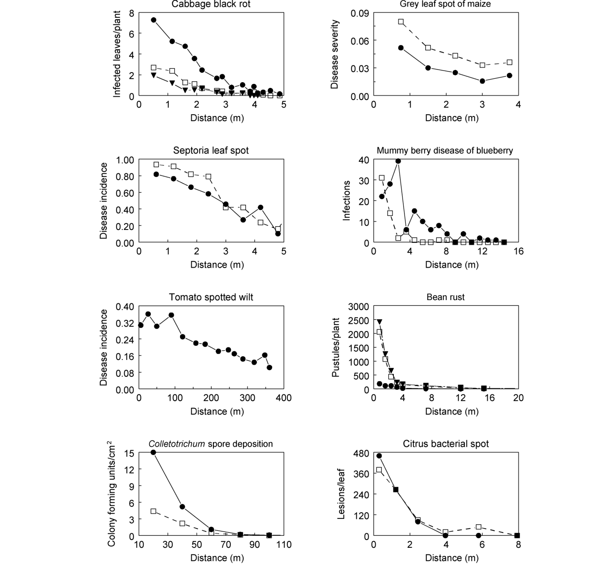{#fig-dg-examples}
 ซึ่งคัดเลือกมาเพื่อให้เห็นถึงความหลากหลายของระบบความสัมพันธ์ระหว่างเชื้อก่อโรคและพืชอาศัย

 ซึ่งคัดเลือกมาเพื่อให้เห็นถึงความหลากหลายของระบบความสัมพันธ์ระหว่างเชื้อก่อโรคและพืชอาศัย

ในภาพรวม ความลาดชันของโรคมักจะมีรูปทรงอันเป็นเอกลักษณ์ซึ่งส่วนใหญ่ถูกกำหนดโดยกระบวนการทางฟิสิกส์ของการแพร่กระจาย ความรุนแรงของโรคจะสูงมากที่บริเวณแหล่งกำเนิดเชื้อและบริเวณใกล้เคียง (โดยเฉพาะอย่างยิ่งหากแหล่งกำเนิดเชื้ออยู่บนหรือใกล้กับผิวดิน) และโดยทั่วไปจะค่อยๆ ลดลงเมื่อระยะห่างจากแหล่งกำเนิดเชื้อเพิ่มขึ้น อัตราการลดลง (Rate of decline) มักจะมีค่าสูงในระยะทางสั้นๆ จากแหล่งกำเนิดเชื้อ โดยเฉพาะในช่วงแรกของการระบาด และมีค่าต่ำเมื่ออยู่ในระยะที่ไกลออกไป เมื่อความรุนแรงของโรคมีระดับค่อนข้างสูงใกล้กับแหล่งกำเนิดเชื้อ (เช่น สูงกว่า 10% ของค่าสูงสุดที่เป็นไปได้อย่างมีนัยสำคัญ) ความรุนแรงจะลดลงอย่างช้าๆ ในระยะทางสั้นๆ จากนั้นจะเริ่มลดลงอย่างฮวบฮาบ (Steeper decline) ก่อนที่อัตราการลดลงจะกลับมาน้อยลงอีกครั้งในระยะที่ไกลออกไป (ดูตัวอย่างของโรคที่เกิดจากเชื้อ Septoria) ในบางกรณี อาจพบว่าความรุนแรงของโรคเพิ่มขึ้นก่อนที่จะเข้าสู่รูปแบบปกติที่ค่อยๆ ลดลงตามระยะทาง (ดูตัวอย่างของโรคผลมัมมี่) ลักษณะเช่นนี้จะพบได้บ่อยกว่าเมื่อแหล่งกำเนิดเชื้ออยู่ในตำแหน่งที่สูงขึ้นไป (นั่นคือ บริเวณส่วนบนของต้นโฮสต์)

### 7.2.2 แหล่งกำเนิดเชื้อ (Inoculum sources)

ที่ผ่านมาเราใช้คำว่า "แหล่งกำเนิดเชื้อ" (Inoculum source) กันมาตลอดโดยยังไม่ได้นิยามความหมายที่แท้จริง สำหรับโรคที่มีหลายวงจร (Polycyclic disease) สิ่งมีชีวิตใดๆ ที่ติดเชื้อ (และสามารถแพร่เชื้อได้; ดูบทที่ 5) ถือเป็นแหล่งกำเนิดเชื้อสำหรับสิ่งมีชีวิตที่แข็งแรงต้นอื่นๆ ส่วนโรคที่มีวงจรเดียว (Monocyclic disease) แหล่งกำเนิดเชื้ออาจเป็นสิ่งมีชีวิตที่ติดเชื้อมาจากพื้นที่อื่นหรือจากปีก่อนหน้า หรืออาจเป็นสปอร์ที่พักตัวข้ามฤดูหนาว (Overwintering spores) อยู่ในดินก็ได้ อย่างไรก็ตาม ในบริบทของการอธิบายลักษณะการแพร่กระจายของโรค เรามักจะมองว่า แหล่งกำเนิดเชื้อ คือการกระจุกตัวของหน่วยติดเชื้อในพื้นที่ที่จำกัด (Spatially-restricted concentration) เช่น กลุ่มของสปอร์ เซลล์แบคทีเรีย หรือแม้แต่สิ่งมีชีวิตที่เป็นโรคซึ่งสามารถผลิตหน่วยติดเชื้อได้ กล่าวคือ แหล่งกำเนิดเชื้อจะแยกตัวออกมา หรืออยู่ตรง "ขอบ" ของพื้นที่ที่ใช้ประเมินการแพร่กระจายของโรค อย่างน้อยก็ในช่วงเริ่มต้นของการระบาด นอกจากนี้ เรายังอาจเรียกแหล่งกำเนิดเชื้อว่า จุดโฟกัสของโรค (Disease focus) ได้เช่นกัน แต่เรามักจะใช้คำนี้ในบทต่อๆ ไปมากกว่า โดยทั่วไปแล้ว พื้นที่ของแหล่งกำเนิดเชื้อจะเล็กกว่าพื้นที่ที่ใช้วัดการเกิดโรคมาก แม้ว่านี่จะไม่ใช่กฎตายตัวก็ตาม

ข้อควรระวังที่สำคัญคือ แนวคิดเรื่องแหล่งกำเนิดเชื้อที่จำกัดอยู่ในพื้นที่เฉพาะนี้ ส่วนหนึ่งเป็นเพียงเรื่องของความสะดวกในการศึกษาเท่านั้น ความเป็นจริงคือ ในการระบาดหลายๆ ครั้ง (หรือส่วนใหญ่) แหล่งกำเนิดเชื้อไม่ได้แยกตัวออกจากประชากรโฮสต์ แต่เป็นส่วนหนึ่งของระบบที่โรคกำลังพัฒนาขึ้นมาเลย ตัวอย่างเช่น ในโรคที่มีหลายวงจร ทุกๆ รอยแผล (Lesion) สามารถกลายเป็นแหล่งกำเนิดเชื้อได้ ในทำนองเดียวกัน สำหรับโรคที่มีวงจรเดียว เราอาจพบสปอร์ที่พักตัวข้ามฤดูหนาวกระจายอยู่ทั่วพื้นดินที่ปลูกพืชโฮสต์ แต่ในทางปฏิบัติ เพื่อที่จะ ศึกษา ความลาดชันและการแพร่กระจายของโรค เรามักจำเป็นต้องใช้ระบบที่แหล่งกำเนิดเชื้อ (เริ่มต้น) ถูกกำหนดตำแหน่งเชิงพื้นที่ไว้อย่างชัดเจน (Well-defined in space) อย่างไรก็ตาม ในช่วงไม่กี่ปีที่ผ่านมาได้มีการพัฒนาแนวทางทางสถิติใหม่ๆ ที่น่าสนใจ ซึ่งช่วยให้เราไม่จำเป็นต้องมีข้อจำกัดดังกล่าวอีกต่อไป ดังที่จะได้กล่าวถึงในหัวข้อ 9.10 (Gibson, 1997a, b)

หากแบ่งตามรูปทรงเรขาคณิตและขนาดสัมพัทธ์ (Relative size) แหล่งกำเนิดเชื้อจะมีอยู่ 3 ประเภทหลักๆ ได้แก่ แหล่งกำเนิดเชื้อแบบจุด (Point source), แบบเส้น (Line source) และแบบพื้นที่ (Area source) การแยกแยะความแตกต่างเหล่านี้มีความสำคัญต่อการอธิบายลักษณะการเคลื่อนที่ทางกายภาพของส่วนขยายพันธุ์ (Propagules) บนระนาบ แม้ว่าบางครั้งเราอาจไม่ได้สนใจกระบวนการทางกายภาพโดยตรง แต่พารามิเตอร์ต่างๆ ในแบบจำลองความลาดชัน (Gradient models) ก็ยังคงขึ้นอยู่กับประเภทของแหล่งกำเนิดเชื้ออยู่ดี ดังนั้น เราจึงต้องตระหนักถึงประเภทของแหล่งกำเนิดเชื้อเสมอเมื่อเปรียบเทียบผลลัพธ์ระหว่างระบบต่างๆ ถึงแม้ในทางคณิตศาสตร์ "จุด" จะไม่มีมิติ แต่ในบริบทของการแพร่กระจายของโรค คำว่า แหล่งกำเนิดเชื้อแบบจุด จะใช้เรียกแหล่งกำเนิดเชื้อที่มีขนาดเล็กมากๆ เมื่อเทียบกับพื้นที่ที่กำลังศึกษาการแพร่กระจาย

ตัวอย่างของแหล่งกำเนิดเชื้อแบบจุด เช่น พืชที่ติดเชื้อเพียงต้นเดียวและมีแผลที่กำลังสร้างสปอร์ (Sporulating lesions) อยู่ตรงกลางหรือมุมใดมุมหนึ่งของแปลงปลูก ในทางปฏิบัติ เส้นผ่านศูนย์กลาง (หรือพูดให้กว้างกว่านั้นคือความกว้าง) ของแหล่งกำเนิดเชื้อแบบจุดจะอยู่ที่ประมาณ 1% ของระยะทางทั้งหมดที่ใช้วัดการแพร่กระจาย ส่วน แหล่งกำเนิดเชื้อแบบเส้น เราสามารถจินตนาการได้ว่ามันคือแหล่งกำเนิดเชื้อแบบจุดที่ถูกยืดออกไปจนสุดความกว้างของแปลงหรือพื้นที่ทดลอง ในทิศทางที่ตั้งฉากกับทิศทางการแพร่กระจายของโรคที่วัดได้ ตัวอย่างเช่น แถวของต้นพืชที่ติดเชื้อที่เรียงรายอยู่ตามแนวขอบแปลง หรือพาดผ่านตรงกลางแปลง ดังแสดงใน @fig-dg-sources-diagram แสดงตัวอย่างในอุดมคติของแหล่งกำเนิดเชื้อแบบจุด (Point source), แบบเส้น (Line source), และแบบพื้นที่ (Area source)

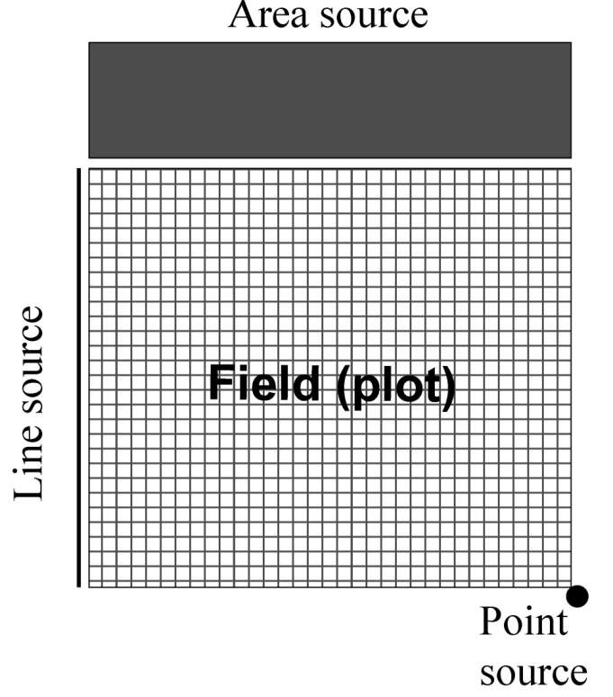{#fig-dg-sources-diagram}
 (Point source), แบบเส้น (Line source), และแบบพื้นที่ (Area source)

 (Point source), แบบเส้น (Line source), และแบบพื้นที่ (Area source)

## 7.3 แบบจำลองความลาดชันของโรค (Gradient Models) {#sec-dg-models}

การสร้างแบบจำลองเพื่ออธิบายการแพร่กระจายของเชื้อและการแพร่กระจายของโรคสามารถทำได้หลายวิธี แม้เราจะไม่ได้นำเสนอในที่นี้ แต่การแพร่กระจายของสปอร์ก็สามารถอธิบายได้ด้วยแบบจำลองหลายประเภทซึ่งอิงตามหลักฟิสิกส์ของการเคลื่อนที่ของอนุภาคในตัวกลางชนิดต่างๆ (Aylor, 1999; Ferrandino, 1993; McCartney and Fitt, 1985) นอกจากนี้ ยังมีแบบจำลองไม่เชิงเส้น (Nonlinear models) ที่ค่อนข้างเรียบง่ายอีกมากมายที่ใช้แสดงความสัมพันธ์ระหว่างการตกตะกอนของสปอร์ การติดเชื้อ หรือความรุนแรงของโรค กับระยะห่างจากแหล่งกำเนิดเชื้อ (Jeger, 1983; Maffia and Berger, 1998; Minogue, 1986) แบบจำลองเหล่านี้มักมีลักษณะเป็นแบบจำลองเชิงสหสัมพันธ์ (Correlative) หรือเชิงพรรณนา (Descriptive) (ดูบทที่ 3) แต่ก็สามารถสอดคล้องกับกลไกการแพร่กระจายที่เราทราบกันดีอยู่แล้ว ยิ่งไปกว่านั้น ยังมีการใช้สมการคณิตศาสตร์เชิงทฤษฎีที่ค่อนข้างซับซ้อนเพื่ออธิบายการแพร่กระจาย (และรวมถึงการเคลื่อนที่ของสิ่งมีชีวิตโดยทั่วไป) ซึ่งสามารถครอบคลุมคุณลักษณะทางประชากรศาสตร์หลายประการในกระบวนการทางชีววิทยาที่เกี่ยวข้อง โดยไม่จำเป็นต้องไปยุ่งเกี่ยวกับฟิสิกส์ของการพัดพาอนุภาคโดยตรง (Othmer et al., 1988; Pielaat and van den Bosch, 1998; van den Bosch et al., 1990a)ในเนื้อหาส่วนใหญ่ เราจะมุ่งเน้นความสนใจไปที่แบบจำลองความลาดชันของโรคแบบไม่เชิงเส้นที่ค่อนข้างเรียบง่ายซึ่งเคยมีผู้เสนอไว้ เพื่อให้สอดคล้องกับแบบจำลองที่ใช้ในบทก่อนๆ แบบจำลองที่เราจะใช้ตลอดทั้งบทนี้ส่วนใหญ่จะเป็นแบบกำหนดได้ (Deterministic models) และถือว่าระยะทาง ($s$ ซึ่งย่อมาจากคำว่า “$s$pace” หรือพื้นที่) เป็นตัวแปรต่อเนื่อง (Continuous variable) แม้โดยเนื้อแท้แล้วมันจะเป็นแบบจำลองเชิงพรรณนา แต่มันก็มักจะสอดคล้องกับแบบจำลองการแพร่กระจายที่เน้นกลไก (Mechanistic models) และสามารถอธิบายลักษณะของความลาดชันที่สังเกตได้จริงอย่างแม่นยำ แบบจำลองเหล่านี้ยังมีเวอร์ชันที่เป็นแบบสุ่ม (Stochastic versions) ซึ่งมีประโยชน์อย่างยิ่งในการทำความเข้าใจแง่มุมต่างๆ ของพลวัตพัฒนาการของโรคเมื่อเวลาและพื้นที่เปลี่ยนไปเช่นเดียวกับที่ผ่านมา เราใช้ $Y$ เป็นตัวแทนของปริมาณโรคในหน่วยสัมบูรณ์ (Absolute units) เช่น จำนวนแผล จำนวนใบที่ติดเชื้อ หรือพื้นที่ของรอยแผล และใช้ $y$ แทนความรุนแรงของโรคในรูปของสัดส่วน ($y = Y/M$ โดยที่ $M$ คือจำนวนของสิ่งมีชีวิตหรือพื้นที่ของโฮสต์ที่สามารถรับการติดเชื้อได้) เพื่อความสะดวก เราอาจเรียก $Y$ ว่าจำนวนการติดเชื้อ (Number of infections) ก็ได้ เพราะหากความรุนแรงของโรคยังไม่สูงมากนัก เราสามารถนับจำนวนแผลและถือว่ารอยแผลแต่ละรอยคือการติดเชื้อหนึ่งครั้ง หากสมมติว่ามีสัดส่วนคงที่สัดส่วนหนึ่ง ($\psi$) ของสปอร์ (หรือหน่วยติดเชื้ออื่นๆ) ที่ตกลงมาแล้วสามารถก่อให้เกิดการติดเชื้อได้สำเร็จ ค่า $Y/\psi$ จะเป็นตัวแทนของจำนวนสปอร์ที่ตกลงมาเมื่อค่า $Y$ ยังไม่สูงนัก เพื่อให้สัญลักษณ์สมบูรณ์แบบ เราอาจเขียนแทน $Y$ ที่ระยะห่าง $s$ จากแหล่งกำเนิดเชื้อด้วย $Y(s)$ แต่โดยทั่วไปแล้ว ในบทนี้เรามักจะไม่ต้องการสัญลักษณ์ที่ซับซ้อนขนาดนั้น ยิ่งไปกว่านั้น เนื่องจากการจัดการเรื่องพื้นที่อย่างชัดเจนเป็นเรื่องสำคัญในที่นี้ $Y$ จึงเป็นตัวแทนของจำนวนการติดเชื้อต่อหน่วยพื้นที่ (เช่น จำนวนการติดเชื้อต่อตารางเซนติเมตรของพื้นผิวที่มีการนับหรือวัดการติดเชื้อ) หรือจำนวนการติดเชื้อต่อหน่วยความยาว (เช่น จำนวนแผลต่อระยะทางหนึ่งเซนติเมตรตามแนวรัศมีของวงกลมที่มีจุดศูนย์กลางอยู่ที่แหล่งกำเนิดเชื้อแบบจุด)สำหรับผู้ที่ยึดติดในความถูกต้องทางฟิสิกส์อย่างเคร่งครัด (Physical purists) การนำเสนอของเราต่อจากนี้จะถูกต้องแม่นยำก็ต่อเมื่อใช้กับแหล่งกำเนิดเชื้อแบบเส้น โดยมีการแพร่กระจายตั้งฉากกับแหล่งกำเนิดเชื้อนั้น กล่าวอีกนัยหนึ่งคือ เรากำลังนำเสนอแบบจำลองสำหรับระบบพื้นที่แบบ 1 มิติเท่านั้น ในบทที่ 8 เราจึงจะพูดถึงประเด็นต่างๆ เกี่ยวกับการเปรียบเทียบการแพร่กระจายระหว่าง 1 มิติกับ 2 มิติ

### 7.3.1 แบบจำลองเอกซ์โพเนนเชียล (Exponential Model)

แบบจำลองแรกที่เราจะพิจารณาคือแบบจำลองเอกซ์โพเนนเชียล (Exponential) ซึ่งบางครั้งก็เรียกว่าเอกซ์โพเนนเชียลเชิงลบ (Negative exponential) แบบจำลองนี้ถูกนำมาใช้เพื่ออธิบายความลาดชัน (Gradients) มาอย่างน้อยตั้งแต่ช่วงทศวรรษที่ 1940 (Frampton et al., 1942; Gregory and Read, 1949) ในที่นี้ $Y$ จะแปรผันตามฟังก์ชันเอกซ์โพเนนเชียลของระยะห่างจากแหล่งกำเนิดเชื้อ:โดยที่ $a_E$ และ $b_E$ คือพารามิเตอร์ พารามิเตอร์ $a_E$ เป็นตัวแทนของระดับเชิงทฤษฎีของ $Y$ ณ แหล่งกำเนิดเชื้อ ($s = 0$) เพราะเมื่อพิจารณาที่จุดกำเนิดเชื้อ เราสามารถเขียนสมการ 7.1 ได้เป็น:ด้วยเหตุนี้ พารามิเตอร์ตัวนี้จึงเป็นตัวบ่งชี้ ความแรงของแหล่งกำเนิดเชื้อ (Source strength) ซึ่งก็คือปริมาณของแหล่งเชื้อ หรือระดับความรุนแรงของโรคที่ก่อให้เกิดแหล่งเชื้อ ณ ตำแหน่ง $s = 0$ ส่วนพารามิเตอร์ $b_E$ ซึ่งบางครั้งเรียกว่า พารามิเตอร์การแพร่กระจาย (Spread parameter) จะเป็นตัววัดความชันของความลาดชัน โดยมีหน่วยเป็น 1/ระยะทาง (1/distance) ส่วนกลับของ $b_E$ (นั่นคือ $1/b_E$) จะมีหน่วยเป็นระยะทาง และเป็นตัวบ่งชี้ถึงมาตราส่วนเชิงพื้นที่ (Spatial scale) ที่เกิดการแพร่กระจาย (หรือการกระจายตัวของเชื้อ) ขึ้น ซึ่งเราจะกล่าวถึงเรื่องนี้เพิ่มเติมในภายหลัง ขีดจำกัดล่าง (Lower limit) สำหรับพารามิเตอร์ทั้งสองตัวนี้คือ 0 (เมื่อ $Y$ ไม่เพิ่มขึ้นตามระยะทาง) และไม่มีขีดจำกัดบน (Upper limit) (อย่างน้อยก็ในเชิงแบบจำลอง) แน่นอนว่าหาก $a_E = 0$ ก็แปลว่าไม่มีสิ่งมีชีวิตที่เป็นโรค (หรือไม่มีการติดเชื้อ) เลย และจะไม่มีการประเมินการแพร่กระจายใดๆ เกิดขึ้น ($Y = 0$ ที่ทุกๆ ค่าของ $s$) ในขณะที่ถ้า $b_E = 0$ จะหมายความว่า $Y$ ไม่มีแนวโน้มลดลงเลยเมื่อระยะทางเพิ่มขึ้น ซึ่งอาจเป็นสัญญาณบ่งชี้ว่าไม่มีแหล่งกำเนิดเชื้อที่แท้จริงอยู่ที่ $s = 0$ หรืออาจเป็นเพราะเราเข้าไปวัดความรุนแรงของโรคหลังจากเวลาผ่านไปนานมากจนพืชทุกต้นในบริเวณนั้นกลายเป็นโรคไปหมดแล้ว ตัวอย่างกราฟที่เกิดจากสมการ 7.1 แสดงไว้ในรูปที่ 7.3 ตามที่คาดไว้ การเพิ่มค่า $b_E$ จะทำให้ $Y$ ลดลงอย่างรวดเร็ว (ความชันมากขึ้น) เมื่อเทียบกับ $s$ และการเพิ่มค่า $a_E$ จะทำให้ระดับความสูงของกราฟเพิ่มขึ้น นอกจากนี้ สมการ 7.1 ยังสามารถนำไปประยุกต์ใช้กับความรุนแรงของโรคในรูปแบบของสัดส่วน ($y$) ได้ด้วย หากให้ $M$ คือจำนวนตำแหน่งที่สามารถติดเชื้อได้ ณ ระยะทางที่กำหนด (เช่น จำนวนแผลสูงสุดที่เป็นไปได้) ดังนั้น $y = Y/M$ การหารทั้งสองข้างของสมการ 7.1 ด้วย $M$ ก็จะให้สมการสำหรับ $y$ แทนสมการสำหรับ $Y$

เราสามารถแปลงแบบจำลองเอกซ์โพเนนเชียลให้อยู่ในรูปเส้นตรง (Linearized) ได้โดยการใส่ลอการิทึมธรรมชาติ (Natural logs) เข้าไปทั้งสองข้างของสมการ ซึ่งจะได้ผลลัพธ์ดังนี้:ความลาดชันของการแพร่กระจาย ($Y$ เทียบกับ $s$) ที่อธิบายด้วยแบบจำลองเอกซ์โพเนนเชียล แสดงไว้ใน @fig-dg-exponential-model

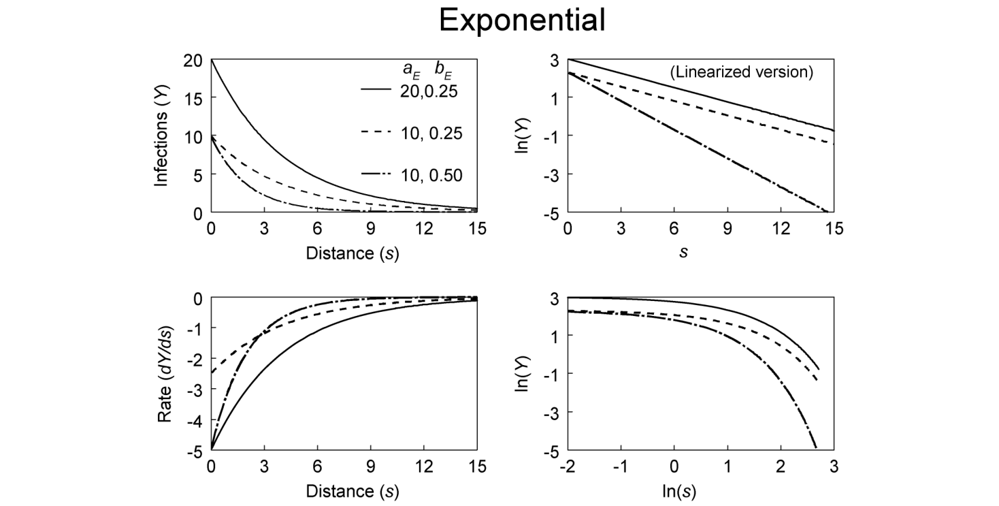{#fig-dg-exponential-model}
สมการ 7.2 แสดงความสัมพันธ์แบบเส้นตรงระหว่าง $\ln(Y)$ และ $s$ โดยมีความชัน (Slope) เท่ากับ $-b_E$ และจุดตัดแกน (Intercept) เท่ากับ $\ln(a_E)$ (ดูกราฟเส้นตรงในรูปที่ 7.3 ประกอบ) ในสเกลที่มีการแปลงรูปนี้ (Transformed scale) เราจะมองเห็นผลกระทบของ $a_E$ และ $b_E$ ต่อความลาดชันได้ง่ายขึ้น ตัวอย่างเช่น ความลาดชันสองเส้นที่มีค่า $b_E$ เท่ากันแต่มีค่า $a_E$ ต่างกัน จะปรากฏเป็นเส้นขนานเมื่อนำ $\ln(Y)$ มาพล็อตเทียบกับระยะทาง แต่ถ้าค่า $b_E$ ต่างกัน เส้นความลาดชันทั้งสองก็จะไม่ขนานกัน และอาจตัดกันได้ขึ้นอยู่กับค่าของ $a_E$ อย่างไรก็ตาม หากพล็อตในสเกลปกติที่ไม่มีการแปลงรูป (นั่นคือ $Y$ เทียบกับ $s$) การจะสังเกตเห็นผลกระทบของพารามิเตอร์การแพร่กระจายที่แตกต่างกันที่มีต่อความลาดชันนั้นอาจทำได้ยากมาก หากเรามีข้อมูลการวัดผลของ $Y$ เพียงสองระยะทาง คือ $Y(s_1)$ และ $Y(s_2)$ เราก็สามารถหาค่า $b_E$ ได้จากสูตร: $b_E = [\ln\{Y(s_2)\} - \ln\{Y(s_1)\}] / (s_2 - s_1)$ สมการ 7.2 นี้มีประโยชน์มากสำหรับการวาดภาพความลาดชันของโรคให้เห็นชัดเจน และสำหรับการประมาณค่าพารามิเตอร์ (ดังที่จะกล่าวถึงในหัวข้อถัดไป) ถึงกระนั้น ต้องไม่ลืมว่าความลาดชันแบบเอกซ์โพเนนเชียลที่แท้จริงของโรคนั้นเป็นเส้นโค้ง ไม่ใช่เส้นตรง (ตามสมการ 7.1) ซึ่งหมายความว่าความชันจะเปลี่ยนแปลงอย่างต่อเนื่องตามระยะห่างจากแหล่งกำเนิดเชื้อ เราสามารถเห็นภาพนี้ได้ชัดเจนขึ้นเมื่อเขียนแบบจำลองความลาดชันแบบเอกซ์โพเนนเชียลในรูปของสมการเชิงอนุพันธ์ (Differential-equation form):โดยที่ $dY/ds$ คืออัตราการเปลี่ยนแปลงของ $Y$ เทียบกับระยะห่างจากแหล่งกำเนิดเชื้อ อันที่จริง เราสามารถเริ่มแนะนำแบบจำลองเอกซ์โพเนนเชียลด้วยสมการ 7.3 แทนสมการ 7.1 ก็ได้ เพื่อเป็นการเน้นย้ำถึงพลวัต (Dynamics) ของการแพร่กระจายของโรคในเชิงพื้นที่ อย่างไรก็ตาม เนื่องจากแบบจำลองความลาดชันเหล่านี้มักถูกนำมาใช้โดยอิงจากความสามารถในการอธิบายลักษณะความลาดชันที่สังเกตได้จริง มากกว่าจะอิงจากเหตุผลด้านพลวัต เราจึงเลือกที่จะนำเสนอแบบจำลองในรูปสมการที่ผ่านการอินทิเกรตแล้ว (Integrated form) เป็นอันดับแรกผู้อ่านสามารถกลับไปทบทวนบทที่ 4 สำหรับคำอธิบายโดยละเอียดเกี่ยวกับสมการเชิงอนุพันธ์และอัตราการเปลี่ยนแปลงได้อัตรา $dY/ds$ เป็นตัววัดความชันของความลาดชันโดยตรง ดังที่แสดงในกราฟมุมล่างซ้ายของรูปที่ 7.3 อัตรานี้จะมีค่าติดลบมากๆ เมื่ออยู่ใกล้แหล่งกำเนิดเชื้อ (ใกล้ $s = 0$) และจะลู่เข้าหาศูนย์เมื่อ $s$ มีค่ามากๆ (ทั้งนี้ขึ้นอยู่กับค่าของพารามิเตอร์การแพร่กระจาย) เราสามารถแสดงให้เห็นได้ว่า $dY/ds = -a_Eb_E$ ที่ $s = 0$ (เนื่องจากค่า $Y$ ที่ $s = 0$ จะถูกกำหนดโดย $a_E$) ความชันของความลาดชันเป็นฟังก์ชันที่ขึ้นอยู่กับตัวแปรเพียงตัวเดียวคือ $Y$ และพารามิเตอร์เพียงตัวเดียวคือ $b_E$ ดังนั้น เราอาจมองว่าพารามิเตอร์การแพร่กระจายนี้เป็นตัวแทนของเงื่อนไขและปัจจัยแวดล้อมทั้งหมด (เช่น สภาพแวดล้อม) ที่ส่งผลต่อความลาดชันของโรคนอกเหนือไปจากระดับความรุนแรงของโรคที่เกิดขึ้นจริง ความลาดชันแบบเอกซ์โพเนนเชียลสองเส้นที่มีค่า $b_E$ เท่ากัน สามารถถือได้ว่ามีความลาดชันเท่ากัน ไม่ว่าค่าเฉลี่ยความรุนแรงของโรคที่พบในชุดข้อมูลจะเป็นเท่าใดก็ตาม เพราะทั้งสองเส้นจะมีอัตรา $dY/ds$ เท่ากันเสมอเมื่อค่า $Y$ มีระดับเท่ากัน

### 7.3.2 แบบจำลองยกกำลัง (Power Model)

แบบจำลองตัวที่สองที่เราพิจารณาในบทนี้สำหรับการใช้อธิบายความลาดชันของโรค รู้จักกันในชื่อของแบบจำลองยกกำลัง (Power model), กฎเลขยกกำลัง (Power law) หรือแบบจำลองผกผันยกกำลัง (Inverse-power model) นอกจากนี้ยังมีอีกชื่อหนึ่งว่า แบบจำลองเกรกอรี (Gregory model) เพราะเขาเป็นหนึ่งในผู้สนับสนุนยุคแรกๆ ให้ใช้แบบจำลองนี้อธิบายความลาดชัน และเขาได้นำมันไปใช้อย่างกว้างขวางเพื่อสรุปผลลัพธ์ของการแพร่กระจาย (Gregory, 1968, 1973) สำหรับแบบจำลองยกกำลัง $Y$ จะแปรผันตามกำลัง (Power) ของระยะทาง:โดยที่ $a_P$ และ $b_P$ เป็นพารามิเตอร์ พารามิเตอร์เหล่านี้มีความคล้ายคลึงกับพารามิเตอร์ของแบบจำลองเอกซ์โพเนนเชียลอยู่บ้าง แต่ก็มีความแตกต่างที่เป็นรากฐานสำคัญด้วยเช่นกัน สังเกตว่าเมื่อ $s = 1$ สมการ 7.4 จะถูกลดรูปเหลือ $Y = a_P1^{-b_P} = a_P1 = a_P$ ดังนั้น $a_P$ จึงเป็นตัวแทนของระดับ $Y$ เชิงทฤษฎีที่ระยะทาง 1 หน่วยจากแหล่งกำเนิดเชื้อ [นั่นคือ $a_P = Y(1)$] ไม่ใช่ระดับ ณ แหล่งกำเนิดเชื้อ อันที่จริง ค่า $Y$ จะมีค่าเพิ่มขึ้นอย่างไม่มีที่สิ้นสุด (Indefinitely large) เมื่อ $s$ เข้าใกล้ 0 (หาก $b_P$ มีค่าเป็นบวก) ซึ่งถือว่าไม่มีความหมายในทางชีววิทยา อย่างไรก็ตาม เพียงเพราะแบบจำลองให้ผลลัพธ์ที่ไร้ความหมายที่ระยะทางใดระยะทางหนึ่ง ก็ไม่ได้หมายความว่ามันจะไม่มีประโยชน์เลยในระยะทางอื่นๆ (หรือส่วนใหญ่) ยิ่งไปกว่านั้น หากระยะห่างระหว่างต้นพืช (หรือระหว่างแหล่งกำเนิดเชื้อกับต้นพืชที่อยู่ใกล้ที่สุด) คือ $x$ เซนติเมตร มันก็ไม่สำคัญหรอกที่แบบจำลองจะสร้างค่าที่ไม่สมจริงออกมาในระยะทางที่น้อยกว่า $x$ เซนติเมตร สิ่งที่สำคัญคือแบบจำลองสามารถสร้างค่าที่สมจริงออกมาได้ที่ระยะทาง $x$, $2x$ และระยะทางจริงอื่นๆ ที่อยู่ระหว่างแหล่งกำเนิดเชื้อกับต้นพืชเนื่องจากความหมายของ $a_P$ ผูกติดอยู่กับระยะทางที่ไม่ใช่ศูนย์ ความหมายทางกายภาพของมันจึงขึ้นอยู่กับหน่วยที่ใช้ในการบันทึกระยะทาง $s$ ด้วย ตัวอย่างเช่น หากสมการ 7.4 มีความเหมาะสมในการอธิบายความลาดชันในรูปที่ 7.1 และระยะทางถูกบันทึกในหน่วยเมตร แล้วล่ะก็ $a_P$ จะเป็นค่าเชิงทฤษฎีของ $Y$ ที่ระยะ 1 เมตรจากแหล่งกำเนิดเชื้อ แต่ถ้าหากระยะทางถูกบันทึกในหน่วยเซนติเมตร $a_P$ ก็จะกลายเป็นค่าของ $Y$ ที่ระยะ 1 เซนติเมตรจากแหล่งกำเนิดเชื้อแทน ดังนั้น เราจะต้องคำนึงถึงหน่วยของระยะทางเสมอเมื่อตีความค่าเฉพาะของ $a_P$ หากเราต้องการใช้ $a_P$ เป็นตัวชี้วัดโดยประมาณของ $Y$ ณ แหล่งกำเนิดเชื้อ (หรือให้พูดอย่างเจาะจงยิ่งขึ้นคือ "ใกล้กับ" แหล่งกำเนิดเชื้อมากๆ) เราควรเลือกหน่วยของระยะทางที่ทำให้ $s = 1$ มีตำแหน่งอยู่ใกล้กับแหล่งกำเนิดเชื้อมากกว่าตำแหน่งของค่า $Y$ จุดแรกที่สังเกตได้มากๆ ตัวอย่างเช่น หากระยะทางที่ใกล้แหล่งกำเนิดเชื้อที่สุดที่มีค่าสังเกต $Y$ อยู่ที่ 0.5 เมตร การบันทึกระยะทางในหน่วยเซนติเมตร (ไม่ใช่เมตรหรือกิโลเมตร) จึงจะเหมาะสมที่สุดในสมการ 7.4 พารามิเตอร์ $b_P$ ก็เป็นที่รู้จักกันในฐานะพารามิเตอร์การแพร่กระจายเช่นเดียวกัน อย่างไรก็ตาม มันเป็นพจน์ที่ไม่มีหน่วย (Unitless) ซึ่งต่างจาก $b_E$ ที่มีหน่วยเป็น 1/ระยะทาง นี่จึงเป็นความแตกต่างที่สำคัญยิ่งในการตีความพารามิเตอร์เลขชี้กำลัง (Exponent parameter) ทางกายภาพระหว่างสองแบบจำลอง การปรับเปลี่ยนมาตราส่วนของระยะทาง (Rescaling) (เช่น จากกิโลเมตรเป็นเซนติเมตร) จะส่งผลต่อค่า $b_E$ แต่จะไม่ทำให้ค่า $b_P$ เปลี่ยนแปลงไปเลย (ในทางตรงกันข้าม ขอให้จำไว้ว่าการปรับมาตราส่วนของระยะทางจะเปลี่ยนค่าของ $a_P$ แต่ไม่เปลี่ยนค่าของ $a_E$)เนื่องจากค่าของ $Y$ ที่ $s = 0$ ไม่สามารถนิยามได้ในแบบจำลองความลาดชันแบบยกกำลัง แบบจำลองนี้จึงมักถูกดัดแปลงโดยการบวกค่าคงที่บวกขนาดเล็ก ($\lambda$) เข้ากับตัวแปร $s$:เราเรียกสมการนี้ว่า แบบจำลองยกกำลังดัดแปลง (Modified power model) หรือ แบบจำลองกฎเลขยกกำลังดัดแปลง (Modified power-law model) ในที่นี้ $\lambda$ จะมีหน่วยเดียวกับ $s$ (นั่นคือมีหน่วยเป็นระยะทาง) เมื่อ $s = 0$ สมการ 7.5 จะลดรูปลงเหลือ $Y = a_P\lambda^{-b_P} = Y(0) = Y_0$ ซึ่งเป็นค่าคงที่บวกสำหรับกรณีที่ $a_P$ และ $b_P$ มีค่าเป็นบวก กล่าวอีกนัยหนึ่งคือ $a_P\lambda^{-b_P}$ เป็นพจน์ที่แสดงความแรงของแหล่งกำเนิดเชื้อ (Source-strength term) สำหรับแบบจำลองยกกำลัง ส่วนการตีความของ $a_P$ สามารถทำได้โดยการแทนค่า $s$ ในสมการ 7.5 ด้วย $1-\lambda$ ซึ่งจะทำให้ได้ $Y = a_P1^{-b_P} = a_P$ พูดง่ายๆ คือ $a_P$ ก็คือค่าเชิงทฤษฎีของ $Y$ ที่ระยะทาง $1-\lambda$ จากจุดศูนย์กลางของแหล่งกำเนิดเชื้อนั่นเอง Mundt (1989) ได้เสนอแนวคิดที่น่าสนใจไว้ว่า $\lambda$ สามารถพิจารณาเป็นตัวชี้วัด "ขนาด" ทางกายภาพ (เช่น เส้นผ่านศูนย์กลาง หรือความกว้าง) ของแหล่งกำเนิดเชื้อได้แน่นอนว่าเมื่อ $\lambda = 0$ สมการ 7.5 ก็จะกลับไปเป็นรูปเดียวกับสมการ 7.4 เพื่อความเป็นสากล เราจะเรียกสมการ 7.5 ว่าแบบจำลองยกกำลังสำหรับความลาดชัน โดยเป็นที่เข้าใจตรงกันว่ามักจะถูกใช้งานโดยกำหนดสมมติฐานให้ $\lambda$ มีค่าเป็น 0 กราฟแสดงความสัมพันธ์ระหว่าง $Y$ เทียบกับ $s$ ดังแสดงใน @fig-dg-power-model

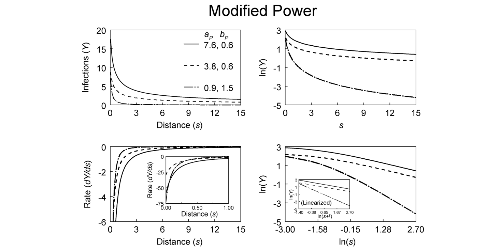{#fig-dg-power-model}

 สำหรับแบบจำลองนี้มีความคล้ายคลึงกับกราฟของแบบจำลองเอกซ์โพเนนเชียล (รูปที่ 7.3) อยู่บ้าง อย่างไรก็ตาม ในแบบจำลองยกกำลัง เส้นโค้งจะมีความชันมากกว่า (ชันกว่า) เมื่ออยู่ใกล้แหล่งกำเนิดเชื้อ และมีความชันน้อยกว่า (ลาดเอียงน้อยกว่า) เมื่ออยู่ไกลออกไปสมการ 7.5 สามารถแปลงให้อยู่ในรูปเส้นตรง (อย่างน้อยก็ในส่วนที่เกี่ยวกับพารามิเตอร์ $a_P$ และ $b_P$) ได้โดยการใส่ลอการิทึมเข้าไปทั้งสองข้าง:สมการนี้แสดงถึงความสัมพันธ์แบบเส้นตรงระหว่าง $\ln(Y)$ และ $\ln(s + \lambda)$ (ดูรูปแทรกในกราฟมุมล่างขวาของรูปที่ 7.4) ความจริงแล้ว สำหรับแบบจำลองนี้ การพล็อต $\ln(Y)$ เทียบกับ $\ln(s)$ จะได้เส้นที่ใกล้เคียงกับเส้นตรงมากๆ ยกเว้นบริเวณที่อยู่ใกล้กับแหล่งกำเนิดเชื้อ (นั่นคือบริเวณที่ $s$ เข้าใกล้ $\lambda$) สถานการณ์เช่นนี้อาจเกิดขึ้นได้ หากความสัมพันธ์ที่แท้จริงเป็นไปตามสมการ 7.5 หรือ 7.6 ซึ่งมีค่า $\lambda > 0$ แต่เราดันไปเลือกใช้สมการ 7.4 (นั่นคือตั้งค่า $\lambda = 0$) ในการปรับแก้ให้เข้ากับชุดข้อมูล ในทางกลับกัน การพล็อต $\ln(Y)$ เทียบกับ $s$ (แบบไม่มีการแปลงรูปตัวแปรระยะทาง) ซึ่งถือเป็นมาตราส่วนมาตรฐานของแบบจำลองความลาดชันแบบเอกซ์โพเนนเชียล กลับจะแสดงให้เห็นถึงความโค้งของเส้นกราฟที่สูงมาก (รูปที่ 7.4)แบบจำลองยกกำลัง (แบบดัดแปลง) ยังสามารถแสดงในรูปของสมการเชิงอนุพันธ์ได้ดังนี้:เช่นเดียวกับแบบจำลองเอกซ์โพเนนเชียล อัตรา $dY/ds$ จะแปรผันตาม $Y$ ซึ่งหมายความว่าความลาดชันจะชันที่สุด (มีค่าติดลบมากที่สุด) ณ บริเวณที่มีระดับของโรคสูงสุด (ซึ่งโดยปกติจะอยู่ใกล้แหล่งกำเนิดเชื้อ) อย่างไรก็ตาม $dY/ds$ ก็แปรผกผันทางอ้อมกับ $s$ ด้วยเช่นกัน (หรือแปรผกผันกับ $s + \lambda$ หาก $\lambda$ มีค่าไม่เป็นศูนย์) ดังนั้น ที่ระดับของโรค $Y$ เท่ากัน ความลาดชันเมื่ออยู่ใกล้แหล่งกำเนิดเชื้อจึงมีค่าสูงกว่าเมื่ออยู่ไกลออกไป กราฟมุมล่างซ้ายของรูปที่ 7.4 แสดงตัวอย่างของเส้นโค้ง $dY/ds$ ทั่วไปสำหรับแบบจำลองยกกำลัง เส้นโค้งเหล่านี้จะมีความคล้ายคลึงกับของแบบจำลองเอกซ์โพเนนเชียล เพียงแต่จะมีความชันบริเวณใกล้แหล่งกำเนิดเชื้อสูงกว่าเท่านั้น อันที่จริง หาก $\lambda = 0$ ค่า $dY/ds$ จะติดลบมากจนไร้ขีดจำกัดเมื่อ $s$ ลู่เข้าหา 0 (หรือสำหรับกรณีที่ $\lambda$ มีค่าเป็นบวก ค่า $dY/ds$ จะติดลบอย่างไม่มีที่สิ้นสุดเมื่อ $s + \lambda$ เข้าใกล้ 0) สำหรับค่า $\lambda$ ที่เป็นบวก ค่า $dY/ds$ จะมีค่าที่จำกัดและแน่นอน ณ ทุกค่าของ $s$ โดยจะมีค่าเท่ากับ $-a_Pb_P\lambda^{-(b_P + 1)}$ ที่ $s = 0$ ตามที่แสดงให้เห็นในรูปแทรกของกราฟมุมล่างซ้ายของรูป 7.4ในบางแง่มุม การเปรียบเทียบความลาดชันแบบยกกำลังนั้นอาจทำได้ยากกว่าแบบเอกซ์โพเนนเชียล ทั้งนี้เพราะในกรณีของแบบจำลองยกกำลัง ความชันของความลาดชันจะขึ้นอยู่กับทั้ง $Y$ และ $s$ (ดูสมการ 7.7) (สำหรับการอภิปรายที่มีคุณค่าเกี่ยวกับประเด็นนี้ โปรดดู Minogue, 1986) ดังนั้น ความลาดชันสองเส้นที่มีค่า $b_P$ เท่ากัน จึงไม่จำเป็นต้องมีความชัน ($dY/ds$) เท่ากัน ณ ระดับของ $Y$ ที่กำหนด (ที่เลือกไว้) ถึงกระนั้น ก็ยังเป็นเรื่องปกติที่จะเปรียบเทียบความลาดชันผ่านค่า (ประมาณการ) ของ $b_P$ ในการศึกษาเชิงเปรียบเทียบ นักวิจัยจะต้องตระหนักเสมอว่าความลาดชันสองเส้นที่มีค่า $b_P$ เท่ากันอย่างสมบูรณ์ จะมีค่าการเปลี่ยนแปลงของ $\ln(Y)$ ต่อการเปลี่ยนแปลง 1 หน่วยของ $\ln(s)$ ที่เท่ากัน [นั่นคือ $d\ln(Y)/d\ln(s) = b_P$ (โดยเฉลี่ย); ดูสมการ 7.6] แต่นั่นไม่ได้หมายความว่าการเปลี่ยนแปลงในค่าชี้วัดความรุนแรงของโรคที่เกิดขึ้นจริงต่อการเปลี่ยนแปลงของระยะทาง 1 หน่วย ณ ระดับ $Y$ เดียวกัน จะต้องเท่ากันด้วย{#fig-7-4}

### 7.3.3 แบบจำลองยกกำลังเทียบกับแบบจำลองเอกซ์โพเนนเชียล (Power vs Exponential Model)

แบบจำลองเอกซ์โพเนนเชียลและแบบจำลองยกกำลัง (แบบดัดแปลง) ถือเป็นสองแบบจำลองที่ถูกนำมาใช้เพื่ออธิบายลักษณะความลาดชันของโรค (หรือการแพร่กระจาย) กันอย่างแพร่หลายที่สุด ในความเป็นจริง สองแบบจำลองนี้ (รวมถึงแบบจำลองอื่นๆ ที่ใกล้เคียงกัน) สามารถอธิบายลักษณะความลาดชันที่สังเกตได้จริงในหลายๆ กรณีได้อย่างดีเยี่ยม (เช่น Fitt et al., 1987) ยิ่งไปกว่านั้น สองแบบจำลองนี้ยังถูกใช้เป็นพื้นฐานในการขยายกรอบของแบบจำลองเพิ่มเติม ซึ่งนำไปใช้แสดงพลวัตเชิงพื้นที่และเวลา (Spatiotemporal dynamics) ของพัฒนาการโรคพืชได้ด้วย (Gibson and Austin, 1996; Xu and Ridout, 1998) ดังนั้น การอภิปรายถึงแบบจำลองทั้งสองและลักษณะความลาดชันที่มันอธิบายได้อย่างละเอียดขึ้นอีกสักนิดจึงมีประโยชน์อย่างยิ่ง ความแตกต่างเชิงแนวคิด (หรือความหมาย) เกี่ยวกับความเท่ากันของความลาดชันในทั้งสองแบบจำลองได้รับการอภิปรายไปแล้วในตอนท้ายของหัวข้อย่อยก่อนหน้านี้ การอภิปรายในหัวข้อนี้จึงจะเป็นการขยายความประเด็นต่างๆ ที่เคยกล่าวถึงไปแล้ว พร้อมทั้งครอบคลุมถึงความเหมือนและความแตกต่างของพฤติกรรมของแบบจำลอง ตลอดจนวิธีการตีความทั้งสองแบบจำลองล้วนใช้อธิบายสถานการณ์ที่ $Y$ ลดลงแบบไม่เชิงเส้นเมื่อเทียบกับ $s$ ดังแสดงใน @fig-dg-exp-vs-power (ดูกราฟบนสุด)

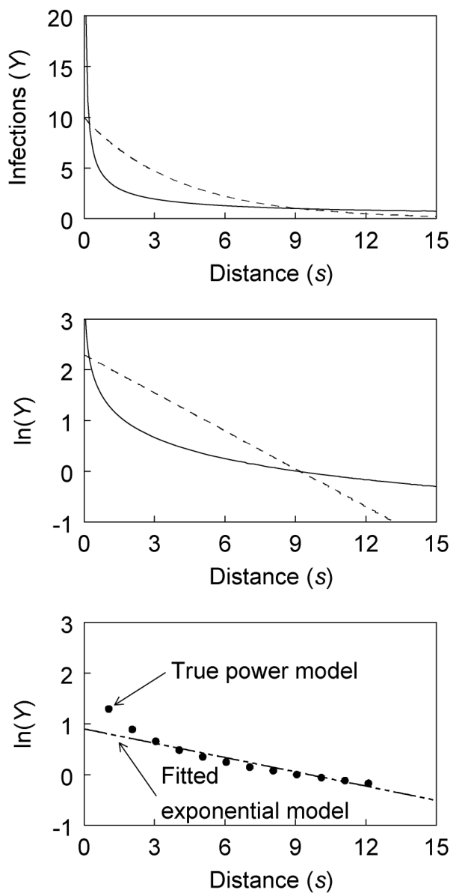{#fig-dg-exp-vs-power}
 ในกรณีของแบบจำลองยกกำลัง ความลาดชันจะชันกว่าเมื่ออยู่ใกล้กับแหล่งกำเนิดเชื้อ แต่จะลาดเอียงน้อยกว่าเมื่ออยู่ห่างออกไป หากเปรียบเทียบกับแบบจำลองเอกซ์โพเนนเชียล ความแตกต่างของสองแบบจำลองจะยิ่งเด่นชัดเมื่อเราพล็อตค่า $\ln(Y)$ เทียบกับ $s$ (รูปที่ 7.5): แบบจำลองเอกซ์โพเนนเชียลจะให้ผลลัพธ์เป็นเส้นตรง แต่แบบจำลองยกกำลังอาจแสดงให้เห็นถึงความโค้งของกราฟได้อย่างชัดเจน กราฟรูปแบบนี้มีประโยชน์อย่างมากในการช่วยทำความเข้าใจแนวคิดของแบบจำลองทั้งสอง สำหรับแบบจำลองยกกำลังนั้น ในระยะที่ไกลจากแหล่งกำเนิดเชื้อมากๆ ค่า $\ln(Y)$ จะเปลี่ยนแปลงเพียงเล็กน้อยต่อการเปลี่ยนแปลงระยะทาง 1 หน่วย (เมื่อเทียบกับแบบจำลองเอกซ์โพเนนเชียล) และระดับของโรคจะยังคงมีหลงเหลืออยู่เล็กน้อย (แต่ก็ไม่ใช่ระดับที่ละเลยได้) แม้จะอยู่ในระยะที่ไกลมากก็ตาม หากมองในแง่ของการแพร่กระจาย สิ่งนี้หมายความว่าโอกาสที่สปอร์จะตกตะกอนในระยะไกลมากๆ ก็ยังมีอยู่เล็กน้อยเช่นกัน (แต่ก็มองข้ามไม่ได้)ดังที่ได้อภิปรายไว้ในบทความหลายชิ้น (Aylor, 1999; McCartney and Fitt, 1998) แบบจำลองทั้งสองเป็นตัวแทนของมุมมองทางฟิสิกส์เกี่ยวกับการแพร่กระจายของสปอร์ในอากาศที่แตกต่างกันออกไป โดยเฉพาะอย่างยิ่ง การแพร่กระจายของหน่วยขยายพันธุ์นั้น สามารถอธิบายได้ผ่านองค์ประกอบสองประการ:การลดลงอย่างรวดเร็วของความเข้มข้นของสปอร์ในอากาศ (Aerial spore concentration) และอัตราการตกตะกอนของสปอร์บนต้นพืชเมื่อเทียบกับระยะทางที่ห่างจากแหล่งกำเนิดเชื้อการลดลงอย่างรวดเร็วของความเข้มข้นของสปอร์เป็นผลมาจาก การกรอง (Filtration) สปอร์โดยต้นพืช (หรือโครงสร้างอื่นๆ) และ การเจือจาง (Dilution) อันเกิดจากการผสมปนเปของอากาศ ซึ่งนำไปสู่ การหลุดรอด (Escape) ของสปอร์ออกจากเรือนยอด (Canopy) (Aylor, 1999) เมื่ออากาศมีความปั่นป่วนต่ำ แนวโน้มที่สปอร์จะตกตะกอนจะมีมากกว่าแนวโน้มที่จะถูกเจือจางหรือหลุดรอดออกไป ส่งผลให้โดยเฉลี่ยแล้ว ความหนาแน่นของสปอร์จะลดลงแบบเอกซ์โพเนนเชียลเมื่อเทียบกับระยะทาง (สอดคล้องกับสมการ 7.1) สถานการณ์เช่นนี้จะเกิดขึ้นกับเชื้อก่อโรคที่อาศัยการกระเซ็นของน้ำฝนในการแพร่กระจาย (Splash-dispersed pathogens) ซึ่งอากาศที่ปั่นป่วนไม่ใช่ปัจจัยหลักที่ส่งผลนัก (Pielaat et al., 1998; Yang et al., 1991) ในทางกลับกัน เมื่ออากาศมีความปั่นป่วนสูง แนวโน้มที่สปอร์จะถูกเจือจางและหลุดรอดออกจากเรือนยอดจะมีมากกว่าแนวโน้มที่จะตกตะกอน ในกรณีเช่นนี้ โดยเฉลี่ยแล้วความหนาแน่นของสปอร์จะลดลงตามแบบจำลองยกกำลัง (สอดคล้องกับสมการ 7.4){#fig-7-5}แน่นอนว่าเป็นไปได้อย่างมากที่ในเหตุการณ์การแพร่กระจายที่เกิดขึ้นจริง อาจไม่มีกระบวนการใดกระบวนการหนึ่งโดดเด่นไปกว่ากันเลย ไม่ว่าจะเป็นการเจือจาง/หลุดรอด หรือการตกตะกอน ในกรณีเช่นนั้น เราอาจจำเป็นต้องใช้แบบจำลองที่มีความซับซ้อนมากขึ้น (ดูหัวข้อ 7.3.5 และ Aylor, 1999) เพื่อให้สามารถอธิบายกระบวนการได้อย่างเพียงพอ อันที่จริง Aylor (1999) ได้ชี้ให้เห็นว่าการตกตะกอน และการเจือจาง/หลุดรอด อาจเป็นกลไกหลักที่โดดเด่นในช่วงระยะทางที่แตกต่างกัน ดังนั้น ในทางทฤษฎี หากเราสามารถสังเกตความห่างของระยะทางด้วยความละเอียดที่สูงมากๆ ได้ (สมมติว่าวัดกันทุกๆ 1 เซนติเมตร) โดยเริ่มจากแหล่งกำเนิดเชื้อและลากยาวออกไปหลายกิโลเมตร เราอาจจะได้เห็นโค้งความลาดชันที่คล้ายกับแบบจำลองยกกำลังสลับกับแบบเอกซ์โพเนนเชียลในแต่ละช่วงระยะทางก็เป็นได้ โชคดีที่ในหลายๆ กรณี การปรับแต่งแบบจำลองให้ละเอียดซับซ้อนขนาดนั้นไม่ได้จำเป็นเลย และเพียงแค่ใช้แบบจำลองเอกซ์โพเนนเชียลแบบเรียบง่ายหรือแบบจำลองยกกำลัง (แบบดัดแปลง) ก็เพียงพอแล้วสำหรับการนำไปอธิบายรูปแบบความลาดชันส่วนใหญ่ที่พบได้จริง

### 7.3.4 การกระจายตัวของการสัมผัส (Contact Distributions)

ที่ผ่านมา เราใช้วิธีการเชิงพรรณนา (Descriptive approach) เป็นหลักในการอธิบายลักษณะความลาดชันของโรคหรือการแพร่กระจาย (รูปที่ 7.1) และได้แสดงให้เห็นว่าแบบจำลองยกกำลังและแบบจำลองเอกซ์โพเนนเชียลนั้นมีความสอดคล้องกับกระบวนการทางฟิสิกส์ของการแพร่กระจายสปอร์ที่เรารู้จักกันดีอย่างไรบ้าง แต่บางครั้ง การอธิบายการแพร่กระจายด้วยแบบจำลองความน่าจะเป็น (Probabilistic models) หรือแบบจำลองทางสถิติ ก็อาจจะมีประโยชน์มากกว่าแบบจำลองที่กำหนดได้ (Deterministic models) ลองสมมติว่าสปอร์ทั้งหมดมีจุดกำเนิดมาจากแหล่งกำเนิดเชื้อ (แบบเส้น) เพียงแหล่งเดียว ($s = 0$) ทีนี้ สมมติให้ความน่าจะเป็นที่สปอร์จะตกตะกอนในช่วงระยะทางที่เพิ่มขึ้นเพียงเล็กน้อย ($\Delta s$) มีค่าคงที่ ไม่ว่าสปอร์จะเดินทางมาไกลแค่ไหนแล้วก็ตาม และความน่าจะเป็นนี้ก็มีค่าเท่ากันสำหรับสปอร์ทุกๆ ตัวในประชากรที่มาจากแหล่งกำเนิดเดียวกัน เราจะเรียกความน่าจะเป็นนี้ว่า $\zeta\Delta s$ (โดย $\zeta$ มีหน่วยเป็น 1/ระยะทาง) หากใช้วิธีการมาตรฐานสำหรับจัดการกับการกระจายตัวแบบต่อเนื่อง (Continuous distributions) เราสามารถแสดงให้เห็นได้ว่า ฟังก์ชันความหนาแน่นของความน่าจะเป็น (Probability density function หรือ $pdf$) สำหรับตัวแปรสุ่ม $s$ (ระยะทางที่สปอร์เคลื่อนที่ไปจนกว่าจะตกตะกอน) จะสามารถเขียนได้ดังนี้:ข้อสังเกตคือ เราจะนำการกระจายตัวของการสัมผัสนี้กลับมาใช้อีกครั้งในบทที่ 9 สำหรับการวิเคราะห์รูปแบบเชิงพื้นที่บางประเภท และมันยังเป็นองค์ประกอบหลักของการสร้างแบบจำลองทั้งหมดในบทที่ 8 อีกด้วย การอินทิเกรต (Integration) ค่า $D(s)$ ตั้งแต่ $s$ ถึง $s + \Delta s$ ก็คือความน่าจะเป็นที่สปอร์จะตกลงมาในช่วงระยะทางนี้ (เมื่อเริ่มต้นจากระยะทาง 0) หรือพูดอีกอย่างก็คือ $D(s)$ เป็นความน่าจะเป็นต่อหนึ่งหน่วยระยะทางที่สปอร์จะตกลงมาที่ตำแหน่ง ("บริเวณรอบๆ") $s$ หากขอยืมคำศัพท์มาจากทฤษฎีวิทยาการระบาดทั่วไป (Diekmann and Heesterbeek, 2000) เราสามารถเรียก $D(s)$ ได้ว่าเป็น การกระจายตัวของการสัมผัส (Contact distribution) เพราะในแง่หนึ่ง มันอธิบายถึงความน่าจะเป็นของการ "สัมผัส" (Contact) ระหว่างสิ่งมีชีวิตที่เป็นโรคในตำแหน่งหนึ่ง [ซึ่งในกรณีนี้คือแหล่งกำเนิดเชื้อ ($s = 0$)] กับสิ่งมีชีวิตอีกตัวในอีกตำแหน่งหนึ่ง (ตำแหน่งที่ระบุโดย $s$) หากจะพูดให้เจาะจงลงไปสำหรับกรณีของโรคพืช การกระจายตัวของการสัมผัสจะอธิบายถึงความน่าจะเป็นที่หน่วยติดเชื้อ (เช่น สปอร์) ที่มาจาก $s = 0$ จะเดินทางไปสัมผัสกับโฮสต์ที่ระยะทาง $s$ (ซึ่งหาได้จากการอินทิเกรต $D(s)$ จาก $s$ ถึง $s + \Delta s$) เนื่องจาก $D(s)$ เป็นฟังก์ชัน $pdf$ การอินทิเกรตจาก $s = 0$ ไปจนถึง $s = \infty$ จึงมีค่าเท่ากับ 1 ตามนิยาม ซึ่งในทางชีววิทยาสำหรับการแพร่กระจายของสปอร์ สิ่งนี้หมายความว่า ท้ายที่สุดแล้วสปอร์จะต้องตกลงที่ใดที่หนึ่งเสมอ ส่วนรายละเอียดเพิ่มเติมเกี่ยวกับแนวคิดของการกระจายตัวของการสัมผัสนี้ เราจะไปเจาะลึกกันในบทถัดไปประเด็นที่ควรชี้ให้เห็นก็คือ การที่สปอร์ตกตะกอนที่ตำแหน่ง $s$ นั้น ไม่ได้หมายความว่าสปอร์จะได้สัมผัสกับโฮสต์ที่ตำแหน่ง $s$ เสมอไป เพราะบางทีอาจจะไม่มีโฮสต์อยู่ตรงระยะทาง $s$ พอดีเป๊ะ (ยกตัวอย่างเช่น) ในทางปฏิบัติ เราจึงนำทั้งความลาดชันของโรคและความลาดชันของการตกตะกอนของสปอร์มาใช้พิจารณาหาการกระจายตัวของการสัมผัสที่เหมาะสม (หรือสมเหตุสมผล) และเมื่อถึงเวลาที่เหมาะสม (ดูบทที่ 8) เราสามารถนำการกระจายตัวของการสัมผัสที่ได้จากการพัดพาของสปอร์นี้ ไปคูณกับค่าคงที่ค่าหนึ่ง เพื่อสะท้อนถึงสัดส่วนของสปอร์ที่ตกลงมา ณ ตำแหน่ง $s$ แล้วได้สัมผัสกับโฮสต์จริงๆสมการ 7.8 มีความคล้ายคลึงโดยตรงกับแบบจำลองความลาดชันของโรคแบบเอกซ์โพเนนเชียล (สมการ 7.1) โดยที่ $\zeta = b_E$ ความแตกต่างก็คือ สมการ 7.8 ถูกปรับสเกลเพื่อให้ผลรวมของการอินทิเกรตครอบคลุมทุกระยะทางมีค่าเท่ากับ 1 ดังนั้น พารามิเตอร์ "ความแรงของแหล่งกำเนิดเชื้อ" ในที่นี้จึงเป็นเพียงค่า $\zeta$ เท่านั้น ค่าคาดหวัง (Expected value หรือค่าเฉลี่ย) และความแปรปรวน (Variance) ของตัวแปรสุ่มที่มีสมการ 7.8 เป็นฟังก์ชัน $pdf$ จะมีค่าเท่ากับ $1/\zeta$ และ $1/\zeta^2$ ตามลำดับ ส่วนค่ามัธยฐานของ $s$ ($s_{50\%}$) จะมีค่าเท่ากับ $\ln(2)/\zeta$ทีนี้ ลองสมมติว่าความน่าจะเป็นของการตกตะกอนต่อหน่วยระยะทาง ($\zeta$) ไม่ได้คงที่ แต่เป็นตัวแปรสุ่มเสียเอง (โดยอาจมีค่าแตกต่างกันไปในแต่ละสปอร์) นั่นหมายความว่าสปอร์แต่ละตัวจะมีความน่าจะเป็นในการตกตะกอนที่ไม่เท่ากัน ซึ่งอาจเป็นผลมาจากขนาดของมัน หรือลักษณะเที่ยวบินที่มันเดินทางไป การกระจายตัวแบบแกมมา (Gamma distribution) (Evans et al., 2000) ถือเป็นรูปแบบการกระจายตัวที่มีประโยชน์มากสำหรับ $\zeta$ เพราะมันรองรับค่าที่เป็นบวกได้ทุกค่า เมื่อใช้วิธีการมาตรฐานสำหรับการผสมการกระจายตัว (Mixing distributions) เราจะได้สมการสำหรับระยะทางการบินของสปอร์ดังนี้:สมการ 7.9 คือฟังก์ชัน $pdf$ ของการกระจายตัวแบบพาเรโตชนิดที่สอง (Pareto distribution of the second kind) (Johnson et al., 1994) ซึ่งมักเรียกสั้นๆ ว่าการกระจายตัวแบบพาเรโต (Pareto distribution) (Minogue, 1989) สมการนี้มีความคล้ายคลึงโดยตรงกับแบบจำลองยกกำลังดัดแปลงสำหรับความลาดชันของการแพร่กระจาย (สมการ 7.5) โดยที่ $b_P = \Psi + 1$ ความแตกต่างเพียงอย่างเดียวคือ ในสมการ 7.9 มีการปรับสเกลเพื่อให้ผลรวมของการอินทิเกรตครอบคลุมทุกระยะทางมีค่าเท่ากับ 1 ในทางตรงกันข้าม การใช้งานสมการ 7.4 ตามปกติจะไม่มีการปรับสเกลจำนวนสปอร์ (หรือการติดเชื้อ) แต่อย่างใด และค่า $a_P$ จะเป็นตัวกำหนดความสูงของกราฟ $Y$ สิ่งที่น่าสนใจก็คือ ค่าเฉลี่ยและความแปรปรวนของการกระจายตัวแบบพาเรโตนั้นจะนิยามได้ก็ต่อเมื่อค่า $\Psi$ มีขนาดใหญ่ระดับหนึ่งเท่านั้น Minogue (1989) ได้อภิปรายเกี่ยวกับคุณสมบัตินี้ไว้อย่างมีประโยชน์มาก หาก $\Psi > 1$ (นั่นคือ $b_P > 2$) ค่าเฉลี่ยของ $s$ จะเท่ากับ $\lambda/(\Psi - 1)$ ส่วนค่ามัธยฐานของ $s$ ซึ่งสามารถนิยามได้ในทุกค่าของ $\Psi$ จะเท่ากับ $s_{50\%} = \lambda(2^{1/\Psi} - 1)$ความแตกต่างระหว่างสมการ 7.8 และ 7.9 จะเห็นได้ชัดเจนที่สุด ณ ค่า $s$ ที่น้อยมากๆ และมากสุดๆ (คือช่วงที่อยู่ใกล้และไกลจากแหล่งกำเนิดเชื้อ) ซึ่งฟังก์ชันพาเรโตจะให้ค่าที่สูงกว่าแบบเอกซ์โพเนนเชียล สิ่งนี้คือแนวคิดเดียวกับที่แสดงในกราฟกลางของรูปที่ 7.5 สำหรับแบบจำลองการแพร่กระจายแบบกำหนดได้ (Deterministic dispersal models) การพล็อตค่า $\ln[D(s)]$ เทียบกับ $s$ จะได้รูปร่างกราฟแบบเดียวกับการพล็อต $\ln(Y)$ เทียบกับ $s$ เมื่อค่า $\ln[D(s)]$ ลดลงเป็นเส้นตรงเทียบกับ $s$ เราจะเรียกการกระจายตัวนั้นว่า มีขอบเขตแบบเอกซ์โพเนนเชียล (Exponentially bounded) ดังนั้น การกระจายตัวแบบเอกซ์โพเนนเชียลจึงมีคุณสมบัตินี้ รายละเอียดเพิ่มเติมเกี่ยวกับแนวคิดของขอบเขตแบบเอกซ์โพเนนเชียลสำหรับการกระจายตัวจะมีอธิบายในบทที่ 8 และในงานของ Minogue (1989) นอกจากนี้ บทที่ 8 ยังจะอธิบายถึงการนำรูปแบบการกระจายตัวต่างๆ ที่พิจารณาในที่นี้ไปประยุกต์ใช้ในวงกว้างอีกด้วยเมื่ออ้างอิงถึงค่าที่ทำนายไว้ที่ระยะทาง $s$ ไกลๆ การกระจายตัวแบบพาเรโตนั้นไม่มีขอบเขตแบบเอกซ์โพเนนเชียล (Not exponentially bounded) ดังนั้นมันจึงมีลักษณะที่เรียกว่า "หางอ้วนกว่า" (Fatter tail) เมื่อเทียบกับแบบเอกซ์โพเนนเชียล นัยสำคัญของความแตกต่างนี้สามารถเห็นได้จากการจำลองสถานการณ์การบินของสปอร์อย่างง่าย โดยใช้เครื่องมือสุ่มตัวเลข (Random number generator) จำลองระยะทางการบินของสปอร์ 2,000 เที่ยว (จากตำแหน่งแบบสุ่มตามแนวเส้นตรง) ออกมาสำหรับการกระจายตัวทั้งแบบเอกซ์โพเนนเชียลและแบบพาเรโต เพื่อให้ทั้งสองแบบมีความทัดเทียมกันในมุมหนึ่ง เราจึงเลือกกำหนดให้ค่ามัธยฐานของ $s$ ($s_{50\%}$) เป็น 0.6 เท่ากันทั้งสองการกระจายตัว ดังแสดงใน @fig-dg-spore-dispersal-sim จะเห็นว่าจุดต่างๆ กระจุกตัวอยู่ใกล้กับแหล่งกำเนิดเชื้อ

{#fig-dg-spore-dispersal-sim}
 และความหนาแน่นของจุดก็ลดลงอย่างรวดเร็วพอสมควรในแบบจำลองทั้งสอง แต่สำหรับแบบเอกซ์โพเนนเชียล ความหนาแน่นจะลดลงอย่างราบเรียบมากๆ โดยระยะทางไกลที่สุดไปหยุดอยู่แค่ประมาณ 8 ในขณะที่แบบจำลองพาเรโต (ซึ่งก็คือการแพร่กระจายแบบจำลองยกกำลัง) การลดลงของความหนาแน่นของจุดจะมีความไม่สม่ำเสมอมากกว่า และพบจุดกระจายตัวอยู่ในช่วงระยะทางที่กว้างมาก อันที่จริง มีอยู่ถึง 26 จุด (จาก 2,000 จุด) ที่มีระยะทางไกลกว่าขีดจำกัดบน $s = 1000$ ที่ใช้ในกราฟนี้เสียอีก อย่างไรก็ตาม ขอย้ำอีกครั้งว่าครึ่งหนึ่งของจุดทั้งหมดในกราฟทั้งสอง ล้วนอยู่ในระยะทางที่น้อยกว่า 0.6 ทั้งสิ้นดังแสดงใน @fig-dg-spore-dispersal-sim แสดงการจำลองการแพร่กระจายของสปอร์ 2,000 สปอร์จากแหล่งกำเนิดเชื้อแบบเส้น

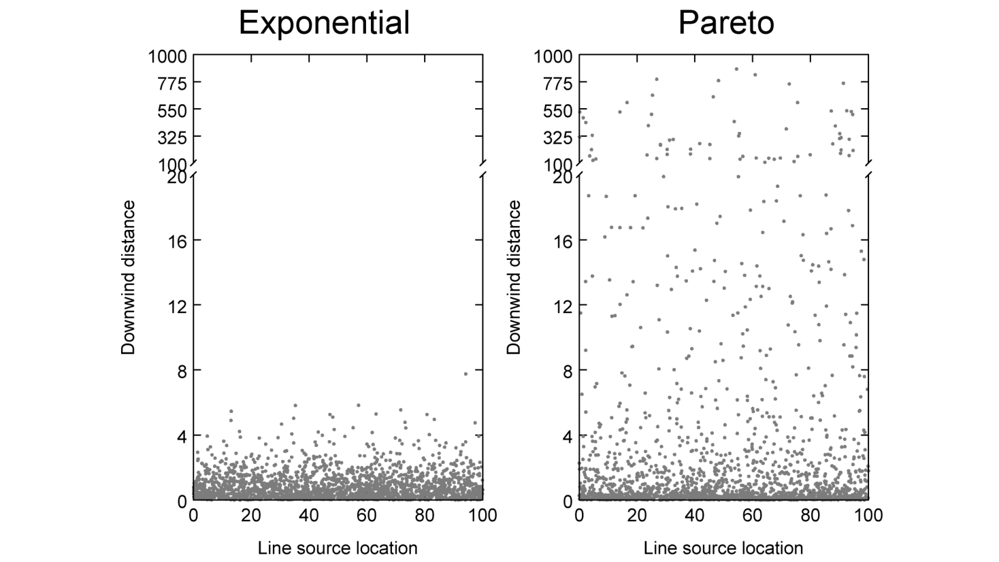{#fig-dg-spore-dispersal-sim}

คุณลักษณะอีกประการหนึ่งของ @fig-dg-spore-dispersal-sim ที่ควรค่าแก่การสังเกตก็คือ สำหรับการกระจายตัวแบบพาเรโต นอกจากสปอร์จะตกตะกอนไปไกลเกินแหล่งกำเนิดเชื้อแล้ว เรายังมองเห็นการเกาะกลุ่ม (Clumping) หรือการกระจุกตัว (Clustering) ของจุดตามระยะทางต่างๆ อย่างค่อนข้างชัดเจน ดังนั้น สำหรับเชื้อก่อโรคที่มีรูปแบบการแพร่กระจายของสปอร์คล้ายกับการกระจายตัวแบบพาเรโต การเกิดจุดโฟกัสของการติดเชื้อใหม่ (New foci of infection) ถัดจากแหล่งกำเนิดเดิม และการกระจุกตัวของโรคบริเวณรอบๆ การติดเชื้อใหม่นั้น จึงถือเป็นลักษณะปกติที่พบได้ทั่วไป หัวข้อเหล่านี้จะถูกนำไปเจาะลึกในบทต่อๆ ไปเหตุผลที่เราเน้นย้ำถึงการกระจายตัวของการสัมผัสแบบเอกซ์โพเนนเชียลและแบบพาเรโตในหัวข้อย่อยนี้ ก็เพราะทั้งสองแบบมีความสอดคล้องโดยตรงกับแบบจำลองความลาดชันของโรคแบบเอกซ์โพเนนเชียลและแบบยกกำลังที่ได้รับความนิยมและมีประโยชน์ อย่างไรก็ตาม ก็ยังพบว่ามีฟังก์ชันการกระจายตัวแบบอื่นๆ ที่นำมาใช้ประโยชน์ได้เช่นกัน ตัวอย่างเช่น การกระจายตัวแบบปกติ (Normal), แบบ (ฮาล์ฟ-)โคชี ((Half-)Cauchy) และแบบอื่นๆ ได้ถูกนำมาใช้แทน $D(s)$ (Shaw, 1995; van den Bosch et al., 1988b, c; Pielaat and van den Bosch, 1998; Xu and Ridout, 1998) ซึ่งทั้งหมดนี้จะมีรูปร่างโดยรวมแตกต่างกันไป โดยเฉพาะในแง่ของ "ความหนัก" (Heaviness) หรือ "ความอ้วน" (Fatness) ของหางกราฟที่ระยะทางไกลๆ (นั่นคือ ค่า $D(s)$ ลดลงเร็วแค่ไหนเมื่อ $s$ เพิ่มขึ้นในระยะไกล) นัยสำคัญของความอ้วนของหางกราฟนี้จะยิ่งเด่นชัดมากขึ้นในช่วงท้ายของบทนี้และในบทถัดไป เมื่อเราอภิปรายถึงการพัฒนาของโรคในมิติของพื้นที่และเวลาร่วมกัน (Spatio-temporal disease development)

### 7.3.5 แบบจำลองการแพร่กระจายอื่นๆ (Some Other Dispersal Models)

เช่นเดียวกับแบบจำลองพัฒนาการของโรคในเชิงเวลา (Temporal models of disease progress) มันยังมีแบบจำลองอื่นๆ ที่สามารถนำมาใช้อธิบายความลาดชันของโรคเมื่อห่างออกไปจากแหล่งกำเนิดเชื้อได้ ดังที่กล่าวไปแล้วว่า การแพร่กระจายของสปอร์ถูกกำหนดโดยกระบวนการที่ผสมผสานกันระหว่างการตกตะกอนและการเจือจาง (รวมถึงการหลุดรอด) (Aylor, 1999) ซึ่งกระบวนการใดกระบวนการหนึ่งอาจมีความสำคัญมากกว่าเมื่ออยู่ภายใต้เงื่อนไขที่แตกต่างกัน และก็เป็นไปได้ด้วยที่อาจจะไม่มีกระบวนการใดโดดเด่นเลย ทำให้ความลาดชันที่สังเกตได้มีลักษณะผสมกันทั้งของการตกตะกอนและการเจือจาง Lambert และคณะ (1980) ได้ริเริ่มก้าวแรกในการต่อยอดแบบจำลองข้างต้น ด้วยการพัฒนาแบบจำลองความลาดชันที่มีความเป็นสากลมากขึ้น ฟังก์ชันของพวกเขาสามารถเขียนได้ดังนี้:{#fig-7-6}โดยที่ $a_1$, $b_1$ และ $\eta$ คือพารามิเตอร์ เมื่อพารามิเตอร์รูปทรงที่ไม่มีหน่วยอย่าง $\eta$ มีค่าเท่ากับ 1 สมการ 7.10 จะลดรูปลงกลายเป็นแบบจำลองเอกซ์โพเนนเชียล (สมการ 7.1) แต่เมื่อ $\eta$ ลู่เข้าสู่ 0 สมการ 7.10 ก็จะลดรูปลงไปจนกลายเป็นแบบจำลองยกกำลัง (สมการ 7.4) ส่วนค่าอื่นๆ ของ $\eta$ จะช่วยให้แบบจำลองสามารถปรับเปลี่ยนไปเป็นรูปทรงอื่นๆ ได้ในบางมุม การสร้างรูปทั่วไป (Generalization) ของสมการ 7.10 อาจไม่มีความจำเป็นเลย เหตุผลก็คือ แท้จริงแล้ว แบบจำลองยกกำลังดัดแปลงก็ถือเป็นแบบจำลองความลาดชันของการแพร่กระจายแบบทั่วไปอยู่แล้ว หากยอมให้ $\lambda$ สามารถมีค่าเป็นอะไรก็ได้ ในสถานการณ์นี้ ค่า $\lambda$ และ $b_P$ จะทำงานร่วมกันเพื่อเป็นตัวกำหนดรูปทรงของความลาดชัน เราสามารถเห็นภาพนี้ได้จากสมการ 7.7 สำหรับค่า $dY/ds$ เมื่อค่า $\lambda$ มีขนาดใหญ่มาก (ตัวอย่างเช่น ใหญ่กว่าระยะทางที่ไกลที่สุดที่นำมาพิจารณามากๆ) ค่า $s$ ที่เป็นตัวส่วนแทบจะไม่มีผลต่ออัตราเลย พูดง่ายๆ คือ ถ้า $\lambda$ มีค่ามาก การเพิ่มค่า $s$ ก็แทบจะไม่ทำให้ตัวส่วนเปลี่ยนไปเลยสักนิด และเราจะสามารถเขียนแบบจำลองได้เป็น $dY/ds \approx (b_P/\lambda)Y$ ซึ่งนี่ก็คือรูปแบบของแบบจำลองเอกซ์โพเนนเชียลนั่นเอง (โดยมี $b_E = b_P/\lambda$) หากพูดในเชิงคณิตศาสตร์ให้ลึกขึ้น เมื่อ $\lambda$ มีค่าเพิ่มขึ้นอย่างไม่มีที่สิ้นสุด โดยที่ยังคงอัตราส่วน $b_P/\lambda$ ให้มีค่าจำกัดและแน่นอน (ซึ่งหมายความว่า $b_P$ ก็ต้องเพิ่มขึ้นอย่างไม่มีที่สิ้นสุดเช่นกัน) แบบจำลองยกกำลังดัดแปลงนี้ก็จะลดรูปลงไปเป็นแบบจำลองเอกซ์โพเนนเชียลการสร้างรูปทั่วไปในอีกแนวทางหนึ่ง สามารถทำได้โดยการผสมผสานทั้งฟังก์ชันเอกซ์โพเนนเชียลและฟังก์ชันยกกำลังเข้าไว้ในแบบจำลองเดียวกัน (Maffia and Berger, 1998) หนึ่งในรูปแบบที่เป็นไปได้คือ:โดยที่ $a_1$, $b_1$ และ $b_2$ คือพารามิเตอร์ แบบจำลองนี้มีความสอดคล้องกับแบบจำลองทางฟิสิกส์บางตัวที่ถูกพัฒนาขึ้นมาเพื่ออธิบายการกระจายตัวของสปอร์ (ดูสมการ 15 ใน Aylor, 1999) เมื่อ $b_2 = 0$ (ในทางทฤษฎีคือเมื่อกระบวนการเจือจาง/หลุดรอดของสปอร์ไม่มีความสำคัญเลย หรือมีความสำคัญน้อยมากเมื่อเทียบกับกระบวนการตกตะกอน) สมการ 7.11a จะลดรูปลงเหลือสมการ 7.1 ในทำนองเดียวกัน เมื่อ $b_1 = 0$ (ในทางทฤษฎีคือเมื่อการตกตะกอนมีความสำคัญน้อยมากเมื่อเทียบกับกระบวนการเจือจาง/หลุดรอด) สมการ 7.11a ก็จะลดรูปลงเหลือสมการ 7.4 อย่างไรก็ตาม เป็นไปได้ที่พารามิเตอร์ $b$ ทั้งสองตัวจะมีค่าไม่เป็นศูนย์ เราสามารถแปลงสมการนี้ให้อยู่ในรูปเส้นตรงได้เป็น:ซึ่งจะช่วยให้การประมาณค่าพารามิเตอร์ทำได้ง่ายขึ้น (ดูหัวข้อด้านล่าง) นอกจากนี้ แบบจำลองยังสามารถถูกนำไปสร้างเป็นรูปทั่วไปได้อีกโดยการบวกค่าคงที่ ($\lambda$) เข้ากับ $s$ เช่นเดียวกับที่ทำในแบบจำลองยกกำลัง (สมการ 7.5)อีกหนึ่งแบบจำลองที่เป็นไปได้ จะมีพื้นฐานมาจากรูปแบบเชิงกำหนด (Deterministic version) ของการกระจายตัวทางสถิติแบบฮาล์ฟ-โคชี (Half-Cauchy) สำหรับค่า $D(s)$ วิธีหนึ่งในการเขียนแบบจำลองนี้คือ:สิ่งที่น่าสนใจคือ Aylor และ Ferrandino (1990) ได้พัฒนาแบบจำลองตัวเดียวกันนี้เพื่อใช้อธิบายการตกตะกอนของสปอร์ใกล้กับแหล่งกำเนิดเชื้อ โดยอาศัยกลไกวิถีการบินของสปอร์ที่ตั้งสมมติฐานไว้ แบบจำลองนี้มีความคล้ายคลึงกับแบบจำลองยกกำลัง (สมการ 7.4 หรือ 7.5) ตรงที่มีการนำค่า $s$ (หรือพูดให้ถูกคือ ฟังก์ชันของ $s$) ไปยกกำลัง ดังนั้น มันจึงอาจเป็นตัวเลือกที่เหมาะสมในการนำมาใช้แทนแบบจำลองยกกำลัง สำหรับความลาดชันที่ดิ่งชันมากๆ บริเวณใกล้แหล่งกำเนิดเชื้อ ($s \approx 0$) และราบเรียบในระยะที่ไกลออกไป ทว่าสิ่งที่ต่างจากแบบจำลองยกกำลัง (แบบไม่ดัดแปลง; สมการ 7.4) ก็คือสมการ 7.12 มีค่าที่แน่นอน ณ $s = 0$ ซึ่งก็คือ $Y(0) = a_1$ ในฐานะของการกระจายตัวของการสัมผัส การกระจายตัวแบบฮาล์ฟ-โคชีถูกนำมาใช้อย่างหนักในการจำลองสถานการณ์และการศึกษาเชิงทฤษฎี (Shaw, 1995; Xu and Ridout, 1998) แต่ (ยัง) ไม่ได้รับความนิยมมากนักในการนำมาใช้อธิบายความลาดชันที่สังเกตได้จริง ผู้อ่านที่สนใจสามารถลองพิสูจน์ได้ว่าด้วยสมการ 7.12 ค่า $1/Y$ จะเป็นฟังก์ชันเชิงเส้น (Linear function) ของ $s^2$ส่วนการกระจายตัวของการสัมผัสแบบอื่นๆ จะได้รับการอภิปรายในบทที่ 8

### 7.3.6 การคำนวณเบื้องต้น (Some Calculations)

ผู้อ่านที่ได้เรียนรู้วิธีการคำนวณด้วยแบบจำลองพัฒนาการของโรคเชิงประจักษ์ (Empirical disease progress models) ในบทที่ 4 มาแล้ว (ดูสมการ 4.4.6) จะไม่มีปัญหาเลยในการดำเนินการในลักษณะเดียวกันกับแบบจำลองความลาดชัน บางครั้ง การพิจารณาแบบจำลองที่พบบ่อยที่สุดสองแบบ (เอกซ์โพเนนเชียลและยกกำลัง) ในรูปของสมการทั่วไป (Generic form) ก็อาจช่วยให้ง่ายขึ้น:โดยที่ $a^*$ หมายถึง $\ln(a_E)$ หรือ $\ln(a_P)$ ส่วน $b^*$ คือ $b_E$ (มีหน่วยเป็น 1/ระยะทาง) หรือ $b_P$ (ไม่มีหน่วย) และ $s^*$ เป็นได้ทั้งแค่ $s$ เฉยๆ (สำหรับเอกซ์โพเนนเชียล) หรือ $\ln(s + \lambda)$ สำหรับแบบจำลองยกกำลัง (แบบดัดแปลง) (โดยมีเราจะสาธิตการคำนวณเพียงสักสองสามตัวอย่างในที่นี้ สมมติว่าระยะทางถูกวัดในหน่วยเซนติเมตรจากแหล่งกำเนิดเชื้อ ให้ $Y$ เป็นตัวแทนของจำนวน (เฉลี่ย) ของตุ่มแผลราสนิม (Rust pustules) ต่อต้น และกำหนดให้ $a_E = 500$ และ $b_E = 0.02$/ซม. อยากทราบว่า Y ที่ระยะทาง 4 เมตร (400 ซม.) มีค่าเท่าใด? หากใช้สมการ 7.13 เราจะได้ $\ln(Y) = \ln(500) - 0.02 \times (400) = 6.215 - 8 = -1.875$ เมื่อแปลงค่ากลับ (Back-transformation) จะได้ค่า $Y$ เท่ากับ $0.168$ การคำนวณง่ายๆ แบบนี้สามารถทำได้โดยตรงผ่านสมการ 7.1 ทีนี้ ด้วยพารามิเตอร์ชุดเดิม ที่ระยะทางเท่าใด Y จึงจะเท่ากับ 1 ? การจัดรูปสมการ 7.13 ใหม่ จะนำไปสู่:ผู้อ่านที่สนใจน่าจะสามารถหาคำตอบได้ว่า จะต้องเปลี่ยนค่า $a_E$ หรือ $b_E$ ไปเท่าใด เพื่อให้ $Y$ ลดลงเหลือ 1 ตุ่มแผล/ต้น ที่ระยะทางไม่ใช่ 3.1 เมตร แต่เป็น 1 เมตร (100 ซม.) คำตอบคือ: ต้องเปลี่ยนค่า $a_E$ ใหม่เป็น 7.39 (เท่ากับลดความแรงของแหล่งกำเนิดเชื้อลง ~496) หรือต้องเปลี่ยนค่า $b_E$ ใหม่เป็น 0.062/ซม. (เท่ากับเพิ่มความชันของความลาดชันขึ้น 0.042/ซม.)เมื่อทำการคำนวณในลักษณะเดียวกันกับแบบจำลองยกกำลัง สิ่งสำคัญที่ต้องจำไว้เสมอคือเรากำลังจัดการกับระยะทางที่อยู่ในรูปลอการิทึม (Logarithmic transformation of distance) ตัวอย่างเช่น กำหนดให้ $\lambda = 1$ ซม. สมมติว่า $b_P = 1.2$ และ $a_P = 500$ (นั่นคือค่า $Y$ ที่แหล่งกำเนิดเชื้อเท่ากับ $500 \times 1^{-1.2} = 500$ ตุ่มแผล/ต้น) ระยะทางที่ทำให้ $Y = 1$ สามารถหาได้จาก: $s^* = - [\ln(1) - \ln(500)]/1.2 = 5.18$ และเนื่องจากในกรณีนี้ $s^* = \ln(s + 1)$ ค่า $s$ จึงสามารถคำนวณได้ดังนี้:

## 7.4 การปรับแก้แบบจำลอง (Model Fitting) {#sec-dg-fitting}

 {#sec-dg-fitting}

### 7.4.1 การเลือกแบบจำลอง (Choosing a Model)

เช่นเดียวกับเส้นโค้งพัฒนาการของโรค (Disease progress curves ในบทที่ 4) เราสามารถ (หรือควร) ใช้วิธีการทางกราฟิกและสถิติที่เกี่ยวข้องกันร่วมกันเพื่อเลือกแบบจำลองที่เหมาะสมที่สุดในการอธิบายความลาดชันของโรค และก็เหมือนกับวิธีการอื่นๆ กระบวนการเลือกแบบจำลองนั้นถูกจำกัดด้วยข้อมูลที่มีอยู่ นั่นหมายความว่า ข้อสรุปใดๆ เกี่ยวกับแบบจำลองที่ 'ดีที่สุด' อาจมีข้อจำกัดอันเนื่องมาจากความคลาดเคลื่อนในการวัด (Measurement error, ดูบทที่ 2), ความคลาดเคลื่อนจากการสุ่มตัวอย่าง (Sampling error, บทที่ 10) และช่วงระยะทางที่มีการประเมินค่า $Y$ ถึงกระนั้น การเลือกแบบจำลองที่สมเหตุสมผลก็เป็นสิ่งสำคัญอย่างยิ่งในการนำไปแปลงการแพร่กระจายของเชื้อและการแพร่กระจายของโรคให้เป็นตัวเลข (Quantifying dispersal and disease spread, ดังที่จะกล่าวในภายหลัง) รวมไปถึงการนำไปใช้เปรียบเทียบผลลัพธ์ระหว่างกลุ่มทดลอง (Treatments), สถานที่, ปี หรือเชื้อก่อโรคต่างๆโดยทั่วไป วิธีการมาตรฐานที่นำเสนอในบทที่ 4 สามารถนำมาประยุกต์ใช้กับข้อมูลความลาดชันของการแพร่กระจายที่สังเกตได้ เพื่อเลือกแบบจำลองที่เหมาะสมให้กับชุดข้อมูลนั้นๆ เราจะขอสาธิตกระบวนการนี้ด้วยข้อมูลจำนวนตุ่มแผลต่อต้นของโรคราสนิมในถั่ว (Rust of beans) (Aylor and Ferrandino, 1989) ซึ่งใช้แหล่งกำเนิดเชื้อแบบเส้น (Line source) โดยข้อมูลที่นำมาใช้คือผลลัพธ์จากการประเมินครั้งแรกในปี 1986 ในทิศใต้ ซึ่งอ่านค่าได้จากกราฟ อย่างที่คาดไว้ ค่า $Y$ มีแนวโน้มลดลงเมื่อ $s$ เพิ่มขึ้น (รูปที่ 7.7 และ 7.8) ซึ่งสอดคล้องกับแบบจำลองการแพร่กระจายทั้งแบบเอกซ์โพเนนเชียลและแบบยกกำลัง การลดลงอย่างฮวบฮาบในช่วงประมาณ 3 เมตรแรก และเส้นโค้งที่ราบเรียบมากในระยะไกล เป็นสิ่งที่บ่งชี้ไปทางแบบจำลองยกกำลัง แต่นี่ก็อาจทำให้เข้าใจผิดได้หากไม่ได้มีการบันทึกข้อมูลในระยะที่ใกล้และไกลมากๆ ($s$)การพล็อตค่า $dY/ds$ เทียบกับ $s$ มีความสำคัญในการแยกแยะความแตกต่างเชิงทฤษฎีระหว่างกระบวนการของทั้งสองแบบจำลอง (สำหรับแบบจำลองยกกำลัง $dY/ds$ จะดิ่งลงไปสู่ค่าติดลบที่มหาศาลอย่างรวดเร็ว ส่วนแบบเอกซ์โพเนนเชียลจะลดลงช้ากว่าไปสู่ค่าติดลบที่จำกัด) (ดูรูปที่ 7.3 และ 7.4) อย่างไรก็ตาม ในทางปฏิบัติ การพล็อต $\Delta Y/\Delta s$ มักไม่ค่อยมีประโยชน์ในการเลือกแบบจำลองเท่าใดนัก เหตุผลก็คือ โดยทั่วไปแล้วเป็นไปได้ยากมากที่เราจะสามารถสุ่มตัวอย่างในระยะประชิดแหล่งกำเนิดเชื้อได้ถี่พอที่จะเห็นว่า $dY/ds$ ลดลงเร็วพอที่จะสะท้อนให้เห็นถึงความเป็นแบบจำลองยกกำลังหรือไม่ และเนื่องจากค่า $dY/ds$ ที่ประมาณขึ้นมานั้นอยู่ในรูปของอัตราส่วน (Ratio) การประมาณค่าจึงอาจขาดความแม่นยำ (Imprecision) ไปมาก ส่งผลให้จุดบนกราฟกระจายตัวสะเปะสะปะ ดังจะเห็นได้จากตัวอย่างโรคราสนิมในถั่ว: แม้ว่าแนวโน้มจะชี้ชัดว่าค่าจะติดลบมากขึ้นเรื่อยๆ เมื่อ $s$ เข้าใกล้ 0 แต่ค่าประมาณของอัตราก็มีความผันผวนสูงมากในช่วงสามถึงสี่ระยะทางแรก (รูปที่ 7.7)

ดังแสดงใน @fig-dg-bean-rust ความสัมพันธ์ระหว่างจำนวนตุ่มแผลของโรคราสนิมถั่วต่อใบกับระยะห่างจากแหล่งกำเนิดเชื้อ

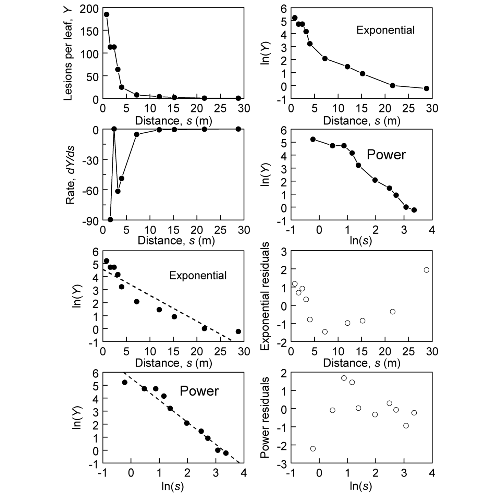{#fig-dg-bean-rust}

การพล็อต $\ln(Y)$ เทียบกับ $s$ และ $\ln(s)$ มีประโยชน์อย่างยิ่งในการเลือกแบบจำลอง กราฟเหล่านี้สอดคล้องกับเวอร์ชันเชิงเส้นของทั้งสองแบบจำลอง (สมการ 7.3 และ 7.6)—หากแบบจำลองใดมีความเหมาะสม ผลลัพธ์ที่ได้จะเป็นเส้นตรง สำหรับตัวอย่างโรคราสนิมถั่ว ดังแสดงใน @fig-dg-bean-rust กราฟ $\ln(Y)$ เทียบกับ $s$

 แสดงความโค้งอย่างเห็นได้ชัด ซึ่งบ่งบอกว่าแบบจำลองเอกซ์โพเนนเชียลไม่น่าจะเหมาะสม ความโค้งในลักษณะนี้เป็นเรื่องปกติเมื่อนำข้อมูลจากแบบจำลองยกกำลังมาพล็อตในสเกลนี้ (ดูรูปที่ 7.3) ในทางกลับกัน กราฟ $\ln(Y)$ เทียบกับ $\ln(s)$ (รูปที่ 7.7) กลับเป็นเส้นตรงค่อนข้างสวยงาม ยกเว้นในบริเวณที่ใกล้แหล่งกำเนิดเชื้อมากๆ ซึ่งเส้นกราฟจะมีความโค้งเล็กน้อย ดังที่ได้อภิปรายไว้ข้างต้น ความโค้งบริเวณค่า $\ln(s)$ ต่ำๆ นี้จะเกิดขึ้นเมื่อ $\lambda$ มีค่ามากกว่า 0 ในสมการ 7.6 (ดูรูปที่ 7.4) การลองใช้ค่า $\lambda$ เท่ากับครึ่งหนึ่งของระยะทางระหว่างแหล่งกำเนิดเชื้อและจุดสุ่มตัวอย่างจุดแรก (0.4) ช่วยลดความโค้งนี้ลงได้บ้าง แต่เดี๋ยวเราจะแสดงให้เห็นในภายหลังว่า การเพิ่มค่านี้เข้าไปส่งผลกระทบเพียงเล็กน้อยต่อการปรับแก้แบบจำลอง โดยรวมแล้ว แบบจำลองยกกำลังดูจะมีความสมเหตุสมผลในการใช้อธิบายชุดข้อมูลตัวอย่างนี้มากกว่าแบบจำลองเอกซ์โพเนนเชียลเช่นเดียวกับการประเมินความลาดชันของการแพร่กระจาย/ความลาดชันของโรคทุกรูปแบบ ช่วงระยะทางในการสุ่มตัวอย่าง (Range of sampling distances) มีอิทธิพลอย่างมากต่อผลลัพธ์ (Ferrandino, 1996) หากพิจารณาในช่วงระยะทางที่แคบ การทำนายของแบบจำลองทั้งสองอาจออกมาใกล้เคียงกันมาก แม้ว่าเนื้อแท้แล้วทั้งสองแบบจำลองจะมีความแตกต่างกันอย่างสิ้นเชิงในระยะที่ใกล้และไกลจากแหล่งกำเนิดเชื้อมากๆ ก็ตาม เราสามารถเห็นภาพนี้ได้จากกราฟรูปล่างสุดในรูปที่ 7.5 จุดทึบคือค่าของโรคที่ตรงกับแบบจำลองยกกำลังพอดีเป๊ะ (สมการ 7.4) แต่ถูกนำมาพล็อตในรูปแบบของ $\ln(Y)$ เทียบกับ $s$ ซึ่งเป็นสเกลมาตรฐานสำหรับแบบจำลองเอกซ์โพเนนเชียล (สมการ 7.1) เส้นตรงในกราฟคือผลลัพธ์ของการพยายามนำแบบจำลองเอกซ์โพเนนเชียลมาปรับแก้ให้เข้ากับจุดข้อมูลเหล่านี้ ซึ่งผลออกมาว่าปรับแก้ได้ค่อนข้างดีเยี่ยม ยกเว้นในบริเวณใกล้แหล่งกำเนิดเชื้อ ที่แบบจำลองเอกซ์โพเนนเชียลทำนายค่า $Y$ ต่ำกว่าความเป็นจริง (Underpredicts) หากสมมติว่าไม่มีข้อมูลจุดแรก (ที่ $s = 1$) (เช่น ในกรณีที่พืชแถวแรกปลูกห่างจากแหล่งกำเนิดเชื้อ 2 เมตร) นักวิจัยก็จะแทบไม่มีหลักฐานใดๆ มาคัดค้านเลยว่าแบบจำลองเอกซ์โพเนนเชียลไม่เหมาะสม และหากมีข้อมูลในระยะที่ไกลกว่า $s = 12$ ออกไปมากๆ ความแตกต่างของทั้งสองแบบจำลองก็จะยิ่งเด่นชัดขึ้น—ค่า $\ln(Y)$ ที่แท้จริงจะลดลงในอัตราที่ช้าลงเรื่อยๆ ตามความสัมพันธ์ของแบบจำลองยกกำลัง (นั่นคือเส้นโค้งจะราบเรียบขึ้น) ในขณะที่แบบจำลองเอกซ์โพเนนเชียลจะยังคงชี้ให้เห็นว่า $\ln(Y)$ ลดลงเป็นเส้นตรงอย่างต่อเนื่องประเด็นสำคัญจากการอภิปรายนี้ก็คือ นักวิจัยไม่ควรด่วนสรุปผลลัพธ์จากชุดข้อมูลเพียงชุดเดียว (Over-interpret) เนื่องจากกระบวนการทางกายภาพที่แตกต่างกันอาจมีอิทธิพลโดดเด่นในช่วงระยะทางที่ต่างกัน (Aylor, 1999) และความลาดชันที่สังเกตได้มักจะเป็นเพียงส่วนหนึ่งของความลาดชันของการแพร่กระจายทั้งหมด ดังนั้น ต่อให้แบบจำลองที่เรียบง่ายจะสามารถปรับแก้เข้ากับชุดข้อมูลขนาดเล็กได้อย่างสมบูรณ์แบบ ก็ไม่ได้หมายความว่าแบบจำลองนี้จะสามารถใช้ได้กับทุกๆ ระยะทาง หรือกับเหตุการณ์การแพร่กระจายทุกครั้งสำหรับการจับคู่ระหว่างเชื้อก่อโรคและโฮสต์ (Pathogen/host combination) เดิมเสมอไป แน่นอนว่าเรา จำเป็น ต้องเลือกแบบจำลองที่สมเหตุสมผลเพื่อแปลงการแพร่กระจายของโรคเป็นตัวเลขได้อย่างถูกต้อง และเพื่อเปรียบเทียบผลลัพธ์ของการทดลองกลุ่มต่างๆ อย่างไรก็ตาม ข้อสรุปเกี่ยวกับกลไกจะต้องอิงตามหลักฐานที่สะสมร่วมกันเสมอ (Cumulative evidence) ไม่ใช่อิงจากชุดข้อมูลที่มีอยู่อย่างจำกัด Ferrandino (1996) ได้อธิบายขยายความถึงความท้าทายในการแยกแยะความแตกต่างระหว่างความลาดชันแบบเอกซ์โพเนนเชียลและแบบกฎยกกำลังเอาไว้ เมื่อทำการประเมินโรคในขอบเขตพื้นที่ที่จำกัด

### 7.4.2 การประมาณค่าพารามิเตอร์—วิธีการเชิงเส้น (Estimating Parameters: Linear Methods)

มีวิธีการทางสถิติมากมายที่สามารถนำมาใช้ปรับแก้แบบจำลองความลาดชันของโรคให้เข้ากับข้อมูลได้ ในที่นี้เราตั้งสมมติฐานว่าผู้อ่านได้ทำความเข้าใจเนื้อหาเกี่ยวกับการปรับแก้แบบจำลองสำหรับเส้นโค้งพัฒนาการของโรค (หัวข้อ 4.6) มาแล้ว ดังนั้นจึงไม่จำเป็นต้องลงรายละเอียดมากนัก วิธีกำลังสองน้อยที่สุด (Least squares) และวิธีภาวะน่าจะเป็นสูงสุด (Maximum likelihood) (รวมถึงวิธีการทางสถิติอื่นๆ บางวิธี) สามารถนำมาใช้สำหรับการปรับแก้แบบจำลองและประมาณค่าพารามิเตอร์ได้ แต่ในบทนี้เราจะมุ่งเน้นไปที่วิธีกำลังสองน้อยที่สุดเป็นหลักดังที่แสดงไว้ในสมการ 7.13 ทั้งแบบจำลองเอกซ์โพเนนเชียลและแบบจำลองยกกำลังดัดแปลง (ในกรณีที่สมมติให้รู้ค่า $\lambda$ แล้ว) สามารถเขียนให้อยู่ในรูปของแบบจำลองเชิงเส้น (Linear models) ได้ ผู้อ่านสามารถกลับไปดูบทที่ 3 สำหรับการอภิปรายเกี่ยวกับความหมายของแบบจำลองที่เป็นเชิงเส้นในส่วนของพารามิเตอร์ รูปแบบทางสถิติของแบบจำลองการแพร่กระจายทางคณิตศาสตร์เหล่านี้สามารถเขียนได้ดังนี้:โดยที่ตัวห้อย $j$ ระบุถึงจุดข้อมูลหรือระยะทางจุดที่ $j$ ($j = 1, \dots, n$) และ $\varepsilon$ คือพจน์ความคลาดเคลื่อน (Error term หรือ Residual) ซึ่งเป็นตัวแปรสุ่ม (คือผลต่างระหว่างค่าที่แปลงรูปแล้วของ $Y$ ที่สังเกตได้ กับค่าที่กำหนดโดยแบบจำลอง) จุดตัดแกนของแบบจำลองคือ $\ln(a_E)$ หรือ $\ln(a_P)$ และความชันคือ $b_E$ หรือ $b_P$ แน่นอนว่าสมการ 7.14b ไม่ใช่เชิงเส้นเมื่อพิจารณาที่พารามิเตอร์ $\lambda$ เพราะ $\lambda$ ปรากฏอยู่แค่ในฟังก์ชันลอการิทึมของ $s + \lambda$ เท่านั้น เราจำเป็นต้องกำหนดค่าของ $\lambda$ ล่วงหน้าเพื่อที่จะใช้วิธีทางสถิติเชิงเส้นได้ วิธีที่นิยมทำกันมากที่สุดคือสมมติให้ $\lambda = 0$ ซึ่งจะส่งผลให้ได้แบบจำลองความลาดชันของการแพร่กระจายแบบยกกำลังที่เรียบง่ายขึ้น อย่างไรก็ตาม เราก็อาจจะกำหนดค่าใดค่าหนึ่งให้ใกล้เคียงกับ "ขนาด" (เส้นผ่านศูนย์กลาง, ความลึก) ของแหล่งกำเนิดเชื้อก็ได้ (Mundt, 1989)ในการใช้วิธีกำลังสองน้อยที่สุดเชิงเส้น จะต้องมีการตั้งสมมติฐานมาตรฐานเกี่ยวกับการกระจายตัวของพจน์ความคลาดเคลื่อน ($\varepsilon$) และตัวแปรตอบสนอง (Response variable) [ซึ่งในสถานการณ์นี้คือ $\ln(Y)$] (ดูสมการ 4.6.2 และ Neter et al., 1983) ความเป็นโค้งปกติ (Normality) มักไม่ค่อยสำคัญมากนัก ยกเว้นในสถานการณ์ที่รุนแรงจริงๆ แต่ความเป็นอิสระของข้อมูลที่สังเกตได้ (Independence) และความแปรปรวนคงที่ (Constant variance) ถือเป็นสมมติฐานที่สำคัญมาก สำหรับเส้นโค้งพัฒนาการของโรคนั้น ตัวแปรตอบสนอง (ความรุนแรงของโรคที่แปลงรูปแล้ว) จะมีลักษณะสะสม (Cumulative) กล่าวคือ $Y$ ที่ $t = 20$ จะเท่ากับ $Y$ ที่ $t = 10$ บวกกับโรคใหม่ที่พัฒนาขึ้นระหว่างเวลา 10 ถึง 20 ดังนั้น การตรวจสอบความสัมพันธ์เชิงอนุกรม (Serial correlations) จึงเป็นเรื่องสำคัญมากในการสร้างแบบจำลองพัฒนาการของโรค ทว่าสำหรับความลาดชันของโรค ค่า $Y$ [หรือ $\ln(Y)$] ตามที่แสดงไว้นั้น ไม่ใช่ค่าสะสมเชิงพื้นที่ (Not a cumulative value over space) ตัวอย่างเช่น $Y$ ที่ $s = 20$ ไม่ได้ เป็นการสะสมรอยแผล (หรือการติดเชื้อ) ตั้งแต่ระยะทาง 0 ถึง 20 ในแง่นี้ เราจึงอาจไม่คาดคิดว่าจะพบความสัมพันธ์ (Correlations) ของค่า $Y$ สำหรับความลาดชันของโรค อย่างไรก็ตาม เนื่องจากค่า $Y$ มีแนวโน้มลดลง ตามระยะทาง (รูปที่ 7.1) จึงเกิดความสัมพันธ์เชิงพื้นที่ในตัวเอง (Spatial autocorrelation หรือความไม่อิสระต่อกัน) อันเนื่องมาจากแนวโน้มเชิงพื้นที่นี้ กล่าวคือ ค่า $Y$ มีความสัมพันธ์เชิงอนุกรมผ่านระยะทาง ในหลายๆ กรณีที่มีความลาดชันของโรคอย่างชัดเจนจากแหล่งกำเนิดเชื้อ (เดียว) ความสัมพันธ์ของค่า $Y$ จะสามารถถูก "หักล้าง" (Removed) ได้ด้วยการนำแบบจำลองความลาดชันมาปรับแก้เข้ากับข้อมูล ตัวอย่างเช่น $\varepsilon = Y - a_E\exp(-b_Es)$ อาจไม่มีความสัมพันธ์กันเลย (หากแบบจำลองเอกซ์โพเนนเชียลสมเหตุสมผล) แม้ว่าค่า $Y$ จะมีความสัมพันธ์กันก็ตาม หากอธิบายด้วยคำศัพท์แบบอนุกรมเวลา (Time series) แนวโน้ม (Trend) ได้ถูกขจัดออกไปแล้วผ่านการใช้แบบจำลองเฉพาะเจาะจงปรับแก้ข้อมูลความลาดชัน เพื่อความแน่ใจ การตรวจสอบความเป็นอิสระสามารถทำได้ง่ายๆ โดยการประเมินค่าคลาดเคลื่อน (Residuals) ดังที่ได้กล่าวไว้ในบทที่ 4หาก $Y$ คือจำนวนสปอร์ที่ตกตะกอนหรือจำนวนรอยแผล เป็นไปได้ยากมากที่ $var(Y)$ จะคงที่ โดยทั่วไป เราสามารถคาดหวังได้ว่า $var(Y)$ จะเพิ่มขึ้นตามค่าเฉลี่ยของ $Y$ (Schabenberger and Pierce, 2002) ปรากฏว่าสำหรับข้อมูลแบบไม่ต่อเนื่องในรูปแบบของการนับ (Count data) การแปลงเป็นลอการิทึมทำงานได้ค่อนข้างดีในการทำให้ความแปรปรวนคงที่ (Stabilizing variances) กล่าวคือ ในทางปฏิบัติ ตัวแปร $\ln(Y)$ อาจมีความแปรปรวนใกล้เคียงกับค่าคงที่ได้ และไม่จำเป็นต้องมีการถ่วงน้ำหนัก (Weighting) ตามค่าความแปรปรวนที่สมมติ (หรือคำนวณ) ไว้ ดังนั้น ในที่นี้เราจึงตั้งสมมติฐานว่า $\ln(Y)$ มีความแปรปรวนคงที่สำหรับวัตถุประสงค์ในการปรับแก้แบบจำลอง ในช่วงหลังของบทนี้ เราจะค่อยมาจัดการกับสถานการณ์ที่ไม่สามารถตั้งสมมติฐานให้ตัวแปรตอบสนอง (ไม่ว่าจะแปลงรูปแล้วหรือไม่ก็ตาม) มีความแปรปรวนคงที่ได้ดังแสดงใน @fig-dg-sas-program-dispersal แสดงชุดคำสั่ง SAS เพื่ออ่านข้อมูลการแพร่กระจาย

และปรับแก้แบบจำลองการแพร่กระจายด้วยวิธีกำลังสองน้อยที่สุด จากข้อมูลในรูปที่ 7.7 การนำแบบจำลองเอกซ์โพเนนเชียล (สมการ 7.14a) มาปรับแก้เข้ากับข้อมูลโรคราสนิมถั่ว นำไปสู่สมการดังนี้:
$$

\ln(\hat{Y}) = 4.58 (0.352) - 0.20 (0.027) s
$$

โดยตัวเลขในวงเล็บคือค่าความคลาดเคลื่อนมาตรฐานโดยประมาณ (Estimated standard errors) สัมประสิทธิ์การตัดสินใจ (Coefficient of determination, $R^2$) คือ 0.878 และความแปรปรวนของค่าคลาดเคลื่อน (Residual variance) ถูกประมาณไว้ที่ 0.579 ค่าประมาณของ $a_E$ สามารถหาได้จากการแปลงกลับ (Back-transformation) ของ 4.58 นั่นคือ $\exp(4.58) = 97.5$ ซึ่งต่ำกว่าค่า $Y$ ที่สังเกตได้ในระยะทางแรก ($s = 0.8$) อย่างเห็นได้ชัด สิ่งที่ควรทราบคือ ค่าประมาณของ $\hat{b}_E$ มีหน่วยเป็น 1/ระยะทาง นั่นคือ $b_E = 0.20$/เมตร การประเมินเส้นทำนายและค่าคลาดเคลื่อนในกราฟรูปล่างของรูปที่ 7.7 เปิดเผยให้เห็นชัดเจนว่าแบบจำลองนี้ไม่สามารถปรับแก้เข้ากับช่วงของข้อมูลที่สังเกตได้อย่างเหมาะสม โดยเฉพาะอย่างยิ่ง ค่าคลาดเคลื่อน (ที่ปรับเป็นมาตรฐานแล้ว) แสดงรูปแบบที่ชัดเจนมาก แน่นอนว่าหากไม่มีการบันทึกข้อมูลในระยะ 2 เมตรจากแหล่งกำเนิดเชื้อและระยะที่ไกลกว่า 25 เมตร ผลการปรับแก้คงจะออกมาดูดีทีเดียวการนำแบบจำลองยกกำลังดัดแปลง (สมการ 7.14b โดยที่ $\lambda = 0$) มาปรับแก้เข้ากับข้อมูล นำไปสู่สมการดังนี้:
$$

\ln(\hat{Y}) = 5.56 (0.246) - 1.70 (0.119) \ln(s)
$$

ซึ่งได้ค่า $R^2$ เท่ากับ 0.962 และมีความแปรปรวนของค่าคลาดเคลื่อนโดยประมาณเท่ากับ 0.179 ความชันในสมการนี้เป็นค่าไม่มีหน่วย การแปลงกลับของจุดตัดแกนคือ $\exp(5.56) = 259.8$ ซึ่งก็คือค่าประมาณของ $Y$ ณ ระยะ $s = 1$ เมตร ไม่ใช่ ที่แหล่งกำเนิดเชื้อ เราสามารถทดลองปรับมาตราส่วนของระยะทางจากเมตรเป็นเซนติเมตรได้ โดยนำระยะทางไปคูณด้วย 100 แล้วจึงค่อยใส่ลอการิทึมให้ $s$ การปรับแก้ด้วยแบบจำลองยกกำลัง (ที่ $\lambda = 0$) จะให้ผลลัพธ์เหมือนเดิมทุกประการ ยกเว้นพจน์จุดตัดแกนที่ตอนนี้จะถูกประมาณเป็น 13.38 (ความคลาดเคลื่อนมาตรฐาน = 0.766) การแปลงกลับจะได้ $\exp(13.38) = 646,934$ ซึ่งเห็นได้ชัดว่าเป็นตัวเลขที่มหาศาลมาก สำหรับค่า $Y$ ที่ทำนายได้ในระยะ 1 เซนติเมตร การปรับสเกลเป็นมิลลิเมตรยิ่งจะให้ตัวเลขที่มหาศาลกว่านี้อีก ทั้งนี้เป็นเพราะ $Y$ จะเพิ่มขึ้นอย่างไม่มีที่สิ้นสุดเมื่อ $s$ เข้าใกล้ 0 ในแบบจำลองนี้ (และ $a_P$ ก็คือค่าของ $Y$ ที่ $s = 1$) หากใช้ผลลัพธ์จากมาตราส่วนระยะทางแบบเซนติเมตร ค่า $Y$ ที่ทำนายได้ที่ 100 ซม. (=1 เมตร) จะหาได้จาก:ซึ่งจะเท่ากับค่าจุดตัดแกนเดิมของระยะทางในหน่วยเมตรพอดี (คลาดเคลื่อนเล็กน้อยจากการปัดเศษ){#fig-7-8}การประเมินเส้นทำนายและค่าคลาดเคลื่อนทางกราฟิกแสดงให้เห็นว่า แบบจำลองนี้เหมาะสมกับชุดข้อมูลโรคราสนิมถั่วมากกว่าแบบจำลองเอกซ์โพเนนเชียลอย่างชัดเจน ความคลาดเคลื่อนที่มากที่สุดพบได้ในบริเวณใกล้แหล่งกำเนิดเชื้อ ซึ่งก่อนหน้านี้เราได้สังเกตเห็นความโค้งเล็กน้อยบนสเกล log-log แล้ว การปรับแก้ให้แนบสนิทขึ้นสามารถทำได้โดยพิจารณาใช้ค่า $\lambda$ ที่มากกว่า 0 ผู้อ่านสามารถทดลองใช้ค่า $\lambda$ ที่หลากหลายได้ แต่เราจะขอแสดงผลลัพธ์เฉพาะเมื่อ $\lambda = 0.4$ เมตรเท่านั้น ค่านี้นำมาจากครึ่งหนึ่งของระยะทางระหว่างจุดสุ่มตัวอย่างจุดแรกกับจุดศูนย์กลางของแหล่งกำเนิดเชื้อ ซึ่งอาจเป็นตัวเลือกที่สมเหตุสมผลหากตีความ $\lambda$ ในทางกายภาพว่าเป็นตัวชี้วัดขนาดของแหล่งกำเนิดเชื้อ การใช้วิธีกำลังสองน้อยที่สุดจะนำไปสู่สมการดังนี้:
$$

\ln(\hat{Y}) = 6.1 (0.347) - 1.88 (0.165) \ln(s + 0.4)
$$

ซึ่งให้ค่า $R^2$ เท่ากับ 0.974 สูงกว่าตอนที่ $\lambda = 0$ เล็กน้อย พารามิเตอร์ความชันมีค่าเพิ่มขึ้นเล็กน้อย (1.88 เทียบกับ 1.70) และจุดตัดแกนก็มีค่าสูงขึ้นด้วย การแปลงกลับของจุดตัดแกน $\exp(6.1) = 445.9$ คือค่าประมาณของ $a_P$ ซึ่งจะเท่ากับค่าทำนายของ $Y$ เมื่อ $s + 0.4 = 1$ เมตร (หรือ $s = 0.6$ เมตร) เราสามารถหาค่าทำนายของ $Y$ ที่ $s = 1$ ได้จาก:
$$

\hat{Y} = 445.9 \times (1 + 0.4)^{-1.88} = 237.9
$$

ค่าประมาณนี้ใกล้เคียงกับค่า $259.8$ ของ $a_P$ ที่ได้จากแบบจำลองยกกำลังที่เรียบง่ายกว่าด้านบน ($\lambda = 0$) ซึ่งตามนิยามแล้วก็คือค่าประมาณของ $Y$ ที่ $s = 1$ เมื่อ $\lambda = 0$ นั่นเองนอกเหนือจากข้อดีที่อาจช่วยปรับแก้ให้แบบจำลองเข้ากับข้อมูลที่สังเกตได้ดียิ่งขึ้นแล้ว ข้อได้เปรียบที่แท้จริงของแบบจำลองยกกำลังดัดแปลง (ที่ $\lambda > 0$) ก็คือ การที่เราสามารถประมาณค่า $Y$ ณ แหล่งกำเนิดเชื้อ หรือ $Y(0)$ เพื่อเป็นตัวชี้วัดความแรงของแหล่งกำเนิดเชื้อได้โดยตรง เมื่อใช้สูตรที่ให้ไว้หลังสมการ 7.5 เราจะได้:ค่านี้สูงกว่าค่าประมาณความแรงของแหล่งกำเนิดเชื้อที่อิงตามแบบจำลองเอกซ์โพเนนเชียล ($\hat{a}_E = 97.5$) อย่างเห็นได้ชัด อย่างไรก็ตาม ค่า $Y(0)$ นี้ยังต่ำกว่าค่าประมาณที่ไร้สาระของ $Y$ ที่ระยะ 1 ซม. [$Y(0.01)$] อย่างมาก ซึ่งปรากฏให้เห็นในตัวอย่างก่อนหน้าตอนที่เราพยายามนำแบบจำลองยกกำลังแบบธรรมดา ($\lambda = 0$) ไปปรับแก้กับข้อมูล ขอเตือนผู้อ่านอีกครั้งว่าแบบจำลองเอกซ์โพเนนเชียลให้ผลลัพธ์การปรับแก้ที่ค่อนข้างแย่กับข้อมูลในบริเวณใกล้กับแหล่งกำเนิดเชื้อ และแบบจำลองยกกำลังแบบธรรมดาก็พังทลายลงไม่เป็นท่าเมื่อ $s$ เข้าใกล้ 0โดยสรุป สำหรับชุดข้อมูลตัวอย่าง แบบจำลองยกกำลัง (แบบดัดแปลง) ให้ผลลัพธ์การปรับแก้ที่แนบสนิทกว่าแบบจำลองเอกซ์โพเนนเชียล แต่นี่ไม่ได้หมายความว่าจะเป็นจริงเสมอไปกับชุดข้อมูลอื่นๆ การใช้ค่า $\lambda$ ที่มากกว่า 0 ให้ผลลัพธ์ที่ดีกว่าการใช้ $\lambda = 0$ อย่างไรก็ตาม การจะบอกว่าเราจำเป็นต้องใช้แบบจำลองที่กว้างครอบคลุม (More general model) ข้อมูลชุดนี้หรือไม่ก็ยังไม่ชัดเจนนัก เพราะการพัฒนาของค่า $R^2$ และกราฟค่าคลาดเคลื่อน (ไม่ได้แสดงไว้) มีเพียงเล็กน้อยเท่านั้นเมื่อเปลี่ยนมาใช้ $\lambda = 0.4$ เมตร ผู้อ่านอาจทดลองดูได้ว่าผลการปรับแก้อาจดีขึ้นกว่านี้เมื่อใช้ค่า $\lambda$ ที่สูงขึ้น หากเป้าหมายของงานวิจัยคือการหาค่าประมาณที่แม่นยำของ "ความแรงของแหล่งกำเนิดเชื้อ" และความลาดชันของโรคในระยะประชิดแหล่งกำเนิดเชื้อ การใช้แบบจำลองที่มีความซับซ้อนขึ้นก็ย่อมเป็นเรื่องที่สมควรอย่างยิ่ง แต่ถ้าเป้าหมายเป็นเพียงการอธิบายภาพรวมของความลาดชันด้วยความเรียบง่ายที่สมเหตุสมผล (เริ่มต้นที่ประมาณ 0.7 เมตร) เพื่ออำนวยความสะดวกในการเปรียบเทียบระหว่างกลุ่ม (เช่น กลุ่มทดลอง, สายพันธุ์พืช, ปี) แบบจำลองที่ซับซ้อนก็อาจจะเกินความจำเป็น อันที่จริง การใช้แบบจำลองที่กว้างและซับซ้อนเกินความจำเป็นในบางกรณีอาจเป็นข้อเสียด้วยซ้ำ เพราะการปรับแก้แบบจำลองจะมีความยุ่งยากขึ้น นอกจากนี้ เราต้องชี้ให้เห็นด้วยว่าการเปรียบเทียบความแนบสนิทในการปรับแก้ระหว่างแบบจำลองเอกซ์โพเนนเชียลกับแบบจำลองยกกำลังดัดแปลงนั้น ในแง่หนึ่งถือว่าไม่ยุติธรรมเท่าใดนักหากยอมให้ $\lambda$ สามารถเป็นค่าบวกใดๆ ก็ได้ เพราะในสถานการณ์นี้ แบบจำลองยกกำลังดัดแปลงจะมีพารามิเตอร์ที่ไม่ทราบค่าถึง 3 ตัว ในขณะที่แบบจำลองเอกซ์โพเนนเชียลมีเพียง 2 ตัว โดยปกติแล้ว แบบจำลองที่มี 3 พารามิเตอร์ย่อมให้การปรับแก้ที่ดีกว่า 2 พารามิเตอร์เสมอ โดยเฉพาะอย่างยิ่งถ้าแบบจำลองที่มี 2 พารามิเตอร์นั้นเป็นเพียงรูปแบบเฉพาะ (Special case) ของแบบจำลองที่มี 3 พารามิเตอร์ ดังที่เราเคยเห็นมาแล้วตอนที่นำแบบจำลองริชาร์ดส์ (Richards model, ที่มีพารามิเตอร์ $\eta$ ที่ไม่ทราบค่า) มาปรับแก้เข้ากับข้อมูลพัฒนาการของโรค (บทที่ 4) เมื่อเราพิจารณาหาค่า $\lambda$ จากข้อมูลที่สังเกตได้โดยตรง แบบจำลองยกกำลังดัดแปลงจะกลายเป็นแบบจำลองความลาดชันที่มีความยืดหยุ่น (ครอบคลุม) ซึ่งสามารถปรับเปลี่ยนเป็นรูปทรงต่างๆ ได้อย่างหลากหลาย (Minogue, 1989) ทั้งนี้ เราไม่สามารถประมาณค่า $\lambda$ ได้โดยตรงโดยใช้วิธีกำลังสองน้อยที่สุดเชิงเส้น เพราะแบบจำลอง (สมการ 7.24b) ไม่ได้เป็นเส้นตรงเมื่อเทียบกับพารามิเตอร์ $\lambda$ การวิเคราะห์การถดถอย (Regressing) ของ $\ln(Y)$ บน $\ln(s + \lambda)$ สำหรับค่าที่เป็นไปได้จำนวนมากของ $\lambda$ (สมมติว่า $\lambda = 0, 0.1, 0.2, \dots, 1$) แล้วเลือกค่า $\lambda$ ที่ให้ค่า $R^2$ สูงที่สุด จึงถือเป็นวิธีทางอ้อมในการประมาณค่าพารามิเตอร์ตัวนี้ ในหัวข้อย่อยถัดไป เราจะมาดูวิธีการประมาณค่า $\lambda$ ด้วยวิธีการที่ไม่เป็นเชิงเส้น (Nonlinear methods) กันการกำหนดให้ $\lambda$ มีค่ามากกว่า 0 ในแบบจำลองยกกำลัง เป็น สิ่งสำคัญ หากเรากำลังพยายามแปลงความลาดชันในระยะใกล้แหล่งกำเนิดเชื้อมากๆ ให้เป็นตัวเลข คำถามที่ตามมาจากอภิปรายนี้ก็คือ: เราจะสามารถเปรียบเทียบความแนบสนิทในการปรับแก้ระหว่างแบบจำลองเอกซ์โพเนนเชียลและแบบจำลองยกกำลังดัดแปลง (ที่ $\lambda$ ไม่เป็นศูนย์) อย่างไร โดยไม่ให้เป็นการเอาเปรียบแบบแรกจนเกินไป? หนึ่งในคำตอบคือ ให้เลือกค่า $\lambda$ ที่เป็นอิสระจากความลาดชัน ซึ่งเราสามารถทำได้ตั้งแต่ก่อนที่จะเก็บข้อมูล หรือก่อนที่จะดูผลกราฟเลยทีเดียว หากถือว่า $\lambda$ คือตัวแทนในการวัดขนาดของแหล่งกำเนิดเชื้อ ค่านี้ย่อมสามารถกะประมาณเอาได้แน่นอน กฎที่เราเลือกใช้ไปก่อนหน้านี้คือ การให้ $\lambda$ เท่ากับครึ่งหนึ่งของระยะทางระหว่างจุดศูนย์กลางของแหล่งกำเนิดเชื้อกับจุดข้อมูลจุดแรก แต่มันก็ยังมีความเป็นไปได้แบบอื่นๆ อีกมากมาย อย่างไรก็ตาม นักวิจัยพึงตระหนักไว้เสมอว่า ค่าประมาณของ $a_P$ และ $b_P$ จะขึ้นอยู่กับการเลือกค่า $\lambda$ ของเราเสมอ

### 7.4.3 การประมาณค่าพารามิเตอร์—วิธีการไม่เป็นเชิงเส้น (Estimating Parameters: Nonlinear Methods)

แบบจำลองมาตรฐานสำหรับความลาดชันของการแพร่กระจายล้วนไม่เป็นเชิงเส้น (Nonlinear) เมื่อพิจารณาในแง่ของพารามิเตอร์ ในทางปฏิบัติทั่วไป ดังที่ได้กล่าวไว้ข้างต้น แบบจำลองมักจะถูกดัดแปลงให้อยู่ในรูปเชิงเส้น (Linearized) เพื่อให้สามารถใช้วิธีกำลังสองน้อยที่สุดเชิงเส้นในการประมาณค่าพารามิเตอร์ได้ อย่างไรก็ตาม วิธีการประมาณค่าแบบไม่เป็นเชิงเส้น (Nonlinear estimation methods) กลับมอบความยืดหยุ่นที่สูงกว่ามาก ทำให้นักวิจัยไม่จำเป็นต้องถูกบังคับให้ใช้เฉพาะแบบจำลองที่แปลงเป็นเชิงเส้นได้เท่านั้น แต่ความยืดหยุ่นนี้ก็ต้องแลกมากับข้อเสียบางประการ นั่นคือวิธีการที่ไม่เป็นเชิงเส้นจะมีความซับซ้อนกว่า อาจล้มเหลวในการประมวลผล หรืออาจให้ค่าประมาณพารามิเตอร์ที่เอนเอียง (Biased estimates) นอกจากนี้ ยังต้องการจำนวนจุดข้อมูล (Data points) มากกว่าวิธีการเชิงเส้นอย่างมีนัยสำคัญ ถึงกระนั้น ผู้ที่มีความเชี่ยวชาญก็สามารถใช้ประโยชน์จากวิธีการประมาณค่าแบบไม่เป็นเชิงเส้นนี้ได้อย่างมหาศาล ผู้อ่านที่สนใจควรกลับไปทบทวนหัวข้อ 3.5 และ 3.6 ในบทที่ 3 สำหรับในที่นี้ เราจะขอนำเสนอการวิเคราะห์บางส่วนโดยใช้ชุดข้อมูลโรคราสนิมถั่ว ซึ่งสามารถดูชุดคำสั่งที่เกี่ยวข้องสำหรับการปรับแก้แบบจำลองได้ดังแสดงใน @fig-dg-sas-program-dispersal

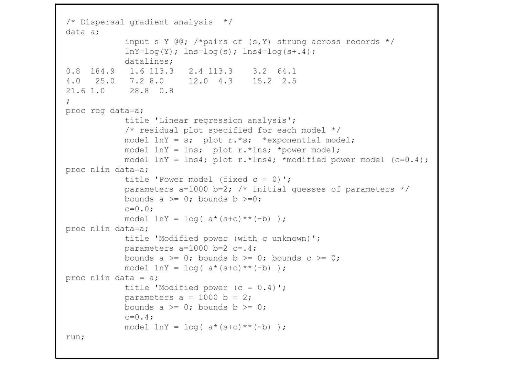{#fig-dg-sas-program-dispersal}

โดยทั่วไป เราสามารถเขียนแบบจำลองการแพร่กระจายในรูปสมการได้ดังนี้: $Y_j = f(s_j; \Theta)$ โดยที่ $\Theta$ คือเวกเตอร์ของพารามิเตอร์ (Vector of parameters) ส่วนรูปแบบทางสถิติของแบบจำลองสามารถเขียนได้สองวิธีคือ:และโดยที่ตัวห้อย $j$ ตรงกับข้อมูลที่สังเกตได้ (Observation) ในจุดที่ $j$ (ระยะห่างจากแหล่งกำเนิดเชื้อ) ข้อคิดเห็นต่างๆ ที่เคยกล่าวไว้ในบทที่ 4 (หัวข้อ 4.6.3) เกี่ยวกับความเหมาะสมในการเลือกรูปแบบทางสถิติของแบบจำลองพัฒนาการของโรคนั้น สามารถนำมาประยุกต์ใช้ในที่นี้ได้เช่นกัน กล่าวโดยสรุป หากสมการ 7.15a เป็นสมการที่ถูกต้อง เราจะสามารถใช้วิธีการที่ไม่เป็นเชิงเส้นได้เพียงอย่างเดียวเท่านั้น เพราะแบบจำลองทางสถิตินี้ไม่สามารถแปลงให้อยู่ในรูปเชิงเส้นได้ (แต่ลองดูหัวข้อ 3.5 ประกอบ) แม้ว่าฟังก์ชันที่แปลงรูปแล้วของ $f(\bullet)$ จะเป็นเชิงเส้นก็ตาม ในทางกลับกัน หาก $f(\bullet)$ เป็นตัวแทนของแบบจำลองเอกซ์โพเนนเชียล หรือแบบจำลองยกกำลัง (และอื่นๆ อีกบางแบบ) สมการ 7.15b จะสามารถแปลงเป็นเชิงเส้นได้—โดยการใส่ลอการิทึมเข้าไปทั้งสองข้างของสมการ อย่างไรก็ตาม จากความเข้าใจในเชิงชีววิทยาประชากรของโรค (Population biology of diseases) ที่เรามีอยู่ ณ ปัจจุบัน ยังไม่เป็นที่แน่ชัดว่าพจน์ความคลาดเคลื่อน (Error term) ในแบบจำลองทางสถิติที่ไม่เป็นเชิงเส้นนั้น ควรจะอยู่ในรูปของการบวก (Additive) หรือการคูณ (Multiplicative) กันแน่เพื่อหลีกเลี่ยงการพูดซ้ำไปซ้ำมา เราจะขออภิปรายถึงสมมติฐานเพียงข้อเดียวที่เกี่ยวกับค่า $\varepsilon$ (และส่งผลถึง $Y$ ด้วย) เนื่องจากความหนาแน่นของสปอร์หรือจำนวนรอยแผลต่อต้นนั้นมีความแปรปรวนอย่างมากเมื่อพิจารณาตามระยะทางจากแหล่งกำเนิดเชื้อ (ดูรูปที่ 7.1) จึงเป็นไปได้ยากมากที่ความแปรปรวนของ $\varepsilon$ (หรือ $Y$) จะมีค่าคงที่ แต่มันมีแนวโน้มว่า $var(Y)$ จะเพิ่มขึ้นตามค่าเฉลี่ยของ $Y$ ที่สูงขึ้นมากกว่า (หรือเป็นฟังก์ชันของ $Y$ ที่เพิ่มขึ้นทางเดียว หรือ Monotonically increasing function) แนวทางหนึ่งในการนำคุณสมบัติข้อนี้ของ $Y$ ไปรวมไว้ในการวิเคราะห์ก็คือ การใช้วิธีกำลังสองน้อยที่สุดแบบถ่วงน้ำหนัก (Weighted least squares) (หรือวิธีภาวะน่าจะเป็นสูงสุดแบบถ่วงน้ำหนัก) ตัวเลือกที่สมเหตุสมผลสำหรับการกำหนดค่าน้ำหนักก็คือ $1/Y$ หรือ $1/Y^2$เราสามารถแสดงให้เห็นได้ว่า หาก $var(Y)$ แปรผันตรงกับ $Y^2$ ค่า $\ln(Y)$ ก็จะมีความแปรปรวนที่ใกล้เคียงกับค่าคงที่ (Neter et al., 1983) ด้วยเหตุที่รูปแบบเชิงเส้นของแบบจำลองเอกซ์โพเนนเชียลและแบบจำลองยกกำลัง (ดัดแปลง) ล้วนมีฟังก์ชันลอการิทึมของ $Y$ เข้ามาเกี่ยวข้อง การใช้วิธีกำลังสองน้อยที่สุดเชิงเส้นแบบไม่ถ่วงน้ำหนัก (Unweighted linear least squares) ในการปรับแก้แบบจำลองจึงถือว่ามีความสมเหตุสมผล แนวทางที่คล้ายกันอีกแบบคือการใช้วิธีการที่ไม่เป็นเชิงเส้น แต่ใช้แบบจำลองในรูปแบบที่ผ่านการแปลงเป็นลอการิทึมแล้ว ตัวอย่างเช่น ด้วยสมการ 7.15b (แต่ไม่ใช่ 7.15a) เราสามารถเขียนได้ดังนี้:โดยที่ $\ln(\varepsilon) = \varepsilon^*$ คือพจน์ความคลาดเคลื่อน "ตัวใหม่" ซึ่งเทียบเท่ากับ $\varepsilon$ ในสมการ 7.14 สำหรับแบบจำลองเอกซ์โพเนนเชียลและแบบจำลองยกกำลัง การจัดการทางพีชคณิตของ $\ln[f(\bullet)]$ จะให้ผลลัพธ์ออกมาเป็นสมการเชิงเส้น อย่างไรก็ตาม สมการ 7.15c นี้ยังสามารถนำไปใช้ได้โดยตรงกับวิธีการประมาณค่าพารามิเตอร์แบบไม่เป็นเชิงเส้น สำหรับแบบจำลองใดๆ ก็ตามที่ค่าความแปรปรวนของ $Y$ แปรผันตรงกับกำลังสองของ $Y$ ($Y^2$)ในรูปที่ 7.8 เราได้แสดงวิธีการปรับแก้แบบจำลองยกกำลังดัดแปลงในรูปแบบต่างๆ ให้เข้ากับข้อมูลโรคราสนิม โดยกำหนดให้แบบจำลองอยู่ในรูปของสมการ 7.15c ทั้งนี้ เราสามารถใช้โปรแกรมทางสถิติอื่นๆ อีกมากมายเพื่อการวิเคราะห์นี้ได้ ในตัวอย่าง ค่า $\ln(Y)$ ถูกสร้างขึ้นในขั้นตอนข้อมูล (Data step) (ln Y) และสมการฝั่งขวามือของสมการ 7.15c จะถูกกำหนดไว้ในคำสั่งบอกรูปแบบแบบจำลอง (Model statement) โดยพจน์ความคลาดเคลื่อนจะถูกละไว้เป็นที่เข้าใจตรงกันโดยไม่ต้องเขียนออกมา คำสั่งตั้งค่าพารามิเตอร์ (Parameter statement) จะเป็นตัวระบุพารามิเตอร์ที่ไม่ทราบค่าและกำหนดค่าคาดเดาเริ่มต้น (Initial guesses) ให้กับพวกมัน เราสามารถกำหนดขอบเขตให้กับพารามิเตอร์ได้ และยังสามารถกำหนดการค้นหาค่าเริ่มต้นของพารามิเตอร์สำหรับการทำออปติไมเซชัน (Optimization) ได้ด้วย ค่าประมาณของพารามิเตอร์และสัมประสิทธิ์การตัดสินใจที่ได้จากการวิเคราะห์ มีดังนี้ (โดยมีค่าความคลาดเคลื่อนมาตรฐานอยู่ในวงเล็บ):Power (แบบจำลองยกกำลัง): $\hat{a}_P = 260(64)$, $\hat{b}_P = 1.70(0.12)$, กำหนด $\lambda = 0$, $R^2 = 0.96$Modified Power (แบบจำลองยกกำลังดัดแปลง): $\hat{a}_P = 447(102)$, $\hat{b}_P = 1.88(0.11)$, กำหนด $\lambda = 0.4$, $R^2 = 0.97$Modified Power (แบบจำลองยกกำลังดัดแปลงพร้อมประมาณค่า $\lambda$): $\hat{a}_P = 1993(2462)$, $\hat{b}_P = 2.36(0.38)$, $\hat{\lambda} = 1.7(1.1)$, $R^2 = 0.983$โปรดสังเกตว่าเราใช้สัญลักษณ์หมวก (Hat, $\hat{}$) เหนือตัว $\lambda$ เมื่อมันถูกประมาณค่าจากข้อมูลโดยตรง (ในกรณีที่สาม) และจะไม่ใส่หมวกเมื่อเราแค่แทนค่าใดค่าหนึ่งของ $\lambda$ ลงไปในแบบจำลองเฉยๆ (ในสองกรณีแรก)การใช้แบบจำลองที่มีการล็อกค่า $\lambda$ ไว้ที่ 0 หรือ 0.4 (ในสองกรณีแรก) ให้ผลลัพธ์ออกมาตรงกับการใช้วิธีกำลังสองน้อยที่สุดเชิงเส้น (ตามที่อธิบายไปก่อนหน้านี้) เนื่องจากผลลัพธ์ของการแปลงเป็นลอการิทึมคือแบบจำลองเชิงเส้น แต่โดยทั่วไปแล้ว สำหรับแบบจำลองที่ไม่เป็นเชิงเส้นอย่างแท้จริง เราไม่สามารถคาดหวังได้เลยว่าจะมีความสอดคล้องกันเช่นนี้ระหว่างแบบจำลองเชิงเส้นและไม่เป็นเชิงเส้น สังเกตว่าในแบบจำลองเชิงเส้นนั้น สิ่งที่เราประมาณคือค่า $\ln(a_P)$ แต่ในที่นี้เรากำลังประมาณค่า $a_P$ โดยตรง และเมื่อเราเปิดให้ $\lambda$ สามารถเป็นค่าอะไรก็ได้ (กรณีที่สาม) สัมประสิทธิ์การตัดสินใจก็เพิ่มขึ้นอย่างมากจนเกือบจะปรับแก้ได้แนบสนิทกับข้อมูลอย่างสมบูรณ์แบบ ค่าประมาณของ $\lambda$ ($\hat{\lambda} = 1.7$) ออกมาใกล้เคียงกับระยะทางจากแหล่งกำเนิดเชื้อไปยังจุดสุ่มตัวอย่างจุดที่ สอง ดังนั้น แนวคิดที่มองว่า $\lambda$ คือตัวชี้วัดขนาดของแหล่งกำเนิดเชื้อนั้น อาจจะใช้ไม่ได้ในกรณีนี้ แต่บทบาทของ $\lambda$ ในที่นี้ น่าจะเป็นเรื่องของการช่วยปรับแต่งรูปทรงความลาดชันของการแพร่กระจายให้เหมาะสมเสียมากกว่า และอย่างที่คาดไว้ ค่าประมาณของ $a_P$ และ $b_P$ ย่อมต้องขึ้นอยู่กับค่าของ $\lambda$ (ไม่ว่าจะเป็นค่าคงที่หรือค่าประมาณ) อย่างแน่นอนค่าประมาณของ $a_P$ ในกรณีทั่วไป ($= 1993$) นั้นแตกต่างจากค่าประมาณตัวอื่นๆ อย่างมาก จนชวนให้สงสัยในความถูกต้องของมัน แต่อย่าลืมว่า $a_P$ คือค่าทำนายของ $Y$ ณ ระยะ $s = 1 - \lambda$ ดังนั้นเมื่อ $\lambda = 1.7$ สิ่งนี้หมายความว่า $a_P$ เป็นตัวแทนของ $Y$ ณ ระยะทาง $-0.7$ เมตร หรือ $Y(-0.7)$ ซึ่ง ไม่ใช่ ตำแหน่งที่มีอยู่จริงทางกายภาพ สิ่งที่น่าสนใจกว่าคือการหาค่าทำนายของ $Y$ ที่ระยะ $s = 0$ เมตร การประเมินค่า $Y(0)$ นี้จะไม่สามารถทำได้เมื่อค่าถูกทำนายให้ออกมาเป็น $\hat{a}_P\hat{\lambda}^{-\hat{b}_P}$ ในแบบจำลองยกกำลังดัดแปลง เมื่อล็อกค่า $\lambda$ ไว้ที่ 0.4 ความแรงของแหล่งกำเนิดเชื้อจะคำนวณได้เป็น $447(0.4)^{-1.88} = 2503$ แต่เมื่อใช้ค่าประมาณของ $\lambda$ ความแรงของแหล่งกำเนิดเชื้อจะออกมาเป็น $1993(1.7)^{-2.36} = 570$ ซึ่งต่ำกว่าค่าที่ได้จากการใช้ค่าคงที่ $\lambda$ ขนาดเล็ก ดังที่ได้อภิปรายไว้แล้ว แบบจำลองยกกำลังจะเริ่มมีลักษณะคล้ายแบบเอกซ์โพเนนเชียลมากขึ้นเมื่อ $\lambda$ มีค่ามาก ดังนั้นจึงไม่น่าแปลกใจที่ค่าทำนาย $Y(0)$ ในที่นี้จะลดลงเมื่อ $\lambda$ เพิ่มขึ้น ในแง่หนึ่ง ตำแหน่ง $s = 0$ ถือเป็นตำแหน่งสมมติ (ในเชิงทฤษฎี) สำหรับชุดข้อมูลนี้ เพราะจุดข้อมูลจุดแรกเริ่มต้นเกือบๆ หนึ่งเมตรจากแหล่งกำเนิดเชื้อเข้าไปแล้ว สำหรับจุดข้อมูลที่มีการสังเกตได้จริงนั้น แบบจำลองทั้งสามเวอร์ชันสามารถปรับแก้ข้อมูลได้แนบสนิทดีเยี่ยมผลลัพธ์ที่น่าสนใจประการหนึ่งในการใช้แบบจำลองยกกำลังดัดแปลงแบบที่ไม่ทราบค่า $\lambda$ ก็คือ ค่าความคลาดเคลื่อนมาตรฐานโดยประมาณ (Estimated standard errors) ของ $\hat{a}_P$ และ $\hat{\lambda}$ นั้นมีค่าสูงมาก สิ่งนี้ชี้ให้เห็นถึงความไม่แม่นยำ (Imprecision) พอสมควรในการประมาณค่าพารามิเตอร์ทั้งสองตัวนี้ นอกจากนี้ ค่าประมาณทั้งสองยังมีความสัมพันธ์เชิงบวกระหว่างกันอย่างสูง (Highly and positively correlated) อันเป็นผลมาจากธรรมชาติของโครงสร้างแบบจำลองเอง ตัวอย่างเช่น ดังที่แสดงในสูตรหาค่าประมาณ $Y(0)$ ในย่อหน้าก่อน เมื่อ $\hat{\lambda}$ มีค่าเพิ่มขึ้น ค่า $\hat{\lambda}^{-\hat{b}_P}$ จะต้องลดลง (หากกำหนดให้ $\hat{b}_P$ เป็นค่าบวก) ดังนั้น เพื่อให้คงค่า $Y(0)$ ไว้เท่าเดิม $\hat{a}_P$ ก็จำเป็นต้องเพิ่มขึ้นตาม $\hat{\lambda}$ ไปด้วย Ratkowsky (1990) ได้ชี้ให้เห็นว่าในกลุ่มแบบจำลองที่มีลักษณะคล้ายแบบจำลองยกกำลังดัดแปลง พารามิเตอร์ $a_P$ และ $\hat{\lambda}$ จะมีพฤติกรรมที่ไม่เป็นเชิงเส้นอย่างมาก (ดูการอภิปรายเพิ่มเติมในบทที่ 3) วิธีหนึ่งในการเพิ่มความแม่นยำและลดความเอนเอียง (Bias) ของค่าประมาณ ก็คือการปรับพารามิเตอร์ของแบบจำลองใหม่ (Re-parameterize) โดยใช้สิ่งที่เรียกว่าพารามิเตอร์ "ค่าคาดหวัง" (Expected value parameter) เข้ามาแทนที่ $a_P$ ประเด็นนี้มีความสำคัญมากสำหรับผู้ที่ทำงานเกี่ยวกับการสร้างแบบจำลองความลาดชันของการแพร่กระจายแบบไม่เป็นเชิงเส้น การนำเสนอเกี่ยวกับการสร้างแบบจำลองในบทที่ 5 ของ Schabenberger และ Pierce (2002) จะเป็นประโยชน์อย่างมากในเรื่องนี้เรายังสามารถนำกระบวนการประมาณค่าแบบไม่เป็นเชิงเส้นไปใช้ปรับแก้แบบจำลองการแพร่กระจายแบบอื่นๆ ที่อธิบายไว้ในหัวข้อ 7.3.5 ได้ด้วย ตัวอย่างเช่น ค่าประมาณของพารามิเตอร์รูปทรงในแบบจำลองของ Lambert และคณะ (สมการ 7.10) ออกมาเป็น $\hat{\eta} = 0.24$ (s.e. = 0.12) ซึ่งใกล้เคียงแต่ก็ยังสูงกว่าค่าขีดจำกัดของแบบจำลองยกกำลังบริสุทธิ์ (Pure power model, ที่ $\eta = 0$) เล็กน้อย สิ่งนี้สะท้อนว่าแบบจำลองยกกำลังมีความเหมาะสมมากกว่าแบบเอกซ์โพเนนเชียล ซึ่งก็สอดคล้องกับผลลัพธ์ที่นำเสนอไปก่อนหน้านี้ การนำแบบจำลองลูกผสมยกกำลัง-เอกซ์โพเนนเชียล (Joint power-exponential model, สมการ 7.11a) มาปรับแก้ข้อมูล จะให้ผลลัพธ์ดังนี้: $\hat{b}_1 = 0.05$ (s.e. = 0.034) สำหรับองค์ประกอบแบบเอกซ์โพเนนเชียล และ $\hat{b}_2 = 1.31$ (s.e. = 0.271) สำหรับองค์ประกอบแบบยกกำลัง ในทางทฤษฎี หากความลาดชันเป็นแบบยกกำลังบริสุทธิ์ ค่า $b_1$ จะต้องเป็น 0 ซึ่งจากการคำนวณ ค่าประมาณ $\hat{b}_1$ ที่ได้นี้ก็ไม่ได้แตกต่างจาก 0 อย่างมีนัยสำคัญแต่อย่างใด เป็นอีกหนึ่งเครื่องยืนยันว่าแบบจำลองยกกำลังนั้นเหมาะสมแล้ว สิ่งนี้ยังสามารถทดสอบได้จากการดูการลดลงของผลรวมกำลังสองของค่าคลาดเคลื่อน (Residual sum of squares) ระหว่างการปรับแก้แบบจำลองยกกำลังเทียบกับสมการ 7.11a ได้ด้วย อย่างไรก็ตาม การตีความง่ายๆ แบบนี้อาจมีอุปสรรคตรงที่ความจริงแล้ว $s$ และ $\ln(s)$ (ดูสมการ 7.11b) นั้นมีความสัมพันธ์เกี่ยวข้องกัน และความสัมพันธ์นั้นก็อาจจะสูงกว่า 0.9 ได้ในหลายๆ กรณี หากมองอีกมุมหนึ่ง สมการ 7.11a เป็นการทำงานร่วมกันของฟังก์ชันสองตัวที่มีตัวแปร ($s$) เป็นตัว เดียวกัน ด้วยเหตุนี้ การทดสอบทางสถิติที่เกี่ยวข้องกับพารามิเตอร์จึงอาจให้ผลที่คลุมเครือได้ Ferrandino (1996) ได้พัฒนาแนวทางที่ชาญฉลาดมากในการนำฟังก์ชันที่ไม่มีความสัมพันธ์ต่อกัน (Uncorrelated functions) สองตัวมาแทนที่ $s$ และ $\ln(s)$ เพื่อใช้ทดสอบว่าแบบจำลองยกกำลังและแบบเอกซ์โพเนนเชียลให้ความแนบสนิทในการปรับแก้ข้อมูลพอๆ กันหรือไม่ ผู้อ่านสามารถตรวจสอบรายละเอียดเพิ่มเติมได้จากบทความต้นฉบับสิ่งที่ควรค่าแก่การหยิบยกมาเน้นย้ำก็คือ สมการ 7.12 ให้ผลลัพธ์การปรับแก้เข้ากับชุดข้อมูลตัวอย่างได้ดีที่สุดในบรรดาแบบจำลองทั้งหมด เมื่อประเมินจากค่าผลรวมกำลังสองของค่าคลาดเคลื่อนที่ต่ำที่สุดและค่าสัมประสิทธิ์การตัดสินใจที่สูงที่สุด ความน่าทึ่งอยู่ตรงที่ว่าแบบจำลองนี้มีพารามิเตอร์เพียงสองตัวเท่านั้น ในขณะที่แบบจำลองที่ทำผลงานได้ดีรองลงมาล้วนแต่มีสามพารามิเตอร์ (เช่น แบบจำลองยกกำลังดัดแปลงที่มีการประมาณค่า $\lambda$) สิ่งนี้เป็นสัญญาณบอกเราว่า ควรมีการศึกษาเพิ่มเติมเพื่อประเมินความเหมาะสมของการนำแบบจำลองตระกูลโคชี (Cauchy-like model) ไปใช้กับความลาดชันของการแพร่กระจายรูปแบบอื่นๆ ต่อไป

## 7.5 การปรับแก้ความลาดชันของโรคสำหรับระดับความรุนแรงสูงสุด (Disease Gradients Correcting for Maximum Intensity) {#sec-dg-correction}

ตามที่ได้กล่าวไปแล้วในตอนต้นของบท การประเมินการแพร่กระจายของหน่วยขยายพันธุ์ (propagules) มักทำได้โดยการหาปริมาณการตกสะสมของสปอร์ (หรือหน่วยติดเชื้ออื่นๆ) ที่ระยะห่างต่างๆ จากแหล่งกำเนิด หรือที่นิยมทำกันมากกว่าก็คือ การวัดความรุนแรงของโรค (disease intensity) (เช่น จำนวนรอยแผลหรือตุ่มหนอง) ในแต่ละระยะห่าง วิธีหลังนี้จะใช้ได้ดีก็ต่อเมื่อจำนวนสปอร์แปรผันตรงแบบเชิงเส้นกับจำนวนแผล ซึ่งเป็นสมมติฐานที่สมเหตุสมผลเมื่อความหนาแน่นของแผลยังมีไม่มากนัก แต่ในความเป็นจริง การจะระบุให้ชัดเจนเป๊ะๆ ว่า "มากเกินไป" คือแค่ไหนนั้นอาจทำได้ยาก เมื่อมีการตกสะสมของสปอร์เพิ่มขึ้น สัดส่วนของสปอร์ที่ทำให้เกิดแผลจนนับได้กลับจะลดลง (Vanderplank, 1975) นั่นเป็นเพราะสปอร์อาจเกิดการแข่งขันกันเอง หรืออาจจะไปตกลงบนบริเวณที่พืชติดเชื้อไปแล้ว ดังที่เราได้เห็นในเส้นโค้งการดำเนินของโรค (disease progress curves) เราจึงจำเป็นต้องคำนึงถึงความจริงที่ว่า ระดับความรุนแรงของโรคนั้นมี "ขีดจำกัดสูงสุด" (upper limit) เสมอในการระบาดในหัวข้อนี้ เราจะมาเจาะลึกกันว่าเราจะปรับแก้โมเดลอย่างไร เพื่อให้ครอบคลุมถึงขีดจำกัดสูงสุดของความรุนแรงของโรคในพื้นที่หนึ่งๆ ความจำเป็นในการปรับแก้โมเดลแบบนี้เป็นที่ทราบกันดีมานานหลายทศวรรษแล้ว (Gregory, 1973) แต่ก็น่าแปลกใจที่ปัจจุบันยังมีงานวิจัยด้านโรคพืชวิทยา (plant pathology) ตีพิมพ์ออกมาโดยไม่มีการปรับแก้ใดๆ ซึ่งนำไปสู่การตีความผลลัพธ์ที่น่ากังขา เราจะเริ่มต้นด้วยแนวทางแบบเฉพาะกิจ (ad hoc) ในการปรับเปลี่ยนโมเดล จากนั้นจะขยับไปสู่แนวทางที่เป็นทางการมากขึ้น ซึ่งคล้ายกับวิธีการที่ใช้ในการดำเนินของโรค โดยเราจะขยายโมเดลเอกซ์โพเนนเชียล (สมการ 4.1) ด้วยการบวกตัวแปรที่แสดงถึง "ส่วนที่ปลอดโรค" (disease-free term) เข้าไป เนื่องจากความลาดชันของการเกิดโรค (disease gradients) มักถูกประเมินไว้มากกว่าหนึ่งช่วงเวลาในระหว่างการระบาด เราจะแสดงให้เห็นถึงวิธีหาปริมาณและเปรียบเทียบความลาดชันที่ได้จากหลายๆ ช่วงเวลา แนวทางนี้เป็นวิธีแบบครอบจักรวาลและสามารถนำไปใช้เปรียบเทียบความลาดชันใดๆ ก็ได้ ไม่ใช่เฉพาะแค่ต่างช่วงเวลาเท่านั้น โมเดลที่พัฒนาขึ้นนี้ยังเป็นรากฐานสำคัญสำหรับการอธิบายลักษณะเชิงทฤษฎีเพิ่มเติมของโรคทั้งในมิติของเวลาและพื้นที่

### 7.5.1 การปรับแก้อย่างง่าย (Simple Adjustment)

เมื่อหลายทศวรรษก่อน มีการชี้ให้เห็นว่า หากเราใช้ความรุนแรงของโรคเป็นตัวแปรตาม (dependent variable) และระดับความรุนแรงนั้นไม่ได้อยู่ในระดับต่ำ เราจะต้องปรับแก้โมเดลการแพร่กระจายทั่วไปเสียใหม่ (Gregory, 1973) ที่ผ่านมาในบทนี้ เราดำเนินงานภายใต้สมมติฐานที่ว่า $Y$ ในโมเดลเอกซ์โพเนนเชียล (สมการ 7.1), โมเดลพาวเวอร์ (ที่ปรับแก้แล้ว) (สมการ 7.4), และโมเดลที่คล้ายคลึงกัน เป็นตัวแปรสุ่มที่มี 0 เป็นขอบเขตล่าง (lower bound) และ ไม่มี ขอบเขตบน (upper bound) ทว่าในความเป็นจริง $Y$ มีขอบเขตบนทางกายภาพคือ $M$ (จำนวนต้นพืชหรือพื้นที่โฮสต์ที่สามารถเป็นโรคได้) ซึ่งสอดคล้องกับขอบเขตบนของ $y$ ที่ 1 ($y = Y/M$) ในหลายๆ กรณี ขอบเขตบนที่แท้จริงของ $y$ หรือ $K$ อาจจะน้อยกว่า 1 ก็ได้ ($K < 1$ หรือ $KM < M$; ดูหัวข้อ 4.4.8) แต่ในที่นี้เราจะจำกัดความสนใจไว้เฉพาะสถานการณ์ที่ $K = 1$ สมมติฐานง่ายๆ ที่ว่าไม่มีขอบเขตบนนั้น แม้จะฟังดูสมเหตุสมผลหาก $Y$ หรือ $y$ ไม่สูงเกินไป แต่ก็กลายเป็นเรื่องไม่สมจริงทันทีเมื่อ $Y$ หรือ $y$ อยู่ในระดับปานกลางถึงสูง คำแนะนำของ Gregory คือการกำหนดให้ $Z$ เป็นการแปลงข้อมูลแบบ multiple infection transformation ของความรุนแรงของโรค หาก $y$ แทนการเกิดโรคในสเกล 0–1 เราจะแทนที่ $Y$ ด้วย $\ln[1/(1 - y)]$ นั่นคือ เราจะใช้ $Z = \ln[1/(1 - y)] = \ln[M/(M - Y)]$ แทน $Y$ ในโมเดลข้างต้น หลักการและเหตุผลในเรื่องนี้ก็คือ ในช่วงที่ความรุนแรงของโรคยังต่ำ การเพิ่มขึ้น 1 หน่วยของการตกสะสมของสปอร์จะทำให้ $y$ หรือ $Y$ เพิ่มขึ้นในระดับที่ใกล้เคียงกับ 1 หน่วยเช่นกัน แต่การเพิ่มขึ้นของ $y$ หรือ $Y$ เทียบกับการเพิ่มขึ้นของการตกสะสมของสปอร์นี้ จะค่อยๆ ลดน้อยถอยลงเมื่อระดับการเกิดโรคสูงขึ้น (เพราะสปอร์อาจไปตกลงบนรอยแผลเดิม หรือแย่งตำแหน่งการติดเชื้อกัน) ในทางทฤษฎีแล้ว ความสัมพันธ์เชิงเส้นระหว่าง $Z$ และการตกสะสมของสปอร์จะถูกรักษาไว้ในทุกๆ ระดับความหนาแน่นของโรค การแปลงข้อมูลวิธีนี้สามารถหาได้โดยตรงจากการพิจารณาการแจกแจงทางสถิติแบบไม่ต่อเนื่อง (discrete statistical distributions) ซึ่งเราจะกล่าวถึงในบทที่ 9แนวทางนี้ทำให้ได้ผลลัพธ์ดังนี้: สำหรับโมเดลเอกซ์โพเนนเชียลในรูปสมการเชิงเส้น (linearized version) (เทียบกับสมการ 7.2) และ:สำหรับโมเดลพาวเวอร์ (ที่ปรับแก้แล้ว) ในรูปสมการเชิงเส้น (เทียบกับสมการ 7.6) โปรดสังเกตว่าทางซ้ายมือของสมการเกี่ยวข้องกับการแปลงลอการิทึมซ้อน (double-log transformation) ซึ่งในทางสถิติรู้จักกันในชื่อการแปลงแบบ complementary log-log ของ $y$ หรือ $\text{CLL}(y)$ การแปลงนี้ยังสามารถเขียนได้ในรูป: $\text{CLL}(y) = \ln[-\ln(1 - y)]$โดยทั่วไปแล้ว การแปลงแบบ multiple infection transformation มักใช้เพื่ออธิบายการพัฒนาของโรคเมื่อเวลาผ่านไปสำหรับโรคแบบวงจรเดียว หรือ monocyclic diseases (บทที่ 4) ดังนั้น ดูเผินๆ อาจจะ เหมือนว่าสมการ 7.16a และ 7.16b มีประโยชน์หลักๆ สำหรับโรคแบบ monocyclic แต่ในความเป็นจริงแล้ว การปรับแก้ด้วย multiple infection transformation นี้ถูกนำมาใช้กับความลาดชันของการเกิดโรคทั้งแบบวงจรเดียว (monocyclic) และหลายวงจร (polycyclic) ในบางสถานการณ์ การแปลงแบบ CLL ก็ ได้มาจากโมเดลเชิงกลไกที่อธิบายการพัฒนาของโรคแบบ monocyclic ในเชิงพื้นที่และเวลา (ดู Minogue, 1986, และหัวข้อ 8.3.3) อย่างไรก็ตาม ขอเตือนผู้อ่านว่าโมเดลการเติบโตแบบ monocyclic ที่แท้จริงนั้น จะให้ค่า $\ln[1/(1 - y)]$ ที่ฝั่งซ้ายของสมการทางเวลา (สมการ 4.11) ไม่ใช่ $\text{CLL}(y)$อย่างน้อยที่สุด นักวิจัยควรเลือกใช้ $\text{CLL}(y)$ แทนที่จะเป็น $\ln(y)$ หรือ $\ln(Y)$ ในโมเดลเชิงเส้น เมื่อใดก็ตามที่พวกเขากำลังอธิบายลักษณะความลาดชันของการเกิดโรค และค่า $y$ มีค่ามากกว่า ~0.2 ในหัวข้อย่อยถัดไป เราจะแสดงให้เห็นว่า เราอาจสามารถหาวิธีการแปลงข้อมูลที่เหมาะสมกว่าได้ สำหรับใช้อธิบายความลาดชันโดยอาศัยการวิเคราะห์ $dy/ds$ ที่เป็นทางการมากขึ้น

### 7.5.2 การขยายรูปแบบทั่วไปของแบบจำลองเอกซ์โพเนนเชียลและแบบจำลองกำลัง (Generalizations of the Models)

สำหรับเส้นโค้งการดำเนินของโรค (disease progress curves) เราสามารถสร้างโมเดลการเกิดโรคในระดับสัมบูรณ์ (absolute scale) คือ $Y$ หรือในระดับสัดส่วน (proportion scale) คือ $y$ ($= Y/M$) ได้ สำหรับการศึกษาการแพร่กระจาย เรามักนิยมใช้ค่า $Y$ มากกว่า $y$ แต่ในหลายๆ กรณีก็เป็นเพียงการเลือกตามความสะดวก ในบทที่ 4 เราได้เห็นแล้วว่าแนวทางตรงไปตรงมาในการขยายโมเดลสมการเชิงอนุพันธ์ของการเติบโตของประชากรแบบไม่จำกัด ก็คือการนำระดับความรุนแรงของโรค ($y$) ไปคูณกับระดับความรุนแรงในส่วนที่ปลอดโรค ($1 - y$) แนวคิดเดียวกันนี้สามารถนำมาใช้พัฒนาโมเดลสำหรับความลาดชันของการเกิดโรคได้เช่นกัน ในหัวข้อย่อยต่อๆ ไป เราจะประยุกต์ใช้โมเดลที่ขยายรูปแล้วอย่างเหมาะสมกับชุดข้อมูลจริง และเนื่องจากตอนนี้เรากำลังโฟกัสไปที่ความรุนแรงของโรคโดยตรง ไม่ใช่แค่กระบวนการแพร่กระจาย เราจึงขอเรียกสมการต่อไปนี้อย่างชัดเจนว่า โมเดลความลาดชันของการเกิดโรค (disease gradient models)เราสามารถหารทั้งสองข้างของสมการ $dY/ds$ สำหรับโมเดลเอกซ์โพเนนเชียลและโมเดลพาวเวอร์ (ที่ปรับแก้แล้ว) (สมการ 7.1 และ 7.7) ด้วย $M$ เพื่อให้ได้:และสำหรับอัตราการเปลี่ยนแปลงของ $y$ เทียบกับการเปลี่ยนแปลงของ $s$ เพื่อให้การนำเสนอดูเรียบง่ายขึ้น ในหัวข้อที่เหลือนี้เราจะสมมติให้ $\lambda = 0$ สำหรับโมเดลพาวเวอร์ที่ปรับแก้แล้ว จากข้อโต้แย้งในบทที่ 4 สมการ 7.17a และ 7.17b อาจให้ค่า $dy/ds$ ที่ไม่สมจริงอย่างยิ่งเมื่อ $y$ มีค่ามาก ซึ่งนำไปสู่การทำนายค่า $y$ ที่เป็นไปไม่ได้ (เช่น $y > 1$) ที่ระยะ $s$ สั้นๆ การนำ $1 - y$ ไปคูณที่ด้านขวามือของสมการอัตราเหล่านี้ จะช่วยให้ได้รูปแบบการแพร่กระจายที่สมจริงและตีความได้ง่ายขึ้นครอบคลุมทุกระดับความรุนแรงของโรค และเช่นเดียวกับในหัวข้อ 7.5.1 เรากำหนดให้ $K = 1$ โมเดลการแพร่กระจายแบบเอกซ์โพเนนเชียลจะกลายเป็น:หลังจากคูณด้วยสัดส่วนของโฮสต์ที่ปลอดโรคแล้ว ในความเป็นจริงแล้ว นี่คือโมเดลลอจิสติก (logistic model) สำหรับความลาดชันของการเกิดโรค เราใช้ $b_L$ เป็นพารามิเตอร์ความลาดชัน (หน่วยเป็น 1/ระยะทาง) เพื่อเตือนให้รู้ว่า พารามิเตอร์นี้ไม่เหมือนกับ $b_E$ (สมการ 7.17a) เสียทีเดียว อย่างไรก็ตาม ในระดับที่ $y$ ต่ำ โดยทั่วไปแล้วสมการ 7.17a และ 7.18 จะแยกกันแทบไม่ออก (โดยที่ $b_L \approx b_E$) เมื่อทำการอินทิเกรต (Integration) จะได้ผลลัพธ์เป็น:ซึ่ง $A_L$ คือค่าคงที่ของการอินทิเกรต มีค่าเท่ากับ $(1 - y_0)/y_0$ โดยที่ $y_0$ คือความรุนแรงของโรค (ในทางทฤษฎี) ณ แหล่งกำเนิดเชื้อ (นั่นคือที่ $s = 0$) ผู้อ่านควรสังเกตว่าเลขชี้กำลังในตัวส่วนนั้นเป็นค่าบวก ซึ่งแตกต่างจากโมเดลลอจิสติกในเวอร์ชันเชิงเวลา (สมการ 4.15b) สาเหตุที่เป็นเช่นนี้ก็เพราะเครื่องหมายลบในสมการเชิงอนุพันธ์ (สมการ 7.18) นั่นเอง อีกวิธีหนึ่งในการเขียนสมการ 7.19 ที่มีค่าเท่ากันคือ:ซึ่งสามารถนำไปเทียบกับสมการ 4.15a สำหรับการดำเนินของโรคตามเวลาได้ แต่ในตอนนี้จะมีเครื่องหมายลบอยู่หน้าพารามิเตอร์การแพร่กระจายการจัดรูปสมการพีชคณิตของสมการ 7.19 จะได้ผลลัพธ์เป็นสมการเชิงเส้นดังนี้:ซึ่งเป็นสมการของเส้นตรงที่มีความชันเป็น $-b_L$ และมีจุดตัดแกน (intercept) เท่ากับค่าลอจิต (logit) ของความรุนแรงของโรค ณ แหล่งกำเนิด (ลองเทียบกับสมการ 4.16)ตัวอย่างความลาดชันของการเกิดโรคที่สอดคล้องกับสมการ 7.19 แสดงไว้ใน @fig-dg-logistic-gradients สำหรับค่า $y_0$

 (หรือ $A_L$) ที่เลือกมาคู่กับค่า $b_L$ หนึ่งค่า เส้นโค้งเหล่านี้แสดงถึงเวลา 5 ช่วงที่ต่างกันในการระบาด การเลือกใช้ค่า $A_L$ ในที่นี้อาจดูเหมือนสุ่มมาลอยๆ แต่จะมีการอธิบายเพิ่มเติมในหัวข้อย่อยถัดไป เส้นโค้งที่ได้จะเป็นภาพสะท้อนแบบกระจกเงา (mirror images) ของเส้นโค้งการดำเนินของโรคแบบลอจิสติก (เนื่องจากมีเครื่องหมายลบหน้า $b_L$) โดยที่ค่า $y$ จะสูงสุดที่ค่า $s$ ต่ำสุด แตกต่างจากสถานการณ์ที่ตัวแปรตอบสนองไม่มีขอบเขตบน เส้นโค้งเหล่านี้จะเริ่มแบนราบ (level off) เมื่อค่า $y$ อยู่ในระดับสูง (หรือ $s$ ต่ำ) สำหรับกรณีที่ค่า $y$ ไม่สูงมากนัก (เช่น <20%) เส้นโค้งจะมีลักษณะหน้าตาเหมือนกับของโมเดลการแพร่กระจายแบบเอกซ์โพเนนเชียล (สมการ 7.2)สมการ 7.20 สามารถเขียนได้ว่า:{#fig-7-9}สาเหตุที่เป็นเช่นนี้ก็เพราะว่า โมเดลเอกซ์โพเนนเชียลถือเป็นการประมาณค่าที่ดีเยี่ยมสำหรับโมเดลลอจิสติกในช่วงที่ค่า $y$ ต่ำหากเราพล็อตกราฟความลาดชันในสเกลลอการิทึม (log-scale) (กรอบกลางของรูปที่ 7.9) จะดูเหมือนว่าความลาดชันแบนราบลงเมื่อเวลาผ่านไป โดยเฉพาะที่ระยะห่างใกล้กับแหล่งกำเนิด (ในที่นี้คือ $s < 12$) แม้ว่าจะใช้ค่าพารามิเตอร์การแพร่กระจายเพียงค่าเดียวก็ตาม แนวคิดที่ว่าความลาดชันของการแพร่กระจายจะแบนราบลงเมื่อเวลาผ่านไปสำหรับโรคแบบ polycyclic นั้น มีประวัติศาสตร์อันยาวนานในวงการโรคพืชวิทยา Gregory (1968) ระบุว่า การแพร่กระจายทุติยภูมิ (secondary spread) จะทำให้ความลาดชันปฐมภูมิ (primary gradient) แบนราบลง ซึ่งก็ฟังดูสมเหตุสมผลเมื่อเราใช้ความรุนแรงของโรคที่ยังไม่ได้แปลงรูปมาเป็นมาตรวัดการติดเชื้อ (ดูที่กรอบบนสุดของ @fig-dg-logistic-gradients) เนื่องด้วยข้อจำกัดที่เป็นขีดจำกัดสูงสุดของความรุนแรงของโรค

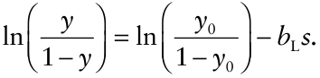{#fig-dg-logistic-gradients}
 อัตราการเปลี่ยนแปลงของ $y$ เทียบกับการเปลี่ยนแปลงของ $s$ จะต้องชะลอตัวลง (เมื่อปัจจัยอื่นๆ คงที่) ในขณะที่ $y$ เพิ่มขึ้น เพราะโอกาสในการติดเชื้อจะลดน้อยลงเมื่อโฮสต์ส่วนใหญ่ติดเชื้อไปแล้ว อย่างไรก็ตาม Zadoks และ Kampmeijer (1977), van den Bosch และคณะ (1988a–c), และ Minogue กับ Fry (1983b) รวมถึงนักวิจัยท่านอื่นๆ ได้ตั้งข้อสังเกตว่า ความลาดชันของการติดเชื้อไม่จำเป็นต้องแบนราบลงเสมอไปเมื่อเวลาผ่านไประหว่างการระบาด ในที่นี้เราจะชี้ให้เห็นถึงประเด็นบางประการที่เกี่ยวข้องกับการแบนราบของความลาดชันเท่านั้นในการจะดูว่าความลาดชันของการติดเชื้อแบนราบลงหรือไม่ เราจะต้องใช้วิธีแปลงรูป $y$ ที่เหมาะสม (หรือใช้โมเดลที่มีการปรับแก้เพื่อรองรับระดับ $y$ สูงสุดอย่างถูกต้อง) หากสมการ 7.18 เป็นตัวเลือกที่เหมาะสม เราก็จะต้องพล็อตกราฟค่าลอจิต (logits) เทียบกับระยะทาง ดังที่แสดงในกรอบล่างของรูปที่ 7.9 ในกราฟนี้ การปรับแก้สำหรับข้อจำกัดการเกิดโรคสูงสุดได้ถูกนำมาคำนวณเรียบร้อยแล้วในรูปแบบกราฟิก และเราจะเห็นได้ว่าความลาดชันมีความเสถียร ในแง่ที่ว่าไม่มีการเปลี่ยนแปลงของความชันในเวลาที่ต่างกัน เนื่องจาก $\text{logit}(y)$ มีค่าใกล้เคียงกับ $\ln(y)$ มากในสภาวะที่ $y$ ต่ำ เราจึงสามารถเห็นความลาดชันที่เสถียรในช่วงที่ $y$ ต่ำได้เช่นกันในกราฟ $\ln(y)$ ต่อ $s$ ของรูปที่ 7.9 หากเราสังเกตที่ฝั่งขวามือของกราฟ แน่นอนว่าความชันของความลาดชันในที่นี้ไม่ได้เปลี่ยนแปลงไปเลยก็เพราะเราใช้สมการ 7.19 โดยมีค่า $b_L$ แบบ "คงที่" (ค่าเดียว) ในทุกระดับของ $y_0$ หากความลาดชันนั้นชันน้อยลงเมื่อเวลาผ่านไปจริง ค่า $b_L$ ของสมการ 7.19 (หรือสมการ 7.20) ก็จะต้องมีค่าน้อยลง (เข้าใกล้ 0 มากขึ้น) เมื่อเวลาเพิ่มขึ้น (หากว่าสมการ 7.19 นั้นเหมาะสมกับ "ทุก" ช่วงเวลา) ดังนั้น การทดสอบค่า $b_L$ จึงกลายเป็นพื้นฐานสำคัญในการประเมินความลาดชันเมื่อเวลาผ่านไปโมเดลพาวเวอร์สามารถปรับให้อยู่ในรูปทั่วไปได้ง่ายๆ เช่นกันเพื่อรองรับขีดจำกัดของการเกิดโรค โดยโมเดลนี้สามารถเขียนให้อยู่ในรูปสมการเชิงอนุพันธ์, รูปอินทิเกรต, และรูปสมการเชิงเส้นได้ดังนี้:ซึ่ง $A_{PL}$ มีค่าเท่ากับ $(1 - y_1)/y_1$ โดยที่ $y_1$ คือความรุนแรงของโรค (ในทางทฤษฎี) ที่ระยะทางเท่ากับ 1 [$= y(1)$] เทอมที่เป็นจุดตัดแกนในสมการ 7.23 มีค่าเท่ากับ $+\ln[y_1/(1 - y_1)]$ ซึ่งก็คือลอจิตของโรคที่ระยะ $s = 1$ โปรดสังเกตว่าเราตั้งชื่อพารามิเตอร์ความลาดชันนี้ว่า $b_{PL}$ (ย่อมาจาก "power-logistic"; ไม่มีหน่วย) เนื่องจากตัวเศษในสมการ 7.21 อยู่ในรูปของลอจิสติก แต่มีตัวส่วนเป็น $s$ ซึ่งสะท้อนถึงรูปแบบความลาดชันสไตล์พาวเวอร์ โมเดลนี้ยังถูกเรียกอีกชื่อหนึ่งว่า โมเดล log-logistic เราสามารถมองเห็นความเชื่อมโยงระหว่างโมเดลนี้กับโมเดลความลาดชันการเกิดโรคแบบลอจิสติกได้ชัดเจนยิ่งขึ้นผ่านอีกรูปแบบหนึ่งในการเขียนค่า $y$ ของสมการ 7.22:โมเดล log-logistic ที่มีการกำหนดค่าพารามิเตอร์แตกต่างกันออกไป จะถูกนำไปใช้ในหัวข้อ 3.5 ของบทที่ 3ความลาดชันของการเกิดโรคที่อธิบายโดยสมการ 7.22 จะแสดงให้เห็นใน @fig-dg-power-logistic-gradients โดยสอดคล้องกับค่า $y_1$

 (หรือ $A_{PL}$) ทั้ง 5 ค่า สำหรับค่า $b_{PL}$ ที่กำหนดไว้คงที่เพียงค่าเดียว เนื่องจากธรรมชาติของความลาดชันสไตล์โมเดลพาวเวอร์ ค่า $dy/ds$ จะเป็นค่าลบจำนวนมหาศาลที่ค่า $s$ เล็กๆ การลดลงของ $y$ เทียบกับ $s$ ที่เพิ่มขึ้น จึงค่อนข้างใหญ่มากในบริเวณใกล้กับแหล่งกำเนิด แม้ในเวลาที่ความรุนแรงของโรคโดยรวมจะอยู่ในระดับสูง (เช่น เส้นโค้งบนสุดในรูปที่ 7.10) กระนั้นก็ตาม เส้นโค้งก็ยังคงมีลักษณะที่แบนราบลงเล็กน้อยใกล้ๆ กับแหล่งกำเนิดเมื่อค่า $y$ เพิ่มสูงขึ้น ซึ่งก็เป็นไปตามที่คาดการณ์ไว้เพราะในโมเดลนี้มีขีดจำกัดสูงสุดของการเกิดโรค (= 1) การแบนราบของความลาดชันนี้จะเห็นได้ชัดเจนขึ้นเมื่อเราพล็อต $\ln(y)$ เทียบกับ $\ln(s)$ (กรอบกลางของ @fig-dg-power-logistic-gradients) ซึ่งเป็นสเกลที่ถูกต้องสำหรับโมเดลพาวเวอร์แบบปกติ

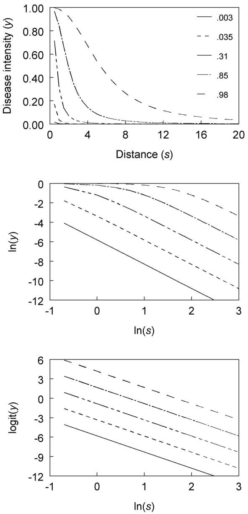{#fig-dg-power-logistic-gradients}
 (สมการ 7.6) แต่ ไม่ใช่ สเกลที่ถูกต้องเมื่อมีการปรับแก้สำหรับระดับโรคสูงสุด อย่างไรก็ตาม หากเราดูเพียงแค่ฝั่งขวามือของกราฟนี้ ซึ่งตรงกับบริเวณที่ $y$ ค่อนข้างต่ำ เราจะเห็นเส้นขนานกัน (นั่นคือ ไม่มีการแบนราบเกิดขึ้น) และเมื่อนำ $\text{logit}(y)$ มาพล็อตเทียบกับ $\ln(s)$ (กรอบล่างของรูปที่ 7.10) ซึ่งเป็นสเกลที่ถูกต้องสำหรับโมเดลที่เราเพิ่งแนะนำไปในที่นี้ (สมการ 7.23) เราจะพบเส้นตรงที่มีความชันเท่ากันในทุกๆ ช่วงเวลา ซึ่งเป็นตัวบ่งชี้ถึงความเสถียรของความลาดชัน เช่นเดียวกับโมเดลลอจิสติกก่อนหน้านี้ ความลาดชันในตัวอย่างเชิงทฤษฎีนี้ จำเป็นต้อง เสถียร เพราะมันถูกสร้างขึ้นมาโดยใช้พารามิเตอร์การแพร่กระจายเพียงค่าเดียวในสมการ เราอาจตั้งคำถามสำหรับความลาดชันของการเกิดโรคที่สังเกตได้ว่า: ความชัน (ที่วัดโดย $b_{PL}$) มีการเปลี่ยนแปลงไปตามเวลาหรือไม่? หรือถ้าพูดอีกอย่างก็คือ ความลาดชันเหล่านี้เสถียรหรือเปล่า? คำตอบนั้นซับซ้อนกว่าความลาดชันสไตล์เอกซ์โพเนนเชียลมาก ดังที่เราจะมาอภิปรายกันในย่อหน้าถัดไปการอภิปรายเรื่องโมเดลพาวเวอร์ (สมการ 7.7) ในแง่ของแนวคิดเรื่องความชันของความลาดชันนั้น ยังสามารถนำไปปรับใช้กับโมเดลใดๆ ก็ตามที่มี "ระยะทาง" เป็นตัวส่วนในสมการ $dy/ds$ ได้ด้วย สรุปสั้นๆ คือ มันมักจะมีความคลุมเครืออยู่เสมอเกี่ยวกับความหมายของการเท่ากัน (หรือการไม่เท่ากัน) ของความลาดชันสองเส้น ในกรณีที่สมการ $dy/ds$ (หรือ $dY/ds$) มีทั้ง $y$ และ $s$ เข้ามาเกี่ยวข้อง สำหรับสถานการณ์ที่เรียบง่ายกว่าอย่างโมเดลการแพร่กระจายแบบเอกซ์โพเนนเชียลหรือลอจิสติก ค่า $dy/ds$ จะเกี่ยวข้องกับเพียงแค่ $y$ และค่าพารามิเตอร์เท่านั้น ดังนั้น หากความลาดชันสองเส้นมีค่า $b_L$ เท่ากัน ความชัน (ซึ่งในที่นี้กำหนดนิยามโดย{#fig-7-10}ค่า $dy/ds$) ก็จะเท่ากันที่ค่า $y$ ค่าใดค่าหนึ่ง อย่างไรก็ตาม สำหรับสมการ 7.21 แม้ว่าความลาดชันสองเส้นจะมีค่า $b_{PL}$ เท่ากัน ความชันก็ไม่จำเป็นต้องเท่ากันที่ค่า $y$ เดียวกันเสมอไป เพราะความชันนั้นขึ้นอยู่กับระยะทางจากแหล่งกำเนิดด้วยเช่นกัน ถึงกระนั้น การเปรียบเทียบค่าประมาณของ $b_{PL}$ ก็ยังคงเป็นที่นิยมและมีประโยชน์ แต่เราควรระมัดระวังไม่ไปตีความความหมายของความแตกต่างระหว่างพารามิเตอร์ให้มากเกินจริง (over-interpreting)

### 7.5.3 แบบจำลองอื่นๆ (Other Models)

นอกเหนือจากโมเดลที่กล่าวถึงในหัวข้อย่อยด้านบนแล้ว ยังสามารถนำการประยุกต์และส่วนขยายรูปแบบอื่นๆ ของโมเดลการแพร่กระจายและโมเดลความลาดชันของการเกิดโรคมาปรับใช้ได้อีกด้วย เช่นเดียวกับที่โมเดลลอจิสติกสามารถนำมาปรับแก้เพื่อรองรับความไม่สมมาตร (asymmetry) ในสมการ $dy/dt$ เมื่อเวลาผ่านไป (ดูหัวข้อ 4.4.4) เราก็สามารถใช้ฟังก์ชันของ $1 - y$ [เช่น $-\ln(1 - y)$ สำหรับโมเดล Gompertz (ดูสมการ 4.19)] แทนการใช้ $1 - y$ ตรงๆ ในสมการสำหรับ $dy/ds$ ได้เช่นกัน แนวทางนี้มีให้เห็นบ้างในทางปฏิบัติ (เช่น Maffia และ Berger, 1998) นอกจากนี้ เรายังสามารถขยายโมเดลความลาดชันอื่นๆ ในหัวข้อ 7.3.5 เพื่อปรับแก้สำหรับระดับโรคสูงสุดได้อีกด้วย เราจะไม่ลงลึกในแนวทางเหล่านี้ ณ ที่นี้ แต่ก็ถือว่ามีประโยชน์ไม่น้อยหากผู้วิจัยมีเป้าหมายเพื่ออธิบายความลาดชันที่สังเกตได้ให้มีความแม่นยำสูงที่สุดเราอาจลองพิจารณาการลดรูปโมเดลที่นำเสนอไปแล้วสำหรับความลาดชันของการเกิดโรค อย่างน้อยก็เพื่อวัตถุประสงค์ในการเปรียบเทียบ ตัวอย่างเช่น สมมติว่า $dy/ds$ ไม่ได้รับผลกระทบจาก $y$ แต่ยังคงมีความรุนแรงของโรคสูงสุดที่เป็นไปได้เท่ากับ 1 หากระยะทางไม่มีผลกระทบต่อความลาดชันโดยตรง จะได้:ซึ่งตอนนี้ $b_M$ คือพารามิเตอร์การแพร่กระจาย (มีหน่วยเป็น 1/ระยะทาง) โมเดลนี้คล้ายคลึงกับโมเดลโมโนโมเลกุล (monomolecular model) (สมการ 4.8) สำหรับการดำเนินของโรคตามเวลา เราจึงใช้ตัวห้อย $M$ ด้วยเหตุผลดังกล่าว หากระยะทางมีผลกระทบต่อความลาดชัน จะได้:ซึ่งพารามิเตอร์การแพร่กระจาย ($b_{PM}$) ไม่มีหน่วย โมเดลเหล่านี้และโมเดลอื่นๆ ได้รับการพัฒนาและพิจารณาโดย Jeger (1983) และมีการนำไปประเมินบ้างในบางครั้ง (เช่น Jeger และคณะ, 1983; Madden และคณะ, 1990a) การหาคำตอบสามารถทำได้ง่าย ไม่ว่าจะเป็นในรูปสมการแบบไม่เชิงเส้น (nonlinear) หรือแบบแปลงเป็นเชิงเส้นแล้ว (linearized)

### 7.5.4 การปรับแก้แบบจำลองเข้ากับข้อมูลจริง (Model Fitting)

#### 7.5.4.1 ข้อคิดเห็นทั่วไป (General comments)

. เช่นเดียวกับโมเดลเอกซ์โพเนนเชียลและโมเดลพาวเวอร์แบบง่าย เราสามารถใช้วิธีการฟิตโมเดล (model fitting) แบบต่างๆ โดยเลือกใช้โมเดลความลาดชันการเกิดโรคเวอร์ชันแบบไม่เชิงเส้นหรือแบบเชิงเส้นที่เราได้อภิปรายกันมาอย่างไรก็ตาม ประเด็นหนึ่งที่ต้องใส่ใจก็คือ ความแปรปรวน (variance) ของตัวแปรตอบสนอง (ตัวแปรตาม) ในโมเดล สำหรับตัวแปรนับจำนวนแบบไม่ต่อเนื่องที่ไม่มีขีดจำกัดบน เราคาดเดาได้ว่าความแปรปรวนหรือ $var(Y)$ จะเพิ่มขึ้นตามค่า $Y$ ที่เพิ่มขึ้น เราได้ชี้ให้เห็นแล้วว่า การแปลงข้อมูลที่ใช้ในการทำโมเดลไม่เชิงเส้นของ $Y$ ให้อยู่ในรูปเชิงเส้น นั่นคือ $\ln(Y)$ ก็ทำหน้าที่ได้ดีในการรักษาระดับความแปรปรวนให้คงที่ (stabilizing variances) แต่หากความรุนแรงของโรคอยู่ในรูปของสัดส่วน (สเกล 0–1) $var(y)$ จะเป็นฟังก์ชันของ $y$ ที่ซับซ้อนกว่านั้น ดังที่จะอภิปรายในรายละเอียดต่อไปในบทที่ 9 เป็นไปได้อย่างยิ่งว่าอุบัติการณ์ของโรค (disease incidence) จะมีการแจกแจงแบบทวินาม (binomial) หรือการแจกแจงแบบไม่ต่อเนื่องทั่วไป (general discrete distribution) หากเป็นเช่นนั้น $var(y)$ จะแปรผันตาม $y(1 - y)$ ในการฟิตโมเดลแบบไม่เชิงเส้น (โดยให้ $y$ เป็นตัวแปรตาม) เข้ากับชุดข้อมูล เราจึงอาจใช้ค่าน้ำหนัก (weights) เท่ากับ $1/[y(1 - y)]$ ได้เมื่อฟิตข้อมูลเข้ากับโมเดลเวอร์ชันแปลงเป็นเชิงเส้น สิ่งที่เกี่ยวข้องคือความแปรปรวนของตัวแปร $y$ ที่แปลงแล้ว นั่นคือ $var(y^*)$ ในหัวข้อ 4.6.2 เราได้แสดงวิธีการประมาณค่าความแปรปรวนของ $y^*$ ($var(y^*)$) เมื่อทราบ (หรือตั้งสมมติฐาน) ค่า $var(y)$ ไปแล้ว สำหรับการแปลงค่าลอจิต (logit transformation), $y^* = \ln[y/(1 - y)]$ ดังนั้น $var(y^*) = [y(1 - y)]^{-1}$ ด้วยเหตุนี้ ในการนำสมการ 7.20 หรือ 7.23 ไปฟิตกับข้อมูล (โดยสมมติให้มีพจน์ของความคลาดเคลื่อนแบบบวก หรือ additive error term $\varepsilon$) เราจึงสามารถใช้ $y(1 - y)$ เป็นค่าน้ำหนักได้เมื่อจัดการกับข้อมูลความรุนแรงของโรค (disease severity) มักจะไม่ชัดเจนว่าการแจกแจงทางสถิติแบบใดจะเหมาะสมที่สุด อย่างไรก็ตาม โดยทั่วไปเราสามารถตั้งสมมติฐานได้ว่า $var(y)$ ยังคงแปรผันตาม $y(1 - y)$ และใช้ค่าน้ำหนักแบบเดียวกับที่กล่าวไปสำหรับอุบัติการณ์ของโรคสำหรับทั้งอุบัติการณ์และความรุนแรงของโรค ผลที่ได้จากการฟิตโมเดลอาจจะแสดงให้เห็นถึงหลักฐานทางสถิติหรือไม่ก็ได้ ว่าจำเป็นต้องมีการถ่วงน้ำหนักในกรณีที่มีข้อมูลเพียงหนึ่งค่าต่อระยะทาง กราฟค่าคลาดเคลื่อน (residual plot) สามารถเป็นหลักฐานยืนยันได้อย่างหนักแน่นว่าความแปรปรวนนั้นไม่เท่ากัน และนั่นหมายถึงความจำเป็นต้องมีการถ่วงน้ำหนัก แต่หากมีจุดข้อมูลจำนวนจำกัด กราฟค่าคลาดเคลื่อนอาจมีความคลุมเครือ ในกรณีนี้ การตัดสินใจเรื่องการถ่วงน้ำหนักจะขึ้นอยู่กับดุลยพินิจของผู้วิจัยมากขึ้น เราอาจโต้แย้งได้ว่าน้ำหนักนั้นจำเป็นเสมอสำหรับตัวแปรที่มีค่าอยู่ระหว่าง 0 ถึง 1 โดยเฉพาะอย่างยิ่งหากมีค่าสังเกตที่เข้าใกล้ขอบเขตด้านใดด้านหนึ่ง ในทางกลับกัน หากหลักฐานเชิงประจักษ์จากการประเมินการฟิตของโมเดล (เช่น กราฟค่าคลาดเคลื่อน) ไม่ได้แสดงให้เห็นถึงความแปรปรวนที่ไม่เท่ากันอย่างชัดเจน ก็แสดงว่าไม่มีหลักฐานโดยตรงที่สนับสนุนให้ใช้การถ่วงน้ำหนักใดๆ ในสถานการณ์หลังนี้ อาจโต้แย้งได้ว่าการถ่วงน้ำหนักกลับจะให้ผลเสีย เพราะการฟิตโมเดลที่ได้จะแย่ลง (ในแง่ของผลรวมกำลังสองของค่าคลาดเคลื่อน หรือ residual sum of squares) เมื่อเทียบกับการไม่ใช้น้ำหนัก ในบทนี้ เราใช้การถ่วงน้ำหนัก (หรือการแปลงเพื่อรักษาเสถียรภาพของความแปรปรวนที่เหมาะสมในหัวข้อก่อนหน้านี้) แต่เราไม่ได้มีมุมมองที่ตายตัวในประเด็นนี้ และยอมรับข้อดีของทั้งสองข้อโต้แย้งในกรณีที่ไม่มีหลักฐานชัดเจนเกี่ยวกับความแปรปรวนที่ไม่เท่ากันสำหรับข้อมูลที่กำลังวิเคราะห์

#### 7.5.4.2 ตัวอย่าง—การประเมินผลด้วยภาพกราฟิก (Example—graphical evaluation)

. เราจะพิจารณาตัวอย่างโรคราสนิมถั่ว (bean rust) อีกตัวอย่างหนึ่ง โดยอิงจากหนึ่งในชุดข้อมูลที่อธิบายไว้ใน Maffia และ Berger (1998) ซึ่งใช้แหล่งกำเนิดแบบเส้นของพืชที่ติดเชื้อ และได้ข้อมูลจากการปลูกในฤดูใบไม้ผลิ ความรุนแรงของโรคถูกวัดด้วยหลายวิธี แต่เราจะอภิปรายเฉพาะผลลัพธ์ของอุบัติการณ์ของโรคที่ใบ (leaf disease incidence) ซึ่งก็คือสัดส่วนของใบที่มีตุ่มหนอง ผลลัพธ์ถูกเก็บข้อมูลที่ 6 ช่วงเวลา คือ $t = 1, 8, 15, 22, 29$ และ 36 วัน โดย $t = 1$ สอดคล้องกับวันแรกที่สังเกตเห็นตุ่มหนองตัวอย่างนี้เป็นตัวอย่างคลาสสิกที่พบได้ทั่วไป ซึ่งมีการสังเกตความลาดชันในหลายช่วงเวลาของการระบาด สำหรับช่วงเวลาประเมินครั้งที่ 1 และ 2 พบว่า $y$ ลดลงค่อนข้างชันเมื่อ $s$ เพิ่มขึ้นใกล้กับแหล่งกำเนิด ดังแสดงใน @fig-dg-bean-rust-timeseries ที่ระยะทาง 5 เมตรขึ้นไป

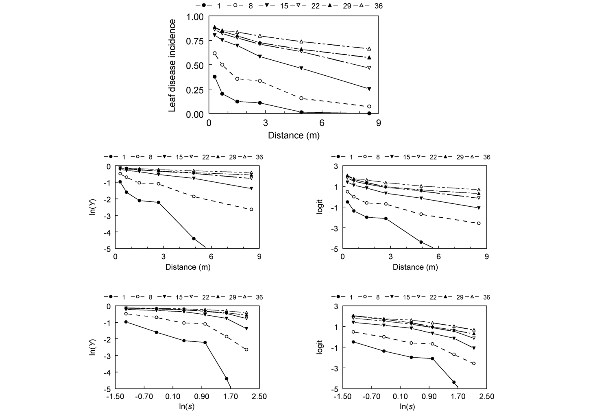{#fig-dg-bean-rust-timeseries}
 อุบัติการณ์โรคอยู่ในระดับต่ำมาก เมื่อเวลาผ่านไป ความลาดชันในสเกลเดิม ($y$) แบนราบลงอย่างเห็นได้ชัด และ $y$ มีค่าใกล้เคียง 1 เมื่ออยู่ใกล้กับแหล่งกำเนิดเชื้อเดิมในเวลาต่อมา ยิ่งไปกว่านั้น ในช่วงเวลาต่อมาเหล่านี้ $y$ ก็ยังคงสูงมากในระยะทางไกลที่สุดที่มีการพิจารณา (8.5 ม.) ในอุดมคติแล้ว เราควรใช้ระยะทางที่ไกลพอเพื่อจะได้เห็นความลาดชันที่ "สมบูรณ์" (full gradient) ในแต่ละช่วงเวลา แต่นี่เป็นเรื่องที่ไม่สามารถทำได้จริงอย่างสิ้นเชิงในการศึกษาระดับภาคสนามส่วนใหญ่ ในกรณีนี้ อาจต้องใช้ขนาดพื้นที่แปลงใหญ่ขึ้นอย่างน้อยสี่เท่า เพื่อที่จะได้สังเกตเห็นค่า $y$ ที่ระดับต่ำที่ระยะทางไกลๆ จากแหล่งกำเนิดหากเราเพิกเฉยต่อข้อเท็จจริงที่ว่า $y$ มีขีดจำกัดบน และพล็อต $\ln(y)$ เทียบกับ $s$ หรือ $\ln(s)$ เราจะเห็นความลาดชันของการเกิดโรคแบนราบลงเมื่อเวลาผ่านไป โดยเฉพาะที่ระยะ $s < 5$ ม. นอกจากนี้ โปรดสังเกตว่าอุบัติการณ์ของโรคในครั้งแรกนั้นต่ำมากจนยากที่จะนำผลในระยะทางไกลๆ มาเปรียบเทียบกับช่วงเวลาอื่นๆ ดังนั้นเราจึง (โดยส่วนใหญ่)เมื่อพิจารณาว่ามีการเข้าใกล้ขีดจำกัดบนของ $y$ ($=1$) แล้ว จึงเหมาะสมที่จะนำโมเดลความลาดชันแบบลอจิสติกและโมเดล power-logistic (สมการ 7.20 และ 7.23) มาอธิบายข้อมูลเหล่านี้ กราฟระหว่าง $\text{logit}(y)$ กับ $s$ และ $\ln(s)$ แสดงไว้ที่ด้านขวามือของรูปที่ 7.11 โดยทั่วไปแล้ว เราไม่สามารถเลือกฟันธงได้ชัดเจนระหว่างโมเดลสองแบบนี้ กราฟที่พล็อตระหว่าง $\text{logit}(y)$ เทียบกับ $s$ มีความโค้งเล็กน้อย โดยที่ความชันจะลดลงเมื่อระยะทางเพิ่มขึ้น สิ่งนี้บ่งบอกถึงโมเดลลักษณะแบบพาวเวอร์ ส่วนกราฟของ $\text{logit}(y)$ เทียบกับ $\ln(s)$ จะให้เส้นตรง ยกเว้นเมื่อระยะทางไกลมากๆ ($s$ สูง) ซึ่งจะเห็นเส้นโค้งงอลงเล็กน้อย กราฟค่าคลาดเคลื่อน (residual plots) จากการวิเคราะห์การถดถอยเชิงเส้นก็แสดงให้เห็นรูปแบบบางอย่างในโมเดลทั้งสองตัวเลือก (ไม่ได้แสดงรูป) และด้วยความที่กราฟของ $\text{logit}(y)$ เทียบกับ $\ln(s)$ ให้เส้นตรงที่ระยะ $s < 6$ ม. [$\ln(s) < 1.6$] เราจึงเลือกใช้โมเดล power-logistic เป็นโมเดลหลักในการอธิบายความลาดชันเหล่านี้ สิ่งนี้สอดคล้องกับการศึกษาอื่นๆ ที่พบความสัมพันธ์ในรูปแบบ power-law สำหรับความลาดชันการแพร่กระจายของสปอร์ราสนิม (Aylor และ Ferrandino, 1989; Mundt, 1989) อย่างไรก็ตาม ข้อมูลในตัวอย่างนี้ยังไม่เพียงพอที่จะตีความความลาดชันในแง่ของกลไกการแพร่กระจาย หากจะตีความให้ลึกกว่านี้จำเป็นต้องใช้ชุดข้อมูลอื่นๆ และใช้พื้นที่ศึกษาที่ใหญ่ขึ้น (มีค่า $s$ สูงสุดที่มากขึ้น) โดยเฉพาะประเด็นหลัง ข้อมูลที่เป็นประโยชน์อย่างยิ่งคือ การได้รู้ว่าเส้นตรงกราฟลอจิตที่เริ่มโค้งลงเล็กน้อยเมื่อ $\ln(s) > 1.6$ (รูปที่ 7.11) นั้น จะยังคงโค้งลงต่อไปเรื่อยๆ หรือไม่ในระยะทางที่ไกลขึ้นมาก

#### 7.5.4.3 ตัวอย่าง—การถดถอยเชิงเส้น (Example—linear regression)

. สำหรับผู้อ่านที่สนใจ จุดข้อมูลจริงได้ถูกนำเสนอไว้ใน @fig-dg-sas-program-spatiotemporal ในรูปแบบของโปรแกรม SAS

 สำหรับการวิเคราะห์การถดถอยตามสมการ 7.20 และ 7.23 ก่อนที่จะนำเสนอผลลัพธ์ของโมเดล power-logistic เราจะขอแสดงผลลัพธ์บางส่วนที่ได้หากเราเพิกเฉย (อย่างไม่ถูกต้อง) ต่อข้อเท็จจริงที่ว่า $y$ ถูกจำกัดค่าไว้ไม่เกิน 1 นั่นคือ หากเราเอาข้อมูลไปฟิตกับโมเดลพาวเวอร์ทั่วไป (สมการ 7.6 โดยใช้ $y$ แทน $Y$ สำหรับความรุนแรงของโรค) และเปรียบเทียบความชัน (ค่าประมาณของ $b_L$) ระหว่างช่วงเวลาต่างๆ การวิเคราะห์นี้ไม่ได้ถูกระบุไว้ในโปรแกรม SAS ค่าความชันที่ประมาณไว้คือ 0.69, 0.41, 0.20, 0.12, 0.10 และ 0.07 สำหรับช่วงเวลาที่ 1 ถึง 36 โดยอิงจากการถดถอยเชิงเส้นแบบถ่วงน้ำหนักของ $\ln(y)$ ต่อ $\ln(s)$ ซึ่งให้น้ำหนักเท่ากับ $y/(1 - y)$ [ดูหัวข้อ 4.6.2 สำหรับความแปรปรวนของ $\ln(y)$] ผลลัพธ์ชี้ให้เห็นแนวโน้มที่ความชันจะลดลงอย่างมากเมื่อเวลาผ่านไป อันที่จริงแล้ว ความชันในวันที่ 8 นั้นสูงกว่าความชันในวันที่ 36 ถึงประมาณหกเท่า ($0.41/0.07$){#fig-7-11}เพื่อให้ง่ายต่อการใช้งานต่อไป เราควรเขียนระบุอย่างชัดเจนว่ารูปแบบทางสถิติของโมเดล power-logistic (สมการ 7.23) สามารถเขียนได้ดังนี้:หรือซึ่งตัวห้อย $j$ อ้างอิงถึงระยะทางที่ $j$ (เช่น ระยะทางแรกคือ $s_1 = 0.3$ ม.), $y^*$ คือสัญลักษณ์แทนการแปลงรูปที่ทำให้เกิดโมเดลเชิงเส้น (ในที่นี้คือลอจิต), และ $A_{PL}^* = -\ln(A_{PL}) = \ln[y_1/(1 - y_1)]$ สำหรับโมเดล power-logistic การนำสมการ 7.26b ไปฟิตเข้ากับข้อมูลของแต่ละช่วงเวลา โดยใช้วิธีกำลังสองน้อยที่สุดแบบถ่วงน้ำหนัก (weighted least squares) [โดยให้ค่าน้ำหนักเป็น $y(1 - y)$] จะได้ผลลัพธ์ดังตาราง 7.1 ค่าองศาอิสระความคลาดเคลื่อน (error degrees of freedom, $df$) เท่ากับ 4 ในแต่ละช่วงเวลา ดังที่แสดงในกรอบบนสุดของ @fig-dg-power-logistic-fit เส้นที่ฟิตได้ถือเป็นตัวแทนสรุป

ที่สมเหตุสมผลสำหรับความลาดชันบนสเกล $\text{logit}:\ln(s)$ ค่า $\hat{A}_{PL}^*$ จะเพิ่มขึ้นเมื่อเวลาผ่านไปตามคาด เนื่องจาก $y$ มีค่าเพิ่มขึ้นตามเวลา การแปลงค่ากลับ (back-transformation) ของ $\hat{A}_{PL}^*$ สามารถนำมาใช้เพื่อประมาณค่า $y$ ที่ระยะ 1 เมตรได้ ตัวอย่างเช่นค่าประมาณของ $b_{PL}$ มีค่าน้อยลงเมื่อเวลาผ่านไปจริง แต่ก็ถือว่าแนวโน้มยังอ่อนกว่ากรณีที่ใช้โมเดลพาวเวอร์แบบง่ายๆ (ที่ไม่มีการปรับแก้สำหรับระดับโรคสูงสุด) มาก แม้ว่าค่า $R^2$ จะสูง แต่ก็ยังมีรูปแบบบางอย่างปรากฏในกราฟค่าคลาดเคลื่อน ซึ่งบ่งชี้ว่าโมเดล power-logistic ก็ยังไม่ได้สมบูรณ์แบบ ในตารางที่ 7.1 ได้แสดงผลลัพธ์บางส่วนจากการฟิตข้อมูลเข้ากับเวอร์ชันสถิติของโมเดลความลาดชันการเกิดโรคแบบลอจิสติก (สมการ 7.20) เพื่อใช้ในการเปรียบเทียบ ค่าประมาณของ $b_L$ ลดลงเร็วกว่าค่าประมาณของ $b_{PL}$ เมื่อเวลาผ่านไป โมเดลนี้และโมเดลอื่นๆ ส่งผลให้เกิดกราฟค่าคลาดเคลื่อนในรูปแบบที่ไม่พึงประสงค์ แม้ว่าค่า $R^2$ จะสูงมากในการประเมินโรคในบางช่วงเวลากับโมเดลลอจิสติกก็ตาม ตามที่ได้อภิปรายไว้เบื้องต้น เราสรุปว่าโมเดล power-logistic เป็นทางเลือกที่สมเหตุสมผล (แต่ยังไม่สมบูรณ์แบบ) สำหรับการนำมาวิเคราะห์

#### 7.5.4.4 ตัวอย่าง—การเปรียบเทียบค่าประมาณพารามิเตอร์ (Example—comparing parameter estimates)

. เมื่อเราต้องการเปรียบเทียบความลาดชันสองเส้น เราสามารถทดสอบความเท่าเทียมกันของพารามิเตอร์การแพร่กระจายหรือค่าจุดตัดแกน (การแปลงรูปของค่าคงที่ของการอินทิเกรต) ได้ด้วยวิธีต่างๆ ความลาดชันที่นำมาเปรียบเทียบกันอาจมาจากการประเมินโรคในช่วงเวลาที่ต่างกันในการระบาดครั้งเดียว (ดังเช่นตัวอย่างนี้) หรือสอดคล้องกับการประเมินโรคในช่วงเวลาเดียวกันแต่มาจากทรีตเมนต์ที่แตกต่างกัน (เช่น การใช้พันธุ์พืช หรือการฉีดพ่นสารป้องกันกำจัดเชื้อราที่ต่างกัน) แนวทางต่างๆ ที่ได้อภิปรายไว้ในบทที่ 4 สามารถนำมาประยุกต์ใช้ในกรณีนี้ได้เช่นกัน ซึ่งในที่นี้เราจะขอกล่าวถึงแนวทางเพียงไม่กี่แนวทางเท่านั้น{#fig-7-12}ตาราง 7.1. การฟิตโมเดลลอจิสติก (สมการ 7.20) และโมเดล power-logistic (สมการ 7.23) กับข้อมูลของโรคราสนิมถั่วที่แสดงในรูปที่ 7.12 ควบคู่ไปกับระยะทางโดยประมาณ ($\hat{s}'$) ที่ความรุนแรงของโรคเท่ากับ 0.6 สำหรับเวลาการประเมินโรคที่แตกต่างกัน

: การปรับแก้แบบจำลองลอจิสติก (สมการ 7.20) และพาวเวอร์-ลอจิสติก (สมการ 7.23) เข้ากับข้อมูลโรคราสนิมถั่ว พร้อมการประมาณระยะทาง ($\hat{s}'$) ที่ระดับความรุนแรงของโรคเท่ากับ 0.6 ณ เวลาประเมินต่างๆ {#tbl-dg-model-fits}

| $t$ (วัน) | $\hat{A}_{PL}^*$ | $\hat{b}_{PL}$ | $R^2$ | $\hat{s}'$ (ม.) | $\hat{A}_L^*$ | $\hat{b}_L$ | $R^2$ | $\hat{s}'$ (ม.) |
|:---:|:---:|:---:|:---:|:---:|:---:|:---:|:---:|:---:|
| 1 | -1.6 (0.15) | 0.88 (0.17) | 0.88 | – | -0.5 (0.23) | 0.72 (0.15) | 0.85 | – |
| 8 | -0.3 (0.12) | 0.77 (0.12) | 0.91 | 0.4 | 0.3 (0.15) | 0.37 (0.05) | 0.92 | – |
| 15 | 0.8 (0.15) | 0.71 (0.12) | 0.90 | 1.7 | 1.3 (0.09) | 0.29 (0.02) | 0.98 | 3.1 |
| 22 | 1.3 (0.11) | 0.58 (0.07) | 0.93 | 4.7 | 1.6 (0.09) | 0.21 (0.02) | 0.97 | 5.7 |
| 29 | 1.5 (0.04) | 0.53 (0.03) | 0.99 | 7.9 | 1.7 (0.16) | 0.18 (0.03) | 0.89 | 7.2 |
| 36 | 1.7 (0.06) | 0.41 (0.12) | 0.96 | 23.5 | 1.9 (0.09) | 0.15 (0.02) | 0.94 | 10.0 |

แนวทางที่เรียบง่ายที่สุดคือ การใช้การทดสอบที ($t$-test) เพื่อเปรียบเทียบค่าประมาณของพารามิเตอร์ ตัวอย่างเช่น หากเรามีความลาดชันอยู่ 2 เส้น ซึ่งแต่ละเส้นแสดงลักษณะด้วยโมเดล power-logistic (สมการ 7.26a) เราก็สามารถทดสอบสมมติฐานหลักได้ว่าพารามิเตอร์เท่ากัน หรือตั้งสมมติฐานทางเลือกได้ว่าพารามิเตอร์ไม่เท่ากัน ค่าสถิติทดสอบ $t$ สามารถเขียนได้เป็น: ซึ่งตัวส่วนคือความคลาดเคลื่อนมาตรฐาน (standard error) ของผลต่างระหว่างความชันที่ประมาณได้สองค่า ซึ่งสามารถประมาณค่าได้ (สำหรับความชันที่ไม่มีความสัมพันธ์กัน) เป็น: ซึ่งสองพจน์ทางด้านขวามือคือกำลังสองของความคลาดเคลื่อนมาตรฐานของความชันที่ประมาณได้ สำหรับการเปรียบเทียบค่าความชันโดยประมาณของวันที่ 8 และ 15 จากตัวอย่างราสนิมในถั่ว ค่าสถิติทดสอบ $t$ คือ:{#fig-7-13}ค่าองศาอิสระ (degrees of freedom) สำหรับ $t$-test จะเท่ากับผลรวมของค่าองศาอิสระความคลาดเคลื่อนสำหรับเส้นโค้งการดำเนินของโรคทั้งสองเส้น ($df = 4 + 4 = 8$) ค่า $t$-statistic ที่คำนวณได้นี้ ต่ำกว่าค่าวิกฤตที่ $df = 8$ (2.31) เพื่อให้มีนัยสำคัญที่ $\alpha = 0.05$ มาก ดังนั้น ความชันจึงไม่มีความแตกต่างกันอย่างมีนัยสำคัญ (ที่ $\alpha = 0.05$) สำหรับความลาดชันทั้งสองเส้นนี้ข้อควรระวังประการหนึ่งสำหรับผู้อ่านคือ ตัวอักษร $s$ ถูกใช้แทนทั้งตัวแปรของระยะทางและค่าประมาณความคลาดเคลื่อนมาตรฐาน หรือค่าเบี่ยงเบนมาตรฐาน ส่วน $t$ ถูกใช้แทนทั้งตัวแปรเวลาและตัวสถิติทดสอบ $t$ (t-statistic) นอกเหนือจากการใช้สัญลักษณ์ที่ไม่ธรรมดาสำหรับตัวแปรบอกเวลาและระยะทาง (หรือสำหรับความคลาดเคลื่อนมาตรฐาน และค่า t-statistics) แล้ว การตีความซ้ำซ้อนเช่นนี้ก็เป็นสิ่งที่ไม่อาจหลีกเลี่ยงได้ ความหมายของสัญลักษณ์ควรเห็นได้ชัดเจนจากบริบทของเนื้อหาจุดตัด 2 จุด สามารถเปรียบเทียบได้ในลักษณะเดียวกันกับการเปรียบเทียบความชัน จากนั้น จึงสามารถเปรียบเทียบความลาดชันคู่อื่นๆ ต่อไปได้ ผู้อ่านควรสามารถพิจารณาได้ว่าจุดตัดมีความแตกต่างกันอย่างชัดเจนระหว่างหลายช่วงเวลา (ตามที่คาดไว้) และความชันบางค่าก็มีความแตกต่างกันด้วย แนวทางนี้มีประโยชน์มากเมื่อมีจำนวนความลาดชันเพียงเล็กน้อย หรือเมื่อผู้วิจัยมีข้อมูลเพียงค่าประมาณพารามิเตอร์และค่าคลาดเคลื่อนมาตรฐานเท่านั้น (เช่น จากเอกสารตีพิมพ์) ในกรณีที่มีความลาดชันหลายเส้น การทำความเข้าใจการแพร่กระจายของโรคในภาพรวมจากการเปรียบเทียบแบบจับคู่อาจเป็นไปได้ยาก ดังนั้น การวิเคราะห์ความแปรปรวนร่วม (covariance analysis) เพื่อทดสอบว่าระดับความสูงของเส้นตรง (จุดตัดแกน) หรือความชันมีความแปรปรวนระหว่างกลุ่มหรือไม่ จึงมักเป็นวิธีที่มีประสิทธิภาพมากกว่า (Milliken และ Johnson, 2002) แนวทางนี้ยังช่วยให้ผู้วิจัยสามารถรวมคุณลักษณะต่างๆ ของแผนการทดลอง (experimental design) เช่น การแบ่งบล็อก (blocking) เข้าไปในการวิเคราะห์ได้อีกด้วยหากสมมติว่าโมเดล power-logistic มีความเหมาะสม เราก็สามารถขยายสมการ 7.26b เป็น:โดยที่ตัวห้อย $i$ เป็นตัวแทนของกลุ่มที่ $i$ (ในตัวอย่างนี้ก็คือเวลา) มีการห้อยตัว $i$ บนตัวแปร $\ln(s)$ (นอกเหนือจากตัวห้อย $j$) เนื่องจากระยะทางในแต่ละกลุ่มอาจไม่เท่ากัน (แม้ว่าจะไม่ใช่กรณีของที่นี่ก็ตาม) ดังนั้น ความเป็นไปได้ที่แต่ละกลุ่มจะมีจุดตัด ($A^*$) และความชัน ($b_{PL}$) แตกต่างกัน จึงถูกรวมเข้าไว้ในโมเดลทางสถิตินี้ อีกวิธีในการเขียนสมการนี้คือ:ซึ่ง $\gamma$ และ $\iota$ จะเป็นตัวแทนของจุดตัดรวม และความชันรวม ตามลำดับ ในสูตรนี้ $\gamma + A_{PL i}^*$ คือค่าจุดตัดสำหรับกลุ่มที่ $i$ และ $\iota + b_{PL i}$ คือความชันสำหรับกลุ่มที่ $i$ ผู้อ่านควรนำไปเปรียบเทียบกับสมการ 4.38b และอ่านคำอภิปรายเรื่องการใช้สมการประเภทนี้ซ้ำอีกรอบ สูตรในสมการ 7.27b นี้มีประโยชน์ที่สุดในการวิเคราะห์ความแปรปรวนร่วมเพื่อทดสอบว่ามีความแตกต่างอย่างมีนัยสำคัญของกลุ่มต่อค่าจุดตัดและความชันหรือไม่ โมเดลนี้ถูกนำไปฟิตเข้ากับข้อมูลโรคราสนิมถั่ว โดยให้กลุ่มคือเวลา ด้วยการใช้คำสั่ง MIXED ในโปรแกรม SAS ตาม @fig-dg-sas-program-spatiotemporal โปรดสังเกตว่า

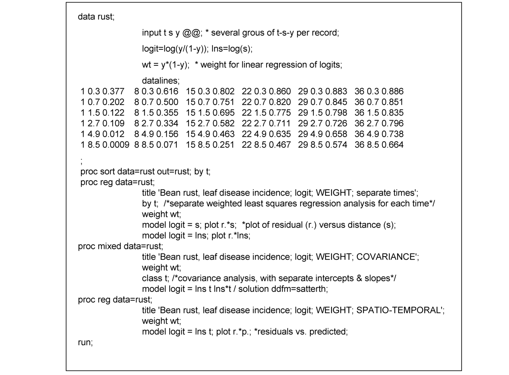{#fig-dg-sas-program-spatiotemporal}
 เวลา ($t$) จะถูกกำหนดให้เป็นตัวแปรกลุ่ม (ตัวแปรหมวดหมู่ หรือตัวแปรปัจจัย) ในโปรแกรม ตัวแปร $\gamma$ จะถูกกำหนดเป็นนัยในคำสั่งประโยคที่กำหนดโมเดล และจะไม่ได้ถูกระบุชื่อ; $t$ ระบุผลกระทบของเวลาที่มีต่อค่าจุดตัด [ตัวแปรที่ใช้แสดงความสัมพันธ์ที่ส่งผลกระทบหลัก ($A_{PL i}^*$)] ความชันโดยรวมและผลของกลุ่มที่มีต่อความชันจะถูกระบุด้วย lns ($\iota$) และ lns*t ($b_{PL i}$) ตามลำดับ ซึ่งหมายความว่า ในกรณีหลัง ความหมายของความชันที่อิงกลุ่ม (group-dependent slope) ก็คือ การที่ความชันเหล่านั้นมีค่าไม่เท่ากัน (เป็นปฏิกิริยาสัมพันธ์ระหว่างกลุ่มกับตัวแปรต่อเนื่อง)เมื่อทำการฟิตข้อมูลเข้ากับโมเดล พบผลลัพธ์ดังนี้: มีผลกระทบของระยะทางอย่างมีนัยสำคัญยิ่ง ($F = 246.6$; $df = 1, 24$; $P < 0.001$) ซึ่งแปลว่า $\iota$ มีค่าต่างจาก 0; มีผลกระทบของเวลาอย่างมีนัยสำคัญยิ่ง ($F = 103.0$; $df = 5, 24$; $P < 0.001$) ซึ่งบ่งชี้ว่า ($A_{PL i}^*$) มีค่าแปรผันไปตามเวลา; และมีผลกระทบเล็กน้อยสำหรับปฏิกิริยาสัมพันธ์ระหว่างเวลาและระยะทาง ($F = 2.6$; $df = 5, 24$; $P = 0.05$) ซึ่งบอกให้ทราบว่ามีหลักฐานบางส่วนชี้ให้เห็นว่า $b_{PL i}$ อาจมีค่าไม่เท่ากันในทุกช่วงเวลา ในรูปแบบสมการของโมเดลนี้ เราสามารถหาค่าประมาณที่แท้จริงของจุดตัดและความชันสำหรับแต่ละเวลาได้ด้วยการหาค่าประมาณของ $\gamma$, $\iota$ และพารามิเตอร์ที่จำเพาะกับแต่ละกลุ่ม (โดยใช้ตัวเลือก solution) ตัวอย่างเช่น ความชันสำหรับกลุ่มที่ 3 (เวลาที่สาม) จะหาได้จาก $\hat{\gamma} + \hat{A}_{PL 3}^*$ วิธีที่ตรงไปตรงมามากขึ้นในการหา $\hat{\iota} + \hat{b}_{PL 3}$ และค่าประมาณจุดตัด คือการใช้คำสั่งกำหนดโมเดล ดังต่อไปนี้: ซึ่งใช้คำสั่งตัวเลือก noint (no intercept) ที่เป็นการกำจัด $\gamma$ ออกไปจากโมเดล เนื่องด้วยไม่มีการกำหนดตัวแปร $\ln s$ เดี่ยวๆ ในตัวโมเดลอีกแล้ว (ดังนั้นจึงไม่มี $\iota$) เท่ากับว่าเป็นการนำข้อมูลไปฟิตกับสมการ 7.27a แทน อย่างไรก็ตาม ผลการทดสอบ $F$-tests ที่แสดงความสัมพันธ์ของกลุ่มและปฏิกิริยาสัมพันธ์ (interaction) ระหว่างกลุ่มและตัวแปรแบบต่อเนื่อง จะไม่สามารถนำไปใช้ในการทดสอบผลกระทบของกลุ่มและผลของปฏิกิริยาสัมพันธ์ได้อีกเมื่อมีการปรับเปลี่ยนโค้ดของโปรแกรมดังกล่าว (แม้ว่าค่าความชันและจุดตัดที่ประเมินได้ รวมทั้งค่าคลาดเคลื่อนมาตรฐาน จะยังคงเหมาะสม) ด้วยวิธีนี้ เราจะได้ค่าประมาณพารามิเตอร์สำหรับวันที่ 15 ซึ่งทำได้ดังนี้: ซึ่งสอดคล้องกับผลการวิเคราะห์การถดถอยรายบุคคลที่แสดงไว้ก่อนหน้านี้ ความสอดคล้องนี้ไม่จำเป็นต้องออกมาดีขนาดนี้ เนื่องจากเมื่อทำตรงนี้แล้ว การวิเคราะห์ความแปรปรวนร่วมนี้ถือว่ามีความแปรปรวนของค่าความคลาดเคลื่อนเพียงค่าเดียวสำหรับข้อมูลทั้งหมด ไม่ใช่การแยกความแปรปรวนสำหรับแต่ละความลาดชัน (แต่ละช่วงเวลาการประเมิน ในที่นี้)เนื่องจากปรากฏว่าผลของกลุ่มที่มีต่อความชันเพียงเล็กน้อย (ปฏิกิริยาสัมพันธ์เล็กน้อย) จึงเป็นเรื่องปกติที่จะลองพิจารณาโมเดลที่ใช้ความแปรปรวนร่วม โดยกำหนดให้มีความชันเพียงค่าเดียว (ไม่ขึ้นกับกลุ่ม) ดู สมการ 7.27a สามารถลดรูปลงได้เป็น:โปรดสังเกตว่าสูตรนี้ชี้ให้เห็นว่า $b_{PL i} = 0$ สำหรับทุก $i$ (ทุกกลุ่ม) หรือพูดอีกนัยหนึ่งคือ ตอนนี้ $\iota$ เป็นตัวแทนของความชันเพียงค่าเดียว (คือ $\iota b_{PL}$ โดยไม่มีตัวห้อย $i$) สามารถฟิตข้อมูลเข้ากับโมเดลนี้ได้โดยใช้โค้ดดังต่อไปนี้:ด้วยการวิเคราะห์นี้ ความชันโดยประมาณ (ที่เป็นค่าเดียว) จะเท่ากับ: $\hat{b}_{PL} = 0.62$ (s.e. $= 0.043$) ซึ่งเป็นค่ากลางๆ ระหว่างความชันแต่ละเส้นจากช่วงเวลาต่างๆ การคำนวณค่าประมาณสำหรับจุดตัดแกนที่ต่างกันสามารถทำได้ด้วยคำสั่งตัวเลือก noint เช่นกัน โดยจะได้ค่า $\hat{\gamma} + \hat{A}_{PL i}^*$ โดยตรง โดยให้ค่า $\hat{A}_{PL i}^*$ (เพราะ $\gamma = 0$) จุดตัดประมาณการสำหรับ 6 เวลา ได้แก่: −1.5, −0.3, 0.8, 1.4, 1.6 และ 1.8 ซึ่งมีค่าใกล้เคียงกับที่ได้จากการวิเคราะห์ข้อมูลแบบแยกแต่ละช่วงเวลา ความแปรปรวนตกค้าง (residual variance) สำหรับโมเดลนี้อยู่ที่ 0.0125 ซึ่งก็ไม่ได้สูงกว่าค่าความแปรปรวนตกค้างที่ได้จากการฟิตเข้ากับสมการ 7.27b (0.0098) สักเท่าไหร่นัก ซึ่งก็ชี้ให้เห็นว่า เราสามารถใช้ค่าพารามิเตอร์ความลาดชันเพียงค่าเดียวอธิบายชุดข้อมูลเวลาที่แตกต่างกันได้อย่างสมเหตุสมผลพอควร ดังแสดงในกรอบด้านล่างของ @fig-dg-power-logistic-fit ว่าการใช้ความชันเพียงค่าเดียวนั้นเพียงพอแล้ว

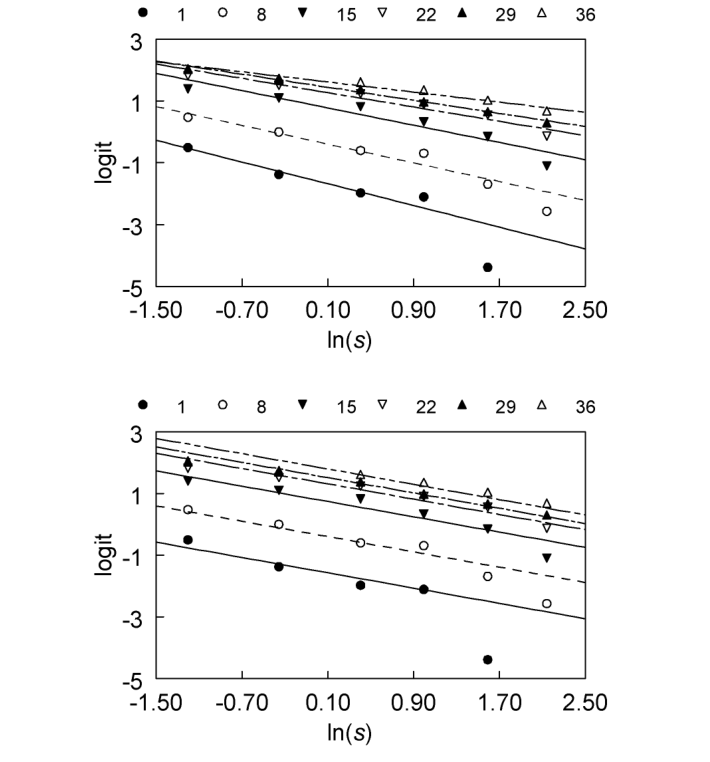{#fig-dg-power-logistic-fit}
สำหรับการอธิบายข้อมูลเหล่านี้ ถึงแม้การใช้ความชันแยกตามเวลา (กรอบด้านบน) อาจจะให้ผลลัพธ์ที่พอดีกว่าก็ตามท้ายที่สุด การวิเคราะห์ความลาดชันในกรณีของโรคราสนิมในถั่วนี้ แสดงให้เห็นว่า ทั้งโมเดลลอจิสติกและโมเดล power logistic สามารถนำมาใช้ได้ แต่ในที่นี้เราเลือกโมเดลหลัง เพราะโมเดลแนวพาวเวอร์เป็นที่นิยมสำหรับโรคกลุ่มราสนิมบนสเกล $y$ ดั้งเดิม เราพบว่าความลาดชันค่อยๆ แบนราบลงอย่างชัดเจนเมื่อเวลาเพิ่มขึ้น โดยเฉพาะในบริเวณที่ใกล้แหล่งกำเนิดเชื้อ นอกจากนี้ยังมีหลักฐานบางส่วนที่ชี้ว่าความลาดชันแบนราบลงเมื่อเวลาผ่านไปในสเกลของ $\text{logit}(y):\ln(s)$ แต่กระนั้น การตั้งสมมติฐานให้ระดับความชันของการเกิดโรค ($b_{PL}$) คงที่เมื่อเวลาผ่านไป ก็ถือเป็นการประมาณค่าในระดับที่ยอมรับได้สำหรับชุดข้อมูลนี้ ผ่านการใช้การแปลงรูปเป็นลอจิต (ในกรณีนี้) การมีขีดจำกัดความรุนแรงของโรค (นั่นคือ $y < 1$) ก็ถูกพิจารณารวมอยู่ด้วยแล้ว เพื่อให้เราสามารถอธิบายถึงความสัมพันธ์ระหว่างความรุนแรงโรค (ที่ถูกแปลงรูปแล้ว) กับระยะทาง (ที่ถูกแปลงรูปแล้ว) ได้ในที่สุด

## 7.6 พลวัตเชิงพื้นที่และเวลาของการแพร่ระบาดของโรค (Spatio-Temporal Dynamics of Disease Spread) {#sec-dg-spatiotemporal}

### 7.6.1 ข้อคิดเห็นทั่วไป (General Comments)

จากการอธิบายลักษณะของความลาดชันของโรค (Disease gradients) ในหลายๆ ช่วงเวลาของการแพร่ระบาดในหัวข้อก่อนหน้านี้ เราได้พิจารณาถึงพลวัตเชิงพื้นที่และเวลา (Spatio-temporal dynamics) ของการพัฒนาของโรคในประชากรโฮสต์ (Host populations) กันมาบ้างแล้ว นั่นคือ เราได้พิจารณาว่า $y$ เปลี่ยนแปลงไปตาม $s$ อย่างไรในรูปแบบของความลาดชันของโรค และพิจารณาว่า $y$ เปลี่ยนแปลงไปตาม $t$ อย่างไร ผ่านการเปลี่ยนแปลงความสูงของความลาดชันและ (อาจรวมถึง) ความชัน (Steepness) ของความลาดชันเมื่อเวลาผ่านไป ในหัวข้อนี้ เราจะเริ่มจัดรูปแบบความสัมพันธ์ระหว่าง $y$ กับทั้ง $t$ และ $s$ ให้เป็นระบบมากขึ้นดังที่ได้กล่าวไว้ในหัวข้อ 7.1

ในบทก่อนๆ เรามักจะมองการแพร่ระบาดของโรคพืชในฐานะกระบวนการเชิงเวลา (Temporal process) ซึ่งแสดงลักษณะด้วย $dy / dt$ ถึงแม้ว่าเราจะตระหนักดีว่ามิติของพื้นที่มีความสำคัญเช่นกัน ตัวอย่างเช่น ในโรคพืชแบบวงจรเดียว (Monocyclic diseases) เราได้ระบุไว้ว่า $dy / dt = r_M(1 - y)$ (สมการ 4.8) โดยที่ $r_M$ เท่ากับผลคูณของความหนาแน่นหรือความอุดมสมบูรณ์ของเชื้อเริ่มต้น (Inoculum density or abundance) ($x'$) และความน่าจะเป็นต่อหน่วยเวลาที่เชื้อเริ่มต้นหนึ่งหน่วยจะทำให้เกิดการติดเชื้อ ($\phi$ = ความน่าจะเป็นต่อหน่วยเวลาที่เชื้อเริ่มต้นหนึ่งหน่วยจะสัมผัสกับโฮสต์แต่ละต้น คูณด้วยความน่าจะเป็นที่เชื้อเริ่มต้นซึ่งสัมผัสกับโฮสต์ที่ปลอดโรคจะสามารถทำให้โฮสต์ติดโรคได้จริงๆ) หาก $x'$ รวมกลุ่มกันอยู่ที่ตำแหน่งใดตำแหน่งหนึ่ง (เช่น เป็นเส้น เป็นจุด ฯลฯ) ค่า $\phi$ ก็ไม่น่าจะคงที่ แต่จะแปรผันเป็นฟังก์ชันของระยะทางจาก $x'$ นั่นคือ $\phi(s)$ จริงๆ แล้วฟังก์ชัน $\phi(s)$ นี้มีความคล้ายคลึงกับการกระจายตัวของการสัมผัส (Contact distribution) (ดูหัวข้อ 7.3.4)สำหรับโรคพืชแบบหลายวงจร (Polycyclic diseases) สถานการณ์จะมีความซับซ้อนมากกว่า (อย่างเห็นได้ชัด) เพราะโฮสต์ทุกต้นที่ติดเชื้อสามารถกลายมาเป็นแหล่งของเชื้อเริ่มต้น (Inoculum source) ได้ อย่างน้อยก็ในช่วงระยะเวลาที่แพร่เชื้อได้ (Infectious period) ของต้นที่ป่วยนั้น (ดูบทที่ 5) แทนที่จะมีความน่าจะเป็นคงที่ที่สปอร์ซึ่งถูกสร้างขึ้นมาจะไปสัมผัสกับโฮสต์ ($\theta$; ดูหัวข้อ 5.2.2 และ 5.2.3) สปอร์ที่สร้างขึ้นจากต้นที่ติดเชื้อ ณ ตำแหน่ง $\xi$ จะมีโอกาสสัมผัสกับโฮสต์ที่ตำแหน่ง $s$ ได้มากกว่ามาก หากทั้งสองตำแหน่งอยู่ใกล้กัน ($s - \xi$ มีค่าน้อย) เมื่อเทียบกับกรณีที่ตำแหน่งทั้งสองอยู่ห่างกัน ($s - \xi$ มีค่ามาก) อีกนัยหนึ่ง $\theta$ แท้จริงแล้วเป็นฟังก์ชันของ $s - \xi$ นั่นคือ $\theta(s - \xi)$ดังนั้น โมเดลลอจิสติก (Logistic model) (สมการ 4.14) และโมเดลที่ซับซ้อนกว่าในบทที่ 5 สำหรับ $y$ (เช่น สมการ 5.30) จึงไม่เพียงพอที่จะเป็นตัวแทนของการระบาดทั้งในมิติของพื้นที่และเวลา เมื่อการระบาดเริ่มต้นจากแหล่งเชื้อเริ่มต้นที่ระบุได้อย่างชัดเจน (หนึ่งแหล่งหรือหลายแหล่ง) แม้ว่าโมเดลเชิงเวลาในบทก่อนๆ จะมีประโยชน์อย่างมากในการอธิบายและทำความเข้าใจการระบาด แต่การวัดปริมาณในระดับต่อไปจำเป็นต้องพิจารณาทั้งพื้นที่และเวลาในการพัฒนาของโรคอย่างเป็นระบบ แนวทางที่นำเสนอในหัวข้อนี้ถือเป็นก้าวแรกสู่การพัฒนาความเข้าใจที่ดียิ่งขึ้นเกี่ยวกับกระบวนการเชิงพื้นที่และเวลาภายในการระบาดของโรค ผ่านโมเดลที่พัฒนาขึ้นเหล่านี้ เราคาดหวังว่าแนวคิดเรื่องการแพร่กระจายของโรคจะมีความชัดเจนมากขึ้น และเราจะได้แนวทางเชิงประจักษ์ (Empirical approaches) สำหรับอธิบายลักษณะการแพร่กระจายซึ่งเป็นผลสืบเนื่องตามธรรมชาติจากโมเดลดังกล่าว อย่างไรก็ตาม โมเดลเฉพาะที่แสดงในที่นี้ควรได้รับการพิจารณาว่าเป็นเพียงบันไดขั้นแรกที่จะนำไปสู่การอธิบายลักษณะการแพร่กระจายอย่างครบถ้วนสมบูรณ์ยิ่งขึ้นในบทที่ 8

### 7.6.2 แบบจำลองเชิงพื้นที่และเวลาสองรูปแบบ (Two Spatio-Temporal Models)

ก่อนหน้านี้ บางครั้งเราพบว่าการใช้สัญลักษณ์ $y(t)$ แทนที่จะใช้แค่ $y$ เพียงอย่างเดียว เป็นประโยชน์ในการเป็นตัวแทนความรุนแรงของโรค (Disease intensity) ณ เวลา $t$ เมื่อเรานำมิติของพื้นที่และเวลามาพิจารณาควบคู่กัน เราสามารถใช้สัญลักษณ์ $y(t, s)$ เพื่ออ้างอิงถึงความรุนแรงของโรค ณ ตำแหน่ง $s$ และเวลา $t$ การเป็นตัวแทนในมิติพื้นที่แบบสองมิติสามารถทำได้โดยการแทนที่ $s$ ด้วย $s_1$ และ $s_2$ (เป็นต้น) เพื่อใช้แทนตำแหน่งในแถวและคอลัมน์ กลายเป็น $y(t, s_1, s_2)$ อย่างไรก็ตาม เราจะไม่พิจารณาแนวทางแบบหลังในที่นี้ รูปแบบทั่วไปที่ใช้แสดง $y(t, s)$ สามารถเขียนได้ดังนี้:โดยที่ $\Theta$ คือเวกเตอร์ของพารามิเตอร์ มีความเป็นไปได้สูงมากที่ $f(\cdot)$ จะไม่ใช่สมการเดี่ยวที่เรียบง่าย (หรือแม้แต่สมการเดี่ยวที่ซับซ้อน) แต่สามารถเขียนได้ในรูปของปริพันธ์ (Integral) เท่านั้นซึ่ง $\Xi$ เป็นนิพจน์ทางคณิตศาสตร์ทั่วไปใดๆ (Arbitrary general mathematical expression) ส่วน $s$ และ $t$ เป็นตำแหน่งเฉพาะ (ระหว่าง 0 ถึง $s$) และเวลาเฉพาะ (ระหว่าง 0 ถึง $t$) ตามลำดับ และเป็นการหาปริพันธ์ข้ามพื้นที่และเวลา ในสถานการณ์เช่นนี้ จำเป็นต้องใช้วิธีการหาคำตอบเชิงตัวเลข (Numerical solutions) แม้ว่าในบางสถานการณ์อาจจะมีคำตอบเชิงวิเคราะห์แบบประมาณค่า (Approximate analytical solutions) ให้ใช้งานได้ (ดูบทที่ 8) ในที่นี้ เราจะพิจารณาสถานการณ์ที่มีคำตอบสำหรับปริพันธ์อยู่แล้ว ดังนั้น $f(\cdot)$ จึงเป็นสมการเดี่ยวปัจจุบัน ความรุนแรงของโรคกลายเป็นฟังก์ชันของตัวแปรอิสระแบบต่อเนื่อง (Continuous independent variables) สองตัว นั่นคือ $s$ และ $t$ ในทางคณิตศาสตร์ เราจะใช้อนุพันธ์ย่อย (Partial derivatives, $\partial\cdot$) แทนอนุพันธ์ธรรมดา (Ordinary derivatives) เพื่อแสดงอัตราการเปลี่ยนแปลงในโมเดลที่มีตัวแปรอิสระมากกว่าหนึ่งตัว เราสามารถหาอนุพันธ์ย่อยของสมการ 7.28a เพื่อหาอัตราการเปลี่ยนแปลงของ $y$ เทียบกับเวลาและพื้นที่ได้ โดยเฉพาะอย่างยิ่ง เราเขียน $\partial y(t, s)/\partial t$ สำหรับอัตราการเปลี่ยนแปลงสัมบูรณ์ (Absolute rate of change) ของ $y$ เทียบกับเวลา ณ ตำแหน่ง $s$ และเขียน $\partial y(t, s)/\partial s$ สำหรับอัตราการเปลี่ยนแปลงสัมบูรณ์ของ $y$ เทียบกับพื้นที่ (ระยะทาง) ณ เวลา $t$ ในบางบริบทของการนำเสนอ เราอาจลดรูปสัญลักษณ์เหล่านี้ให้เรียบง่ายลงเป็น $\partial y / \partial t$ และ $\partial y / \partial s$ โดยให้เป็นที่เข้าใจร่วมกันว่าฟังก์ชันนี้ขึ้นอยู่กับตัวแปร $s$ และ $t$ ตามลำดับ เพื่อให้แนวทางนี้ทำงานได้ มีข้อกำหนดทางคณิตศาสตร์ว่า $f(\cdot)$ จะต้องเป็นฟังก์ชันต่อเนื่อง (Continuous function)สำหรับโรคแบบหลายวงจร โมเดลลอจิสติกมักจะเป็นรูปแบบที่เหมาะสมในการอธิบายการลุกลามของโรคเมื่อเวลาผ่านไป (บทที่ 4 และ 5) ดังนั้น จึงสมเหตุสมผลที่เราจะพิจารณารูปแบบหนึ่งของสมการ 7.28 ซึ่งมีอนุพันธ์ย่อยเทียบกับเวลา ดังนี้:เราอาจพิจารณาฟังก์ชันอื่นๆ ในจุดนี้ได้เช่นกัน เช่น ฟังก์ชันกอมเพิร์ตซ์ (Gompertz) สำหรับการลุกลามของโรคเชิงเวลา ในทำนองเดียวกัน เราอาจใช้โมเดลประเภท H-L-I-R (บทที่ 5) สำหรับการลุกลามเชิงเวลาได้ โดยให้แทนที่พจน์ $y$ ตัวแรกทางฝั่งขวาของสมการ 7.29 ด้วยโรคระยะแพร่เชื้อ (Infectious disease) สำหรับโรคแบบวงจรเดียว เป็นเรื่องธรรมชาติที่จะพิจารณารูปแบบของสมการ 7.28 ซึ่งมีอนุพันธ์ย่อยสำหรับโรคเทียบกับเวลา ดังนี้:ในหัวข้อก่อนหน้านี้ เราได้แสดงให้เห็นแล้วว่าอัตราการเปลี่ยนแปลงของโรคเทียบกับระยะทาง สามารถใช้โมเดลลอจิสติกหรือโมเดลเพาเวอร์-ลอจิสติก (Power-logistic models) เป็นตัวแทนได้อย่างสมเหตุสมผล ดังนั้น เราจึงพิจารณารูปแบบของสมการ 7.28 ซึ่งอนุพันธ์ย่อยเทียบกับ $s$ สามารถเขียนได้เป็น:และแน่นอนว่าอาจพิจารณาโมเดลอื่นๆ ได้เช่นกัน ตรงนี้เป็นจุดที่ดีที่จะชี้ให้เห็นว่า โมเดลความลาดชันแบบลอจิสติก (หรือเพาเวอร์-ลอจิสติก) ไม่ได้หมายความโดยนัยว่าโรคดังกล่าวจะต้องมีธรรมชาติแบบหลายวงจร (แบบดอกเบี้ยทบต้น - Compound interest) เสมอไปขั้นตอนต่อไปคือการพิจารณา คู่ ของสมการเชิงอนุพันธ์ย่อย โดยให้สมการหนึ่งสำหรับพื้นที่ และอีกสมการหนึ่งสำหรับเวลา ตัวอย่างเช่น ให้พิจารณาสมการลอจิสติกสำหรับพลวัตของโรคทั้งเชิงเวลา (สมการ 7.29) และเชิงพื้นที่ (สมการ 7.31) คำตอบของสมการนี้จะนำไปสู่สมการต่อไปนี้:โดยที่ $A_{LL}$ คือค่าคงที่ของการหาปริพันธ์ (Constant of integration) ซึ่งมีค่าเท่ากับ $(1 - y_0)/y_0$ และ $y_0$ คือค่า $y$ ทางทฤษฎี ณ เวลา $t = 0$ และ $s = 0$ กล่าวคือ $f(\cdot)$ ของสมการ 7.28a คือนิพจน์ทางฝั่งขวาของสมการ 7.33 นั่นเอง อีกมุมมองหนึ่งคือ อนุพันธ์ย่อยของสมการ 7.33 มีค่าเท่ากับสมการ 7.29 และ 7.31 เมื่อจัดรูปสมการทางพีชคณิตเล็กน้อย จะได้สมการเชิงเส้น (Linear equation) ดังนี้:พจน์จุดตัดแกน (Intercept term) สามารถเขียนได้อีกรูปแบบเป็น $+\ln[y_0/(1 - y_0)]$ ดังนั้นเราจึงสามารถใช้สมการ 7.33 หรือ 7.34 เพื่ออธิบายโรคทั้งในมิติของพื้นที่และเวลาได้ดังแสดงใน @fig-dg-spatiotemporal-logistic แสดงตัวอย่างการระบาดของโรคแบบหนึ่งที่เป็นไปตามสมการ 7.33

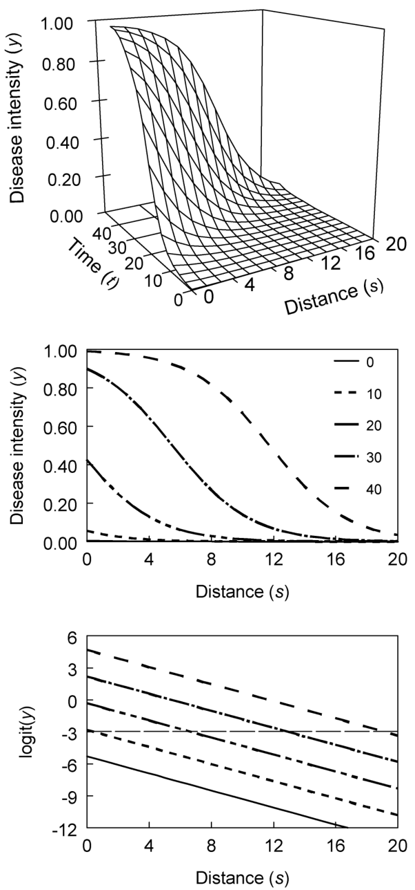{#fig-dg-spatiotemporal-logistic}
 โดยกำหนดให้ $r_L = 0.25$ ต่อวัน และ $b_L = 0.4$ ต่อเมตร กราฟ 3 มิติในกรอบด้านบนแสดงภาพการพัฒนาของโรคในทั้งสองมิติ ข้อสังเกต: เพื่อความชัดเจนในการมองเห็น แกนเวลาถูกจัดวางให้ลึกลงไปในหน้ากระดาษ (ทำมุมเล็กน้อย) โดยให้ช่วงเวลาที่น้อยที่สุดอยู่บริเวณด้านหน้า ที่ระยะทางใดๆ ที่เลือกไว้ (เช่น $s = 4$ เมตร) โรคจะเพิ่มขึ้นแบบลอจิสติกเมื่อเวลาผ่านไป โดยมีค่า $y$ ต่ำเมื่อ $t = 0$ และค่า $y$ จะเข้าใกล้ 1.0 เมื่อเวลาผ่านไปนานๆ (เมื่อ $s$ มีค่าน้อย) เส้นโค้งเชิงเวลา (Temporal curves) มีลักษณะเป็นรูปตัวเอส (Sigmoid shape) ถึงแม้ความรุนแรงของโรคจะไม่พุ่งสูงมากในระยะทางไกลๆ (ภายในกรอบเวลาที่พิจารณาในที่นี้) ที่ระยะ $s = 0$ เราจะเห็นการเพิ่มขึ้นแบบลอจิสติกของ $y$ ตรงบริเวณแหล่งเชื้อเริ่มต้นเมื่ออ่านกราฟ 3 มิติจากซ้ายไปขวา เราจะเห็นความลาดชันของโรคแปรผันตามระยะทาง ความลาดชันเหล่านี้ก็มีรูปร่างเป็นตัวเอสกลับหัว (Reverse-sigmoid) ด้วยเช่นกัน เนื่องจากเราได้กำหนดสมการ 7.31 ไว้สำหรับความลาดชัน กรอบกลางของภาพที่ 7.14 แสดงความลาดชันของโรคในช่วงเวลา (ที่ระบุ) ต่างๆ ที่เลือกไว้ ถึงแม้ว่าเส้นโค้งที่เวลา $t = 0$ วัน แทบจะไม่สูงขึ้นเลยจากแกน 0 ในช่วงแรกๆ ความลาดชันมีรูปร่างแบบเอกซ์โพเนนเชียล (Exponential) ตามที่คาดไว้ แต่จะแบนราบลงเมื่อเข้าใกล้แหล่งเชื้อเริ่มต้น เนื่องจากข้อจำกัดของการเกิดโรค กรอบล่างของภาพแสดงให้เห็นว่า ความรุนแรงของโรคที่ผ่านการแปลงแบบลอจิต (Logit-transformed) ลดลงแบบเชิงเส้นตามระยะทาง (ดูสมการ 7.34)

ยิ่งไปกว่านั้น เนื่องจากเวลาที่เลือกถูกแบ่งเป็นช่วงๆ เท่ากัน (ทุก 10 วัน) ความแตกต่างในแนวตั้งของค่าลอจิตจึงคงที่ในทุกระยะทาง ($10 \cdot r_L$) เป็นที่น่าสังเกตว่า ค่าทางทฤษฎีที่พล็อตกราฟในภาพที่ 7.14 คือ{#fig-7-14}ค่าเดียวกับที่อยู่ในภาพที่ 7.9 ค่าของ $y_0$ ที่เลือกในภาพก่อนหน้านี้เป็นเพียงความรุนแรงของโรคทางทฤษฎีที่ระยะ $s = 0$ สำหรับการเพิ่มทีละ 10 วัน ตามพารามิเตอร์โมเดลที่ให้ไว้ในที่นี้การจับคู่สมการเชิงอนุพันธ์ย่อยที่เป็นธรรมชาติอีกคู่หนึ่ง คือ สมการลอจิสติกสำหรับพลวัตเชิงเวลา (สมการ 7.29) คู่กับสมการเพาเวอร์-ลอจิสติก (สมการ 7.32) สำหรับพลวัตเชิงพื้นที่ ซึ่งจะสอดคล้องกับสมการสำหรับ $y$ ดังต่อไปนี้:โดยที่ $A_{LPL}$ คือค่าคงที่ของการหาปริพันธ์ ซึ่งมีค่าเท่ากับ $(1 - y_1)/y_1$ และ $y_1$ คือค่าของ $y$ ณ เวลา $t = 0$ และ $s = 1$ หรือพูดอีกอย่างก็คือ นิพจน์ฝั่งขวาของสมการ 7.35 มีค่าเท่ากับ $f(\cdot)$ ในสมการ 7.28a นั่นเอง สมการ 7.35 ยังสามารถเขียนได้อีกรูปแบบเป็น:การจัดรูปด้วยพีชคณิตจะนำไปสู่สมการเชิงเส้นดังนี้:ซึ่งบ่งชี้ให้เห็นถึงความสัมพันธ์แบบเส้นตรงระหว่างค่าลอจิต กับตัวแปร $t$ และ $\ln(s)$ สำหรับสมการ 7.34 และ 7.36 เราสามารถเขียนแทนค่า $-\ln(A_{LPL})$ ด้วย $A_{LPL}^*$ ได้ตัวอย่างที่สอดคล้องกับสมการ 7.35 โดยกำหนดให้ $r_L = 0.25$ ต่อวัน และ $b_{PL} = 2.5$ ได้แสดงไว้ใน @fig-dg-spatiotemporal-power-logistic จะเห็นการเพิ่มขึ้นแบบตัวเอสของ $y$

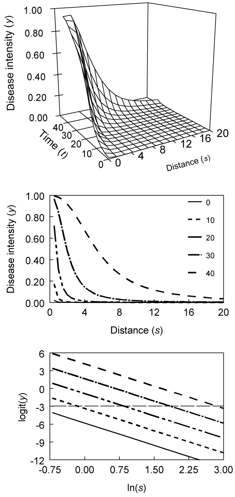{#fig-dg-spatiotemporal-power-logistic}
 ในทุกระยะทางที่เกินกว่า 0 ซึ่งเป็นผลมาจากลักษณะแบบลอจิสติกของ $\partial y / \partial t$ โดย $y$ จะเข้าใกล้ 1 เมื่ออยู่ใกล้กับแหล่งกำเนิดเชื้อ (ในช่วงเวลาที่พิจารณาไว้ในที่นี้) เมื่อเปรียบเทียบกับตัวอย่างในภาพที่ 7.14 จะพบว่าค่า $y$ ลดลงอย่างรวดเร็วและชันกว่ามากเมื่อ $s$ เพิ่มขึ้น เนื่องจากมีพจน์ $s$ เป็นตัวส่วนใน $\partial y / \partial s$ (ดูในกรอบกลางของภาพที่ 7.15) ยิ่งไปกว่านั้น ค่าลอจิตจะลดลงในลักษณะเชิงเส้นสัมพันธ์กับค่า $\ln(s)$ ที่เพิ่มขึ้น โดยมีความชันเท่ากันในทุกช่วงเวลา ตามเงื่อนไขของสมการ 7.36 (กรอบล่างของภาพที่ 7.15) ในตัวอย่างนี้ โดยเฉพาะอย่างยิ่ง ความแตกต่างในแนวตั้งระหว่างเส้นต่างๆ จะคงที่ในทุกๆ ระยะทาง เนื่องจากระยะห่างของเวลาในแต่ละเส้นคือ 10 วัน ($10 \cdot r_L$) ดังที่ได้ชี้แจงไปสำหรับภาพก่อนหน้า ค่าที่แสดงในภาพที่ 7.15 เป็นค่าเดียวกับในเนื้อหาส่วนก่อนหน้าของบทนี้ และแสดงให้เห็นแล้วในภาพที่ 7.10 สิ่งที่ดูเหมือนเป็นการสุ่มเลือกค่า $y_1$ (หรือ $A$) ในภาพที่ 7.10 นั้น แท้จริงแล้วคือค่าทางทฤษฎีสำหรับ $y$ ณ ระยะ $s = 1$ ในช่วงเวลาต่างๆ ที่ถูกเลือกไว้ยังมีโมเดลอื่นๆ อีกมากมายสำหรับ $y(t, s)$ ที่สามารถสร้างขึ้นได้ด้วยการพิจารณาจับคู่สมการเชิงอนุพันธ์ย่อยสำหรับพลวัตของพื้นที่และเวลา แต่ก่อนที่เราจะอภิปรายถึงประโยชน์ของโมเดลที่เป็นไปได้เหล่านี้ เราต้องนำเสนออีกหนึ่งแนวคิดที่มีความสำคัญอย่างยิ่งเสียก่อน ในการอธิบายลักษณะของพลวัตเชิงพื้นที่และเวลา

### 7.6.3 ความเร็วของการแพร่กระจายของโรค (Velocity of Disease Spread)

#### 7.6.3.1 เส้นไอโซพาท (Isopaths)

สมมติว่ามีเชื้อโรคชนิดหนึ่งถูกนำเข้าไปในประชากรโฮสต์ (ที่อายุยืนยาว) ซึ่งแต่เดิมเคยปลอดโรค โดยนำเข้าไปที่ตำแหน่งใดตำแหน่งหนึ่ง (จุด หรือ เส้น) และทำให้โรคตั้งตัวได้สำเร็จ (ดูบทที่ 5) สำหรับโรคที่มีการรุกราน (Invasive diseases) เป็นเรื่องปกติที่เราจะตั้งคำถามว่า: โรคนี้จะแพร่กระจายออกไปจากจุดเริ่มต้นได้เร็วแค่ไหน? เพื่อให้เห็นภาพตามกระบวนการคิดนี้ สมมติต่อไปว่าผู้ประเมินรู้ข้อมูลอย่างสมบูรณ์แบบว่ามีโฮสต์ต้นใดบ้างที่ป่วยในช่วงเวลาที่มีการประเมินโรค (โดยไม่มีต้นไหนตกหล่นไปจากความผิดพลาดในการสุ่มตัวอย่าง และไม่มีการวินิจฉัยสถานะโรคที่ผิดพลาด) โดยกำหนดให้เวลาที่เริ่มมีเชื้อเข้ามาคือ $t = 0$ สมมติว่าระยะทางที่ไกลที่สุด ($s$){#fig-7-15}จากแหล่งเชื้อเริ่มต้น ที่พบโฮสต์ป่วยในระยะเวลา (สัปดาห์) ต่างๆ มีค่าเป็นดังนี้:ระยะทางเหล่านี้สามารถถือเป็นตัวแทนของแนวหน้าการระบาด (Front of the epidemic) ในเวลาที่ระบุได้ ดังเช่นในบทที่ 4 เราใช้สัญลักษณ์ $\Delta$ ในที่นี้เพื่อแสดงถึงผลต่างที่คำนวณได้ระหว่างค่าสองค่าที่อยู่ถัดกัน อัตราการแพร่กระจายของโรคเชิงพื้นที่เทียบกับเวลา ($\Delta s / \Delta t$) ที่คำนวณได้ สามารถหาได้จากการนำผลต่างของระยะทางมาหารด้วยผลต่างของเวลาระหว่างสัปดาห์ที่ 2 และสัปดาห์ที่ 4 โรคแพร่กระจายออกไป 14 เมตร นั่นคือ ในสัปดาห์ที่ 4 โรคได้เคลื่อนตัวออกห่างจากแหล่งกำเนิดไปไกลขึ้นอีก 14 เมตรเมื่อเทียบกับสัปดาห์ที่ 2 ดังนั้น $\Delta s / \Delta t = 14/2 = 7$ เมตร/สัปดาห์ หรือเท่ากับ 1 เมตร/วัน จากตัวอย่างสมมติชิ้นนี้ อัตราการกระจายจะเท่ากันในทุกๆ คู่ของเวลา หากอัตรานี้ดำเนินต่อไปเรื่อยๆ โดยไม่เปลี่ยนแปลง เราก็สามารถคำนวณได้ว่า เมื่อไรโรคจะแพร่กระจายไปถึงระยะ 1 กิโลเมตรจากแหล่งกำเนิดดั้งเดิม ตัวอย่างเช่น คำตอบคือ $1000/7 = 142.9$ สัปดาห์ หรือราวๆ 2.7 ปี ในทำนองเดียวกัน เราอาจตั้งคำถามว่า โรคจะแพร่กระจายไปได้ไกลแค่ไหนในอีก 5 ปีข้างหน้า? หากสมมติว่ามีการปลูกพืชต่อเนื่องในทุกทิศทางและไม่มีผลกระทบจากฤดูกาล และโดยที่เวลา 5 ปีมี 260 สัปดาห์ คำตอบคือ $7 \times 260 = 1,820$ เมตร หรือราวๆ 1.8 กิโลเมตรอัตราการแพร่กระจายของโรคเชิงพื้นที่เทียบกับเวลาที่เราหามานี้ ไม่ได้บอกข้อมูลใดๆ เกี่ยวกับความรุนแรงของโรคที่ระยะทางต่างๆ จากแหล่งกำเนิดเลย เว้นแต่ว่าเราจะตั้งสมมติฐานอื่นๆ เพิ่มเติม หรือมีข้อมูลอื่นเข้ามาประกอบ (ดูรายละเอียดด้านล่าง) ยิ่งไปกว่านั้น ในทางปฏิบัติมักจะเป็นไปได้ยาก (เนื่องจากต้องใช้ทั้งต้นทุนและเวลา) ที่จะประเมินโรคในระยะที่ไกลเพียงพอจากแหล่งกำเนิดเพื่อตามหาโฮสต์ต้นที่อยู่ไกลที่สุดที่เกิดอาการป่วย ตัวอย่างเช่น ในช่วงแรกของตัวอย่างโรคราสนิมถั่ว (Bean rust) ดังแสดงใน @fig-dg-bean-rust-timeseries การประเมินจำนวนจุดนูนของโรค

ราสนิมบนใบไม้ในระยะมากกว่า 9 เมตรจากแหล่งกำเนิดให้ผลที่น่าพอใจ แต่เมื่อเข้าสู่สัปดาห์ที่ 3 ของการระบาด ปรากฏว่าใบไม้ประมาณ 50% ในระยะ 9 เมตรได้ติดเชื้อไปหมดแล้ว ดังนั้น จึงมีความเป็นไปได้สูงมากที่เราจะไม่รู้ตำแหน่งแนวหน้าของการระบาดเลยแนวทางปฏิบัติที่เป็นไปได้จริงในการหาค่า $\Delta s / \Delta t$ คือการเลือกค่าคงที่ (ซึ่งโดยทั่วไปจะเลือกค่าต่ำๆ) ของ $y$ ซึ่งก็คือ $y'$ และดูว่าที่เวลาต่างๆ ที่เราเลือกไว้นั้น เราพบค่า $y'$ ที่ระยะทางใด นอกจากนี้ อาจจะใช้งานได้จริงมากกว่าหากเรานำความรุนแรงของโรคที่แปลงรูปแล้วมาใช้คำนวณ โดยเลือกค่า $y^*$ เฉพาะเจาะจงค่าใดค่าหนึ่ง นั่นคือ $y^{*\prime}$ มาเป็นตัวตั้งในการคำนวณ ลองกลับไปพิจารณา @fig-dg-spatiotemporal-logistic ที่เป็นความลาดชันของโรคแบบลอจิสติก

เมื่อเวลาผ่านไปอีกครั้ง ในกรอบด้านล่าง จะแสดงเส้นแนวนอนบางๆ ซึ่งสอดคล้องกับค่า $y^{*\prime} = -2.944$ หรือ $y' = 0.05$ เส้น (หรือเส้นโค้ง) ที่แสดงระดับความรุนแรงของโรคที่คงที่นี้เรียกว่า เส้นไอโซพาท (Isopath) เส้นแนวนอนไม่ได้ถูกแสดงไว้ในกรอบกลาง เนื่องจากมองเห็นได้ยาก (เพราะอยู่ใกล้กับเส้น 0 มากเกินไป) จุดที่เส้นแนวนอนไปตัดกับเส้นความลาดชัน (หรือเส้นโค้ง) คือระยะทางที่เราพบความรุนแรงของโรคที่ 5% ในช่วงเวลาต่างๆ บนกราฟ ที่ $t = 0$ จะไม่มีระยะทางใดเลยที่พบความรุนแรงของโรคแตะระดับ 5% สำหรับเวลาอื่นๆ ที่แสดงบนกราฟ จะพบในระยะทางต่อไปนี้ (สมมติให้หน่วยของเวลาคือวัน และระยะทางคือเมตร):เมื่ออ้างอิงจากผลลัพธ์ที่เฉพาะเจาะจงเหล่านี้ เราสามารถคำนวณ $\Delta s / \Delta t$ ได้เท่ากับ 0.625 เมตร/วัน ตัวอย่างเช่น ระหว่างวันที่ 30 ถึง 40 เราจะได้: $(19.13 - 12.88) / 10 = 0.625$ ระยะทางที่แสดงในที่นี้ถูกทำเป็นทศนิยมสองตำแหน่ง แม้ว่าจากความลาดชันที่สังเกตได้จริง (เช่น ภาพที่ 7.13) ผู้ประเมินจะไม่สามารถวัดค่าให้แม่นยำได้ถึงระดับนี้ก็ตาม (ในภายหลังเราจะแสดงให้เห็นว่าเราได้ค่าระยะทางที่แม่นยำระดับนี้มาได้อย่างไร) ยิ่งไปกว่านั้น เมื่อพิจารณาว่าการสังเกตโรคจะกระทำในระยะทางและเวลาที่กำหนดไว้ (ตายตัว) จึงเป็นไปได้อย่างมากที่เราจะไม่ได้พบความรุนแรงที่ระดับ 5% เป๊ะๆ ในระยะทางใดๆ เลย สถานการณ์นี้จึงต้องอาศัยการประมาณค่าในช่วง (Interpolation) หรือใช้คำอธิบายจากโมเดลเข้ามาช่วย{#fig-7-16}ก่อนที่จะไปอภิปรายถึงผลลัพธ์ของโมเดล เรากลับมาพิจารณาภาพที่ 7.15 ซึ่งเกี่ยวข้องกับความลาดชันประเภทเพาเวอร์-ลอจิสติกกันอีกรอบ เส้นแนวนอนยังคงเป็น $y^{*\prime} = -2.944$ เช่นเดิม (สำหรับ $y' = 0.05$) ส่วนค่าลอการิทึมของระยะทาง $\ln(s')$ สามารถอ่านได้จากจุดตัด และค่า $s'$ สามารถคำนวณย้อนกลับจาก $\exp(\ln(s'))$:แม้ว่าความแตกต่างของ $\ln(s')$ ในแต่ละช่วงเวลาจะคงที่ในกรณีนี้ แต่ผลต่างของค่า $s'$ กลับเพิ่มขึ้นเรื่อยๆ ในแต่ละช่วงเวลาที่ถัดกัน นั่นก็คือ ยิ่งระยะทางห่างจากแหล่งกำเนิดมากเท่าใด หรือยิ่งเวลาผ่านไปนานเท่าไรตั้งแต่เริ่มเกิดการระบาด อัตรา $\Delta s / \Delta t$ ก็จะยิ่งมีค่ามากขึ้นเท่านั้น ตัวอย่างเช่น ในช่วงระหว่างวันที่ 30 ถึง 40 อัตรา $\Delta s / \Delta t$ จะมีค่าเท่ากับ 1.1 เมตร/วัน แต่ในช่วงระหว่างวันที่ 10 ถึง 20 อัตรา $\Delta s / \Delta t$ จะมีค่าเพียง 0.15 เมตร/วัน ค่าของระยะทางสำหรับทั้งสองกรณี ถูกแสดงไว้ใน @fig-dg-isopath-distance

 ควบคู่กับเส้นแนวโน้มซึ่งความหมายจะถูกอธิบายให้ชัดเจนในอีกไม่ช้าในเมื่อตอนนี้เรากำลังรับมือกับการเปลี่ยนแปลงของระยะทาง ณ จุดที่เราพบค่า $y$ ที่ไม่เป็นศูนย์ และมีค่า จำเพาะเจาะจง ค่าหนึ่ง ($y'$) การเขียนแทนอัตราการเปลี่ยนแปลงด้วยสัญลักษณ์ $\Delta s' / \Delta t$ จึงน่าจะแม่นยำกว่า เหตุผลก็คือ ผลลัพธ์อาจขึ้นอยู่กับความรุนแรงของโรคที่เลือกใช้ อย่างไรก็ตาม ยกเว้นในบางกรณี สัญลักษณ์พิเศษเพิ่มเติมดังกล่าวก็มักจะไม่จำเป็นต้องนำมาใช้

#### 7.6.3.2 พลวัตความเร็วของแบบจำลองทั้งสอง (Two Models)

เมื่อใช้โมเดลเพื่อพัฒนาโรคทั้งในเชิงเวลา ($\partial y / \partial t$) และเชิงพื้นที่ ($\partial y / \partial s$) ในหัวข้อ 7.6.2

การอธิบายคุณลักษณะของอัตราการแพร่กระจายเชิงพื้นที่ของโรคเมื่อเวลาผ่านไป จึงกลายเป็นเรื่องตรงไปตรงมา ดังที่ได้อภิปรายไปในหัวข้อ 7.6.2 ข้างต้น เราจะใช้อนุพันธ์ย่อยร่วมกับโมเดลเชิงกำหนด (Deterministic models) เพื่อแสดงอัตราการเปลี่ยนแปลงของตัวแปรใดๆ ที่มีตัวแปร "อิสระ" (Independent variables) สองตัว ($t$ และ $s$) เราสามารถแสดงให้เห็นได้ (Jeger, 1983) ว่าอัตราการเคลื่อนที่ของเส้นไอโซพาทคือ:สำหรับกระบวนการเชิงพื้นที่และเวลาทั่วไป ดังเช่นกระบวนการที่เป็นตัวแทนด้วยสมการ 7.28a จะเป็นประโยชน์อย่างยิ่งหากเรามอง $\partial s / \partial t$ เป็น ความเร็ว (Velocity) เนื่องจากมีหน่วยเป็นระยะทางต่อเวลา อย่างเจาะจงเลยก็คือ $\partial s / \partial t$ ถือเป็นความเร็ว (Velocity หรือ Speed) ของการเคลื่อนที่ของเส้นไอโซพาท เป็นตัวบอกว่าโรคในระดับหนึ่งๆ จะเคลื่อนตัวจากตำแหน่งหนึ่งไปยังอีกตำแหน่งหนึ่งด้วยความเร็วเท่าใด หรืออธิบายถึงอัตราการขยายตัวของแหล่งกำเนิดโรค (Disease focus) ค่า $\Delta s / \Delta t$ ที่คำนวณไว้ข้างต้นสำหรับเวลาและระยะทางที่เจาะจง จะถูกแทนที่ด้วยอนุพันธ์ย่อย $\partial s / \partial t$ เนื่องจากเราสมมติให้ $y(t, s)$ แทนด้วยฟังก์ชันต่อเนื่อง เราสามารถมองว่าการคำนวณ $\Delta s / \Delta t$ เป็นการประมาณค่าของ $\partial s / \partial t$ ได้ เมื่อเรานำรูปแบบโมเดลใดๆ มาประยุกต์ใช้ในสมการ 7.28a (ซึ่งในที่นี้เทียบเท่ากับการเลือกคู่ฟังก์ชันของ $\partial y / \partial t$ และ $\partial y / \partial s$) เราจะสามารถระบุการเคลื่อนที่เชิงพื้นที่หรือการแพร่กระจายของโรคได้โดยตรงจากการใช้สมการ 7.37เมื่อใช้สมการลอจิสติก 7.29 สำหรับ $\partial y / \partial t$ และสมการลอจิสติก 7.31 สำหรับ $\partial y / \partial s$ (ซึ่งมีคำตอบตามที่ให้ไว้ในสมการ 7.33) เราจะได้นิพจน์สำหรับความเร็วที่เรียบง่ายมากๆ เมื่ออิงตามสมการ 7.37:{#fig-7-17}
เนื่องจากทั้งตัวเศษและตัวส่วนต่างก็เป็นค่าคงที่ สมการ 7.37 จึงชี้ให้เห็นว่า $\partial s / \partial t$ เป็นค่าคงที่ ($C = r_L / b_L$) โดยมีหน่วยเป็นระยะทางต่อเวลา นี่หมายความว่า ที่ระดับความรุนแรงโรคคงที่ใดๆ ($y'$) หรือแบบที่แปลงรูปแล้ว ($y^{*\prime}$) โรคจะเคลื่อนที่ไปเป็นระยะทางที่คงที่ในช่วงเวลาที่คงที่เสมอ สำหรับตัวอย่างในภาพที่ 7.14 ผลต่างในแนวนอนระหว่างเส้นหรือเส้นโค้งที่ถัดกัน (ซึ่งเป็นระยะเวลาที่เพิ่มขึ้นทีละ 10 วัน) จะมีระยะห่างเท่ากันหมด ซึ่งมีค่าเท่ากับ $C$ คูณด้วยผลต่างของเวลา นั่นคือ: $(0.25/0.4) \times 10 = 6.25$ เมตร ถึงแม้ว่าตัวอย่างที่เราลองทำนี้จะคำนวณบนฐานค่า $y' = 0.05$ แต่เราก็สามารถเลือกใช้เส้นไอโซพาทในระดับอื่นๆ ได้เช่นกัน ระยะทางที่วัดได้จริงอาจจะต่างกันออกไป (เช่น $y' = 0.5$ จะอยู่ในระยะที่ใกล้กับแหล่งกำเนิดมากกว่า $y' = 0.01$) แต่ระยะทางที่เปลี่ยนแปลงไปในแต่ละช่วงเวลาจะยังมีค่าเท่าเดิม (สำหรับโมเดลนี้)การหาปริพันธ์ของสมการ 7.38 นำไปสู่นิพจน์เส้นตรงในรูป $s_0 + (r_L / b_L) \cdot t$ โดยที่ $s_0$ คือค่าคงที่ของการหาปริพันธ์ ซึ่งสอดคล้องกับระยะทางที่พบ $y'$ ณ เวลา $t = 0$ สำหรับตัวอย่างนี้ ค่า $y$ ที่ $t = 0$ มีค่าน้อยกว่า 0.05 ในทุกๆ ระยะทาง แม้กระทั่งที่ตำแหน่งแหล่งกำเนิดก็ตาม ดังนั้น $s_0$ จึงไม่จำเป็นต้องมีการตีความทางกายภาพแบบตรงไปตรงมาเสมอไป เส้นตรง (ที่มีความชันเท่ากับ $r_L / b_L$) ถูกแสดงไว้ใน @fig-dg-isopath-distance พร้อมกับระยะทางเจาะจงที่เราหามาได้ก่อนหน้านี้

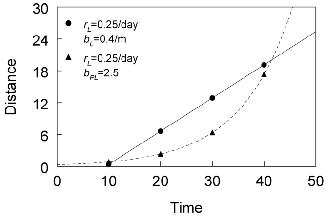{#fig-dg-isopath-distance}
 หากเราเลือกค่า $y'$ ที่น้อยกว่า 0.05 จุดต่างๆ และเส้นตรงจะเลื่อนสูงขึ้น (เนื่องจากความรุนแรงที่ต่ำจะถูกพบในระยะที่ไกลจากแหล่งกำเนิดมากกว่า) ในทางกลับกัน สำหรับค่า $y'$ ที่เลือกให้มากกว่า 0.05 จุดและเส้นตรงจะเลื่อนต่ำลงมา (เนื่องจากโรคระดับที่รุนแรงจะถูกพบในบริเวณที่ใกล้แหล่งกำเนิดมากกว่า)เมื่อ $\partial s / \partial t$ มีค่าคงที่ เราสามารถกล่าวได้ว่าโรคแพร่กระจายในลักษณะ คล้ายคลื่น (Wave-like manner) (Diekmann, 1978; Thieme, 1977) และการระบาดลุกลามเป็นเสมือนคลื่นที่เดินทางกระจายออกไปด้วยความเร็ว $C$ (Traveling wave) ลักษณะนี้สามารถสังเกตเห็นได้จากกรอบด้านบนของ @fig-dg-isopath-radial-expansion ซึ่งสอดคล้องกับค่าเดียวกับใน

ภาพที่ 7.16 แต่ใช้เจาะจงกรณีแหล่งกำเนิดแบบจุด (Point source) (ที่กึ่งกลางของแปลงปลูก) เส้นไอโซพาทของค่า $y' = 0.05$ จะขยายรัศมีเพิ่มขึ้นจากจุดศูนย์กลางอย่างสม่ำเสมอด้วยอัตรา $C = 0.625$ เมตร/วันทีนี้ ลองพิจารณาสถานการณ์ที่เราใช้โมเดลเพาเวอร์-ลอจิสติกเพื่ออธิบายความลาดชันของโรค (สมการ 7.32) และใช้โมเดลลอจิสติกสำหรับการพัฒนาของโรคตามกาลเวลา (สมการ 7.29) อีกนัยหนึ่ง เราพิจารณาให้สมการ 7.35 เป็นคำตอบสำหรับ $y(t, s)$ ในสมการ 7.28a เมื่อประยุกต์ใช้สมการ 7.37 จะได้ผลลัพธ์ดังนี้:เพื่อหาอัตราการเคลื่อนที่ของเส้นไอโซพาท โปรดสังเกตว่า เนื่องจาก $b_{PL}$ เป็นค่าที่ไม่มีหน่วย ค่า $\nu$ (ซึ่งเท่ากับ $r_L / b_{PL}$) จึงมีหน่วยเป็น 1/เวลา ดังนั้น $\nu \cdot s$ จึงเป็นความเร็ว ไม่ใช่แค่ตัว $\nu$ อย่างเดียว สมการ 7.39 มีความคล้ายคลึงกับนิพจน์ที่พบในสมการ 7.38 ยกเว้นประเด็นสำคัญที่ว่าความเร็วนั้นแปรผันตรงกับระยะทาง นั่นก็คือ หากกำหนดให้ปัจจัยอื่นๆ มีค่าเท่ากันหมด $\partial s / \partial t$ (ความเร็ว) จะเพิ่มขึ้นตามค่า $s$ ที่เพิ่มขึ้น นี่คือสถานการณ์เดียวกับที่พบเป๊ะในภาพที่ 7.15 คำตอบของสมการนี้ถูกกำหนดไว้ดังนี้: โดยที่ค่าคงที่ของการหาปริพันธ์ ($s_0$) คือระยะทางทางทฤษฎี ณ เวลา $t = 0$ ซึ่งเกิดค่า $y'$ ขึ้น การหาอนุพันธ์ของสมการนี้เทียบกับเวลา จะได้เป็นอีกวิธีการหนึ่งในการแสดงออกถึงความเร็วของการขยายตัวของโรค:$C(t) = (r_L/b_{PL}) s_0 \exp[(r_L/b_{PL})t]$ข้อสังเกต: เราได้ระบุสัญลักษณ์ความเร็วให้เป็น $C(t)$ อย่างชัดเจน เพื่อเน้นย้ำความหมายแฝงของสมการ 7.39 ที่ว่าความเร็วจะเพิ่มขึ้นตามเวลาที่ล่วงเลยไปนับตั้งแต่จุดเริ่มต้นการระบาด ด้วยเหตุที่ความเร็วขึ้นอยู่กับระยะทาง รัศมีเส้นไอโซพาทจึงเพิ่มขึ้นแบบเอกซ์โพเนนเชียลตาม เวลา ดังที่เห็นได้จากเส้นโค้งประ (Broken curve) ในภาพที่ 7.16 สำหรับสถานการณ์ในอุดมคติของการมีแหล่งกำเนิดโรคแบบจุดเดียว ดังแสดงใน @fig-dg-isopath-radial-expansion เราจะสังเกตเห็นว่าความต่างของรัศมีวงกลมจะกว้างขึ้น

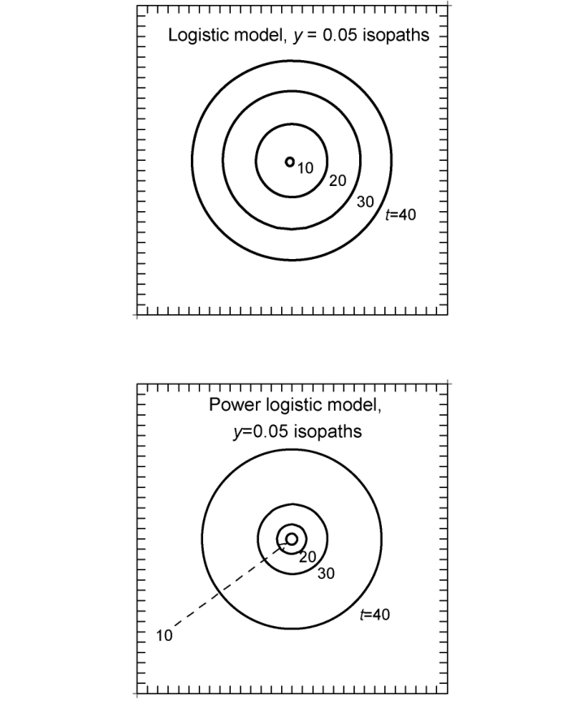{#fig-dg-isopath-radial-expansion}
เรื่อยๆ เมื่อเวลาผ่านไปการระบาดที่มีลักษณะตามสมการ 7.39 เรียกว่าเป็นการระบาดที่มีการแพร่กระจายแบบ ไม่คล้ายคลื่น (Non-wave-like manner) เนื่องจากมีการเร่งความเร็วของการเคลื่อนที่ในเส้นไอโซพาท (Minogue, 1989) ในขณะที่ Ferrandino (1993) อ้างถึงสิ่งนี้ว่าเป็นการแพร่กระจายแบบ คลื่นกระจาย (Dispersive wave spread)เป็นเรื่องสำคัญที่ต้องสังเกตว่า สำหรับทั้งสมการ 7.38 และ 7.39 ค่า $\partial s / \partial t$ แปรผันตรงกับ $r_L$ นี่หมายความว่า ความเร็วในการแพร่กระจายเชิงพื้นที่จะเพิ่มขึ้นตามการเพิ่มขึ้นของโรคในเชิงเวลา (ในบริเวณที่พบโรค) ตัวอย่างเช่น หากเปรียบเทียบโรคชนิดที่ 1 กับโรคชนิดที่ 2 แล้วพบว่า ประสิทธิภาพการติดเชื้อสูงกว่า ระยะแฝง (Latent period) สั้นกว่า หรืออัตราการสร้างสปอร์ต่อบาดแผล (Sporulation rate per lesion) ของโรค 1 มีค่าสูงกว่า ดังนั้นค่า $\partial s / \partial t$ ของโรคที่ 1 ก็จะสูงกว่าโรคที่ 2 เช่นกัน ในทางกลับกัน $\partial s / \partial t$ จะแปรผกผันกับ $b^*$ (ทั้ง $b_L$ หรือ $b_{PL}$) ในโมเดลทั้งสอง เนื่องจาก $b_L$ เป็นหน่วยวัดระดับความชันของความลาดชัน จึงสมเหตุสมผลที่ความเร็วของเส้นไอโซพาทจะเพิ่มขึ้นเมื่อค่า $b_L$ ลดลง ยกตัวอย่างเช่น หากโดยเฉลี่ยแล้วสปอร์ของเชื้อโรคชนิดที่ 1 สามารถลอยปลิวไปได้ไกลกว่าเชื้อโรคชนิดที่ 2 ดังนั้นค่า $1/b_L$ ของเชื้อที่ 1 จึงใหญ่กว่าของเชื้อที่ 2 ส่งผลให้ได้ค่า $\partial s / \partial t$ ของเชื้อที่ 1 มากกว่าเชื้อที่ 2 ด้วย สำหรับพารามิเตอร์ $b_{PL}$ ที่ไม่มีหน่วย การตีความอาจจะยากขึ้นมาสักเล็กน้อย ดังที่เคยอภิปรายไว้สำหรับ $b_P$ ในหัวข้อโมเดลความลาดชันของการแพร่กระจาย (Dispersal gradient models) และโมเดลการกระจายตัวของการสัมผัส (Contact distribution models) อย่างไรก็ตาม เนื่องจาก $b_P$ เป็นตัวกำหนดลักษณะความชันของความลาดชันบนสเกลของล็อกระยะทาง (Log distance scale) (ในสถานการณ์เช่นนี้) เราจึงสามารถตีความค่า $b_P$ ได้ในทำนองเดียวกับ $b_L$ เมื่อพิจารณาในแง่ของความเร็วในการแพร่กระจาย (ในรูปของล็อก)

### 7.6.4 แบบจำลองเชิงพื้นที่และเวลาอื่นๆ (Other Models)

รูปแบบจำลองเชิงพื้นที่และเวลา (Spatio-temporal models) ในสมการที่ 7.33 และ 7.35 ถูกเลือกมาเพื่อใช้เป็นตัวอย่างอธิบายในหัวข้อก่อนหน้านี้ เนื่องจากทั้งสองสมการนี้สร้างขึ้นจากรูปแบบจำลองที่ใช้กันทั่วไปสำหรับองค์ประกอบด้านเวลาและพื้นที่ของการระบาด และยังสามารถอธิบายลักษณะสำคัญบางประการของความเร็วในการเคลื่อนที่ของโรค (velocity of disease movement) ได้อย่างครบถ้วน แน่นอนว่า เราสามารถ (หรือควร) นำสมการเชิงอนุพันธ์ย่อย (partial differential equations) คู่เจาะจงรูปแบบอื่นๆ มาพิจารณาเป็นองค์ประกอบของสมการที่ 7.28a ด้วยเช่นกัน ยกตัวอย่างเช่น ลองพิจารณาสถานการณ์ที่พัฒนาการของโรคเมื่อเวลาผ่านไปอยู่ในรูปแบบโมโนโมเลกุล (monomolecular form) (สมการที่ 7.30) และความลาดชันของโรค (disease gradients) แสดงได้ด้วย $\partial y / \partial s = b_{PM}(1 - y)/s$ (รูปแบบพาวเวอร์-โมโนโมเลกุล (power-monomolecular type)) เมื่อประยุกต์ใช้สมการที่ 7.37 เราจะได้ผลลัพธ์ดังนี้:ซึ่งจะเหมือนกับสมการที่ 7.39 ทุกประการ เพียงแต่ใช้สัญลักษณ์สำหรับพารามิเตอร์ที่แตกต่างกันเท่านั้น ในทำนองเดียวกัน การจับคู่รูปแบบจำลองเชิงเวลาแบบโมโนโมเลกุล เข้ากับรูปแบบจำลองแบบโมโนโมเลกุลแท้ๆ สำหรับความลาดชัน [$b_M(1 - y)$] จะส่งผลให้ได้ความเร็วคงที่ ($r_M / b_M$)แต่จะเกิดอะไรขึ้นถ้าพัฒนาการของโรคเชิงเวลาเป็นรูปแบบโมโนโมเลกุล (สมการที่ 7.30) และความลาดชันเป็นรูปแบบลอจิสติก (logistic type) (สมการที่ 7.31)? ผลลัพธ์ที่ได้คือ:สมการความเร็วนี้มีลักษณะสำคัญบางประการร่วมกับสมการอื่นๆ ที่เราเคยพิจารณามาแล้ว นั่นคือ $\partial s / \partial t$ จะเพิ่มขึ้นตามอัตราการเพิ่มขึ้นของโรคตามเวลา ($r_M$) และจะเพิ่มขึ้นเมื่อความชัน (steepness) ของความลาดชันของโรคลดลง ($1/b_L$) อย่างไรก็ตาม ความเร็วนี้ยังมีความสัมพันธ์ผกผัน (reciprocal) กับความรุนแรงของโรค (disease intensity) ด้วย นั่นคือ $\partial s / \partial t$ จะเป็นฟังก์ชันของ $y$ โดยที่ $\partial s / \partial t$ จะมีค่ามากกว่าในระดับความรุนแรงต่ำเมื่อเทียบกับระดับความรุนแรงสูง สำหรับสถานการณ์นี้ เราจะได้อัตราการขยายตัวของโรค (disease expansion rate) ที่แตกต่างกันออกไปสำหรับค่าของโรคแต่ละค่าที่ระบุไว้โดยเฉพาะ ($y'$) ในกรณีเช่นนี้ เราสามารถระบุให้ชัดเจนยิ่งขึ้นได้โดยเรียกความเร็วนั้นว่า $\partial s' / \partial t$เพื่อให้เข้าใจถึงความเร็วที่ขึ้นอยู่กับตัวโรค (disease-dependent velocities) ได้ดียิ่งขึ้น ลองพิจารณากราฟที่มีลักษณะคล้ายกับกรอบตรงกลางของรูปที่ 7.14 ซึ่งสอดคล้องกับผลเฉลยของสมการที่ 7.40 หากเราลากเส้นแนวนอนที่ค่า $y'$ ต่างๆ กัน แล้วคำนวณหาค่า $\Delta s' / \Delta t$ สำหรับแต่ละเส้น เราจะพบว่าค่า $\Delta s' / \Delta t$ ที่ได้จะมีค่ามากกว่าเมื่อ $y'$ มีค่าน้อยเมื่อเทียบกับตอนที่ $y'$ มีค่ามากJeger (1983) ได้แสดงให้เห็นถึงการจับคู่สมการที่น่าสนใจรูปแบบอื่นๆ สำหรับองค์ประกอบด้านเวลาและพื้นที่ของการระบาด แต่โดยทั่วไปแล้ว การจับคู่สมการเชิงอนุพันธ์ย่อยนั้นอาจไม่สามารถนำไปสู่ผลเฉลยเชิงวิเคราะห์ (analytical solution) สำหรับ $y(t, s)$ ได้เสมอไป (สมการที่ 7.28a, b) สถานการณ์จริงอาจมีความซับซ้อนมากยิ่งกว่านั้น ตัวอย่างเช่น ในบทนี้เราได้ตั้งสมมติฐานไว้ว่า พจน์ระดับประชากรสำหรับอัตราการเปลี่ยนแปลงตามเวลาและตามพื้นที่ ($r^*$ และ $b^*$) นั้นเป็นค่าคงที่ แต่นั่นก็ไม่ได้เป็นเช่นนั้นเสมอไป ยกตัวอย่างเช่น ถึงแม้ว่า $y$ จะเพิ่มขึ้นในรูปแบบลอจิสติกทั่วทั้งประชากร แต่ $r_L$ ก็อาจไม่ใช่ค่าตายตัว โดยอาจขึ้นอยู่กับระยะห่างจากแหล่งเชื้อเริ่มต้น (original inoculum source) และโดยเฉพาะอย่างยิ่ง $r_L$ อาจจะเพิ่มขึ้นหรือลดลงตามค่า $s$ ก็ได้ เราสามารถเขียนแทนด้วย $r_L(s)$ เพื่อแสดงให้เห็นว่า $r_L$ เป็นฟังก์ชันของ $s$ ซึ่งสามารถประเมินได้โดยตรงด้วยการวิเคราะห์เส้นโค้งพัฒนาการของโรค (disease progress curves) ณ แต่ละ จุดเก็บตัวอย่าง (เช่น การตัดแบ่ง $y$ ในแนวตั้งดังรูปที่ 7.11) ในพื้นที่ปลูก เพื่อดูว่าค่าประมาณของ $r_L$ เปลี่ยนแปลงอย่างเป็นระบบตามระยะทางหรือไม่ เพื่อเพิ่มความซับซ้อนเข้าไปอีก $r_L$ ยังอาจเปลี่ยนแปลงไปตามเวลาได้ด้วย ส่งผลให้ค่า $r_L$ ในช่วงแรกและช่วงท้ายของการระบาดมีค่าแตกต่างกัน สิ่งนี้สามารถเขียนแทนด้วย $r_L(t, s)$ โปรดสังเกตว่า หาก $r_L$ แปรผันอย่างเป็นระบบตามเวลา เส้นโค้งพัฒนาการของโรคก็มักจะปรากฏออกมาในรูปแบบที่ไม่ใช่รูปร่างแบบลอจิสติกยิ่งไปกว่านั้น ความลาดชันของโรคอาจจะมีธรรมชาติเป็นแบบลอจิสติก (หรือ พาวเวอร์-ลอจิสติก) อยู่ตลอดเวลา แต่มีพจน์ $b_L$ (หรือ $b_{PL}$) ที่เป็นฟังก์ชันของเวลา นั่นคือ $b_L(t)$ [หรือ $b_{PL}(t)$] เราได้ประเมินเรื่องนี้โดยตรงจากตัวอย่างรูปแบบพาวเวอร์-ลอจิสติกในรูปที่ 7.11 และพบหลักฐานบางอย่างที่บ่งชี้ว่าความชันลดลงตามเวลาจริงๆ นอกจากนี้ $b_L$ (หรือ $b_{PL}$) ยังสามารถแปรผันตามระยะทางได้ด้วย ส่งผลให้อัตราการลดลงของ $y$ บริเวณใกล้แหล่งกำเนิดโรคนั้นแตกต่างจากบริเวณที่อยู่ห่างออกไป ซึ่งสามารถเขียนได้เป็น $b_L(s)$ [หรือ $b_{PL}(t, s)$] สถานการณ์แบบหลังสุดนี้มักจะปรากฏออกมาในรูปแบบของความลาดชันของโรคที่ไม่ใช่ลอจิสติก (หรือไม่ใช่พาวเวอร์-ลอจิสติก) เมื่อพิจารณาในแต่ละช่วงเวลาแยกกันประเด็นสำคัญของเรื่องนี้ก็คือ พลวัตเชิงพื้นที่และเวลาของโรค (spatio-temporal dynamics of disease) สามารถมีความซับซ้อนได้อย่างมาก และอาจเป็นเรื่องท้าทายเอามากๆ ในการค้นหารูปแบบจำลองที่ค่อนข้างเรียบง่าย (เช่น สมการที่ 7.33 หรือ 7.35) เพื่อใช้แสดงถึงพลวัตของโรคทั้งในเชิงพื้นที่และเวลา ที่สามารถอธิบายได้อย่างสมเหตุสมผลตามหลักชีววิทยาประชากร (population biology) แม้ว่าพลวัตเชิงเวลาล้วนๆ และความลาดชันของโรคจะสามารถอธิบายได้เป็นอย่างดีด้วยรูปแบบจำลองมาตรฐาน (เช่น แบบลอจิสติก) แต่การจะระบุคุณลักษณะของพลวัตเชิงพื้นที่และเวลาที่เกิดขึ้นจากตัวแปรเหล่านั้นก็ยังคงเป็นงานที่ยากลำบากอยู่ดี ท้ายที่สุดแล้ว การสร้างรูปแบบจำลองแบบการแพร่กระจาย (diffusion modeling) และ/หรือ การสร้างรูปแบบจำลองแบบอินทิกรัล (integral modeling) ก็ถือเป็นสิ่งจำเป็น ดังที่จะนำเสนอในบทถัดไป แต่อย่างไรก็ตาม รูปแบบจำลองที่นำเสนอไว้ ณ ที่นี้ก็ถือเป็นจุดเริ่มต้นที่สมเหตุสมผล ในการทำความเข้าใจเกี่ยวกับการระบาด ตลอดจนใช้เพื่ออธิบายและเปรียบเทียบพัฒนาการของโรคทั้งในเชิงพื้นที่และเวลาได้อย่างดีเยี่ยม

### 7.6.5 การวิเคราะห์และการประยุกต์ใช้ (Analysis)

ดังที่ได้แสดงให้เห็นข้างต้น เราสามารถกำหนดความเร็วการเคลื่อนที่ของแนวเส้นความรุนแรงของโรคเท่ากัน (velocity of isopath movement) เชิงประจักษ์ (empirically) สำหรับการระบาดหนึ่งๆ ได้ในรูป $\Delta s / \Delta t$ โดยการเลือกค่าเฉพาะของ $y$ คือ $y'$ (หรือ $y^{*\prime}$) และหาระยะทางที่ค่านี้ปรากฏขึ้น ณ ช่วงเวลาการประเมินที่แตกต่างกัน การเปลี่ยนแปลงของระยะทางหารด้วยการเปลี่ยนแปลงของเวลา ก็คือตัวชี้วัดความเร็วนั่นเอง โดยทั่วไปแล้ว เรามักจะใช้ค่า $y'$ ที่มีค่าน้อย เนื่องจากสิ่งที่เราให้ความสนใจมากที่สุดมักจะเป็นการเคลื่อนตัวของแนวหน้าการระบาด (front of the epidemic) ตัวเลือกที่เหมาะสมคือ $y' = 0.05$ หรือ $y' = 0.10$ การใช้ค่าที่น้อยกว่านี้มากๆ อาจนำไปสู่ผลลัพธ์ที่สร้างความเข้าใจผิดได้ อันเนื่องมาจากความแม่นยำต่ำของค่า $y$ ที่ประเมินได้ (ดูในบทที่ 10) ในการตรวจสอบว่า $\Delta s' / \Delta t$ ได้รับผลกระทบจากความรุนแรงของโรคหรือไม่นั้น เราสามารถทำการคำนวณสำหรับค่า $y'$ ค่าอื่นๆ ได้ด้วย (เช่น 0.25, 0.5)เมื่อพยายามประยุกต์ใช้ระเบียบวิธีนี้กับชุดข้อมูลตัวอย่างในรูปที่ 7.11 เราจะมองเห็นความยากลำบากที่เกิดขึ้นได้ทันที หากใช้ค่า $y' = 0.05$ (หรือ $\text{logit}(y') = -2.94$) เราจะสามารถระบุค่า $\Delta s / \Delta t$ ได้เฉพาะระหว่างเวลาที่ 1 และ 8 เท่านั้น (ผ่านการประมาณค่าในช่วง หรือ interpolation) เนื่องจากในเวลาต่อจากนั้น ค่า $y$ ทั้งหมดล้วนมีค่าเกิน 0.05 ไปแล้วทั้งสิ้น แต่ถ้าหากเลือกใช้ $y' = 0.6$ เราก็จะสามารถกำหนดอัตราการเคลื่อนที่ของแนวเส้น isopath ระหว่างช่วงเวลาต่างๆ ได้หลากหลายช่วงมากยิ่งขึ้น อย่างไรก็ตาม หากอัตราดังกล่าวขึ้นอยู่กับ $y$ การทราบถึงการเคลื่อนที่ของ isopath ที่ 0.6 ก็อาจมีความน่าสนใจน้อยกว่า isopath ที่ 0.05 (ซึ่งหมายถึงจุดที่อยู่ใกล้กับแนวหน้าของการระบาดมากกว่า)เราสามารถใช้รูปแบบจำลองที่ปรับเข้ากันกับข้อมูลความลาดชัน (fitted to the gradient data) มาใช้หาระยะทางที่ทำให้ได้ค่า $y'$ ตามที่ต้องการได้ ตัวอย่างเช่น สมมติว่ารูปแบบจำลองความลาดชันแบบพาวเวอร์-ลอจิสติกมีความเหมาะสมกับข้อมูล (สมการที่ 7.23) และเราเลือกใช้ค่าประมาณของพารามิเตอร์ดังที่แสดงไว้ก่อนหน้านี้สำหรับข้อมูลในรูปที่ 7.13 เราจะสามารถกำหนดได้ว่าระยะทางที่สอดคล้องกันคือโปรดสังเกตว่ามีการใช้ฟังก์ชันเอกซ์โพเนนเชียลในส่วนนี้ เนื่องจากเพียงแค่จัดเรียงสมการที่ 7.23 ใหม่ เราก็จะได้นิพจน์สำหรับ $\ln(s')$ แล้ว นอกจากนี้ ค่าดังกล่าวสามารถหาได้จากการจัดเรียงสมการไม่เชิงเส้น (nonlinear equation) ที่ 7.22 ใหม่ได้ด้วยเช่นกัน [โดยมีการใช้ $\hat{A}_{PL} = \exp(-\hat{A}^*_{PL}) = 1.35$] ซึ่งแท้จริงแล้ว นี่คือรูปแบบการคำนวณที่ใช้เพื่อหาค่า $s'$ ทศนิยมสองตำแหน่งในหัวข้อ 7.6.3.1 สำหรับความลาดชันของโรคในอุดมคติที่แสดงในรูปที่ 7.14 และ 7.15 แต่หากเราทำการคำนวณนี้สำหรับรูปแบบจำลองเชิงพื้นที่และเวลาแบบลอจิสติก (สมการที่ 7.34) เราก็ไม่จำเป็นต้องดำเนินการทางเอกซ์โพเนนเชียลแต่อย่างใดระยะทางที่คำนวณได้ ณ ที่นี้ ถือว่าไกลเกินกว่าระยะทางสูงสุดที่ใช้ในการศึกษาเป็นอย่างมาก (รูปที่ 7.13) และเมื่อพิจารณาถึงความไม่แน่นอนเกี่ยวกับความเหมาะสมของรูปแบบจำลองในระยะทางไกลๆ ด้วยแล้ว ผลลัพธ์นี้ก็อาจจะเชื่อถือไม่ได้มากนัก เหตุผลที่ค่าประมาณของ $s'$ มีค่าสูงมาก ก็เนื่องมาจากความลาดชันที่ตื้นมากๆ (ค่า $dy/ds$ ที่น้อย) ในระยะทางไกล สำหรับกระบวนการของรูปแบบจำลองประเภทพาวเวอร์ (power-type model) สำหรับข้อมูลในรูปที่ 7.13 นักวิจัยที่ต้องการประเมินการขยายตัวของโรคเมื่อเวลาผ่านไป จะทำงานได้ง่ายขึ้นมาก หากเลือกใช้ค่าความรุนแรงของโรคที่มากกว่า 0.25 เป็นค่า $y'$ สาเหตุก็เพราะว่า ระยะทางที่คำนวณได้จะอยู่ในช่วงระยะทาง (ส่วนใหญ่) ที่ถูกใช้ในการศึกษานี้นั่นเองการใช้ค่า $s'$ ที่คำนวณได้สำหรับแต่ละช่วงเวลา โดยอิงจากค่าประมาณของพารามิเตอร์ของรูปแบบจำลองความลาดชันของโรคที่เลือก จะทำให้เราสามารถคำนวณค่า $\Delta s / \Delta t$ ได้ในภายหลัง กล่าวอีกนัยหนึ่ง ค่า $s'$ ที่คำนวณได้จากการจัดเรียงสมการใหม่นี้ จะถูกนำมาใช้ประหนึ่งว่าเป็นระยะทางที่สังเกตได้จริง หากเราใช้ $y' = 0.6$ (นั่นคือ $y^{*\prime} = 0.405$) และใช้ค่าประมาณพารามิเตอร์ที่ได้เมื่อมีความชันแตกต่างกันในแต่ละช่วงเวลา เราจะได้ค่าประมาณ $s'$ ดังที่แสดงไว้ในตารางที่ 7.1 ความแตกต่างของ $s'$ ระหว่างช่วงเวลาต่างๆ คือ 1.3, 3.0, 3.2, และ 15.6 เมตร ตลอดการประเมินทั้งห้าครั้งหลังสุด เมื่อนำค่าเหล่านี้มาหารด้วย 7 วัน (ซึ่งเป็นความแตกต่างของเวลาระหว่างการประเมินโรคแต่ละครั้งที่เป็นฐานของความลาดชัน) เราก็จะได้ค่าความเร็ว (velocity) ดังต่อไปนี้: 0.19, 0.41, 0.46, และ 2.22 เมตร/วัน จะเห็นได้อย่างชัดเจนว่าความเร็วเพิ่มสูงขึ้นสำหรับ $y' = 0.6$ ซึ่งส่วนหนึ่งเป็นผลมาจากความสัมพันธ์ประเภทพาวเวอร์ (การมีตัวแปร $s$ เป็นตัวเศษในสมการ $\partial y / \partial s$) และก็เป็นเพราะว่า $b_{PL}$ มีแนวโน้มลดลงเล็กน้อยตามกาลเวลาด้วยเมื่อใช้รูปแบบจำลองที่พัฒนาขึ้นในหัวข้อ 7.6.2 เราก็ไม่จำเป็นต้องอิงการคำนวณหาค่า isopath จากความลาดชันที่สังเกตได้จริง หรือจากความลาดชันที่ประเมินแยกเป็นรายครั้งอีกต่อไป โดยเฉพาะอย่างยิ่ง หากเราสามารถตั้งสมมติฐานให้เป็นรูปแบบจำลองเชิงพื้นที่และเวลาแบบเฉพาะเจาะจง หรือสามารถค้นหาหลักฐานเชิงประจักษ์ว่ารูปแบบจำลองดังกล่าวสมเหตุสมผล เราก็จะสามารถนำพารามิเตอร์ของรูปแบบจำลองไปใช้โดยตรงในการหาค่า (หรือประเมิน) $\partial s / \partial t$ ได้เลย สำหรับตัวอย่างโรคราสนิมถั่ว (Fig. 7.15) เราได้ทำการปรับค่า (fitted) ของรูปแบบจำลองแบบพาวเวอร์-ลอจิสติก (สมการที่ 7.36) เข้ากับข้อมูลโดยใช้วิธีกำลังสองน้อยที่สุด (least squares) ซึ่งสามารถเขียนเป็นรูปแบบจำลองทางสถิติได้ว่า:โดยที่ $y^*_{ij}$ คือค่า logit ของความรุนแรงของโรค ณ เวลาที่ $i$ และระยะทางที่ $j$ และ $\varepsilon_{ij}$ คือค่าความคลาดเคลื่อน (error) โค้ดของโปรแกรม SAS สำหรับการนำข้อมูลไปปรับเข้ากับรูปแบบจำลองนี้ แสดงไว้ที่ส่วนล่างของรูปที่ 7.12 รูปแบบจำลองนี้ควรนำไปเปรียบเทียบกับสมการที่ 7.27a, b ที่มีการกำหนดจุดตัดแกน (intercept) และความชัน (slope) แบบแยกส่วน (ในสเกลที่แปลงแล้ว) สำหรับ แต่ละ กลุ่ม โดยที่คำว่า "กลุ่ม" นั้น สอดคล้องกับเวลา (ซึ่งเป็นตัวแปรประเภท class/factor variable) ในที่นี้ จะมีพจน์จุดตัดแกนเพียงหนึ่งค่า ทั้งเวลาและพื้นที่ต่างก็เป็นตัวแปรต่อเนื่อง (continuous variables) และไม่มีปฏิกิริยาร่วม (interaction) ระหว่างเวลาและ $\ln(s)$ พัฒนาการไม่ใช่แบบลอจิสติก หรืออย่างน้อยก็ไม่ใช่แบบลอจิสติกที่ให้ $K = 1$ สิ่งนี้สามารถสังเกตเห็นได้จากกราฟระหว่าง $\text{logit}(y)$ กับ $\ln(s)$ เนื่องจากมีการประเมินโรคในทุกๆ 7 วัน การเพิ่มขึ้นแบบลอจิสติก จึงจะสอดคล้องกับระยะห่างในแนวตั้งของความลาดชันที่แปลงรูปแล้วที่ เท่ากัน เสมอ ยกตัวอย่างเช่น ที่ระยะ $s = 0.7$ เมตร การเพิ่มขึ้นแบบลอจิสติกล้วนๆ จะหมายถึงการเปลี่ยนแปลงของค่า logit ที่เท่ากัน ระหว่างเวลาที่ 1 และ 8, 8 และ 15, และต่อๆ ไป หากค่า $r_L$ และ $b_{PL}$ ถูกกำหนดให้คงที่ตลอดการระบาด ความแตกต่างในแนวตั้ง ($= r_L \cdot \Delta t$) ก็จะเท่ากันในทุกๆ ระยะทางบนสเกลของ logit ผู้อ่านที่สนใจสามารถลองสร้างเส้นโค้งพัฒนาการของโรค (disease progress curves) สำหรับแต่ละระยะทางได้ โดยการนำค่า logit ในแนวตั้งไปพลอตเทียบคู่กับเวลา ข้อมูลเหล่านี้แสดงให้เห็นถึงการชะลอตัวของการระบาดเมื่อเวลาผ่านไป ซึ่งสอดคล้องกับการลดลงของความแตกต่างในแนวตั้งของค่า logit ณ แต่ละช่วงเวลา กราฟแสดงส่วนตกค้าง (residual plot) ของการวิเคราะห์การถดถอยพหุคูณ (multiple regression) ก็ช่วยยืนยันอีกเสียงว่า รูปแบบจำลองแบบลอจิสติกสำหรับพัฒนาการเชิงเวลานั้นไม่ใช่สิ่งที่เหมาะสมที่สุด (ideal) ในกรณีนี้นอกจากนี้ เรายังสามารถปรับรูปแบบจำลองแบบลอจิสติก-ลอจิสติก (สมการที่ 7.34) ให้เข้ากับข้อมูลเพื่ออธิบายการระบาดได้เช่นกัน จากนั้นเราจะใช้สมการ:การปรับข้อมูลเข้ากับรูปแบบจำลองได้ผลลัพธ์คือ:โดยตัวเลขในวงเล็บ คือความคลาดเคลื่อนมาตรฐาน (standard errors) ของค่าประมาณพารามิเตอร์ ค่า $R^2$ อยู่ที่ 0.84 และความแปรปรวนของส่วนตกค้างที่ประมาณได้ (estimated residual variance) อยู่ที่ 0.034 เมื่อนำค่าประมาณพารามิเตอร์มาใช้งาน ความเร็วประเมินของการเคลื่อนที่ของ isopath ($\partial s / \partial t$) คือ $(0.088/0.564) \cdot s = 0.156 s$ เมตร/วัน ยกตัวอย่างเช่น ความเร็วโดยประมาณที่ระยะ 1, 3, 9, และ 18 เมตร จะเท่ากับ 0.156, 0.47, 1.4, และ 2.8 เมตร/วัน ตามลำดับ ระยะทางของ $y$ ที่คงที่ ณ เวลา $t$ จะถูกประมาณการด้วยสมการ: โดยที่ค่าประมาณ $s_0$ (ระยะทาง ณ เวลา $t = 0$ ซึ่งพบค่า $y'$) สามารถประเมินได้ด้วยสมการ: ซึ่งในที่นี้ $y^{*\prime}$ ก็คือค่า logit ของ $y'$ ที่ถูกแปลงมาแล้ว นิพจน์สำหรับ $s_0$ ที่คาดการณ์ไว้นี้ สามารถหาได้จากการจัดรูปสมการพีชคณิต (algebraic rearrangement) ของสมการที่ 7.36 (โดยให้ $t = 0$) เมื่อใช้ค่าประมาณพารามิเตอร์และ $y' = 0.6$ ($y^{*\prime} = 0.405$) จะได้ผลลัพธ์ดังนี้:สำหรับวันที่ 8, 15, 22, 29, และ 36 จะได้ระยะทางที่ประเมินไว้คือ: 0.3, 0.9, 2.7, 8.0, และ 24.0 เมตร หากอ้างอิงจากการประเมินข้อมูลในรูปที่ 7.11 และ 7.13 ดูเหมือนว่าค่าเหล่านี้จะค่อนข้างน้อยเกินไปสักนิดในช่วงแรกๆ ปัญหาดังกล่าวอยู่ที่ความพอดี (fit) ของสมการที่ 7.36 ต่อข้อมูลชุดนี้ โดยเฉพาะอย่างยิ่งในแต่ละระยะทาง เพื่อใช้เป็นตัวแทนของค่า isopath ในที่นี้ $s_0$ ถูกประมาณค่าเป็น $[A^*_{LL} - y'] / \hat{b}_L$ แต่อย่างไรก็ตาม รูปแบบจำลองนี้ก็คงจะไม่ได้ทำงานได้ดีไปกว่ารูปแบบจำลองแบบพาวเวอร์-ลอจิสติก เนื่องจากอัตราการเพิ่มขึ้นตามเวลาที่มีแนวโน้มลดลง สำหรับทางเลือกอื่น เราอาจจะใช้รูปแบบจำลองเชิงเวลา (temporal model) แบบอื่นๆ ได้ (เช่น แบบโมโนโมเลกุล (monomolecular), กอมเพิร์ตซ์ (Gompertz)) แต่ในทางปฏิบัติมันก็ค่อนข้างยากที่จะนำรูปแบบจำลองเหล่านั้นมารวมเข้ากับรูปแบบจำลองความลาดชันของโรคแบบพาวเวอร์-ลอจิสติก (หรือลอจิสติก) ซึ่งส่วนหนึ่งเป็นเพราะว่า $\partial s / \partial t$ จะกลายมาเป็นฟังก์ชันของ $y$ แทน และเป็นอีกหนึ่งทางเลือกแทนการเปลี่ยนไปใช้รูปแบบจำลองเชิงเวลาแบบอื่น เราสามารถระบุรูปแบบจำลองเชิงเวลาที่ $\partial y / \partial t$ เป็นปฏิภาคผกผัน (inversely proportional) กับเวลา ซึ่งจะส่งผลให้ $\text{logit}(y)$ กลายเป็นฟังก์ชันเชิงเส้นของ $\ln(t)$ ได้ นี่เป็นวิธีการเดียวกันกับการกำหนดรูปแบบจำลองลอจิสติก แต่ให้ $r_L$ เป็นฟังก์ชันของเวลา นั่นคือ $r_L(t)$ แทนที่จะเป็นค่าคงที่ งานวิจัยของ Jeger (1983), Campbell และ Madden (1990), รวมไปถึง Madden และคณะ (1990b) ได้แสดงให้เห็นถึงวิธีการนำรูปแบบจำลองเชิงเวลาชนิดนี้มาใช้งานการสนทนาข้างต้นช่วยเน้นย้ำให้เห็นถึงความท้าทายที่เราต้องเผชิญในการสร้างรูปแบบจำลองเชิงพื้นที่และเวลา รวมถึงการวิเคราะห์การระบาดของโรค ผลเฉลยเชิงวิเคราะห์ (analytical solutions) ของสมการเชิงอนุพันธ์ย่อยสำหรับพัฒนาการตามเวลาและพื้นที่ (สมการที่ 7.28a) อาจหาได้โดยการตั้งสมมติฐานที่แข็งแรง (strong assumptions) เกี่ยวกับกระบวนการที่กำลังจำลองขึ้นเท่านั้น (เช่น การใช้คู่ของสมการเชิงอนุพันธ์ย่อย) ซึ่งสมมติฐานเหล่านั้นก็อาจจะสมเหตุสมผลหรือไม่สมเหตุสมผลก็ได้ ทว่าเมื่อสมมติฐานมีความสอดคล้องสมเหตุสมผล ผลเฉลยเหล่านี้ก็จะช่วยให้การอธิบาย การเปรียบเทียบ และการทำความเข้าใจสถานการณ์การระบาดเป็นไปอย่างสะดวกสบายมากยิ่งขึ้น กล่าวคือ รูปแบบจำลองอย่างเช่นในสมการที่ 7.33 และ 7.35 รวมทั้งในรูปแบบเชิงเส้น (linearized forms) ของพวกมัน นำเสนอแนวทางที่สวยงามในการอธิบายคุณลักษณะพัฒนาการของโรคในเชิงพื้นที่และเวลา และดังที่จะได้เห็นชัดเจนยิ่งขึ้นในบทถัดไป รูปแบบจำลองเหล่านี้ (โดยเฉพาะอย่างยิ่งสำหรับโรคแบบวงจรพหุวัฏจักร หรือ polycyclic diseases) อาจถือได้ว่าเป็นเพียงก้าวขั้นกลาง ในกระบวนการพัฒนาและสร้างความเข้าใจที่ลึกซึ้งยิ่งขึ้น เกี่ยวกับการระบาดของโรคในมิติของเวลาและพื้นที่เท่านั้น

## 7.7 การจัดการโรคในมิติเชิงพื้นที่ (Disease Management) {#sec-dg-management}

ความรู้เกี่ยวกับความลาดชันของการแพร่กระจาย (dispersal gradients) สามารถนำมาใช้ประโยชน์ได้อย่างมหาศาลในการพัฒนาและทดสอบวิธีการควบคุมโรค (McCartney and Fitt, 1998) ตัวอย่างเช่น เราสามารถตัดสินใจได้ว่าควรปลูกพืชอาศัย (host crop) ให้ห่างจากแหล่งเชื้อ (inoculum source) (เช่น พืชอาศัยทางเลือก (alternative host)) มากแค่ไหน เพื่อที่จะรักษาระดับความรุนแรงของโรค (disease intensity) ให้อยู่ต่ำกว่าค่าวิกฤต หรือเราอาจจะประเมินผลกระทบของการใช้พันธุ์พืชต้านทาน (resistant cultivars) การปลูกพืชแบบผสมพันธุ์ (cultivar mixtures) รวมไปถึงวิธีการควบคุมอื่นๆ ที่มีต่อระดับของโรค ณ ระยะห่าง $s'$ เมตรจากแหล่งกำเนิดเชื้อได้ เมื่อเรามีความรู้เกี่ยวกับพัฒนาการของโรคทั้งในเชิงเวลาและพื้นที่ เราก็จะสามารถคำนวณได้ว่าต้องใช้เวลานานเท่าใด โรคจึงจะพัฒนาไปถึงค่าวิกฤตค่าหนึ่ง (สมมติว่าเป็นค่า $y'$) ภายใต้สภาวะของพืชปลูกและสภาพแวดล้อมที่กำหนด จากนั้น เราก็จะสามารถอาศัยการทดลองเพื่อพิจารณาว่าวิธีการรักษาหรือควบคุมแบบใด ที่จะช่วยชะลอการเกิดโรคจนถึงระดับวิกฤตนั้นได้การประเมินวิธีการควบคุมที่มีต่อการแพร่กระจายและการลุกลามของโรค จะทำผ่านการประเมินค่า (ที่ประมาณการมา) ของพารามิเตอร์ในรูปแบบจำลอง การคำนวณต่างๆ ที่ใช้พารามิเตอร์ตัวอย่างตลอดทั้งบทนี้ จึงล้วนแล้วแต่มีคุณค่าต่อการประเมินวิธีการควบคุมทั้งสิ้น และเราจะไม่ขอกล่าวซ้ำอีกในที่นี้ สำหรับความลาดชันปฐมภูมิ (primary gradients) ผลลัพธ์ของวิธีการควบคุมหลายๆ วิธีมักจะไปลดค่า $a^*$ แต่ไม่กระทบต่อ $b^*$ (Minogue, 1986) กล่าวคือ หากวิธีการควบคุมหนึ่ง (เช่น การใช้พันธุ์ต้านทาน) ช่วยลดความรุนแรงของโรคลงในสัดส่วนที่คงที่ทั่วทั้งแปลงปลูก (ตัวอย่างเช่น เนื่องจากความน่าจะเป็นที่สปอร์ที่ตกลงมาจะทำให้เกิดการติดเชื้อนั้น ลดลงไป 50% เมื่อเทียบกับพันธุ์พืชอีกชนิดหนึ่ง) ดังนั้น ความแตกต่างเพียงอย่างเดียวที่เกิดขึ้นกับความลาดชันก็คือ ความสูงของเส้นโค้ง ($a^*$) ด้วยเหตุนี้ พารามิเตอร์การลุกลาม (spread parameter) จึงไม่มีความเกี่ยวข้องกับการควบคุมในกรณีนี้ อย่างไรก็ตาม $b^*$ อาจจะได้รับหรือไม่ได้ผลกระทบจากการปฏิบัติทางการเกษตรบางอย่าง ที่ส่งผลต่อความรุนแรงของโรคในเวลาใดเวลาหนึ่งก็ได้ ตัวอย่างเช่น ความหนาแน่นในการปลูก (planting density) (ดูเพิ่มเติมใน Madden and Boudreau, 1997) เป็นที่แน่นอนว่า จำนวนต้นพืชหรือใบพืชที่เพิ่มขึ้นจะช่วยทำหน้าที่กรองสปอร์ออกไปได้อันเนื่องมาจากปรากฏการณ์กีดขวาง (barrier effects) ทว่าในทางกลับกัน สปอร์เหล่านั้นก็อาจจะต้องเดินทางเพียงแค่ระยะสั้นๆ เพื่อไปถึงและอาจติดเชื้อพืชต้นอื่นๆ ยิ่งไปกว่านั้น สภาพแวดล้อมของพืชปลูกก็อาจเปลี่ยนแปลงไปตามความหนาแน่นของประชากรพืช ซึ่งนำไปสู่การเปลี่ยนแปลงของความน่าจะเป็นในการติดเชื้อของสปอร์ที่ตกกระทบลงมาด้วยสำหรับการลุกลามทุติยภูมิ (secondary spread) การจะสรุปเป็นกฎเกณฑ์ทั่วไปเกี่ยวกับความสูงหรือความชันของความลาดชันของโรคโดยอ้างอิงจากแหล่งเชื้อเริ่มต้นนั้น ถือเป็นเรื่องที่ทำได้ยากยิ่งกว่า สาเหตุก็เป็นเพราะจำนวนของการติดเชื้อ ณ ตำแหน่งใดตำแหน่งหนึ่ง อาจเกิดจากเชื้อที่ถูกผลิตขึ้นมาจากหลายๆ ตำแหน่งภายในแปลงปลูก ไม่ใช่แค่จากแหล่งเชื้อเริ่มต้นเพียงแหล่งเดียว หากวิธีการควบคุมนั้นส่งผลต่อพัฒนาการของโรคในเชิงเวลา ($r^*$) วิธีการควบคุมดังกล่าวก็จะส่งผลต่อการลุกลามของโรค ($\partial s / \partial t$; ดูสมการที่ 7.38 และ 7.39) ด้วยเช่นกัน ไม่ว่าค่า $b^*$ จะได้รับผลกระทบด้วยหรือไม่ก็ตามแม้จะมีหลักฐานเอกสารยืนยันอย่างชัดเจนว่าการแพร่กระจาย (dispersal) เป็นปัจจัยหลักในการพัฒนาของการระบาด แต่ Jeger (1999) ก็ได้ตั้งข้อสังเกตไว้ว่า ความรู้เกี่ยวกับการแพร่กระจายนี้ กลับถูกนำไปใช้ในการพัฒนาและนำไปปฏิบัติใช้จริงในโปรแกรมการจัดการศัตรูพืชแบบผสมผสาน (integrated pest management: IPM) น้อยเกินไป ดังนั้น จึงยังมีโอกาสอีกมากมายมหาศาลในการปรับปรุงกลยุทธ์และยุทธวิธีในการควบคุมโรค ผ่านการใช้ประโยชน์จากข้อมูลการแพร่กระจายของเชื้อก่อโรคและการลุกลามของโรค ที่ได้มาจากงานวิจัยทางวิทยาการระบาด

## 7.8 บทสรุปส่งท้ายและโหมโรงสู่บทถัดไป (Concluding Comments and Prelude) {#sec-dg-conclusions}

ในบทนี้ เราได้พิจารณาถึงการแพร่กระจายของสปอร์และหน่วยติดเชื้ออื่นๆ (infectious units) (รวมถึงแมลงพาหะนำเชื้อ หรือ inoculative vectors) จากสถานที่หนึ่งไปยังอีกสถานที่หนึ่ง การศึกษาเรื่องการแพร่กระจายนั้นมีความเกี่ยวข้องกับการผสมผสานหลักการและวิธีการทางฟิสิกส์และชีววิทยาเข้าด้วยกัน มากกว่าหัวข้ออื่นใดในวิทยาการระบาดของพืช (Aylor, 1999; Madden, 1992) ดังที่มักปฏิบัติกันทั่วไปในงานด้านวิทยาการระบาด ในบทนี้เราได้ย่อรูปแบบจำลองทางฟิสิกส์อันซับซ้อนของการเคลื่อนที่ของสปอร์ ให้อยู่ในรูปแบบที่ค่อนข้างเรียบง่ายสำหรับการตกกระทบของสปอร์ (spore deposition) (ต่อหน่วยพื้นที่) หรือการติดเชื้อ (เช่น จำนวนตุ่มแผล (pustule) ต่อใบ) ในฐานะฟังก์ชันของระยะห่างจากแหล่งเชื้อ—ซึ่งก็คือความลาดชันของการแพร่กระจายนั่นเอง รูปแบบจำลองเหล่านี้ยังถือเป็นเวอร์ชันที่มีการปรับสัดส่วน (scaled versions) ของการแจกแจงการสัมผัส (contact distribution) ซึ่งเป็นตัวกำหนดความน่าจะเป็นที่สปอร์ (หรือหน่วยติดเชื้อใดๆ) ซึ่งมีจุดกำเนิด ณ ตำแหน่ง 0 จะเดินทางไปถึง (หรือตกลงไป) ณ ตำแหน่ง $s$โดยทั่วไปแล้ว ความลาดชันของการแพร่กระจายมักจะอยู่ในรูปแบบเอกซ์โพเนนเชียล (exponential) หรือรูปแบบพาวเวอร์ที่ปรับแก้แล้ว (modified power-law type) (ดังสมการที่ 7.1 และ 7.4) รูปแบบจำลองทั้งสองชนิดนี้สามารถให้ผลการทำนายที่คล้ายคลึงกันมากในช่วงระยะทางตั้งแต่แคบไปจนถึงปานกลาง และอาจเป็นเรื่องยากที่จะเลือกว่าจะใช้รูปแบบจำลองไหนดีเมื่อต้องรับมือกับชุดข้อมูลหลายๆ ชุด (Ferrandino, 1996; Fitt et al., 1987) แต่ที่ระยะห่างใกล้กับแหล่งเชื้อมากๆ และระยะทางที่ไกลออกไปมากๆ ความลาดชันที่สอดคล้องกับรูปแบบจำลองทั้งสองประเภทนี้สามารถเบี่ยงเบนออกจากกันได้อย่างมีนัยสำคัญ โดยเฉพาะอย่างยิ่ง รูปแบบจำลองแบบพาวเวอร์ (power model) จะมีลักษณะเด่นคือ ค่า $Y$ จะลดลงอย่างรวดเร็ว (ชันกว่า) บริเวณใกล้แหล่งเชื้อ และลดลงอย่างช้าๆ (ตื้นกว่า) เมื่ออยู่ไกลจากแหล่งเชื้อ เมื่อนำไปเทียบกับรูปแบบจำลองเอกซ์โพเนนเชียล (รูปที่ 7.5) เราสามารถใช้วิธีการทางสถิติทั้งแบบเชิงเส้นและไม่เชิงเส้น เพื่อปรับข้อมูลให้เข้ากับรูปแบบจำลองเหล่านี้ได้ และเมื่อได้ค่าประมาณพารามิเตอร์มาแล้ว เราก็สามารถนำมันไปเปรียบเทียบความลาดชัน ตลอดจนประเมินผลกระทบของวิธีการจัดการ (treatments) ที่เราใส่เข้าไป หรือปัจจัยที่ไม่สามารถควบคุมได้ (เช่น ความแตกต่างระหว่างปี)เมื่อเรากำลังระบุคุณลักษณะความลาดชันของการแพร่กระจายผ่านการวัดความรุนแรงของโรค (จำนวนการติดเชื้อ) เราต้องใช้ความระมัดระวังในการปรับแก้เพื่อรองรับระดับการเกิดโรคสูงสุดที่เป็นไปได้ทุกครั้งที่ความรุนแรงของโรคอยู่ในระดับปานกลางหรือสูง นั่นคือ หากการติดเชื้อถูกแสดงผลในสเกลสัดส่วน ($y$: 0 - 1) เราไม่ควรใช้รูปแบบจำลองความลาดชันแบบง่ายๆ โดยปราศจากการปรับแก้ การปรับแก้ที่ว่านี้มักจะเกี่ยวข้องกับการคูณนิพจน์สำหรับ $dy/ds$ ด้วย $1 - y$ (หรือด้วยฟังก์ชันของ $1 - y$) รูปแบบจำลองความลาดชันของโรคที่ได้จากกระบวนการนี้ สามารถนำไปใช้เพื่อพิจารณาสิ่งต่างๆ ได้มากมาย เช่น ความลาดชันของโรคเปลี่ยนแปลงไปอย่างไรเมื่อเวลาผ่านไประหว่างการระบาด และโรคแพร่กระจายไปได้ไกลแค่ไหนเมื่อเวลาผ่านไป มันจะมีประโยชน์อย่างยิ่งในการหาอัตราการเคลื่อนที่ (ความเร็ว (velocity): $C$ หรือ $C(t)$) ของปริมาณโรคระดับหนึ่งคงที่จากแหล่งกำเนิด ซึ่งจะขึ้นอยู่กับรูปแบบความลาดชันของการแพร่กระจาย หรือการแจกแจงการสัมผัสนั่นเอง เราสามารถอธิบายลักษณะพัฒนาการของโรคที่เกิดขึ้นพร้อมกันทั้งในเชิงพื้นที่และเวลา (spatio-temporal development) ได้โดยการเชื่อมโยงสมการเชิงอนุพันธ์ย่อยสำหรับความคืบหน้าของโรคตามเวลา เข้ากับความลาดชันของโรคตามระยะทาง สำหรับในบางสถานการณ์ ผลเฉลยเชิงวิเคราะห์ที่ช่วยให้การอธิบายการระบาดง่ายขึ้นก็เป็นสิ่งที่เป็นไปได้เช่นกันท้ายที่สุดแล้ว การสร้างรูปแบบจำลองที่ละเอียดและซับซ้อนยิ่งขึ้นเป็นสิ่งจำเป็น เพื่อใช้เป็นตัวแทนของกระบวนการระบาดเชิงพื้นที่และเวลา โดยเฉพาะอย่างยิ่งสำหรับโรคแบบวงจรพหุวัฏจักร (polycyclic diseases) ตัวอย่างเช่น ในรูปแบบจำลองอนุพันธ์สำหรับความรุนแรงของโรค (สมการที่ 7.33 และ 7.35) ค่า $y$ ณ เวลาหนึ่งๆ จะมีความสัมพันธ์กับระยะห่างจากแหล่งเชื้อ เริ่มต้น (original) เพียงอย่างเดียว แต่อย่างไรก็ตาม เมื่อการแพร่กระจายปฐมภูมิของโรคเกิดขึ้นแล้ว สิ่งมีชีวิตที่ติดเชื้อทุกตัวในแปลงปลูกก็จะสามารถทำหน้าที่เป็นแหล่งเชื้อ (inoculum source) ได้ทันทีเมื่อผ่านพ้นระยะแฝง (latent period) และก่อนที่ระยะแพร่เชื้อ (infectious period) จะสิ้นสุดลง ด้วยเหตุนี้ จึงไม่มีระยะทางที่เกี่ยวข้องกันเพียงจุดเดียวแบบเจาะจง (unique distance) อีกต่อไป แต่กลับมีระยะทางมากมายที่เราต้องนำมาพิจารณา สิ่งมีชีวิตที่ติดเชื้อที่อยู่ใกล้กับตำแหน่ง $s$ จะมีแนวโน้มที่จะทำให้เกิดการติดเชื้อที่ตำแหน่ง $s$ ได้มากกว่าสิ่งมีชีวิตที่ติดเชื้อที่อยู่ห่างไกลจาก $s$ ออกไปมากๆ สิ่งเหล่านี้เพิ่มความซับซ้อนให้กับปัญหาอย่างมหาศาล ดังที่จะได้แสดงให้เห็นในบทถัดไปสิ่งที่เพิ่มความซับซ้อนให้กับปัญหาการหาปริมาณ (quantification problem) นี้เข้าไปอีกก็คือ การลุกลามของโรคที่เริ่มจากจุดโฟกัสหลายจุด (multiple foci) ในช่วงเริ่มต้นของการระบาด แทนที่จะมาจากแหล่งเชื้อเพียงจุดเดียว นอกเหนือจากการใช้การจำลอง (simulation) (ดังที่ได้อภิปรายไว้บางส่วนในบทที่ 8) แนวทางที่พบได้บ่อยกว่าก็คือการเปลี่ยนมุมมองที่มีต่อการวิเคราะห์ และหันไปวัดปริมาณรูปแบบ (pattern) ของโรค ณ เวลาประเมินหนึ่งครั้งหรือมากกว่านั้น ในระหว่างที่เกิดการระบาดขึ้น ซึ่งประเด็นนี้จะถูกนำไปเจาะลึกในรายละเอียดต่อไปในบทที่ 9
