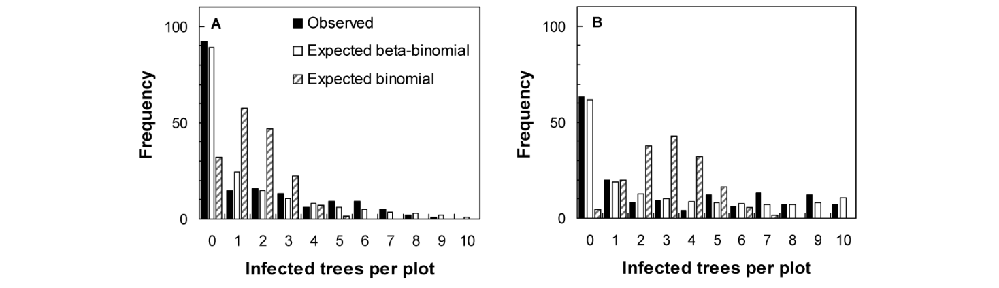
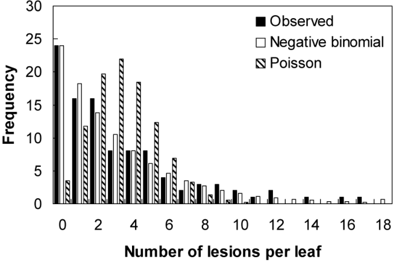
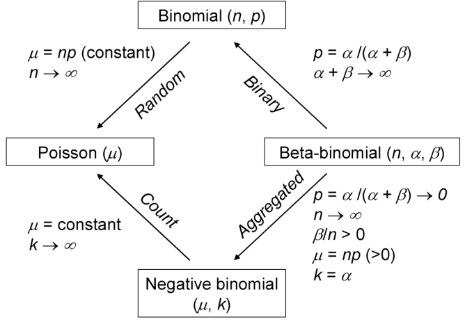
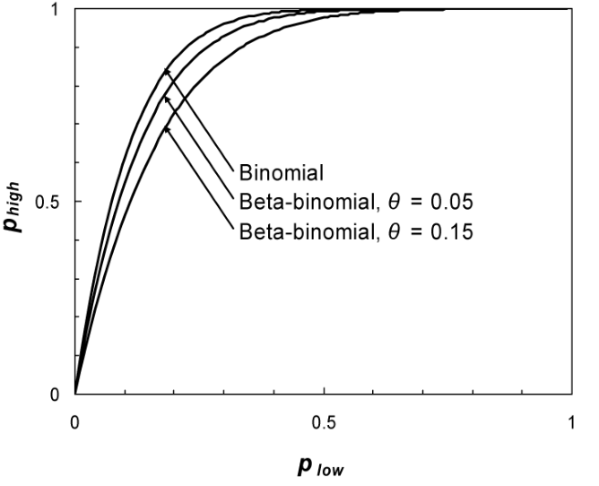
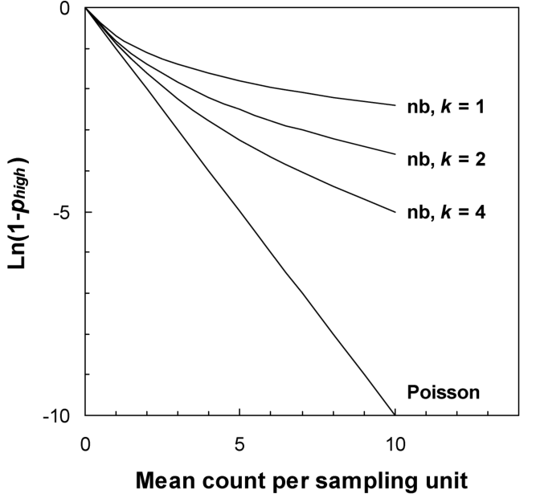
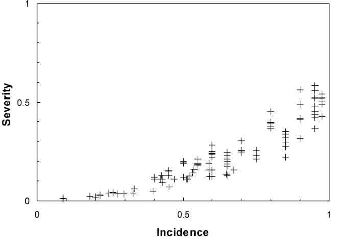
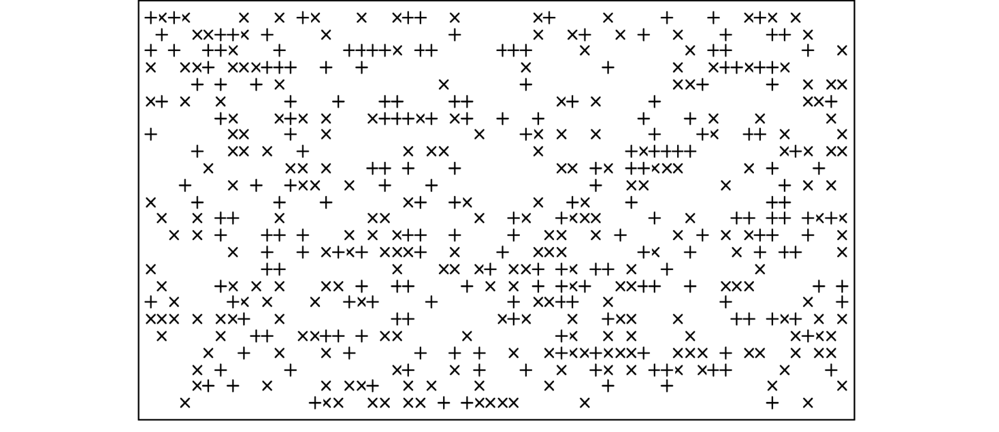
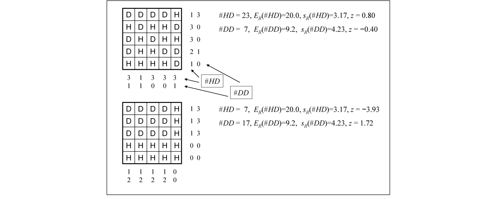
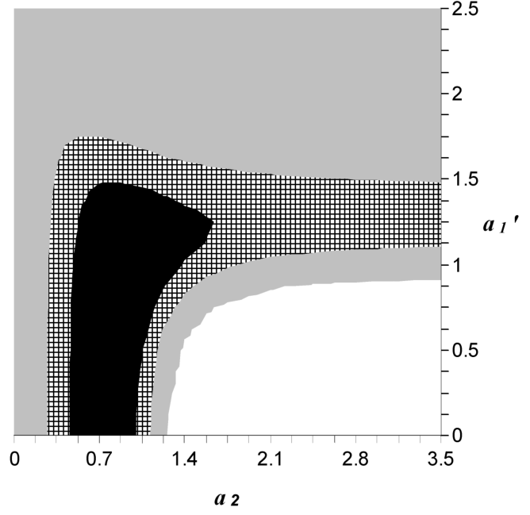

# การวิเคราะห์รูปแบบเชิงพื้นที่ของโรคพืช (Spatial Pattern Analysis) {#sec-spatial-patterns}

<!-- พี่ต้นข้าว: บันทึกถึงน้องกันต์ (ดร.กันต์ธณวิชญ์ ใจสงฆ์, ศูนย์วิจัยข้าวปทุมธานี)
     ในบทที่ 7 เราได้ศึกษาการแพร่กระจายของเชื้อและเกรเดียนต์ของโรค (Disease gradients) ที่แผ่ออกมาจากแหล่งกำเนิดเชื้อที่รู้ตำแหน่งแน่ชัด (Known source) 
     แต่ในชีวิตจริงของการทำงานภาคสนามในแปลงนาข้าว หรือแปลงพืชเศรษฐกิจทั่วไป สถานการณ์ส่วนใหญ่ที่เราต้องเผชิญกลับแตกต่างออกไปอย่างสิ้นเชิงครับ!
     บ่อยครั้งที่เราก้าวขาลงไปสำรวจแปลงนา เราไม่รู้เลยว่าจุดกำเนิดเชื้อดั้งเดิม (Primary foci) อยู่ตรงไหน เพราะเชื้อราสาเหตุโรคไหม้ (Magnaporthe oryzae)
     หรือแบคทีเรียโรคขอบใบแห้ง (Xanthomonas oryzae pv. oryzae) อาจปลิวมาจากรอบทิศทาง หรือตกค้างอยู่ในตอซังและวัชพืชทั่วทั้งแปลง
     บทที่ 9 นี้จึงเป็น "คัมภีร์หลักว่าด้วยรูปแบบเชิงพื้นที่ (Spatial pattern)" ที่สมบูรณ์ที่สุด
     แปลครบถ้วน 100% ตามต้นฉบับบทที่ 9 ของ Madden et al. (2007) โดยไม่มีการตัดทอนหรือสรุปย่อ
     เราจะเรียนรู้ตั้งแต่การวิเคราะห์ทางสถิติเมื่อสุ่มตรวจตัวอย่างแบบเบาบาง (Sparsely sampled data: การแจกแจงทวินาม, บีตา-ทวินาม, ปัวซง, ทวินามเชิงลบ, และกฎเลขยกกำลัง Binary power law)
     ไปจนถึงการวิเคราะห์แผนที่เชิงพื้นที่แบบละเอียด 2 มิติ (Intensively mapped data: Join-count statistics, Moran's I, เซมิแวริโอแกรม Semivariance, SADIE, และ Ripley's K-function)
     เพื่อให้สามารถนำไปใช้วินิจฉัยกลไกการแพร่ระบาดและวางแผนการจัดการโรคได้อย่างแม่นยำครับ -->

> *"รูปแบบเชิงพื้นที่ของพืชที่เป็นโรค คือภาพสะท้อนที่เป็นรูปธรรมของกระบวนการทางระบาดวิทยาเบื้องหลังที่สร้างมันขึ้นมา"*
> — Madden, Hughes and van den Bosch (2007)

::: {.callout-note}
## วัตถุประสงค์การเรียนรู้ประจำบท

เมื่อศึกษาบทนี้จบแล้ว ผู้อ่านควรจะสามารถ:

1. จำแนกความแตกต่างระหว่างการกระจายตัวแบบสุ่ม (Random), แบบกระจุกตัว (Aggregated/Clustered), และแบบสม่ำเสมอ (Regular) ตลอดจนเข้าใจคำศัพท์เฉพาะทางเชิงพื้นที่
2. อธิบายความแตกต่างระหว่างข้อมูลจากการสุ่มตัวอย่างแบบเบาบาง (Sparsely sampled data) กับข้อมูลแผนที่พิกัดแบบละเอียด (Intensively mapped data)
3. คำนวณและทดสอบการแจกแจงแบบทวินาม (Binomial), บีตา-ทวินาม (Beta-binomial), ดัชนีการกระจายตัว ($D$), และสัมประสิทธิ์สหสัมพันธ์ภายในกลุ่ม ($\rho$) สำหรับข้อมูลอุบัติการณ์ของโรค (Incidence)
4. ประยุกต์ใช้กฎเลขยกกำลังทวิภาค (Binary power law) และกฎของเทย์เลอร์ (Taylor's power law) ในการประเมินระดับการกระจุกตัวข้ามประชากร
5. วิเคราะห์ข้อมูลการนับ (Counts) ด้วยการแจกแจงแบบปัวซง (Poisson) และทวินามเชิงลบ (Negative binomial)
6. วิเคราะห์รูปแบบของโรคในโครงสร้างลำดับชั้นเชิงพื้นที่ (Spatial hierarchies)
7. ประยุกต์ใช้แบบจำลองความสัมพันธ์ระหว่างความรุนแรงของโรคกับอุบัติการณ์ (Severity-incidence relationships)
8. วิเคราะห์ข้อมูลแผนที่พิกัด 2 มิติด้วยสถิติการเชื่อมต่อ (Join-count statistics), สถิติความสัมพันธ์เชิงพื้นที่ (Moran's $I$), เซมิแวริโอแกรม (Semivariogram), ดัชนีระยะทาง SADIE, และฟังก์ชันระยะทาง Ripley's $K$
:::

## 9.1 เหตุใดเราจึงต้องศึกษารูปแบบเชิงพื้นที่ (Why We Look at Spatial Patterns) {#sec-sp-why}

ในบทที่ 7 (@sec-disease-gradients) เราได้ทำความเข้าใจถึงหลักการแพร่กระจายของเชื้อโรคพืชและการพัฒนาของเกรเดียนต์ของโรค (Disease gradients) ที่แผ่ขยายออกไปตามระยะทางจากแหล่งกำเนิดเชื้อเดี่ยวที่ทราบตำแหน่งแน่ชัด เช่น แหล่งกำเนิดแบบจุด (Point source) หรือแหล่งกำเนิดแบบเส้น (Line source) การศึกษารูปแบบเชิงพื้นที่ของโรคจากแหล่งกำเนิดที่ทราบตำแหน่งนั้นช่วยให้เราสามารถประเมินระยะทางที่สปอร์ของเชื้อสามารถเดินทางไปได้ และสามารถสร้างแบบจำลองเกรเดียนต์ของโรคขึ้นมาได้อย่างตรงไปตรงมา

อย่างไรก็ตาม ในความเป็นจริงของเกษตรกรรมและระบาดวิทยาภาคสนาม สถานการณ์ส่วนใหญ่มักไม่ได้เริ่มต้นขึ้นจากแหล่งกำเนิดเดี่ยวที่ชัดเจนเช่นนั้น บ่อยครั้งอย่างยิ่งที่เชื้อเริ่มต้น (Primary inoculum) มีต้นกำเนิดมาจาก:
- สปอร์ที่ตกค้างอยู่ในดินหรือตอซังพืชที่กระจายตัวอยู่ทั่วทั้งแปลง
- เมล็ดพันธุ์หรือท่อนพันธุ์ที่ติดเชื้อมาตั้งแต่ตอนปลูก
- หรือสปอร์ที่ปลิวมาจากแปลงข้างเคียงหลายๆ ทิศทางอย่างต่อเนื่องตลอดฤดูกาล

เมื่อเราก้าวขาลงไปสำรวจแปลงปลูก เรามักจะพบเห็นเพียงภาพรวมของต้นพืชที่เป็นโรคและต้นพืชที่ปกติปลอดโรคกระจายตัวอยู่ทั่วแปลง โดยที่เรา **ไม่ทราบพิกัดของแหล่งกำเนิดเชื้อดั้งเดิม (Unknown inoculum sources)** เลยแม้แต่น้อย ในสถานการณ์เช่นนี้ เราไม่สามารถวัดระยะทาง $s$ จากแหล่งกำเนิดเพื่อสร้างเกรเดียนต์แบบบทที่ 7 ได้อีกต่อไป สิ่งเดียวที่เรามีอยู่ตรงหน้าคือ **รูปแบบการจัดวางเชิงพื้นที่ (Spatial pattern)** ของพืชที่เป็นโรคในแปลงเท่านั้น!

การศึกษารูปแบบเชิงพื้นที่ของโรคพืชมีเป้าหมายและประโยชน์สำคัญ 4 ประการ:

1. **การสืบย้อนหากลไกการแพร่ระบาดและชีววิทยาของเชื้อ (Inferring epidemiological mechanisms):** 
   รูปแบบเชิงพื้นที่เปรียบเสมือน "รอยเท้า" หรือ "ลายนิ้วมือ" ที่กระบวนการทางระบาดวิทยาประทับทิ้งไว้ การที่ต้นพืชที่เป็นโรคกระจายตัวแบบสุ่มอย่างอิสระ หรือเกาะกลุ่มกันเป็นหย่อมหนาแน่น เป็นเบาะแสสำคัญที่บ่งชี้ถึงกลไกการแพร่กระจายของเชื้อ เช่น:
   - การกระจายตัวแบบสุ่ม (Random pattern) มักบ่งชี้ถึงเชื้อที่ติดมากับเมล็ดพันธุ์อย่างสุ่ม หรือสปอร์ที่ลอยมาจากแหล่งกำเนิดระยะไกลในบรรยากาศชั้นบน
   - การเกาะกลุ่มเป็นหย่อมเล็กๆ (Small clusters) มักบ่งบอกถึงการแพร่กระจายระยะใกล้จากพืชสู่พืชข้างเคียง เช่น ละอองฝนกระเด็น (Rain splash) หรือแมลงพาหะที่บินในระยะสั้น
   - การเกิดแถบโรคเป็นแนวยาว มักสะท้อนถึงการแพร่ระบาดตามทิศทางลม หรือการแพร่กระจายผ่านเครื่องจักรกลการเกษตรและทางน้ำชลประทาน
2. **การพัฒนาแผนการสุ่มตัวอย่างที่ถูกต้องและมีประสิทธิภาพ (Developing sampling plans):** 
   รูปแบบเชิงพื้นที่มีบทบาทกำหนดโดยตรงต่อความแปรปรวนของการสุ่มตัวอย่าง หากโรคมีการกระจุกตัวเป็นหย่อม การสุ่มตัวอย่างแบบสุ่มอย่างง่าย (Simple random sampling) อาจให้ผลการประเมินที่คลาดเคลื่อนสูงมาก เราจำเป็นต้องเข้าใจรูปแบบการกระจายตัวเพื่อออกแบบขนาดตัวอย่าง (Sample size) และวิธีการสุ่มที่เหมาะสม (ดูบทที่ 10)
3. **การประเมินความสูญเสียผลผลิตที่แม่นยำ (Assessing crop losses):** 
   ดังที่เราได้พิสูจน์ไว้ในบทที่ 12 (@sec-yield-loss) ความแปรปรวนเชิงพื้นที่ของการเกิดโรคส่งผลกระทบโดยตรงต่อผลผลิตเฉลี่ยของทั้งแปลง หากโรคมีการกระจุกตัวสูง ผลผลิตเฉลี่ยจะเบี่ยงเบนไปจากผลผลิตที่พยากรณ์จากระดับโรคเฉลี่ย
4. **การวางกลยุทธ์การควบคุมโรคเฉพาะจุด (Precision disease management):** 
   การทำความเข้าใจขอบเขตของหย่อมโรคช่วยให้เราสามารถฉีดพ่นสารเคมีหรือกำจัดต้นเป็นโรคเฉพาะบริเวณที่เกิดปัญหา (Site-specific management) แทนที่จะต้องพ่นสารเคมีครอบคลุมทั้งแปลง ซึ่งช่วยประหยัดต้นทุนและลดผลกระทบต่อสิ่งแวดล้อม

---

## 9.2 ศัพท์เฉพาะทางและนิยาม (Terminology) {#sec-sp-terms}

ในวรรณกรรมทางวิทยาศาสตร์ มีการใช้คำศัพท์เชิงพื้นที่หลากหลายคำ ซึ่งบางครั้งอาจสร้างความสับสน เพื่อความชัดเจนและแม่นยำตลอดทั้งบทนี้ เราขอกำหนดนิยามของคำศัพท์สำคัญดังต่อไปนี้:

- **รูปแบบเชิงพื้นที่ (Spatial pattern):** หมายถึง การจัดวางหรือการกระจายตัวของหน่วยพืชที่เป็นโรค (เช่น ต้นพืช รอยโรค หรืออวัยวะพืช) ในขอบเขตพื้นที่สองมิติ (หรือหนึ่งมิติ) ที่สนใจ
- **ความไม่เป็นเนื้อเดียวกันเชิงพื้นที่ (Spatial heterogeneity):** หมายถึง สภาวะที่ระดับของโรคหรือความหนาแน่นของพืชที่เป็นโรคมีความผันแปรหรือไม่สม่ำเสมอในแต่ละตำแหน่งของพื้นที่ ตรงกันข้ามกับคำว่า ความเป็นเนื้อเดียวกัน (Spatial homogeneity)
- **การรวมกลุ่ม หรือ การกระจุกตัว (Aggregation หรือ Clustered pattern):** หมายถึง รูปแบบเชิงพื้นที่ที่พืชที่เป็นโรคมีแนวโน้มที่จะอยู่ใกล้ชิดกันมากกว่าที่จะเกิดขึ้นอย่างสุ่มตามโอกาสทางสถิติ ส่งผลให้เกิดบริเวณที่มีความหนาแน่นของโรคสูงสลับกับบริเวณที่แทบไม่มีโรคเลย
- **การกระจายตัวแบบสุ่ม (Random pattern):** หมายถึง สภาวะที่โอกาสที่พืชต้นใดต้นหนึ่งจะเป็นโรค มีค่าเท่ากันในทุกตำแหน่งของพื้นที่ และการเป็นโรคของพืชต้นหนึ่งไม่ได้ส่งผลกระทบหรือเพิ่มโอกาสให้พืชต้นข้างเคียงกลายเป็นโรค (สมมติฐานความเป็นอิสระต่อกัน: Independence)
- **การกระจายตัวแบบสม่ำเสมอ (Regular หรือ Over-dispersed pattern):** หมายถึง สภาวะที่พืชที่เป็นโรคอยู่ห่างกันอย่างเป็นระเบียบมากกว่าการสุ่ม มักพบในระบบที่มีการแข่งขันรุนแรง หรือพืชมีกลไกป้องกันตัวเหนี่ยวนำไปยังต้นข้างเคียง (พบได้ยากมากในระบบโรคพืชธรรมชาติ)
- **หย่อมโรค (Patchiness):** หมายถึง การเกิดกลุ่มก้อนหรือหย่อมของโรคที่มีขอบเขตชัดเจนในแปลงปลูก

---

## 9.3 ข้อมูลโรคพืชเชิงพื้นที่ (Spatial Plant Disease Data) {#sec-sp-data}

### 9.3.1 การเก็บรวบรวมข้อมูล: การสุ่มแบบเบาบาง vs การทำแผนที่ละเอียด {#sec-sp-data-types}

ลักษณะของข้อมูลโรคพืชเชิงพื้นที่ที่เราสามารถเก็บรวบรวมได้จากแปลงปลูก สามารถแบ่งออกเป็น 2 ประเภทหลัก ซึ่งต้องใช้ระเบียบวิธีทางสถิติในการวิเคราะห์ที่แตกต่างกันอย่างสิ้นเชิง:

#### 1. ข้อมูลจากการสุ่มตัวอย่างแบบเบาบาง (Sparsely Sampled Data)
ในการสำรวจแปลงขนาดใหญ่หรือการเก็บข้อมูลทั่วไป เรามักไม่สามารถตรวจนับต้นพืชทุกต้นในแปลงได้ สิ่งที่นักวิจัยทำคือการสุ่มเลือก **หน่วยสุ่มตัวอย่าง (Sampling units หรือ Quadrats)** จำนวน $N$ หน่วยกระจายตัวอยู่ทั่วแปลง โดยแต่ละหน่วยสุ่มอาจประกอบด้วยต้นพืชจำนวน $n$ ต้น (เช่น สุ่มกรอบขนาด 10 ต้น จำนวน 50 จุดทั่วแปลง)

สำหรับแต่ละหน่วยสุ่ม เราจะบันทึก:
- **ข้อมูลอุบัติการณ์ (Incidence):** จำนวนต้นที่เป็นโรค ($Y$) จากจำนวนต้นทั้งหมด $n$ ต้นในหน่วยสุ่มนั้น ($0 \le Y \le n$) หรือสัดส่วนของโรค $y = Y/n$
- **ข้อมูลการนับ (Counts):** จำนวนรอยโรค แผล หรือตัวแมลงพาหะ ($Y$) บนหน่วยพืช (ซึ่ง $Y$ สามารถมีค่าเป็น $0, 1, 2, \dots$ โดยไม่มีขีดจำกัดบน $n$ ที่ชัดเจน)
- **ข้อมูลความรุนแรง (Severity):** เปอร์เซ็นต์พื้นที่ใบที่เป็นโรคเฉลี่ยของหน่วยสุ่มนั้น

ลักษณะเด่นของข้อมูลประเภทนี้คือ **เราไม่ได้บันทึกพิกัดทางภูมิศาสตร์ ($x, y$) ที่แน่นอนของแต่ละหน่วยสุ่ม** (หรือหน่วยสุ่มอยู่ห่างกันมากจนถือว่าไม่มีความสัมพันธ์เชิงพื้นที่ระหว่างหน่วยสุ่ม) สิ่งที่เราสนใจวิเคราะห์คือ **การแจกแจงความถี่ (Frequency distribution)** ของจำนวนต้นที่เป็นโรคต่อหน่วยสุ่ม และ **ความแปรปรวนระหว่างหน่วยสุ่ม (Variance among sampling units)** เพื่อทดสอบว่ามีความแปรปรวนสูงกว่าการกระจายตัวแบบสุ่ม (Overdispersion) หรือไม่

{#fig-9-1}

{#fig-9-2}

กราฟใน @fig-9-1 และ @fig-9-2 แสดงตัวอย่างคลาสสิกของข้อมูลจากการสุ่มแบบเบาบาง โดยแสดงความถี่ของหน่วยสุ่มที่มีจำนวนต้นเป็นโรค $Y = 0, 1, 2, \dots, n$ ต้น ซึ่งจะได้รับการวิเคราะห์อย่างละเอียดใน @sec-sp-incidence และ @sec-sp-counts

#### 2. ข้อมูลแผนที่เชิงพื้นที่แบบละเอียดเข้มข้น (Intensively Mapped Data)
ในกรณีที่เราทำการตรวจนับต้นพืช **ทุกต้นในแปลงอย่างต่อเนื่อง (Contiguous census)** หรือมีการบันทึกพิกัดตำแหน่ง ($x, y$) ของต้นพืชทุกต้นในแปลงทดลอง 

ข้อมูลประเภทนี้ช่วยให้เรารู้ตำแหน่งสัมพัทธ์ที่แน่นอนของต้นพืชแต่ละต้น ว่าต้นใดเป็นโรค ต้นใดปกติ และต้นที่เป็นโรคอยู่ติดกับต้นที่เป็นโรคด้วยกันหรือไม่ ข้อมูลแผนที่ละเอียดนี้เปิดโอกาสให้เราสามารถใช้ระเบียบวิธีทางสถิติขั้นสูง เช่น สถิตินับการเชื่อมต่อ (Join-count statistics), การวิเคราะห์ความสัมพันธ์เชิงพื้นที่ (Spatial autocorrelation), เซมิแวริโอแกรม (Semivariograms), และ SADIE ดังที่จะอธิบายใน @sec-sp-mapped

## 9.4 การวิเคราะห์ข้อมูลอุบัติการณ์จากการสุ่มตัวอย่างแบบเบาบาง (Sparsely Sampled Incidence Data) {#sec-sp-incidence}

### 9.4.1 สถิติสรุป (Summary Statistics) {#sec-sp-summary-stats}

โดยพื้นฐานแล้ว รูปแบบเชิงพื้นที่ของโรคพืชเป็นผลลัพธ์โดยตรงจาก **การที่สถานะการเกิดโรคของพืชต้นหนึ่งขึ้นอยู่กับสถานะการเกิดโรคของพืชต้นข้างเคียง** ข้อมูลเชิงพื้นที่จึงเกิดขึ้นตามธรรมชาติเมื่อเราเก็บข้อมูลอุบัติการณ์ของโรค (Incidence) จากกลุ่มของพืชข้างเคียง แม้ว่าเราจะไม่ได้บันทึกพิกัดตำแหน่งทางภูมิศาสตร์ของแต่ละกลุ่มไว้เลยก็ตาม ในทางสถิติ ระเบียบวิธีนี้จัดอยู่ภายใต้หัวข้อ **การสุ่มตัวอย่างแบบกลุ่ม (Cluster sampling)** (ซึ่งจะอภิปรายในบทที่ 10) 

ในที่นี้ หน่วยสุ่มตัวอย่าง (Sampling units หรือ Quadrats) ทำหน้าที่เป็น "กลุ่ม" (Clusters) ซึ่งเกิดจากการออกแบบการทดลอง การวิเคราะห์ข้อมูลจากการสุ่มแบบเบาบางนี้จะบอกรูปแบบเชิงพื้นที่ที่ **สเกลภายในหน่วยสุ่มตัวอย่าง (Within-sampling-unit scale)** เป็นหลัก ดังที่ Nicot et al. (1984) และ Ferrandino (1998) ได้ชี้ไว้ การวิเคราะห์นี้จะไม่บอกข้อมูลรูปแบบในสเกลที่ใหญ่กว่าขนาดของหน่วยสุ่ม เว้นแต่เราจะมีข้อมูลแผนที่พิกัด 2 มิติอย่างละเอียด

เพื่อให้การวิเคราะห์ตรงไปตรงมา เราจะเริ่มต้นด้วยสมมติฐานว่า:
- มีจำนวนหน่วยสุ่มตัวอย่างทั้งหมด $N$ หน่วย
- แต่ละหน่วยสุ่มมีจำนวนต้นพืช (หรืออวัยวะพืช) เท่ากันทั้งหมด คือ $n$ ต้น
- ในหน่วยสุ่มที่ $i$ ($i = 1, 2, \dots, N$) ตรวจพบจำนวนต้นที่เป็นโรคเท่ากับ $Y_i$ ต้น ($Y_i$ เป็นจำนวนเต็มตั้งแต่ $0, 1, \dots, n$)
- สัดส่วนของต้นที่เป็นโรคในหน่วยสุ่มที่ $i$ คือ $y_i = Y_i / n$

ค่าเฉลี่ยอุบัติการณ์ของโรคทั้งแปลง (Mean disease incidence, $\bar{y}$) คำนวณได้จาก:

$$\bar{y} = \frac{1}{N} \sum_{i=1}^N y_i = \frac{1}{N n} \sum_{i=1}^N Y_i = \frac{\bar{Y}}{n} \qquad (9.1)$$

และความแปรปรวนของตัวอย่างแบบไม่เอนเอียง (Unbiased sample variance, $s_y^2$) ของค่าสัดส่วน $y_i$ คือ:

$$s_y^2 = \frac{1}{N - 1} \sum_{i=1}^N (y_i - \bar{y})^2 \qquad (9.2)$$

โดยมีองศาความเป็นอิสระ $df = N - 1$ ความคลาดเคลื่อนมาตรฐานของค่าเฉลี่ยคือ $\text{SE}(\bar{y}) = s_y / \sqrt{N}$

สำหรับจำนวนต้นเป็นโรคต่อหน่วยสุ่ม ค่าเฉลี่ยคือ $\bar{Y} = n \bar{y}$ และความแปรปรวนคือ $s_Y^2 = n^2 s_y^2$

::: {.callout-note}
## ขอบเขตความแปรปรวนสูงสุดและต่ำสุดของข้อมูลอุบัติการณ์

Madden and Hughes (1995) ได้แสดงให้เห็นว่า:
- **ความแปรปรวนสูงสุด ($s_{y(\max)}^2$):** จะเกิดขึ้นเมื่อต้นที่เป็นโรคทั้งหมดไป **กระจุกตัวอัดแน่นอยู่ในหน่วยสุ่มจำนวนน้อยที่สุดเท่าที่เป็นไปได้** (เช่น ถ้ามีโรค 125 ต้น ใน 100 หน่วยสุ่มๆ ละ 25 ต้น ความแปรปรวนสูงสุดจะเกิดเมื่อ 5 หน่วยสุ่มเป็นโรคเต็ม 25 ต้น ส่วนอีก 95 หน่วยสุ่มปลอดโรค 0 ต้นโดยสิ้นเชิง) ซึ่งคำนวณได้จาก:
  $$s_{y(\max)}^2 = \left( \frac{N}{N - 1} \right) \bar{y}(1 - \bar{y}) \approx \bar{y}(1 - \bar{y})$$
- **ความแปรปรวนต่ำสุด ($s_{y(\min)}^2$):** จะเกิดขึ้นเมื่อต้นที่เป็นโรคกระจายตัวอย่างสม่ำเสมอที่สุดเท่าที่จะทำได้ โดยมีจำนวนต้นเป็นโรคในแต่ละหน่วยสุ่มเท่ากันพอดี ซึ่งจะทำให้ $s_y^2 = 0$
:::

---

### 9.4.2 การแจกแจงแบบทวินาม (The Binomial Distribution) {#sec-sp-binomial}

หากการกระจายตัวของโรคในแปลงเป็น **การกระจายตัวแบบสุ่มอย่างแท้จริง (Spatial randomness)** โอกาสที่พืชแต่ละต้นจะเป็นโรคจะมีความเป็นอิสระต่อกัน และมีค่าความน่าจะเป็นคงที่เท่ากับ $p$ ความน่าจะเป็นที่จะพบต้นเป็นโรคจำนวน $Y$ ต้น ในหน่วยสุ่มขนาด $n$ ต้น จะเป็นไปตาม **การแจกแจงแบบทวินาม (Binomial distribution)**:

$$\Pr(Y) = \binom{n}{Y} p^Y (1 - p)^{n - Y} \qquad (9.3)$$

โดยที่ $\binom{n}{Y} = \frac{n!}{Y!(n - Y)!}$ คือสัมประสิทธิ์ทวินาม

ภายใต้การแจกแจงแบบทวินาม:
- ค่าเฉลี่ยที่คาดหวังคือ $E[Y] = np$ หรือ $E[y] = p$
- ความแปรปรวนเชิงทฤษฎีในรูปสัดส่วน คือ:
  $$s_{\text{bin}}^2 = \frac{\bar{y}(1 - \bar{y})}{n} \qquad (9.4)$$
  และในรูปจำนวนต้นคือ $s_{\text{bin}, Y}^2 = n \bar{y}(1 - \bar{y})$

เราสามารถทดสอบว่าการแจกแจงความถี่ที่สังเกตได้สอดคล้องกับการแจกแจงแบบทวินามหรือไม่ โดยใช้ **การทดสอบภาวะสารูปสนิทดีแบบไคสแควร์ (Chi-square goodness-of-fit test)**:

$$\chi^2 = \sum_{j=0}^n \frac{(O_j - E_j)^2}{E_j} \qquad (9.5)$$

โดยที่ $O_j$ คือความถี่ที่สังเกตได้จริงในชั้นที่มีโรค $j$ ต้น, $E_j = N \cdot \Pr(Y = j)$ คือความถี่ที่คาดหวังตามการแจกแจงทวินาม โดยมี $df = (n + 1) - 1 - 1 = n - 1$ (หัก 1 สำหรับผลรวมความถี่ และหัก 1 สำหรับการประมาณพารามิเตอร์ $p$ จาก $\bar{y}$) โดยในชั้นที่มีค่า $E_j < 5$ ควรยุบรวมชั้นเข้าด้วยกัน

ตัวอย่างข้อมูลคลาสสิกของโรคไวรัสเหี่ยวลายมะเขือเทศ (Tomato spotted wilt virus: TSWV) ในออสเตรเลีย (Bald, 1937) ซึ่งแสดงใน @fig-9-1 และตารางที่ 9.1 พบว่าค่า $\chi^2$ ไม่มีนัยสำคัญทางสถิติ ($P > 0.05$) บ่งชี้ว่าการเกิดโรค TSWV ในแปลงนี้สอดคล้องกับการกระจายตัวแบบสุ่มอย่างสมบูรณ์

---

### 9.4.3 ดัชนีการกระจายตัว (The Index of Dispersion, $D$) {#sec-sp-dispersion-index}

ข้อจำกัดของการทดสอบภาวะสารูปสนิทดีแบบไคสแควร์คือ จำเป็นต้องมีขนาดตัวอย่าง $N$ ที่มากพอเพื่อไม่ให้ค่าคาดหวัง $E_j$ เล็กเกินไป อีกทั้งยังต้องยุบรวมชั้นความถี่ ทางเลือกที่สะดวกและทรงพลังกว่ามากคือการใช้ **ดัชนีการกระจายตัว (Index of dispersion, $D$)** (Fisher, 1925):

$$D = \frac{(N - 1) s_y^2}{s_{\text{bin}}^2} = \frac{\sum_{i=1}^N (y_i - \bar{y})^2}{\bar{y}(1 - \bar{y})/n} = \frac{\sum_{i=1}^N (Y_i - \bar{Y})^2}{\bar{Y}(1 - \bar{Y}/n)} \qquad (9.6)$$

ดัชนี $D$ คืออัตราส่วนระหว่าง **ความแปรปรวนที่สังเกตได้จริง ($s_y^2$)** กับ **ความแปรปรวนเชิงทฤษฎีในกรณีสุ่มแบบทวินาม ($s_{\text{bin}}^2$)** คูณด้วยองศาความเป็นอิสระ $(N - 1)$:
- ภายใต้สมมติฐานว่างของการกระจายตัวแบบสุ่ม ($H_0$: การแจกแจงแบบทวินาม) สถิติทดสอบ $D$ จะมีการแจกแจงแบบไคสแควร์ที่มี $df = N - 1$:
  $$D \sim \chi^2_{N - 1}$$
- หาก $D > \chi^2_{0.05, N - 1}$ เราจะปฏิเสธสมมติฐานว่าง และสรุปว่า **ข้อมูลมีความแปรปรวนสูงกว่าการสุ่ม (Overdispersion) หรือมีการกระจุกตัวเป็นหย่อม (Aggregated / Clustered)**
- หาก $D < \chi^2_{0.95, N - 1}$ แสดงว่ามีการกระจายตัวแบบสม่ำเสมอผิดปกติ (Regular / Underdispersed)
- หรือหาก $N$ มีขนาดใหญ่ เราสามารถใช้ตัวแปรสถิติมาตรฐาน $Z$:
  $$Z = \sqrt{2D} - \sqrt{2(N - 1) - 1} \sim N(0, 1)$$

---

### 9.4.4 สหสัมพันธ์ภายในกลุ่ม (Intra-Cluster Correlation, $\rho$) {#sec-sp-intra-cluster}

ในทางสรีรวิทยาและระบาดวิทยา การกระจุกตัวหมายถึงแนวโน้มที่พืชในหน่วยสุ่มเดียวกันจะมีสถานะการเกิดโรคเหมือนกันบ่อยกว่าปกติ เราสามารถวัดระดับความสัมพันธ์นี้ได้อย่างเป็นทางการผ่าน **สัมประสิทธิ์สหสัมพันธ์ภายในกลุ่ม (Intra-cluster correlation coefficient, $\rho$)** (Mak, 1988; Ridout et al., 1999):

$$\rho = \frac{s_y^2 - s_{\text{bin}}^2}{\bar{y}(1 - \bar{y}) - s_{\text{bin}}^2} = \frac{\frac{D}{N - 1} - 1}{n - 1}$$

- เมื่อข้อมูลมีการกระจายตัวแบบสุ่ม ค่า $s_y^2 = s_{\text{bin}}^2$ ส่งผลให้ $\rho = 0$
- เมื่อข้อมูลมีการกระจุกตัวสมบูรณ์ (ต้นพืชในแต่ละหน่วยสุ่มเป็นโรคทั้งหมด $y=1$ หรือปลอดโรคทั้งหมด $y=0$) ค่าความแปรปรวนจะเท่ากับค่าสูงสุด $s_y^2 = \bar{y}(1-\bar{y})$ ส่งผลให้ $\rho = 1$
- ค่า $\rho > 0$ บ่งชี้ถึงระดับของการเกาะกลุ่มของโรคภายในหน่วยสุ่ม

---

### 9.4.5 การแจกแจงแบบบีตา-ทวินาม (The Beta-Binomial Distribution) {#sec-sp-beta-binomial}

เมื่อพืชในหน่วยสุ่มเดียวกันมีแนวโน้มที่จะเกาะกลุ่มเป็นโรคเหมือนๆ กัน การแจกแจงแบบทวินามจะไม่สามารถอธิบายข้อมูลได้อีกต่อไป ในสถานการณ์เช่นนี้ **การแจกแจงแบบบีตา-ทวินาม (Beta-binomial distribution)** จะเข้ามาทำหน้าที่เป็นแบบจำลองหลัก (Skellam, 1948)

การแจกแจงแบบบีตา-ทวินามเกิดขึ้นจากการผ่อนปรนสมมติฐานว่าความน่าจะเป็นที่พืชจะเป็นโรค ($p$) มีค่าคงที่ โดยยอมให้ $p$ มีความผันแปรไปในแต่ละหน่วยสุ่มตาม **การแจกแจงแบบบีตา (Beta distribution)** ที่มีพารามิเตอร์ $\alpha$ และ $\beta$:
$$f(\pi) = \frac{\pi^{\alpha - 1} (1 - \pi)^{\beta - 1}}{B(\alpha, \beta)}$$

เมื่อนำมาผสมกับการแจกแจงแบบทวินาม (Compound distribution) จะได้ฟังก์ชันความน่าจะเป็น:

$$\Pr(Y) = \binom{n}{Y} \int_0^1 \pi^Y (1 - \pi)^{n - Y} f(\pi) \, d\pi \qquad (9.7)$$

ในทางระบาดวิทยา นิยมแปลงพารามิเตอร์ให้อยู่ในรูป $p = \alpha / (\alpha + \beta)$ ซึ่งคือความน่าจะเป็นเฉลี่ยของการเกิดโรค และ $\theta = 1 / (\alpha + \beta)$ ซึ่งเป็น **ดัชนีการกระจุกตัว (Index of aggregation, $\theta$)**:

$$\Pr(Y) = \binom{n}{Y} \frac{\prod_{j=0}^{Y-1} (p + j\theta) \prod_{j=0}^{n-Y-1} (1 - p + j\theta)}{\prod_{j=0}^{n-1} (1 + j\theta)} \qquad (9.8)$$

โดยที่ $Y = 0, 1, 2, \dots, n$

{#fig-9-3}

ลักษณะเด่นของการแจกแจงแบบบีตา-ทวินาม (@fig-9-3):
- เมื่อ $\theta = 0$ สมการ 9.8 จะลดรูปลงเป็น **การแจกแจงแบบทวินามธรรมดา**
- เมื่อ $\theta > 0$ ความแปรปรวนจะสูงกว่าทวินาม
- เมื่อ $\theta$ มีค่าสูงมากๆ การแจกแจงสามารถกลายเป็น **แบบสองยอด (Bimodal distribution)** โดยมีหน่วยสุ่มที่ปลอดโรคเลย ($Y=0$) และหน่วยสุ่มที่เป็นโรคยกแปลง ($Y=n$) สูงโดดเด่นทั้งสองข้าง ซึ่งการแจกแจงแบบทวินามไม่มีวันทำได้เลย!

ค่าประมาณพารามิเตอร์ $\theta$ ด้วยวิธีโมเมนต์ (Moment estimate) คำนวณได้จาก:

$$\widehat{\theta} = \frac{s_y^2 - \frac{\bar{y}(1 - \bar{y})}{n}}{\bar{y}(1 - \bar{y}) - s_y^2} \qquad (9.9)$$

และสัมประสิทธิ์สหสัมพันธ์ภายในกลุ่มมีความสัมพันธ์โดยตรงกับ $\theta$:
$$\rho = \frac{\theta}{1 + \theta}$$

ความแปรปรวนของการแจกแจงแบบบีตา-ทวินาม ($s_{\beta\text{-bin}}^2$) เขียนได้ในรูป:

$$s_{\beta\text{-bin}}^2 = \frac{\bar{y}(1 - \bar{y})}{n} \left[ 1 + (n - 1)\frac{\theta}{1 + \theta} \right] = s_{\text{bin}}^2 [1 + (n - 1)\rho] \qquad (9.12, 9.13)$$

เทอม $[1 + (n - 1)\rho]$ เรียกว่า **แฟกเตอร์ความไม่เป็นเนื้อเดียวกัน (Heterogeneity factor)** ซึ่งเป็นตัวขยายความแปรปรวนให้สูงขึ้นกว่าทวินาม

---

### 9.4.6 ทบทวนดัชนีการกระจายตัวอีกครั้ง {#sec-sp-dispersion-revisited}

เมื่อแทนความแปรปรวนแบบบีตา-ทวินามลงในดัชนีการกระจายตัว $D$ จะได้ความสัมพันธ์ที่น่าทึ่ง:

$$E[D] = (N - 1) [1 + (n - 1)\rho] \qquad (9.14)$$

- เมื่อไม่มีการเกาะกลุ่ม ($\rho = 0$) จะได้ $E[D] = N - 1$ ซึ่งสอดคล้องกับค่าเฉลี่ยของการแจกแจงไคสแควร์ที่มี $df = N - 1$
- เมื่อเกิดการกระจุกตัวสมบูรณ์ ($\rho = 1$) จะได้ $E[D] = (N - 1)n$
- ในวรรณกรรมการสุ่มตัวอย่าง อัตราส่วน $D/(N-1) = 1 + (n-1)\rho$ นี้ ก็คือ **ประสิทธิผลการออกแบบการสุ่ม (Design effect: deff)** นั่นเอง (Kish, 1995)

---

### 9.4.7 กฎความสัมพันธ์เลขยกกำลัง (Binary Power Law) {#sec-sp-power-law}

ในการศึกษาระบาดวิทยา เรามักเก็บข้อมูลการสุ่มตัวอย่างหลายๆ ครั้งตลอดฤดูปลูก หรือจากหลายๆ แปลงที่มีระดับอุบัติการณ์ของโรคแตกต่างกัน Hughes and Madden (1992) ได้ค้นพบความสัมพันธ์เชิงประจักษ์ที่เป็นสากลอย่างยิ่งระหว่าง **ความแปรปรวนที่สังเกตได้จริง ($s_y^2$)** กับ **ความแปรปรวนเชิงทฤษฎีแบบทวินาม ($s_{\text{bin}}^2$)** ซึ่งเรียกว่า **กฎเลขยกกำลังทวิภาค (Binary power law)**:

$$s_y^2 = A \cdot (s_{\text{bin}}^2)^b = A \cdot \left[ \frac{\bar{y}(1 - \bar{y})}{n} \right]^b \qquad (9.15)$$

เมื่อแปลงเป็นรูปลอการิทึมจะได้แบบจำลองเชิงเส้น:

$$\ln(s_y^2) = \ln(A) + b \cdot \ln(s_{\text{bin}}^2) \qquad (9.17)$$

โดยที่ $A$ และ $b$ คือพารามิเตอร์ที่ประเมินได้จากการถดถอยเชิงเส้น

{#fig-9-4}

การแปลความหมายพารามิเตอร์ใน @fig-9-4:
- **กรณีการกระจายตัวแบบสุ่ม:** เส้นกราฟจะมีค่า $A = 1$ และ $b = 1$ พอดี (เส้นประ $s_y^2 = s_{\text{bin}}^2$)
- **กรณีเกิดการกระจุกตัว (Aggregation):** ข้อมูลส่วนใหญ่ในธรรมชาติจะมีค่า $A > 1$ หรือ $b > 1$ ส่งผลให้จุดข้อมูลลอยตัวอยู่เหนือเส้นทวินามเสมอ แสดงว่าความแปรปรวนจริงสูงกว่าการสุ่มในทุกๆ ระดับความรุนแรงของโรค!
- พารามิเตอร์ $A$ และ $b$ สะท้อน "ความเข้มข้นของการเกาะกลุ่ม" ของเชื้อโรคในระบบนั้นๆ และได้รับการยืนยันความถูกต้องในระบบโรคพืชมากกว่า 50 ระบบทั่วโลก (Xu and Ridout, 2000)

---

### 9.4.9 หน่วยสุ่มตัวอย่างที่มีขนาดไม่เท่ากัน (Unequal Size Sampling Units) {#sec-sp-unequal-units}

ในทางปฏิบัติ บ่อยครั้งที่จำนวนต้นพืชในแต่ละหน่วยสุ่มมีค่าไม่เท่ากัน ($n_i \ne n$ เช่น ในกรอบสุ่มบางจุดต้นพืชตายหรือปลูกไม่ติด) ในกรณีนี้ เราไม่สามารถใช้สูตรธรรมดาได้ Cochran (1977) ได้เสนอสูตรประมาณการดังนี้:

อุบัติการณ์เฉลี่ยรวมของทั้งแปลง:
$$\bar{y} = \frac{\sum_{i=1}^N Y_i}{\sum_{i=1}^N n_i} \qquad \text{และขนาดหน่วยสุ่มเฉลี่ย} \quad \bar{n} = \frac{\sum n_i}{N}$$

ความแปรปรวนของสัดส่วนที่สังเกตได้จริง:
$$s_y^2 = \frac{\sum_{i=1}^N n_i^2 (y_i - \bar{y})^2}{\bar{n}^2 (N - 1)}$$

ความแปรปรวนแบบทวินาม:
$$s_{\text{bin}}^2 = \frac{\bar{y}(1 - \bar{y})}{\bar{n}}$$

ซึ่งสามารถนำไปคำนวณดัชนีการกระจายตัว $D$ และการทดสอบ $C(\alpha)$ ได้ตามปกติครับ

---

### 9.4.10 การสุ่มตัวอย่างแบบสองขั้นตอน (Two-Stage Cluster Sampling) {#sec-sp-two-stage}

เมื่อแปลงมีขนาดใหญ่มาก เช่น แปลงนา 100 ไร่ เรามักไม่สามารถตรวจนับต้นพืชทั้งหมดในแต่ละหน่วยสุ่มได้ สิ่งที่เราทำคือ **การสุ่มแบบสองขั้นตอน (Two-stage sampling)**:
1. ขั้นที่หนึ่ง: สุ่มเลือกหน่วยสุ่มตัวอย่างหลัก (Primary units หรือ Quadrats) จำนวน $N$ หน่วย จากทั้งหมด $M$ หน่วยในแปลง (สัดส่วนการสุ่มขั้นแรก $f_1 = N/M$)
2. ขั้นที่สอง: ภายในแต่ละหน่วยสุ่มหลัก สุ่มตรวจต้นพืชเพียง $n$ ต้น จากทั้งหมด $m$ ต้น (สัดส่วนการสุ่มขั้นที่สอง $f_2 = n/m$)

ความแปรปรวนของอุบัติการณ์เฉลี่ย ($s_{\bar{y}}^2$) จะประกอบด้วยความแปรปรวน 2 ส่วน (Cochran, 1977):

$$s_{\bar{y}}^2 = \frac{1 - f_1}{N} s_1^2 + \frac{f_1 (1 - f_2)}{N n} s_2^2$$

โดยที่:
- $s_1^2$ คือ ความแปรปรวนระหว่างหน่วยสุ่มหลัก (Between-quadrat variance)
- $s_2^2$ คือ ความแปรปรวนระหว่างต้นพืชภายในหน่วยสุ่มเดียวกัน (Within-quadrat variance)

ข้อสังเกตที่สำคัญคือ หากสัดส่วนการสุ่มขั้นแรกมีค่าน้อยมาก ($f_1 = N/M \approx 0$) เทอมที่สองจะหายไป ทำให้ความแปรปรวนของค่าเฉลี่ยขึ้นอยู่กับความแปรปรวนระหว่างแปลงย่อย ($s_1^2$) เกือบทั้งหมดครับ

## 9.5 การวิเคราะห์ข้อมูลการนับจากการสุ่มตัวอย่างแบบเบาบาง (Sparsely Sampled Count Data) {#sec-sp-counts}

ในทางพยาธิวิทยาพืช ข้อมูลโรคพืชในรูปของ **การนับ (Counts)** มักหมายถึงจำนวนการติดเชื้อ, จำนวนแผลรอยโรค (Lesions), หรือจำนวนสปอร์/หน่วยแพร่เชื้อต่อหน่วยสุ่มตัวอย่าง ข้อมูลประเภทนี้มีความแตกต่างจากข้อมูลอุบัติการณ์ (Incidence) ตรงที่ **ไม่มีขีดจำกัดบน $n$ ที่ตายตัว** (จำนวนแผลบนใบหนึ่งใบอาจเป็น $0, 1, 2, \dots$ ไปได้เรื่อยๆ จนกระทั่งแผลเริ่มชนกัน) ซึ่งวิธีการวิเคราะห์ข้อมูลการนับนี้ได้รับการพัฒนาอย่างกว้างขวางในสาขากีฏวิทยาและวัชพืชวิทยา (เช่น Bliss, 1958; Southwood, 1978; Krebs, 1998)

### 9.5.1 สถิติสรุป (Summary Statistics) {#sec-sp-count-summary}

สมมติว่าใบพืชคือหน่วยสุ่มตัวอย่างที่สนใจ และในตัวอย่างใบพืชจำนวน $N$ ใบ เรานับจำนวนแผลบนใบที่ $i$ ได้เท่ากับ $Y_i$ แผล ($i = 1, 2, \dots, N$) 

ค่าเฉลี่ยจำนวนแผลต่อใบ ($ar{Y}$ หรือ $m$) คำนวณได้จาก:

$$ar{Y} = rac{1}{N} \sum_{i=1}^N Y_i \qquad (9.22)$$

และความแปรปรวนของตัวอย่างแบบไม่เอนเอียง ($s_Y^2$) คือ:

$$s_Y^2 = rac{1}{N - 1} \sum_{i=1}^N (Y_i - ar{Y})^2 \qquad (9.23)$$

ความคลาดเคลื่อนมาตรฐานของค่าเฉลี่ยคือ $	ext{SE}(ar{Y}) = s_Y / \sqrt{N}$

---

### 9.5.2 การแจกแจงแบบปัวซง (The Poisson Distribution) {#sec-sp-poisson}

หากการเกิดแผลบนใบพืชแต่ละใบเป็นเหตุการณ์ที่เป็นอิสระต่อกันอย่างสมบูรณ์ (การมีแผลหนึ่งแผลไม่ได้ช่วยเพิ่มหรือลดโอกาสที่จะเกิดแผลอื่นบนใบเดียวกัน) การแจกแจงความถี่ของจำนวนแผลต่อใบจะสอดคล้องกับ **การแจกแจงแบบปัวซง (Poisson distribution)** ซึ่งเป็นแบบจำลองอ้างอิงพื้นฐานสำหรับการกระจายตัวแบบสุ่มของข้อมูลการนับ:

$$\Pr(Y) = rac{e^{-\mu} \mu^Y}{Y!} \qquad (9.24)$$

โดยที่ $e = 2.71828\dots$ และ $\mu$ คือค่าพารามิเตอร์เฉลี่ย ซึ่งประมาณค่าได้จาก $ar{Y}$

::: {.callout-note}
## คุณสมบัติเด่นที่เป็นเอกลักษณ์ของการแจกแจงแบบปัวซง

คุณสมบัติทางคณิตศาสตร์ที่สำคัญที่สุดของการแจกแจงแบบปัวซงคือ **ค่าเฉลี่ยเชิงทฤษฎีจะเท่ากับความแปรปรวนเสมอ**:
$$E[Y] = 	ext{Var}(Y) = \mu$$
นั่นคือ ความแปรปรวนเชิงทฤษฎีในสภาวะสุ่มคำนวณได้จาก $s_{	ext{pois}}^2 = ar{Y}$
:::

---

### 9.5.3 การแจกแจงแบบทวินามเชิงลบ (The Negative Binomial Distribution) {#sec-sp-neg-binomial}

ในธรรมชาติของโรคพืช การมีแผลเกิดขึ้นบนใบพืชมักจะเพิ่มโอกาสให้เกิดแผลใหม่ตามมา (เกิดการแพร่พันธุ์ทุติยภูมิบนใบเดิม หรือเกิดจากหยดน้ำฝนที่พัดพาสปอร์มาเป็นกลุ่มก้อน) ส่งผลให้เกิดการเกาะกลุ่มกันของแผล การแจกแจงความน่าจะเป็นที่ทรงอิทธิพลที่สุดในการอธิบายข้อมูลการนับที่มีการกระจุกตัว คือ **การแจกแจงแบบทวินามเชิงลบ (Negative binomial distribution: NBD)** (Strandberg, 1973):

$$\Pr(Y) = rac{\Gamma(Y + k)}{Y! \Gamma(k)} \left( rac{k}{\mu + k} 
ight)^k \left( rac{\mu}{\mu + k} 
ight)^Y \qquad (9.25)$$

โดยที่:
- $\mu$ คือค่าเฉลี่ยของจำนวนแผลต่อหน่วยสุ่ม
- $k$ คือ **พารามิเตอร์การกระจุกตัว (Aggregation parameter; $k > 0$)**
  - เมื่อ $k$ มีค่าน้อยๆ (เข้าใกล้ 0) แสดงว่าเกิดการกระจุกตัวอย่างรุนแรงยิ่งยวด
  - เมื่อ $k 	o \infty$ การแจกแจงแบบทวินามเชิงลบจะลู่เข้าสู่การแจกแจงแบบปัวซง
- $\Gamma(\cdot)$ คือฟังก์ชันแกมมา (หาก $k$ เป็นจำนวนเต็ม $rac{\Gamma(Y+k)}{\Gamma(k)} = (k+Y-1)(k+Y-2)\dots(k)$)

ค่าประมาณพารามิเตอร์ $k$ ด้วยวิธีโมเมนต์ (Moment estimate) คำนวณได้จาก:
$$\widehat{k} = rac{ar{Y}^2}{s_Y^2 - ar{Y}}$$

และความแปรปรวนของการแจกแจงแบบทวินามเชิงลบ ($s_{	ext{nb}}^2$) คือ:

$$s_{	ext{nb}}^2 = ar{Y} + rac{ar{Y}^2}{\widehat{k}} = ar{Y} \left( 1 + rac{ar{Y}}{\widehat{k}} 
ight) \qquad (9.28)$$

สังเกตว่าเทอม $ar{Y}^2 / \widehat{k}$ จะเป็นบวกเสมอ ทำให้ **ความแปรปรวนของการแจกแจงแบบทวินามเชิงลบสูงกว่าค่าเฉลี่ยเสมอ ($s_{	ext{nb}}^2 > ar{Y}$)** ซึ่งสะท้อนถึงสภาวะการกระจายตัวเกิน (Overdispersion) ของแผลโรคนั่นเอง!

{#fig-9-6}

---

### 9.5.4 ดัชนีการกระจายตัวสำหรับข้อมูลการนับ {#sec-sp-count-dispersion}

สำหรับการทดสอบการเบี่ยงเบนออกจากการกระจายตัวแบบสุ่มของข้อมูลการนับ เราใช้ **ดัชนีการกระจายตัวสำหรับข้อมูลการนับ (Index of dispersion for counts, $D$)**:

$$D = rac{(N - 1) s_Y^2}{ar{Y}} = rac{\sum_{i=1}^N (Y_i - ar{Y})^2}{ar{Y}} \qquad (9.29)$$

- ภายใต้สมมติฐานว่างของการกระจายตัวแบบสุ่มปัวซง ($H_0$):
  $$D \sim \chi^2_{N - 1}$$
- หาก $D > \chi^2_{0.05, N - 1}$ แสดงว่าแผลของโรคมีการกระจุกตัวเป็นหย่อม (Aggregated) อย่างมีนัยสำคัญทางสถิติ

---

### 9.5.5 กฎเลขยกกำลังของเทย์เลอร์ (Taylor's Power Law) {#sec-sp-taylor-power-law}

สำหรับข้อมูลการนับที่มีการสำรวจข้ามหลายๆ แปลงหรือหลายช่วงเวลา Taylor (1961) ได้เสนอกฎความสัมพันธ์เลขยกกำลังอันโด่งดัง ซึ่งเชื่อมโยงความแปรปรวนที่สังเกตได้ ($s_Y^2$) เข้ากับค่าเฉลี่ย ($m = ar{Y}$):

$$s_Y^2 = a \cdot m^b$$

เมื่อแปลงเป็นรูปลอการิทึม:

$$\ln(s_Y^2) = \ln(a) + b \cdot \ln(m)$$

- พารามิเตอร์ $a$ เป็นปัจจัยปรับมาตราส่วน
- พารามิเตอร์ $b$ คือ **ดัชนีการกระจุกตัวของเทย์เลอร์ (Taylor's index of aggregation)**:
  - หาก $a = 1$ และ $b = 1$ จะได้ $s_Y^2 = m$ ซึ่งสอดคล้องกับการสุ่มแบบปัวซง
  - ในระบบโรคพืชและแมลงศัตรูพืชเกือบทั้งหมด $b > 1$ (โดยทั่วไปอยู่ในช่วง $1.1 - 2.0$) บ่งชี้ว่า เมื่อความหนาแน่นเฉลี่ยของโรคเพิ่มสูงขึ้น ความแปรปรวนจะยิ่งทวีความรุนแรงขึ้นในอัตราเลขยกกำลัง!

---

## 9.6 ความสัมพันธ์ระหว่างการแจกแจงแบบต่างๆ (Relationships between Distributions) {#sec-sp-dist-relations}

เพื่อสร้างความเข้าใจในภาพรวมอย่างเป็นระบบ @fig-9-7 แสดงแผนผังสี่เหลี่ยมที่เชื่อมโยงการแจกแจงความน่าจะเป็นแบบไม่ต่อเนื่องทั้ง 4 รูปแบบเข้าด้วยกันอย่างงดงาม:

{#fig-9-7}

จาก @fig-9-7:
1. **การแจกแจงแบบทวินาม (Binomial):** ใช้สำหรับข้อมูลอุบัติการณ์ ($y$) ภายใต้การกระจายตัวแบบสุ่ม
2. **การแจกแจงแบบบีตา-ทวินาม (Beta-binomial):** เกิดจากการนำการแจกแจงแบบบีตามาผสมกับทวินาม เพื่อรองรับข้อมูลอุบัติการณ์ที่มีการกระจุกตัว ($	heta > 0$)
3. **การแจกแจงแบบปัวซง (Poisson):** เกิดขึ้นเมื่อจำนวนต้นในหน่วยสุ่มมีขนาดใหญ่มาก ($n 	o \infty$) แต่โอกาสเกิดโรคต่ำมาก ($p 	o 0$) โดยที่ผลคูณ $np = \mu$ คงที่ การแจกแจงแบบทวินามจะลู่เข้าสู่การแจกแจงแบบปัวซงสำหรับข้อมูลการนับ
4. **การแจกแจงแบบทวินามเชิงลบ (Negative binomial):** เกิดจากการผสมการแจกแจงแบบแกมมาเข้ากับปัวซง หรือเป็นลิมิตของการแจกแจงแบบบีตา-ทวินามเมื่อ $n 	o \infty$ ซึ่งใช้สำหรับข้อมูลการนับที่มีการกระจุกตัว ($k < \infty$)

---

## 9.7 ลำดับชั้นเชิงพื้นที่ (Spatial Hierarchies) {#sec-sp-hierarchies}

ในหลายระบบการเกษตร โครงสร้างเชิงพื้นที่มีการจัดลำดับชั้นอย่างเป็นธรรมชาติ เช่น ใบพืชอยู่บนกิ่ง, กิ่งอยู่บนต้น, ต้นพืชอยู่ในแถว, แถวอยู่ในแปลงย่อย, และแปลงย่อยอยู่ในภูมิภาค (Hughes et al., 1996, 1997)

{#fig-9-8}

{#fig-9-9}

การวิเคราะห์ในโครงสร้างลำดับชั้นช่วยตอบคำถามว่า **การกระจุกตัวของโรคเกิดขึ้นที่สเกลใดเป็นหลัก?**
- หากพบการกระจุกตัวสูงที่ระดับใบภายในกิ่ง แต่การกระจายตัวระหว่างต้นเป็นแบบสุ่ม แสดงว่าการแพร่กระจายเชื้อเกิดขึ้นในระยะประชิดมาก (เช่น หยดน้ำค้างหรือแมลงคลาน)
- แต่ถ้าการกระจุกตัวเกิดขึ้นที่ระดับแปลงข้ามภูมิภาค แสดงว่ามีปัจจัยด้านสภาพอากาศระดับมหภาคหรือการเคลื่อนย้ายต้นพันธุ์ที่เป็นโรคเป็นตัวขับเคลื่อนหลักครับ (@fig-9-8 และ @fig-9-9)

---

## 9.8 ข้อมูลความรุนแรงของโรคจากการสุ่มตัวอย่างแบบเบาบาง (Sparsely Sampled Disease Severity) {#sec-sp-severity}

### 9.8.1 ความสัมพันธ์ระหว่างความรุนแรงกับอุบัติการณ์ (The Severity–Incidence Relationship) {#sec-sp-sev-inc}

ในงานอารักขาพืชภาคสนาม การประเมิน **อุบัติการณ์ของโรค ($y$; สัดส่วนหรือเปอร์เซ็นต์ของต้น/ใบที่เป็นโรค)** ทำได้รวดเร็ว ง่ายดาย มีความแม่นยำสูง และไม่มีอคติทางสายตาของผู้ประเมิน ขณะที่การประเมิน **ความรุนแรงของโรค ($S$; เปอร์เซ็นต์พื้นที่เนื้อเยื่อที่เป็นแผล)** เป็นงานที่ต้องใช้เวลาอย่างมาก เหน็ดเหนื่อย และมีความแปรปรวนระหว่างผู้ประเมินสูงมาก (ดูบทที่ 2)

ด้วยเหตุนี้ นักระบาดวิทยาจึงให้ความสนใจอย่างยิ่งในการสร้าง **แบบจำลองความสัมพันธ์ระหว่างความรุนแรงกับอุบัติการณ์ (Severity-incidence models)** เพื่อให้สามารถทำนายค่าความรุนแรงเฉลี่ย ($S$) ได้จากการตรวจนับอุบัติการณ์ ($y$) เพียงอย่างเดียว! (Seem, 1984; McRoberts et al., 1995)

{#fig-9-10}

แบบจำลองความสัมพันธ์ที่นิยมใช้ ได้แก่ แบบจำลองเสริมลอการิทึมสองชั้น (Complementary log-log model):

$$\ln(-\ln(1 - y)) = lpha + eta \ln(S)$$

หรือแบบจำลองลอการิทึมเชิงประจักษ์:

$$\ln(S) = a + b \ln(y)$$

::: {.callout-important}
## อิทธิพลของการกระจุกตัวเชิงพื้นที่ต่อความสัมพันธ์ระหว่าง $S$ กับ $y$

ความจริงทางระบาดวิทยาที่สำคัญยิ่งคือ **ระดับการกระจุกตัวเชิงพื้นที่ของโรคมีผลโดยตรงต่อเส้นความสัมพันธ์ระหว่าง $S$ กับ $y$!**
- เมื่อโรคมีการกระจายตัวแบบสุ่ม แผลของโรคจะกระจายไปแตะต้นพืชเกือบทุกต้น ทำให้ค่าอุบัติการณ์ $y$ พุ่งสูงขึ้นอย่างรวดเร็วแม้ว่าความรุนแรงเฉลี่ย $S$ จะยังต่ำอยู่
- แต่เมื่อโรคมีการกระจุกตัวเป็นหย่อมหนาแน่น แผลจำนวนมากจะไปอัดแน่นอยู่บนต้นพืชต้นเดิมๆ ทำให้ค่าความรุนแรงเฉลี่ยของต้นที่เป็นโรค ($S_d$) พุ่งสูงมาก ในขณะที่อุบัติการณ์รวม ($y$) ยังคงอยู่ในระดับต่ำ!

ดังนั้น แบบจำลองที่พยากรณ์ความรุนแรงจากอุบัติการณ์จึงจำเป็นต้องคำนึงถึงพารามิเตอร์การกระจุกตัวเชิงพื้นที่เสมอครับ (@fig-9-10)
:::

## 9.9 การวิเคราะห์ข้อมูลแผนที่โรคแบบละเอียดเข้มข้น (Intensively Mapped Disease Data) {#sec-sp-mapped}

เมื่อข้อมูลที่เก็บรวบรวมได้ประกอบด้วย **พิกัดตำแหน่งเชิงพื้นที่ ($x, y$) หรือการจัดวางสัมพัทธ์ในกริด 2 มิติของทุกต้นพืชในแปลงอย่างต่อเนื่อง (Contiguous census)** เราจะสามารถก้าวข้ามข้อจำกัดของการสุ่มแบบเบาบาง และเข้าสู่การวิเคราะห์เชิงพื้นที่ขั้นสูงที่เปิดเผยรายละเอียดของโครงสร้างและระยะการส่งอิทธิพลของโรคได้อย่างสมบูรณ์

ข้อมูลแผนที่ละเอียดนี้แบ่งออกเป็น 2 ประเภทหลัก:
1. **ข้อมูลแบบทวิภาค (Binary mapped data):** ต้นพืชแต่ละต้นมีสถานะเป็น 0 (ปกติปลอดโรค, H) หรือ 1 (เป็นโรค, D)
2. **ข้อมูลแบบจำนวนนับหรือความรุนแรง (Count or Continuous mapped data):** แต่ละตำแหน่งมีค่าตัวเลข เช่น จำนวนแผล จำนวนต้นเป็นโรคต่อกรอบสุ่ม หรือระดับความรุนแรงของโรค (%)

ชุดข้อมูลประวัติศาสตร์ที่เป็นหมุดหมายแรกของระบาดวิทยาเชิงพื้นที่ มาจากการศึกษาโรคไวรัสเหี่ยวลายมะเขือเทศ (Tomato spotted wilt virus: TSWV) ในออสเตรเลียโดย Cochran (1936) และ Bald (1937) ดังแสดงใน @fig-9-11 และ @fig-9-12:

{#fig-9-11}

{#fig-9-12}

ในการวิเคราะห์ข้อมูลแผนที่ TSWV ดังกล่าว Bald (1937) สังเกตว่าพืชที่เป็นโรคไม่ได้เรียงตัวเป็นแนวยาวตามแถว ทำให้ตัดประเด็นการแพร่กระจายผ่านเครื่องจักรกลเกษตรทิ้งไป และการพบหย่อมโรคขนาดเล็กๆ กระจายอยู่ทั่วไป สะท้อนว่าเพลี้ยไฟ (Thrips) ซึ่งเป็นแมลงพาหะ บินนำเชื้อเข้ามาจากนอกแปลง แล้วร่อนลงและขยับบินต่อไปเพียงระยะสั้นๆ ในแปลงเท่านั้น!

---

### 9.9.1 สถิตินับการเชื่อมต่อ (Join-Count Statistics) {#sec-sp-join-count}

สำหรับข้อมูลแบบทวิภาค (เป็นโรค D vs ปลอดโรค H) บนกริด 2 มิติ ระเบียบวิธีทางสถิติที่ตรงไปตรงมาและทรงพลังที่สุดคือ **สถิตินับการเชื่อมต่อ (Join-count statistics)** (Cliff and Ord, 1981)

หลักการเริ่มต้นจากการกำหนด **กฎความเป็นเพื่อนบ้าน (Proximity definition)** ระหว่างต้นพืชที่อยู่ติดกัน:
- **แบบรุก (Rook's case):** พิจารณาเฉพาะเพื่อนบ้าน 4 ทิศ (บน, ล่าง, ซ้าย, ขวา) คล้ายการเดินของเรือในหมากรุก
- **แบบควีน (Queen's case):** พิจารณาเพื่อนบ้านทั้ง 8 ทิศรอบตัว (รวมแนวทแยงมุมทั้ง 4 ทิศด้วย)

{#fig-9-13}

เมื่อเชื่อมโยงคู่เพื่อนบ้านทั้งหมดในกริด จะเกิด "รอยต่อ (Joins)" ขึ้น 3 ประเภท (@fig-9-13):
1. **รอยต่อ D–D (หรือ B–B; Black-Black):** คู่เพื่อนบ้านที่เป็นโรคทั้งสองต้น
2. **รอยต่อ H–D (หรือ B–W; Black-White):** คู่เพื่อนบ้านที่ต้นหนึ่งเป็นโรคและอีกต้นปลอดโรค
3. **รอยต่อ H–H (หรือ W–W; White-White):** คู่เพื่อนบ้านที่ปลอดโรคทั้งสองต้น

ให้ $K$ คือจำนวนคู่การเชื่อมต่อทั้งหมดในกริด และ $p$ คือสัดส่วนของต้นที่เป็นโรคทั้งหมดในแปลง ($p = N_D / N$) ภายใต้สมมติฐานว่างของการกระจายตัวแบบสุ่ม ค่าคาดหมายของจำนวนรอยต่อคำนวณได้จาก:

$$E[\text{DD}] = \frac{1}{2} K p^2$$
$$E[\text{HD}] = K p (1 - p)$$
$$E[\text{HH}] = \frac{1}{2} K (1 - p)^2$$

เราสามารถทดสอบสมมติฐานการกระจุกตัวได้โดยใช้ **คะแนนมาตรฐาน $Z$ (Standardized test statistic)**:

$$Z_{\text{DD}} = \frac{\text{DD} - E[\text{DD}]}{\sigma_{\text{DD}}}$$

โดยที่ $\sigma_{\text{DD}}$ คือส่วนเบี่ยงเบนมาตรฐานเชิงทฤษฎีของจำนวนรอยต่อ DD (ดูสูตรสมบูรณ์ใน Cliff and Ord, 1981; Madden et al., 1982)
- หาก $Z_{\text{DD}} > +1.96$ ($P < 0.05$) แสดงว่า **มีจำนวนรอยต่อระหว่างต้นเป็นโรคด้วยกันสูงกว่าการสุ่มอย่างมีนัยสำคัญ บ่งชี้ชัดเจนว่าโรคเกิดการกระจุกตัวเป็นกลุ่มก้อน (Aggregation)**
- หากพิจารณารอยต่อ HD หากเกิดการกระจุกตัว ค่า HD จะน้อยกว่าค่าคาดหมาย ($Z_{\text{HD}} < -1.96$) เพราะต้นเป็นโรคไปอัดรวมกันอยู่ข้างในหย่อม ไม่ค่อยมีขอบสัมผัสกับต้นปกติ

---

### 9.9.2 สถิติผลคูณไขว้และสหสัมพันธ์เชิงพื้นที่ (Moran's $I$) {#sec-sp-moran}

เมื่อข้อมูลอยู่ในรูปตัวเลขต่อเนื่อง หรือจำนวนนับในแต่ละกริด สถิติที่นิยมใช้สูงสุดในระดับสากลคือ **สถิติสหสัมพันธ์เชิงพื้นที่ของมอแรน (Moran's $I$ autocorrelation coefficient)** (Moran, 1950):

$$I = \frac{N}{\sum_{i=1}^N \sum_{j=1}^N w_{ij}} \frac{\sum_{i=1}^N \sum_{j=1}^N w_{ij} (y_i - \bar{y})(y_j - \bar{y})}{\sum_{i=1}^N (y_i - \bar{y})^2}$$

โดยที่:
- $y_i, y_j$ คือระดับโรค ณ ตำแหน่ง $i$ และ $j$
- $w_{ij}$ คือ **เมทริกซ์การถ่วงน้ำหนักเชิงพื้นที่ (Spatial weight matrix)** ซึ่งกำหนดว่าตำแหน่ง $i$ และ $j$ เป็นเพื่อนบ้านกันหรือไม่ (เช่น $w_{ij} = 1$ เมื่ออยู่ติดกัน และ $0$ ในกรณีอื่น หรือใช้ส่วนกลับของระยะทาง $w_{ij} = 1/d_{ij}$)

คุณสมบัติของ Moran's $I$:
- ภายใต้สมมติฐานการกระจายตัวแบบสุ่ม ค่าคาดหมายของ $I$ มีค่าใกล้ศูนย์: $E[I] = -1/(N - 1) \approx 0$
- **เมื่อ $I > 0$ อย่างมีนัยสำคัญ ($Z > +1.96$):** แสดงว่ามี **สหสัมพันธ์เชิงพื้นที่ในแดนบวก (Positive spatial autocorrelation)** กล่าวคือ จุดที่มีโรคสูงมักจะถูกล้อมรอบด้วยจุดที่มีโรคสูงด้วยกัน (เกิดหย่อมโรคหนาแน่น)
- **เมื่อ $I < 0$ อย่างมีนัยสำคัญ:** แสดงว่ามีสหสัมพันธ์เชิงพื้นที่ในแดนลบ (สลับฟันปลาหรือตารางหมากรุก)

อีกหนึ่งสถิติที่ใช้ควบคู่กันคือ **ดัชนีของเกียรี (Geary's $c$)** (Geary, 1954) ซึ่งเน้นวัดผลต่างกำลังสอง $(y_i - y_j)^2$ โดยมีค่าคาดหมายในสภาวะสุ่ม $E[c] = 1$ (หาก $c < 1$ แสดงว่าเกิดการกระจุกตัวเชิงบวก)

---

### 9.9.4 เซมิแวริโอแกรมและธรณีสถิติ (Semivariance and Geostatistics) {#sec-sp-geostat}

ระเบียบวิธีทางธรณีสถิติ (Geostatistics) เป็นเครื่องมืออันทรงพลังที่กำเนิดขึ้นในวงการธรณีวิทยาและวิทยาศาสตร์พื้นพิภพ แต่ได้รับการนำมาประยุกต์ใช้ในระบาดวิทยาโรคพืชอย่างกว้างขวาง (Chellemi et al., 1988; Gumpertz et al., 1997) เนื่องจากช่วยให้เราสามารถวัด **ระยะการส่งอิทธิพลของโรค (Spatial correlation range หรือ Patch size)** ได้อย่างเป็นตัวเลขทางกายภาพจริง

หัวใจของธรณีสถิติคือ **เซมิแวเรียนซ์ (Semivariance, $\gamma(h)$)** ซึ่งวัดความผันแปรของผลต่างระหว่างจุดสังเกตสองจุดที่อยู่ห่างกันเป็นระยะทาง $h$ (Spatial lag):

$$\hat{\gamma}(h) = \frac{1}{2 N(h)} \sum_{i=1}^{N(h)} [y(x_i + h) - y(x_i)]^2 \qquad (9.50)$$

โดยที่ $N(h)$ คือจำนวนคู่ของจุดสังเกตที่อยู่ห่างกันเป็นระยะทาง $h$

เมื่อเรานำค่า $\hat{\gamma}(h)$ มาพลอตกราฟเทียบกับระยะทาง $h$ จะได้เส้นกราฟที่เรียกว่า **เซมิแวริโอแกรม (Semivariogram)** ดังแสดงใน @fig-9-14:

{#fig-9-14}

องค์ประกอบสำคัญ 3 ประการของเซมิแวริโอแกรม (@fig-9-14):
1. **นักเก็ต (Nugget effect, $C_0$):** คือค่าเซมิแวเรียนซ์ ณ ระยะทาง $h \to 0$ สะท้อนถึงความคลาดเคลื่อนในการตรวจวัด (Measurement error) หรือความแปรปรวนในสเกลที่เล็กกว่าระยะห่างที่สุ่มตัวอย่าง
2. **ซิลล์ (Sill, $C_0 + C$):** คือระดับเพดานความแปรปรวนสูงสุดที่เส้นกราฟจะราบเรียบขนานกับแกนนอน ซึ่งเท่ากับความแปรปรวนรวมของประชากรทั้งหมด (Total sample variance)
3. **เรนจ์ (Range of spatial dependence, $a$):** คือ **ระยะทางที่เส้นกราฟเริ่มแตะระดับซิลล์** 
   - ณ ระยะทางที่สั้นกว่าเรนจ์ ($h < a$): จุดสังเกตสองจุดยังคงมีความสัมพันธ์เชิงพื้นที่ต่อกัน ยิ่งอยู่ใกล้กันความแปรปรวนยิ่งต่ำ
   - ณ ระยะทางที่เกินกว่าเรนจ์ ($h \ge a$): จุดสังเกตสองจุดจะมีความเป็นอิสระต่อกันโดยสิ้นเชิง! 
   - ในทางระบาดวิทยา **ค่าเรนจ์ ($a$) คือตัวแทนที่บ่งบอก "ขนาดเส้นผ่านศูนย์กลางเฉลี่ยของหย่อมโรค (Average patch size)" ในแปลงปลูกนั้นๆ!**

แบบจำลองเชิงทฤษฎีที่นิยมนำมาฟิตกับเซมิแวริโอแกรม ได้แก่ แบบจำลองทรงกลม (Spherical model) และแบบจำลองเอกซ์โพเนนเชียล (Exponential model)

---

### 9.9.5 การวิเคราะห์เชิงพื้นที่ด้วยดัชนีระยะทาง (SADIE) {#sec-sp-sadie}

**SADIE (Spatial Analysis by Distance IndicEs)** พัฒนาขึ้นโดย Joe Perry และคณะ (Perry, 1995, 1998) เป็นระเบียบวิธีที่ออกแบบมาโดยเฉพาะสำหรับการวิเคราะห์ข้อมูลการนับเชิงพื้นที่ 2 มิติ โดยอาศัยอัลกอริทึมการขนส่ง (Transportation algorithm) เพื่อคำนวณ **แรงงานหรือระยะทางขั้นต่ำในการเคลื่อนย้ายประชากร (Distance to regularity, $D$)** เพื่อทำให้ข้อมูลที่สังเกตได้จริงกลายเป็นการกระจายตัวแบบสม่ำเสมอสมบูรณ์

{#fig-9-15}

ดัชนีสำคัญของ SADIE (@fig-9-15):
1. **ดัชนีการรวมกลุ่มภาพรวม (Index of aggregation, $I_a$):**
   $$I_a = \frac{D}{E[D]}$$
   โดยที่ $E[D]$ คือระยะทางเฉลี่ยที่ได้จากการสลับตำแหน่งข้อมูลแบบสุ่ม (Random permutations) หลายพันครั้ง:
   - $I_a = 1$: การกระจายตัวแบบสุ่ม
   - $I_a > 1$ ($P < 0.05$): ข้อมูลมีการกระจุกตัวเป็นหย่อม (Aggregated)
2. **ดัชนีการเกาะกลุ่มเฉพาะจุด (Local clustering indices):**
   - **ดัชนีหย่อมหนาแน่น ($v_i$; Patch index):** คำนวณสำหรับแต่ละจุด หาก $v_i > 1.5$ แสดงว่าจุดนั้นตั้งอยู่ใจกลางของหย่อมที่มีโรคระบาดรุนแรงหนาแน่น (แสดงด้วยพื้นที่สีแดงใน @fig-9-15D)
   - **ดัชนีช่องว่างปลอดโรค ($v_j$; Gap index):** หาก $v_j < -1.5$ แสดงว่าจุดนั้นตั้งอยู่ใจกลางของบริเวณที่ปลอดโรคหรือมีโรคน้อยมาก (แสดงด้วยพื้นที่สีฟ้าใน @fig-9-15D)

แผนที่สีแดง-ฟ้าของ SADIE ช่วยให้นักวิจัยมองเห็นขอบเขตทางกายภาพของหย่อมโรคได้อย่างคมชัด และสามารถนำไปใช้กำหนดพิกัดในการฉีดพ่นสารเคมีเฉพาะจุดได้อย่างแม่นยำครับ

## 9.10 รูปแบบเชิงพื้นที่และฟังก์ชันการแพร่กระจาย (Spatial Patterns and Dispersal Functions) {#sec-sp-dispersal-patterns}

น้องกันต์ครับ ตลอดทั้งบทนี้เราได้เห็นเครื่องมือทางสถิติมากมายที่ใช้บรรยายลักษณะการกระจายตัวของโรค แต่คำถามสำคัญที่นักระบาดวิทยาพืชถามอยู่เสมอตั้งแต่ยุคบุกเบิกของ Cochran (1936) และ Bald (1937) มาจนถึงปัจจุบัน (Del Ponte et al., 2003; Ristaino and Gumpertz, 2000; Thackray et al., 2002) ก็คือ: **"เราสามารถอนุมาน (Infer) กลไกและฟังก์ชันการแพร่กระจายของเชื้อสาเหตุ (Dispersal function) ย้อนกลับมาจากแผนที่รูปแบบเชิงพื้นที่ของโรคที่บันทึกได้ในแปลงได้หรือไม่?"**

ในบทที่ 7 เราได้เรียนรู้ว่าความชันของการแพร่กระจาย (Dispersal gradient) สามารถอธิบายได้ด้วยกราฟความสัมพันธ์ระหว่างความรุนแรงของโรค (หรือความหนาแน่นของประชากรเชื้อ) กับระยะทางจากจุดกำเนิดเชื้อจำเพาะที่ (Localized inoculum source) โดยแบบจำลองเชิงประจักษ์ 2 ตระกูลหลักที่นิยมใช้กันอย่างกว้างขวาง (Minogue, 1986; Fitt et al., 1987) ได้แก่:
1. **แบบจำลองเอกซ์โพเนนเชียลลบ (Negative exponential):** ความหนาแน่นของเชื้อลดลงอย่างรวดเร็วแบบเอกซ์โพเนนเชียลตามระยะทาง ($y = a \exp(-b d)$ หรือการแจกแจงแบบสัมผัสแบบเอกซ์โพเนนเชียล)
2. **แบบจำลองกฎกำลังผกผัน (Inverse power law / Pareto):** ความหนาแน่นของเชื้อลดลงเป็นปฏิภาคผกผันกับระยะทางยกกำลัง ($y = a d^{-b}$ หรือการแจกแจงแบบพาเรโต)

เมื่อพิจารณาที่ระยะทางไกลๆ จากแหล่งกำเนิดเชื้อ แบบจำลองกฎกำลังผกผันจะมี "หางของการแจกแจงที่หนากว่า (Fat tail)" กล่าวคือ อัตราการลดลงของความหนาแน่นเชื้อช้ากว่าแบบจำลองเอกซ์โพเนนเชียลที่มีค่าเฉลี่ยเท่ากันอย่างมาก ส่งผลให้โอกาสที่สปอร์จะปลิวไปตกและก่อให้เกิดโรคที่ระยะทางไกล (Long-distance dispersal) มีค่าสูงกว่าอย่างมีนัยสำคัญ (Minogue, 1989; Shaw, 1994, 1995)

---

### 9.10.1 แบบจำลองการจำลองสถานการณ์เชิงเฟ้นสุ่ม (Simulation Models) {#sec-sp-simulation}

เมื่อเราเก็บข้อมูลจากแปลงทดลองจริง การเลือกว่าแบบจำลองใดเหมาะสมกว่ากันโดยดูเฉพาะค่าสัมประสิทธิ์การตัดสินใจ ($R^2$) จากสมการถดถอยเชิงเส้นเพียงอย่างเดียวมักทำได้ยากและไม่ชัดเจนนัก อย่างไรก็ตาม การเลือกฟังก์ชันการแพร่กระจายระหว่างสองแบบนี้ส่งผลกระทบอย่างมหาศาล (Enormous impact) ต่อรูปแบบเชิงพื้นที่ของโรคระบาดที่สร้างขึ้นจากแบบจำลองการจำลองสถานการณ์เชิงเฟ้นสุ่ม (Stochastic simulation models) ดังที่ Minogue (1989) และ Shaw (1994, 1995) ได้แสดงไว้อย่างน่าทึ่งครับ

![ผลการจำลองสถานการณ์เชิงเฟ้นสุ่ม 2 ครั้งด้วยโปรแกรม DISP_PROJECT ของ M. W. Shaw โดยทั้งสองสถานการณ์จำลองดำเนินไป 120 รอบการสืบพันธุ์ (Generations) จนได้ขนาดประชากรพืชเป็นโรคสุดท้ายประมาณ 3,500 ต้น กำหนดพารามิเตอร์ชีววิทยาของแบบจำลอง 3 ตัว (ระยะฟักตัว [Latent period], ระยะแพร่เชื้อ [Infectious period], และมัธยฐานระยะทางแพร่กระจาย [Median dispersal distance]) ให้มีค่าเท่ากันทุกประการ และวาดด้วยมาตราส่วนเดียวกัน (A) การจำลองที่อิงฟังก์ชันการแพร่กระจายแบบเอกซ์โพเนนเชียลลบ (Negative exponential) (B) การจำลองที่อิงฟังก์ชันการแพร่กระจายแบบกฎกำลังผกผันยกกำลังสอง (Inverse-square dispersal function) (ดัดแปลงจาก Madden et al., 2007)](figures/ch09/fig9-img44.png){#fig-9-16}

เมื่อน้องกันต์เปรียบเทียบภาพการจำลองทั้งสองใน @fig-9-16 จะเห็นความแตกต่างทางชีววิทยาที่ชัดเจนมาก:
- **แบบจำลองเอกซ์โพเนนเชียลลบ (@fig-9-16A):** การแพร่กระจายจะสร้าง **"จุดโฟกัสการระบาดเดี่ยวที่ขยายขอบเขตออกไปอย่างสม่ำเสมอ (Single expanding focus)"** เหมือนระลอกคลื่นน้ำ โดยแทบไม่พบการเกิดจุดระบาดใหม่ที่กระโดดข้ามระยะทางไกลออกไปภายนอกวงระบาดนี้เลย
- **แบบจำลองกฎกำลังผกผัน (@fig-9-16B):** เราจะไม่เห็นขอบเขตของจุดโฟกัสเดี่ยวที่ชัดเจน แต่จะเห็นการเกิด **"หย่อมโฟกัสลูก (Daughter foci)"** กระจัดกระจายอยู่ห่างจากแหล่งเดิมในระยะทางต่างๆ ทำให้เกิดรูปแบบการระบาดที่มีความหลากหลายเชิงพื้นที่สูง (Spatial heterogeneity) ซึ่ง Shaw (1995) บรรยายว่ารูปแบบนี้ "ดูเป็นธรรมชาติสมจริง (Look natural)" และ Minogue (1989) ยกย่องว่า "สมจริงอย่างน่าประทับใจ (Impressively realistic)"

นอกจากนี้ ในบทที่ 7 และ 8 เราได้พิสูจน์แล้วว่า รูปแบบของฟังก์ชันการแพร่กระจายส่งผลเชิงคุณภาพ (Qualitative effect) ต่ออัตราการขยายตัวของจุดโฟกัสโรค:
- หากเป็นฟังก์ชันเอกซ์โพเนนเชียล อัตราเร็วในการขยายตัวของแนวหน้าการระบาด (Wavefront velocity) จะคงที่สม่ำเสมอตามกาลเวลา
- แต่หากเป็นฟังก์ชันกฎกำลัง อัตราเร็วในการขยายตัวจะเร่งตัวขึ้นตามกาลเวลา (Accelerating expansion rate) เพราะการเกิดหย่อมโฟกัสลูกที่ระยะไกลจะทำหน้าที่เป็นสถานีแพร่เชื้อแห่งใหม่ ส่งผลให้โรคยิ่งลุกลามเข้าสู่พื้นที่ปลอดโรคแห่งใหม่ได้เร็วยิ่งขึ้นเรื่อยๆ!

---

### 9.10.2 การอนุมานการแพร่กระจายจากรูปแบบด้วยแบบจำลองเฟ้นสุ่ม (Inference of Dispersal from Pattern Using Stochastic Models) {#sec-sp-stochastic-inference}

แทนที่เราจะเริ่มต้นจากฟังก์ชันการแพร่กระจายเพื่อสร้างการจำลองภาพขึ้นมา (Forward simulation) ในทางปฏิบัติของนักระบาดวิทยา เรามักจะเริ่มต้นจาก **ข้อมูลการทำแผนที่พิกัดต้นเป็นโรคที่บันทึกได้จริงจากแปลง (Inverse problem)** เช่น แผนที่สองช่วงเวลาของ Cochran (1936) ใน @fig-9-11 ซึ่งเราเห็นการเพิ่มขึ้นของจำนวนต้นเป็นโรคระหว่างการสำรวจครั้งที่ 1 และ 2

Gibson and Austin (1996) และ Gibson (1997a, b) ได้พัฒนาระเบียบวิธีตามแนวคิดความน่าจะเป็นสูงสุด (Likelihood-based stochastic modeling) สำหรับการฟิตแบบจำลองพลวัตเชิงพื้นที่และกาลเวลาเข้ากับข้อมูลแผนที่แปลงจริง โดยมีหลักการสำคัญดังนี้ครับ:

กำหนดให้พืชต้นหนึ่งอยู่ที่ตำแหน่ง $i$ และมีสภาพไวต่อการเกิดโรค (Susceptible) ณ เวลา $t$ ความน่าจะเป็นที่ต้นพืชดังกล่าวจะติดเชื้อในช่วงเวลาสั้นๆ ถัดไป จะขึ้นอยู่กับระยะเวลาและตำแหน่งของพืชต้นอื่นๆ ในแปลงที่ติดเชื้ออยู่ก่อนแล้ว โดยแบบจำลองกำหนดให้อัตราการติดเชื้อ (Infection force) แปรผันตรงกับ:
$$\lambda_i(t) \propto a_1 + \sum_{j \in \text{Infected}(t)} |j - i|^{-2 a_2}$$
โดยที่:
- $|j - i|$ คือ ระยะทางแบบยุคลิด (Euclidean distance) ระหว่างตำแหน่งของพืชติดเชื้อ $j$ กับพืชที่ยังไม่ติดเชื้อ $i$
- $a_1$ คือ **พารามิเตอร์การติดเชื้อจากแหล่งภายนอก (Background source of infection):** สะท้อนถึงความน่าจะเป็นที่พืชจะติดเชื้อจากสปอร์ที่ปลิวมาจากนอกแปลงทดลอง เพื่อความสะดวกในการประมาณค่าและการแปลผล มักแปลงค่าเป็น $a_1' = \sqrt{\ln(1 + a_1)}$
- $a_2$ คือ **พารามิเตอร์ความชันของการแพร่กระจายภายในแปลง (Local transmission parameter):** กำหนดอัตราการลดลงของอำนาจการแพร่เชื้อตามระยะทางระหว่างต้นพืชในแปลง ยิ่งค่า $a_2$ สูง การแพร่เชื้อยิ่งกระจุกตัวอยู่เฉพาะต้นเพื่อนบ้านใกล้ชิดเท่านั้น

เมื่อนำข้อมูลแผนที่แปลง 2 ช่วงเวลาไปประมาณค่าพารามิเตอร์ด้วยวิธี Generalized Maximum Likelihood จะได้การแจกแจงความหนาแน่นของพารามิเตอร์ร่วม (Joint parameter density) และนำมาพล็อตเป็น **กราฟเส้นชั้นความสูง (Contour plot)** ของค่า $a_1'$ เทียบกับ $a_2$

{#fig-9-17}

ในกรณีของโรคไวรัสทริสเตซาในส้ม (Citrus tristeza virus; CTV) ในฟลอริดา (@fig-9-17):
- จุดยอดสูงสุดของความหนาแน่นพารามิเตอร์อยู่ที่ $a_1' = 1.35$ และ $a_2 = 0.55$
- การที่ $a_1'$ มีค่าสูงอย่างมีนัยสำคัญ บ่งชี้อย่างชัดเจนว่า **การระบาดส่วนใหญ่มีสาเหตุมาจากเพลี้ยอ่อนพาหะที่บินนำเชื้อไวรัสเข้ามาจากสวนส้มแปลงอื่นภายนอก (External background infection)** ขณะที่การแพร่กระจายระหว่างต้นส้มภายในแปลงเอง ($a_2$) มีบทบาทรองลงมา

{#fig-9-18}

ในทางตรงกันข้าม ตัวอย่างใน @fig-9-18 ซึ่งเป็นโรคใบไหม้แบคทีเรียของหอมหัวใหญ่ (Bacterial blight of onion ที่เกิดจาก *Xanthomonas axonopodis* pv. *allii*) ในเกาะเรอูนียง (La Réunion; Roumagnac et al., 2004):
- พารามิเตอร์ที่ให้ค่าความหนาแน่นสูงสุดคือ $a_1' = 0.0$ และ $a_2 = 1.4$
- ผลลัพธ์นี้เป็นหลักฐานหนักแน่นว่า **การระบาดเกิดขึ้นจากการแพร่กระจายเชื้อระหว่างต้นพืชเพื่อนบ้านภายในแปลงอย่างแท้จริง (Purely local transmission)** โดยละอองน้ำฝนหรือการทำงานในแปลง โดยไม่มีการติดเชื้อข้ามแปลงมาจากแหล่งภายนอกเลย

{#fig-9-19}

และเมื่อนำระเบียบวิธีนี้ไปวิเคราะห์ข้อมูลไวรัส TSWV ของ Cochran (1936) (@fig-9-19):
- ค่าพารามิเตอร์ที่ให้ค่าความหนาแน่นสูงสุดคือ $a_1' = 1.150$ และ $a_2 = 0.875$
- สะท้อนว่าโรค TSWV ในแปลงมะเขือเทศดังกล่าวเกิดจากการผสมผสานกันระหว่าง **การแพร่กระจายในระยะใกล้ภายในแปลงโดยเพลี้ยไฟพาหะ (Local spread by thrips)** ร่วมกับ **การอพยพเข้ามาของเพลี้ยไฟที่มีเชื้อจากวัชพืชหรือแปลงข้างเคียง (Background influx)**

ระเบียบวิธีของ Gibson นี้ถือเป็นก้าวกระโดดครั้งสำคัญที่เชื่อมโยงแผนที่ระบาดวิทยาเข้ากับชีววิทยาการแพร่กระจายเชิงกลไกครับ (ต่อมา Keeling et al., 2004 ยังได้เสนอแนวทางขยายต่อยอดที่สามารถประมาณพารามิเตอร์การแพร่กระจายได้จากแผนที่ภาพนิ่งเพียงครั้งเดียว [Single snapshot] โดยตั้งสมมติฐานบางประการเกี่ยวกับพลวัตของโรค)

---

## 9.11 ระเบียบวิธีวิเคราะห์เชิงพื้นที่ที่อิงระยะทาง (Distance-Based Methods) {#sec-sp-distance-based}

น้องกันต์ครับ วิธีการทั้งหมดที่เราศึกษามาก่อนหน้านี้ เน้นการนับ **"เหตุการณ์ (Events)"** เช่น จำนวนต้นเป็นโรคในกรอบสุ่ม หรือสถานะการเป็นโรค (0 หรือ 1) บนกริดพิกัด แต่ยังมีระเบียบวิธีทางสถิติอีกตระกูลหนึ่งที่ทรงพลังอย่างยิ่งในทางนิเวศวิทยาและระบาดวิทยา นั่นคือการวิเคราะห์ **"ระยะห่างเชิงพื้นที่ระหว่างเหตุการณ์ (Intervals or Distances between events)"** หรือที่เรียกว่า **การวิเคราะห์รูปแบบจุดเชิงพื้นที่ (Spatial Point Pattern Analysis)**

---

### 9.11.1 เหตุการณ์และช่วงระยะห่างใน 1 มิติ (Events and Intervals) {#sec-sp-intervals-1d}

เพื่อสร้างความเข้าใจพื้นฐาน ลองจินตนาการถึงแถวพืชแถวเดี่ยวที่มีความยาวมากใน 1 มิติ (เช่น แถวข้าวหรือข้าวโพด) หากการเกิดโรคตามแนวแถวเป็นไปแบบ **สุ่มโดยสมบูรณ์ (Complete Spatial Randomness; CSR)** จำนวนต้นที่เป็นโรคต่อหน่วยความยาวแถวจะมีการแจกแจงแบบปัวซง (Poisson distribution; @sec-sp-poisson)

ให้ความหนาแน่นเฉลี่ยของต้นเป็นโรคต่อหน่วยความยาวเท่ากับ $\lambda$ (ในวิชาสถิติเชิงพื้นที่ เราเรียก $\lambda$ นี้ว่า **ความเข้มข้น [Intensity]** ของกระบวนการจุด เพื่อไม่ให้สับสนกับความรุนแรงของโรค [Disease intensity]):
- ค่าเฉลี่ยของจำนวนต้นเป็นโรคในช่วงความยาว $d$ คือ $\mu = \lambda d$
- จากการแจกแจงแบบปัวซง ความน่าจะเป็นที่จะ **ไม่พบต้นเป็นโรคเลย** ในช่วงระยะทาง $d$ ใดๆ คือ $\exp(-\mu) = \exp(-\lambda d)$
- ซึ่งมีค่าเท่ากับความน่าจะเป็นที่ระยะห่างจากต้นเป็นโรคต้นหนึ่งไปยังต้นเป็นโรคต้นถัดไป ($d_i$) จะมีค่ามากกว่า $d$
- ดังนั้น ฟังก์ชันการแจกแจงสะสม (Cumulative distribution function; CDF) ของระยะทางไปยังต้นเป็นโรคต้นถัดไปคือ:
  $$\Pr(d_i \le d) = 1 - \exp(-\lambda d)$$
- เมื่อทำการหาอนุพันธ์เทียบกับระยะทาง $d$ จะได้ฟังก์ชันความหนาแน่นความน่าจะเป็น (Probability density function; PDF):
  $$f(d) = \frac{\mathrm{d}}{\mathrm{d}d}[1 - \exp(-\lambda d)] = \lambda \exp(-\lambda d) \quad (d \ge 0)$$

นี่คือ **การแจกแจงแบบเอกซ์โพเนนเชียล (Exponential distribution)** ซึ่งเป็นตัวแทนทางทฤษฎีของระยะห่างระหว่างเหตุการณ์ที่เป็นอิสระต่อกันในกระบวนการปัวซงต่อเนื่อง โดยมีค่าเฉลี่ยของระยะห่างระหว่างต้นที่เป็นโรคเท่ากับ:
$$E[\bar{d}] = \int_0^\infty d \cdot \lambda \exp(-\lambda d) \, \mathrm{d}d = \frac{1}{\lambda}$$
ข้อเท็จจริงนี้คือรากฐานทางคณิตศาสตร์ที่ Minogue (1989) ชี้ให้เห็นว่า ทำไมแบบจำลองเอกซ์โพเนนเชียลลบจึงปรากฏเป็นฟังก์ชันการแพร่กระจายเชิงประจักษ์ในธรรมชาตินั่นเองครับ

---

### 9.11.2 การวิเคราะห์ระยะห่างของเพื่อนบ้านใกล้ที่สุด (Nearest Neighbor Analysis) {#sec-sp-nearest-neighbor}

เมื่อขยายขอบเขตจาก 1 มิติมาสู่ **ระนาบ 2 มิติ (Two-dimensional space)** ในแปลงปลูกจริง ข้อมูลจุดพิกัดพืชเป็นโรคทั้งหมดจะถูกบันทึกเป็นแผนที่จุด (Dot map หรือ Spatial point pattern) เทคนิคการวิเคราะห์ระยะห่างจุดเพื่อนบ้านใกล้ที่สุดเริ่มต้นอย่างเป็นทางการจากงานคลาสสิกของ Clark and Evans (1954)

สมมติให้จุดพืชเป็นโรคกระจายตัวแบบสุ่มสมบูรณ์ (Poisson point process) ด้วยความหนาแน่น $\lambda$ ต้นต่อหน่วยพื้นที่:
- หากวาดวงกลมรัศมี $d$ รอบพืชเป็นโรคต้นใดต้นหนึ่ง พื้นที่ของวงกลมคือ $\pi d^2$
- ความน่าจะเป็นที่ระยะทางไปยังเพื่อนบ้านที่เป็นโรคต้นที่ใกล้ที่สุด ($d_i$) จะน้อยกว่าหรือเท่ากับ $d$ คือ:
  $$\Pr(d_i \le d) = 1 - \exp(-\lambda \pi d^2)$$
- อนุพันธ์เทียบกับ $d$ จะได้ฟังก์ชันความหนาแน่นความน่าจะเป็นของระยะเพื่อนบ้านใกล้ที่สุด (Rayleigh density distribution):
  $$f(d) = 2 \pi \lambda d \exp(-\lambda \pi d^2) \quad (d \ge 0)$$
- ค่าเฉลี่ยที่คาดหวัง (Expected mean distance to nearest neighbor) ภายใต้สมมติฐานการสุ่มสมบูรณ์คือ:
  $$E[\bar{d}] = \int_0^\infty d \cdot [2 \pi \lambda d \exp(-\lambda \pi d^2)] \, \mathrm{d}d = \frac{1}{2\sqrt{\lambda}}$$
- และความแปรปรวนของระยะเพื่อนบ้านใกล้ที่สุดคือ:
  $$\operatorname{Var}(\bar{d}) = \frac{4 - \pi}{4 \pi \lambda N}$$
  โดยที่ $N$ คือจำนวนจุดพืชเป็นโรคทั้งหมดในพื้นที่ศึกษา

**ดัชนีการรวมกลุ่มของคลาร์กและเอแวนส์ (Clark-Evans Aggregation Index, $R$):**
Clark and Evans (1954) เสนอให้เปรียบเทียบระยะทางเพื่อนบ้านใกล้ที่สุดเฉลี่ยที่วัดได้จริงในแปลง ($\bar{d}_{\text{obs}}$) กับค่าที่คาดหวังตามทฤษฎีการสุ่ม ($E[\bar{d}]$):
$$R = \frac{\bar{d}_{\text{obs}}}{E[\bar{d}]} = 2 \bar{d}_{\text{obs}} \sqrt{\lambda}$$

เกณฑ์การแปลผลดัชนี $R$:
1. **$R = 1$:** รูปแบบการกระจายตัวเป็นแบบ **สุ่มโดยสมบูรณ์ (Random pattern / CSR)**
2. **$R < 1$:** ต้นที่เป็นโรคอยู่ใกล้ชิดกันมากกว่าการสุ่ม บ่งชี้ว่าเกิด **การเกาะกลุ่มเป็นหย่อม (Clustered / Aggregated pattern)** (หากทุกต้นกองรวมอยู่ที่จุดเดียวกัน $R \to 0$)
3. **$R > 1$:** ต้นที่เป็นโรคอยู่ห่างกันมากกว่าการสุ่ม บ่งชี้ถึง **การกระจายตัวแบบสม่ำเสมอหรือผลักกัน (Regular / Dispersed pattern)** (ค่าสูงสุดตามทฤษฎีสำหรับโครงสร้างรังผึ้งหกเหลี่ยม [Hexagonal lattice] คือ $R = 2.1491$)

เราสามารถทดสอบสมมติฐานทางสถิติว่า $R$ แตกต่างจาก 1 อย่างมีนัยสำคัญหรือไม่ ด้วยสถิติทดสอบมาตรฐาน $z$:
$$z = \frac{\bar{d}_{\text{obs}} - E[\bar{d}]}{\sqrt{\frac{4 - \pi}{4 \pi \lambda N}}}$$

---

### 9.11.3 ฟังก์ชันระยะทาง $K$ ของริปลีย์ และฟังก์ชัน $L$ ของเบซัก (Ripley's $K$ and Besag's $L$ Functions) {#sec-sp-ripley-k}

ข้อจำกัดสำคัญของการวิเคราะห์เพื่อนบ้านใกล้ที่สุดลำดับที่ 1 (Nearest neighbor) คือ ข้อมูลระยะทางของเพื่อนบ้านต้นเดียวไม่สามารถสะท้อนโครงสร้างเชิงพื้นที่ในสเกลระยะทางอื่นๆ ที่กว้างขึ้นได้ Brian Ripley (1976, 1977) จึงได้พัฒนา **ฟังก์ชัน $K$ (Ripley's $K$-function)** ขึ้นมาเพื่อตรวจสอบรูปแบบการกระจายตัวครอบคลุมทุกระดับสเกลระยะทางอย่างต่อเนื่อง

**นิยามทางทฤษฎีของ $K(d)$:**
$K(d)$ นิยามจากจำนวนจุดเหตุการณ์เฉลี่ยที่อยู่ภายในระยะทาง $d$ จากจุดสุ่มจุดหนึ่ง หารด้วยความหนาแน่นประชากร $\lambda$:
$$K(d) = \frac{1}{\lambda} E[\text{จำนวนจุดที่อยู่ภายในระยะทาง } d \text{ จากจุดใดๆ}]$$

ภายใต้สมมติฐานการกระจายตัวแบบสุ่มสมบูรณ์ (CSR):
- จำนวนจุดเฉลี่ยในวงกลมรัศมี $d$ คือ $\lambda \pi d^2$
- ดังนั้น ภายใต้การสุ่มสมบูรณ์ ค่าทางทฤษฎีคือ:
  $$K(d) = \pi d^2$$

Julian Besag (1977) เสนอให้แปลงรูป (Linear transformation) ของ $K(d)$ เพื่อให้ง่ายต่อการพล็อตและแปลผลเป็น **ฟังก์ชัน $L$ (Besag's $L$-function)**:
$$L(d) = \sqrt{\frac{K(d)}{\pi}}$$
ซึ่งสำหรับรูปแบบสุ่ม เส้นกราฟของ $L(d)$ เทียบกับ $d$ จะเป็นเส้นตรงความชันเท่ากับ 1 ผ่านจุดกำเนิด และเพื่อความสะดวกสูงสุดในการตีความ นักระบาดวิทยานิยมพล็อต **$L(d) - d$ เทียบกับระยะทาง $d$**:
$$L(d) - d = \sqrt{\frac{K(d)}{\pi}} - d$$
ภายใต้สมมติฐานการสุ่มสมบูรณ์ กราฟ $L(d) - d$ จะเป็น **เส้นตรงแนวนอนที่ค่าศูนย์เสมอ!**

**การคำนวณตัวประมาณค่า $\hat{K}(d)$ จากข้อมูลแปลง:**
$$\hat{K}(d) = \frac{A}{N^2} \sum_{i=1}^N \sum_{j \ne i}^N I(d_{ij} \le d) w_{ij}^{-1}$$
โดยที่:
- $A$ คือ พื้นที่ทั้งหมดของแปลงศึกษา และ $N$ คือ จำนวนจุดพืชเป็นโรคทั้งหมด
- $I(d_{ij} \le d)$ คือ ฟังก์ชันบ่งชี้ (Indicator function) ซึ่งมีค่าเท่ากับ 1 ถ้าระยะทางระหว่างต้นที่ $i$ และ $j$ ($d_{ij}$) น้อยกว่าหรือเท่ากับ $d$ และเป็น 0 ในกรณีอื่น
- $w_{ij}$ คือ **ตัวถ่วงน้ำหนักปรับแก้ผลกระทบจากขอบแปลง (Edge-effect correction weight):** (Ripley, 1976; Haase, 1995; Ward and Ferrandino, 1999) คำนวณจากสัดส่วนของเส้นรอบวงของวงกลมรัศมี $d_{ij}$ ที่ตกอยู่ภายในขอบเขตแปลงศึกษา ช่วยป้องกันอคติจากการที่พืชริมแปลงมีโอกาสพบเพื่อนบ้านน้อยกว่าพืชกลางแปลง

![การวิเคราะห์รูปแบบเชิงพื้นที่ของการตายของต้นโอ๊กจากโรค Sudden Oak Death (Marin County, California, ปี 2000) ด้วยฟังก์ชัน $L(d) - d$ เทียบกับระยะทาง $d$ (เมตร) เส้นประแนวนอนที่ค่าศูนย์แสดงความคาดหวังภายใต้การกระจายแบบสุ่ม (CSR) เส้นประโค้งบนและล่างคือขอบเขตซองความเชื่อมั่น (99% Monte Carlo confidence envelopes) จากการจำลองสถานการณ์สุ่ม 99 ครั้ง เส้นทึบแสดงค่า $\hat{L}(d) - d$ ที่สังเกตได้จริงในแปลง แสดงการกระจุกตัวเป็นหย่อมอย่างมีนัยสำคัญที่สเกลระยะทางตั้งแต่ 1 ถึง 200 เมตร (ดัดแปลงจาก Madden et al., 2007)](figures/ch09/fig9-img54.png){#fig-9-20}

**การแปลผลกราฟ $L(d) - d$ ร่วมกับ Monte Carlo Envelope (@fig-9-20):**
1. **เมื่อเส้นกราฟ $\hat{L}(d) - d > 0$ และทะลุขอบเขตซองจำลองบน (Upper envelope):** แสดงว่าพืชเป็นโรคเกิด **การรวมกลุ่มเป็นหย่อม (Significant clustering / Aggregation)** ณ สเกลระยะทางนั้น
2. **จุดยอดสูงสุดของกราฟ (Peak of $L(d) - d$):** บ่งชี้ถึง **ขนาดหรือรัศมีของหย่อมโรคที่มีความหนาแน่นสูงสุด (Predominant cluster scale)**
3. **เมื่อเส้นกราฟตกอยู่ภายในซองความเชื่อมั่น (Envelope):** ยอมรับสมมติฐานว่างว่ารูปแบบเป็นแบบสุ่ม (Random)
4. **เมื่อเส้นกราฟต่ำกว่าศูนย์และทะลุขอบเขตซองล่าง (Lower envelope):** แสดงว่ามี **การกระจายตัวแบบผลักกันหรือสม่ำเสมอ (Inhibition or Regularity)**

ในตัวอย่าง @fig-9-20 ซึ่งศึกษาการยืนต้นตายของต้นโอ๊กจากโรค Sudden Oak Death (เกิดจากเชื้อราน้ำ *Phytophthora ramorum*) ในแคลิฟอร์เนีย เส้นกราฟ $\hat{L}(d) - d$ พุ่งสูงทะลุซองความเชื่อมั่น 99% ตั้งแต่ระยะ 1 เมตรไปจนถึงเกือบ 200 เมตร โดยมีจุดพีคเด่นชัดอยู่ที่ระยะประมาณ 40–50 เมตร บ่งบอกอย่างชัดเจนว่าโรคไม่ได้กระจายตัวแบบสุ่ม แต่มีโครงสร้างการรวมกลุ่มเป็นหย่อมขนาดใหญ่ที่มีรัศมีประมาณ 40–50 เมตร อันเกิดจากการแพร่กระจายของสปอร์ทางลมและละอองฝนระหว่างต้นโอ๊กในป่าธรรมชาติครับ

---

## 9.12 สรุปภาพรวมและข้อคิดเห็นเชิงระบาดวิทยา (Conclusions and Epidemiological Synthesis) {#sec-sp-conclusions}

น้องกันต์ครับ รูปแบบเชิงพื้นที่ของโรคพืชมีความซับซ้อนและมีหลากหลายมิติอย่างยิ่ง (Complex and multifaceted) การศึกษาแบบจำลองเชิงลึกของ X.-M. Xu และคณะ (Xu and Ridout, 1998, 2000a, b; Xu et al., 2001) ได้ย้ำเตือนเราว่า ในการวิจัยโรคพืชไม่มีระเบียบวิธีทางสถิติใดเพียงวิธีเดียวที่สามารถตอบคำถามได้ครอบคลุมทุกมิติ

เพื่อให้เห็นภาพรวม พี่ต้นข้าวขอสรุปการเลือกใช้เครื่องมือวิเคราะห์เชิงพื้นที่ตาม **ระดับสเกลและประเภทของข้อมูล (Data types and Spatial scales)** ดังนี้ครับ:

1. **ข้อมูลการสุ่มแบบเบาบาง (Sparsely sampled data / Quadrat sampling):**
   - เหมาะสำหรับงานติดตามและจัดการโรคในแปลงเกษตรขนาดใหญ่ (Disease management)
   - มุ่งเน้นการวิเคราะห์ **ระดับความแปรปรวนและการกระจุกตัวภายในหน่วยสุ่ม (Within-sampling-unit aggregation)**
   - ใช้การแจกแจงทวินามลบ (Negative binomial), เบตา-ทวินาม (Beta-binomial), ดัชนีการกระจายตัว ($D$), ค่าสหสัมพันธ์ภายในกลุ่ม ($\rho$), ตลอดจนกฎกำลังของเทย์เลอร์ (Taylor's power law) และกฎกำลังทวินาม (Binary power law) เพื่อนำไปสู่การออกแบบแผนการสุ่มตัวอย่างที่ประหยัดและแม่นยำที่สุด (ซึ่งเราจะเจาะลึกกันในบทที่ 10!)
2. **ข้อมูลการทำแผนที่พิกัดอย่างละเอียด (Intensively mapped data / Point & Grid maps):**
   - เหมาะสำหรับงานวิจัยเชิงกลไกการแพร่ระบาด (Mechanistic epidemiology) และการวิเคราะห์การแพร่กระจายเชิงพื้นที่
   - มุ่งเน้นการวิเคราะห์ **สหสัมพันธ์เชิงพื้นที่ระหว่างหน่วยสุ่ม (Between-sampling-unit spatial correlation)**
   - สถิติจอยน์เคานต์ (Join-count statistics) และดัชนีมอแรน ($I$) ตอบคำถามว่าต้นข้างเคียงมีสถานะโรคสัมพันธ์กันหรือไม่
   - เซมิแวริโอแกรม (Semivariogram) ให้ค่าเรนจ์ ($a$) ที่บอกขนาดเฉลี่ยของหย่อมโรค และ SADIE ให้แผนที่ขอบเขตหย่อมระบาด (Patches) และช่องว่างปลอดโรค (Gaps) อย่างเป็นรูปธรรม
   - ฟังก์ชัน $K$ และ $L$ ของริปลีย์ ตรวจสอบระดับการเกาะกลุ่มข้ามสเกลระยะทางอย่างต่อเนื่อง
   - แบบจำลองเฟ้นสุ่มเชิงพื้นที่-กาลเวลาของกิบสัน (Gibson's spatio-temporal stochastic models) ช่วยปลดล็อกการอนุมานย้อนกลับไปสู่พารามิเตอร์การแพร่กระจายเชื้อจากแหล่งภายนอก ($a_1$) เทียบกับการแพร่เชื้อภายในแปลง ($a_2$)

ข้อควรระวังสำคัญที่สุดที่ Perry et al. (2002) และ Madden et al. (1995b) ฝากเตือนไว้คือ: **อย่าเพียงแต่นำชุดข้อมูลไปรันผ่านโปรแกรมสำเร็จรูปทุกคำสั่งที่มีอยู่โดยปราศจากเป้าหมายเพียงเพื่อหวังให้ผลงานดูหนาแน่นขึ้น!** เราต้องตั้งต้นจากคำถามทางชีววิทยาและธรรมชาติของระบบโรคพืช (Plant pathosystem) เสมอ ว่าเรากำลังต้องการประเมินความผันแปรของประชากรเพื่อวางแผนการสุ่ม หรือต้องการเข้าใจพลวัตการเคลื่อนย้ายของเชื้อเพื่อวางมาตรการควบคุมโรคระบาดอย่างตรงจุดครับ!

---

## 9.13 เอกสารอ่านเพิ่มเติม (Suggested Readings) {#sec-sp-readings}

- **Binns, M. R., Nyrop, J. P., and van der Werf, W. 2000.** *Sampling and Monitoring for Crop Protection Decision Making*. Chapter 4: Distributions. CAB International, London. (หนังสืออ้างอิงระดับเสาหลักว่าด้วยการประยุกต์ใช้การแจกแจงทางสถิติและการกระจายตัวเชิงพื้นที่เพื่อการตัดสินใจสุ่มตัวอย่างอารักขาพืช)
- **Cochran, W. G. 1936.** The statistical analysis of field counts of diseased plants. *Supplement to Journal of the Royal Statistical Society* 3: 49–67. (เอกสารประวัติศาสตร์ระดับคลาสสิกที่ริเริ่มการวิเคราะห์การเกาะกลุ่มของต้นพืชเป็นโรคในแปลงด้วยระเบียบวิธีทางสถิติอย่างเป็นระบบ)
- **Gottwald, T. R., Gibson, G. J., Garnsey, S. M., and Irey, M. 1999.** Examination of the effect of aphid vector population composition on the spatial dynamics of citrus tristeza virus spread via stochastic modeling. *Phytopathology* 89: 603–608. (ตัวอย่างการวิจัยยอดเยี่ยมที่เชื่อมโยงชนิดและประชากรแมลงพาหะเข้ากับแบบจำลองเฟ้นสุ่มเพื่ออนุมานกลไกการแพร่ระบาดเชิงพื้นที่)
- **Madden, L. V., and Hughes, G. 1995.** Plant disease incidence: distributions, heterogeneity, and temporal analysis. *Annual Review of Phytopathology* 33: 529–564. (บทความปริทัศน์ระดับมาสเตอร์พีซที่สรุปทฤษฎีการกระจายตัวของอุบัติการณ์โรคพืช ความไม่เป็นเนื้อเดียวกัน และมิติเชิงกาลเวลาอย่างครอบคลุม)
- **Ristaino, J. B., and Gumpertz, M. L. 2000.** New frontiers in the study of dispersal and spatial analysis of epidemics caused by species in the genus *Phytophthora*. *Annual Review of Phytopathology* 38: 541–576. (การสังเคราะห์องค์ความรู้ด้านการแพร่กระจายและการวิเคราะห์เชิงพื้นที่ของโรคระบาดที่เกิดจากเชื้อราน้ำไฟทอปธอราได้อย่างลึกซึ้งและทันสมัย)
