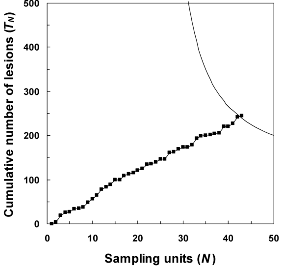
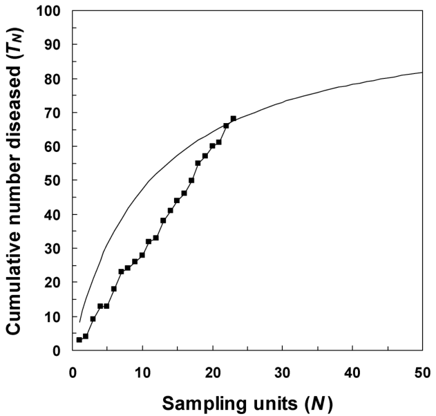
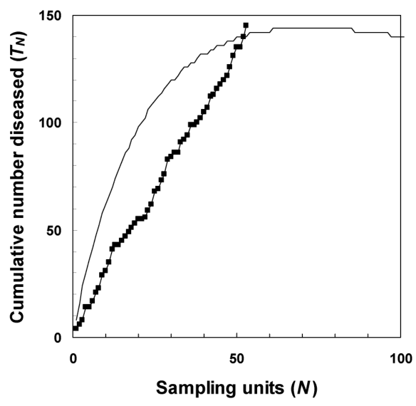

# การสุ่มตัวอย่างเพื่อประเมินโรคพืช (Sampling for Plant Disease Estimation) {#sec-sampling-plans}

## 10.1 ทำไมต้องสุ่มตัวอย่างข้อมูลทางระบาดวิทยา (Why We Sample for Epidemiological Data) {#sec-smp-intro}

สวัสดีครับน้องกันต์! ในบทที่ 9 เราได้ท่องไปในโลกของรูปแบบเชิงพื้นที่และได้เห็นแล้วว่า โรคพืชในแปลงไม่ได้เกิดขึ้นมาลอยๆ แบบสุ่มเสมอไป แต่มักมีการรวมกลุ่มเป็นหย่อม (Aggregated) หรือมีความเชื่อมโยงเชิงพื้นที่อย่างเป็นระบบ ทีนี้ คำถามเชิงปฏิบัติการที่สำคัญที่สุดของนักวิจัยและผู้จัดการโรคพืชทุกคนก็คือ: **"เมื่อเราเดินเข้าแปลงนาหรือแปลงทดลองขนาดใหญ่ เราจะสุ่มตัวอย่างอย่างไรให้ได้ข้อมูลตัวแทนที่แม่นยำ น่าเชื่อถือ และคุ้มค่าแรงงานที่สุด?"**

ในความเป็นจริง เราแทบไม่มีทางตรวจสอบพืชทุกต้นในแปลงปลูกขนาดใหญ่ได้ (Census) เพราะต้องใช้ทรัพยากรมหาศาลทั้งเวลา แรงงาน และงบประมาณ ยิ่งไปกว่านั้น ในการทดสอบบางประเภท เช่น การตรวจกรดนิวคลีอิกของไวรัสด้วยเทคนิค PCR หรือการชักนำให้เกิดแผลในห้องปฏิบัติการ พืชหรือใบตัวอย่างอาจถูกทำลายไปหลังการตรวจวัด (Destructive sampling) ดังนั้น **การสุ่มตัวอย่าง (Sampling)** จึงไม่ใช่แค่ทางเลือกเสริม แต่เป็น **หัวใจหลักที่ขาดไม่ได้** ในการศึกษาและการจัดการโรคระบาดของพืชครับ

ข้อมูลที่ได้จากการสุ่มตัวอย่างถูกนำไปใช้ในวัตถุประสงค์หลัก 3 ประการ:
1. **การประเมินค่าทางระบาดวิทยา (Estimation):** เพื่อประมาณค่าพารามิเตอร์ของประชากร เช่น อุบัติการณ์ของโรคเฉลี่ย ($\bar{y}$) ความรุนแรงของโรคเฉลี่ย หรือความหนาแน่นของประชากรเชื้อสาเหตุ
2. **การทดสอบสมมติฐานทางวิทยาศาสตร์ (Hypothesis testing):** เช่น การเปรียบเทียบประสิทธิภาพของพันธุ์ต้านทานหรือสารชีวภัณฑ์ควบคุมโรค
3. **การตัดสินใจปฏิบัติการจัดการโรค (Decision making):** เช่น การตรวจสอบว่าระดับโรคพืชข้ามเกณฑ์ความเสียหายทางเศรษฐกิจ (Action threshold) หรือยัง ซึ่งเราจะต้องนำข้อมูลนี้ไปใช้ในบทที่ 11 ต่อไป

ในบทนี้ พี่ต้นข้าวจะพาน้องกันต์เจาะลึกทฤษฎีการสุ่มตัวอย่างสำหรับข้อมูลโรคพืช ทั้งในแง่ของข้อมูลเชิงคุณลักษณะ (อุบัติการณ์; Incidence) และข้อมูลการนับ (Counts) ตลอดจนการออกแบบแผนการสุ่มตัวอย่างแบบต่างๆ ครับ

---

## 10.2 ข้อพิจารณาเบื้องต้นก่อนการสุ่มตัวอย่าง (Sampling Preliminaries) {#sec-smp-preliminaries}

ก่อนที่เราจะจรดปากกาคำนวณขนาดตัวอย่าง มีหลักการและนิยามพื้นฐานทางสถิติการสุ่มตัวอย่าง (Sampling theory) ที่เราจำเป็นต้องทำความเข้าใจให้ตรงกันก่อนครับ

### 10.2.1 ศัพท์เฉพาะทาง (Terminology) {#sec-smp-terminology}

- **ประชากรเป้าหมาย (Target population):** กลุ่มของหน่วยสิ่งมีชีวิตทั้งหมดที่เราต้องการสรุปผลไปถึง เช่น "ต้นข้าวทั้งหมดในเขตชลประทานจังหวัดปทุมธานีในฤดูนาปรัง"
- **หน่วยการสุ่ม (Sampling unit):** สิ่งที่เราหยิบขึ้นมาตรวจวัดหรือสังเกต ซึ่งอาจเป็นระดับอวัยวะพืช (เช่น ใบพืช, รวงข้าว, ใบธง), ระดับต้นเดี่ยว (Individual plant), หรือระดับกลุ่มพืช (กรอบสุ่มหรือควอดแรต [Quadrat], แปลงย่อย [Plot])
- **กรอบการสุ่ม (Sampling frame):** บัญชีรายชื่อหรือแผนผังพิกัดเชิงกายภาพที่ระบุหน่วยการสุ่มทั้งหมดในประชากรอย่างครบถ้วนและไม่ซ้ำซ้อน
- **ขนาดประชากร ($M$):** จำนวนหน่วยการสุ่มทั้งหมดที่มีอยู่ในประชากรเป้าหมาย
- **ขนาดตัวอย่าง ($N$):** จำนวนหน่วยการสุ่มที่เราดึงออกมาตรวจวัดจริง

### 10.2.2 ขนาดตัวอย่างและความแม่นยำ (Sample Size and Precision) {#sec-smp-sample-size}

ขนาดตัวอย่าง ($N$) ถือเป็นการประนีประนอม (Trade-off) ระหว่าง **ความแม่นยำทางสถิติ (Statistical precision)** กับ **ต้นทุนทรัพยากร (Resource cost)**
- หากสุ่มตัวอย่างน้อยเกินไป ($N$ เล็กเกินไป): ค่าประมาณที่ได้จะมีความคลาดเคลื่อนสูง ช่วงความเชื่อมั่นกว้าง จนไม่สามารถนำไปสู่ข้อสรุปที่เชื่อถือได้
- หากสุ่มตัวอย่างมากเกินไป ($N$ ใหญ่เกินจำเป็น): แม้ความแม่นยำจะสูงขึ้น แต่ต้นทุนและเวลาที่สูญเสียไปอาจไม่คุ้มค่าทางเศรษฐกิจ

ตามทฤษฎีขีดจำกัดส่วนกลาง (Central Limit Theorem; CLT) เมื่อขนาดตัวอย่าง $N$ มีขนาดใหญ่พอ ค่าเฉลี่ยของตัวอย่าง ($\bar{y}$) จะมีการแจกแจงแบบปกติ (Normal distribution) โดยมีความคลาดเคลื่อนมาตรฐาน (Standard error) ผกผันกับ $\sqrt{N}$:
$$\operatorname{SE}(\bar{y}) = \frac{s}{\sqrt{N}}$$
โดยที่ $s$ คือส่วนเบี่ยงเบนมาตรฐานของประชากร

### 10.2.3 การออกแบบการสุ่มตัวอย่าง (Sample Design) {#sec-smp-design}

รูปแบบการสุ่มตัวอย่างหลักๆ ที่ใช้ในทางระบาดวิทยาพืช ได้แก่:
1. **การสุ่มแบบง่าย (Simple Random Sampling; SRS):** หน่วยการสุ่มทุกหน่วยในประชากรมีโอกาสได้รับเลือกเท่าเทียมกันอย่างเป็นอิสระต่อกัน
2. **การสุ่มแบบกลุ่ม (Cluster Sampling):** สุ่มเลือกกลุ่มของพืช (เช่น กอข้าว หรือกรอบสุ่ม $n$ ต้น) มาทำการตรวจวัดทุกต้นในกลุ่ม เหมาะอย่างยิ่งเมื่อต้นทุนในการเดินทางระหว่างกลุ่มสูงกว่าต้นทุนการตรวจวัดพืชภายในกลุ่ม
3. **การสุ่มแบบแบ่งชั้นภูมิ (Stratified Random Sampling):** แบ่งแปลงออกเป็นชั้นภูมิย่อยตามลักษณะที่คาดว่าจะมีความแปรปรวนต่างกัน (เช่น บริเวณที่ลุ่มน้ำขัง vs บริเวณดอน) แล้วสุ่มตัวอย่างแบบง่ายจากแต่ละชั้นภูมิ
4. **การสุ่มแบบมีระบบ (Systematic Sampling):** สุ่มเลือกหน่วยแรกแบบสุ่ม จากนั้นเลือกหน่วยถัดไปตามระยะก้าวคงที่ (เช่น สุ่มตรวจทุกๆ 10 ต้นตามแนวแถว หรือตามแนวเส้นทแยงมุม W-pattern)

### 10.2.4 ความแปรปรวน (Variability) {#sec-smp-variability}

การคำนวณขนาดตัวอย่างจะเกิดขึ้นไม่ได้เลยหากเราไม่ทราบขนาดของ **ความแปรปรวน (Variance)** ของประชากร ในทางปฏิบัติ ความแปรปรวนมักได้มาจาก:
- ข้อมูลการศึกษานำร่อง (Pilot study)
- ข้อมูลประวัติศาสตร์ในอดีตจากระบบโรคพืชเดียวกัน
- การคาดการณ์กรณีที่เลวร้ายที่สุด (Worst-case scenario; เช่น สำหรับข้อมูลอุบัติการณ์ทวินาม ความแปรปรวนสูงสุดจะเกิดขึ้นเมื่ออุบัติการณ์ $p = 0.5$)

### 10.2.5 ขนาดประชากรและตัวปรับแก้ประชากรจำกัด (Population Size and Finite Population Correction) {#sec-smp-fpc}

ในทางทฤษฎีสถิติส่วนใหญ่ มักสมมติว่าประชากรมีขนาดใหญ่มากจนถือเป็นอนันต์ ($M \to \infty$) แต่หากเราสุ่มตัวอย่างโดยไม่ใส่คืน (Sampling without replacement) จากประชากรที่มีขนาดจำกัด ($M$) เช่น สุ่มตรวจต้นกล้าในถาดเพาะ 500 ต้น หากขนาดตัวอย่าง $N$ คิดเป็นสัดส่วนมากกว่า 5% ของขนาดประชากรทั้งหมด ($N / M > 0.05$) เราจำเป็นต้องคูณปรับแก้ความแปรปรวนด้วย **ตัวปรับแก้ประชากรจำกัด (Finite Population Correction; FPC)**:
$$\operatorname{FPC} = 1 - \frac{N}{M}$$
ส่งผลให้ความคลาดเคลื่อนมาตรฐานของค่าเฉลี่ยตัวอย่างลดลงเหลือ:
$$\operatorname{SE}(\bar{y}) = \sqrt{\frac{s^2}{N} \left(1 - \frac{N}{M}\right)}$$

หากเราคำนวณขนาดตัวอย่างเริ่มต้นได้เป็น $N_0$ (ภายใต้สมมติฐานประชากรอนันต์) ขนาดตัวอย่างที่แท้จริงที่ปรับแก้ FPC แล้ว ($N$) จะคำนวณได้จาก:
$$N = \frac{N_0}{1 + \frac{N_0}{M}}$$
จะเห็นได้ชัดเจนว่า เมื่อ $M$ มีขนาดใหญ่มากเมื่อเทียบกับ $N_0$ ค่า $N_0 / M \to 0$ ทำให้ $N \approx N_0$ แต่ถ้า $M$ มีขนาดเล็ก ขนาดตัวอย่างจริงที่ต้องใช้จะลดลงอย่างมีนัยสำคัญครับ

### 10.2.6 ความน่าเชื่อถือของค่าเฉลี่ยตัวอย่าง (Reliability of the Estimated Sample Mean) {#sec-smp-reliability}

Karandinos (1976) ได้สรุปนิยามระดับความน่าเชื่อถือ (Reliability criteria) สำหรับการคำนวณขนาดตัวอย่างไว้ 3 รูปแบบหลัก ซึ่งนักระบาดวิทยาพืชต้องเลือกใช้ให้ตรงกับเป้าหมาย:

1. **กำหนดขอบเขตความคลาดเคลื่อนสัมบูรณ์ (Fixed Absolute Margin of Error, $h$):**
   ต้องการให้ค่าประมาณ $\bar{y}$ อยู่ห่างจากค่าพารามิเตอร์จริง $\mu$ ไม่เกินระยะ $h$ ด้วยระดับความเชื่อมั่น $100(1 - \alpha)\%$:
   $$\Pr(|\bar{y} - \mu| \le h) = 1 - \alpha$$
   โดยระยะครึ่งหนึ่งของช่วงความเชื่อมั่น (Half-width) คือ $h = z_{\alpha/2} \operatorname{SE}(\bar{y})$
2. **กำหนดขอบเขตความคลาดเคลื่อนสัมพัทธ์ (Fixed Relative Margin of Error, $H$):**
   ต้องการให้ความคลาดเคลื่อนเป็นสัดส่วน $H$ ของค่าเฉลี่ยจริง (เช่น คลาดเคลื่อนไม่เกิน 10% หรือ 20% ของค่าเฉลี่ย):
   $$h = H \cdot \mu \implies \Pr(|\bar{y} - \mu| \le H \mu) = 1 - \alpha$$
3. **กำหนดสัมประสิทธิ์ความแปรผันของค่าเฉลี่ย (Fixed Coefficient of Variation, $C$):**
   กำหนดให้อัตราส่วนของความคลาดเคลื่อนมาตรฐานต่อค่าเฉลี่ยมีค่าไม่เกินระดับคงที่ $C$ (เช่น $C = 0.1$ หรือ $C = 0.2$):
   $$CV(\bar{y}) = \frac{\operatorname{SE}(\bar{y})}{\mu} \le C$$

ในงานวิจัยโรคพืชภาคสนาม ค่า $C = 0.2$ (หรือ 20%) ถือเป็นระดับความน่าเชื่อถือที่ยอมรับได้ทั่วไปสำหรับการสำรวจเบื้องต้น ขณะที่ค่า $C = 0.1$ (หรือ 10%) จะใช้ในงานทดลองที่ต้องการความแม่นยำสูงครับ

---

## 10.3 การสุ่มตัวอย่างแบบง่ายสำหรับข้อมูลอุบัติการณ์ของโรค (Simple Random Sampling for Disease Incidence Data) {#sec-smp-srs-incidence}

อุบัติการณ์ของโรค (Disease incidence) คือสัดส่วนของหน่วยการสุ่มที่เป็นโรคต่อหน่วยการสุ่มทั้งหมดที่ตรวจวัด เมื่อเราสุ่มตรวจพืชทีละต้นแบบสุ่มอย่างง่าย (SRS) สถานะของพืชแต่ละต้นจะเป็นตัวแปรทวินาม (0 = ไม่เป็นโรค, 1 = เป็นโรค)

### 10.3.1 การคำนวณขนาดตัวอย่าง (Sample Size Calculations) {#sec-smp-srs-calc}

สมมติว่าค่าอุบัติการณ์จริงในแปลงคือ $p$ และเราประมาณค่าด้วยอุบัติการณ์ของตัวอย่าง $\bar{y} = Y / N$ โดยที่ $Y$ คือจำนวนพืชที่เป็นโรคที่พบในตัวอย่างขนาด $N$

ความแปรปรวนของตัวแปรทวินามคือ $\sigma^2 = p(1 - p)$ ดังนั้น ความแปรปรวนของค่าเฉลี่ยตัวอย่างคือ:
$$\operatorname{Var}(\bar{y}) = \frac{p(1 - p)}{N}$$
และประมาณค่าได้ด้วย $\widehat{\operatorname{Var}}(\bar{y}) = \frac{\bar{y}(1 - \bar{y})}{N}$ (กรณีละเว้น FPC)

เมื่อนำนิยามความน่าเชื่อถือทั้ง 3 แบบของ Karandinos (1976) มาประยุกต์ใช้ จะได้สูตรขนาดตัวอย่างสำหรับข้อมูลอุบัติการณ์ดังแสดงใน @tbl-10-1:

| นิยามความน่าเชื่อถือ | เกณฑ์ทางคณิตศาสตร์ | สูตรคำนวณขนาดตัวอย่าง ($N$) |
| :--- | :--- | :--- |
| **สัมประสิทธิ์ความแปรผันคงที่ ($C$)** | $CV(\bar{y}) = C$ | $$N = \frac{1 - \bar{y}}{C^2 \bar{y}}$$ |
| **ขอบเขตความคลาดเคลื่อนสัมบูรณ์คงที่ ($h$)** | ครึ่งช่วงกว้าง $= h$ | $$N = \frac{z_{\alpha/2}^2 \bar{y}(1 - \bar{y})}{h^2}$$ |
| **ขอบเขตความคลาดเคลื่อนสัมพัทธ์คงที่ ($H$)** | ครึ่งช่วงกว้าง $= H \bar{y}$ | $$N = \frac{z_{\alpha/2}^2 (1 - \bar{y})}{H^2 \bar{y}}$$ |

: สูตรคำนวณขนาดตัวอย่างสำหรับการสุ่มแบบง่ายของข้อมูลอุบัติการณ์โรคพืช (ละเว้น FPC) {#tbl-10-1}

{#fig-10-1}

น้องกันต์สังเกตลักษณะกราฟใน @fig-10-1 ให้ดีนะครับ:
- เมื่ออุบัติการณ์ของโรคสูง (เช่น $\bar{y} = 0.5$ หรือ 50%): ที่ $C = 0.2$ เราต้องการตัวอย่างเพียง $N = (1 - 0.5) / (0.2^2 \times 0.5) = 25$ ต้นเท่านั้น!
- แต่เมื่ออุบัติการณ์ของโรคต่ำมาก (เช่น $\bar{y} = 0.01$ หรือ 1%): ขนาดตัวอย่างที่ต้องการจะพุ่งสูงขึ้นถึง $N = (1 - 0.01) / (0.2^2 \times 0.01) = 2,475$ ต้น!

> **ข้อคิดทางระบาดวิทยา:** การตรวจหาโรคที่อุบัติการณ์ต่ำมากด้วยการสุ่มแบบง่ายนั้น "เปลืองแรงอย่างมหาศาล" นี่จึงเป็นเหตุผลที่ในหัวข้อต่อๆ ไป เราต้องเรียนรู้เทคนิคขั้นสูงอย่าง **Group testing (การตรวจแบบรวมกลุ่ม)**, **Inverse sampling (การสุ่มแบบผกผัน)**, และ **Sequential sampling (การสุ่มแบบลำดับ)** เพื่อประหยัดแรงงานครับ

#### ตัวอย่างการคำนวณ 10.1 (Example 10.1)
สมมติว่าน้องกันต์ต้องการประเมินอุบัติการณ์ของโรคใบจุดในถาดเพาะกล้าที่มีต้นกล้าทั้งหมด $M = 480$ ต้น โดยกำหนดความน่าเชื่อถือที่ $CV = 0.2$ การสำรวจเบื้องต้นคาดว่ามีต้นกล้าเป็นโรคประมาณ 15% ($\bar{y} = 0.15$):

1. **คำนวณขนาดตัวอย่างเริ่มต้น ($N_0$):**
   $$N_0 = \frac{1 - \bar{y}}{C^2 \bar{y}} = \frac{1 - 0.15}{(0.2)^2 \times 0.15} = \frac{0.85}{0.04 \times 0.15} = \frac{0.85}{0.006} \approx 141.67 \to 142 \text{ ต้น}$$
2. **ปรับแก้ด้วยตัวปรับแก้ประชากรจำกัด (FPC):**
   เนื่องจาก $N_0 / M = 142 / 480 \approx 0.296$ (เกือบ 30% ของประชากร ซึ่งเกินเกณฑ์ 5% อย่างมาก) เราจึงต้องปรับลดขนาดตัวอย่าง:
   $$N = \frac{N_0}{1 + \frac{N_0}{M}} = \frac{141.67}{1 + \frac{141.67}{480}} = \frac{141.67}{1 + 0.295} = \frac{141.67}{1.295} \approx 109.4 \to 110 \text{ ต้น}$$
การนำ FPC มาคิดช่วยลดภาระการสุ่มตรวจของน้องกันต์ลงจาก 142 ต้นเหลือเพียง 110 ต้น โดยยังคงรักษาความแม่นยำทางสถิติไว้เท่าเดิมครับ!

---

### 10.3.2 ความคลาดเคลื่อนจากการตรวจสอบ (Inspection Errors) {#sec-smp-inspection-errors}

ในการคำนวณข้างต้น เราตั้งสมมติฐานในอุดมคติว่า "การตรวจวินิจฉัยโรคมีความแม่นยำสมบูรณ์แบบ 100%" แต่ในความเป็นจริง โดยเฉพาะการวินิจฉัยด้วยสายตาในสนามหรือชุดทดสอบทางห้องปฏิบัติการ มักมีความคลาดเคลื่อนเกิดขึ้นเสมอ (Sutula et al., 1986):
- **สัดส่วนผลลบลวง ($\zeta$; False negative rate):** สัดส่วนของพืชที่เป็นโรคจริงแต่ถูกตรวจวินิจฉัยผิดพลาดว่าเป็นพืชปกติ (ความไวของการทดสอบ หรือ Sensitivity เท่ากับ $\text{Se} = 1 - \zeta$)
- **สัดส่วนผลบวกลวง ($\delta$; False positive rate):** สัดส่วนของพืชที่ปกติปลอดโรคแต่ถูกตรวจวินิจฉัยผิดพลาดว่าเป็นโรค (ความจำเพาะของการทดสอบ หรือ Specificity เท่ากับ $\text{Sp} = 1 - \delta$)

หากความชุกจริงของโรคในประชากรคือ $p$ อุบัติการณ์ที่สังเกตได้จากผลการทดสอบ ($\bar{y}$) จะมีค่าเท่ากับ:
$$\bar{y} = p (1 - \zeta) + (1 - p)\delta$$

Rogan and Gladen (1978) ได้ชี้ให้เห็นว่า หากเรานำ $\bar{y}$ ไปใช้ตรงๆ จะเกิด **อคติอย่างรุนแรง (Badly biased)** ดังนั้น เราจึงต้องใช้ **ตัวประมาณค่าของโรแกน-กลาเดน (Rogan-Gladen estimator, $p^*$)** ในการปรับแก้อคติ:
$$p^* = \frac{\bar{y} - \delta}{1 - \zeta - \delta} = \frac{\bar{y} + \text{Sp} - 1}{\text{Se} + \text{Sp} - 1}$$
(โดยใช้ได้เมื่อ $\delta < \bar{y} < 1 - \zeta$; หาก $\bar{y} \le \delta$ กำหนดให้ $p^* = 0$ และหาก $\bar{y} \ge 1 - \zeta$ กำหนดให้ $p^* = 1$)

Rahme and Joseph (1998) ได้ศึกษาผลกระทบของความคลาดเคลื่อนนี้ต่อขนาดตัวอย่าง พบว่าหากกำหนดขอบเขตความคลาดเคลื่อนสัมบูรณ์คงที่ $h$ ขนาดตัวอย่างที่ต้องใช้จริง ($N$) จะต้องถูกขยายขนาดขึ้นดังนี้:
$$N = \frac{z_{\alpha/2}^2 \bar{y}(1 - \bar{y})}{h^2 (1 - \zeta - \delta)^2}$$

> **ข้อสังเกตสำคัญ:** 
> - หากการตรวจสอบไม่มีความคลาดเคลื่อนเลย ($\zeta = 0, \delta = 0$) ตัวหาร $(1 - 0 - 0)^2 = 1$ สูตรจะลดรูปลงมาเป็นสูตรทวินามปกติใน @tbl-10-1
> - แต่หากผลรวมความผิดพลาด $\zeta + \delta$ เพิ่มขึ้น ตัวหาร $(1 - \zeta - \delta)^2$ จะมีค่าน้อยกว่า 1 ส่งผลให้ขนาดตัวอย่างที่ต้องสุ่ม **พุ่งสูงขึ้นอย่างมาก** เพื่อชดเชยสัญญาณรบกวนจากการตรวจสอบ
> - และหาก $\zeta + \delta = 1$ (การทดสอบไม่มีอำนาจแยกแยะเลย เสมือนการโยนเหรียญ) ตัวหารจะเป็นศูนย์ ขนาดตัวอย่างจะเป็นอนันต์ หมายความว่าต่อให้สุ่มตรวจทั้งแปลงก็ไม่สามารถสร้างช่วงความเชื่อมั่นที่มีประโยชน์ได้!

---

### 10.3.3 ช่วงความเชื่อมั่นแบบแม่นตรงของการแจกแจงทวินาม (Exact Binomial Confidence Intervals) {#sec-smp-exact-ci}

ในการคำนวณที่ผ่านมา เราใช้สูตรช่วงความเชื่อมั่นแบบวอลด์ (Wald confidence interval) ที่อิงการแจกแจงแบบปกติ:
$$\bar{y} \pm z_{\alpha/2} \sqrt{\frac{\bar{y}(1 - \bar{y})}{N}}$$
สูตรนี้ใช้งานได้ดีเมื่อขนาดตัวอย่าง $N$ มีขนาดใหญ่และอุบัติการณ์ $\bar{y}$ อยู่ใกล้ 0.5 แต่จะ **ล้มเหลวอย่างสิ้นเชิง** เมื่อขนาดตัวอย่างมีขนาดเล็ก หรือเมื่ออุบัติการณ์ของโรคมีค่าเข้าใกล้ 0 หรือ 1!

ตัวอย่างเช่น หากเราสุ่มตรวจพืช $N = 10$ ต้น และพบต้นเป็นโรค 1 ต้น ($\bar{y} = 0.1$):
- ช่วงความเชื่อมั่น 95% แบบปกติจะได้ค่าช่วง: $0.1 \pm 1.96 \sqrt{\frac{0.1 \times 0.9}{10}} = 0.1 \pm 0.186 \implies [-0.086, 0.286]$
- ขอบเขตล่างติดลบ ($-0.086$) ซึ่งเป็นไปไม่ได้ในทางชีววิทยา เพราะอุบัติการณ์ของโรคต้องมีค่าอยู่ในช่วง $[0, 1]$ เสมอ!

เพื่อแก้ปัญหานี้ เราจึงต้องใช้ **ช่วงความเชื่อมั่นแบบแม่นตรงของคล็อปเปอร์-เพียร์สัน (Clopper-Pearson exact confidence interval; Clopper and Pearson, 1934)** ซึ่งคำนวณจากฟังก์ชันหางสะสมของการแจกแจงทวินาม (หรือการแจกแจงบีตา) ในตัวอย่างข้างต้น ค่าช่วงความเชื่อมั่น 95% ของ Clopper-Pearson จะได้ช่วง $[0.0025, 0.445]$ ซึ่งขอบเขตล่างมีค่าเป็นบวก และขอบเขตบนสะท้อนความไม่แน่นอนที่สมเหตุสมผล

#### ตัวอย่างที่ตรวจไม่พบพืชเป็นโรคเลย ($Y = 0$) และ "กฎของเลขสาม (Rule of Three)"
สถานการณ์ที่พบบ่อยมากในงานกักกันพืชหรือการสำรวจแปลงปลอดโรค คือเมื่อสุ่มตรวจพืช $N$ ต้นแล้ว **ไม่พบต้นเป็นโรคเลยแม้แต่ต้นเดียว ($Y = 0$)**
หากใช้สูตรปกติ ความแปรปรวนจะเป็นศูนย์ ทำให้ช่วงความเชื่อมั่นหดเหลือ $0 \pm 0$ ซึ่งอันตรายมาก เพราะการตรวจไม่พบในตัวอย่างไม่ได้แปลว่าทั้งแปลงปลอดโรค 100%!

ภายใต้การแจกแจงทวินาม ความน่าจะเป็นที่จะตรวจไม่พบโรคเลยใน $N$ ต้น คือ $(1 - p_U)^N = \alpha$ ดังนั้น ขอบเขตบนของช่วงความเชื่อมั่นด้านเดียว $100(1 - \alpha)\%$ ($p_U$) คือ:
$$p_U = 1 - \alpha^{1/N}$$
หากกำหนดระดับความเชื่อมั่น 95% ($\alpha = 0.05$):
เมื่อกระจายอนุกรมเทย์เลอร์ (Taylor series expansion) จะได้ความสัมพันธ์โดยประมาณที่โด่งดังมากในวงการระบาดวิทยา นั่นคือ **"กฎของเลขสาม (The Rule of Three)"** (Selvin, 1996; Jovanovic and Levy, 1997):
$$p_U \approx \frac{-\ln(0.05)}{N} \approx \frac{2.996}{N} \approx \frac{3}{N}$$

เกณฑ์การประมาณค่าขอบเขตบนด้านเดียวที่ระดับความเชื่อมั่นต่างๆ เมื่อตรวจไม่พบโรค ($Y = 0$):
- **ช่วงความเชื่อมั่นด้านเดียว 90% ($\alpha = 0.10$):** $p_U \approx \frac{-\ln(0.10)}{N} \approx \frac{2.3}{N}$
- **ช่วงความเชื่อมั่นด้านเดียว 95% ($\alpha = 0.05$):** $p_U \approx \frac{3}{N}$
- **ช่วงความเชื่อมั่นด้านเดียว 99% ($\alpha = 0.01$):** $p_U \approx \frac{-\ln(0.01)}{N} \approx \frac{4.6}{N}$
- **ช่วงความเชื่อมั่นด้านเดียว 99.9% ($\alpha = 0.001$):** $p_U \approx \frac{7}{N}$

ตัวอย่างเช่น หากน้องกันต์สุ่มตรวจต้นข้าว $N = 300$ ต้นแล้วไม่พบโรคขอบใบแห้งเลย ขอบเขตบนของอุบัติการณ์ที่ระดับความเชื่อมั่น 95% คือ:
$$p_U \approx \frac{3}{300} = 0.01 \text{ (หรือ 1\%)}$$
หมายความว่า เรามั่นใจ 95% ว่าอุบัติการณ์ของโรคในแปลงจริงจะไม่เกิน 1% แม้เราจะตรวจไม่พบเลยก็ตาม!

Jovanovic and Zalenski (1997) ยังได้เสนอการปรับปรุงกฎของเลขสามตามแนวคิดแบบเบย์เซียน (Bayesian approach) โดยกำหนดการแจกแจงล่วงหน้าแบบเอกรูป (Uniform prior) ซึ่งให้ผลประมาณที่แม่นยำยิ่งขึ้น:
$$p_U \approx \frac{3}{N + 1}$$
และหากมีการสุ่มตรวจซ้ำเป็นชุดลำดับ $K$ ครั้ง ครั้งละ $N_i$ ต้น และไม่พบโรคเลยทุกครั้ง ขอบเขตบนรวมสามารถคำนวณได้ง่ายๆ จาก:
$$p_U \approx \frac{3}{\sum_{i=1}^K N_i + 1} \approx \frac{3}{\sum_{i=1}^K N_i}$$

## 10.4 การสุ่มตัวอย่างแบบง่ายสำหรับข้อมูลการนับ (Simple Random Sampling for Count Data) {#sec-smp-counts}

นอกจากข้อมูลอุบัติการณ์ (เป็นโรค/ไม่เป็นโรค) แล้ว ข้อมูลทางระบาดวิทยาพืชอีกประเภทที่สำคัญมากคือ **ข้อมูลการนับ (Count data)** เช่น จำนวนแผลของโรคใบจุดต่อใบ (Number of lesions per leaf), จำนวนสปอร์ของเชื้อราบนกับดักดักสปอร์, หรือจำนวนแมลงพาหะนำโรคไวรัสต่อต้นข้าว (เช่น เพลี้ยกระโดดสีน้ำตาลต่อกอ)

ความแตกต่างทางสถิติที่สำคัญระหว่างข้อมูลอุบัติการณ์และข้อมูลการนับคือ ข้อมูลอุบัติการณ์มีเพดานจำกัดตามขนาดหน่วยสุ่ม ($0 \le y \le 1$ หรือ $0 \le Y \le n$) แต่ข้อมูลการนับจะมีค่าเป็นจำนวนเต็มบวกที่ไม่มีเพดานจำกัดด้านบนทางทฤษฎี ($Y = 0, 1, 2, \dots, \infty$)

---

### 10.4.1 การแจกแจงแบบปัวซง (The Poisson Distribution) {#sec-smp-poisson}

หากเชื้อสาเหตุหรือแผลของโรคกระจายตัวอย่างเป็นอิสระและสุ่มสมบูรณ์ในแปลง (Complete spatial randomness) ข้อมูลการนับจะมีการแจกแจงแบบปัวซง (Poisson distribution; @sec-sp-poisson)

คุณสมบัติเฉพาะที่สำคัญที่สุดของการแจกแจงแบบปัวซงคือ **ความแปรปรวนเท่ากับค่าเฉลี่ยเสมอ (Equidispersion):**
$$\operatorname{Var}(Y) = \mu$$
ดังนั้น ความแปรปรวนของค่าเฉลี่ยตัวอย่างที่สุ่มตรวจ $N$ หน่วยคือ:
$$\operatorname{Var}(\bar{y}) = \frac{\mu}{N}$$
และประมาณค่าได้ด้วย $\widehat{\operatorname{Var}}(\bar{y}) = \frac{\bar{y}}{N}$

---

### 10.4.2 การแจกแจงแบบทวินามลบและกฎกำลังของเทย์เลอร์ (Negative Binomial and Taylor's Power Law) {#sec-smp-negbin-taylor}

ในความเป็นจริงของการระบาด แผลของโรคหรือแมลงพาหะมักแสดง **การกระจุกตัวเป็นหย่อม (Aggregation / Overdispersion)** ความแปรปรวนจึงมักมีค่าสูงกว่าค่าเฉลี่ยอย่างมาก ($\operatorname{Var}(Y) > \mu$)

แบบจำลองที่นิยมใช้บรรยายความแปรปรวนที่เกินมานี้มี 2 แนวทางหลัก:

1. **การแจกแจงแบบทวินามลบ (Negative Binomial Distribution):**
   ความแปรปรวนสัมพันธ์กับค่าเฉลี่ยผ่านพารามิเตอร์การเกาะกลุ่ม $k$ (Aggregation parameter; ยิ่ง $k$ ต่ำ การเกาะกลุ่มยิ่งรุนแรง):
   $$\operatorname{Var}(Y) = \mu + \frac{\mu^2}{k}$$
   ส่งผลให้ความแปรปรวนของค่าเฉลี่ยตัวอย่างมีค่าเท่ากับ:
   $$\operatorname{Var}(\bar{y}) = \frac{1}{N} \left(\mu + \frac{\mu^2}{k}\right)$$

2. **กฎกำลังของเทย์เลอร์ (Taylor's Power Law):**
   ความแปรปรวนของประชากรมีความสัมพันธ์เชิงประจักษ์กับค่าเฉลี่ยในรูปของฟังก์ชันกฎกำลัง:
   $$s^2 = a \mu^b$$
   โดยที่ $a > 0$ คือพารามิเตอร์มาตราส่วน และ $b$ คือดัชนีการรวมกลุ่ม ($b = 1$ แสดงการกระจายแบบสุ่มปัวซง, $b > 1$ แสดงการรวมกลุ่มเป็นหย่อม)

---

### 10.4.3 การคำนวณขนาดตัวอย่างสำหรับข้อมูลการนับ (Sample Size Calculations for Counts) {#sec-smp-count-calc}

เมื่อนำนิยามความน่าเชื่อถือทั้ง 3 รูปแบบของ Karandinos (1976) มาจับคู่กับแบบจำลองความแปรปรวน จะได้สูตรคำนวณขนาดตัวอย่าง $N$ ดังแสดงใน @tbl-10-2:

| นิยามความน่าเชื่อถือ | การแจกแจงปัวซง (Poisson) | การแจกแจงทวินามลบ (Negative Binomial) | กฎกำลังของเทย์เลอร์ (Taylor's Power Law) |
| :--- | :--- | :--- | :--- |
| **สัมประสิทธิ์ความแปรผันคงที่ ($C$)** | $$N = \frac{1}{C^2 \bar{y}}$$ | $$N = \frac{1}{C^2} \left(\frac{1}{\bar{y}} + \frac{1}{k}\right)$$ | $$N = \frac{a \bar{y}^{b-2}}{C^2}$$ |
| **ขอบเขตคลาดเคลื่อนสัมบูรณ์คงที่ ($h$)** | $$N = \frac{z_{\alpha/2}^2 \bar{y}}{h^2}$$ | $$N = \frac{z_{\alpha/2}^2}{h^2} \left(\bar{y} + \frac{\bar{y}^2}{k}\right)$$ | $$N = \frac{z_{\alpha/2}^2 a \bar{y}^b}{h^2}$$ |
| **ขอบเขตคลาดเคลื่อนสัมพัทธ์คงที่ ($H$)** | $$N = \frac{z_{\alpha/2}^2}{H^2 \bar{y}}$$ | $$N = \frac{z_{\alpha/2}^2}{H^2} \left(\frac{1}{\bar{y}} + \frac{1}{k}\right)$$ | $$N = \frac{z_{\alpha/2}^2 a \bar{y}^{b-2}}{H^2}$$ |

: สูตรคำนวณขนาดตัวอย่างสำหรับการสุ่มแบบง่ายของข้อมูลการนับภายใต้แบบจำลองการแจกแจงต่างๆ {#tbl-10-2}

{#fig-10-2}

น้องกันต์ดู @fig-10-2 ให้ละเอียดนะครับ นี่คือบทเรียนสถิติที่สำคัญอย่างยิ่ง:
- สำหรับการแจกแจงแบบปัวซง (เส้นประ): เมื่อ $\bar{y} \to \infty$ ขนาดตัวอย่าง $N \to 0$ หมายความว่าหากแผลมีจำนวนเยอะมาก เราสุ่มตรวจเพียงไม่กี่ใบก็รู้ค่าเฉลี่ยได้แม่นยำ
- แต่สำหรับการแจกแจงแบบทวินามลบ (เส้นทึบ): สูตรมีพจน์บวก $1 / (C^2 k)$ ติดอยู่เสมอ! หมายความว่า **ต่อให้แผลในแปลงมีจำนวนมหาศาลเพียงใด ขนาดตัวอย่าง $N$ ก็ไม่มีวันลดลงต่ำกว่าขีดจำกัดล่าง $N_{\min} = \frac{1}{C^2 k}$ ได้เลย!**
  - เช่น ที่ $C = 0.2$ และ $k = 1$: $N_{\min} = 1 / (0.04 \times 1) = 25$ ตัวอย่างเสมอ
  - หากการเกาะกลุ่มรุนแรงมาก $k = 0.2$: $N_{\min} = 1 / (0.04 \times 0.2) = 125$ ตัวอย่าง!

#### ตัวอย่างการคำนวณ 10.2 (Example 10.2)
สมมติว่าน้องกันต์ตรวจนับจำนวนแผลของโรคใบจุดต่อใบข้าวในแปลงทดลอง 2 แปลง (Field 10.2.1 และ 10.2.2) โดยกำหนด $CV = 0.2$ ($C = 0.2$):
- **แปลงที่ 1 (Field 10.2.1):** ข้อมูลมีการกระจายตัวแบบสุ่มปัวซง มีค่าเฉลี่ยแผล $\bar{y} = 2.5$ แผล/ใบ
  $$N = \frac{1}{C^2 \bar{y}} = \frac{1}{(0.2)^2 \times 2.5} = \frac{1}{0.04 \times 2.5} = \frac{1}{0.10} = 10 \text{ ใบ}$$
- **แปลงที่ 2 (Field 10.2.2):** โรคมีการเกาะกลุ่มเป็นหย่อม ฟิตได้การแจกแจงทวินามลบที่มี $\bar{y} = 2.5$ และพารามิเตอร์ $k = 0.8$:
  $$N = \frac{1}{C^2} \left(\frac{1}{\bar{y}} + \frac{1}{k}\right) = \frac{1}{0.04} \left(\frac{1}{2.5} + \frac{1}{0.8}\right) = 25 \times (0.4 + 1.25) = 25 \times 1.65 = 41.25 \to 42 \text{ ใบ}$$
เห็นไหมครับว่า เพียงเพราะโรคในแปลงที่ 2 มีการกระจายตัวแบบเกาะกลุ่มเป็นหย่อม ($k = 0.8$) เราต้องเพิ่มขนาดตัวอย่างขึ้นถึง 4 เท่าตัว (จาก 10 ใบเป็น 42 ใบ) จึงจะได้ค่าเฉลี่ยที่มีความน่าเชื่อถือเท่าเทียมกัน!

---

### 10.4.4 ช่วงความเชื่อมั่นแบบแม่นตรงของการแจกแจงแบบปัวซง (Exact Poisson Confidence Intervals) {#sec-smp-exact-poisson}

เช่นเดียวกับกรณีทวินาม เมื่อผลรวมของการนับ $Y_{\text{total}} = \sum Y_i$ มีค่าน้อย การใช้สูตรประมาณปกติ $\bar{y} \pm z_{\alpha/2}\sqrt{\bar{y}/N}$ อาจให้ขอบเขตล่างติดลบ Garwood (1936) จึงได้พัฒนาความสัมพันธ์ระหว่างการแจกแจงปัวซงกับการแจกแจงไคสแควร์ ($\chi^2$) เพื่อคำนวณช่วงความเชื่อมั่นแบบแม่นตรง:
$$\left[ \frac{\chi^2_{2 Y_{\text{total}}, 1 - \alpha/2}}{2 N}, \; \frac{\chi^2_{2(Y_{\text{total}} + 1), \alpha/2}}{2 N} \right]$$
ซึ่งรับประกันว่าขอบเขตล่างจะไม่ติดลบ และสะท้อนความแปรปรวนจริงได้อย่างถูกต้องเสมอครับ

---

## 10.5 การสุ่มตัวอย่างแบบกลุ่มสำหรับข้อมูลอุบัติการณ์ของโรค (Cluster Sampling for Disease Incidence Data) {#sec-smp-cluster}

ในความเป็นจริงของการสำรวจโรคพืชภาคสนาม การเดินสุ่มตรวจพืชทีละต้นแบบกระจายทั่วแปลง (SRS) นั้นเหนื่อยและเสียเวลาเดินทางมาก นักวิจัยจึงมักเลือก **การสุ่มแบบกลุ่ม (Cluster Sampling)** เช่น การสุ่มเลือกกรอบสุ่มหรือควอดแรต (Quadrat) ขนาด $n$ ต้น หรือการสุ่มเลือกกอข้าวที่มี $n$ ลำต้นย่อย แล้วตรวจนับจำนวนต้นที่เป็นโรค $Y$ ภายในกลุ่มนั้น

สมมติว่าเราสุ่มกลุ่มมาทั้งหมด $N_c$ กลุ่ม แต่ละกลุ่มมีขนาดเท่ากันคือ $n$ ต้น จำนวนพืชที่ตรวจวัดทั้งหมดคือ $N_{\text{total}} = N_c \times n$

### 10.5.1 การแจกแจงแบบเบตา-ทวินามและผลกระทบของการออกแบบ (Beta-Binomial Distribution and Design Effect) {#sec-smp-betabin-deff}

หากสถานะการเกิดโรคของต้นพืชในกลุ่มเดียวกันเป็นอิสระต่อกัน จำนวนพืชเป็นโรคในกลุ่มจะมีการแจกแจงแบบทวินาม แต่ดังที่เราได้เรียนรู้ในบทที่ 9 ต้นพืชที่อยู่ใกล้กันในกลุ่มเดียวกันมักจะติดเชื้อร่วมกันเนื่องจากการแพร่กระจายระยะใกล้ ทำให้เกิด **สหสัมพันธ์เชิงพื้นที่ภายในกลุ่ม (Intra-cluster correlation coefficient, $\rho$)**

เมื่อข้อมูลมีความผันแปรสูงกว่าทวินาม (Overdispersion) การแจกแจงแบบเบตา-ทวินาม (Beta-binomial distribution; @sec-sp-betabinomial) จะถูกนำมาใช้ โดยความแปรปรวนของอุบัติการณ์เฉลี่ย $\bar{y}$ ของกลุ่มคือ:
$$\operatorname{Var}(\bar{y}) = \frac{p(1 - p)}{N_c \cdot n} [1 + (n - 1)\rho]$$

พจน์ในวงเล็บเหลี่ยมคือตัวคูณเพิ่มความแปรปรวนอันเนื่องมาจากการเกาะกลุ่ม ซึ่งในสถิติการสำรวจเรียกว่า **ผลกระทบของการออกแบบ (Design Effect; $\operatorname{deff}$)**:
$$\operatorname{deff} = 1 + (n - 1)\rho$$
- หาก $\rho = 0$ (ไม่มีสหสัมพันธ์ในกลุ่ม): $\operatorname{deff} = 1$ ความแปรปรวนจะเท่ากับการสุ่มแบบง่าย (SRS)
- หาก $\rho > 0$ (เกิดการเกาะกลุ่ม): $\operatorname{deff} > 1$ ความแปรปรวนจะสูงกว่าการสุ่มแบบง่ายอย่างมีนัยสำคัญ

### 10.5.2 การคำนวณขนาดตัวอย่างสำหรับการสุ่มแบบกลุ่ม (Sample Size Calculations for Cluster Sampling) {#sec-smp-cluster-calc}

เพื่อชดเชยผลกระทบของ $\operatorname{deff}$ จำนวนกลุ่ม ($N_c$) ที่ต้องสุ่มภายใต้เกณฑ์ความน่าเชื่อถือต่างๆ จึงคำนวณได้ดังแสดงใน @tbl-10-3:

| นิยามความน่าเชื่อถือ | สูตรคำนวณจำนวนกลุ่ม ($N_c$) |
| :--- | :--- |
| **สัมประสิทธิ์ความแปรผันคงที่ ($C$)** | $$N_c = \frac{1 - \bar{y}}{C^2 \bar{y} n} [1 + (n - 1)\rho]$$ |
| **ขอบเขตคลาดเคลื่อนสัมบูรณ์คงที่ ($h$)** | $$N_c = \frac{z_{\alpha/2}^2 \bar{y}(1 - \bar{y})}{h^2 n} [1 + (n - 1)\rho]$$ |
| **ขอบเขตคลาดเคลื่อนสัมพัทธ์คงที่ ($H$)** | $$N_c = \frac{z_{\alpha/2}^2 (1 - \bar{y})}{H^2 \bar{y} n} [1 + (n - 1)\rho]$$ |

: สูตรคำนวณจำนวนกลุ่ม ($N_c$) สำหรับการสุ่มแบบกลุ่มของข้อมูลอุบัติการณ์โรคพืช {#tbl-10-3}

{#fig-10-3}

กราฟใน @fig-10-3 ให้บทเรียนที่สำคัญมากสำหรับนักระบาดวิทยาพืชครับ:
- หาก $\rho = 0$ (การกระจายแบบสุ่ม): เมื่อเราเพิ่มขนาดกลุ่ม $n$ จำนวนกลุ่ม $N_c$ จะลดลงเป็นสัดส่วนผกผันตรงไปตรงมา เพราะพืชทุกต้นให้ข้อมูลใหม่ที่เป็นอิสระต่อกันเสมอ
- แต่หาก $\rho > 0$ (เช่น $\rho = 0.2$ หรือ $0.4$): เมื่อเราเพิ่มขนาดกลุ่ม $n$ ให้ใหญ่ขึ้นเรื่อยๆ เส้นกราฟจะเริ่มราบเรียบ (Asymptote) กล่าวคือ **การเพิ่มจำนวนต้นพืชในกลุ่มเดิมแทบไม่ได้ช่วยลดจำนวนกลุ่มที่ต้องเดินสุ่มลงเลย!**
- เหตุผลทางชีววิทยาคือ: เมื่อพืชในกลุ่มเดียวกันติดเชื้อด้วยกัน ข้อมูลที่ได้จากต้นที่ 2, 3, 4 ในกลุ่มเดิมจึงกลายเป็นข้อมูลซ้ำซ้อน (Redundant information) ซึ่งไม่ได้ช่วยเพิ่มความแม่นยำในการอนุมานประชากรทั้งแปลง!

#### การหาขนาดกลุ่มที่คุ้มค่าที่สุด (Optimal Cluster Size, $n_{\text{opt}}$)
ในทางปฏิบัติ การเดินระหว่างกลุ่มมีต้นทุนค่าใช้จ่าย/เวลาคงที่ ($c_1$) ขณะที่การตรวจพืชแต่ละต้นในกลุ่มมีต้นทุน ($c_2$):
$$\text{Total Cost} = c_1 N_c + c_2 N_c n$$
เมื่อใช้วิธีแคลคูลัสหาจุดต่ำสุดของฟังก์ชันต้นทุน จะได้ **ขนาดกลุ่มที่เหมาะสมที่สุดทางเศรษฐศาสตร์ ($n_{\text{opt}}$)** (Cochran, 1977; Madden and Hughes, 1999):
$$n_{\text{opt}} = \sqrt{\frac{c_1}{c_2} \left(\frac{1 - \rho}{\rho}\right)}$$

- หากค่าใช้จ่ายในการเดินระหว่างแปลงสูงมาก ($c_1 \gg c_2$): ควรสุ่มกลุ่มขนาดใหญ่ ($n$ มาก) แล้วสุ่มจำนวนกลุ่มน้อยลง
- หากค่า $\rho$ สูงมาก (โรคเกาะกลุ่มเป็นหย่อมหนาแน่น): ควรลดขนาดกลุ่มลง ($n$ เล็ก) แล้วกระจายเดินสุ่มกลุ่มให้ทั่วแปลงมากขึ้น!

#### ตัวอย่างการคำนวณ 10.3 (Example 10.3)
สมมติว่าน้องกันต์สุ่มตรวจโรคกาบใบแห้งของข้าว โดยใช้กรอบสุ่มขนาด $n = 9$ ต้นต่อกลุ่ม คาดว่าอุบัติการณ์เฉลี่ย $\bar{y} = 0.20$ ต้องการความน่าเชื่อถือ $CV = 0.2$:
1. **กรณีที่โรคกระจายตัวแบบสุ่ม ($\rho = 0$):**
   $$N_c = \frac{1 - 0.20}{(0.2)^2 \times 0.20 \times 9} \times [1 + 0] = \frac{0.80}{0.04 \times 1.8} = \frac{0.80}{0.072} \approx 11.1 \to 12 \text{ กลุ่ม}$$
   (ตรวจพืชทั้งหมด $12 \times 9 = 108$ ต้น)
2. **กรณีที่โรคมีการรวมกลุ่มเป็นหย่อมปานกลาง ($\rho = 0.15$):**
   $$\operatorname{deff} = 1 + (9 - 1) \times 0.15 = 1 + 8 \times 0.15 = 1 + 1.2 = 2.2$$
   $$N_c = 11.1 \times 2.2 \approx 24.4 \to 25 \text{ กลุ่ม}$$
   (ตรวจพืชทั้งหมด $25 \times 9 = 225$ ต้น)
เห็นได้ชัดว่า สหสัมพันธ์ภายในกลุ่มเพียง $\rho = 0.15$ ทำให้เราต้องสุ่มกลุ่มเพิ่มขึ้นมากกว่าเท่าตัว (จาก 12 กลุ่มเป็น 25 กลุ่ม) เพื่อควบคุมความแม่นยำให้คงที่ครับ!

---

### 10.5.3 ช่วงความเชื่อมั่นสำหรับการสุ่มแบบกลุ่ม (Confidence Intervals for Cluster Sampling) {#sec-smp-cluster-ci}

เมื่อข้อมูลอุบัติการณ์มาจากการสุ่มแบบกลุ่มที่มีการกระจุกตัวแบบเบตา-ทวินาม ช่วงความเชื่อมั่นแบบดั้งเดิมของ Clopper-Pearson จะแคบเกินไป (Underestimate coverage error) เนื่องจากไม่ได้นำผลกระทบของ $\operatorname{deff}$ เข้ามาคำนวณ

ระเบียบวิธีที่ทันสมัยและได้รับการยอมรับในการสร้างช่วงความเชื่อมั่นสำหรับการสุ่มแบบกลุ่ม ได้แก่:
1. **โปรแกรม BBDCI3 ของ Wypij and Santner (1990):** คำนวณช่วงความเชื่อมั่นแบบแม่นตรงสำหรับการแจกแจงเบตา-ทวินามโดยตรง
2. **ระเบียบวิธีของ Chen and Tipping (2002):** อาศัยการปรับแก้อรรถประโยชน์เสมือน (Effective sample size) ร่วมกับสมการภาวะน่าจะเป็นแบบโปรไฟล์ (Profile likelihood) ซึ่งให้ช่วงความเชื่อมั่นที่แม่นยำ ใกล้เคียงกับวิธีของ Wypij และ Santner แต่มีความยืดหยุ่นในการคำนวณทางสถิติมากกว่าครับ

## 10.6 การวิเคราะห์การถดถอยสำหรับข้อมูลอุบัติการณ์ของโรค (Regression Analysis of Disease Incidence Data) {#sec-smp-regression-incidence}

น้องกันต์ครับ เมื่อเราเก็บข้อมูลการสุ่มตัวอย่างจากแปลงที่มีปัจจัยทดลองหลากหลาย (เช่น กรรมวิธีพ่นสารเคมี, พันธุ์พืชต่างกัน, ระดับความชื้นในดิน หรือช่วงเวลาเก็บเกี่ยว) เราไม่เพียงต้องการหาค่าเฉลี่ยตัวอย่างรวมเพียงค่าเดียว แต่เราต้องการ **สร้างแบบจำลองการถดถอย (Regression model)** เพื่ออธิบายว่าปัจจัยเหล่านี้ส่งผลต่อระดับการเกิดโรคอย่างไร

สำหรับข้อมูลอุบัติการณ์ของโรค ($y_i = Y_i / n_i$) ซึ่งเป็นสัดส่วนที่มีค่าอยู่ระหว่าง 0 ถึง 1 การใช้สมการถดถอยเชิงเส้นธรรมดา (Ordinary Least Squares; OLS) จะมีข้อบกพร่องร้ายแรง 2 ประการ:
1. ค่าทำนายของความน่าจะเป็นอาจหลุดออกนอกช่วง $[0, 1]$ (ติดลบหรือเกิน 100%)
2. ความแปรปรวนของสัดส่วนขึ้นอยู่กับค่าเฉลี่ย ($\operatorname{Var}(y_i) = p_i(1 - p_i)/n_i$) ซึ่งละเมิดสมมติฐานความแปรปรวนคงที่ (Homoscedasticity)

ดังนั้น เราจึงต้องใช้กรอบของ **แบบจำลองเชิงเส้นวางนัยทั่วไป (Generalized Linear Models; GLM)** ซึ่งพัฒนาขึ้นโดย Nelder and Wedderburn (1972) และ McCullagh and Nelder (1989)

---

### 10.6.1 การถดถอยโลจิสติก (Logistic Regression) {#sec-smp-logistic}

แบบจำลองมาตรฐานสำหรับข้อมูลสัดส่วนทวินามคือ **การถดถอยโลจิสติก (Logistic regression)** โดยใช้ฟังก์ชันเชื่อมโยงแบบโลจิต (Logit link function):
$$\operatorname{logit}(p_i) = \ln\left(\frac{p_i}{1 - p_i}\right) = \eta_i = \beta_0 + \beta_1 x_{i1} + \beta_2 x_{i2} + \dots + \beta_k x_{ik}$$
และแปลงกลับเป็นอุบัติการณ์ที่คาดหวังได้ด้วยฟังก์ชันโลจิสติก:
$$p_i = \frac{\exp(\eta_i)}{1 + \exp(\eta_i)} = \frac{1}{1 + \exp(-\eta_i)}$$

การประมาณค่าพารามิเตอร์ $\beta$ กระทำด้วย **วิธีภาวะน่าจะเป็นสูงสุด (Maximum Likelihood Estimation; MLE)** โดยฟังก์ชันล็อกภาวะน่าจะเป็น (Log-likelihood) คือ:
$$\ln L = \sum_{i=1}^N \left[ y_i \ln(p_i) + (n_i - y_i)\ln(1 - p_i) + \ln\binom{n_i}{y_i} \right]$$

ความเหมาะสมของแบบจำลองถูกวัดด้วย **เดเวียนซ์ (Deviance, $D$)** หรือสถิติทดสอบอัตราส่วนภาวะน่าจะเป็น (Likelihood Ratio Statistic; LRS):
$$D = 2 \sum_{i=1}^N \left[ Y_i \ln\left(\frac{Y_i}{\hat{\mu}_i}\right) + (n_i - Y_i)\ln\left(\frac{n_i - Y_i}{n_i - \hat{\mu}_i}\right) \right]$$
โดยที่ $\hat{\mu}_i = n_i \hat{p}_i$ และสถิติเพียร์สันไคสแควร์ (Pearson $\chi^2$):
$$\chi^2 = \sum_{i=1}^N \frac{(Y_i - n_i \hat{p}_i)^2}{n_i \hat{p}_i (1 - \hat{p}_i)}$$

#### ปัญหาการกระจายตัวเกิน (Overdispersion) ในการถดถอยโลจิสติก
หากแบบจำลองทวินามมีความเหมาะสม สถิติเดเวียนซ์ ($D$) หรือเพียร์สัน ($\chi^2$) ควรมีค่าใกล้เคียงกับองศาความอิสระตกค้าง (Residual degrees of freedom; $df = N - k - 1$)
แต่ในข้อมูลโรคพืชภาคสนาม เรามักพบว่า:
$$\phi = \frac{\chi^2}{df} \gg 1$$
ปรากฏการณ์นี้เรียกว่า **การกระจายตัวเกินทวินาม (Extra-binomial variation หรือ Overdispersion)** ซึ่งเกิดจากการที่พืชในแปลงเกาะกลุ่มเป็นหย่อม หรือมีตัวแปรสภาพแวดล้อมที่ไม่ได้วัดส่งผลรบกวน หากเราเพิกเฉยและใช้การถดถอยโลจิสติกปกติ ความคลาดเคลื่อนมาตรฐาน ($\operatorname{SE}(\hat{\beta})$) จะ **ต่ำกว่าความเป็นจริงมาก (Underestimated SE)** นำไปสู่การสรุปผลว่าปัจจัยทดลองมีนัยสำคัญ ทั้งที่ความจริงไม่มีนัยสำคัญ (Type I error สูงขึ้นอย่างน่ากลัว)!

---

### 10.6.2 การถดถอยเบตา-ทวินาม (Beta-Binomial Regression) {#sec-smp-betabin-reg}

เพื่อจัดการกับปัญหา Overdispersion อย่างถูกต้องตามหลักระบาดวิทยา เราสามารถขยายแบบจำลองไปสู่ **การถดถอยเบตา-ทวินาม (Beta-binomial regression)** (Crowder, 1978; Williams, 1982; Prentice, 1986):

แบบจำลองกำหนดให้:
$$E(Y_i) = n_i p_i$$
$$\operatorname{Var}(Y_i) = n_i p_i (1 - p_i) [1 + (n_i - 1)\rho]$$
โดยที่ $\rho$ คือสัมประสิทธิ์สหสัมพันธ์ภายในกลุ่ม หรือใช้พารามิเตอร์การกระจายตัว $\theta = \rho / (1 - \rho)$

ในแบบจำลองนี้:
- พารามิเตอร์ความชัน $\beta$ จะเชื่อมโยงกับค่าเฉลี่ย $p_i$ ผ่านฟังก์ชันโลจิต: $\operatorname{logit}(p_i) = \mathbf{x}_i' \boldsymbol{\beta}$
- และพารามิเตอร์การเกาะกลุ่ม $\theta$ (หรือ $\rho$) จะถูกประมาณค่าควบคู่กันไปด้วยวิธีภาวะน่าจะเป็นสูงสุดแบบเต็มรูป (Full MLE) หรือวิธีกึ่งภาวะน่าจะเป็นของวิลเลียมส์ (Williams' quasi-likelihood method; Williams, 1982)

ผลลัพธ์ที่ได้คือ ความคลาดเคลื่อนมาตรฐานของพารามิเตอร์จะถูกคูณปรับขยายด้วย $\sqrt{1 + (n_i - 1)\rho}$ ทำให้การทดสอบสมมติฐานทางสถิติ (เช่น การทดสอบผลของสารเคมีหรือพันธุ์ต้านทาน) มีความเที่ยงตรง ไม่เกิดผลบวกลวงจากอิทธิพลของการรวมกลุ่มของโรคในแปลงครับ!

{#fig-10-4}

การตรวจสอบวินิจฉัยแบบจำลอง (@fig-10-4) ประกอบด้วย:
1. การตรวจสอบความเป็นอิสระของเรซิดูอัลเทียบกับค่าทำนาย (Residuals vs Fitted values)
2. กราฟควอนไทล์-ควอนไทล์ (Q-Q plot) ของเรซิดูอัลเพื่อตรวจดูความเป็นปกติ
3. สถิติเลเวอเรจ (Leverage) และเดลตา-เบตา (Delta-beta) เพื่อค้นหาจุดสังเกตที่มีอิทธิพลสูงผิดปกติ (Outliers / Influential observations)

---

### 10.6.3 การถดถอยโลจิสติกด้วยข้อมูลปรับแก้ $\operatorname{deff}$ (Logistic Regression with Deff-Transformed Data) {#sec-smp-deff-reg}

ในกรณีที่โปรแกรมคอมพิวเตอร์ที่ใช้อยู่ไม่มีคำสั่งสำเร็จรูปสำหรับการถดถอยเบตา-ทวินาม Rao and Scott (1981, 1984) ได้เสนอระเบียบวิธีที่ชาญฉลาดมาก เรียกว่า **การแปลงข้อมูลด้วยผลกระทบของการออกแบบ ($\operatorname{deff}$-transformation)**:

1. คำนวณค่าผลกระทบของการออกแบบสำหรับแต่ละหน่วยสุ่ม:
   $$\operatorname{deff}_i = 1 + (n_i - 1)\hat{\rho}$$
2. ปรับลดขนาดตัวอย่างและจำนวนพืชเป็นโรคเสมือน (Effective sample size):
   $$n_i^* = \frac{n_i}{\operatorname{deff}_i}, \quad Y_i^* = \frac{Y_i}{\operatorname{deff}_i}$$
3. นำข้อมูลจำลอง $Y_i^*$ และ $n_i^*$ ไปรันด้วยคำสั่งการถดถอยโลจิสติกแบบถ่วงน้ำหนักมาตรฐาน (Standard weighted logistic regression)

ผลการประมาณค่าสัมประสิทธิ์ $\hat{\beta}$ และความคลาดเคลื่อนมาตรฐาน $\operatorname{SE}(\hat{\beta})$ ที่ได้จากวิธีนี้จะใกล้เคียงกับการถดถอยเบตา-ทวินามอย่างน่าอัศจรรย์ และช่วยแก้ปัญหา Overdispersion ได้อย่างสะดวกง่ายดายครับ

---

## 10.7 การวิเคราะห์การถดถอยสำหรับข้อมูลการนับ (Regression Analysis of Count Data) {#sec-smp-regression-counts}

สำหรับข้อมูลการนับ (เช่น จำนวนสปอร์, จำนวนแผล, จำนวนแมลงพาหะ) แบบจำลองมาตรฐานในตระกูล GLM คือ **การถดถอยปัวซง (Poisson regression)**

### 10.7.1 การถดถอยปัวซงและการถดถอยทวินามลบ (Poisson and Negative Binomial Regression) {#sec-smp-poisson-negbin-reg}

การถดถอยปัวซงใช้ **ฟังก์ชันเชื่อมโยงแบบล็อก (Log link function)**:
$$\ln(\mu_i) = \beta_0 + \beta_1 x_{i1} + \dots + \beta_k x_{ik} + \ln(A_i)$$
โดยที่ $\ln(A_i)$ คือ **พจน์ออฟเซต (Offset)** ซึ่งเป็นค่าคงที่ที่ทราบค่าแน่นอน ใช้สำหรับปรับแก้เมื่อหน่วยการสุ่มมีขนาดพื้นที่หรือเวลาในการตรวจนับไม่เท่ากัน (เช่น ขนาดพื้นที่ใบข้าว หรือเวลาในการดักสปอร์)

หากพบปัญหาการกระจายตัวเกินในการนับ ($\operatorname{Var}(Y_i) > \mu_i$) เราสามารถเลือกแนวทางแก้ไขได้ 2 ทาง:
1. **แบบจำลองกึ่งปัวซง (Quasi-Poisson model):** กำหนดให้ $\operatorname{Var}(Y_i) = \phi \mu_i$ โดยที่ $\phi > 1$ คือพารามิเตอร์การกระจายตัว
2. **การถดถอยทวินามลบ (Negative binomial regression):** กำหนดให้ $\operatorname{Var}(Y_i) = \mu_i + \alpha \mu_i^2$ (โดย $\alpha = 1/k$) ซึ่งแบบจำลองนี้มีความยืดหยุ่นสูงและเป็นที่นิยมอย่างยิ่งในงานวิจัยกีฏวิทยาและโรคพืช เพราะสะท้อนพฤติกรรมการเกาะกลุ่มของสิ่งมีชีวิตตามธรรมชาติได้สมจริงที่สุดครับ

## 10.8 การตรวจแบบรวมกลุ่มสำหรับข้อมูลอุบัติการณ์ (Group Testing with Incidence Data) {#sec-smp-group-testing}

น้องกันต์ครับ ลองจินตนาการถึงสถานการณ์จริงในห้องปฏิบัติการตรวจโรคพืช เช่น การตรวจหาเชื้อไวรัสใบสีส้มของข้าว (Rice orange leaf virus) หรือไวรัสในกล้วยไม้และมันฝรั่ง โดยใช้เทคนิค ELISA หรือ RT-PCR
หากอุบัติการณ์ของโรคในแปลงต่ำมาก เช่น มีต้นเป็นโรคเพียง 1 ใน 1,000 ต้น ($p = 0.001$) หากเราต้องสกัดสารและตรวจพืชทีละต้นจำนวน 3,000 ต้น เราต้องใช้น้ำยาตรวจถึง 3,000 หลอดทดลอง ซึ่งสิ้นเปลืองงบประมาณมหาศาล!

เพื่อแก้ปัญหานี้ นักสถิติชื่อ Robert Dorfman (1943) ได้ริเริ่มแนวคิด **การตรวจแบบรวมกลุ่ม (Group Testing หรือ Pooled Testing)** ในช่วงสงครามโลกครั้งที่ 2 และต่อมา Gibbs and Gower (1949), Thompson (1962), Burrows (1987) ได้นำมาพัฒนาอย่างลึกซึ้งสำหรับงานทางกีฏวิทยาและโรคพืช:
แทนที่จะตรวจทีละต้น เรานำตัวอย่างพืช $k$ ต้นมารวมบดในหลอดทดลองเดียวกันแล้วตรวจเพียงครั้งเดียว!
- หากหลอดทดลองให้ **ผลลบ**: แสดงว่าพืชทั้ง $k$ ต้นในหลอดนั้นปลอดโรคทั้งหมด!
- หากหลอดทดลองให้ **ผลบวก**: แสดงว่ามีพืช *อย่างน้อย 1 ต้น* ในกลุ่มนั้นที่เป็นโรค!

---

### 10.8.1 ตัวประมาณค่าอุบัติการณ์จากการตรวจรวมกลุ่ม (Estimators of Individual Incidence) {#sec-smp-group-estimators}

สมมติว่าอุบัติการณ์ของต้นพืชที่เป็นโรคเดี่ยวๆ คือ $p$:
- ความน่าจะเป็นที่พืชต้นหนึ่งจะปลอดโรคคือ $1 - p$
- หากพืชในกลุ่ม $k$ ต้นเป็นอิสระต่อกัน ความน่าจะเป็นที่ทั้งกลุ่มจะปลอดโรค (ให้ผลทดสอบเป็นลบ) คือ:
  $$\Pr(\text{กลุ่มเป็นลบ}) = (1 - p)^k$$
- ดังนั้น ความน่าจะเป็นที่กลุ่มจะให้ผลการทดสอบเป็นบวก ($P$) คือ:
  $$P = 1 - (1 - p)^k$$

หากเราสุ่มตรวจกลุ่มทั้งหมด $G$ กลุ่ม (รวมพืชทั้งหมด $N = G \times k$ ต้น) และพบว่ามีกลุ่มที่ให้ผลบวก $Y$ กลุ่ม สัดส่วนของกลุ่มที่ให้ผลบวกคือ $\hat{P} = Y / G$

ตัวประมาณค่าภาวะน่าจะเป็นสูงสุด (Maximum Likelihood Estimator; MLE) ของอุบัติการณ์ระดับต้นเดี่ยว ($p$) คือ:
$$\hat{p} = 1 - (1 - \hat{P})^{1/k} = 1 - \left(1 - \frac{Y}{G}\right)^{1/k}$$

#### การปรับแก้อคติของเบอร์โรวส์ (Burrows' Bias-Corrected Estimator)
ตัวประมาณค่า $\hat{p}$ แบบดั้งเดิมจะมีอคติเล็กน้อยในทางบวก (Slight positive bias) เมื่อจำนวนกลุ่ม $G$ มีขนาดไม่ใหญ่นัก Burrows (1987) จึงได้เสนอ **ตัวประมาณค่าปรับแก้อคติ ($\tilde{p}$)** ซึ่งให้ผลลัพธ์ที่แม่นตรงและมีค่าเฉลี่ยความคลาดเคลื่อนกำลังสอง (MSE) ต่ำกว่า:
$$\tilde{p} = 1 - \left(\frac{G - Y + \frac{k - 1}{2k}}{G + \frac{k - 1}{2k}}\right)^{1/k}$$

{#fig-10-5}

{#fig-10-6}

---

### 10.8.2 การเลือกขนาดกลุ่มที่เหมาะสมที่สุด (Optimal Choice of Group Size, $k$) {#sec-smp-optimal-k}

น้องกันต์ดู @fig-10-5 และ @fig-10-6 ให้ดีนะครับ หากเราเลือกขนาดกลุ่ม $k$ ใหญ่เกินไปในแปลงที่มีโรคชุก ทุกหลอดทดลองจะให้ผลบวกหมด ($Y = G$) ซึ่งจะทำให้เราคำนวณค่า $\hat{p}$ ไม่ได้เลย! แต่ถ้าเลือก $k$ เล็กเกินไป เราก็แทบไม่ประหยัดจำนวนหลอดทดลอง

เป้าหมายคือเลือก $k$ ที่ให้ **ความแปรปรวนเชิงเส้นกำกับต่ำที่สุดต่อพืชหนึ่งต้นที่ตรวจ (Minimum asymptotic variance per plant)**:
$$\operatorname{Var}(\hat{p}) = \frac{(1 - p)[1 - (1 - p)^k]}{G k^2 (1 - p)^k}$$
Thompson (1962) และ Swallow (1985) ได้พิสูจน์ผลลัพธ์ทางคณิตศาสตร์ที่สวยงามมากว่า จุดต่ำสุดของความแปรปรวนจะเกิดขึ้นเมื่อความน่าจะเป็นที่กลุ่มจะให้ผลลัพธ์เป็นลบอยู่ที่ $(1 - p)^k \approx 0.2032$ (หรือประมาณ 20%) ซึ่งนำไปสู่ **สูตรทองคำของการเลือกขนาดกลุ่ม**:
$$k_{\text{opt}} \approx \frac{1.5936}{p}$$

- หากคาดว่าอุบัติการณ์ $p \approx 0.01$ (1%): ควรใช้ขนาดกลุ่ม $k \approx 1.59 / 0.01 \approx 159 \to 160$ ต้น/หลอด!
- หากคาดว่าอุบัติการณ์ $p \approx 0.05$ (5%): ควรใช้ขนาดกลุ่ม $k \approx 1.59 / 0.05 \approx 32$ ต้น/หลอด
- หากอุบัติการณ์ $p \ge 0.20$ (20% ขึ้นไป): การตรวจรวมกลุ่มจะไม่คุ้มค่า และควรตรวจทีละต้นตามปกติ

---

### 10.8.3 การวิเคราะห์การตรวจรวมกลุ่มด้วยแบบจำลองเชิงเส้นวางนัยทั่วไป (Group Testing Using GLM) {#sec-smp-group-glm}

เมื่อเราต้องการศึกษาอิทธิพลของปัจจัยทดลองต่ออุบัติการณ์จากการตรวจรวมกลุ่ม เราสามารถฟิตด้วย GLM ได้อย่างสมบูรณ์แบบโดยอาศัย **ฟังก์ชันเชื่อมโยงคอมพลีเมนทารีล็อก-ล็อก (Complementary log-log link; cloglog link)**:
$$\ln(-\ln(1 - P_i)) = \ln(k_i) + \ln(-\ln(1 - p_i)) = \ln(k_i) + \mathbf{x}_i' \boldsymbol{\beta}$$
โดยกำหนดให้ $\ln(k_i)$ เป็นพจน์ออฟเซต (Offset) วิธีนี้ทำให้เราสามารถประเมินผลของพันธุ์ข้าวหรือสารเคมีได้โดยตรงจากผลการตรวจรวมกลุ่มระดับห้องปฏิบัติการอย่างสง่างามครับ!

---

## 10.9 การสุ่มตัวอย่างแบบทวินามสำหรับข้อมูลการนับ (Binomial Sampling for Count Data) {#sec-smp-binomial-for-counts}

ในหลายกรณี การนับจำนวนแผลหรือแมลงทีละตัวอย่างละเอียด (เช่น นับเพลี้ยกระโดด 500 ตัวบนกอข้าว) เป็นงานที่กินเวลามากและทำให้สายตาล้า Jones (1983) และ Garratt (1991) จึงได้เสนอแนวทาง **การสุ่มแบบทวินามเพื่อประมาณข้อมูลการนับ (Binomial sampling for counts)**:
แทนที่จะนับจำนวนจริง เราเพียงแค่บันทึกว่า **"จำนวนนับข้ามเกณฑ์ขีดเริ่มเปลี่ยน $T$ หรือไม่"** (เช่น มีแผลหรือไม่ [$T = 0$], หรือมีเพลี้ยเกิน 5 ตัวหรือไม่ [$T = 5$])

### 10.9.1 ความสัมพันธ์ทางทฤษฎีตามการแจกแจงความน่าจะเป็น {#sec-smp-bin-counts-theory}

1. **กรณีการแจกแจงแบบปัวซง ($T = 0$; เกณฑ์มี/ไม่มี):**
   สัดส่วนของหน่วยที่มีการเกิดโรค ($P$) คือ:
   $$P = 1 - \exp(-\mu) \implies \mu = -\ln(1 - P)$$
   เพียงแค่นับว่ามีกี่ใบที่มีแผล (สัดส่วน $P$) เราก็สามารถถอดสมการหาค่าเฉลี่ยจำนวนแผลต่อใบ ($\mu$) ได้ทันทีโดยไม่ต้องนับแผลเลยแม้แต่แผลเดียว!
2. **กรณีการแจกแจงแบบทวินามลบ ($T = 0$):**
   $$P = 1 - \left(1 + \frac{\mu}{k}\right)^{-k} \implies \mu = k \left[(1 - P)^{-1/k} - 1\right]$$

### 10.9.2 แบบจำลองเชิงประจักษ์ของนัคมัน (Nachman's Empirical Model) {#sec-smp-nachman}

เมื่อไม่ทราบรูปแบบการแจกแจงที่แน่ชัด Nachman (1984) ได้เสนอแบบจำลองเชิงประจักษ์ที่แม่นยำสูง:
$$\ln(\mu) = a + b \ln(-\ln(1 - P))$$
ซึ่งสามารถนำข้อมูลจากการสำรวจนำร่องมาสร้างสมการถดถอยเชิงเส้น เพื่อใช้ทำนายความหนาแน่นเฉลี่ยของประชากรศัตรูพืชได้อย่างรวดเร็วในงานติดตามแปลงเกษตรขนาดใหญ่ครับ

---

## 10.10 การประเมินความรุนแรงของโรคพืช (Estimation of Disease Severity) {#sec-smp-severity}

ความรุนแรงของโรค (Disease severity) คือสัดส่วนหรือร้อยละของพื้นที่ผิวเนื้อเยื่อพืชที่ถูกทำลายโดยรอยโรค (Proportion of diseased leaf area) ซึ่งเป็นตัวแปรแบบต่อเนื่องที่มีค่าอยู่ในช่วง $[0, 1]$

เครื่องมือและแนวทางมาตรฐานในการประเมินความรุนแรงของโรค ได้แก่:
1. **แผนภาพพื้นที่มาตรฐาน (Standard Area Diagrams; SADs):** ชุดภาพวาดหรือภาพถ่ายอ้างอิงที่มีระดับความรุนแรงของโรคที่วัดค่าแน่นอนแล้ว เพื่อให้ผู้ประเมินใช้เทียบสายตา ช่วยลดความลำเอียงส่วนบุคคล (Inter-rater bias)
2. **มาตราส่วนของฮอร์สฟอลล์และบาร์แรตต์ (Horsfall-Barratt Scale):** ออกแบบตามกฎทางจิตฟิสิกส์ของเวเบอร์และเฟคเนอร์ (Weber-Fechner law) ซึ่งระบุว่าสายตามนุษย์แยกแยะการเปลี่ยนแปลงของความเข้มแสงหรือพื้นที่ได้ดีตามมาตราส่วนลอการิทึม (Logarithmic visual acuity) โดยแบ่งช่วงแคบที่ปลายทั้งสองข้าง ($< 5\%$ และ $> 95\%$) และกว้างตรงกลาง
3. **การวิเคราะห์ทางสถิติของข้อมูลความรุนแรง:**
   - ข้อมูลความรุนแรงที่มีค่าเป็นสัดส่วนต่อเนื่องในขอบเขต $(0, 1)$ นิยมวิเคราะห์ด้วย **การถดถอยบีตา (Beta regression; Ferrari and Cribari-Neto, 2004)**
   - หากข้อมูลมีค่า 0 หรือ 1 ปนอยู่ สามารถใช้ **การแปลงล็อก-เรโช (Log-ratio / Logit transformation)** หรือแบบจำลองบีตาแบบพองตัวที่ศูนย์/หนึ่ง (Zero/One-inflated Beta regression) ซึ่งให้ความเที่ยงตรงทางสถิติสูงสุดครับ
"""

out_path = os.path.join(scratch_dir, 'ch10_part4.qmd')
with open(out_path, 'w', encoding='utf-8') as f:
    f.write(content.strip() + '\n')

print(f"Successfully generated {out_path}, size = {len(content)} characters.")

## 10.11 การสุ่มตัวอย่างแบบผกผันสำหรับอุบัติการณ์ของโรค (Inverse Sampling for Disease Incidence) {#sec-smp-inverse}

น้องกันต์ครับ ดังที่เราได้เห็นใน @fig-10-1 หากโรคมีอุบัติการณ์ต่ำมาก (เช่น $p < 0.01$) การกำหนดขนาดตัวอย่างคงที่ล่วงหน้า ($N$ คงที่) อาจทำให้เราต้องสุ่มตรวจพืชเป็นพันๆ ต้น และบ่อยครั้งที่เราอาจตรวจไม่พบพืชเป็นโรคเลยแม้แต่ต้นเดียว ซึ่งให้ข้อมูลที่ไม่แม่นยำ

J. B. S. Haldane (1945) และ Finney (1949) จึงได้เสนอกลยุทธ์การสุ่มที่พลิกมุมคิดอย่างชาญฉลาด เรียกว่า **การสุ่มตัวอย่างแบบผกผัน (Inverse Sampling หรือ Negative Binomial Sampling)**:
**แทนที่จะกำหนดขนาดตัวอย่าง $N$ ไว้ล่วงหน้า เราจะกำหนด "จำนวนพืชเป็นโรคที่เราต้องการพบ" ($r$) ไว้ล่วงหน้าแทน!**
จากนั้น ผู้ประเมินจะเดินตรวจพืชทีละต้นไปเรื่อยๆ จนกระทั่งตรวจพบพืชเป็นโรคครบ $r$ ต้นพอดี จึงสั่งหยุดการสุ่มตรวจ!

ในกระบวนการนี้:
- จำนวนพืชเป็นโรค ($r$) มีค่าคงที่แน่นอน (เช่น กำหนดให้ $r = 5$ หรือ $r = 10$ ต้น)
- แต่ขนาดตัวอย่างทั้งหมดที่ต้องตรวจ ($N$) จะกลายเป็น **ตัวแปรสุ่ม (Random variable)** ที่มีการแจกแจงแบบทวินามลบ (หรือการแจกแจงปาสคาล; Pascal distribution)

---

### 10.11.1 ตัวประมาณค่าแบบไม่เอนเอียงของฮอลเดน (Haldane's Unbiased Estimator) {#sec-smp-haldane}

หากเราคำนวณสัดส่วนแบบตรงไปตรงมา $r / N$ ค่าที่ได้จะมีความเอนเอียงในทางบวก Haldane (1945) ได้พิสูจน์ว่า **ตัวประมาณค่าแบบไม่เอนเอียงขั้นต่ำที่สุด (Minimum Variance Unbiased Estimator; MVUE)** คือ:
$$\hat{p} = \frac{r - 1}{N - 1}$$
และมีความแปรปรวนที่ประมาณค่าได้โดยปราศจากความเอนเอียงคือ:
$$\widehat{\operatorname{Var}}(\hat{p}) = \frac{\hat{p}(1 - \hat{p})}{N - 2} = \frac{(r - 1)(N - r)}{(N - 1)^2 (N - 2)}$$

#### ต้องตรวจพบต้นเป็นโรคกี่ต้น ($r$)?
หากกำหนดระดับความน่าเชื่อถือด้วยสัมประสิทธิ์ความแปรผันคงที่ $C$ ความแปรปรวนสัมพัทธ์ของการสุ่มแบบผกผันจะมีค่าประมาณ:
$$CV(\hat{p}) \approx \frac{1}{\sqrt{r}}$$
ดังนั้น:
$$r \approx \frac{1}{C^2}$$
- หากต้องการความน่าเชื่อถือระดับสำรวจทั่วไป ($C = 0.2$ หรือ 20%): เราต้องการตรวจพบต้นเป็นโรคเพียง $r = 1 / (0.2)^2 = 25$ ต้นเท่านั้น!
- หากต้องการความแม่นยำสูง ($C = 0.1$ หรือ 10%): ต้องการตรวจพบ $r = 1 / (0.1)^2 = 100$ ต้น

> **ความมหัศจรรย์ของการสุ่มแบบผกผัน:** สังเกตไหมครับน้องกันต์ว่า จำนวนพืชเป็นโรคที่ต้องหาให้พบ ($r$) **ไม่ขึ้นอยู่กับว่าอุบัติการณ์จริงในแปลงจะต่ำเพียงใดเลย!** 
> หากโรคมีอุบัติการณ์ต่ำมาก ($p = 0.001$) เราอาจต้องเดินตรวจ $N \approx 25,000$ ต้นจึงจะพบครบ 25 ต้น แต่ถ้าแปลงนั้นโรคระบาดหนัก ($p = 0.25$) เราเดินตรวจเพียง $N \approx 100$ ต้นก็พบครบ 25 ต้นและหยุดตรวจได้ทันที ทำให้เราปรับตัวตามสถานการณ์จริงในแปลงได้โดยอัตโนมัติ!

---

### 10.11.2 กรณีตรวจพบต้นเป็นโรคต้นแรก ($r = 1$; การแจกแจงแบบเรขาคณิต) {#sec-smp-geometric}

ในงานกักกันพืชควบคุมศัตรูพืชกักกัน (Quarantine inspection) หรือการตรวจรับรองเมล็ดพันธุ์บริสุทธิ์ เรามักต้องการตรวจจนกระทั่งพบ **พืชเป็นโรคต้นแรก ($r = 1$)**
ในกรณีนี้ จำนวนต้นที่ต้องตรวจก่อนจะพบโรคต้นแรก ($N$) จะมีการแจกแจงแบบเรขาคณิต (Geometric distribution):
$$\Pr(N = n) = (1 - p)^{n - 1} p$$
ซึ่งตัวประมาณค่าภาวะน่าจะเป็นสูงสุดคือ $\hat{p} = 1 / N$

---

## 10.12 การสุ่มตัวอย่างแบบลำดับเพื่อการประมาณค่าโรค (Sequential Estimation of Disease) {#sec-smp-sequential}

ในหัวข้อ 10.11 การสุ่มแบบผกผันเป็นตัวอย่างแรกของการสุ่มที่ขนาดตัวอย่างไม่ได้ถูกตรึงคงที่ไว้ล่วงหน้า แต่ในทางระบาดวิทยาและกีฏวิทยา เราสามารถขยายแนวคิดนี้ไปสู่ **การสุ่มตัวอย่างแบบลำดับ (Sequential Sampling)** อย่างเต็มรูปแบบ

แนวคิดนี้ริเริ่มโดย Abraham Wald (1947) ในการทดสอบอัตราส่วนภาวะน่าจะเป็นแบบลำดับ (Sequential Probability Ratio Test; SPRT) สำหรับการตัดสินใจ และต่อมา Kuno (1969, 1972) และ Green (1970) ได้ดัดแปลงมาใช้สำหรับ **การประมาณค่าความหนาแน่นหรืออุบัติการณ์ของประชากร (Sequential Estimation)**

หลักการทำงานคือ:
1. ผู้ประเมินสุ่มตรวจหน่วยตัวอย่างทีละหน่วย (หรือทีละกลุ่ม) แล้วคำนวณ **ผลรวมสะสม (Cumulative count, $T_n = \sum_{i=1}^n Y_i$)**
2. นำผลรวมสะสม $T_n$ ไปพล็อตเทียบกับจำนวนหน่วยตัวอย่างสะสม $n$ บนกราฟ
3. ตรวจสอบว่าเส้นทางสะสมตัดผ่าน **"เส้นหยุดการสุ่ม (Stop line หรือ Stopping boundary)"** หรือยัง:
   - หากยังไม่ตัดเส้นหยุด: ให้สุ่มตรวจหน่วยถัดไป ($n + 1$)
   - ทันทีที่เส้นทางแตะหรือตัดข้ามเส้นหยุด: **สั่งยุติการสุ่มตัวอย่างทันที!** และนำข้อมูลที่ได้มาคำนวณค่าประมาณเฉลี่ย

---

### 10.12.1 การสุ่มแบบลำดับสำหรับข้อมูลการนับตามแบบจำลองของคูโนะ (Kuno's Method for Counts) {#sec-smp-kuno}

Eizi Kuno (1969) ได้พัฒนาสมการเส้นหยุดสำหรับการแจกแจงแบบปัวซงและการแจกแจงแบบทวินามลบ โดยกำหนดระดับความน่าเชื่อถือด้วยสัมประสิทธิ์ความแปรผัน $C$:

1. **กรณีการแจกแจงแบบปัวซง (Poisson):**
   $$T_n = \frac{1}{C^2}$$
   เส้นหยุดเป็นเส้นตรงแนวนอนคงที่! เช่น ที่ $C = 0.2$ เส้นหยุดคือ $T_n = 1 / 0.04 = 25$ หมายความว่า ตรวจสะสมแผลหรือแมลงไปเรื่อยๆ จนกระทั่งนับแผลรวมได้ครบ 25 แผลเมื่อใด ให้หยุดตรวจทันที ไม่ว่าจะตรวจไปกี่ใบก็ตาม!
2. **กรณีการแจกแจงแบบทวินามลบ (Negative Binomial):**
   $$T_n = \frac{1}{C^2 - \frac{1}{k n}}$$
   เส้นหยุดจะมีความโค้งเข้าสู่เส้นกำกับแนวนอน

{#fig-10-7}

ในตัวอย่าง @fig-10-7 สำหรับแปลงทดลอง Field 10.2.1:
- ผู้วิจัยกำหนดความแม่นยำ $C = 0.2$
- เมื่อเดินตรวจพืชสะสมไปทีละต้น ผลรวมของแผลค่อยๆ เพิ่มขึ้น
- เมื่อตรวจถึงต้นที่ $n = 17$ แผลสะสมแตะระดับ $T_{17} = 102$ แผล ซึ่งตัดผ่านเส้นหยุด $C = 0.2$ พอดี การสุ่มจึงยุติลงทันที โดยไม่ต้องเดินตรวจจนครบ 50 หรือ 100 ต้นตามแผนเดิม ช่วยประหยัดเวลาการสำรวจในแปลงได้อย่างมหาศาลครับ!

---

### 10.12.2 การสุ่มแบบลำดับตามกฎกำลังของกรีน (Green's Method Based on Taylor's Power Law) {#sec-smp-green}

เมื่อความแปรปรวนของการนับสอดคล้องกับกฎกำลังของเทย์เลอร์ ($s^2 = a m^b$) Green (1970) ได้สร้างสมการเส้นหยุดที่ทรงพลังและไม่ต้องอาศัยสมมติฐานการแจกแจงแบบพารามิเตอร์:
$$T_n = \left(\frac{a}{C^2}\right)^{\frac{1}{2 - b}} n^{\frac{b - 1}{2 - b}}$$
หรือเขียนในรูปสมการล็อก-เชิงเส้นบนกระดาษกราฟ:
$$\ln(T_n) = \frac{\ln(a / C^2)}{2 - b} + \left(\frac{b - 1}{2 - b}\right) \ln(n)$$

{#fig-10-8}

ใน @fig-10-8 ซึ่งใช้ข้อมูลจากแปลง Field 10.2.2 ที่มีการรวมกลุ่มของแผลสูง การสุ่มสะสมดำเนินไปจนถึงต้นที่ $n = 43$ และมีแผลสะสม $T_{43} = 245$ แผล ซึ่งตัดผ่านเส้นหยุด $C = 0.2$ ทำให้ได้ค่าเฉลี่ยที่มีความน่าเชื่อถือตรงตามเป้าหมายโดยอัตโนมัติ

---

### 10.12.3 การสุ่มแบบลำดับสำหรับอุบัติการณ์จากการสุ่มแบบกลุ่ม (Sequential Estimation of Incidence from Cluster Sampling) {#sec-smp-seq-cluster}

Madden and Hughes (1999) ได้พัฒนาการสุ่มแบบลำดับสำหรับข้อมูลอุบัติการณ์ที่สุ่มด้วยกรอบสุ่มหรือควอดแรต (Cluster sampling) ขนาดกลุ่ม $n$ ต้น ภายใต้การแจกแจงแบบเบตา-ทวินาม

สมการเส้นหยุดสำหรับจำนวนกลุ่มสะสม ($N_c$) คือ:
$$T_{N_c} = \frac{N_c n}{1 + C^2 n N_c [1 + (n - 1)\rho]^{-1}}$$

{#fig-10-9}

{#fig-10-10}

ใน @fig-10-9 และ @fig-10-10 แสดงให้เห็นว่า:
- เส้นหยุดจะปรับตัวตามระดับการเกาะกลุ่ม ($\rho$): หากโรคเกาะกลุ่มมาก ($\rho$ สูง) เส้นหยุดจะยกตัวสูงขึ้น ทำให้ต้องสุ่มกลุ่มมากขึ้น
- ช่วยให้นักระบาดวิทยาสามารถควบคุมความคลาดเคลื่อนในการสำรวจโรคระดับแปลงได้อย่างแม่นยำ ไม่ว่าสภาพการระบาดในแปลงจริงจะรุนแรงหรือเบาบางเพียงใดครับ!

---

## 10.13 สรุปและข้อคิดเห็นเชิงระบาดวิทยา (Conclusions and Methodological Synthesis) {#sec-smp-conclusions}

น้องกันต์ครับ การสุ่มตัวอย่างคือกระบวนการบริโภคทรัพยากร (Sampling consumes resources) ดังนั้น การออกแบบแผนการสุ่มตัวอย่างจึงต้องสร้างสมดุลที่สมบูรณ์แบบระหว่าง **"ความน่าเชื่อถือทางสถิติ (Reliability)"** กับ **"ประสิทธิภาพการใช้ทรัพยากร (Resource efficiency)"**

พี่ต้นข้าวขอสรุปหลักคิดสำคัญสำหรับน้องกันต์และนักวิจัยโรคพืชทุกคนดังนี้ครับ:
1. **จับคู่ธรรมชาติของข้อมูลกับแบบจำลองทางสถิติให้ถูกต้อง:**
   - ข้อมูลอุบัติการณ์พืชเดี่ยว $\to$ การแจกแจงทวินาม (Binomial)
   - ข้อมูลอุบัติการณ์แบบกลุ่ม/กอ $\to$ การแจกแจงเบตา-ทวินาม (Beta-binomial) และคำนึงถึง $\operatorname{deff}$
   - ข้อมูลการนับที่สุ่มสมบูรณ์ $\to$ การแจกแจงปัวซง (Poisson)
   - ข้อมูลการนับที่มีการเกาะกลุ่ม $\to$ การแจกแจงทวินามลบ (Negative binomial) หรือกฎกำลังของเทย์เลอร์
2. **ระวังอคติจากความผิดพลาดในการตรวจสอบ (Inspection errors):** ในการตรวจประเมินด้วยสายตาหรือชุดทดสอบ ต้องคำนึงถึงความไว (Sensitivity) และความจำเพาะ (Specificity) เสมอ และใช้ตัวประมาณค่าของโรแกน-กลาเดน ($p^*$) เพื่อแก้อคติ
3. **อย่ากลัวเมื่อตรวจไม่พบโรค ($Y = 0$):** ใช้ **"กฎของเลขสาม (Rule of Three)"** ($p_U \approx 3/N$) เพื่อระบุขอบเขตบนของความเสี่ยงอย่างเป็นวิทยาศาสตร์
4. **ใช้นวัตกรรมการสุ่มเมื่ออุบัติการณ์ต่ำ:**
   - การตรวจรวมกลุ่ม (Group testing) ด้วยขนาดกลุ่มที่เหมาะสม $k \approx 1.59 / p$ ช่วยประหยัดค่าทดสอบได้มหาศาล
   - การสุ่มแบบผกผัน (Inverse sampling) และการสุ่มแบบลำดับ (Sequential sampling) ช่วยปรับขนาดตัวอย่างตามความเป็นจริงในแปลง ทำให้ไม่ต้องสุ่มตรวจเกินความจำเป็น!

---

## 10.14 เอกสารอ่านเพิ่มเติม (Suggested Readings) {#sec-smp-readings}

- **Binns, M. R., Nyrop, J. P., and van der Werf, W. 2000.** *Sampling and Monitoring for Crop Protection Decision Making*. CAB International, London. (ตำราอ้างอิงระดับโลกที่ครอบคลุมทฤษฎีการสุ่มตัวอย่างและการติดตามศัตรูพืชเพื่อการตัดสินใจอย่างสมบูรณ์แบบ)
- **Cochran, W. G. 1977.** *Sampling Techniques*. 3rd ed. John Wiley & Sons, New York. (คัมภีร์คลาสสิกแห่งทฤษฎีการสุ่มตัวอย่างทางสถิติที่วางรากฐานของ FPC, การสุ่มแบบกลุ่ม และการหาจุดคุ้มทุน)
- **Karandinos, M. G. 1976.** Optimum sample size and components of sample size for estimating any given parameter. *Bull. Entomol. Soc. Am.* 22: 41–44. (บทความเสาหลักที่กำหนดนิยามความน่าเชื่อถือ 3 ประการ [$h, H, C$] ซึ่งเป็นมาตรฐานของวงการเกษตรมาจนถึงปัจจุบัน)
- **Madden, L. V., and Hughes, G. 1999.** Sampling for plant disease incidence. *Phytopathology* 89: 1088–1103. (บทความเจาะลึกการสุ่มตัวอย่างอุบัติการณ์ของโรคพืชและผลกระทบของ Beta-binomial aggregation)
- **Rogan, W. J., and Gladen, B. 1978.** Estimating prevalence from the results of a screening test. *Am. J. Epidemiol.* 107: 71–76. (การพัฒนาระเบียบวิธีปรับแก้อคติจากการทดสอบที่มีผลบวกลวงและลบลวง)
"""

out_path = os.path.join(scratch_dir, 'ch10_part5.qmd')
with open(out_path, 'w', encoding='utf-8') as f:
    f.write(content.strip() + '\n')

print(f"Successfully generated {out_path}, size = {len(content)} characters.")
