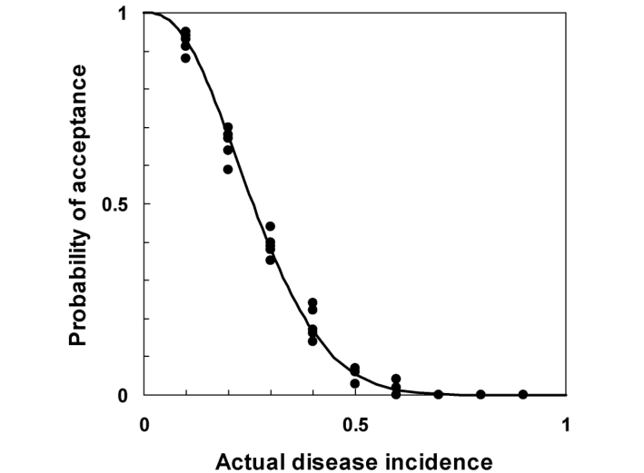
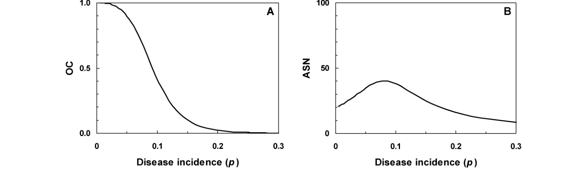
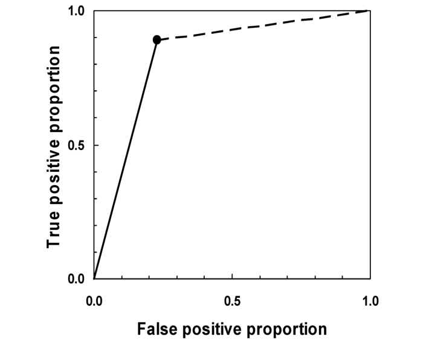

# การตัดสินใจในการจัดการโรคพืช (Decision Making in Plant Disease Management) {#sec-decision-thresholds}

## 11.1 การตัดสินใจในการจัดการโรคพืช (Decision Making in Disease Management) {#sec-dm-intro}

สวัสดีครับน้องกันต์! ในบทที่ 10 เราได้เรียนรู้เทคนิคการสุ่มตัวอย่างเพื่อประมาณค่าทางระบาดวิทยาอย่างแม่นยำไปแล้ว แต่งานของนักระบาดวิทยาพืชไม่ได้หยุดอยู่แค่การรู้ว่าแปลงนามีโรคอยู่กี่เปอร์เซ็นต์ คำถามที่ตามมาซึ่งสำคัญที่สุดต่อชีวิตและความเป็นอยู่ของเกษตรกรก็คือ: **"เมื่อตรวจพบโรคในระดับนี้ เราควรตัดสินใจ 'พ่นสารเคมีควบคุม' หรือ 'ปล่อยผ่านโดยไม่ต้องทำอะไร'?"**

ความสัมพันธ์อันยาวนานและแนบแน่นระหว่างเกษตรกรรมกับระบาดวิทยาพืชทำให้ "การจัดการโรค (Disease management)" กลายเป็นหัวใจหลักที่ขับเคลื่อนศาสตร์นี้มาโดยตลอด ดังที่ J. E. Vanderplank (1963) ได้วางรากฐานไว้ในหนังสือประวัติศาสตร์ *Plant Diseases: Epidemics and Control* พืชปลูกในแปลงเกษตรต้องเผชิญกับความเสี่ยงจากการเข้าทำลายของเชื้อโรค ซึ่งอาจนำไปสู่ความสูญเสียทางเศรษฐกิจทั้งในแง่ปริมาณและคุณภาพของผลผลิต (ซึ่งเราได้ศึกษากลไกในเชิงลึกกันแล้วในบทที่ 12)

เป้าหมายสูงสุดของบทนี้คือ **การประเมินระดับความเสี่ยง (Risk assessment) เชิงปริมาณ เพื่อนำมาใช้เป็นเกณฑ์ตัดสินใจอย่างเป็นระบบว่า "การเข้าแทรกแซงเพื่อระงับโรค (Disease suppression intervention) มีความคุ้มค่าทางเศรษฐกิจและสมเหตุสมผลหรือไม่"** 

ในบทนี้ เราจะเน้นการตัดสินใจในระดับ **แปลงเดี่ยว (Individual field)** สำหรับช่วงเวลาการตัดสินใจจุดใดจุดหนึ่งในฤดูปลูก ซึ่งเป็นการตัดสินใจเชิงจัดกลุ่มแบบทวิภาค (Binary classification):
- **ทางเลือกที่ 1:** ปฏิบัติการควบคุมโรค (Treat / Spray) เช่น การพ่นสารป้องกันกำจัดเชื้อรา
- **ทางเลือกที่ 2:** ไม่ต้องปฏิบัติการใดๆ (Do not treat / No spray)

---

## 11.2 พื้นฐานการสุ่มตัวอย่างเพื่อการยอมรับรุ่น (Acceptance Sampling Preliminaries) {#sec-dm-preliminaries}

แนวคิดทางสถิติที่ทรงพลังที่สุดในการตัดสินใจจำแนกประเภท ได้รับการพัฒนามาจากวงการควบคุมคุณภาพเชิงอุตสาหกรรม (Industrial quality control) เรียกว่า **การสุ่มตัวอย่างเพื่อการยอมรับรุ่น (Acceptance Sampling)** ซึ่งริเริ่มโดย Dodge and Romig (1929) และได้รับการต่อยอดมาใช้ในทางการเกษตรและการกักกันพืชอย่างกว้างขวาง

### 11.2.1 ความน่าจะเป็นและภาวะน่าจะเป็น (Probability and Likelihood) {#sec-dm-prob-likelihood}

ก่อนอื่นเราต้องแยกความแตกต่างระหว่างสองแนวคิดนี้ให้ชัดเจน:
- **ความน่าจะเป็น (Probability, $\Pr(Y \mid p)$):** เราทราบค่าพารามิเตอร์จริงของประชากร ($p$) แล้วคำนวณโอกาสที่จะสังเกตพบข้อมูล $Y$ ในตัวอย่าง
- **ภาวะน่าจะเป็น (Likelihood, $L(p \mid Y)$):** เราสังเกตพบข้อมูล $Y$ ในตัวอย่างแล้ว และใช้ข้อมูลนี้เพื่อประเมินความสมเหตุสมผลของค่าพารามิเตอร์ $p$ ต่างๆ

### 11.2.2 ขีดเริ่มเปลี่ยนในการตัดสินใจ (Thresholds in Disease Management) {#sec-dm-thresholds}

ในทางระบาดวิทยาและกีฏวิทยาเศรษฐกิจ Stern et al. (1959) ได้นิยามระดับขีดเริ่มเปลี่ยนที่สำคัญไว้ดังนี้:
1. **ระดับความเสียหายทางเศรษฐกิจ (Economic Injury Level; EIL):** ระดับความหนาแน่นของศัตรูพืชหรือระดับความรุนแรงของโรคต่ำสุดที่ก่อให้เกิดความเสียหายจนคุ้มค่ากับต้นทุนในการกำจัด:
   $$\text{EIL} = \frac{C}{P \cdot D \cdot K}$$
   โดยที่ $C$ คือต้นทุนในการควบคุมต่อไร่, $P$ คือราคาผลผลิตต่อหน่วย, $D$ คือความสูญเสียผลผลิตต่อหน่วยโรค, และ $K$ คือประสิทธิภาพในการลดโรคของมาตรการควบคุม
2. **ขีดเริ่มเปลี่ยนทางเศรษฐกิจ (Economic Threshold; ET):** ระดับของโรคที่เราต้อง **เริ่มลงมือปฏิบัติการควบคุม** เพื่อป้องกันไม่ให้ประชากรโรคเพิ่มจำนวนจนทะลุผ่านระดับ EIL ในอนาคต
3. **ขีดเริ่มเปลี่ยนเพื่อปฏิบัติการ (Action Threshold; AT):** ค่าอุบัติการณ์หรือความรุนแรงของโรคที่วัดได้จริงในแปลง ซึ่งถูกกำหนดเป็นเกณฑ์ในการสั่งการฉีดพ่นสารเคมี

### 11.2.3 เส้นโค้งลักษณะการทำงานของแผนการสุ่ม (The Operating Characteristic Curve) {#sec-dm-oc-curve}

สมมติว่าแผนการสุ่มตัวอย่างถูกกำหนดด้วยคู่อันดับ $(N, c)$ โดยที่:
- $N$ คือ **ขนาดตัวอย่างที่สุ่มตรวจ** (Sample size)
- $c$ คือ **เกณฑ์จำนวนยอมรับสูงสุด (Acceptance number)**

**กฎการตัดสินใจ (Decision Rule):**
- สุ่มตรวจพืช $N$ ต้น และนับจำนวนต้นที่เป็นโรค $Y$
- หาก $Y \le c$: **ยอมรับรุ่น (Accept)** $\to$ ตัดสินใจ **"ไม่ต้องพ่นสารเคมี (Do not treat)"**
- หาก $Y > c$: **ปฏิเสธรุ่น (Reject)** $\to$ ตัดสินใจ **"ต้องพ่นสารเคมี (Treat)"**

ความน่าจะเป็นในการยอมรับ ($P_a$) จะขึ้นอยู่กับอุบัติการณ์ของโรคจริงในแปลง ($p$) กราฟความสัมพันธ์ระหว่าง $P_a$ กับ $p$ เรียกว่า **เส้นโค้งลักษณะการทำงาน (Operating Characteristic Curve; กราฟ OC)**

{#fig-11-1}

ในอุดมคติ (@fig-11-1) เส้นกราฟ OC ควรมีลักษณะเป็นขั้นบันไดแนวดิ่ง (Step function) ที่จุดขีดเริ่มเปลี่ยน $p^*$:
- เมื่อ $p \le p^*$: $P_a = 1.0$ (ไม่พ่นสารแน่นอน)
- เมื่อ $p > p^*$: $P_a = 0.0$ (พ่นสารแน่นอน)

แต่ในความเป็นจริง เนื่องจากการสุ่มตัวอย่างมีความแปรปรวน เส้นโค้ง OC จึงมีลักษณะเป็นเส้นโค้งรูปตัวเอส (S-shaped curve) เสมอ ทำให้เกิด **ความเสี่ยงในการตัดสินใจผิดพลาด 2 ด้าน**:

{#fig-11-2}

{#fig-11-3}

ความเสี่ยงในการตัดสินใจผิดพลาด 2 รูปแบบ (@fig-11-2, @fig-11-3):
1. **ความเสี่ยงของผู้ผลิต (Producer's Risk, $\alpha$):** 
   - เกิดขึ้นเมื่อแปลงมีระดับโรคต่ำและยอมรับได้ ($p = p_1$; เรียกว่า Acceptable Quality Level หรือ AQL) แต่ผลการสุ่มตัวอย่างกลับบังเอิญพบโรคเกิน $c$ ทำให้ตัดสินใจปฏิเสธและสั่งพ่นสารเคมีโดยไม่จำเป็น (ความผิดพลาดชนิดที่ 1; Type I error)
   - ความน่าจะเป็นในการยอมรับแปลงที่ดีคือ $P_a(p_1) = 1 - \alpha$
2. **ความเสี่ยงของผู้บริโภค (Consumer's Risk, $\beta$):**
   - เกิดขึ้นเมื่อแปลงมีระดับโรครุนแรงเกินขีดจำกัดที่ยอมรับได้ ($p = p_2$; เรียกว่า Lot Tolerance Percent Defective หรือ LTPD) แต่ผลการสุ่มตัวอย่างกลับบังเอิญพบโรคไม่เกิน $c$ ทำให้ตัดสินใจยอมรับและละเว้นการพ่นสารเคมี จนเกิดความเสียหายต่อผลผลิตอย่างรุนแรง (ความผิดพลาดชนิดที่ 2; Type II error)
   - ความน่าจะเป็นในการยอมรับแปลงที่แย่คือ $P_a(p_2) = \beta$

---

### 11.2.4 การคำนวณกราฟ OC ภายใต้การแจกแจงทวินาม (Binomial OC Curve) {#sec-dm-binomial-oc}

หากขนาดประชากรมีขนาดใหญ่มาก การสุ่มพืช $N$ ต้นแบบสุ่มอย่างง่าย (SRS) จะสอดคล้องกับการแจกแจงทวินาม ความน่าจะเป็นในการยอมรับรุ่น ($P_a$) คำนวณจากผลรวมสะสมของความน่าจะเป็นทวินาม:
$$P_a(p) = \sum_{y=0}^c \binom{N}{y} p^y (1 - p)^{N - y}$$

---

### 11.2.5 การคำนวณกราฟ OC ภายใต้การแจกแจงไฮเพอร์จีโอเมตริก (Hypergeometric OC Curve) {#sec-dm-hypergeometric-oc}

หากการสุ่มตัวอย่างกระทำโดยไม่ใส่คืนจากประชากรที่มีขนาดจำกัด $M$ (เช่น แปลงทดลองย่อย หรือกล่องบรรจุผลผลิต $M$ ผล) ความน่าจะเป็นในการยอมรับรุ่นจะคำนวณจากการแจกแจงไฮเพอร์จีโอเมตริก:
$$P_a(X) = \sum_{y=0}^c \frac{\binom{X}{y} \binom{M - X}{N - y}}{\binom{M}{N}}$$
โดยที่ $X = M \cdot p$ คือจำนวนหน่วยที่เป็นโรคทั้งหมดในประชากร

{#fig-11-4}

@fig-11-4 แสดงให้เห็นข้อเท็จจริงทางสถิติที่น่าสนใจมาก:
- เมื่อขนาดประชากร $M$ มีขนาดใหญ่ ($M = 500$ หรือ $M \to \infty$) เส้นโค้ง OC ไฮเพอร์จีโอเมตริกจะทับซ้อนกับเส้นโค้งทวินาม
- แต่เมื่อประชากรมีขนาดเล็กลง ($M = 100$) โดยที่สัดส่วนการสุ่ม $N/M = 50/100 = 0.5$ (สุ่มตรวจถึงครึ่งหนึ่งของประชากร!) เส้นโค้ง OC จะมีความชันชันกว่ามาก ทำให้ความคลาดเคลื่อนในการตัดสินใจลดลงอย่างเห็นได้ชัดครับ

---

### 11.2.6 ผลกระทบของความคลาดเคลื่อนจากการตรวจสอบ (Inspection Errors) {#sec-dm-inspection-errors-oc}

เช่นเดียวกับที่เราได้ศึกษาในบทที่ 10 หากการตรวจวินิจฉัยโรคมีความคลาดเคลื่อน (สัดส่วนผลลบลวง $\zeta$ และสัดส่วนผลบวกลวง $\delta$) อุบัติการณ์ของผลทดสอบที่เป็นบวก ($p_{\text{apparent}}$) จะบิดเบือนไปจากอุบัติการณ์จริง ($p$):
$$p_{\text{apparent}} = p (1 - \zeta) + (1 - p)\delta$$

เมื่อนำ $p_{\text{apparent}}$ ไปแทนที่ในสมการกราฟ OC เส้นโค้ง OC จะถูกบิดเบือนไปอย่างรุนแรง:

{#fig-11-5}

จาก @fig-11-5 จะเห็นว่า แม้ว่าแปลงจะปลอดโรคโดยสมบูรณ์ ($p = 0$) แต่เนื่องจากมีอัตราผลบวกลวง $\delta = 0.05$ ความน่าจะเป็นในการยอมรับรุ่นที่ $p = 0$ ก็ไม่อาจแตะระดับ 1.0 ได้เลย! นี่คือเหตุผลที่ในงานตัดสินใจกักกันพืชและอารักขาพืช เราต้องให้ความสำคัญสูงสุดกับการควบคุมคุณภาพและความแม่นยำของกระบวนการตรวจวินิจฉัยโรคครับ
"""

out_path = os.path.join(scratch_dir, 'ch11_part1.qmd')
with open(out_path, 'w', encoding='utf-8') as f:
    f.write(content.strip() + '\n')

print(f"Successfully generated {out_path}, size = {len(content)} characters.")

## 11.3 การออกแบบแผนการสุ่มตัวอย่างที่มีเส้นโค้ง OC ตามที่กำหนด (Designing a Sampling Plan with a Specified OC Curve) {#sec-dm-design-oc}

น้องกันต์ครับ ในทางปฏิบัติ เราไม่ได้เริ่มต้นจากการมีแผนการสุ่ม $(N, c)$ อยู่แล้วแล้วมาพล็อตดูกราฟ OC แต่เราจะ **ทำกระบวนการย้อนกลับ (Inverse design)** นั่นคือ: ผู้มีอำนาจตัดสินใจหรือนักระบาดวิทยาจะกำหนดระดับความเสี่ยงและจุดควบคุมที่ยอมรับได้ 4 ค่าขึ้นมาก่อน แล้วจึงคำนวณหาคู่ขนาดตัวอย่างและเกณฑ์ยอมรับ $(N, c)$ ที่สอดคล้องกับข้อกำหนดนั้น!

---

### 11.3.1 แผนการสุ่มที่อิงความเสี่ยงของผู้ผลิตและความเสี่ยงของผู้บริโภค (Plans Based on Producer's and Consumer's Risks) {#sec-dm-risk-specs}

ข้อกำหนดมาตรฐาน 4 ประการที่ใช้ในการออกแบบแผนการสุ่ม ได้แก่:
1. **ระดับคุณภาพที่ยอมรับได้ (Acceptable Quality Level; AQL, $p_1$):** ระดับอุบัติการณ์ของโรคที่ถือว่ายังต่ำและปลอดภัย ไม่จำเป็นต้องพ่นสารเคมี
2. **ความเสี่ยงของผู้ผลิต ($\alpha$):** ความน่าจะเป็นสูงสุดที่จะตัดสินใจผิดพลาดไปสั่งพ่นสารเคมี ทั้งที่อุบัติการณ์ของโรคอยู่ที่ระดับ $p_1$ (โดยทั่วไปกำหนด $\alpha = 0.05$ หรือ 5%)
3. **ระดับคุณภาพที่เป็นขีดจำกัดความเสียหาย (Lot Tolerance Percent Defective; LTPD, $p_2$):** ระดับอุบัติการณ์ของโรคที่ถือว่าเป็นอันตรายรุนแรง ต้องไม่ปล่อยให้เล็ดลอดไปโดยไม่พ่นสารเคมีเด็ดขาด
4. **ความเสี่ยงของผู้บริโภค ($\beta$):** ความน่าจะเป็นสูงสุดที่จะตัดสินใจผิดพลาดไม่พ่นสารเคมี ทั้งที่อุบัติการณ์ของโรคพุ่งสูงถึงระดับ $p_2$ (โดยทั่วไปกำหนด $\beta = 0.10$ หรือ 10%)

แผนการสุ่มตัวอย่าง $(N, c)$ ที่ต้องการ จะต้องสอดคล้องกับระบบอสมการพร้อมกัน 2 ข้อ:
$$\begin{aligned}
P_a(p_1) &= \sum_{y=0}^c \binom{N}{y} p_1^y (1 - p_1)^{N - y} \ge 1 - \alpha \\
P_a(p_2) &= \sum_{y=0}^c \binom{N}{y} p_2^y (1 - p_2)^{N - y} \le \beta
\end{aligned}$$

{#fig-11-6}

ใน @fig-11-6 ทุกแผนการสุ่มต่างลากผ่านจุดควบคุมทั้งสองจุดได้อย่างสมบูรณ์แบบ:
- หากเราเลือกแผน $(34, 1)$: เราตรวจพืชเพียง 34 ต้น และยอมให้พบต้นเป็นโรคได้ไม่เกิน 1 ต้น แม้จะประหยัดแรงงาน แต่เส้นโค้งจะมีความชันน้อย ทำให้แปลงที่มีอุบัติการณ์ก้ำกึ่ง (เช่น $p = 0.04$) มีโอกาสถูกสั่งพ่นสารเคมีหรือปล่อยผ่านพอๆ กัน
- หากเราเลือกแผน $(153, 7)$: แม้จะต้องตรวจพืชถึง 153 ต้น แต่เส้นโค้งจะมีความชันสูงมาก เสมือนมีกำแพงตัดขาดการตัดสินใจที่คมกริบ ช่วยลดความกำกวมในทางปฏิบัติได้อย่างยอดเยี่ยมครับ

---

### 11.3.2 แผนการสุ่มที่อิงระดับคุณภาพไม่เอนเอียง (Plans Based on Indifference Quality Level) {#sec-dm-iql}

Hamaker (1950) ได้เสนอแนวทางการวิเคราะห์กราฟ OC โดยใช้ **ระดับคุณภาพไม่เอนเอียง (Indifference Quality Level; IQL, $p_0$)** ซึ่งคือนิยามของจุดที่ความน่าจะเป็นในการยอมรับเท่ากับความน่าจะเป็นในการปฏิเสธพอดี ($P_a(p_0) = 0.50$):
- จุด $p_0$ มักถูกใช้เป็นตัวแทนของ **ขีดเริ่มเปลี่ยนเพื่อปฏิบัติการ (Action threshold, $p^*$)**
- ความชันสัมพัทธ์ของเส้นโค้ง OC ณ จุด $p_0$ ($h_0$) สะท้อนถึง **อำนาจในการจำแนก (Discriminatory power)** ของแผนการสุ่ม:
  $$h_0 = -p_0 \left. \frac{\mathrm{d}P_a}{\mathrm{d}p} \right|_{p = p_0} \approx \sqrt{\frac{2}{\pi}} \sqrt{N p_0 (1 - p_0)}$$
ยิ่งขนาดตัวอย่าง $N$ มีขนาดใหญ่ ค่า $h_0$ จะยิ่งสูงขึ้น บ่งบอกว่าเส้นโค้ง OC ณ จุดขีดเริ่มเปลี่ยนจะยิ่งดิ่งชันและมีความเด็ดขาดในการตัดสินใจสูงขึ้นครับ

---

### 11.3.3 การหาแผนการสุ่มด้วยขั้นตอนวิธีแบบวนซ้ำ (Finding a Sampling Plan by Iteration) {#sec-dm-iterative-search}

เนื่องจาก $N$ และ $c$ ต้องเป็นจำนวนเต็มบวก เราจึงไม่สามารถแก้ระบบสมการด้วยพีชคณิตตรงๆ ได้ แต่สามารถหาคำตอบได้อย่างง่ายดายด้วยขั้นตอนวิธีแบบวนซ้ำ (Iterative search algorithm) ในคอมพิวเตอร์:
1. เริ่มต้นกำหนด $c = 0, 1, 2, \dots$
2. สำหรับแต่ละค่า $c$ หาค่า $N_{\min}$ ต่ำสุดที่ทำให้อสมการทั้งสองเป็นจริงพร้อมกัน
3. เปรียบเทียบต้นทุนของแต่ละคู่ $(N, c)$ เพื่อเลือกแผนการสุ่มที่เหมาะสมที่สุด

{#fig-11-7}

จาก @fig-11-7 จะเห็นว่า เมื่อประชากรมีขนาดจำกัด (เช่น ในแปลงทดลองขนาดเล็ก $M = 100$) ตัวปรับแก้ประชากรจำกัด (FPC) ช่วยให้เราลดขนาดตัวอย่างลงจาก $N = 34$ ต้น (ในกรณีทวินาม) เหลือเพียง $N = 32$ ต้น โดยยังคงควบคุมความเสี่ยง $\alpha$ และ $\beta$ ได้ตามข้อกำหนดอย่างสมบูรณ์!

---

## 11.4 แผนการสุ่มที่มีเกณฑ์จำนวนยอมรับเป็นศูนย์ (Zero Acceptance Number Sampling Plans; $c = 0$) {#sec-dm-c-zero}

น้องกันต์ครับ มีสถานการณ์พิเศษที่สำคัญยิ่งยวดในงานอารักขาพืชระดับชาติ นั่นคือ **งานกักกันพืชเพื่อป้องกันศัตรูพืชกักกัน (Quarantine inspection)** และ **การตรวจรับรองแปลงพันธุ์บริสุทธิ์ (Seed certification)** ในงานเหล่านี้ นโยบายความปลอดภัยทางชีวภาพจะกำหนดอย่างเข้มงวดว่า: **"หากตรวจพบเชื้อโรคแม้แต่ต้นเดียวหรือตัวเดียว จะต้องปฏิเสธและสั่งทำลายหรือกักกันพืชทั้งรุ่นทันที!"**

นี่คือแผนการสุ่มที่มี **เกณฑ์จำนวนยอมรับเป็นศูนย์ ($c = 0$)** หรือแผน $(N, 0)$

---

### 11.4.1 ลักษณะเฉพาะของเส้นโค้ง OC เมื่อ $c = 0$ {#sec-dm-c-zero-oc}

เมื่อ $c = 0$ แผนการสุ่มจะยอมรับรุ่นก็ต่อเมื่อ **ตรวจไม่พบพืชเป็นโรคเลยในตัวอย่าง ($Y = 0$)**
ภายใต้การแจกแจงทวินาม ความน่าจะเป็นในการยอมรับรุ่นคือ:
$$P_a(p) = (1 - p)^N$$

{#fig-11-8}

ข้อสังเกตทางสถิติที่สำคัญอย่างยิ่งของแผน $c = 0$ (@fig-11-8):
- เส้นโค้ง OC สำหรับ $c = 0$ จะ **ไม่มีลักษณะรูปตัวเอส (No S-shape)** และ **ไม่มีจุดเปลี่ยนเว้า (No inflection point)** เลย!
- เส้นกราฟมีลักษณะเว้าขึ้นด้านบนตลอดทั้งเส้น (Purely concave) โดยความน่าจะเป็นในการยอมรับ $P_a$ จะดิ่งฮวบลงอย่างรวดเร็วทันทีที่อุบัติการณ์ $p > 0$
- **ผลกระทบต่อเกษตรกร/ผู้ผลิต:** แผน $c = 0$ จะสร้าง **ความเสี่ยงของผู้ผลิต ($\alpha$) สูงมากอย่างไม่เป็นธรรม!** แม้แปลงนั้นจะมีโรคเพียง 1–2% ซึ่งแทบไม่ก่อความเสียหาย แต่มีโอกาสสูงมากที่ตัวอย่างจะสุ่มไปเจอและทำให้ถูกปฏิเสธทั้งแปลง

---

### 11.4.2 การคำนวณขนาดตัวอย่างสำหรับแผน $c = 0$ และการเชื่อมโยงกับ "กฎของเลขสาม" {#sec-dm-c-zero-calc}

หากเราต้องการคุ้มครองผู้บริโภคหรือประเทศผู้นำเข้า โดยกำหนดว่า "หากอุบัติการณ์จริงสูงแตะระดับอันตราย $p_2$ ความน่าจะเป็นที่จะตรวจหลุดรอดไปต้องไม่เกิน $\beta$":
$$P_a(p_2) = (1 - p_2)^N = \beta$$
เมื่อเทกลอการิทึมธรรมชาติทั้งสองข้าง:
$$N \ln(1 - p_2) = \ln(\beta) \implies N = \frac{\ln(\beta)}{\ln(1 - p_2)}$$

เมื่อ $p_2$ มีค่าน้อย สามารถประมาณค่าได้ด้วยการกระจายเทย์เลอร์ $\ln(1 - p_2) \approx -p_2$:
$$N \approx \frac{-\ln(\beta)}{p_2}$$

น้องกันต์เห็นอะไรคุ้นเคยไหมครับ?
- หากเรากำหนดระดับความเชื่อมั่น 95% ในการตรวจจับโรค ($\beta = 0.05$):
  $$-\ln(0.05) \approx 2.996 \approx 3 \implies N \approx \frac{3}{p_2}$$
  **นี่คือกฎของเลขสาม (The Rule of Three) ที่เราได้เรียนรู้ในบทที่ 10 (@sec-smp-exact-ci) นั่นเอง!**
- หากกำหนดระดับความเชื่อมั่น 90% ($\beta = 0.10$):
  $$-\ln(0.10) \approx 2.30 \implies N \approx \frac{2.3}{p_2}$$
- หากกำหนดระดับความเชื่อมั่น 99% ($\beta = 0.01$):
  $$-\ln(0.01) \approx 4.61 \implies N \approx \frac{4.6}{p_2}$$

ตัวอย่างเช่น หากด่านกักกันพืชต้องการตรวจจับสินค้าเกษตรนำเข้าเพื่อไม่ให้มีเชื้อโรคปนเปื้อนเกิน 0.5% ($p_2 = 0.005$) ด้วยความมั่นใจ 95% ($\beta = 0.05$) เจ้าหน้าที่จะต้องสุ่มตรวจผลผลิตอย่างน้อย:
$$N \approx \frac{3}{0.005} = 600 \text{ ผล}$$
และต้องไม่พบเชื้อโรคเลยแม้แต่ผลเดียว ($c = 0$) จึงจะอนุญาตให้นำเข้าได้ครับ!

---

### 11.4.3 ปัญหาห้องคัดแยกพัสดุและปฏิทรรศน์การตรวจสอบ (The Mailroom Problem and Inspection Paradox) {#sec-dm-mailroom}

ในงานกักกันพืชหรือการตรวจสอบสินค้าเกษตรล็อตใหญ่ ปัญหาสำคัญที่มักถูกมองข้ามคือ **"คุณภาพของล็อตสินค้าขาเข้า (Incoming quality distribution)"** 

ลองนึกภาพห้องคัดแยกพัสดุ (The Mailroom Problem) หรือด่านตรวจพืชที่มีตู้คอนเทนเนอร์สินค้าเกษตรส่งเข้ามา 100 ตู้:
- หากตู้สินค้าส่วนใหญ่มาจากแหล่งปลูกที่สะอาดมาก (มีอุบัติการณ์ของโรคต่ำกว่า $p_1$) การใช้แผน $c = 0$ แม้จะเข้มงวด แต่สินค้าที่หลุดรอดไปสู่ตลาดก็ยังคงมีสัดส่วนของเสียต่ำ
- แต่หากสินค้าที่ส่งเข้ามามาจากแหล่งที่มีโรคระบาดรุนแรงเป็นประจำ แม้แผนการสุ่มจะคัดกรองตู้ที่ตรวจพบโรคทิ้งไปแล้ว ตู้สินค้าที่บังเอิญผ่านการตรวจสอบไปได้ ($Y = 0$) ก็ยังคงมีระดับการปนเปื้อนเชื้อโรคเฉลี่ยสูงกว่าเกณฑ์ที่คาดหวัง!

นี่คือข้อเตือนใจว่า **แผนการสุ่มตัวอย่างที่ดีเพียงลำพังไม่สามารถทดแทนระบบการจัดการคุณภาพตั้งแต่ต้นทางในแปลงปลูก (Good Agricultural Practices; GAP) ได้อย่างสมบูรณ์ครับ!**
"""

out_path = os.path.join(scratch_dir, 'ch11_part2.qmd')
with open(out_path, 'w', encoding='utf-8') as f:
    f.write(content.strip() + '\n')

print(f"Successfully generated {out_path}, size = {len(content)} characters.")

## 11.5 การสุ่มตัวอย่างแบบลำดับเพื่อการจำแนกประเภท (Sequential Sampling for Classification) {#sec-dm-sequential-classification}

น้องกันต์ครับ ในแผนการสุ่มแบบขนาดตัวอย่างคงที่ $(N, c)$ ที่เราศึกษาในหัวข้อ 11.3 และ 11.4 เราต้องเดินตรวจพืชจนครบ $N$ ต้นเสมอ ไม่ว่าแปลงนั้นจะไม่มีโรคเลยแม้แต่ต้นเดียว หรือมีโรคระบาดรุนแรงจนเห็นชัดตั้งแต่ก้าวแรกที่เดินลงแปลงก็ตาม! นี่คือความสูญเสียทรัพยากรโดยไม่จำเป็น

เพื่อแก้ไขปัญหานี้ Abraham Wald (1947) ได้คิดค้นสุดยอดระเบียบวิธีทางสถิติขึ้นมาในช่วงสงครามโลกครั้งที่ 2 นั่นคือ **การทดสอบอัตราส่วนภาวะน่าจะเป็นแบบลำดับ (Sequential Probability Ratio Test; SPRT)** ซึ่งได้รับการยกย่องว่าเป็นหนึ่งในนวัตกรรมทางสถิติที่ประหยัดทรัพยากรที่สุดในประวัติศาสตร์ และได้กลายมาเป็นเครื่องมือหลักในการจัดการศัตรูพืชแบบผสมผสาน (Integrated Pest Management; IPM) ทั่วโลก

---

### 11.5.1 การจำแนกประเภทแบบลำดับด้วยการสุ่มแบบง่าย (Sequential Classification with Simple Random Sampling) {#sec-dm-sprt-srs}

ในกรอบของ SPRT เราจะตั้งสมมติฐานทางสถิติ 2 ข้อที่แข่งขันกัน:
- **สมมติฐานว่าง ($H_0$):** $p = p_1$ (ระดับโรคต่ำ ไม่จำเป็นต้องพ่นสารเคมี $\to$ Do not treat)
- **สมมติฐานแย้ง ($H_1$):** $p = p_2$ (ระดับโรครุนแรง ต้องพ่นสารเคมี $\to$ Treat)
โดยที่ $p_1 < p_2$

เมื่อเราสุ่มตรวจพืชสะสมไปทีละต้นจนถึงต้นที่ $N$ และพบจำนวนต้นเป็นโรคสะสม $Y$ ต้น อัตราส่วนภาวะน่าจะเป็น (Likelihood Ratio, $\Lambda_N$) ภายใต้การแจกแจงทวินามคือ:
$$\Lambda_N = \frac{L(p_2 \mid Y, N)}{L(p_1 \mid Y, N)} = \frac{\binom{N}{Y} p_2^Y (1 - p_2)^{N - Y}}{\binom{N}{Y} p_1^Y (1 - p_1)^{N - Y}} = \left(\frac{p_2}{p_1}\right)^Y \left(\frac{1 - p_2}{1 - p_1}\right)^{N - Y}$$

**เกณฑ์การตัดสินใจของวอลด์ (Wald's Decision Rule):**
กำหนดจุดตัดขอบเขต 2 ค่าจากระดับความเสี่ยงที่ยอมรับได้ ($\alpha, \beta$):
- ขอบเขตล่าง: $B = \frac{\beta}{1 - \alpha}$
- ขอบเขตบน: $A = \frac{1 - \beta}{\alpha}$

กฎการตัดสินใจคือ:
1. หาก $\Lambda_N \le B$: **ยอมรับ $H_0$ (Accept $H_0$)** $\to$ ยุติการสุ่ม และตัดสินใจ **"ไม่ต้องพ่นสารเคมี"**
2. หาก $\Lambda_N \ge A$: **ปฏิเสธ $H_0$ ยอมรับ $H_1$ (Reject $H_0$)** $\to$ ยุติการสุ่ม และตัดสินใจ **"ต้องพ่นสารเคมี"**
3. หาก $B < \Lambda_N < A$: **ยังตัดสินใจไม่ได้ (Continue sampling)** $\to$ สุ่มตรวจพืชต้นที่ $N + 1$ ต่อไป

#### เส้นหยุดเชิงเส้นของการตัดสินใจ (Linear Decision Boundaries / Stop Lines)
เมื่อเทกลอการิทึมธรรมชาติ จะได้สมการเส้นตรง 2 เส้นที่ขนานกันบนระนาบระหว่างผลรวมพืชเป็นโรคสะสม ($Y$) กับจำนวนพืชที่ตรวจสะสม ($N$):
- **เส้นหยุดล่าง (Lower Stop Line):** $Y_{\text{lower}} = h_1 + s N$
- **เส้นหยุดบน (Upper Stop Line):** $Y_{\text{upper}} = h_2 + s N$

โดยที่ความชันร่วม ($s$) และจุดตัดแกน ($h_1, h_2$) คำนวณได้จาก:
$$s = \frac{\ln\left(\frac{1 - p_1}{1 - p_2}\right)}{\ln\left(\frac{p_2(1 - p_1)}{p_1(1 - p_2)}\right)}$$
$$h_1 = \frac{\ln\left(\frac{\beta}{1 - \alpha}\right)}{\ln\left(\frac{p_2(1 - p_1)}{p_1(1 - p_2)}\right)} < 0 \quad (\text{จุดตัดแกนเป็นลบ})$$
$$h_2 = \frac{\ln\left(\frac{1 - \beta}{\alpha}\right)}{\ln\left(\frac{p_2(1 - p_1)}{p_1(1 - p_2)}\right)} > 0 \quad (\text{จุดตัดแกนเป็นบวก})$$

{#fig-11-9}

{#fig-11-10}

![เส้นโค้งขนาดตัวอย่างเฉลี่ย (Average Sample Number; กราฟ ASN) สำหรับ SPRT แสดงจำนวนตัวอย่างเฉลี่ย $E[N]$ ที่ต้องตรวจก่อนการสุ่มจะยุติลง จุดยอดสูงสุดเกิดขึ้น ณ บริเวณความคลุมเครือ ($p \approx s$) ขณะที่ในแปลงที่มีโรคน้อยมาก ($p \le p_1$) หรือโรคระบาดหนัก ($p \ge p_2$) จำนวนตัวอย่างที่ต้องตรวจจะลดลงอย่างมหาศาล (ดัดแปลงจาก Madden et al., 2007)](figures/ch11/fig11-img20.png){#fig-11-11}

{#fig-11-12}

ความมหัศจรรย์ของ SPRT ที่เห็นได้จาก @fig-11-11 และ @fig-11-12 คือ:
- **ในแปลงที่ไม่มีโรคหรือมีโรคน้อยมาก ($p \ll p_1$):** เส้นทางสะสม $Y$ จะวิ่งราบเรียบขนานกับแกนนอน และชนเส้นหยุดล่างอย่างรวดเร็ว ทำให้เราหยุดสุ่มตรวจได้โดยใช้ตัวอย่างเพียงเล็กน้อย
- **ในแปลงที่โรคระบาดหนัก ($p \gg p_2$):** จำนวนต้นเป็นโรคจะเพิ่มขึ้นอย่างรวดเร็วและพุ่งทะลุเส้นหยุดบนแทบจะในทันที ทำให้สั่งพ่นสารเคมีได้ทันท่วงที
- **ขนาดตัวอย่างเฉลี่ย (ASN) ของ SPRT ต่ำกว่าแผนการสุ่มแบบขนาดคงที่ทั่วไปถึง 40–60%!** ซึ่งช่วยประหยัดเวลาและค่าแรงงานของเกษตรกรได้อย่างมหาศาลครับ!

---

### 11.5.2 การจำแนกประเภทแบบลำดับสำหรับการสุ่มแบบกลุ่ม (Sequential Classification with Cluster Sampling) {#sec-dm-sprt-cluster}

เมื่อการสุ่มทำในระดับกรอบสุ่มหรือควอดแรต (Cluster sampling) ขนาด $n$ ต้น และโรคในแปลงมีการรวมกลุ่มเป็นหย่อมตามการแจกแจงแบบเบตา-ทวินาม Madden and Hughes (1994, 1999) ได้พัฒนา **เบตา-ทวินาม SPRT (Beta-binomial SPRT)**:

ความน่าจะเป็นของจำนวนต้นเป็นโรคในควอดแรตจะขึ้นอยู่กับทั้งอุบัติการณ์ ($p$) และสหสัมพันธ์ภายในกลุ่ม ($\rho$):
- เมื่อนำอัตราส่วนภาวะน่าจะเป็นของเบตา-ทวินามมาคำนวณ เส้นหยุดของการตัดสินใจจะยังคงเป็นเส้นตรง
- แต่ความชัน ($s$) และระยะตัดแกน ($h_1, h_2$) จะต้องถูกปรับแก้ตามค่า $\rho$

{#fig-11-13}

จาก @fig-11-13 จะเห็นว่า เมื่อโรคมีการเกาะกลุ่มเป็นหย่อม ($\rho > 0$) เส้นหยุดบนและล่างจะถ่างกว้างออกจากกัน สะท้อนว่าเราต้องสุ่มตรวจจำนวนกลุ่มมากขึ้นเพื่อชดเชยความผันแปรที่เพิ่มขึ้นครับ

---

### 11.5.3 ความจำเป็นของการจำลองสถานการณ์เพื่อตรวจสอบความใช้ได้ (The Need for Simulation) {#sec-dm-sprt-simulation}

ในทางทฤษฎีของวอลด์ การคำนวณขอบเขต $A$ และ $B$ ละเว้นผลของการที่ข้อมูล "กระโดดข้ามเส้นหยุด (Overshoot)" เล็กน้อย ทำให้ในทางปฏิบัติ ค่าความเสี่ยงที่แท้จริง ($\alpha_{\text{actual}}, \beta_{\text{actual}}$) มักจะต่ำกว่าค่าที่ตั้งไว้ (Conservatism)

การนำชุดข้อมูลแผนที่โรคพืชจริงมาทำการสุ่มซ้ำ (Resampling validation / Bootstrap) ช่วยยืนยันว่า แบบจำลอง SPRT สามารถทำงานได้อย่างมีเสถียรภาพสูงในสภาพแวดล้อมภาคสนามจริง และไม่ก่อให้เกิดความคลาดเคลื่อนเกินกว่าเกณฑ์ที่กำหนดไว้ครับ!
"""

out_path = os.path.join(scratch_dir, 'ch11_part3.qmd')
with open(out_path, 'w', encoding='utf-8') as f:
    f.write(content.strip() + '\n')

print(f"Successfully generated {out_path}, size = {len(content)} characters.")

## 11.6 อัลกอริทึมความเสี่ยงเพื่อการตัดสินใจจัดการโรค (Risk Algorithms as a Basis for Decision Making) {#sec-dm-risk-algorithms}

น้องกันต์ครับ ในหลายระบบโรคพืช เมื่อเราตรวจพบอาการของโรคในแปลงด้วยตาเปล่า มักจะ **"สายเกินแก้ (Too late to treat)"** เสียแล้ว! ตัวอย่างคลาสสิกเช่น โรคเน่าดำของเรพซีด/คาโนลา (Sclerotinia stem rot) หรือโรคไหม้ของข้าว (Rice blast) ซึ่งเมื่อเชื้อเข้าทำลายลำต้นหรือคอรวงแล้ว การพ่นสารเคมีแทบจะไม่สามารถยับยั้งความเสียหายได้เลย

ในสถานการณ์เช่นนี้ การตัดสินใจจึงต้องอาศัย **การพยากรณ์ความเสี่ยงล่วงหน้า (Pre-symptom risk forecasting)** โดยรวบรวมปัจจัยสภาพแวดล้อมและประวัติแปลงมาประมวลผลเป็น **อัลกอริทึมความเสี่ยง (Risk algorithms)** หรือระบบการให้คะแนนความเสี่ยง (Point-scoring systems)

---

### 11.6.1 ปัจจัยความเสี่ยงและระบบการให้คะแนน (Risk Factors and Point-Scoring Systems) {#sec-dm-risk-factors}

ปัจจัยความเสี่ยง (Risk factors) ที่นิยมนำมารวมในอัลกอริทึม ได้แก่:
1. **ประวัติการปลูกพืชและการหมุนเวียน (Crop rotation):** จำนวนปีนับตั้งแต่ปลูกพืชอาศัยครั้งล่าสุด (สะท้อนปริมาณเม็ดสเคลอโรเชียหรือเชื้อข้ามฤดูในดิน)
2. **ความหนาแน่นของทรงพุ่ม (Canopy density):** อัตราการปลูกและความสมบูรณ์ของใบ (กำหนดความชื้นสัมพัทธ์และจุลภูมิอากาศใต้ทรงพุ่ม)
3. **ปริมาณน้ำฝนและความชื้นในดิน (Moisture / Rainfall):** ฝนตกในช่วงก่อนออกดอกและการเปียกใบ
4. **การพยากรณ์อากาศล่วงหน้า (Weather forecast):** อุณหภูมิและความชื้นที่เอื้อต่อการงอกของสปอร์
5. **ปริมาณเชื้อสาเหตุเริ่มต้น (Inoculum potential):** เช่น การตรวจเปอร์เซ็นต์กลีบดอกที่ติดเชื้อรา (Petal infestation test)

ตัวอย่างระบบที่ประสบความสำเร็จอย่างสูงในยุโรป คือระบบประเมินความเสี่ยงโรคต้นเน่าสเคลอโรทิเนียของเรพซีดในสวีเดน (Twengström et al., 1998) ซึ่งกำหนดคะแนนความเสี่ยงให้แต่ละปัจจัย (รวมคะแนนเต็ม 100 คะแนน) หากแปลงใดมีคะแนนรวมเกินกว่าขีดเริ่มเปลี่ยน (เช่น คะแนน $\ge 40$ คะแนน) แนะนำให้พ่นสารเคมีป้องกันกำจัดเชื้อรา

{#fig-11-14}

จาก @fig-11-14 สังเกตไหมครับน้องกันต์ว่า แปลงที่เป็นโรคจริงและแปลงที่ไม่เป็นโรคไม่ได้แยกออกจากกันโดยเด็ดขาด แต่มี **บริเวณที่ทับซ้อนกัน (Overlap region)** หมายความว่า ไม่ว่าเราจะเลือกตัดคะแนนขีดเริ่มเปลี่ยนที่จุดใด ย่อมต้องมีความผิดพลาดในการตัดสินใจเกิดขึ้นเสมอ!

---

### 11.6.2 ความไว ความจำเพาะ และตารางจำแนก $2 \times 2$ (Sensitivity, Specificity, and Contingency Table) {#sec-dm-sens-spec}

เมื่อเรากำหนดคะแนนขีดเริ่มเปลี่ยนค่าหนึ่ง (เช่น ตัดที่ 40 คะแนน) ผลการตัดสินใจเทียบกับสถานะการระบาดจริงในแปลง สามารถสรุปได้ด้วย **ตารางจำแนก $2 \times 2$ (Contingency table)**:

| ผลการทำนายด้วยอัลกอริทึม | แปลงเป็นโรคจริง ($\text{Disease } +$) | แปลงไม่เป็นโรคจริง ($\text{Disease } -$) | รวม |
| :--- | :---: | :---: | :---: |
| **เตือนให้พ่นสาร ($\text{Test } +$)** | **บวกจริง (True Positive; TP)** | **บวกลวง (False Positive; FP)** | $\text{TP} + \text{FP}$ |
| **แนะนำไม่พ่นสาร ($\text{Test } -$)** | **ลบลวง (False Negative; FN)** | **ลบจริง (True Negative; TN)** | $\text{FN} + \text{TN}$ |
| **รวม** | $n_1$ (แปลงเป็นโรคทั้งหมด) | $n_2$ (แปลงปลอดภัยทั้งหมด) | $N_{\text{total}}$ |

: ตารางจำแนกแบบสองทาง ($2 \times 2$) สำหรับการประเมินประสิทธิภาพของอัลกอริทึมตัดสินใจ {#tbl-11-1}

ตัวชี้วัดประสิทธิภาพเชิงความน่าจะเป็นแบบมีเงื่อนไข (Conditional probabilities):
1. **ความไวของการทำนาย (Sensitivity, $\text{Se}$):** ความน่าจะเป็นที่อัลกอริทึมจะเตือนให้พ่นสารได้อย่างถูกต้องในแปลงที่เป็นโรคจริง:
   $$\text{Se} = \Pr(\text{Test } + \mid \text{Disease } +) = \frac{\text{TP}}{\text{TP} + \text{FN}} = \frac{\text{TP}}{n_1}$$
2. **ความจำเพาะของการทำนาย (Specificity, $\text{Sp}$):** ความน่าจะเป็นที่อัลกอริทึมจะแนะนำว่าไม่ต้องพ่นสารได้อย่างถูกต้องในแปลงที่ปลอดภัยจริง:
   $$\text{Sp} = \Pr(\text{Test } - \mid \text{Disease } -) = \frac{\text{TN}}{\text{TN} + \text{FP}} = \frac{\text{TN}}{n_2}$$
3. **อัตราผลบวกลวง (False Positive Rate; FPR):** $\text{FPR} = 1 - \text{Sp} = \frac{\text{FP}}{n_2}$ (แปลงปลอดภัยแต่ถูกสั่งพ่นยาโดยไม่จำเป็น)
4. **อัตราผลลบลวง (False Negative Rate; FNR):** $\text{FNR} = 1 - \text{Se} = \frac{\text{FN}}{n_1}$ (แปลงเป็นโรคแต่ระบบเตือนว่าไม่ต้องพ่นยา ก่อให้เกิดความเสียหายร้ายแรง!)

---

### 11.6.3 เส้นโค้ง ROC และพื้นที่ใต้เส้นโค้ง (Receiver Operating Characteristic Curve and AUC) {#sec-dm-roc}

หากเราเปลี่ยนคะแนนขีดเริ่มเปลี่ยนไปเรื่อยๆ จาก 0 ถึง 100 คะแนน:
- หากตั้งเกณฑ์ต่ำมาก (เช่น 10 คะแนน): ความไว $\text{Se} \to 1.0$ (เตือนพ่นทุกแปลง ไม่มีโรคหลุดรอด) แต่ความจำเพาะ $\text{Sp} \to 0$ (บวกลวงเต็มไปหมด)
- หากตั้งเกณฑ์สูงมาก (เช่น 80 คะแนน): ความจำเพาะ $\text{Sp} \to 1.0$ (ไม่พ่นยาพร่ำเพรื่อ) แต่ความไว $\text{Se} \to 0$ (โรคหลุดรอดสร้างความเสียหาย)

เพื่อมองเห็นภาพรวมประสิทธิภาพของระบบโดยไม่ขึ้นอยู่กับเกณฑ์คะแนนใดคะแนนหนึ่ง Swets (1988) ได้นำ **เส้นโค้ง ROC (Receiver Operating Characteristic Curve)** มาประยุกต์ใช้ โดยพล็อต:
$$\text{แกนตั้ง} = \text{ความไว (Sensitivity, } \text{Se}) \quad \text{เทียบกับ} \quad \text{แกนนอน} = 1 - \text{ความจำเพาะ (} 1 - \text{Specificity, FPR)}$$

{#fig-11-15}

{#fig-11-16}

**พื้นที่ใต้เส้นโค้ง ROC (Area Under the Curve; AUC):**
AUC เป็นดัชนีชี้วัดความแม่นยำรวมของอัลกอริทึม:
- $\text{AUC} = 0.50$: ไม่มีอำนาจในการทำนายเลย (เหมือนการโยนหัวก้อยสุ่ม)
- $0.70 \le \text{AUC} < 0.80$: มีความแม่นยำในระดับที่ยอมรับได้ (Acceptable)
- $0.80 \le \text{AUC} < 0.90$: มีความแม่นยำดีเยี่ยม (Excellent)
- $\text{AUC} \ge 0.90$: มีความแม่นยำโดดเด่นเป็นเลิศ (Outstanding)

ในกรณีของ Twengström et al. (1998) ใน @fig-11-16 ค่า $\text{AUC} = 0.77$ ยืนยันว่า อัลกอริทึมคะแนนความเสี่ยงนี้มีประสิทธิภาพดีและช่วยลดการพ่นสารเคมีในสวีเดนลงได้ถึง 30–40% โดยไม่กระทบต่อผลผลิตของเกษตรกรครับ!

---

### 11.6.4 อัตราส่วนภาวะน่าจะเป็น (Likelihood Ratios) {#sec-dm-likelihood-ratios}

อีกหนึ่งเครื่องมือที่ทรงคุณค่าอย่างยิ่งสำหรับการแพทย์และระบาดวิทยาพืช คือ **อัตราส่วนภาวะน่าจะเป็น (Likelihood Ratio; LR)**:
1. **อัตราส่วนภาวะน่าจะเป็นสำหรับผลบวก (Positive Likelihood Ratio; $LR^+$):**
   $$LR^+ = \frac{\Pr(\text{Test } + \mid \text{Disease } +)}{\Pr(\text{Test } + \mid \text{Disease } -)} = \frac{\text{Se}}{1 - \text{Sp}}$$
   บ่งบอกว่า การที่ระบบเตือนให้พ่นสารเคมีนั้น มีโอกาสพบในแปลงที่เป็นโรคจริงมากกว่าแปลงที่ปลอดภัยกี่เท่า (ยิ่ง $LR^+ \gg 1$ ยิ่งยืนยันความจำเป็นในการพ่นยา)
2. **อัตราส่วนภาวะน่าจะเป็นสำหรับผลลบ (Negative Likelihood Ratio; $LR^-$):**
   $$LR^- = \frac{\Pr(\text{Test } - \mid \text{Disease } +)}{\Pr(\text{Test } - \mid \text{Disease } -)} = \frac{1 - \text{Se}}{\text{Sp}}$$
   บ่งบอกว่า การที่ระบบบอกว่าไม่ต้องพ่นสาร มีโอกาสพบในแปลงที่เป็นโรคจริงกี่เท่า (ยิ่ง $LR^- \to 0$ ยิ่งยืนยันความปลอดภัยที่จะไม่พ่นยา)

{#fig-11-17}

จาก @fig-11-17 จะเห็นว่า เมื่อเราขยับขีดเริ่มเปลี่ยนคะแนนสูงขึ้น ค่า $LR^+$ จะยิ่งพุ่งสูงขึ้นอย่างรวดเร็ว ทำให้เรามั่นใจได้อย่างยิ่งยวดว่าแปลงที่ถูกสั่งพ่นยาคือแปลงที่มีความจำเป็นต้องพ่นยาจริงๆ ครับ
"""

out_path = os.path.join(scratch_dir, 'ch11_part4.qmd')
with open(out_path, 'w', encoding='utf-8') as f:
    f.write(content.strip() + '\n')

print(f"Successfully generated {out_path}, size = {len(content)} characters.")

## 11.7 การทำนายความจำเป็นในการปฏิบัติการควบคุมโรค (Predicting the Need for Treatment) {#sec-dm-bayes}

น้องกันต์ครับ เมื่อเรามีระบบเตือนภัยหรืออัลกอริทึมความเสี่ยงที่มีความไวสูง ($\text{Se} = 0.90$) และความจำเพาะสูง ($\text{Sp} = 0.90$) หากระบบส่งสัญญาณเตือนว่า "แปลงของคุณมีความเสี่ยงสูง ต้องพ่นสารเคมีด่วน!" เกษตรกรย่อมอยากทราบคำถามสำคัญที่สุดว่า: **"ความน่าจะเป็นที่แปลงของฉันจะมีโรคระบาดรุนแรงจริงๆ หากระบบส่งสัญญาณเตือน มีค่าเท่าใดกันแน่?"**

คำตอบของคำถามนี้ไม่ได้เท่ากับค่าความไว ($\text{Se}$) ของแบบจำลองนะครับ! แต่เราต้องนำ **ทฤษฎีบทของเบยส์ (Bayes' Theorem)** เข้ามาคำนวณร่วมกับ **ความชุกพื้นฐานของโรคในพื้นที่ (Base rate หรือ Prior probability)**

---

### 11.7.1 ทฤษฎีบทของเบยส์และค่าทำนายผลบวก (Bayes' Theorem and Positive Predictive Value) {#sec-dm-bayes-theorem}

กำหนดให้:
- $p_0 = \Pr(\text{Disease } +)$ คือ **ความน่าจะเป็นก่อนการทดสอบ (Prior probability หรือ Base rate):** สัดส่วนของแปลงในพื้นที่ที่มักเกิดโรคระบาดรุนแรงในแต่ละปี
- $\text{Se} = \Pr(\text{Test } + \mid \text{Disease } +)$ คือ ความไวของระบบเตือนภัย
- $\text{Sp} = \Pr(\text{Test } - \mid \text{Disease } -)$ คือ ความจำเพาะของระบบเตือนภัย

เมื่อระบบส่งสัญญาณเตือนว่ามีโรค ($\text{Test } +$) ความน่าจะเป็นหลังการทดสอบที่แปลงนั้นจะเป็นโรคจริง เรียกว่า **ค่าทำนายผลบวก (Positive Predictive Value; PPV)** ซึ่งคำนวณจากทฤษฎีบทของเบยส์ได้ดังนี้:
$$p_{\text{post}} = \Pr(\text{Disease } + \mid \text{Test } +) = \frac{\Pr(\text{Test } + \mid \text{Disease } +) \Pr(\text{Disease } +)}{\Pr(\text{Test } +)}$$
$$p_{\text{post}} = \frac{p_0 \cdot \text{Se}}{p_0 \cdot \text{Se} + (1 - p_0)(1 - \text{Sp})}$$

และในทำนองเดียวกัน หากระบบบอกว่าไม่ต้องพ่นสาร ($\text{Test } -$) ความน่าจะเป็นที่แปลงจะปลอดภัยจริง เรียกว่า **ค่าทำนายผลลบ (Negative Predictive Value; NPV)**:
$$\text{NPV} = \Pr(\text{Disease } - \mid \text{Test } -) = \frac{(1 - p_0)\cdot \text{Sp}}{(1 - p_0)\cdot \text{Sp} + p_0(1 - \text{Se})}$$

#### การคิดในรูปอัตราต่อรอง (Odds Form of Bayes' Theorem)
น้องกันต์ยังสามารถคำนวณได้อย่างสะดวกรวดเร็วผ่าน **อัตราส่วนภาวะน่าจะเป็น ($LR^+$)**:
1. แปลงความน่าจะเป็นเริ่มต้นเป็นอัตราต่อรองเริ่มต้น (Prior odds):
   $$\text{Prior Odds} = \frac{p_0}{1 - p_0}$$
2. นำไปคูณกับ $LR^+$ เพื่อหาอัตราต่อรองหลังการทดสอบ (Posterior odds):
   $$\text{Posterior Odds} = \text{Prior Odds} \times LR^+$$
3. แปลงกลับเป็นความน่าจะเป็นหลังการทดสอบ (Posterior probability):
   $$p_{\text{post}} = \frac{\text{Posterior Odds}}{1 + \text{Posterior Odds}}$$

---

### 11.7.2 ปฏิทรรศน์ผลบวกลวง: ปัญหาของการทำนายเหตุการณ์ที่เกิดขึ้นไม่บ่อย (Predicting Unusual Events and The False Positive Paradox) {#sec-dm-false-positive-paradox}

นี่คือบทเรียนทางระบาดวิทยาที่สำคัญที่สุดบทเรียนหนึ่ง ซึ่งมักสร้างความประหลาดใจให้กับนักวิจัยและผู้กำหนดนโยบายเสมอ: **"การพยากรณ์โรคพืชที่เกิดไม่บ่อยในฤดูปกติ มักจะเต็มไปด้วยผลบวกลวง (เตือนผิดพลาด) เสมอ แม้ว่าแบบจำลองจะมีความแม่นยำสูงถึง 90% ก็ตาม!"**

ลองพิจารณาตัวอย่างสถานการณ์จริงต่อไปนี้ครับ:
- สมมติว่าในพื้นที่ปลูกข้าวหนึ่ง โรคไหม้คอรวงรุนแรงเกิดขึ้นเพียง 1 ใน 20 ฤดูกาล ($p_0 = 0.05$ หรือ 5% ของแปลง)
- เราพัฒนาแบบจำลอง AI หรือระบบพยากรณ์อากาศที่มีความแม่นยำสูงมาก: $\text{Se} = 0.90$ (90%) และ $\text{Sp} = 0.90$ (90%)
- หากระบบส่งสัญญาณเตือนว่า "แปลงนี้ต้องพ่นยา!" โอกาสที่แปลงนี้จะเป็นโรคจริง ($p_{\text{post}}$) คือเท่าใด?

ลองแทนค่าลงในสมการเบยส์:
$$p_{\text{post}} = \frac{0.05 \times 0.90}{(0.05 \times 0.90) + (0.95 \times 0.10)} = \frac{0.045}{0.045 + 0.095} = \frac{0.045}{0.140} \approx 0.321 \text{ (หรือเพียง 32.1%!)}$$

> **ข้อคิดทางระบาดวิทยา:** นึกไม่ถึงใช่ไหมครับน้องกันต์! แม้แบบจำลองจะมีความแม่นยำ 90% แต่เมื่อระบบส่งสัญญาณเตือนให้พ่นยา โอกาสที่แปลงนั้นจะเป็นโรคจริงกลับมีเพียง **32% เท่านั้น!** 
> อีกเกือบ **68% ของสัญญาณเตือนทั้งหมดกลายเป็น 'สัญญาณเตือนลวง (False alarm)'** ที่ทำให้เกษตรกรพ่นสารเคมีทิ้งไปโดยเปล่าประโยชน์!

เหตุผลทางคณิตศาสตร์คือ: เนื่องจากแปลงส่วนใหญ่ (95%) ปลอดโรคจริง แม้ระบบจะมีความผิดพลาดเพียงเล็กน้อย ($1 - \text{Sp} = 10\%$) แต่ 10% ของกลุ่มคนส่วนใหญ่ ($0.95 \times 0.10 = 0.095$) ย่อมมีจำนวนมากกว่า 90% ของกลุ่มคนส่วนน้อย ($0.05 \times 0.90 = 0.045$) อย่างหลีกเลี่ยงไม่ได้!

**บทเรียนเชิงนโยบาย:**
หากระบบเตือนภัยมีผลบวกลวงบ่อยครั้ง เกษตรกรจะหมดความเชื่อถือในระบบพยากรณ์และเลิกปฏิบัติตามคำเตือนในที่สุด ดังนั้น สำหรับโรคพืชที่เกิดไม่บ่อยหรือในฤดูแล้ง **ระบบพยากรณ์จะต้องได้รับการปรับแต่งให้มีค่าความจำเพาะสูงเป็นพิเศษ ($\text{Sp} > 0.95$ หรือ $0.98$)** จึงจะสามารถนำไปใช้ในภาคสนามได้อย่างน่าเชื่อถือครับ!

---

## 11.8 สรุปและข้อคิดเห็นเชิงระบาดวิทยา (Conclusions and Decision Science Synthesis) {#sec-dm-conclusions}

น้องกันต์ครับ การตัดสินใจจัดการโรคพืชไม่ได้เป็นเพียงแค่การนำสูตรคณิตศาสตร์มาคำนวณตัวเลข แต่เป็นศาสตร์แห่งการบริหารจัดการความเสี่ยง (Risk management) ภายใต้ความไม่แน่นอนของธรรมชาติ

พี่ต้นข้าวขอสรุปกล่องเครื่องมือการตัดสินใจที่เราได้เรียนรู้ในบทนี้ไว้ดังนี้ครับ:

1. **แผนการสุ่มเพื่อการยอมรับรุ่น $(N, c)$ และเส้นโค้ง OC:** ช่วยให้เรามองเห็นและควบคุมความเสี่ยงของทั้งสองฝ่ายอย่างเป็นธรรม ทั้งความเสี่ยงของผู้ผลิต ($\alpha$) ที่จะถูกสั่งพ่นยาโดยไม่จำเป็น และความเสี่ยงของผู้บริโภค ($\beta$) ที่โรคจะหลุดรอดไปสร้างความเสียหาย
2. **แผนการสุ่มยอมรับเป็นศูนย์ ($c = 0$):** เป็นเครื่องมือจำเป็นสำหรับงานกักกันพืชและควบคุมเมล็ดพันธุ์ แต่ต้องระวังอคติต่อเกษตรกร และสามารถคำนวณขนาดตัวอย่างได้ง่ายๆ ด้วย "กฎของเลขสาม" ($N \approx 3/p_2$)
3. **การทดสอบอัตราส่วนภาวะน่าจะเป็นแบบลำดับ (SPRT):** นวัตกรรมอันทรงพลังที่ช่วยให้เราตัดสินใจได้ทันทีในแปลงที่มีโรคน้อยมากหรือโรคระบาดหนัก ช่วยประหยัดขนาดตัวอย่างและเวลาการเดินแปลงได้มากกว่าครึ่งหนึ่งเมื่อเทียบกับแผนขนาดคงที่
4. **อัลกอริทึมความเสี่ยงและเส้นโค้ง ROC:** ช่วยให้เราพยากรณ์ความเสี่ยงล่วงหน้าก่อนที่โรคจะแสดงอาการ โดยมีค่า AUC และอัตราส่วนภาวะน่าจะเป็น ($LR$) เป็นตัวชี้วัดความเป็นเลิศของระบบ
5. **การคิดเชิงเบยส์ (Bayesian thinking):** เตือนสติเราเสมอว่า ประสิทธิภาพของระบบเตือนภัยขึ้นอยู่กับความชุกพื้นฐานของโรคในพื้นที่เสมอ อย่าหลงกลปฏิทรรศน์ผลบวกลวงในยามที่โรคเกิดขึ้นได้ยาก!

เมื่อเรานำเครื่องมือทางสถิติเหล่านี้ไปผสมผสานกับข้อมูลทางระบาดวิทยา การพยากรณ์อากาศ และหลักเศรษฐศาสตร์เกษตร เราจะสามารถยกระดับการอารักขาพืชของไทยสู่ **เกษตรกรรมแม่นยำ (Precision Agriculture)** ที่ทั้งคุ้มค่าทางเศรษฐกิจ ปลอดภัยต่อสุขภาพของเกษตรกร และเป็นมิตรต่อสิ่งแวดล้อมอย่างยั่งยืนครับ!

---

## 11.9 เอกสารอ่านเพิ่มเติม (Suggested Readings) {#sec-dm-readings}

- **Madden, L. V. 2006.** Botanical epidemiology: some key advances and its continuing role in disease management. *European Journal of Plant Pathology* 115: 3–23. (บทความสังเคราะห์ภาพรวมอันทรงคุณค่าที่แสดงให้เห็นบทบาทสำคัญของวิทยาการระบาดวิทยาในการยกระดับการจัดการโรคพืชระดับสากล)
- **Madden, L. V., and Hughes, G. 1994.** Acceptance-sampling plans for green peach aphids in potato fields using the beta-binomial distribution. *Crop Protection* 13: 415–424. (งานวิจัยบุกเบิกที่ประยุกต์ใช้การแจกแจงเบตา-ทวินามเข้ากับแผนการสุ่มเพื่อการยอมรับรุ่นในระบบแปลงเกษตรจริง)
- **Swets, J. A. 1988.** Measuring the accuracy of diagnostic systems. *Science* 240: 1285–1293. (บทความระดับเสาหลักในวารสาร Science ที่วางรากฐานการประเมินความแม่นยำของระบบวินิจฉัยและการวิเคราะห์เส้นโค้ง ROC)
- **Twengström, E., Sigvald, R., Svensson, C., and Yuen, J. 1998.** Forecasting *Sclerotinia sclerotiorum* in spring-sown oilseed rape. *Plant Pathology* 47: 479–485. (ตัวอย่างคลาสสิกของระบบประเมินคะแนนความเสี่ยงโรคพืชที่ใช้งานได้จริงในแปลงเกษตรระดับประเทศ)
- **Wald, A. 1947.** *Sequential Analysis*. John Wiley & Sons, New York. (หนังสือต้นฉบับระดับตำนานของอับราฮัม วอลด์ ที่ให้กำเนิดทฤษฎีการวิเคราะห์แบบลำดับและ SPRT)
- **Zadoks, J. C. 1985.** On the conceptual basis of crop loss assessment: the threshold theory. *Annual Review of Phytopathology* 23: 455–473. (บทความคลาสสิกที่อธิบายรากฐานทางทฤษฎีของระดับความเสียหายทางเศรษฐกิจและขีดเริ่มเปลี่ยนการจัดการโรคพืช)
"""

out_path = os.path.join(scratch_dir, 'ch11_part5.qmd')
with open(out_path, 'w', encoding='utf-8') as f:
    f.write(content.strip() + '\n')

print(f"Successfully generated {out_path}, size = {len(content)} characters.")
