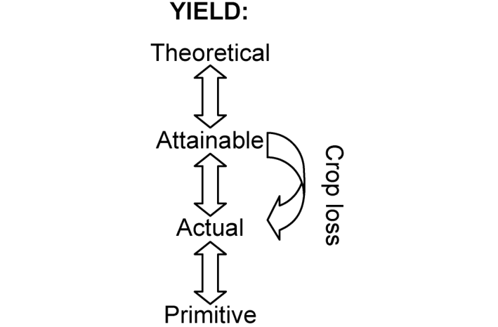
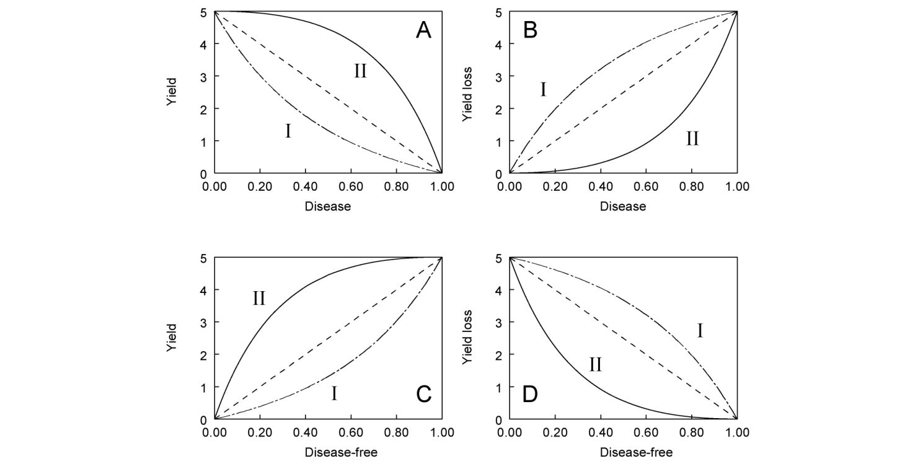
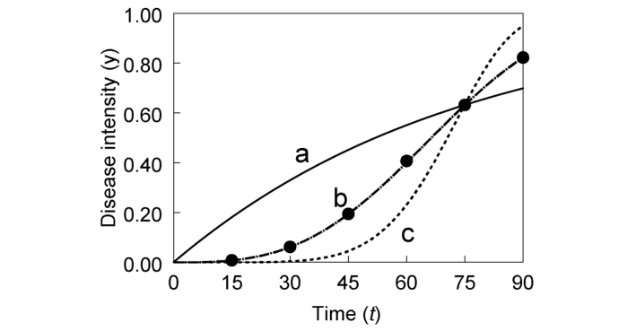
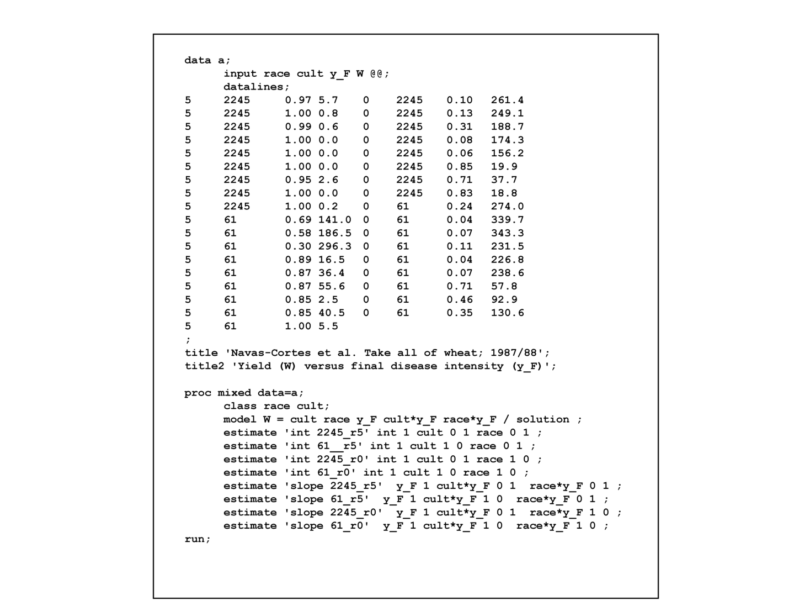
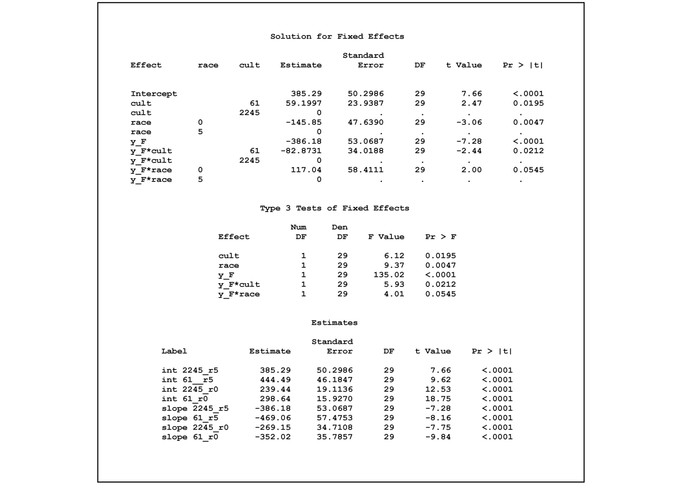
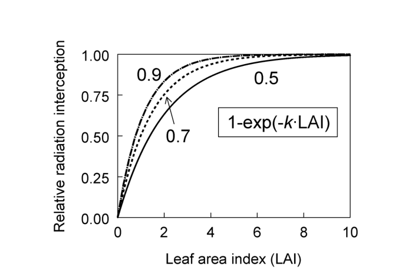
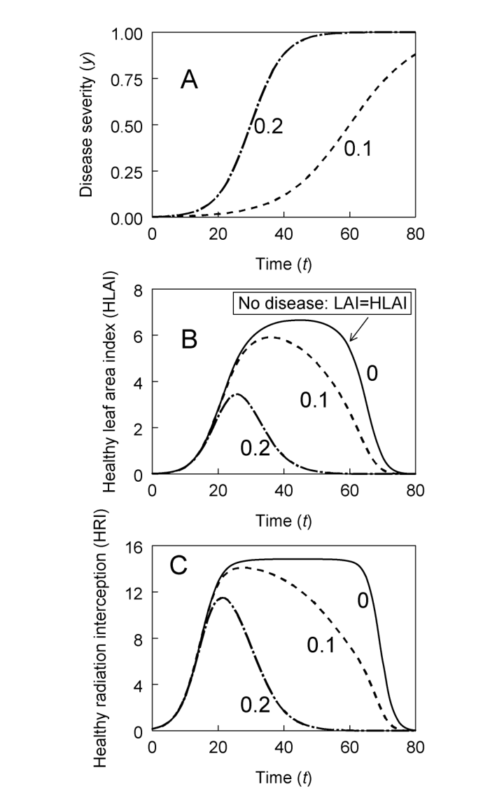
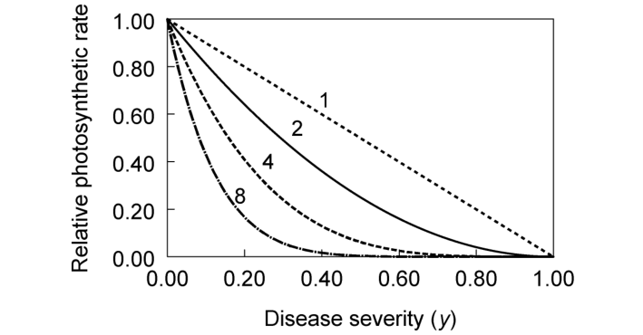

# การประเมินผลกระทบของโรคระบาดต่อผลผลิต (Epidemics and Crop Yield) {#sec-yield-loss}

<!-- พี่ต้นข้าว: บันทึกถึงน้องกันต์ (ดร.กันต์ธณวิชญ์ ใจสงฆ์, ศูนย์วิจัยข้าวปทุมธานี)
     บทที่ 12 นี้คือ "ปลายทางและหัวใจสำคัญที่สุดในเชิงเศรษฐกิจของระบาดวิทยาโรคพืช" ครับน้องกันต์
     ตลอดบทที่ 4 ถึง 6 เราได้ศึกษาพลวัตการเพิ่มขึ้นของโรคตามเวลา และในบทที่ 7 ถึง 8 เราศึกษาการกระจายตัวในเชิงพื้นที่
     แต่คำถามชี้ขาดที่เกษตรกร ผู้จัดการแปลง และผู้กำหนดนโยบายถามนักระบาดวิทยาเสมอเมื่อเกิดการระบาดขึ้นในแปลงนาจริงก็คือ:
     "โรคระบาดรุนแรงระดับนี้ ผลผลิตข้าวจะเสียหายไปกี่ถังต่อไร่? และจุดคุ้มทุนในการตัดสินใจพ่นสารป้องกันกำจัดเชื้อราอยู่ตรงไหน?"
     บทนี้แปลอย่างละเอียดครบถ้วน 100% จากต้นฉบับบทที่ 12 ของ Madden et al. (2007) โดยไม่มีการตัดทอนหรือสรุปย่อ
     พี่คงความแม่นยำทางคณิตศาสตร์และสถิติไว้อย่างสมบูรณ์ พร้อมจัดรูปเล่มและคำอธิบายให้อ่านลื่นไหล น่าติดตาม 
     และเชื่อมโยงสู่บริบทงานวิจัยโรคข้าวในบ้านเรา เช่น โรคไหม้ (Rice blast) และโรคขอบใบแห้ง (Bacterial blight) ครับ -->

> *"การเชื่อมโยงผลผลิตของพืชผลเข้ากับระดับความรุนแรงที่ผันแปรของโรคพืช ยังคงเป็นงานที่ซับซ้อนอย่างยิ่งทั้งในเชิงทฤษฎีและในทางปฏิบัติ"*
> — B. M. Cooke (1998)

::: {.callout-note}
## วัตถุประสงค์การเรียนรู้ประจำบท

เมื่อศึกษาบทนี้จบแล้ว ผู้อ่านควรจะสามารถ:

1. จำแนกระดับชั้นของผลผลิตพืช (ผลผลิตดั้งเดิม, ผลผลิตที่ทำได้จริง, ผลผลิตที่พึงได้, และผลผลิตเชิงทฤษฎี) และนิยามความสูญเสียผลผลิต (Crop loss) ทั้งในเชิงชีววิทยาและเชิงเศรษฐศาสตร์ได้อย่างถูกต้อง
2. อธิบายวิธีการทดลองและข้อควรระวังในการเก็บรวบรวมข้อมูลเพื่อสร้างเกรเดียนต์ระดับความรุนแรงของโรคในแปลงทดลองและแปลงเกษตรกร
3. สร้างและเลือกใช้แบบจำลองเชิงประจักษ์ (Empirical models) ในการพยากรณ์ผลผลิต ได้แก่ แบบจำลองจุดเดียว (Single-point models ทั้งเชิงเส้นและไม่เชิงเส้น), แบบจำลองหลายจุด (Multiple-point models), และแบบจำลองเชิงปริพันธ์ (Integral models เช่น AUDPC)
4. ประเมินและเปรียบเทียบข้อดี-ข้อจำกัดระหว่างการใช้ผลผลิตสัมบูรณ์ ($W$), ผลผลิตสัมพัทธ์ ($w$), ความสูญเสียสัมบูรณ์ ($L$), และความสูญเสียสัมพัทธ์ ($\ell$) เป็นตัวแปรตอบสนอง
5. เข้าใจและประยุกต์ใช้แนวทางเชิงกลไกสรีรวิทยา (Mechanistic physiological approaches) ผ่านการดักรับรังสีของทรงพุ่ม (Radiation interception: RI), ประสิทธิภาพการใช้รังสี (Radiation use efficiency: RUE), พื้นที่ใบเขียวดูดกลืนแสง (Healthy area absorption: HAA), และแนวคิดรอยโรคเสมือน (Virtual lesions)
6. วิเคราะห์ผลกระทบของความแปรปรวนเชิงพื้นที่ (Spatial heterogeneity) ที่มีต่อความสัมพันธ์ระหว่างผลผลิตเฉลี่ยกับระดับโรคเฉลี่ย โดยอาศัยการประมาณค่าด้วยอนุกรมเทย์เลอร์ (Taylor series approximation)
:::

## 12.1 บทนำ (Introduction) {#sec-yl-intro}

เหตุผลสำคัญประการหนึ่งที่เราต้องศึกษาระบาดวิทยาของโรคพืช (Botanical epidemics) อย่างจริงจัง ก็เนื่องมาจากความเสียหายและต้นทุนมหาศาลที่โรคพืชก่อให้เกิดแก่ภาคการเกษตรและการป่าไม้ โดยเฉพาะอย่างยิ่งต้นทุนจากการลดลงของผลผลิตพืชผล (James and Teng, 1979) นักวิจัยจำนวนมาก แม้กระทั่งผู้ที่ไม่เคยพยายามตรวจวัดความสัมพันธ์ระหว่างความรุนแรงของโรคกับผลผลิตในระดับประชากรมาก่อน ต่างก็ได้รับแรงผลักดันอย่างแรงกล้าในการทำงานจากรายงานทางวิชาการและประวัติศาสตร์ที่บันทึกถึงผลกระทบทางเศรษฐกิจและสังคมอันรุนแรงของโรคพืช การระบาดใหญ่ระดับมหันตภัย (Pandemics) ในหน้าประวัติศาสตร์มนุษยชาติ ไม่ว่าจะเป็นโรคเออร์ก็อต (Ergot) ในยุโรปยุคกลาง, โรคราสนิมกาแฟ (Coffee rust) ในศรีลังกา, โรคใบไหม้ของมันฝรั่ง (Late blight) ในไอร์แลนด์และทั่วยุโรป, โรคใบไหม้ของเกาลัด (Chestnut blight) และโรคใบไหม้ข้าวโพดตอนใต้ (Southern corn leaf blight) ในสหรัฐอเมริกา, ตลอดจนโรคใบด่างมันสำปะหลังแอฟริกัน (African cassava mosaic) ในทวีปแอฟริกา เป็นเพียงตัวอย่างส่วนหนึ่งที่คอยเตือนใจเราถึงผลกระทบเลวร้ายที่สุดที่การระบาดของโรคพืชสามารถกระทำต่อสังคมมนุษย์ในภาพรวม (Schumann, 1991; Campbell and Madden, 1990; Horsfall and Cowling, 1978a)

อย่างไรก็ตาม ในความเป็นจริงแล้ว ทุกๆ ปีและในทุกภูมิภาคทั่วโลก ย่อมมีการระบาดของโรคพืชเกิดขึ้นและส่งผลกระทบต่อผลผลิตพืชปลูกอยู่เสมอ หรือมิฉะนั้นก็พร้อมที่จะสร้างความเสียหายอย่างรุนแรงทันทีหากปราศจากการใช้มาตรการควบคุมโรค (ซึ่งมักมีต้นทุนค่าใช้จ่ายสูง) เป้าหมายสูงสุดของพวกเราเสมอมาคือ ความหวังว่าการเพิ่มพูนความเข้าใจเกี่ยวกับพลวัตการระบาดของโรค จะนำไปสู่การลดทอนผลกระทบของโรคที่มีต่อผลผลิต หรือนำไปสู่การพัฒนาวิธีการควบคุมที่มีประสิทธิภาพและประสิทธิผลสูงขึ้น หรือบรรลุผลลัพธ์ทั้งสองประการควบคู่กันไป

แม้ว่าโรคพืชจะมีความสำคัญทางเศรษฐกิจอย่างยิ่งยวด แต่ความสัมพันธ์ระหว่างการพัฒนาของการระบาดกับผลผลิตสุดท้ายที่เก็บเกี่ยวได้ กลับไม่ได้รับการศึกษาวิจัยอย่างเข้มงวดรัดกุมในโรคพืชหลายๆ ชนิดจนกระทั่งเมื่อไม่กี่ทศวรรษที่ผ่านมานี้เอง ย้อนกลับไปเกือบ 90 ปีก่อน Lyman (1918) เคยกล่าวตัดพ้อไว้อย่างน่าคิดว่า วงการวิชาการของเรามีมาตรวัดความสูญเสียผลผลิตที่แม่นยำอยู่น้อยมาก ขณะที่ James and Teng (1979) เชื่อมั่นว่า การขาดแคลนข้อมูลความสูญเสียผลผลิตที่ถูกต้องนี่เอง คือปัจจัยเดี่ยวที่เหนี่ยวรั้งความก้าวหน้าของการอารักขาพืชไว้มากยิ่งกว่าปัจจัยอื่นใด และด้วยสำนวนภาษาที่งดงาม Horsfall and Cowling (1978b) ได้สรุปมุมมองของพวกเขาต่อสถานการณ์ดังกล่าวไว้อย่างลึกซึ้งว่า:

> *"แม้ว่าสังคมโดยทั่วไปจะมองเห็นต้นเอล์มที่ยืนต้นแห้งตายอยู่ตามท้องถนนได้อย่างชัดเจน แต่สังคมกลับรับรู้เพียงเลือนรางเท่านั้นว่าตนเองต้องแบกรับความเสียหายมากเพียงใดจากการรุกรานทำลายล้างของเชื้อก่อโรคพืชชนิดอื่นๆ นั่นเป็นเพราะเราไม่ได้บอกให้สังคมรับรู้ถึงความสูญเสียเหล่านั้น และนั่นก็เป็นเพราะเราเองก็ยังไม่รู้ และนั่นก็เป็นเพราะพวกเรายังไม่ได้ทำการศึกษาวิจัยเรื่องนี้กันอย่างดีพอ"*

แต่เราขอยืนยันว่า ตลอดระยะเวลา 30 กว่าปีที่ผ่านมา นักพยาธิวิทยาพืชได้ทำการค้นคว้าวิจัยในเรื่องนี้อย่างจริงจังและเจาะลึก จนทำให้พวกเรามีความเข้าใจที่ดียิ่งขึ้นอย่างมากว่าโรคพืชส่งผลกระทบต่อผลผลิตอย่างไร Vanderplank (1963) ได้ชี้ให้เห็นอย่างกระจ่างแจ้งถึงความสำคัญของการทำความเข้าใจความสัมพันธ์ระหว่างโรคกับผลผลิต (Disease:yield relationship) ในการประเมินผลลัพธ์สุดท้ายของการระบาด และได้แสดงผลการวิเคราะห์เชิงประจักษ์ในยุคแรกๆ ไว้หลายประการ ยุคทศวรรษ 1970 และ 1980 ถือเป็นช่วงเวลาที่การวิจัยด้านนี้เบ่งบานและก่อดอกออกผลอย่างยิ่ง โดยมีผลงานบุกเบิกชิ้นเอกมากมายจาก W. Clive James, Paul Teng และคณะ ผลงานของคณะนักวิจัยเหล่านี้ได้นำไปสู่การพัฒนาแนวคิดและหลักการพื้นฐานหลายประการในการเชื่อมโยงการระบาดเข้ากับผลผลิตของพืชผล ตลอดจนการสร้างแบบจำลองเชิงประจักษ์ (Empirical models) เพื่ออธิบายกระบวนการเบื้องหลัง ซึ่งพวกเราจะทบทวนแนวคิดและหลักการสำคัญเหล่านี้ในบทนี้

คำว่า **การประเมินความสูญเสียผลผลิต (Crop loss assessment)** มักถูกใช้เพื่อหมายถึงการศึกษาความสัมพันธ์ระหว่างการเข้าทำลายของสิ่งมีชีวิตที่เป็นอันตรายกับผลผลิตที่ได้รับจริง (หรือความสูญเสียผลผลิตที่เกิดขึ้น) ของพืชปลูก ความสัมพันธ์ระหว่างโรคกับผลผลิตจัดเป็นแกนกลางสำคัญของการประเมินความสูญเสียผลผลิต เช่นเดียวกับการศึกษาผลกระทบของการเข้าทำลายของแมลงศัตรูพืชและวัชพืชที่มีต่อผลผลิต ดังที่จะปรากฏชัดเจนในหัวข้อถัดๆ ไป ความสัมพันธ์ระหว่างการพัฒนาของการระบาดกับผลผลิตของพืชผลนั้นมีความสลับซับซ้อนอย่างยิ่ง และมักขึ้นอยู่กับตัวแปรที่หลากหลายยิ่งกว่าตัวแปรที่เราตรวจวัดกันตามปกติเมื่อต้องการหาปริมาณการเพิ่มขึ้นของโรคตามเวลาหรือการแพร่กระจายในเชิงพื้นที่เพียงอย่างเดียว 

ดังนั้น หากมองในมุมเดียวกับ Lyman เราจึงต้องยอมรับตามตรงว่า สำหรับโรคพืชอีกเป็นจำนวนมาก เรายังคงไม่ทราบแน่ชัดว่าความสูญเสียที่แท้จริงมีค่าเท่าใดกันแน่ ยิ่งไปกว่านั้น แม้ในกรณีที่เราสามารถสร้างความสัมพันธ์เชิงฟังก์ชันที่แม่นยำและทำซ้ำได้ระหว่างระดับความรุนแรงของโรค (ในความหมายกว้าง) กับผลผลิตขึ้นมาได้แล้ว ความสูญเสียในระดับภูมิภาคหรือระดับประเทศก็อาจยังคงมีความไม่แน่นอนสูงอยู่ดี ทั้งนี้เนื่องจากข้อจำกัดด้านงบประมาณและกำลังคน ทำให้พวกเราไม่สามารถสุ่มสำรวจเพื่อประเมินอุบัติการณ์หรือความรุนแรงของโรคในแปลงปลูกเชิงพาณิชย์ในสเกลขนาดใหญ่และทำอย่างสม่ำเสมอเป็นกิจวัตรได้ ซึ่งประเด็นเกี่ยวกับการสุ่มตัวอย่างเพื่อประเมินระดับความรุนแรงของโรคพืชนี้ ได้รับการอธิบายไว้อย่างละเอียดในบทที่ 10 (@sec-sampling-plans) และบทที่ 11 (@sec-decision-thresholds) ของหนังสือเล่มนี้

ข้อมูลเกี่ยวกับผลผลิตพืชผลในความสัมพันธ์กับระดับความรุนแรงของโรคนั้นสามารถนำไปใช้ประโยชน์ได้หลากหลายประการ ตัวอย่างเช่น นอกเหนือจากการประเมินว่าวิธีการควบคุมโรค (ที่อาจนำมาใช้) สามารถลดความรุนแรงของโรคหรือชะลออัตราการเพิ่มขึ้นของโรคได้หรือไม่แล้ว เรายังสามารถประเมินได้โดยตรงว่าวิธีการควบคุมนั้นส่งผลต่อการเพิ่มขึ้นของผลผลิตจริงหรือไม่ เพราะในกรณีสุดโต่งบางกรณี เป็นไปได้ที่วิธีการควบคุมหนึ่งๆ อาจช่วยลดความรุนแรงของโรคลงได้อย่างมีนัยสำคัญ แต่กลับแทบไม่ได้ช่วยเพิ่มผลผลิตของพืชผลเลยแม้แต่น้อย! 

นอกจากนี้ การเข้าใจความสัมพันธ์ดังกล่าวยังช่วยให้เราสามารถตัดสินใจจัดการโรคได้อย่างเหมาะสมที่สุด (Optimal disease management decisions) โดยพิจารณาเปรียบเทียบระหว่างต้นทุนของมาตรการควบคุมกับมูลค่าผลผลิตที่คาดว่าจะได้รับเพิ่มขึ้น (ดูบทที่ 11) ข้อมูลนี้ยังจำเป็นต่อการประเมินความคุ้มค่าของการลงทุนวิจัยด้านการอารักขาพืช และช่วยให้ผู้ปรับปรุงพันธุ์พืชสามารถกำหนดเป้าหมายได้ว่า ควรคัดเลือกพันธุ์โดยมุ่งเน้นไปที่ความต้านทานโรคในระยะการเจริญเติบโตใดเป็นพิเศษเพื่อปกป้องผลผลิตให้ได้สูงสุด

การผลิตผลผลิตของพืชปลูกเป็นกระบวนการทางสรีรวิทยาที่มีความซับซ้อนอย่างยิ่ง การเจริญเติบโตของพืช, การดักจับรังสีดวงอาทิตย์โดยทรงพุ่มใบ, การสังเคราะห์ด้วยแสงเพื่อสร้างชีวมวล (Biomass), และการเคลื่อนย้ายสสารชีวมวลส่วนหนึ่งไปสะสมไว้ในเมล็ด เมล็ดผล หรืออวัยวะพืชส่วนที่เก็บเกี่ยว ล้วนเป็นกระบวนการทางสรีรวิทยาที่ได้รับอิทธิพลจากสภาพแวดล้อม, การเข้าทำลายของเชื้อโรคและสิ่งก่อความเครียดอื่นๆ (เช่น แมลงศัตรูพืช), ตลอดจนการแข่งขันจากพืชข้างเคียง (Johnson, 1987, 1992) ในความเป็นจริง ความเข้าใจอันลึกซึ้งเกี่ยวกับการสร้างผลผลิตของพืชผลได้รับการพัฒนามาจากการสร้างแบบจำลองเชิงกลไก (Mechanistic modeling) โดยอาศัยหลักการทางสรีรวิทยาพืช (Batchelor et al., 1993; Boote et al., 1983; Johnson and Teng, 1990) 

แม้ว่าในทางทฤษฎี เราจะสามารถเชื่อมโยงแบบจำลองทางสรีรวิทยาเข้ากับแบบจำลองพลวัตประชากรของโรคพืชได้ ซึ่งโดยทั่วไปจำเป็นต้องอาศัยการจำลองด้วยคอมพิวเตอร์และระบบสมการย่อยจำนวนมหาศาล แต่การสร้างแบบจำลองที่ซับซ้อนระดับนั้นก็ไม่ได้จำเป็นเสมอไป (และในบางสถานการณ์ก็อาจไม่พึงประสงค์ด้วยซ้ำ) เช่นเดียวกับที่เราเคยลดรูปกระบวนการทางสรีรวิทยาอันซับซ้อนตั้งแต่สปอร์แทงเข้าสู่เนื้อเยื่อพืชจนถึงการสร้างสปอร์รุ่นใหม่ ให้เหลือเพียงพารามิเตอร์เดี่ยวที่เป็นส่วนกลับของระยะแฝงเฉลี่ย (Mean latent period) ในบทที่ 5 (@sec-temporal-models) ในทำนองเดียวกันนี้ เราสามารถใช้ **พารามิเตอร์สรุปเชิงสรีรวิทยา (Summary physiological parameters)** เพื่อเชื่อมโยงกระบวนการสร้างและสูญเสียผลผลิตเข้ากับระดับความรุนแรงของโรค (หรือตัวแปรที่สัมพันธ์กับโรค) ได้อย่างกระชับและทรงพลัง

พวกเราจะสาธิตแนวทางการใช้พารามิเตอร์สรุปเชิงสรีรวิทยานี้ในการสร้างแบบจำลองการสูญเสียผลผลิตในหัวข้อท้ายๆ ของบทนี้ แต่ก่อนอื่น เราจะเริ่มต้นด้วยการอภิปรายแนวคิดทั่วไปเกี่ยวกับความสูญเสียผลผลิตและหลักการเก็บรวบรวมข้อมูล จากนั้นจะนำเสนอแนวทางการสร้างแบบจำลองเชิงประจักษ์ (Empirical modeling approaches) ซึ่งเป็นที่นิยมใช้อย่างแพร่หลายตลอดหลายทศวรรษที่ผ่านมา ภายใต้หลักการความเรียบง่ายประหยัดของแบบจำลอง (Model parsimony) เราจะแสดงให้เห็นว่า เราสามารถสร้างความเข้าใจอันลึกซึ้งเกี่ยวกับความสูญเสียผลผลิตได้จากแบบจำลองที่เรียบง่ายแต่รัดกุม โดยเฉพาะอย่างยิ่ง เราจะสาธิตให้เห็นว่า ความแปรปรวนเชิงพื้นที่ของโรค (Spatial heterogeneity) ส่งผลต่อเส้นความสัมพันธ์ระหว่างโรคกับผลผลิตที่สังเกตได้อย่างไร และพลวัตการเพิ่มขึ้นของโรคตามเวลาสามารถเชื่อมโยงเข้ากับการสร้างผลผลิตได้อย่างไร

## 12.2 คำนิยามและแนวคิดพื้นฐาน (Definitions and Concepts) {#sec-yl-concepts}

### 12.2.1 ผลผลิต (Yield) {#sec-yl-yield-types}

ก่อนที่จะลงลึกในรายละเอียดของความสัมพันธ์ระหว่างผลผลิตและโรคพืช เป็นการดีที่จะทำความเข้าใจคำนิยามและแนวคิดพื้นฐานที่เกี่ยวข้องกับการสูญเสียผลผลิตเสียก่อน ในที่นี้เราจะอ้างอิงตามเอกสารมาตรฐานที่ได้รับการยอมรับอย่างสูงของ Chiarappa (1971) และ Zadoks and Schein (1979) แม้ว่าในทางปฏิบัติ นักพยาธิวิทยาพืชท่านอื่นๆ อาจใช้คำศัพท์เหล่านี้แตกต่างกันไปบ้างก็ตาม

- **พืชปลูก (Crop):** หมายถึง ประชากรหรือกลุ่มของพืชที่ได้รับการเพาะปลูกขึ้นเพื่อใช้เป็นอาหาร, เส้นใย, สารกระตุ้น หรือผลผลิตทางเศรษฐกิจอื่นๆ
- **ผลผลิต (Yield):** หมายถึง ผลิตผลที่สามารถตรวจวัดปริมาณได้จากพืชปลูก ซึ่งอาจอยู่ในรูปของเมล็ด, ผล, ใบ, ราก หรือหัวใต้ดิน ขึ้นอยู่กับชนิดของพืชปลูกนั้นๆ

ในการพิจารณาผลผลิตของพืชผล มักเป็นประโยชน์อย่างยิ่งหากเราแบ่งระดับศักยภาพของผลผลิตออกเป็นระดับชั้นต่างๆ ดังแสดงใน @fig-12-1 (ดัดแปลงจากรูปที่ 8.2 ใน Zadoks and Schein, 1979 และ Campbell and Madden, 1990):

{#fig-12-1}

1. **ผลผลิตแบบดั้งเดิม (Primitive yield):** คือ ผลผลิตที่ได้จากการเพาะปลูกพืชพันธุ์พื้นเมือง (Landraces) ภายใต้ระบบการเกษตรแบบดั้งเดิม นั่นคือไม่มีการใช้เทคโนโลยีการอารักขาพืชหรือการจัดการสมัยใหม่ใดๆ เลย สำหรับพืชตระกูลธัญพืช เช่น ข้าวและข้าวสาลี ผลผลิตแบบดั้งเดิมมักอยู่ที่ประมาณ 1 เมตริกตันต่อเฮกตาร์ (MT/ha) ของน้ำหนักแห้ง (เทียบเท่าประมาณ 160 กก./ไร่)
2. **ผลผลิตเชิงทฤษฎี (Theoretical yield หรือ Potential yield):** คือ ผลผลิตสูงสุดที่พืชสามารถทำได้ภายใต้สภาพแวดล้อมที่สมบูรณ์แบบไร้ที่ติ โดยทั่วไปวัดได้จากแปลงทดลองขนาดเล็กที่ได้รับการดูแลอย่างประณีต มีการให้น้ำ ปุ๋ย สารเคมี และการจัดการทางพืชกรรมในระดับสูงสุดอย่างเต็มที่ ซึ่งเป็นระดับการปฏิบัติที่ไม่สามารถทำได้จริงในเชิงเศรษฐกิจในแปลงเกษตรกรรมเชิงพาณิชย์ขนาดใหญ่ ผลผลิตเชิงทฤษฎีนี้อาจมองได้ว่าเป็น "ขีดจำกัดสูงสุดทางพันธุกรรม (Genetic maximum)" ของพืชชนิดนั้นๆ สำหรับพืชธัญพืช ผลผลิตเชิงทฤษฎีอาจสูงถึง 10–20 MT/ha ของน้ำหนักแห้ง (เทียบเท่า 1,600–3,200 กก./ไร่) และความรู้ความเข้าใจของเราเกี่ยวกับผลผลิตเชิงทฤษฎีนี้จะยังคงเพิ่มสูงขึ้นเรื่อยๆ ตามความก้าวหน้าด้านวิทยาการสรีรวิทยาและการปรับปรุงพันธุ์พืช
3. **ผลผลิตที่พึงได้ (Attainable yield):** คือ ผลผลิตที่ได้รับเมื่อเพาะปลูกพืชในแปลงเชิงพาณิชย์เต็มรูปแบบโดยใช้เทคโนโลยีทางการเกษตรสมัยใหม่อย่างครบวงจร ซึ่งโดยทั่วไปกำหนดให้มีการใช้สารเคมีกำจัดศัตรูพืช ปุ๋ย และการจัดการต่างๆ ในระดับที่เหมาะสมที่สุด (Optimum inputs) อย่างไรก็ดี ผลผลิตที่พึงได้นี้อาจคุ้มค่าหรือไม่คุ้มค่าในทางเศรษฐกิจก็ได้ ขึ้นอยู่กับว่าต้นทุนในการผลิตรวมจะสูงเกินกว่ารายได้ที่ขายผลผลิตได้หรือไม่
4. **ผลผลิตที่ทำได้จริง (Actual yield):** คือ ผลผลิตที่เกษตรกรเก็บเกี่ยวได้จริงจากการใช้ชุดการปฏิบัติทางการเกษตรแบบใดแบบหนึ่ง ผลผลิตจริงนี้เกือบทั้งหมดจะมีค่าน้อยกว่าหรืออย่างมากที่สุดเท่ากับผลผลิตที่พึงได้

จากระดับชั้นเหล่านี้ เราสามารถนิยามความสูญเสียได้ชัดเจนขึ้น:

- ผลต่างระหว่างผลผลิตที่พึงได้กับผลผลิตแบบดั้งเดิม จัดเป็น **ความสูญเสียที่หลีกเลี่ยงได้ (Avoidable loss)** ในแง่ที่ว่า ในทางทฤษฎีเรามีเทคโนโลยีและมาตรการอารักขาพืชที่พร้อมจะยกระดับผลผลิตจากระดับดั้งเดิมขึ้นมาสู่ระดับที่พึงได้ แต่ในทางปฏิบัติ เกษตรกรแทบจะไม่สามารถลงทุนใช้เทคโนโลยีเต็มรูปแบบได้เนื่องจากข้อจำกัดทางเศรษฐกิจ เกษตรกรจึงเลือกใช้มาตรการที่คัดสรรแล้วบางส่วนเพื่อให้ได้ "ผลผลิตที่ทำได้จริง" 
- ดังนั้น ผลต่างระหว่างผลผลิตที่พึงได้ (Attainable yield) กับผลผลิตที่ทำได้จริง (Actual yield) จึงถือเป็น **ความสูญเสียผลผลิต (Crop loss หรือ Yield loss)** ตามคำนิยามในภาพรวม (@fig-12-1)

อย่างไรก็ตาม กรอบความคิดข้างต้นเป็นการมองในภาพกว้างระดับมหภาคซึ่งครอบคลุมปัจจัยรบกวนทุกชนิด แต่สำหรับในหนังสือเล่มนี้ เราสนใจมุ่งเน้นไปที่ผลผลิตของพืชผลในความสัมพันธ์กับการระบาดของโรคพืชเป็นหลัก ดังนั้น เพื่อให้เป็น **นิยามเชิงปฏิบัติการ (Operational definition)** ที่ชัดเจนและใช้งานได้จริง:

> พวกเราจึงขอนิยาม **ความสูญเสียผลผลิต (Crop loss)** ว่าคือ **ผลต่างระหว่างผลผลิตที่ทำได้จริง (Actual yield) กับผลผลิตที่จะได้รับในสภาวะที่ปลอดโรค (Yield obtained in the absence of disease)**

ค่าผลผลิตในสภาวะปลอดโรคนี้ มีลักษณะเทียบเคียงได้กับ (แต่ไม่จำเป็นต้องเท่ากับ) ผลผลิตที่พึงได้ในสภาวะแวดล้อมนั้นๆ โดยผลผลิตจริงอาจวัดจากต้นพืชเดี่ยว, แปลงทดลองย่อย, แปลงพาณิชย์, ระดับภูมิภาค หรือระดับประเทศก็ได้ และขึ้นอยู่กับบริบทที่สนใจ คำว่า "สภาวะปลอดโรค" อาจหมายถึงการปลอดจากโรคเดี่ยวที่เรากำลังศึกษา หรือการปลอดจากโรคพืชทุกชนิดร่วมกัน ทั้งนี้ เราจะใช้คำว่า *Crop loss* และ *Yield loss* ในความหมายที่เหมือนกันตลอดทั้งบท

ประเด็นสำคัญที่ต้องตระหนักไว้เสมอคือ ความสูญเสียผลผลิตไม่ได้หมายความว่า อวัยวะส่วนที่เก็บเกี่ยวของพืชจะต้องถูกทำลายหรือลดทอนลงไปโดยตรงจากเชื้อโรคเสมอไป โรคพืชบางชนิดสร้างความเสียหายต่อผลิตผล *หลังจาก* ที่ผลิตผลนั้นสร้างเสร็จสมบูรณ์แล้ว เช่น โรคหลังการเก็บเกี่ยว (Post-harvest diseases) หรือโรคผลเน่าที่เกิดกับผลที่เจริญเต็มที่แล้ว แต่สำหรับโรคพืชส่วนใหญ่ในแปลงปลูก เชื้อโรคจะเข้าไป **ขัดขวางและจำกัดการสร้างผลิตผล (Limit the formation of produce)** มากกว่าที่จะไปทำลายผลิตผลที่สร้างเสร็จแล้ว (เช่น เชื้อราทำลายพื้นที่ใบ ทำให้พืชสังเคราะห์แสงได้น้อยลง จึงติดรวงหรือติดผลได้น้อยลงและเมล็ดลีบ) Cook (1985) เคยโต้แย้งว่าคำว่า "Crop loss" หรือ "Yield loss" อาจไม่ใช่คำที่สะท้อนธรรมชาติของการเกิดโรคพืชส่วนใหญ่ได้อย่างถูกต้องนัก เพราะผลผลิตไม่ได้ "สูญหาย" ไปไหน แต่พืช "สร้างไม่สำเร็จ" ต่างหาก! อย่างไรก็ตาม ภายใต้นิยามเชิงปฏิบัติการที่เรากำหนดขึ้นในที่นี้ คำว่าความสูญเสียผลผลิตครอบคลุมทั้งสองกรณี ทั้งการสูญเสียผลิตผลที่สร้างขึ้นแล้ว (เช่น การเน่าเสีย) และการสูญเสียโอกาสในการสร้างผลิตผลที่ควรจะได้ตามปกติ

### 12.2.2 ผลกระทบของโรคต่อพืชผล (Impacts of Disease on Crops) {#sec-yl-impacts}

ในทางปฏิบัติ เป็นการสะดวกอย่างยิ่งที่เราจะแปลงค่าผลผลิตและความสูญเสียผลผลิตให้อยู่ในรูปของมูลค่าทางเศรษฐกิจ และวัดผลกระทบของโรคในรูปของต้นทุนค่าใช้จ่าย ในความเป็นจริง เราสามารถตรวจวัดและวิเคราะห์ความสูญเสียทั้งในเชิงชีววิทยา (Biological loss) และเชิงเศรษฐศาสตร์ (Economic loss) ควบคู่กันไปได้ (Nutter, 2002b) 

ผลกระทบของโรคพืชที่มีต่อพืชผลก่อให้เกิดต้นทุนในหลากหลายมิติ (James and Teng, 1979) ซึ่งสามารถสรุปได้ดังนี้:

1. **การลดลงของปริมาณผลผลิต (Reduction in quantity):** เป็นต้นทุนทางตรงที่ชัดเจนที่สุด เช่น น้ำหนักเมล็ดข้าวต่อไร่ลดลง หรือจำนวนกระสอบที่เก็บเกี่ยวได้ลดลง
2. **การลดลงของคุณภาพผลผลิต (Reduction in quality):** ผลิตผลอาจมีปริมาณเท่าเดิมแต่ราคาตกต่ำลงอย่างฮวบฮาบ เช่น การเกิดรอยแผลตำหนิบนผลไม้ทำให้ขายเป็นผลไม้เกรดสดไม่ได้, เมล็ดข้าวลีบหรือท้องไข่ทำให้สีแปรสภาพเป็นข้าวสารคุณภาพต่ำ, หรือการปนเปื้อนของสารพิษจากเชื้อรา (Mycotoxins เช่น อะฟลาทอกซินในข้าวโพด หรือดีออกซีนิวาลีนอลในข้าวสาลี) ซึ่งทำให้ผลผลิตกลายเป็นพิษและไม่สามารถจำหน่ายเพื่อการบริโภคของมนุษย์และสัตว์ได้
3. **ต้นทุนในการป้องกันกำจัด (Cost of control):** เป็นภาระค่าใช้จ่ายที่เกิดขึ้นจริงทั้งในระยะสั้นและระยะยาว
   - *ต้นทุนระยะสั้น:* ได้แก่ ค่าสารเคมีป้องกันกำจัดศัตรูพืช (สารกำจัดเชื้อราสำหรับโรครา และสารกำจัดแมลงเพื่อควบคุมแมลงพาหะของโรคไวรัส), ค่าแรงงานและเวลาในการฉีดพ่น, ค่าเครื่องจักรและอุปกรณ์, ตลอดจนต้นทุนในการตรวจคัดกรองเมล็ดพันธุ์และต้นกล้าปลอดโรค
   - *ต้นทุนแฝงในการจัดการ:* ได้แก่ ค่าแรงงานเพิ่มเติมในการเก็บเกี่ยวและคัดเกรดผลผลิตที่เป็นโรคออกจากผลผลิตดี, ต้นทุนในการไถรื้อแปลงและปลูกซ่อมใหม่เมื่อเกิดโรคโคนเน่าหรือกล้าไหม้ (Damping-off), หรือในบางกรณีที่รุนแรง เกษตรกรอาจไม่สามารถปลูกพืชชนิดนั้นได้เลยเนื่องจากมีการสะสมของเชื้อในดินอย่างหนาแน่น
   - *ต้นทุนค่าเสียโอกาส (Opportunity costs):* แม้ว่าการปลูกพืชหมุนเวียน (Crop rotation) จะมีประโยชน์ในระยะยาว แต่การที่ไม่สามารถปลูกพืชที่ให้ผลตอบแทนทางเศรษฐกิจสูงสุดในฤดูกาลนั้นๆ ได้เนื่องจากต้องตัดวงจรโรค ก็ถือเป็นต้นทุนค่าเสียโอกาสทางการค้า
   - *ต้นทุนระยะยาว:* ได้แก่ งบประมาณในการศึกษาวิจัยและปรับปรุงพันธุ์พืชต้านทานโรค ตลอดจนการวิจัยพัฒนายาและสารป้องกันกำจัดศัตรูพืชชนิดใหม่ๆ
4. **การหยุดชะงักของการค้าระหว่างประเทศ (Trade disruptions):** ในกรณีที่เชื้อก่อโรคเป็นศัตรูพืชกักกัน (Quarantine pest) การตรวจพบเชื้อเพียงเล็กน้อยในพื้นที่อาจนำไปสู่การถูกสั่งห้ามส่งออกผลผลิตไปยังตลาดต่างประเทศโดยสิ้นเชิง (Madden and Wheelis, 2003) ซึ่งสร้างความเสียหายทางเศรษฐกิจในระดับมหภาคอย่างประเมินค่าไม่ได้ แม้ว่าผลผลิตในแปลงจริงจะได้รับผลกระทบจากโรคน้อยมากก็ตาม!
5. **ผลกระทบต่อสุขภาพและสังคม (Social and health costs):** สารพิษจากเชื้อราก่อให้เกิดปัญหาสุขภาพทั้งในคนและสัตว์เลี้ยง นอกจากนี้ การขาดแคลนอาหารเฉพาะพื้นที่ยังอาจผลักดันให้ราคาอาหารพุ่งสูงขึ้นอย่างรุนแรง

ต้นทุนเหล่านี้บางส่วนตกเป็นภาระโดยตรงของตัวเกษตรกรเอง ขณะที่บางส่วนถูกแบกรับโดยภาคอุตสาหกรรมเกษตร ผู้บริโภค หรือสังคมในภาพรวม ในบางกรณีที่น่าแปลกใจ เกษตรกรบางรายอาจได้รับประโยชน์จากราคาผลผลิตที่พุ่งสูงขึ้นเนื่องจากผลผลิตโดยรวมในตลาดขาดแคลน แม้ว่าสังคมจะต้องแบกรับภาระค่าครองชีพที่สูงขึ้นก็ตาม Teng (1987) ได้เสนอให้จัดหมวดหมู่ผลกระทบทางเศรษฐกิจเหล่านี้ออกเป็น:
- **ผลกระทบขั้นปฐมภูมิ (Primary effects):** เกิดขึ้นโดยตรงในระดับแปลงปลูกของเกษตรกร (ผลผลิตลด, ต้นทุนยาเพิ่ม)
- **ผลกระทบขั้นทุติยภูมิ (Secondary effects):** เกิดขึ้นกับอุตสาหกรรมแปรรูป ตลาดค้าส่ง และผู้บริโภค
- **ผลกระทบขั้นตติยภูมิ (Tertiary effects):** ส่งผลกระทบระดับชาติ เช่น การเสียดุลการค้า และการเปลี่ยนแปลงนโยบายความมั่นคงทางอาหาร

## 12.3 ข้อมูลและความสัมพันธ์ (Data and Relationships) {#sec-yl-data-relationships}

### 12.3.1 กราฟความสัมพันธ์ระหว่างผลผลิตและความรุนแรงของโรค (Graphs of Yield and Disease) {#sec-yl-graphs}

หัวใจสำคัญของการประเมินความสูญเสียผลผลิตเริ่มต้นจากการทำความเข้าใจรูปแบบความสัมพันธ์ระหว่างตัวแปรผลผลิต (หรือความสูญเสีย) กับตัวแปรความรุนแรงของโรค กราฟใน @fig-12-2 แสดงตัวอย่างรูปแบบความสัมพันธ์ที่พบได้บ่อยจากข้อมูลการทดลองจริง:

![ตัวอย่างความสัมพันธ์ระหว่างผลผลิตของพืชผล [ทั้งในรูปผลผลิตสัมพัทธ์ ($w$) หรือผลผลิตสัมบูรณ์ ($W$)] กับระดับความรุนแรงของโรค [ในรูปสัดส่วนสัมพัทธ์ ($y$) หรือปริมาณสัมบูรณ์ ($Y$)] จากระบบโรคพืชต่างๆ (ดัดแปลงจากแหล่งข้อมูลต้นฉบับหลายแหล่ง; ดูรายละเอียดในเนื้อหา)](figures/ch12/fig12-img02.png){#fig-12-2}

จากกราฟใน @fig-12-2 เราจะสังเกตเห็นประเด็นสำคัญหลายประการ:

1. **รูปร่างของเส้นความสัมพันธ์ (Curve shape):** ความสัมพันธ์ระหว่างผลผลิตกับโรคอาจมีลักษณะเป็นเส้นตรง (Straight line ดังรูป A) หรือเป็นเส้นโค้งไม่เชิงเส้น (Nonlinear curve) ซึ่งอาจโค้งนูน (Convex), โค้งเว้า (Concave), หรือเป็นรูปตัวเอส (Sigmoidal curve ดังรูป E) นอกจากนี้ ในบางโรคอาจพบ **ค่าขีดเริ่มเปลี่ยน (Threshold value)** กล่าวคือ ในช่วงที่ความรุนแรงของโรคยังต่ำมาก ผลผลิตจะไม่ลดลงเลย จนกระทั่งโรคเกินระดับวิกฤตค่าหนึ่ง ผลผลิตจึงเริ่มลดลงอย่างรวดเร็ว (รูป B และ C) หรืออาจมีระดับผลผลิตต่ำสุดคงที่ ($W_{\min}$) ที่ผลผลิตจะไม่ลดลงต่ำไปกว่านี้อีกแล้วแม้โรคจะเพิ่มขึ้นก็ตาม (รูป B)
2. **หน่วยของตัวแปร:** ทั้งผลผลิตและโรคสามารถแสดงได้ทั้งในหน่วยสัมบูรณ์ (Absolute units) และหน่วยสัมพัทธ์ (Relative units):
   - **ผลผลิตสัมบูรณ์ (Absolute yield, $W$):** มีหน่วยวัดทางกายภาพจริง เช่น กิโลกรัมต่อเฮกตาร์ (kg/ha), ถังต่อไร่, หรือกรัมต่อต้น (g/plant)
   - **ความสูญเสียสัมบูรณ์ (Absolute loss, $L$):** คำนวณจากผลต่างระหว่างผลผลิตในสภาวะปลอดโรค ($W_0$) กับผลผลิตที่ได้จริง ($W$):
     $$L = W_0 - W$$
   - **ผลผลิตสัมพัทธ์ (Relative yield, $w$):** คือสัดส่วนของผลผลิตจริงเทียบกับผลผลิตสภาวะปลอดโรค เป็นตัวแปรที่ไม่มีหน่วย (Dimensionless) มีค่าตั้งแต่ 0 ถึง 1:
     $$w = \frac{W}{W_0}$$
   - **ความสูญเสียสัมพัทธ์ (Relative loss, $\ell$):** คือสัดส่วนของผลผลิตที่สูญเสียไปเทียบกับผลผลิตสภาวะปลอดโรค มีค่าตั้งแต่ 0 ถึง 1 เช่นกัน:
     $$\ell = \frac{L}{W_0} = \frac{W_0 - W}{W_0} = 1 - w$$
   - **ความรุนแรงของโรค (Disease intensity):** อาจแสดงเป็นค่าสัมบูรณ์ ($Y$ เช่น พื้นที่ใบที่เป็นแผล, ตารางเซนติเมตร) หรือสัดส่วนสัมพัทธ์ ($y = Y/M$ เมื่อ $M$ คือขนาดพืชอาศัยทั้งหมด เช่น สัดส่วนพื้นที่ใบที่เป็นโรค หรืออุบัติการณ์ของโรค)

::: {.callout-important}
## ข้อแตกต่างเชิงโครงสร้างที่สำคัญระหว่าง $y$ กับ $w$ (หรือ $\ell$)

แม้ว่าทั้งสัดส่วนของโรค ($y$) และผลผลิตสัมพัทธ์ ($w$) จะเป็นตัวแปรไร้หน่วยที่มีค่าอยู่ในช่วง $[0, 1]$ เหมือนกัน แต่น้องกันต์ต้องระมัดระวังเป็นพิเศษว่า **กระบวนการได้มาของตัวแปรทั้งสองมีความแตกต่างกันโดยสิ้นเชิง**:

- ค่า $y$ ได้มาจากการตรวจวัด **ประชากรเดียวกันเพียงประชากรเดียว** (Single population หรือ Single individual) เช่น ในแปลงหนึ่งแปลง เราสามารถวัดพื้นที่ใบเป็นโรค ($Y$) และพื้นที่ใบทั้งหมด ($M$) แล้วคำนวณ $y = Y/M$ ได้ทันทีในตัวเอง
- แต่ค่า $w$ (และ $\ell$) ไม่สามารถวัดได้จากประชากรเพียงชุดเดียว! การจะหาค่า $w$ ได้ เราจำเป็นต้องมี **ประชากรสองกลุ่มที่แตกต่างกัน** เสมอ ได้แก่ (1) ประชากรที่มีการระบาดของโรคในระดับที่สนใจ ($W$) และ (2) ประชากรควบคุมที่ **ปลอดโรคโดยสิ้นเชิง ($W_0$)** เพื่อนำมาเป็นฐานในการเปรียบเทียบ
:::

ความจำเป็นที่ต้องพึ่งพาแปลงควบคุมปลอดโรค ($W_0$) นี่เองที่นำมาซึ่งอุปสรรคสำคัญในทางปฏิบัติ:
- ในการทดลองภาคสนามที่มีการจัดทรีตเมนต์และทำซ้ำ บ่อยครั้งอย่างยิ่งที่เรา **ไม่สามารถทำให้แปลงควบคุมปลอดโรคได้ 100%** แม้จะฉีดพ่นสารเคมีอย่างเข้มข้นก็ตาม ในทางปฏิบัติ นักวิจัยมักต้องใช้วิธีประมาณค่าผลผลิตเฉลี่ยจากแปลงที่มีโรคน้อยที่สุดมาใช้แทน $W_0$ หรืออาศัยการสร้างแบบจำลองถดถอยเพื่อทำนายค่าจุดตัดแกน (Intercept) เมื่อ $y = 0$
- ในงานสำรวจแปลงเกษตรกร (Surveys) ปัญหานี้ยิ่งทวีความรุนแรงขึ้นเป็นเท่าตัว เพราะแม้เราจะสำรวจพบแปลงที่ไม่มีโรคเลย แปลงเหล่านั้นก็อาจมีความแตกต่างด้านชนิดดิน, ปริมาณน้ำ, การใส่ปุ๋ย, หรือประวัติการจัดการอื่นๆ ที่ผู้วิจัยไม่ทราบ ทำให้ผลผลิตของแปลงปลอดโรคนั้นสูงผิดปกติหรือต่ำผิดปกติด้วยเหตุผลที่ไม่เกี่ยวข้องกับโรคพืชเลยแม้แต่น้อย

อย่างไรก็ตาม แม้จะมีข้อจำกัดดังกล่าว การนำเสนอความสูญเสียในรูปสัมพัทธ์ ($w$ หรือ $\ell$) ก็ยังคงเป็นที่นิยมอย่างกว้างขวาง เนื่องจากความง่ายในการสื่อสารและการเปรียบเทียบ แต่ในระยะหลัง นักวิจัยมีแนวโน้มหันมาใช้ **ผลผลิตสัมบูรณ์ ($W$)** เป็นตัวแปรตอบสนองหลักโดยตรงเพิ่มมากขึ้นเรื่อยๆ เพราะมีความสอดคล้องและสามารถเชื่อมโยงเข้ากับแบบจำลองสรีรวิทยาการเจริญเติบโตของพืชได้อย่างเป็นธรรมชาติ (@sec-yl-mechanistic)

### 12.3.2 การรวบรวมข้อมูลจากการระบาดในหลายระดับความรุนแรง (Obtaining Data from a Range of Epidemics) {#sec-yl-data-collection}

การจะสร้างแบบจำลองหรือวาดกราฟความสัมพันธ์ระหว่างโรคกับผลผลิตได้อย่างน่าเชื่อถือ เราจำเป็นต้องมีชุดข้อมูลที่มี **ช่วงความแปรผันของระดับความรุนแรงของโรคที่กว้างเพียงพอ** ตั้งแต่ระดับที่ไม่มีโรคเลย (หรือโรคน้อยมาก) ไปจนถึงระดับที่เกิดโรคระบาดรุนแรงสูงสุด หากข้อมูลกระจุกตัวอยู่เฉพาะช่วงแคบๆ เราจะไม่สามารถระบุรูปร่างที่แท้จริงของความสัมพันธ์ได้เลย 

ในทางปฏิบัติ นักวิจัยใช้กลยุทธ์ต่างๆ ในการสร้างเกรเดียนต์ของโรค (Disease gradient across treatments) ในแปลงทดลอง ดังนี้:

1. **การใช้สารเคมีป้องกันกำจัดเชื้อราในอัตราหรือโปรแกรมที่ต่างกัน (Fungicide schedules):** เป็นวิธีที่นิยมใช้กันมากที่สุด โดยการกำหนดโปรแกรมการฉีดพ่นสารเคมีหลายๆ แบบ เช่น แปลงที่ฉีดพ่นเต็มที่ทุกสัปดาห์ (แปลงปลอดโรค), แปลงที่พ่นเฉพาะช่วงวิกฤต, แปลงที่พ่นด้วยความถี่ต่ำ, และแปลงที่ไม่พ่นสารเคมีเลย 
   - *ข้อควรระวัง:* สารเคมีบางชนิดอาจมีผลข้างเคียงต่อสรีรวิทยาของพืชเอง เช่น กระตุ้นการเจริญเติบโตหรือการสังเคราะห์แสง (Phytotonic effect) หรือในทางกลับกันอาจเกิดความเป็นพิษต่อพืช (Phytotoxicity) ทำให้อายุใบสั้นลง นอกจากนี้ สารเคมียังอาจไปกำจัดเชื้อราชนิดอื่นๆ หรือสิ่งมีชีวิตที่เป็นประโยชน์ในแปลง ซึ่งส่งผลต่อผลผลิตโดยไม่ได้ผ่านการควบคุมโรคเป้าหมายโดยตรง
2. **การปลูกพืชหลายพันธุ์ที่มีระดับความต้านทานต่างกัน (Cultivars with differing resistance):** การเปรียบเทียบพันธุ์ต้านทานสูง, ต้านทานปานกลาง, และพันธุ์อ่อนแอ จะทำให้เกิดระดับการระบาดของโรคที่แตกต่างกันตามธรรมชาติ
   - *ข้อควรระวังอย่างยิ่ง:* พันธุ์พืชแต่ละพันธุ์มักมี **ศักยภาพในการให้ผลผลิตตามพันธุกรรม ($W_0$) ที่ไม่เท่ากัน** ดังนั้น การเปรียบเทียบผลผลิตสัมบูรณ์ข้ามพันธุ์โดยตรงอาจทำให้เกิดความเข้าใจผิดได้ เว้นแต่จะทำการแปลงข้อมูลให้อยู่ในรูปผลผลิตสัมพัทธ์ ($w$) ของแต่ละพันธุ์ หรือใช้แบบจำลองความแปรปรวนร่วม (Analysis of covariance: ANCOVA) เพื่อปรับค่าความแตกต่างทางพันธุกรรมออกไป ดังที่จะสาธิตใน @sec-yl-example
3. **การปรับเปลี่ยนวันปลูก (Staggered planting dates):** การปลูกพืชในวันหรือช่วงสัปดาห์ที่ต่างกัน จะทำให้พืชแต่ละรุ่นสัมผัสกับสภาพอากาศและความดันของสปอร์เชื้อโรค (Inoculum pressure) ในระยะการเจริญเติบโตที่แตกต่างกัน นำไปสู่ระดับความรุนแรงของโรคที่แตกต่างกัน
   - *ข้อควรระวัง:* วันปลูกที่ต่างกันย่อมทำให้พืชได้รับสภาพแสง อุณหภูมิ และความยาวนานของวันไม่เท่ากัน ซึ่งส่งผลกระทบต่อศักยภาพการสร้างผลผลิตของพืชโดยตรง แม้ว่าจะไม่มีโรคก็ตาม
4. **การปลูกเชื้อในระดับความเข้มข้นหรือเวลาที่ต่างกัน (Inoculation levels and timing):** ในแปลงทดลอง เราสามารถควบคุมระดับการระบาดได้โดยการปลูกเชื้อด้วยความเข้มข้นของสปอร์ที่ต่างกัน หรือปลูกเชื้อในระยะการเจริญเติบโตของพืชที่ต่างกัน
5. **การสำรวจแปลงเกษตรกรจริง (Field surveys):** การเก็บข้อมูลจากแปลงเกษตรกรจำนวนมากในหลายพื้นที่และหลายฤดูกาล วิธีนี้สะท้อนสภาพความเป็นจริงของระบบการผลิตเชิงพาณิชย์ได้ดีที่สุด แต่มีความท้าทายสูงมากในการควบคุมตัวแปรแทรกซ้อน เช่น ความแตกต่างของดิน การใส่ปุ๋ย และการให้น้ำ

### 12.3.3 หน่วยทดลองและหน่วยสุ่มตัวอย่าง (Experimental and Sampling Units) {#sec-yl-units}

ในการทดลองเพื่อประเมินความสูญเสียผลผลิต ขนาดและการจัดวางหน่วยทดลอง (Experimental plots) มีความสำคัญอย่างยิ่งยวด ปัญหาคลาสสิกที่พบบ่อยที่สุดคือ **การแทรกสอดระหว่างแปลงย่อย (Interplot interference หรือ Spoilage effects)** ซึ่งเกิดจากการที่สปอร์ของเชื้อโรคจากแปลงที่มีการระบาดรุนแรงปลิวข้ามไปตกและก่อให้เกิดโรคในแปลงข้างเคียงที่ต้องการให้มีโรคน้อย หรือในทางกลับกัน แปลงที่พ่นสารเคมีอย่างเข้มข้นอาจทำหน้าที่เป็นแหล่งดักสปอร์และลดปริมาณเชื้อในบรรยากาศรอบข้าง (Vanderplank, 1963)

วิธีแก้ไขปัญหาการแทรกสอดระหว่างแปลงย่อย ได้แก่:
- การเพิ่มขนาดของแปลงทดลองให้ใหญ่ขึ้น
- การปลูกแถวพืชกันชน (Buffer rows หรือ Border areas) คั่นระหว่างแปลงย่อย โดยใช้พืชที่ไม่เป็นพืชอาศัยของโรค หรือใช้พืชชนิดเดียวกันแต่ไม่เก็บข้อมูล
- การเก็บเกี่ยวผลผลิตเฉพาะบริเวณใจกลางแปลง (Net harvest area) โดยตัดแถวขอบทิ้งไป

นอกจากนี้ หน่วยสุ่มตัวอย่างในการประเมินโรคภายในแปลง (Sampling units) จะต้องสอดคล้องกับธรรมชาติของโรค เช่น การประเมินความรุนแรงของโรคเฉลี่ยจากใบธง (Flag leaf) หรือจากพื้นที่ทรงพุ่มทั้งต้น เพื่อนำมาเป็นตัวแทนระดับโรคของแปลงนั้นๆ

### 12.3.4 ผลผลิตต่อหน่วยพื้นที่ (Yield per Unit Area) {#sec-yl-yield-area}

ในงานวิจัยด้านระบาดวิทยาส่วนใหญ่ เรามักเชื่อมโยงระดับการระบาดเข้ากับค่าผลผลิตรวมเพียงค่าเดียวต่อแปลง (เช่น กิโลกรัมต่อไร่ หรือตันต่อเฮกตาร์) อย่างไรก็ตาม ในทางสรีรวิทยาการเกษตร ผลผลิตรวมของพืชสามารถแตกย่อยออกเป็น **องค์ประกอบของผลผลิต (Yield components)** ได้อย่างชัดเจน 

ตัวอย่างเช่น ในพืชตระกูลธัญพืชอย่างข้าวหรือข้าวสาลี ผลผลิตรวมต่อพื้นที่ ($W$) เป็นผลคูณขององค์ประกอบย่อย (Slafer, 2003):

$$W = (\text{จำนวนต้นต่อพื้นที่}) \times (\text{จำนวนรวงต่อต้น}) \times (\text{จำนวนเมล็ดต่อรวง}) \times (\text{น้ำหนักต่อหนึ่งเมล็ด})$$

โรคพืชแต่ละชนิดและเวลาที่เกิดการเข้าทำลาย จะส่งผลกระทบต่อองค์ประกอบของผลผลิตที่แตกต่างกันอย่างสิ้นเชิง:
- โรคที่เข้าทำลายในระยะต้นกล้า (เช่น โรครากเน่าหรือกล้าไหม้) จะลดจำนวนต้นต่อพื้นที่
- โรคที่เข้าทำลายในระยะแตกกอ (เช่น โรคขอบใบแห้ง หรือโรคไหม้ใบ) จะขัดขวางการสร้างรวง ทำให้จำนวนรวงต่อกอลดลง
- โรคที่เข้าทำลายในระยะออกรวงหรือระยะผสมเกสร (เช่น โรคไหม้คอรวง หรือโรคเน่าคอรวง) จะทำให้เมล็ดลีบ ไม่ผสมเกสร จึงลดจำนวนเมล็ดดีต่อรวง
- โรคที่ทำลายใบธงในระยะสะสมแป้ง จะลดการสังเคราะห์แสง ทำให้เมล็ดไม่เต็มเมล็ด จึงลดน้ำหนักต่อหนึ่งเมล็ด (น้ำหนัก 1,000 เมล็ด)

ประเด็นที่น่าทึ่งคือ **กลไกการชดเชยของพืช (Plant compensation):** พืชหลายชนิดมีความสามารถในการปรับตัวชดเชยระหว่างองค์ประกอบของผลผลิต เช่น หากโรคทำให้จำนวนรวงต่อกอลดลง พืชอาจตอบสนองโดยการส่งอาหารไปเลี้ยงรวงที่เหลืออยู่ ทำให้รวงเหล่านั้นมีจำนวนเมล็ดมากขึ้นหรือเมล็ดมีขนาดใหญ่ขึ้นมาชดเชยได้บางส่วน ดังนั้น การที่โรคเข้าไปลดองค์ประกอบใดองค์ประกอบหนึ่งลง 20% จึงไม่ได้หมายความว่าผลผลิตรวมสุดท้ายจะต้องลดลง 20% เสมอไป!

### 12.3.5 ความเห็นของผู้เชี่ยวชาญ (Expert Opinion) {#sec-yl-expert-opinion}

การเก็บรวบรวมข้อมูลจากการทดลองภาคสนามและการสำรวจแปลงเกษตรกรในพื้นที่กว้างเป็นงานที่ต้องใช้เวลา ทุนวิจัย และกำลังคนมหาศาล ซึ่งเป็นไปไม่ได้เลยที่เราจะมีข้อมูลการทดลองที่สมบูรณ์สำหรับทุกโรค ทุกพืช และทุกสภาพแวดล้อม ทางเลือกหนึ่งที่ใช้กันในทางปฏิบัติเพื่อประเมินความสูญเสียผลผลิตในระดับภูมิภาคหรือระดับประเทศ คือการรวบรวม **ความเห็นของผู้เชี่ยวชาญ (Expert opinion)** เช่น ผู้เชี่ยวชาญประจำศูนย์วิจัยและนักวิชาการส่งเสริมการเกษตรที่มีประสบการณ์ยาวนานในพื้นที่ (Wrather et al., 2001, 2003; Pimentel et al., 2000)

ข้อมูลจากผู้เชี่ยวชาญสะท้อนการบูรณาการประสบการณ์หลายสิบปี การพบเห็นแปลงเกษตรกร และการรับฟังปัญหาจากที่ปรึกษาด้านพืชผล แม้ว่าในหนังสือเล่มนี้เราจะเน้นการสร้างแบบจำลองเชิงปริมาณจากข้อมูลที่วัดได้จริงเป็นหลัก แต่ระเบียบวิธีทางสถิติในการสกัดข้อมูลเชิงปริมาณจากผู้เชี่ยวชาญ (Formal elicitation methods) อย่างเป็นระบบและเป็นกลาง (Hughes and Madden, 2002) ก็ถือเป็นศาสตร์สำคัญที่มีคุณค่าอย่างยิ่งในการประเมินความสูญเสียผลผลิตในสเกลระดับชาติครับ

## 12.4 แบบจำลองความสัมพันธ์ระหว่างผลผลิตกับโรค (Modeling Yield in Relation to Disease) {#sec-yl-modeling}

### 12.4.1 สัญลักษณ์และแนวคิดทั่วไป (Notation and General Concepts) {#sec-yl-notation}

ในการศึกษาความสูญเสียผลผลิต เราตั้งสมมติฐานว่ามีความสัมพันธ์ (อย่างน้อยที่สุดก็ในเชิงศักยภาพ) ระหว่างผลผลิตของพืชผลกับรูปแบบใดรูปแบบหนึ่งของการแสดงออกของการระบาด ในหัวข้อนี้ เราจะมุ่งเน้นพิจารณาสถานการณ์ที่องค์ประกอบของการระบาดที่นำมาใช้เป็นตัวแปรทำนาย ประกอบด้วย **ระดับความรุนแรงของโรค ณ จุดเวลาหนึ่งหรือหลายจุดเวลาในระหว่างฤดูปลูก** หรือค่าสถิติสรุปที่คำนวณขึ้นจากระดับความรุนแรงของโรคเหล่านั้น (และใน @sec-yl-mechanistic เราจะขยายขอบเขตของตัวแปรทำนายเหล่านี้ออกไปสู่มุมมองเชิงสรีรวิทยาของพืชผลที่ลึกซึ้งยิ่งขึ้น)

เพื่อให้สอดคล้องกับสัญลักษณ์ที่ใช้มาตลอดทั้งเล่ม:
- $Y$ แทน ระดับความรุนแรงของโรคในหน่วยสัมบูรณ์ (Absolute units เช่น พื้นที่ใบที่เป็นโรค, ตารางเซนติเมตร)
- $y$ แทน ระดับความรุนแรงของโรคในรูปสัดส่วนสัมพัทธ์ (Relative units เช่น สัดส่วนพื้นที่ใบที่เป็นโรค หรืออุบัติการณ์ของโรค)
- $H$ แทน ปริมาณเนื้อเยื่อพืชที่ปกติปลอดโรคในหน่วยสัมบูรณ์ (เช่น พื้นที่ใบปกติ)
- $h$ แทน ปริมาณเนื้อเยื่อพืชที่ปกติปลอดโรคในรูปสัดส่วนสัมพัทธ์ ($h = H/M$)

โดยที่ $M$ คือ "ขนาด" ของพืชอาศัยทั้งหมด ดังนั้น $Y + H = M$, $y = Y/M$, $h = H/M$ และทำให้ได้ความสัมพันธ์พื้นฐานคือ $y + h = 1$ ตัวแปรเหล่านี้อาจเป็นค่าเฉลี่ยจากการสุ่มตัวอย่างหลายจุดภายในแปลง หรือเป็นค่าที่วัดจากแต่ละหน่วยทดลองก็ได้ (เพื่อความเรียบง่ายในการนำเสนอแนวคิด ในหัวข้อนี้เราจะละเว้นขีดบน $\bar{y}$ ไว้ก่อน)

สำหรับผลผลิตของพืชผลต่อหน่วยพื้นที่ภายใต้ชุดสภาพแวดล้อมหนึ่งๆ ในหน่วยสัมบูรณ์ เราจะแทนด้วยสัญลักษณ์ $W$ (เช่น $W$ อาจมีค่าเท่ากับ 5 ตันต่อเฮกตาร์, 500 กรัมต่อตารางเมตร, หรือ 80 ถังต่อไร่) ซึ่งจัดเป็นการวัดในเชิงความหนาแน่น หากผู้วิจัยบันทึกผลผลิตเป็นรายต้น ก็ควรแปลงค่าให้เป็นผลผลิตต่อหน่วยพื้นที่สำหรับการวิเคราะห์ในขั้นต่อไป 

เราใช้สัญลักษณ์ $W_0$ แทน ผลผลิตที่จะได้รับในสภาวะที่ปลอดจากโรคที่กำลังศึกษา โดยมีหน่วยวัดเดียวกันกับ $W$ ดังนั้น เราสามารถสรุปนิยามตัวแปรต่างๆ ได้ดังนี้:
- **ผลผลิตสัมพัทธ์ (Relative yield, $w$):**
  $$w = \frac{W}{W_0}$$
- **ความสูญเสียผลผลิตสัมบูรณ์ (Absolute yield loss, $L$):**
  $$L = W_0 - W$$
- **ความสูญเสียผลผลิตสัมพัทธ์ (Relative yield loss, $\ell$):**
  $$\ell = \frac{L}{W_0} = \frac{W_0 - W}{W_0} = 1 - w$$

ในแง่กว้างที่สุด เราสามารถมองว่าผลผลิต $W$ เป็นฟังก์ชันของการระบาดของโรค ซึ่งเขียนในรูปทั่วไปได้เป็น:
$$W = g(\text{ตัวแปรการระบาด}; \text{พารามิเตอร์})$$
โดยที่ $g(\cdot)$ อาจเป็นฟังก์ชันเชิงเส้นหรือฟังก์ชันไม่เชิงเส้น (ดูบทที่ 3) เพื่อความสะดวกในการสื่อสาร เราสามารถเรียกสมการในลักษณะนี้ว่า **แบบจำลองการสูญเสียผลผลิต (Crop loss models หรือ Yield loss models)** ควบคู่ไปกับคำว่าแบบจำลองผลผลิต (Yield models) แม้ว่าตัวแปรตอบสนองในสมการจะเป็นผลผลิตก็ตาม 

การที่แบบจำลองสรุปภาพรวมของการระบาดอย่างไร—กล่าวคือ นำตัวแปรการระบาดตัวใดมาใส่ในฟังก์ชัน $g(\cdot)$ และนำมาใช้ในรูปแบบใด—ถือเป็นเกณฑ์ที่มีประโยชน์อย่างยิ่งในการจำแนกประเภทของแบบจำลองการสูญเสียผลผลิต ในที่นี้เราจะใช้ระบบการจำแนกแบบผสมผสาน ซึ่งดัดแปลงมาจากข้อเสนอของ Teng (1985) และ Madden and Nutter (1995)

---

### 12.4.2 แบบจำลองจุดเดียว (Single-Point Models) {#sec-yl-single-point}

#### 12.4.2.1 แบบจำลองเชิงเส้น (Linear models)

คำอธิบายเชิงประจักษ์ที่เรียบง่ายที่สุด และอาจกล่าวได้ว่าสะดวกใช้ในทางปฏิบัติมากที่สุดสำหรับการประเมินความสูญเสียผลผลิต ได้มาจากการใช้ **การตรวจวัดความรุนแรงของโรคเพียงครั้งเดียว ณ จุดเวลาใดเวลาหนึ่งในระหว่างการระบาด** ร่วมกับแบบจำลองเชิงเส้น รูปแบบมาตรฐานของสมการเขียนได้เป็น:

$$W = \beta_0 - \beta_1 y \qquad (12.1)$$

โดยที่ $\beta_0$ และ $\beta_1$ คือพารามิเตอร์ของแบบจำลอง นั่นคือ ฟังก์ชัน $g(\cdot)$ ถูกนิยามอย่างเจาะจงเป็น:
$$g(y; \text{parameters}) = \beta_0 - \beta_1 y$$

หากมีข้อมูล เราสามารถใช้ความรุนแรงของโรคในหน่วยสัมบูรณ์ ($Y$) แทนที่ $y$ ในฟังก์ชัน $g(\cdot)$ ได้เช่นกัน ค่าของ $y$ (หรือ $Y$) โดยทั่วไปได้มาจากการประเมินอาการทางสายตา แต่ก็สามารถใช้การตรวจวัดด้วยอุปกรณ์อิเล็กทรอนิกส์ เช่น ค่าการสะท้อนแสงของรังสีอาทิตย์ (Percentage reflectance of solar radiation; Newton et al., 2004) ได้เช่นกัน นอกจากนี้ เรายังสามารถเขียนแบบจำลองโดยให้ความสูญเสีย ($L$), ผลผลิตสัมพัทธ์ ($w$), หรือความสูญเสียสัมพัทธ์ ($\ell$) เป็นฟังก์ชันของ $y$ ได้โดยอาศัยความสัมพันธ์ที่ได้กล่าวไปแล้ว

เราเรียกสมการ 12.1 ว่า **แบบจำลองจุดเดียว (Single-point model หรือ Critical-point model)** เนื่องจากมีการใช้ค่า $y$ จากจุดเวลาเพียงจุดเดียวในฤดูระบาด ในกรณีที่ต้องการความชัดเจน เราอาจใส่ดัชนีกำกับเวลาไว้ที่ตัวแปร $y$ (เช่น $y_t$) โดยจุดเวลาดังกล่าวอาจถูกเลือกแบบเฉพาะเจาะจง เช่น ณ ระยะสิ้นสุดฤดูปลูก หรือเลือกอย่างเป็นทางการตาม **ระยะการเจริญเติบโตที่วิกฤตของพืช (Critical growth stage)** เช่น ระยะออกดอก (Flowering), ระยะน้ำนม (Milk stage), หรือระยะสร้างเมล็ด (Dough stage) (Large, 1954; James, 1974) ตัวอย่างเช่น สำหรับโรคราสนิมของธัญพืช การวัดความรุนแรงของโรคบนใบธง ณ ระยะน้ำนมมักให้ความสัมพันธ์เชิงเส้นที่ดีเยี่ยมกับผลผลิตสุดท้ายที่เก็บเกี่ยวได้

{#fig-12-3}

เส้นกราฟใน @fig-12-3 แสดงลักษณะของแบบจำลองเชิงเส้นตามสมการ 12.1:
- ในสมการ 12.1 พารามิเตอร์ $\beta_0$ คือ **ผลผลิตที่คาดหวังเมื่อไม่มีโรค ($y = 0$)** หรือก็คือผลผลิตในสภาวะปลอดโรค ($W_0$) นั่นเอง 
- พารามิเตอร์ $\beta_1$ (ซึ่งมีเครื่องหมายลบอยู่ข้างหน้า) บ่งชี้ถึง **อัตราการลดลงของผลผลิตต่อหนึ่งหน่วยของโรคที่เพิ่มขึ้น** (The slope) 
- หาก $y$ แสดงในรูปสัดส่วน ($0 \le y \le 1$) และโรคเข้าทำลายจนเต็ม 100% ($y = 1$) ผลผลิตที่คาดหวังจะเท่ากับ $\beta_0 - \beta_1$ ดังนั้น หากเชื้อโรคสามารถทำลายผลผลิตจนหมดสิ้นเมื่อเกิดโรครุนแรงเต็มที่ ค่า $\beta_1$ จะต้องมีค่าเท่ากับ $\beta_0$ พอดิบพอดี! 

หากเราแปลงสมการ 12.1 ให้อยู่ในรูปของความสูญเสียสัมบูรณ์ ($L$) จะได้:
$$L = W_0 - W = W_0 - (W_0 - \beta_1 y) = \beta_1 y$$
และหากแปลงเป็นความสูญเสียสัมพัทธ์ ($\ell$) จะได้:
$$\ell = \frac{L}{W_0} = \left( \frac{\beta_1}{W_0} \right) y$$

ในความเป็นจริง ไม่มีเหตุผลทางชีววิทยาใดที่จะบังคับให้ความสัมพันธ์ระหว่าง $W$ กับ $y$ ต้องเป็นเส้นตรงเสมอไป (ดูตัวอย่างใน @fig-12-2) ในทางปฏิบัติ สำหรับแบบจำลองที่ยังคงคุณสมบัติเชิงเส้นในแง่ของพารามิเตอร์ (Linear in the parameters) วิธีการที่ง่ายที่สุดในการดักจับความโค้งของเส้นความสัมพันธ์ระหว่าง $W$ กับ $y$ คือการทำ **การแปลงข้อมูลตัวแปรทำนาย (Transformation of $y$)** ให้เป็น $y^*$ ซึ่งทำให้แบบจำลองจุดเดียวเขียนใหม่ได้เป็น:

$$W = \beta_0 - \beta_1 y^* \qquad (12.2)$$

การแปลงข้อมูลที่นิยมใช้กัน ได้แก่ การถอดรากที่สอง ($\sqrt{y}$) และการแปลงลอการิทึม (Romig and Calpouzos, 1970; Large and Doling, 1962; Teng et al., 1979) 

::: {.callout-warning}
## ข้อควรระวังในการตีความจุดตัดแกนเมื่อแปลงข้อมูลตัวแปร $y$

ในสมการ 12.2 พารามิเตอร์ $\beta_1$ คือการเปลี่ยนแปลงของผลผลิตต่อหนึ่งหน่วยการเปลี่ยนแปลงของ $y^*$ ไม่ใช่การเปลี่ยนแปลงต่อหน่วยของ $y$ อีกต่อไป! 

และที่สำคัญยิ่งคือ จุดตัดแกน $\beta_0$ จะเป็นตัวแทนของผลผลิตที่คาดหวังเมื่อ $y^* = 0$ ไม่ใช่เมื่อ $y = 0$ ตัวอย่างเช่น หากเราใช้การแปลง $y^* = \ln(y)$ เมื่อโรคมีระดับ $y = 1$ ค่า $y^*$ จะเท่ากับ $\ln(1) = 0$ ซึ่งหมายความว่า $\beta_0$ จะกลายเป็นผลผลิต ณ สภาวะที่เกิดโรครุนแรงสูงสุด ($y=1$) หาใช่ผลผลิตสภาวะปลอดโรคไม่! เพื่อให้ $\beta_0$ ยังคงหมายถึงผลผลิตในสภาวะปลอดโรค ($y = 0$) ตัวแปรแปลง $y^*$ จะต้องมีค่าเท่ากับ 0 เมื่อ $y = 0$ เสมอ ซึ่งการแปลงในรูป $y^* = \ln(y + 1)$ สามารถตอบโจทย์ข้อนี้ได้อย่างถูกต้องครับ
:::

---

#### 12.4.2.2 แบบจำลองไม่เชิงเส้น (Nonlinear models)

ปรากฏการณ์ทางชีววิทยาและระบาดวิทยาจำนวนมากได้รับการอธิบายได้ดีที่สุดด้วยแบบจำลองไม่เชิงเส้น (Nonlinear models) แบบจำลองประเภทนี้มีประโยชน์อย่างยิ่งเมื่อความสัมพันธ์มี **ค่าขีดเริ่มเปลี่ยน (Thresholds)** หรือเมื่อตัวแปรตอบสนองมีแนวโน้มลู่เข้าสู่ค่าจำกัด (Asymptote) ตลอดจนเมื่อเราต้องการให้แบบจำลองโครงสร้างเดียวสามารถรองรับรูปร่างเส้นโค้งความสัมพันธ์ระหว่าง $W$ กับ $y$ ได้หลากหลายรูปแบบ

แบบจำลองไม่เชิงเส้นที่มีชื่อเสียงแบบหนึ่งที่ Hughes (1988) นำมาประยุกต์ใช้เพื่ออธิบายข้อมูลการสูญเสียผลผลิต สามารถเขียนได้ดังนี้:

$$W = W_0 \left( \frac{1 - y}{((1 - \Theta) + \Theta(1 - y))^2} \right) \qquad (12.3)$$

โดยที่ $W_0$ และ $\Theta$ (โดยที่ $\Theta \le 1/2$) คือพารามิเตอร์ของแบบจำลอง:
- $W_0$ คือผลผลิตที่คาดหวังในสภาวะปลอดโรค ($y = 0$)
- $\Theta$ (ทีตา ตัวใหญ่) เป็นพารามิเตอร์ที่ควบคุมทั้งอัตราการลดลงของผลผลิตและรูปร่างของเส้นโค้ง

กราฟใน @fig-12-4 แสดงลักษณะของเส้นความสัมพันธ์ตามสมการ 12.3 ภายใต้ค่า $\Theta$ ที่แตกต่างกัน:

{#fig-12-4}

คุณสมบัติทางคณิตศาสตร์ที่สำคัญของสมการ 12.3 ได้แก่:
1. **เมื่อ $\Theta > 0$ ($0 < \Theta \le 0.5$; เส้นโค้ง II ใน @fig-12-4):** ในช่วงที่ระดับโรค $y$ ยังต่ำ ผลผลิตจะลดลงเพียงเล็กน้อยเท่านั้น แต่เมื่อโรคเพิ่มสูงขึ้น อัตราการลดลงของผลผลิตจะทวีความรวดเร็วขึ้นเรื่อยๆ ในทางคณิตศาสตร์ อนุพันธ์อันดับสอง ($d^2W/dy^2$) จะมีค่าเป็นลบ เส้นกราฟจึงมีลักษณะ **โค้งนูนขึ้น (Convex)** เมื่อมองเทียบกับแกนโรค พฤติกรรมนี้สอดคล้องกับพืชที่มีกลไกการชดเชยความเสียหาย (Compensation) ได้ดีเมื่อเกิดโรคในระดับต่ำ
2. **เมื่อ $\Theta < 0$ ($\Theta < 0$; เส้นโค้ง I ใน @fig-12-4):** เมื่อเริ่มมีโรคเกิดขึ้นเพียงเล็กน้อย ผลผลิตจะดิ่งฮวบลงอย่างรวดเร็วมากในทันที แต่เมื่อโรคเพิ่มขึ้นสูงขึ้นเรื่อยๆ อัตราการลดลงของผลผลิตจะเริ่มชะลอตัวลง ในทางคณิตศาสตร์ อนุพันธ์อันดับสอง ($d^2W/dy^2$) จะมีค่าเป็นบวก เส้นกราฟมีลักษณะ **โค้งเว้าลง (Concave)** เข้าหาแกนโรค พฤติกรรมนี้มักพบในโรคที่เข้าทำลายท่อลำเลียง หรือเนื้อเยื่อส่วนสำคัญยิ่งยวด ซึ่งการติดเชื้อระยะแรกสร้างความเสียหายรุนแรงที่สุด
3. **เมื่อ $\Theta = 0$:** สมการ 12.3 จะลดรูปลงกลายเป็น **แบบจำลองเส้นตรงที่สมบูรณ์**:
   $$W = W_0(1 - y) = W_0 - W_0 y$$
   ซึ่งตรงกับสมการ 12.1 ทุกประการเมื่อ $\beta_0 = W_0$ และ $\beta_1 = W_0$ โดยมีอนุพันธ์อันดับสอง $d^2W/dy^2 = 0$

ในหลายระบบโรคพืช เราพบหลักฐานชัดเจนว่ามี **ค่าขีดเริ่มเปลี่ยนของโรค (Disease threshold, กำหนดด้วยสัญลักษณ์ $a$)** ซึ่งหมายถึงระดับความรุนแรงของโรคที่ต่ำกว่าค่า $a$ ผลผลิตจะไม่ลดลงเลย หรือมี **ขีดจำกัดผลผลิตขั้นต่ำ (Minimum yield limit, กำหนดด้วยสัญลักษณ์ $W_{\min}$)** ซึ่งหมายถึงผลผลิตจะไม่ลดต่ำไปกว่า $W_{\min}$ อีกแล้วแม้ว่าโรคจะเข้าทำลายเต็มที่ก็ตาม (Madden, 1983; Madden and Nutter, 1995)

{#fig-12-5}

เพื่อรองรับแนวคิดเหล่านี้ Madden et al. ได้นำเสนอ **กรอบแบบจำลองการสูญเสียผลผลิตทั่วไป (General crop loss framework)** โดยเขียนความสัมพันธ์ระหว่างโรคกับผลผลิตได้ในรูป:

$$W = W_{\min} + (W_0 - W_{\min}) \cdot S(y) \qquad (12.4)$$

โดยที่ $S(y)$ คือ **ฟังก์ชันสวิตช์ (Switching function หรือ Switch-off function)** (Schabenberger and Pierce, 2002) ซึ่งทำหน้าที่สลับค่าอย่างต่อเนื่องระหว่าง 1 ถึง 0 เมื่อระดับโรค $y$ เพิ่มขึ้นจากจุดต่ำสุดไปยังจุดสูงสุด:
- เมื่อไม่มีโรค ($y \le a$) ค่า $S(y) = 1$ ทำให้ $W = W_0$
- เมื่อโรคทำลายสูงสุด ค่า $S(y) = 0$ ทำให้ $W = W_{\min}$

ทางเลือกที่ทรงพลังอย่างยิ่งในการกำหนดรูปแบบของ $S(y)$ คือการใช้หนึ่งลบด้วยฟังก์ชันการแจกแจงสะสม (Cumulative distribution function: cdf) ของตัวแปรสุ่มต่อเนื่องแบบฐานนิยมเดี่ยว หากเราเลือกใช้ **ฟังก์ชันการแจกแจงสะสมไวบูลล์ (Weibull cdf)** (Madden et al., 1981a) ฟังก์ชันสวิตช์ปิดจะเขียนได้เป็น:
$$S(y) = \exp\left[ -\left( \frac{y - a}{\delta} \right)^c \right]$$

เมื่อนำไปแทนในสมการ 12.4 จะได้แบบจำลองการสูญเสียผลผลิตแบบไวบูลล์:

$$
\begin{aligned}
W &= W_{\min} + (W_0 - W_{\min}) \cdot \exp\left[ -\left( \frac{y - a}{\delta} \right)^c \right], &\quad \text{เมื่อ } y \ge a \\[8pt]
W &= W_0, &\quad \text{เมื่อ } y < a
\end{aligned}
\qquad (12.5)
$$

แบบจำลองสมการ 12.5 มีพารามิเตอร์ 5 ตัว ได้แก่:
- $W_0$: ผลผลิตสูงสุดในสภาวะปลอดโรค
- $W_{\min}$: ผลผลิตต่ำสุดที่เป็นไปได้
- $a$: ค่าขีดเริ่มเปลี่ยนของโรคบนแกนนอน (Threshold)
- $\delta$ (เดลตา): พารามิเตอร์มาตราส่วน บ่งบอกความชันของการลดลงของผลผลิต
- $c$: พารามิเตอร์รูปร่าง (Shape parameter) ซึ่งกำหนดว่าเส้นโค้งจะเป็นแบบเว้า นูน หรือรูปตัวเอส

เส้นโค้งทั้งหมดใน @fig-12-5A ถูกสร้างขึ้นจากสมการ 12.5 นี้เอง!

นอกจากนี้ หากเราต้องการแบบจำลองที่มีฟังก์ชันสวิตช์เป็นเส้นตรงอย่างง่าย โดยใช้ฟังก์ชันการแจกแจงสะสมแบบสม่ำเสมอ (Uniform cdf; Johnson et al., 1995) โดยกำหนดให้ $a$ คือขีดเริ่มเปลี่ยนของโรค และ $b$ คือระดับโรคสูงสุดที่ผลผลิตจะลดลงถึงขีดต่ำสุด ($W_{\min}$) และจะไม่ลดลงไปกว่านั้นอีกแล้ว แบบจำลองจะเขียนได้ในรูป **ฟังก์ชันเชิงเส้นแบบตัดท่อน (Piecewise linear threshold model)**:

$$
\begin{aligned}
W &= W_{\min} + (W_0 - W_{\min}) \cdot \left( \frac{b}{b - a} - \frac{1}{b - a} y \right), &\quad \text{เมื่อ } a \le y \le b \\[8pt]
W &= W_0, &\quad \text{เมื่อ } y < a \\[8pt]
W &= W_{\min}, &\quad \text{เมื่อ } y > b
\end{aligned}
\qquad (12.6a)
$$

สำหรับช่วงที่ระดับโรคอยู่ระหว่าง $a$ กับ $b$ ($a \le y \le b$) เราสามารถจัดรูปสมการ 12.6a ใหม่ได้เป็น:

$$W = \left[ W_{\min} + (W_0 - W_{\min}) \cdot \left( \frac{b}{b - a} \right) \right] - \left( \frac{W_0 - W_{\min}}{b - a} \right) y \qquad (12.6b)$$

ซึ่งแท้จริงแล้วก็คือสมการเส้นตรงที่มีจุดตัดแกนเท่ากับเทอมในวงเล็บใหญ่ และมีความชันเท่ากับ $-(W_0 - W_{\min})/(b - a)$ ดังแสดงด้วยเส้นทึบหนาใน @fig-12-5B แม้ว่าสมการ 12.6b จะดูเป็นเส้นตรงในช่วงตรงกลาง แต่เนื่องจากจุดตัด $a$ และ $b$ เป็นพารามิเตอร์ที่ไม่ทราบค่าและต้องทำการประมาณค่าจากข้อมูล แบบจำลองนี้จึงจัดเป็นแบบจำลองไม่เชิงเส้นในเชิงสถิติ (Nonlinear in the parameters; ดูหัวข้อ 3.5)

---

### 12.4.3 ข้อพิจารณาเกี่ยวกับตัวแปรตอบสนองและตัวแปรทำนายในแบบจำลองจุดเดียว {#sec-yl-variables-considerations}

#### ความสัมพันธ์เชิงลึกของผลผลิตสัมพัทธ์ ($w$) กับผลผลิตปลอดโรค ($W_0$)

เมื่อนำสมการเส้นตรง 12.1 มาหารตลอดด้วย $W_0$ (โดยกำหนดให้ $\beta_0 = W_0$) เราจะได้แบบจำลองสำหรับผลผลิตสัมพัทธ์ ($w$) ดังนี้:

$$w = \frac{W_0 - \beta_1 y}{W_0} = 1 - \left( \frac{\beta_1}{W_0} \right) y \qquad (12.7)$$

::: {.callout-important}
## ปรากฏการณ์ความชันเปลี่ยนเมื่อศักยภาพผลผลิต ($W_0$) ไม่เท่ากัน

สมการ 12.7 เผยให้เห็นความจริงทางคณิตศาสตร์ที่ลึกซึ้งและมักถูกมองข้ามอย่างยิ่ง: 

ความชันของเส้นความสัมพันธ์ระหว่างผลผลิตสัมพัทธ์ ($w$) กับความรุนแรงของโรค ($y$) คือสัดส่วน **$\beta_1 / W_0$** ซึ่ง **แปรผกผันกับผลผลิตในสภาวะปลอดโรค ($W_0$) โดยตรง!**

นั่นหมายความว่า หากเราทำการทดลองในสองสภาพแวดล้อม (หรือสองแปลง) ที่มีอัตราการทำลายของโรคต่อผลผลิตสัมบูรณ์เท่ากันทุกประการ (กล่าวคือมีค่า $\beta_1$ ทางกายภาพเท่ากัน เช่น โรค 1% ทำลายผลผลิต 50 กก./ไร่ เท่ากันทั้งสองแปลง):
- แปลงที่มีสภาพดินดี ปุ๋ยสมบูรณ์ และมีศักยภาพผลผลิตสูง ($W_0 = 800$ กก./ไร่) จะมีค่าความชันสัมพัทธ์ $\beta_1/W_0 = 50/800 = 0.0625$
- แต่แปลงที่ดินเลวและมีศักยภาพผลผลิตต่ำ ($W_0 = 400$ กก./ไร่) จะมีค่าความชันสัมพัทธ์ $\beta_1/W_0 = 50/400 = 0.125$ ซึ่งชันกว่าถึงสองเท่า!
:::

{#fig-12-6}

ปรากฏการณ์นี้แสดงให้เห็นอย่างชัดเจนใน @fig-12-6 ดังนั้น เมื่อผู้วิจัยรายงานว่า "พันธุ์ A สูญเสียผลผลิตคิดเป็นเปอร์เซ็นต์เร็วกว่าพันธุ์ B" จึงอาจไม่ได้แปลว่าพันธุ์ A อ่อนแอต่อโรคมากกว่าเสมอไป แต่อาจเป็นเพียงเพราะพันธุ์ A มีศักยภาพผลผลิตพื้นฐาน ($W_0$) ที่ต่ำกว่าพันธุ์ B เท่านั้นเอง!

#### ข้อจำกัดของจุดเวลาในการประเมินโรค

{#fig-12-7}

ข้อจำกัดสำคัญที่สุดของแบบจำลองจุดเดียวคือ **สมมติฐานแฝงว่า เส้นการพัฒนาของโรคในทุกๆ แปลงมีรูปร่างและจังหวะเวลาที่สอดคล้องกัน** หากในฤดูกาลใดเกิดการระบาดที่เริ่มต้นเร็วผิดปกติแต่อัตราการเพิ่มช้า (เส้น A ใน @fig-12-7) เปรียบเทียบกับการระบาดที่เริ่มต้นช้ามากแต่พุ่งทะยานอย่างรวดเร็วในช่วงท้ายฤดู (เส้น C ใน @fig-12-7):
- หากเราเลือกวัดโรคที่เวลา $t_2$ เราจะพบว่าเส้น A และเส้น C มีระดับโรค $y$ เท่ากันพอดิบพอดี! 
- แบบจำลองจุดเดียวจะพยากรณ์ว่าทั้งสองแปลงต้องให้ผลผลิตเท่ากัน 
- แต่ในความเป็นจริง พืชในแปลง A ถูกโรคเข้าทำลายกัดกินพื้นที่ใบมาอย่างยาวนานตลอดฤดู ขณะที่พืชในแปลง C เพิ่งจะเริ่มเป็นโรคและได้สะสมแป้งสร้างผลผลิตเสร็จสิ้นไปแล้วเกือบสมบูรณ์ แปลง A จึงย่อมสูญเสียผลผลิตรุนแรงกว่าแปลง C อย่างมหาศาล!

นี่คือเหตุผลที่แบบจำลองจุดเดียวมักจะล้มเหลวเมื่อนำไปใช้ข้ามฤดูกาลหรือข้ามพื้นที่ที่มีพลวัตการระบาดแตกต่างกัน

---

### 12.4.4 แบบจำลองหลายจุด (Multiple-Point Models) {#sec-yl-multiple-point}

เพื่อก้าวข้ามข้อจำกัดของแบบจำลองจุดเดียว นักระบาดวิทยาจึงได้พัฒนา **แบบจำลองหลายจุด (Multiple-point models)** ซึ่งนำค่าความรุนแรงของโรคที่ประเมิน ณ หลายๆ ระยะการเจริญเติบโตตลอดฤดูปลูก เข้ามาร่วมทำนายผลผลิตในสมการถดถอยพหุคูณ (Multiple regression):

$$W = \beta_0 - \beta_1 y_1 - \beta_2 y_2 - \beta_3 y_3 - \dots \qquad (12.8)$$

โดยที่ $y_1, y_2, y_3, \dots$ คือระดับความรุนแรงของโรค ณ จุดเวลาหรือระยะการเจริญเติบโตต่างๆ (เช่น ระยะแตกกอ, ระยะตั้งท้อง, ระยะออกรวง, ระยะน้ำนม) และ $\beta_1, \beta_2, \beta_3, \dots$ คือสัมประสิทธิ์การถดถอยย่อยที่สะท้อนว่า โรคที่เกิดขึ้นในแต่ละระยะส่งผลกระทบต่อผลผลิตมากน้อยเพียงใด แบบจำลองประเภทนี้ได้รับการบุกเบิกและสร้างชื่อเสียงอย่างมากโดย James et al. (1972) ในการประเมินความสูญเสียผลผลิตจากโรคใบไหม้มันฝรั่ง

อย่างไรก็ตาม การใช้แบบจำลองหลายจุดมักต้องเผชิญกับอุปสรรคทางสถิติที่ร้ายแรง นั่นคือ **ปัญหาภาวะร่วมเชิงเส้นพหุคูณ (Multicollinearity)** เนื่องจากในกระบวนการเกิดโรคระบาด ระดับโรคในเวลาต่อมา ($y_2$) ย่อมมีความสัมพันธ์อย่างแนบแน่นกับระดับโรคในเวลาก่อนหน้า ($y_1$) เสมอ การที่ตัวแปรทำนายในสมการถดถอยมีความสัมพันธ์กันเองสูงมาก จะส่งผลให้:
1. ค่าประมาณของพารามิเตอร์ $\beta$ ขาดความเสถียรและแปรปรวนสูงมาก
2. ค่า $\beta$ ในบางระยะอาจมีเครื่องหมายตรงกันข้ามกับความเป็นจริงทางชีววิทยา (เช่น กลายเป็นเครื่องหมายบวก ซึ่งชวนให้เข้าใจผิดว่ายิ่งเป็นโรคผลผลิตยิ่งเพิ่มขึ้น!)

แนวทางในการแก้ไขปัญหานี้ ได้แก่ การใช้เทคนิคการถดถอยแบบสัน (Ridge regression), การถดถอยส่วนประกอบหลัก (Principal component regression), หรือการแปลงตัวแปรทำนายให้อยู่ในรูปของ **อัตราการเพิ่มขึ้นของโรคในแต่ละช่วงเวลา (Disease increments: $\Delta y = y_t - y_{t-1}$)** ซึ่งช่วยลดความสัมพันธ์เชิงเส้นระหว่างตัวแปรลงได้อย่างมีนัยสำคัญ

---

### 12.4.5 แบบจำลองเชิงปริพันธ์ (Integral Models) {#sec-yl-integral}

อีกหนึ่งแนวทางที่งดงามและได้รับความนิยมสูงสุดในการรวบยอดผลกระทบสะสมของโรคตลอดทั้งฤดูกาลให้อยู่ในรูปตัวแปรเดี่ยว คือการใช้ **แบบจำลองเชิงปริพันธ์ (Integral models)** โดยอาศัย **พื้นที่ใต้เส้นโค้งการพัฒนาของโรค (Area Under the Disease Progress Curve: AUDPC)** ซึ่งเราได้ศึกษาคณิตศาสตร์และสูตรการคำนวณอย่างละเอียดมาแล้วในบทที่ 4 (@sec-temporal-foundations):

$$\text{AUDPC} = \int_{t_0}^{t_F} y_t \cdot dt \qquad (12.9a)$$

เมื่อ $t_0$ และ $t_F$ คือเวลาเริ่มต้นและเวลาสิ้นสุดของการประเมินโรคตามลำดับ แบบจำลองเชิงเส้นอย่างง่ายที่ใช้ AUDPC สามารถเขียนได้เป็น:

$$W = \beta_0 - \beta_1 \text{AUDPC} \qquad (12.10)$$

AUDPC มีข้อได้เปรียบอันโดดเด่นเหนือแบบจำลองจุดเดียวอย่างมาก เพราะสามารถสะท้อนได้ทั้ง:
- ระดับความรุนแรงเริ่มต้นของโรค ($y_0$)
- อัตราการเพิ่มขึ้นของโรค ($r$)
- และระยะเวลาที่เชื้อโรคเข้าทำลายพืช ($t_F - t_0$) 

อย่างไรก็ตาม AUDPC แบบมาตรฐานตามสมการ 12.9a ก็ยังมีข้อจำกัดประการหนึ่ง คือ **การให้น้ำหนักความสำคัญของโรคเท่ากันในทุกช่วงเวลา** ไม่ว่าโรค 10% นั้นจะเกิดขึ้นในระยะออกรวงหรือระยะก่อนเก็บเกี่ยว ทั้งที่ในทางสรีรวิทยา โรคที่เกิดในช่วงสะสมแป้งส่งผลเสียหายต่อผลผลิตรุนแรงกว่าโรคที่เกิดตอนใบแก่ใกล้เก็บเกี่ยวอย่างเทียบกันไม่ได้!

เพื่อขจัดจุดอ่อนนี้ นักวิจัยจึงได้เสนอ **แบบจำลองพื้นที่ถ่วงน้ำหนัก (Weighted AUDPC, $A^*$)** (Shaw and Royle, 1987; Shtienberg et al., 1990):

$$A^* = \int_{t_0}^{t_F} f(y_t) \cdot dt \qquad (12.9b)$$

โดยที่ $f(y_t)$ คือฟังก์ชันถ่วงน้ำหนักความสำคัญ เช่น $f(y_t) = \omega_t \cdot y_t$ เมื่อ $\omega_t$ คือค่าน้ำหนักความสำคัญเชิงสรีรวิทยาของแต่ละระยะการเจริญเติบโต (เช่น กำหนดให้ $\omega_t = 1.0$ ในระยะออกรวงและสะสมแป้ง และ $\omega_t = 0.2$ ในระยะก่อนเก็บเกี่ยว) ซึ่งช่วยเพิ่มความแม่นยำในการทำนายผลผลิตขึ้นอย่างมหาศาล

---

### 12.4.6 ตัวแปรทำนายอื่นในแบบจำลองเชิงประจักษ์ (Other Predictor Variables) {#sec-yl-other-predictors}

นอกจากความรุนแรงของโรคและ AUDPC แล้ว เรายังสามารถนำค่าพารามิเตอร์อื่นๆ ของการระบาดมาใช้เป็นตัวแปรทำนายในแบบจำลองเชิงประจักษ์ได้ เช่น:
- อัตราการเพิ่มขึ้นของโรค ($r^*, r_L, r_E$)
- หรือเวลาจนกระทั่งโรคพัฒนาถึงระดับวิกฤตที่กำหนด ($t_{y'}$) เช่น เวลาจนกระทั่งเริ่มพบอาการแรกของโรค (Time to first symptoms) โดยมีหลักการพื้นฐานว่า ยิ่งพืชสามารถชะลอการเกิดอาการแรกออกไปได้นานเท่าใด ผลผลิตสุดท้ายก็จะยิ่งสูงขึ้นเท่านั้น

ตัวอย่างที่ยอดเยี่ยมคือแบบจำลองของ Bejarano-Alcázar et al. (1997) สำหรับโรคเหี่ยวเวอร์ทิซิลเลียมในฝ้าย (Verticillium wilt of cotton) ซึ่งทำนายจำนวนสมอฝ้ายต่อต้นสัมพัทธ์ ($\widehat{w}$) ได้จาก:

$$\widehat{w} = -5 + 1.4 \cdot X_1 - 1.1 \cdot X_2 \qquad (12.17)$$

โดยที่ $X_1$ คือค่าลอการิทึมของเวลา (วัน-องศาสะสม) จนกระทั่งพบอาการแรก และ $X_2$ คือค่าลอการิทึมของอัตราการเพิ่มขึ้นของโรค โดยแบบจำลองมีค่า $R^2 = 0.68$ ซึ่งสอดคล้องกับชีววิทยาอย่างสมบูรณ์ กล่าวคือ พารามิเตอร์ของเวลา ($X_1$) เป็นบวก (เริ่มเป็นโรคช้า = ผลผลิตดี) และพารามิเตอร์ของอัตราการระบาด ($X_2$) เป็นลบ (โรคลามเร็ว = ผลผลิตร่วง)

นอกจากนี้ ในการสำรวจแปลงเกษตรกรจริง เรายังสามารถขยายสมการถดถอยเชิงเส้นพหุคูณเพื่อนำตัวแปรสภาพแวดล้อม การใส่ปุ๋ย และการจัดการพืชเข้ามาผนวกในแบบจำลองได้:

$$W = \beta_0 - \beta_1 y + \alpha_1 X_1 + \alpha_2 X_2 + \alpha_3 X_3 + \dots \qquad (12.11)$$

โดยที่ $X_1, X_2, \dots$ แทนตัวแปรทางปฐพีวิทยาและอุตุนิยมวิทยา (เช่น ปริมาณน้ำฝน หรือปริมาณปุ๋ยไนโตรเจน) และ $\alpha_1, \alpha_2, \dots$ คือสัมประสิทธิ์ของตัวแปรเหล่านั้น ซึ่งช่วยให้นักวิจัยสามารถแยกแยะผลกระทบที่แท้จริงของโรคพืชออกจากอิทธิพลของความอุดมสมบูรณ์ของดินและสภาพอากาศได้อย่างชัดเจนครับ

## 12.5 ตัวอย่างการวิเคราะห์: กรณีศึกษาโรคเหี่ยวฟูซาเรียมในถั่วชิคพี (An Example Analysis) {#sec-yl-example}

เพื่อให้เห็นภาพการนำแบบจำลองเชิงประจักษ์ไปประยุกต์ใช้งานจริงอย่างเป็นรูปธรรม ในหัวข้อนี้เราจะสาธิตการวิเคราะห์ข้อมูลความสูญเสียผลผลิต โดยใช้ชุดข้อมูลจริงที่มีชื่อเสียงของ Navas-Cortés et al. (2000) ซึ่งศึกษาผลกระทบของโรคเหี่ยวฟูซาเรียม (Fusarium wilt) ที่เกิดจากเชื้อรา *Fusarium oxysporum* f. sp. *ciceris* ที่มีต่อผลผลิตของถั่วชิคพี (Chickpea; ถั่วลูกไก่) 

การทดลองนี้ทำการศึกษาในแปลงทดลองย่อย (Microplots) ที่มีการควบคุมประชากรเชื้อ โดยเปรียบเทียบการปลูก 3 ช่วงเวลา (วันปลูก 3 วัน), ใช้ถั่วชิคพี 2 พันธุ์ ได้แก่ พันธุ์ "P-2245" และพันธุ์ "PV-61", และปลูกในดินที่มีการใส่เชื้อราสายพันธุ์เรซ 0 (Race 0) หรือเรซ 5 (Race 5) ที่ระดับความหนาแน่นของเชื้อเริ่มต้นต่างกัน 3 ระดับ ในที่นี้เราจะคัดเลือกชุดข้อมูลของฤดูปลูกปี 1987/88 มาใช้ในการสาธิต แม้ว่าในบทความวิจัยต้นฉบับจะเน้นการวิเคราะห์ผลผลิตสัมพัทธ์ ($w$) เป็นหลัก แต่เพื่อประโยชน์ในการสาธิตเชิงวิชาการ เราจะวิเคราะห์ **ผลผลิตสัมบูรณ์จริง ($W$; กรัมต่อแถวแปลงย่อย)** โดยตรง

ตลอดช่วงการระบาด ผู้วิจัยได้ประเมินระดับความรุนแรงของโรคอย่างต่อเนื่อง และทำการฟิตข้อมูลการพัฒนาของโรคด้วยแบบจำลองริชาร์ดส์ (Richards model; สมการ 4.23a) จากนั้นคำนวณค่าพารามิเตอร์อัตราการเพิ่มขึ้นของโรคแบบถ่วงน้ำหนัก (Weighted mean rate of increase, $\varpi$; สมการ 4.50) ซึ่งช่วยปรับแก้ความแตกต่างของรูปร่างเส้นการระบาด นอกจากนี้ยังได้คำนวณพื้นที่ใต้เส้นโค้งการพัฒนาของโรค (AUDPC) และเวลาจนกระทั่งเริ่มแสดงอาการแรกของโรค (Time to initial symptoms) ค่าเฉลี่ยจากการทำซ้ำ 4 ซ้ำ แสดงไว้ใน @fig-12-8:

{#fig-12-8}

จาก @fig-12-8 จะเห็นได้อย่างชัดเจนว่า:
- ผลผลิต $W$ ลดลงเมื่อระดับความรุนแรงสุดท้ายของโรค ($y_F$), AUDPC, และอัตราการระบาด ($\varpi$) เพิ่มสูงขึ้น
- ในบรรดาตัวแปรทำนายทั้งหมด มีเพียงความสัมพันธ์ระหว่างผลผลิตกับความรุนแรงสุดท้าย ($W:y_F$) เท่านั้นที่มีลักษณะเป็น **เส้นตรงอย่างเด่นชัด** 
- ขณะที่ความสัมพันธ์ระหว่างผลผลิตกับเวลาจนเริ่มพบอาการมีทิศทางเป็นบวก (ยิ่งเริ่มเป็นโรคช้า ผลผลิตยิ่งสูง) ซึ่งสอดคล้องกับทฤษฎีในบทที่ 4 

ในที่นี้ เราจะมุ่งเน้นการวิเคราะห์ความสัมพันธ์เชิงเส้นระหว่าง $W$ กับ $y_F$ เป็นหลัก:
- ค่าผลผลิตกระจายตัวตั้งแต่ประมาณ 300 กรัม/แถวแปลงย่อย เมื่อไม่มีโรค ($y_F \approx 0$) ลงไปจนถึง 0 กรัม เมื่อเกิดโรครุนแรงเต็มที่ ($y_F \approx 1$) แสดงว่าไม่มีผลผลิตขั้นต่ำที่ไม่เป็นศูนย์ ($W_{\min} = 0, b = 1$)
- และไม่มีหลักฐานว่ามีขีดเริ่มเปลี่ยนของโรค ($a = 0$) กล่าวคือ ผลผลิตเริ่มลดลงทันทีที่มีโรคเกิดขึ้น

ดังนั้น ในขั้นแรก เราจึงฟิต **แบบจำลองการถดถอยเชิงเส้นอย่างง่าย (Simple linear regression model)** ตามสมการ 12.1 ด้วยวิธีกำลังสองน้อยที่สุดธรรมดา (Ordinary Least Squares: OLS):

$$W_i = \beta_0 - \beta_1 y_{F,i} + \varepsilon_i \qquad (12.12)$$

โดยที่ $i$ แทนหน่วยทดลองแต่ละหน่วย ผลการประมาณค่าพารามิเตอร์ (พร้อมค่าคลาดเคลื่อนมาตรฐาน SE ในวงเล็บ) ได้แก่:
$$\widehat{\beta}_0 = 277.8\ (14.3) \quad \text{และ} \quad \widehat{\beta}_1 = 280.9\ (20.3) \quad (R^2 = 0.85)$$
เส้นที่ฟิตได้แสดงด้วยเส้นตรงเดี่ยวใน @fig-12-10A

อย่างไรก็ตาม เมื่อตรวจสอบกราฟส่วนเหลือ (Residual plot) พบหลักฐานชัดเจนว่า ความแปรปรวนของส่วนเหลือขึ้นอยู่กับระดับผลผลิต (Heteroscedasticity) โดยมีความแปรปรวนสูงเมื่อผลผลิตสูง (โรคน้อย) และความแปรปรวนต่ำเมื่อผลผลิตต่ำ (โรคมาก) เพื่อแก้ไขปัญหานี้ ผู้วิจัยจึงฟิตแบบจำลองซ้ำด้วย **วิธีกำลังสองน้อยที่สุดแบบถ่วงน้ำหนัก (Weighted Least Squares: WLS)** โดยกำหนดค่าน้ำหนักเท่ากับ $(W + 1)^{-1/2}$ ซึ่งได้ผลการประมาณค่าพารามิเตอร์ใหม่เป็น:

$$\widehat{\beta}_0 = 262.6\ (15.3) \quad \text{และ} \quad \widehat{\beta}_1 = -265.8\ (16.4) \qquad (12.20)$$

โดยมีค่า $R^2 = 0.886$

{#fig-12-10}

#### การขยายสู่แบบจำลองการวิเคราะห์ความแปรปรวนร่วม (ANCOVA)

การวิเคราะห์ข้างต้นเป็นการรวมข้อมูลทั้งหมดเข้าด้วยกันโดยละเลยความแตกต่างของพันธุ์พืชและเรซของเชื้อโรค แต่ในความเป็นจริง พันธุ์พืชต่างกันย่อมมีศักยภาพผลผลิตปลอดโรค ($W_0$) และอัตราการสูญเสียผลผลิตต่อโรค (ความชัน) ที่อาจแตกต่างกัน เพื่อทดสอบสมมติฐานนี้อย่างเป็นทางการ เราจึงขยายสมการ 12.12 สู่ **แบบจำลองความแปรปรวนร่วม (Analysis of Covariance: ANCOVA)**:

$$W_{ijk} = \beta_0 + C_j + \mathfrak{R}_k - \beta_1 y_{F,ijk} + \beta_{1j} y_{F,ijk} + \beta_{1k} y_{F,ijk} + \varepsilon_{ijk} \qquad (12.13)$$

โดยที่:
- $\beta_0$ คือค่าคงที่ฐาน (Baseline intercept)
- $C_j$ คืออิทธิพลของพันธุ์พืชที่ $j$ ($j = \text{PV-61, P-2245}$) ที่มีต่อจุดตัดแกน
- $\mathfrak{R}_k$ คืออิทธิพลของเรซของเชื้อที่ $k$ ($k = \text{Race 0, Race 5}$) ที่มีต่อจุดตัดแกน
- $\beta_1$ คือความชันฐานเทียบกับระดับโรค $y_F$
- $\beta_{1j}$ และ $\beta_{1k}$ คืออิทธิพลร่วม (Interaction) ของพันธุ์และเรซที่มีต่อความชัน ตามลำดับ

{#fig-12-9}

{#fig-12-11}

ผลลัพธ์จากการรันโปรแกรม SAS PROC MIXED แสดงใน @fig-12-9 และ @fig-12-11:
- การทดสอบ F-test พบว่าทั้งพันธุ์พืชและเรซของเชื้อโรคส่งผลกระทบอย่างมีนัยสำคัญยิ่งต่อทั้งจุดตัดแกน ($F = 6.12$ สำหรับพันธุ์) และความชัน ($F = 5.93$ สำหรับอิทธิพลร่วมระหว่างโรคกับพันธุ์)
- ตามข้อกำหนดพารามิเตอร์ของ SAS ระดับสุดท้ายของปัจจัยจะถูกกำหนดให้เป็น 0 (Reference level) ดังนั้น จุดตัดแกนสำหรับพันธุ์ "P-2245" เมื่อติดเชื้อเรซ 5 จึงเท่ากับ $\widehat{\beta}_0 = 385.3$ กรัม/แถวพอดี
- ขณะที่จุดตัดแกน (ผลผลิตปลอดโรค) สำหรับพันธุ์ "PV-61" เมื่อติดเชื้อเรซ 0 คำนวณได้จาก:
  $$\widehat{\beta}_0 + \widehat{C}_{61} + \widehat{\mathfrak{R}}_0 = 385.3 + 59.2 - 145.8 = 298.7 \qquad (12.22)$$
- ในทำนองเดียวกัน ความชันของพันธุ์ "PV-61" มีค่าชันกว่าพันธุ์ "P-2245" อยู่ 82.9 กรัมต่อหน่วยโรค แสดงว่าพันธุ์ PV-61 แม้จะมีศักยภาพผลผลิตปลอดโรคสูงกว่า แต่กลับมีความอ่อนไหวสูญเสียผลผลิตต่อระดับโรคที่เพิ่มขึ้นเร็วกว่า!

เส้นถดถอยแยกตามแต่ละคู่ผสมของพันธุ์และเรซแสดงไว้ใน @fig-12-10B โดยแบบจำลอง ANCOVA นี้สามารถอธิบายความแปรปรวนของข้อมูลได้สูงถึง $R^2 = 0.92$

::: {.callout-tip}
## การวิเคราะห์ ANCOVA สำหรับข้อมูลความสูญเสียผลผลิตใน R

สำหรับน้องกันต์และนักวิจัยยุคปัจจุบัน เราสามารถเขียนโค้ดภาษา R เพื่อฟิตแบบจำลอง ANCOVA ตามสมการ 12.13 ได้อย่างกระชับและสวยงามด้วยฟังก์ชัน `lm()` ดังนี้ครับ:

```r
#| label: ancova-ch12-demo
#| eval: false
# ตัวอย่างโค้ด R สำหรับการฟิต ANCOVA ตามสมการ 12.13
fit_ancova <- lm(
  yield ~ cultivar + race + disease + cultivar:disease + race:disease,
  data = chickpea_data,
  weights = 1 / sqrt(yield + 1)
)

# ตรวจสอบตาราง ANOVA / F-tests
anova(fit_ancova)

# ดูค่าสัมประสิทธิ์และการเปรียบเทียบ
summary(fit_ancova)
```
:::

---

## 12.6 แนวทางเชิงกลไกสรีรวิทยาในการประเมินการสูญเสียผลผลิต (Mechanistic Approaches) {#sec-yl-mechanistic}

ตลอดทศวรรษที่ผ่านมา วงการระบาดวิทยาโรคพืชได้ทุ่มเทความพยายามอย่างยิ่งยวดในการพัฒนาแบบจำลองที่:
1. ให้คำอธิบาย **เชิงกลไก (Mechanistic characterization)** ที่สะท้อนกระบวนการทางสรีรวิทยาที่แท้จริงของการสร้างและสูญเสียผลผลิต
2. แต่ในขณะเดียวกันยังคง **มีความเรียบง่ายพอเหมาะ (Parsimonious)** เพื่อให้สามารถนำไปใช้อธิบายและเปรียบเทียบผลการทดลองข้ามชนิดโรคและข้ามพืชปลูกได้อย่างสะดวก

### 12.6.1 ข้อพิจารณาทั่วไปตามหลักสรีรวิทยาพืช (General Physiological Considerations) {#sec-yl-crop-physiology}

ดังที่ Slafer (2003) ได้กล่าวไว้อย่างลึกซึ้งว่า *"ผลผลิตคือผลลัพธ์สุดท้ายของกระบวนการเจริญเติบโตและพัฒนาการของพืชผลที่ดำเนินไปอย่างต่อเนื่องตลอดทั้งฤดูปลูก"* 

พื้นที่ใบที่สามารถสังเคราะห์แสงได้ (Photosynthetically active leaf area) คือกลไกขับเคลื่อนหลักของการสร้างผลผลิต ย้อนกลับไปเมื่อกว่าครึ่งศตวรรษก่อน Watson (1947) ได้วางรากฐานไว้ว่า ผลผลิตของพืชมีความสัมพันธ์โดยตรงกับ **ดัชนีพื้นที่ใบ (Leaf Area Index: LAI)** ที่หาปริพันธ์สะสมตามเวลาตลอดทั้งฤดูกาลเพาะปลูก

หากแปลงทดลองทุกแปลงมีค่า LAI เท่ากันทั้งหมด แปลงที่มีโรคใบจุดไหม้ระดับความรุนแรง $y = 0.5$ (แผลกินพื้นที่ใบ 50%) ย่อมมีพื้นที่ใบปลอดโรคเหลืออยู่เพียงครึ่งหนึ่งของแปลงที่ปลอดโรค ($y = 0.0$) และย่อมให้ผลผลิตต่ำกว่าอย่างแน่นอน แต่ความท้าทายจะเกิดขึ้นทันทีหากแปลงทดลองแต่ละแปลงมีค่า LAI รวมไม่เท่ากัน!

ลองจินตนาการดูว่า:
- แปลง A มีโรคระดับ $y = 0.5$ แต่มีทรงพุ่มหนาแน่นมากโดยมีค่า $\text{LAI} = 8$
- แปลง B ปลอดโรคโดยสิ้นเชิง ($y = 0.0$) แต่ทรงพุ่มโปร่งโดยมีค่า $\text{LAI} = 4$

ในกรณีนี้ ทั้งสองแปลงจะมี **ดัชนีพื้นที่ใบปกติปลอดโรค (Healthy Leaf Area Index: HLAI)** เท่ากันพอดิบพอดี คือ $H = (1 - y) \times \text{LAI} = 4$ เท่ากัน! หากผลกระทบของโรคเกิดจากการลดพื้นที่ใบเขียวสังเคราะห์แสงเพียงอย่างเดียว ทั้งสองแปลงนี้ย่อมให้ผลผลิตใกล้เคียงกันอย่างยิ่ง แม้ว่าระดับความรุนแรงของโรค ($y$) จะแตกต่างกันอย่างมหาศาลก็ตาม!

ดังนั้น ในวรรณกรรมด้านสรีรวิทยาการสูญเสียผลผลิต จึงนิยมแปลงตัวแปรโรคให้อยู่ในรูปสัมบูรณ์เชิงสรีรวิทยา:
- **ดัชนีพื้นที่ใบเป็นโรค (Diseased LAI):** $Y = y \cdot \text{LAI}$
- **ดัชนีพื้นที่ใบปกติปลอดโรค (Healthy LAI):** $\text{HLAI} = H = (1 - y) \cdot \text{LAI}$

และเช่นเดียวกับที่เราหาปริพันธ์ของโรคสะสมตามเวลาเป็น AUDPC เราสามารถหาปริพันธ์ของ HLAI สะสมตามเวลาตลอดฤดูปลูก ซึ่งเรียกว่า **ช่วงเวลาพื้นที่ใบเขียวสมบูรณ์ (Healthy Area Duration: HAD)**:

$$\text{HAD} = \int_{t_0}^{t_F} \text{HLAI} \cdot dt$$

การใช้ HAD เป็นตัวแปรทำนายในแบบจำลองผลผลิต ($W = g(\text{HAD})$) จะให้ความสัมพันธ์เชิงบวกที่มั่นคงและสะท้อนชีววิทยาได้ดีกว่า AUDPC อย่างมาก (Parker et al., 2004)

---

### 12.6.2 การดักรับรังสีและผลผลิต (Radiation Interception and Yield) {#sec-yl-radiation-yield}

แม้ว่า HAD จะเป็นตัวแปรที่ดี แต่พืชไม่ได้สร้างผลผลิตจาก "พื้นที่ใบ" โดยตรง หากแต่สร้างผลผลิตจาก **"พลังงานแสงอาทิตย์ที่ทรงพุ่มใบดักจับเอาไว้ได้"** ต่างหาก!

ความสัมพันธ์ระหว่างทรงพุ่มพืชกับการดักรับรังสีดวงอาทิตย์ได้รับการอธิบายไว้อย่างงดงามโดยกฎของเบียร์ (Beer's Law) ซึ่ง Monteith (1977) ได้นำมาประยุกต์ใช้กับพืชผล โดยสัดส่วนการดักรับรังสีอาทิตย์ (Fractional radiation interception: $\Psi$) สัมพันธ์กับ LAI ดังนี้:

$$\Psi = 1 - \exp(-k \cdot \text{LAI}) \qquad (12.14)$$

โดยที่ $k$ คือ สัมประสิทธิ์การดับแสง (Light extinction coefficient) ซึ่งมีค่าอยู่ระหว่าง 0.3 ถึง 1.0 ขึ้นอยู่กับสถาปัตยกรรมของทรงพุ่มใบ (เช่น ใบตั้งชันในข้าว $k \approx 0.4 - 0.6$, ใบกางในพืชตระกูลถั่ว $k \approx 0.7 - 0.9$) ดังแสดงใน @fig-12-12:

{#fig-12-12}

ปริมาณรังสีอาทิตย์ที่ทรงพุ่มดักรับได้ต่อวัน (Radiation Interception: RI; หน่วย $\text{MJ}\cdot\text{m}^{-2}\cdot\text{day}^{-1}$) คำนวณได้จากผลคูณของ $\Psi$ กับปริมาณรังสีอาทิตย์รวมที่ตกกระทบในแต่ละวัน ($I$):
$$\text{RI} = I \cdot \Psi = I \cdot [1 - \exp(-k \cdot \text{LAI})]$$

สำหรับพืชที่ปลูกภายใต้สภาพที่ไม่จำกัดน้ำและธาตุอาหาร **ชีวมวลรวมทั้งหมด ณ วันเก็บเกี่ยว ($W_{\text{tot}}$; กรัมน้ำหนักแห้งต่อตารางเมตร)** จะเท่ากับผลรวมของรังสีที่ดักรับได้คูณด้วย **ประสิทธิภาพการใช้รังสี (Radiation Use Efficiency: RUE; หน่วย g DM/MJ)** ตลอดทั้งฤดูปลูก (Monteith, 1977; Gallagher and Biscoe, 1978):

$$W_{\text{tot}} = \int_{t_0}^{t_F} \text{RUE} \cdot \text{RI} \cdot dt \qquad (12.15)$$

#### การนำโรคพืชเข้าสู่แบบจำลองการดักรับรังสี

เมื่อมีโรคพืชทางใบเข้าทำลาย เราสามารถนิยาม **การดักรับรังสีของเนื้อเยื่อใบที่ปกติปลอดโรค (Healthy Radiation Interception: HRI)** ได้สองรูปแบบ:

1. ลดทอนการดักรับรังสีตามสัดส่วนพื้นที่ใบที่เป็นโรค (Waggoner and Berger, 1987):
   $$\text{HRI} = (1 - y) \cdot \text{RI} = (1 - y) \cdot [I \cdot (1 - \exp(-k \cdot \text{LAI}))] \qquad (12.16a)$$
2. หรือคำนวณการดักรับรังสีโดยตรงจากดัชนีพื้นที่ใบปกติ (HLAI):
   $$\text{HRI} = I \cdot [1 - \exp(-k \cdot (1 - y) \cdot \text{LAI})] \qquad (12.16b)$$

Waggoner and Berger (1987) ชี้ว่าสมการ 12.16a สะท้อนความเป็นจริงในทรงพุ่มได้ดีกว่า เพราะใบที่เป็นโรคยังคงบังแสงใบชั้นล่างอยู่ ชีวมวลรวมของพืชในสภาวะที่มีโรคเข้าทำลาย ($W_T$) จึงเขียนได้เป็น:

$$W_T = \int_{t_0}^{t_F} \text{RUE} \cdot \text{HRI} \cdot dt \qquad (12.17a)$$

และสำหรับ **ผลผลิตส่วนที่เก็บเกี่ยวได้ ($W$)** เราสามารถใช้ค่าประสิทธิภาพการใช้รังสีที่ปรับมาตราส่วนแล้ว ($\text{RUE}^* = \text{RUE} \times \text{Harvest Index}$) เพื่อสะท้อนสัดส่วนชีวมวลที่ถูกจัดสรรไปยังผลผลิตเศรษฐกิจ:

$$W = \int_{t_0}^{t_F} \text{RUE}^* \cdot \text{HRI} \cdot dt \qquad (12.17b)$$

{#fig-12-13}

หาก $\text{RUE}^*$ มีค่าคงที่ตลอดฤดูปลูก เราสามารถดึง $\text{RUE}^*$ ออกมานอกเครื่องหมายปริพันธ์ได้:

$$W = \text{RUE}^* \cdot \int_{t_0}^{t_F} \text{HRI} \cdot dt \qquad (12.18a)$$

เทอมปริพันธ์ในสมการ 12.18a คือ **ปริมาณรังสีอาทิตย์สะสมที่เนื้อเยื่อใบปกติสามารถดูดกลืนไว้ได้ตลอดทั้งฤดูปลูก** ซึ่ง Waggoner and Berger บัญญัติชื่อเรียกว่า **Healthy Area Absorption (HAA; หน่วย $\text{MJ}\cdot\text{m}^{-2}$)** ทำให้เราได้แบบจำลองผลผลิตเชิงกลไกที่เรียบง่ายและทรงพลังอย่างยิ่ง:

$$W = \text{RUE}^* \cdot \text{HAA} \qquad (12.18b)$$

---

### 12.6.3 การจำแนกความสูญเสียผลผลิตตามกลไก HAA และ RUE {#sec-yl-haa-rue}

สมการ 12.18b เผยให้เห็นกลไกสำคัญ 2 ประการที่โรคพืชใช้ในการทำลายผลผลิต:
1. **การลดทอน HAA:** เกิดจากการที่เชื้อโรคเข้าทำลายเนื้อเยื่อใบ ทำให้เกิดแผลไหม้ ใบร่วง หรือแห้งตาย ส่งผลให้พืชสูญเสียพื้นที่ในการดักจับแสงอาทิตย์
2. **การลดทอน RUE (หรือ $\text{RUE}^*$):** แม้เนื้อเยื่อใบจะยังคงมีสีเขียวและดักจับแสงได้ แต่เชื้อโรคเข้าไปรบกวนกลไกการสังเคราะห์ด้วยแสง การปิดเปิดของปากใบ การสร้างสารพิษ หรือการเร่งอัตราการหายใจของพืช ทำให้ประสิทธิภาพในการเปลี่ยนพลังงานแสงเป็นน้ำหนักชีวมวลลดต่ำลง

{#fig-12-14}

หลักฐานเชิงประจักษ์ชิ้นเอกที่ยืนยันความเหนือชั้นของแนวทางนี้ มาจากงานวิจัยของ Bergamin Filho et al. (1997) ในการศึกษาโรคใบจุดเหลี่ยมของถั่วแขกในประเทศบราซิล (@fig-12-14):
- เมื่อพลอตกราฟผลผลิตเทียบกับ AUDPC (@fig-12-14A) พบว่าจุดข้อมูลมีความกระจัดกระจายและมีความสัมพันธ์ไม่เชิงเส้นที่ซับซ้อน
- เมื่อเปลี่ยนมาพลอตเทียบกับ HAD (@fig-12-14B) ข้อมูลเริ่มเกาะกลุ่มดีขึ้น
- แต่เมื่อพลอตผลผลิตเทียบกับ **HAA (@fig-12-14C)** ข้อมูลทั้งหมดกลับเรียงตัวเป็น **เส้นตรงที่สวยงามสมบูรณ์แบบ ($R^2 = 0.70$)** โดยมีความชัน $\text{RUE}^* = 0.73$ กรัมต่อเมกะจูล ซึ่งเมื่อปรับแก้น้ำหนักแห้งแล้วจะได้ $\text{RUE} \approx 1.6\ \text{g DM/MJ}$ ซึ่งตรงกับค่าทางสรีรวิทยามาตรฐานของพืชตระกูลถั่วอย่างน่าอัศจรรย์!

{#fig-12-15}

ความงดงามเชิงทฤษฎีนี้แสดงไว้ใน @fig-12-15:
- ในแปลงที่มีพัฒนาการของ LAI แตกต่างกัน ความสัมพันธ์ระหว่างผลผลิตกับ HAD จะแตกแขนงออกเป็นเส้นโค้งที่หลากหลายและยุ่งเหยิง (เส้น a ถึง d ใน @fig-12-15A) 
- แต่เมื่อเราเปลี่ยนแกนนอนมาเป็น **HAA (@fig-12-15B)** เส้นกราฟที่แตกต่างกันทั้งหมดจะ **ยุบรวมลงมาเป็นเส้นตรงเพียงเส้นเดียว (Single straight line)**! 
- ความแปรปรวนอันซับซ้อนของผลผลิตที่ตอบสนองต่อโรคจะ "อันตรธานหายไป" ทันทีที่เราเชื่อมโยงผลผลิตเข้ากับรังสีที่พืชดูดกลืนได้อย่างแท้จริงครับ

### 12.6.4 รอยโรคเสมือน (Virtual Lesions) {#sec-yl-virtual-lesions}

ในแบบจำลองการดักรับรังสีของ Monteith, Waggoner และ Berger ที่ได้กล่าวไปแล้ว เราตั้งสมมติฐานหลักไว้ 3 ข้อ ได้แก่:
1. เนื้อเยื่อใบที่เป็นโรค (LAI − HLAI) ไม่ได้มีส่วนร่วมในการสร้างผลผลิตเลย
2. การสร้างผลผลิตถูกขับเคลื่อนด้วยพลังงานรังสีอาทิตย์ที่เนื้อเยื่อใบปกติปลอดโรคดักจับได้ (HRI สะสมตลอดฤดู)
3. ประสิทธิภาพในการเปลี่ยนพลังงานรังสีเป็นชีวมวลของเนื้อเยื่อใบปกติ (RUE) อาจถูกลดทอนลงเมื่อมีโรคเกิดขึ้นในต้นพืช

อย่างไรก็ตาม ในความเป็นจริงทางสรีรวิทยา บริเวณเนื้อเยื่อที่เกิดแผลอาจยังคงมีการสังเคราะห์ด้วยแสงเหลืออยู่บ้าง และที่สำคัญยิ่งกว่านั้นคือ ประสิทธิภาพ RUE ของเนื้อเยื่อใบปกติอาจขึ้นอยู่กับ **ระยะห่างจากแผลของโรค** กล่าวคือ บริเวณเนื้อเยื่อสีเขียวที่อยู่ติดชิดกับขอบแผลย่อมได้รับสารพิษหรือมีความผิดปกติทางสรีรวิทยามากกว่าเนื้อเยื่อของใบที่ปลอดโรคโดยสิ้นเชิง!

{#fig-12-16}

Bastiaans (1991, 1993) ได้นำเสนอแนวคิดปฏิวัติวงการในการวัดผลกระทบของโรคต่อการสังเคราะห์ด้วยแสงของใบพืชโดยตรง โดยการใช้เครื่องวัดก๊าซเพื่อวัดอัตราการสังเคราะห์ด้วยแสงของใบพืชจำนวนมากที่มีระดับความรุนแรงของโรคทางใบ ($y$) แตกต่างกัน แล้วนำมาเปรียบเทียบกับอัตราการสังเคราะห์ด้วยแสงเฉลี่ยของใบที่สมบูรณ์ปลอดโรค ($P_0$) เพื่อหา **อัตราการสังเคราะห์ด้วยแสงสัมพัทธ์ ($P_y/P_0$)** ซึ่งมีความสัมพันธ์แบบไม่เชิงเส้นตามสมการ:

$$\frac{P_y}{P_0} = (1 - y)^\varphi \qquad (12.19)$$

โดยที่ $\varphi$ (ฟี) คือ พารามิเตอร์ไร้หน่วยที่ควบคุมพฤติกรรมทางสรีรวิทยาของรอยโรค (@fig-12-16):

1. **เมื่อ $\varphi = 1$:** สมการ 12.19 จะลดรูปเป็น $P_y/P_0 = 1 - y$ หรือ $P_y = P_0 - P_0 y$ หมายความว่า อัตราการสังเคราะห์ด้วยแสงของใบจะลดลงเป็นเส้นตรงตามสัดส่วนพื้นที่แผลที่มองเห็นด้วยตาเปล่า เนื้อเยื่อส่วนที่ยังเขียวอยู่จะทำหน้าที่สังเคราะห์ด้วยแสงได้เต็มประสิทธิภาพ 100% เท่ากับใบปกติทุกประการ ซึ่งเทียบเท่ากับกรณีที่ RUE ไม่ได้รับผลกระทบจากโรค
2. **เมื่อ $\varphi > 1$:** อัตราการสังเคราะห์ด้วยแสงสัมพัทธ์ ($P_y/P_0$) จะดิ่งลงเร็วกว่า $1 - y$ อย่างมาก! นั่นหมายความว่า **เนื้อเยื่อใบที่ดูภายนอกเหมือนจะเขียวปกติ กลับถูกยับยั้งการสังเคราะห์ด้วยแสงไปด้วย** โดยอาจเกิดจากการแพร่กระจายของสารพิษจากเชื้อรา (Toxins), การปิดของปากใบเป็นบริเวณกว้างรอบแผล, หรือการทำลายระบบลำเลียงน้ำและอาหาร ในโรคพืชหลายชนิด เช่น โรคใบไหม้ข้าว (*Magnaporthe oryzae*) หรือโรคใบจุดสีน้ำตาล ค่า $\varphi$ อาจพุ่งสูงถึง 4 ถึง 8 หรือมากกว่านั้น! (Bassanezi et al., 2001; Lopes and Berger, 2001; Robert et al., 2004, 2005)
3. **เมื่อ $\varphi < 1$:** เส้นกราฟจะโค้งนูนขึ้นเหนือเส้นตรง หมายความว่าเนื้อเยื่อส่วนที่เหลือมีการเร่งอัตราการสังเคราะห์ด้วยแสงเพื่อชดเชยความเสียหาย (Compensatory photosynthesis)

จากปรากฏการณ์นี้ Bastiaans จึงได้บัญญัติแนวคิดอันทรงคุณค่าที่เรียกว่า **ขนาดรอยโรคเสมือน (Virtual lesion size, $y_v$):**

$$y_v = 1 - (1 - y)^\varphi \qquad (12.20)$$

แนวคิดนี้มองว่า แทนที่เราจะมองว่าใบมีแผลขนาด $y$ และมีเนื้อเยื่อปกติที่สังเคราะห์แสงได้ด้อยลง เราสามารถมองในมุมกลับได้ว่า **เสมือนหนึ่งว่าแผลโรคนั้นมีขนาดใหญ่กว่าที่ตามองเห็นจริง ($y_v \ge y$)** โดยเนื้อเยื่อภายในขอบเขตของรอยโรคเสมือนนี้จะมีอัตราการสังเคราะห์แสงเป็นศูนย์โดยสิ้นเชิง ส่วนเนื้อเยื่อที่อยู่นอกเขต $y_v$ จะสังเคราะห์แสงได้เต็มร้อยเหมือนใบปกติ 

การนำค่า $y_v$ ไปแทนที่ $y$ ในแบบจำลองการสูญเสียผลผลิต (เช่น ในการคำนวณ HRI หรือ HAD) ช่วยยกระดับความแม่นยำทางชีววิทยาขึ้นอย่างมหาศาล และเชื่อมโยงกลไกระดับเซลล์เข้ากับผลผลิตระดับแปลงได้อย่างไร้รอยต่อครับ

---

### 12.6.5 เส้นโค้งผลผลิตแบบ Type I และ Type II (Type I and Type II Curves) {#sec-yl-type-curves}

เมื่อเราพล็อตความสัมพันธ์ระหว่างผลผลิต ($W$) กับระดับความรุนแรงของโรค ($y$) หรือตัวแปรสรุปการระบาด เส้นโค้งเชิงประจักษ์ที่พบในธรรมชาติมักจัดอยู่ใน 2 กลุ่มหลักตามข้อเสนอของ Madden and Nutter (1995) และ Hughes (1988) ได้แก่:

1. **เส้นโค้งแบบ Type I (Concave curve):** 
   - มีลักษณะ **โค้งเว้าเข้าหาแกนโรค** ($d^2W/dy^2 > 0$) 
   - อัตราการสูญเสียผลผลิตจะเกิดขึ้นอย่างรุนแรงและรวดเร็วที่สุดในช่วงที่ระดับโรคยังต่ำมาก จากนั้นเมื่อโรคเพิ่มสูงขึ้น อัตราการลดลงของผลผลิตจะค่อยๆ ชะลอตัวลง
   - *กลไกเบื้องหลัง:* มักเกิดกับโรคที่มีค่า $\varphi$ สูงมาก (รอยโรคเสมือนใหญ่กว่าแผลจริงหลายเท่า) หรือโรคท่อน้ำท่ออาหาร (Vascular wilts) ซึ่งการอุดตันของท่อลำเลียงเพียงไม่กี่ท่อในระยะแรกสร้างความเสียหายต่อการลำเลียงสารอาหารไปสู่ผลผลิตอย่างมหาศาล
2. **เส้นโค้งแบบ Type II (Convex curve):**
   - มีลักษณะ **โค้งนูนขึ้นเมื่อเทียบกับแกนโรค** ($d^2W/dy^2 < 0$)
   - ในช่วงที่ระดับโรคยังต่ำ ผลผลิตแทบจะไม่ลดลงเลย (มี Tolerance หรือมี Threshold $a$) แต่เมื่อโรคระบาดเกินระดับวิกฤต ผลผลิตจะดิ่งฮวบลงอย่างรวดเร็ว
   - *กลไกเบื้องหลัง:* เกิดจากความสามารถของพืชในการชดเชยความเสียหาย (Compensation) ทั้งในระดับสรีรวิทยา (ใบชั้นล่างได้รับแสงเพิ่มขึ้นเมื่อใบชั้นบนเป็นโรค) และในระดับองค์ประกอบผลผลิต (รวงที่เหลือมีเมล็ดโตขึ้น) ตลอดจนกรณีที่พืชมีอวัยวะสะสม (Sink) จำกัด

{#fig-12-17}

@fig-12-17 แสดงการจำลองความสัมพันธ์ระหว่างผลผลิตกับตัวแปรทำนายต่างๆ ภายใต้ระดับ $\varphi$ ที่แตกต่างกัน:
- ใน @fig-12-17C เมื่อ $\varphi = 4$ เส้นความสัมพันธ์ระหว่างผลผลิตกับโรค ณ วันที่ 50 ($y_{50}$) สอดคล้องกับแบบจำลองจุดเดียว:
  $$W = \beta_0 - \beta_1 y_{50}$$
- ข้อคิดสำคัญที่สุดจาก @fig-12-17 คือ **รูปร่างของเส้นความสัมพันธ์ (Type I หรือ Type II) สามารถเปลี่ยนแปลงไปได้ขึ้นอยู่กับว่าเราเลือกใช้ตัวแปรใดเป็นตัวแทนของการระบาด!** ความสัมพันธ์อาจดูเป็นเส้นตรงเมื่อใช้ $y_{50}$ แต่อาจกลายเป็นเส้นโค้ง Type I เมื่อใช้ AUDPC หรือกลายเป็น Type II เมื่อใช้โรคในระยะท้ายฤดู ($y_{70}$) ดังนั้น ผู้วิจัยจึงต้องระมัดระวังอย่างยิ่งในการสรุปพฤติกรรมทางชีววิทยาจากการดูรูปร่างกราฟเพียงภาพเดียว

---

### 12.6.6 เวลาที่เกิดการติดเชื้อ (Time of Infection) {#sec-yl-infection-time}

สำหรับโรคพืชที่เป็น **โรคทั้งระบบ (Systemic diseases)** เช่น โรคที่เกิดจากไวรัส, ไฟโตพลาสมา, สไปโรพลาสมา, ตลอดจนเชื้อราและแบคทีเรียที่เข้าทำลายระบบท่อลำเลียง พลวัตความสูญเสียผลผลิตจะมีความแตกต่างไปจากโรคใบจุดไหม้ทางใบอย่างสิ้นเชิง สำหรับโรคกลุ่มนี้ ตัวแปรชี้ขาดผลผลิตที่แท้จริงไม่ใช่ขนาดของแผล หากแต่เป็น **"เวลาที่ต้นพืชเริ่มติดเชื้อ (Time of infection, $t$)"** (Fargette and Vié, 1995; Madden and Nutter, 1995; Madden et al., 2000a)

หลักการพื้นฐานคือ:
- ต้นพืชที่ติดเชื้อไวรัสตั้งแต่ระยะกล้าหรือระยะแตกกอ จะแคระแกร็น ไม่ออกรวง หรือให้ผลผลิตเป็นศูนย์ ($W \approx 0$)
- แต่ต้นพืชที่เพิ่งติดเชื้อในระยะท้ายฤดู (เช่น ระยะสะสมแป้ง) พืชได้สร้างเมล็ดและผลผลิตเสร็จสิ้นไปแล้วเกือบสมบูรณ์ ผลผลิตที่เก็บเกี่ยวได้จึงแทบจะไม่แตกต่างจากต้นที่ปลอดโรคเลย ($W \approx W_0$)!

{#fig-12-18}

Madden et al. (2000a) ได้สร้างกรอบแบบจำลองคณิตศาสตร์เพื่ออธิบายผลผลิตของต้นพืช (หรือกลุ่มพืชที่ติดเชื้อพร้อมกัน) ณ เวลาติดเชื้อ $t$ โดยใช้ฟังก์ชันสวิตช์เปิด ($S(t)$):

$$W = W_{\min} + (W_0 - W_{\min}) \cdot S(t) \qquad (12.21)$$

เมื่อใช้ฟังก์ชันการแจกแจงสะสมแบบเอกซ์โพเนนเชียล $S(t) = 1 - \exp(-\gamma t)$ โดยที่ $\gamma$ (แกมมา) คือพารามิเตอร์อัตราที่บ่งบอก **ระดับความทนทานต่อเวลาติดเชื้อของพืช (Tolerance parameter)** จะได้สมการความสูญเสียสัมพัทธ์ของต้นที่ติดเชื้อ ณ เวลา $t$:

$$\ell(t) = (1 - w_{\min}) \cdot (1 - S(t)) \qquad (12.22a)$$
$$\ell(t) = (1 - w_{\min}) \cdot \exp(-\gamma t) \qquad (12.22b)$$

และได้ผลผลิตสัมพัทธ์ ณ เวลาติดเชื้อ $t$:

$$w(t) = 1 - (1 - w_{\min}) \cdot \exp(-\gamma t) \qquad (12.22c)$$

เส้นกราฟใน @fig-12-18A แสดงให้เห็นว่า:
- หากพืชมีค่า $\gamma$ ต่ำมาก (เข้าใกล้ 0) ความสูญเสียจะคงอยู่ในระดับสูงเป็นเวลานาน หมายความว่าแม้จะติดเชื้อค่อนข้างช้าในฤดูปลูก พืชก็ยังคงสูญเสียผลผลิตอย่างรุนแรง
- หาก $\gamma$ มีค่าสูง เส้นความสูญเสียจะดิ่งลงอย่างรวดเร็ว แสดงว่าพืชสามารถทนทานได้ดีหากรอดพ้นการติดเชื้อในระยะแรกมาได้

#### การคำนวณผลผลิตรวมของประชากรทั้งแปลง ($w_C$)

ในแปลงปลูกจริง ต้นพืชไม่ได้ติดเชื้อพร้อมกันทั้งหมดในวันเดียว แต่ทยอยติดเชื้อตลอดฤดูปลูกตามเส้นโค้งการระบาด ในแต่ละช่วงเวลาสั้นๆ $dt$ จะมีสัดส่วนของต้นพืชที่ติดเชื้อใหม่เท่ากับ $(dy/dt) \cdot dt$ ดังนั้น ผลผลิตสัมพัทธ์ของทั้งแปลง ($w_C$) คำนวณได้จากการหาปริพันธ์รวมความสูญเสียของพืชทุกรุ่น:

$$w_C = 1 - \left[ \int_0^{t_F} \left(\frac{dy}{dt}\right) \cdot \ell(t) \cdot dt + \vartheta_0 \right] \qquad (12.23)$$

โดยที่ $\vartheta_0 = (1 - w_{\min}) \cdot y_0$ คือความสูญเสียที่เกิดจากประชากรพืชที่ติดเชื้อมาตั้งแต่เริ่มต้น ($y_0$) 

@fig-12-18B แสดงผลการจำลองตามสมการ 12.23 สำหรับการระบาดแบบลอจิสติก:
- ที่อัตราการระบาด $r_L$ สูง ค่า $\gamma$ มีบทบาทชี้ขาดต่อผลผลิตอย่างยิ่งยวด
- กราฟเส้นประ "0.01, $y_0/10$" แสดงผลของการลดเชื้อเริ่มต้นลงถึง 90% (ลดลง 10 เท่า) จะเห็นได้ว่า **การลดเชื้อเริ่มต้นแทบไม่ได้ช่วยเพิ่มผลผลิตสุดท้ายเลย** หากอัตราการระบาด $r_L$ ยังคงสูงอยู่! นี่คือบทเรียนสำคัญที่สอดคล้องกับบทที่ 4 สำหรับโรคที่มีวงจรการสืบพันธุ์หลายรอบ (Polycyclic diseases) ว่าการมุ่งลดอัตราการแพร่กระจาย ($r_L$) หรือการใช้พันธุ์ทนทาน ($	ext{high } \gamma$) มีประสิทธิภาพในการปกป้องผลผลิตสูงกว่าการจัดการเชื้อเริ่มต้นเพียงอย่างเดียว

---

### 12.6.7 บทวิจารณ์และข้อพิจารณาเชิงสรีรวิทยา (Discussion) {#sec-yl-mechanistic-discussion}

การวิเคราะห์ผลผลิตผ่านกรอบแนวคิดสรีรวิทยาช่วยเปิดมุมมองใหม่ที่ลึกซึ้งกว่าแบบจำลองเชิงประจักษ์แบบดั้งเดิมอย่างมาก ในการสังเคราะห์ภาพรวม Boote et al. (1983) ได้สรุปกลไกสำคัญ 7 ประการที่ศัตรูพืชและเชื้อโรคใช้ในการทำลายพืชผลและลดทอนผลผลิต ได้แก่:

1. **ผู้กลืนกินเนื้อเยื่อพืช (Tissue consumers):** กัดกินหรือทำลายเนื้อเยื่อใบจนทะลุเป็นรูหรือแหว่ง
2. **ตัวเร่งการแก่ชราของใบ (Leaf senescence accelerators):** ขับสารเร่งให้ใบเหลืองและร่วงหล่นก่อนกำหนด
3. **ตัวลดความหนาแน่นของประชากรพืช (Stand reducers):** ทำลายต้นกล้าจนต้นพืชตาย ยุบ หรือหายไปจากแปลง
4. **ตัวแย่งแสง (Light stealers):** เส้นใย สปอร์ หรือราดำ (Sooty molds) บดบังแสงแดดไม่ให้ส่องถึงคลอโรฟิลล์
5. **ตัวลดอัตราการสังเคราะห์ด้วยแสง (Photosynthetic rate reducers):** ปล่อยสารพิษหรือรบกวนปฏิกิริยาการตรึงคาร์บอน
6. **ตัวสูบแย่งสารอาหารสังเคราะห์ (Assimilate sappers):** ดูดกินน้ำเลี้ยงและสารอินทรีย์ที่พืชสร้างขึ้นไปใช้ในการเจริญเติบโตของเชื้อโรคเอง
7. **ตัวลดแรงดันเต่งและขัดขวางการลำเลียงน้ำ (Turgor reducers):** อุดตันท่อลำเลียงน้ำ ทำลายระบบราก ทำให้พืชเหี่ยวเฉา

Johnson (1987) ได้ชี้ให้เห็นความจริงที่งดงามยิ่งว่า:
- **กลไก 4 ข้อแรก (1–4)** ส่งผลกระทบหลักโดยตรงต่อ **ดัชนีพื้นที่ใบปกติ (HLAI)** และปริมาณรังสีที่พืชดักรับได้ (HAA)
- ขณะที่ **กลไก 3 ข้อหลัง (5–7)** ส่งผลกระทบหลักโดยตรงต่อ **ประสิทธิภาพการใช้รังสี (RUE)**

ดังนั้น แบบจำลองที่เรียบง่ายแต่ทรงพลังอย่างสมการ 12.18b ($W = \text{RUE}^* \cdot \text{HAA}$) จึงไม่ได้เป็นเพียงสูตรคณิตศาสตร์ที่ตั้งขึ้นลอยๆ หากแต่เป็นการบูรณาการกลไกทางสรีรวิทยาอันซับซ้อนทั้ง 7 มิติเข้าเป็นพารามิเตอร์สรุปที่มีความหมายทางชีววิทยาอย่างแท้จริง ดังที่ Johnson (1992) ได้กล่าวสรุปไว้อย่างน่าประทับใจว่า:

> *"ข้อได้เปรียบที่ยิ่งใหญ่ที่สุดของแนวทาง RI/RUE คือ การที่เราสามารถลดทอนรายละเอียดทางสรีรวิทยาที่รกรุงรังลงให้เหลือน้อยที่สุด ในขณะที่ยังคงรักษาความถูกต้องสมบูรณ์เชิงกลไกไว้อย่างครบถ้วน ซึ่งเปิดโอกาสให้นักระบาดวิทยาสามารถมุ่งเน้นไปที่การทำความเข้าใจพลวัตประชากรของโรคได้อย่างเต็มที่"*

## 12.7 ความแปรปรวนเชิงพื้นที่กับผลผลิต (Spatial Heterogeneity) {#sec-yl-spatial-heterogeneity}

### 12.7.1 แนวคิดทั่วไป (General Concepts) {#sec-yl-spatial-concepts}

ตลอดเนื้อหาที่ผ่านมาของบทนี้ เราแทบจะละเลยอิทธิพลของ **ความแปรปรวนเชิงพื้นที่ของโรค (Spatial heterogeneity)** ไปโดยสิ้นเชิง แต่ดังที่เราได้ศึกษามาแล้วในบทที่ 9 (@sec-spatial-patterns) และบทที่ 10 (@sec-sampling-plans) ในความเป็นจริงภาคสนาม โรคพืชแทบไม่เคยกระจายตัวอย่างสม่ำเสมอ หากแต่มักเกิดการกระจุกตัวเป็นหย่อมๆ (Aggregation หรือ Patchiness) อยู่เสมอ ความแปรปรวนเชิงพื้นที่นี้ส่งผลกระทบอย่างรุนแรงต่อความแม่นยำของการประมาณค่าพารามิเตอร์ และที่น่าทึ่งยิ่งกว่านั้นคือ **มันสามารถบิดเบือนรูปร่างของเส้นความสัมพันธ์ระหว่างผลผลิตกับโรคไปอย่างสิ้นเชิง!**

ในการทดลองและการสำรวจ เรามักใช้ **ค่าเฉลี่ยของผลผลิตและค่าเฉลี่ยของความรุนแรงของโรคต่อแปลง** (Mean yield and mean disease intensity per plot/field) เป็นตัวแทนข้อมูลในการสร้างเส้นกราฟความสัมพันธ์ ตัวอย่างเช่น ในแปลงทดลองหนึ่งแปลง เราสุ่มตรวจวัดใบพืช 50 ใบ แล้วหาค่าเฉลี่ยความรุนแรงของโรค ($ar{y}$) และเก็บเกี่ยวผลผลิตทั้งแปลงมาคำนวณเป็นผลผลิตเฉลี่ย ($ar{W}$) 

ในแวบแรก เราอาจคิดว่าการหาค่าเฉลี่ยมีผลเพียงแค่ช่วย "ลดการกระจายตัวของจุดรอบเส้นกราฟ" ให้ดูเรียบร้อยขึ้นเท่านั้น แต่ดังที่เราจะได้พิสูจน์ทางคณิตศาสตร์ในหัวข้อถัดไป **การหาค่าเฉลี่ยในสภาวะที่โรคมีการกระจายตัวไม่สม่ำเสมอ สามารถเปลี่ยนรูปร่างและตำแหน่งของเส้นความสัมพันธ์ระหว่างผลผลิตกับโรคได้อย่างแท้จริง!**

---

### 12.7.2 แบบจำลอง (Models) {#sec-yl-spatial-models}

เพื่อความเข้าใจที่กระจ่างชัด สมมติว่าความสัมพันธ์พื้นฐานระหว่างผลผลิตของต้นพืชเดี่ยว ($W$) กับระดับโรคของต้นนั้น ($y$) เป็นไปตามฟังก์ชัน $g(y)$:

$$W(y) = g(y) \qquad (12.24)$$

ตัวอย่างเช่น กำหนดให้ $g(y)$ เป็นไปตามแบบจำลองของ Hughes (1988) ตามสมการ 12.3:

$$g(y) = W_0 \left( \frac{1 - y}{((1 - \Theta) + \Theta(1 - y))^2} \right) \qquad (12.25)$$

สมมติว่าสมการ 12.25 คือความจริงแท้ในระดับต้นพืชเดี่ยวแต่ละต้น (ระดับต่ำสุดในลำดับชั้น) แต่เมื่อเราต้องการพิจารณาในระดับแปลงปลูก ซึ่งประกอบด้วยต้นพืชที่มีระดับโรค $y_i$ แตกต่างกัน ค่าเฉลี่ยของโรคในแปลง ($ar{y}$) และ **ค่าเฉลี่ยผลผลิตที่แท้จริงของแปลง ($\bar{W}(y)$)** คำนวณได้จาก:

$$\bar{y} = \sum_i y_i \cdot \Pr(y_i) \qquad (12.26a)$$
$$\bar{W}(y) = \sum_i W(y_i) \cdot \Pr(y_i) \qquad (12.26b)$$

โดยที่ $\Pr(y_i)$ คือความน่าจะเป็น (หรือสัดส่วน) ของต้นพืชที่มีระดับโรค $y_i$

::: {.callout-caution}
## ปริศนาทางคณิตศาสตร์: ทำไม $\bar{W}(y) \ne W(\bar{y})$?

ลองพิจารณาตัวอย่างเชิงตัวเลขอย่างง่ายที่สุด: สมมติว่าในแปลงย่อยหนึ่งมีต้นพืช 3 ต้น ($N=3$) ที่มีระดับความรุนแรงของโรคแตกต่างกันอย่างสิ้นเชิง ได้แก่:
- ต้นที่ 1: $y_1 = 0.2$
- ต้นที่ 2: $y_2 = 0.4$
- ต้นที่ 3: $y_3 = 0.6$

ระดับโรคเฉลี่ยของแปลงนี้คือ:
$$\bar{y} = \frac{0.2 + 0.4 + 0.6}{3} = 0.4$$

หากเราใช้แบบจำลองสมการ 12.25 โดยกำหนดให้ $W_0 = 5$ และ $\Theta = 0.5$ (เส้นโค้งนูน Type II) เราสามารถคำนวณผลผลิตของแต่ละต้นได้จริงดังนี้:
- ต้นที่ 1 ($y = 0.2$): $W(0.2) = 4.898$
- ต้นที่ 2 ($y = 0.4$): $W(0.4) = 4.688$
- ต้นที่ 3 ($y = 0.6$): $W(0.6) = 4.286$

ดังนั้น **ผลผลิตเฉลี่ยที่เก็บเกี่ยวได้จริงจากแปลงนี้ ($\bar{W}(y)$)** คือ:
$$\bar{W}(y) = \frac{4.898 + 4.688 + 4.286}{3} = 4.624$$

แต่ถ้าหากนักวิจัยนำ **ค่าเฉลี่ยของโรค ($\bar{y} = 0.4$)** ไปแทนค่าลงในสมการผลผลิตตรงๆ จะได้ผลผลิตที่ทำนายว่า:
$$W(\bar{y}) = g(0.4) = 4.688$$

จะเห็นได้ทันทีว่า **$\bar{W}(y) = 4.624$ น้อยกว่า $W(\bar{y}) = 4.688$!**
ผลผลิตที่เก็บเกี่ยวได้จริงต่ำกว่าผลผลิตที่คำนวณจากระดับโรคเฉลี่ย! ทำไมจึงเป็นเช่นนั้น?
:::

---

### 12.7.3 การประมาณค่าด้วยอนุกรมเทย์เลอร์ (Taylor Series Approximation) {#sec-yl-taylor-approx}

คำตอบของปริศนานี้อธิบายได้อย่างหมดจดด้วยคณิตศาสตร์ของการประมาณค่าฟังก์ชัน โดยการกระจาย **อนุกรมเทย์เลอร์ (Taylor series expansion)** ของฟังก์ชัน $g(y)$ รอบค่าเฉลี่ยประชากร $\mu$:

$$g(y) = g(\mu) + (y - \mu) \cdot g'(\mu) + \frac{(y - \mu)^2}{2} \cdot g''(\mu) + \dots \qquad (12.27)$$

โดยที่ $g'(\mu)$ และ $g''(\mu)$ คืออนุพันธ์อันดับหนึ่งและอันดับสองของฟังก์ชัน $g(\cdot)$ ประเมิน ณ ค่า $y = \mu$ ตามลำดับ

เมื่อเราหาค่าคาดหมาย (Expectation: $E[\cdot]$) ของทั้งสองข้างของสมการ 12.27 ตามกฎของความน่าจะเป็น (Stuart and Ord, 1994):

$$E[g(y)] \cong g(\mu) + E[y - \mu] \cdot g'(\mu) + \frac{E[(y - \mu)^2]}{2} \cdot g''(\mu) \qquad (12.28a)$$

เนื่องจากผลต่างเฉลี่ยระหว่างตัวแปรสุ่มกับค่าเฉลี่ยของมันย่อมเป็นศูนย์เสมอ ($E[y - \mu] = 0$) และโดยนิยาม $E[(y - \mu)^2]$ ก็คือ **ความแปรปรวน (Variance: $\sigma^2$)** ของระดับโรคนั่นเอง! สมการ 12.28a จึงจัดรูปได้เป็น:

$$E[g(y)] \cong g(\mu) + \frac{\sigma^2 \cdot g''(\mu)}{2} \qquad (12.28b)$$

เมื่อนำมาเขียนในรูปของค่าสถิติจากตัวอย่าง โดยใช้ค่าเฉลี่ย $\bar{y}$ แทน $\mu$ และความแปรปรวนของตัวอย่าง $s^2$ แทน $\sigma^2$:

$$\bar{g}(y) \cong g(\bar{y}) + \frac{s^2 \cdot g''(\bar{y})}{2} \qquad (12.28c)$$

และเมื่อแปลงกลับมาเป็นภาษาของผลผลิตพืชปลูก ($W(y) = g(y)$) เราจะได้ **สูตรการประมาณค่าผลผลิตเฉลี่ยภายใต้อิทธิพลของความแปรปรวนเชิงพื้นที่ (Madden et al., 2007)**:

$$\bar{W}(y) \cong W(\bar{y}) + \frac{s^2 \cdot W''(\bar{y})}{2} \qquad (12.29)$$

โดยที่ $W''(\bar{y})$ คืออนุพันธ์อันดับสองของแบบจำลองผลผลิตประเมิน ณ จุด $\bar{y}$

::: {.callout-important}
## สัจธรรม 3 ประการว่าด้วยความแปรปรวนเชิงพื้นที่และผลผลิตพืชผล

สมการ 12.29 มอบข้อสรุปที่เป็นหลักชัยสำคัญของระบาดวิทยาโรคพืช 3 ประการ:

1. **กรณีแบบจำลองเป็นเส้นตรง ($W = \beta_0 - \beta_1 y$):** 
   อนุพันธ์อันดับสองจะมีค่าเป็นศูนย์เสมอ ($W'' = 0$) ซึ่งส่งผลให้เทอมแก้ความแปรปรวนเป็นศูนย์ นั่นคือ **$\bar{W}(y) = W(\bar{y})$ อย่างสมบูรณ์!** หมายความว่า **เฉพาะในกรณีที่ความสัมพันธ์ระหว่างผลผลิตกับโรคเป็นเส้นตรงเท่านั้น ที่ความแปรปรวนเชิงพื้นที่ (การกระจุกตัวของโรค) จะไม่มีผลกระทบใดๆ ต่อผลผลิตเฉลี่ยของแปลงเลย!**
2. **กรณีเส้นโค้งแบบ Type II (Convex curve; $W'' < 0$):**
   อนุพันธ์อันดับสองมีค่าเป็นลบ ทำให้เทอม $[s^2 W''/2]$ เป็นลบ ส่งผลให้ **$\bar{W}(y) < W(\bar{y})$ เสมอ!**
   - *คำอธิบายทางชีววิทยา:* เมื่อโรคเกิดการกระจุกตัวเป็นหย่อมหนาแน่น พืชในหย่อมนั้นจะถูกทำลายจนเสียหายย่อยยับเกินกว่าที่พืชปกติที่อยู่รอบนอกจะสามารถเติบโตชดเชย (Compensation) ได้ทัน ทำให้ผลผลิตเฉลี่ยของทั้งแปลงลดต่ำลงกว่าแปลงที่โรคกระจายตัวสม่ำเสมอ
3. **กรณีเส้นโค้งแบบ Type I (Concave curve; $W'' > 0$):**
   อนุพันธ์อันดับสองมีค่าเป็นบวก ทำให้เทอม $[s^2 W''/2]$ เป็นบวก ส่งผลให้ **$\bar{W}(y) > W(\bar{y})$ เสมอ!**
   - *คำอธิบายทางชีววิทยา:* เมื่อเกิดโรคกระจุกตัว เชื้อโรคจะไปอัดแน่นและแข่งขันกันเอง (Intraspecific competition) อยู่บนต้นพืชเดิมๆ ในหย่อม ปล่อยให้พืชส่วนใหญ่ในแปลงรอดพ้นจากการติดเชื้อและให้ผลผลิตได้เต็มที่ ทำให้ผลผลิตรวมทั้งแปลงสูงกว่ากรณีที่โรคกระจายตัวไปแตะต้นพืชทุกต้นอย่างสม่ำเสมอ!
:::

{#fig-12-19}

ในตัวอย่างเชิงตัวเลข 3 ต้นข้างต้น ค่าความแปรปรวนแบบโมเมนต์คือ $s^2 = [(0.2-0.4)^2 + (0.4-0.4)^2 + (0.6-0.4)^2]/3 = 0.08/3 = 0.0267$ และอนุพันธ์อันดับสองของสมการ 12.25 ณ $\bar{y} = 0.4$ (เมื่อ $\Theta = 0.5$) คำนวณได้เท่ากับ $W''(\bar{y}) = -8.545$ (สมการ 12.48 ในต้นฉบับ) 

เมื่อนำมาแทนในสมการ 12.29 จะได้:
$$\bar{W}(y) \cong 4.688 + \frac{0.0267 \times (-8.545)}{2} = 4.688 - 0.114 = 4.574$$
ซึ่งใกล้เคียงกับค่าเฉลี่ยจริง $4.624$ อย่างยิ่ง!

@fig-12-19 แสดงให้เห็นปรากฏการณ์สำคัญที่ Ferrandino (1989) ค้นพบ นั่นคือ **ยิ่งโรคเกิดการกระจุกตัวในเชิงพื้นที่มากขึ้นเท่าใด (ค่า $s^2$ ยิ่งสูงขึ้น) เส้นความสัมพันธ์ระหว่างผลผลิตกับโรคจะยิ่งถูกดัดให้ "เหยียดตรงขึ้น (Straighten the line)" มากขึ้นเท่านั้น!** ความโค้งเว้าหรือโค้งนูนตามธรรมชาติจะค่อยๆ เลือนหายไป และกลายสภาพเป็นเส้นตรงในที่สุดเมื่อมองในระดับแปลงปลูกขนาดใหญ่ครับ

---

## 12.8 สรุปและบทวิจารณ์ภาพรวม (Discussion and Conclusions) {#sec-yl-conclusions}

ตลอดบทที่ 12 นี้ เราได้ร่วมเดินทางสำรวจพัฒนาการของการประเมินความสูญเสียผลผลิตจากโรคพืช ตั้งแต่รากฐานประวัติศาสตร์, นิยามระดับชั้นของผลผลิต, แบบจำลองเชิงประจักษ์แบบจุดเดียว หลายจุด และเชิงปริพันธ์ (AUDPC), ไปจนถึงแนวทางเชิงกลไกสรีรวิทยา (RI, RUE, HAA, Virtual lesions) และปิดท้ายด้วยอิทธิพลของความแปรปรวนเชิงพื้นที่

การประเมินความสูญเสียผลผลิตไม่ได้เป็นเพียงการวัดทางสถิติ แต่เป็นสะพานเชื่อมที่นำเอาความรู้ทางระบาดวิทยาไปสู่การปฏิบัติการควบคุมโรคจริง กราฟใน @fig-12-20 สรุปการประยุกต์ใช้แบบจำลองพลวัตการระบาดร่วมกับแบบจำลองผลผลิตได้อย่างยอดเยี่ยม:

{#fig-12-20}

จาก @fig-12-20:
- หากเราต้องการปกป้องผลผลิตให้สูญเสียไม่เกิน 10% (รักษาผลผลิตสัมพัทธ์ $w \ge 0.90$): 
  - หากเชื้อเริ่มต้นมีระดับ $y_0 = 0.01$ (1%) อัตราการระบาด $r_L$ จะต้องถูกควบคุมให้ไม่เกิน 0.032 ต่อวัน
  - แต่หาก $r_L$ สูงกว่านั้น ระดับเชื้อเริ่มต้น $y_0$ จะต้องถูกกดให้ต่ำลงอย่างยิ่งยวด
- กราฟนี้ช่วยให้นักระบาดวิทยาและเกษตรกรสามารถประเมินได้ทันทีว่า ระหว่าง "การลดเชื้อเริ่มต้น (Sanitation/Seed treatment)" กับ "การลดอัตราการระบาด (Fungicide/Resistance)" มาตรการใดจะคุ้มค่าและให้ผลสัมฤทธิ์ในการปกป้องผลผลิตได้ดีกว่ากัน

ความท้าทายในอนาคตของการประเมินความสูญเสียผลผลิตยังคงเปิดกว้างอีกมาก โดยเฉพาะการขยายแบบจำลองไปสู่ระบบ **โรคเชิงซ้อนและศัตรูพืชหลายชนิดร่วมกัน (Multiple pests and diseases)** (Johnson, 1992; Savary and Zadoks, 1992a, b) ตลอดจนการเชื่อมโยงเข้ากับระบบสนับสนุนการตัดสินใจแบบเบย์เซียน (Bayesian decision theory) ในบทที่ 11 เพื่อนำไปสู่การจัดการโรคพืชอย่างแม่นยำ ยั่งยืน และคุ้มค่าทางเศรษฐกิจสูงสุดครับ

---

## 12.9 เอกสารอ่านเพิ่มเติม (Suggested Readings) {#sec-yl-readings}

- **Cooke, B. M. 1998.** Disease assessment and yield loss. In: *The Epidemiology of Plant Diseases* (D. G. Jones, editor). Kluwer Academic Publishers, Dordrecht, pp. 42–72. *(บทความทบทวนวรรณกรรมระดับคลาสสิกที่ครอบคลุมหลักการประเมินโรคและความสูญเสียผลผลิตอย่างรอบด้าน)*
- **Francl, L. J., and Neher, D. A. 1997.** *Exercises in Plant Disease Epidemiology*. APS Press, St. Paul, MN (Chapters 28–31). *(แบบฝึกหัดภาคปฏิบัติการคำนวณความสูญเสียผลผลิตและแบบจำลองถดถอย)*
- **James, W. C., Teng, P. S., and Nutter, F. W., Jr. 1991.** Estimated Losses of Crops From Plant Pathogens. In: *CRC Handbook of Pest Management in Agriculture* (D. Pimentel, editor). CRC Press, Boca Raton, FL, pp. 15–51. *(การรวบรวมตัวเลขและสถิติความสูญเสียผลผลิตระดับโลก)*
- **Johnson, K. B. 1992.** Evaluation of a mechanistic model that describes potato crop losses caused by multiple pests. *Phytopathology* 82: 363–369. *(งานวิจัยชิ้นเอกที่นำหลักการ RI/RUE ไปสร้างแบบจำลองคอมพิวเตอร์จำลองศัตรูพืชหลายชนิดในมันฝรั่ง)*
- **Madden, L. V., Hughes, G., and Irwin, M. E. 2000.** Coupling disease-progress-curve and time-of-infection functions for predicting yield loss of crops. *Phytopathology* 90: 788–800. *(ต้นกำเนิดแบบจำลองการเชื่อมโยงเวลาติดเชื้อเข้ากับเส้นโค้งการระบาดเพื่อพยากรณ์ผลผลิต)*
- **Teng, P. S., editor. 1987.** *Crop Loss Assessment and Pest Management*. APS Press, St. Paul, MN. *(หนังสือประมวลความรู้มาตรฐานสากลด้านการประเมินความสูญเสียผลผลิตที่นักระบาดวิทยาทุกคนต้องมี)*
