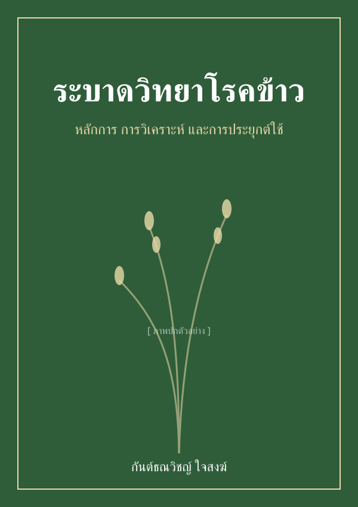

# ยินดีต้อนรับ {#sec-welcome .unnumbered}

<!-- หน้าตัวอย่าง: โครงคล้ายหน้าแรกของ r4pde.net (ปก + ข้อความต้อนรับ + วิธีใช้เล่ม + สัญญาอนุญาต) ผู้เขียนจะออกแบบใหม่ -->

::: {.content-visible when-format="html"}
{width="260" fig-align="left" style="float:right; margin: 0 0 1rem 1.5rem; box-shadow: 0 4px 14px rgba(0,0,0,.25);" fig-alt="Placeholder book cover"}
:::

ยินดีต้อนรับสู่ฉบับออนไลน์ของ **ระบาดวิทยาโรคข้าว: หลักการ การวิเคราะห์ และการประยุกต์ใช้** ตำราภาษาไทยที่ว่าด้วยการพัฒนาของโรคข้าวในเวลาและพื้นที่ ตั้งแต่การวัดโรคไปจนถึงการประเมินความเสียหายของผลผลิต พร้อมตัวอย่างวิเคราะห์ด้วยภาษา R ที่ผู้อ่านรันตามได้ทุกบท

[ข้อความต้อนรับตัวอย่าง ผู้เขียนจะเขียนใหม่]

## เล่มนี้เหมาะกับใคร {.unnumbered}

นักศึกษาปริญญาตรีและปริญญาโทที่เรียนโรคพืชหรือระบาดวิทยา นักวิจัย และนักวิชาการเกษตรที่ต้องการแหล่งอ้างอิงภาษาไทยพร้อมโค้ดที่ใช้งานได้จริง

## วิธีใช้เล่มนี้ {.unnumbered}

แต่ละบทเริ่มจากแนวคิด ตามด้วยสมการและตัวอย่างโค้ด R ส่วนรายละเอียดเชิงคณิตศาสตร์ที่ลึกกว่าระดับปริญญาตรีวางไว้ในกล่องเสริมหรือขอบกระดาษ ผู้อ่านข้ามได้โดยไม่เสียเนื้อเรื่อง

## ฉบับพิมพ์ {.unnumbered}

[ตัวอย่าง: รายละเอียดฉบับพิมพ์ ISBN และช่องทางสั่งซื้อ]

## สัญญาอนุญาต {.unnumbered}

[ตัวอย่าง: ระบุสัญญาอนุญาตของฉบับออนไลน์ภายหลัง]

## การอ้างอิงเล่มนี้ {.unnumbered}

[ตัวอย่าง: รูปแบบการอ้างอิงจะเพิ่มเมื่อมี ISBN/DOI]

::: {.content-visible when-format="html"}

:::
