# Measuring Plant Diseases {#sec-ch2}

_As always in biology, the problem was to know what you were looking at._ Richard Preston (_The Hot Zone_)

## 2.1 Introduction

An epidemic consists of a population of infected individuals in a (generally larger) host population, and the change in diseased individuals over time and space. Before one can understand or compare epidemics, one must first monitor them. We use the Merriam-Webster dictionary and define _monitor_ as: “to watch, keep track of, or check usually for a special purpose.” For the purpose of epidemic analysis, this involves sampling for disease, (Chapter 10), and measurement of disease in the sample. Measurement is the primary subject of this chapter.

Because plant disease involves the interaction of a plant and a pathogen as influenced by the environment, it is natural to consider measurements of plants (e.g., crops, forest trees), pathogens (e.g., spores), and the physical environment (e.g., ambient air temperature) when quantifying epidemics. Depending on the objectives of the study, an investigator may need to quantify variables explicitly representing one or more components of the disease triangle. Because of space limitations, with a few exceptions, we do not explicitly discuss measures of the host, pathogen, or environment. Interested readers should refer to Chapters 3–5 in Campbell and Madden (1990), and also Rotem (1988), Seem (1988), and Sutton et al. (1988). What we do cover here is measurement of disease. As stated by Kranz (1988), “without quantification of disease, no studies in epidemiology, no assessment of crop losses, and no plant disease surveys and their applications would be possible.” Campbell and Neher (1994) summarized this nicely by calling disease measurement “the cornerstone of epidemic analysis.”

Different approaches to the measurement of disease may be appropriate for different pathosystems. For instance, measuring a systemic disease caused by a virus may be very different from measuring the area of lesions caused by a fungus on leaves. There are, however, general principles and approaches that apply for all types of measurements, and these are discussed in this chapter. We start with an overview of concepts, and give relevant definitions and explanations of disease, measurement, and some statistical terms. Then, we present a review of common disease measurement methods, and discuss ways to determine the so-called reliability and accuracy of the disease measurements.

## 2.2 Plant Disease Intensity

### 2.2.1 Concepts

_Disease assessment_ and disease estimation are terms commonly used to describe the measurement of plant disease. The assessed data may be quantitative, qualitative, or a combination of both. A plant or plant unit (e.g., leaf, branch) can be classified as diseased or not diseased, based on either symptoms or some other type of assay. Typically, a sample of plants is assessed in this manner, and the number diseased out of the total (_N_) is recorded. The term _disease incidence_ is used for the proportion of plants (or plant units) diseased or the number diseased out of _N_. Incidence is a discrete variable (see section 2.3).

There can be various scales to incidence, depending on what plant units are assessed for diseased individuals (Hughes et al., 1997; Turechek and Madden, 2001). For instance, if one is assessing individual leaves for disease, then _leaf_ disease incidence is defined as the proportion or number of diseased leaves. If one is assessing individual plants, then _plant_ disease incidence is defined as the proportion or number of diseased plants. A single diseased plant can have one or many diseased leaves. This concept can be extended to even higher scales. For instance, one can determine the proportion of fields with one or more diseased plants as a measure of field disease incidence in a region. However, the specialized term _disease prevalence_ often is used for the proportion or number of fields with diseased plants (Nutter, 2002a).

Besides determining whether or not a plant is diseased, some aspect of the “degree of infection” can be ascertained. For instance, with foliar diseases caused by fungi, one can assess the area of lesions on plants. Although the measurements can be in absolute units (for instance, square centimeters of lesions), it is much more common to assess the proportion or percentage of host area affected by disease. The term _disease severity_ is used for (relative or absolute) area of plant tissue affected by disease. With a sample of plants, one averages the individual values to obtain a mean disease severity. Severity can refer to either the diseased area of an individual plant or the mean diseased area of a sample. As used here, severity is a continuous variable (see section 2.3.2). In practice, however, severity may also be assessed by assigning a disease severity category or class value to each observed plant; then, severity is a discrete variable, although possibly with many distinct values.

Generally, mean disease severity in a plot, field, etc., is the average of the severity of all assessed plants (or plant units), whether the plant is diseased or not. In other words, a severity value of zero is used for all observations with no disease, and the calculated mean is a measure of disease severity for the sample of interest. One could also determine the mean severity for just the diseased plants; that is, one uses the disease-free observations in determining the mean. This is really a “conditional severity,” because it is a measure of disease severity that is conditional on the individuals being infected. Conditional severity is easily obtained by dividing the mean severity of _all_ assessed plants (or plant units) by the proportion of those plants (or plant units) diseased.

When a plant is diseased, instead of assessing the area affected, one can count the number of lesions or other units of infection for certain types of disease. In agreement with McRoberts et al. (2003), we refer to the number of lesions per plant or per unit area (say, lesions per square centimeter) simply as a _disease count_. The count values can be averaged over the observations in the sample to obtain a mean disease count. A count is a discrete variable, because only distinct integer values can be obtained for an individual. However, fractional values can be achieved for means.

Often the term severity is also used for a disease count (Seem, 1984). This is reasonable for some purposes, especially when lesions are all of a similar size. Then, the area diseased is simply the number of lesions multiplied by the average area of an individual lesion. When one is modeling and analyzing disease increase for entire plots or fields, then a mean count of lesions per plant (leaf, etc.) may be a quite reasonable substitute for severity (or severity may be a reasonable substitute for a count). However, the statistical properties of counts and severity are different, and one cannot interchange the variables for all purposes. For instance, some useful methods to determine the spatial pattern of disease depend on the use of discrete variables and are not valid for continuous variables such as severity (Chapter 9).

A disease count may also be referred to as _disease density_ because the counts are expressed relative to a leaf, root, stem, and so on (McRoberts et al., 2003). With common usage of the term, density refers to a quantity per unit area or volume. Thus, it should be pointed out that incidence, severity, and counts can all be expressed as densities. Examples include: the proportion of diseased plants per square meter of crop or the mean proportion of leaf area with disease symptoms per square meter of crop.

Several (but certainly not all) of the principles to be discussed in later chapters correspond to any form of measured disease in a host population. Thus, for ease of communication, it is often desirable to use a general term for plant disease that includes all of the measurements just discussed. We use the term _disease intensity_ to encompass disease incidence, severity, and counts. As mentioned above, sometimes we lump severity and counts together as forms of severity (e.g., some data sets in Chapter 4), and sometimes we keep them separate, especially for statistical purposes (e.g., Chapter 9).

As with most definitions in plant pathology, these definitions of disease are not universally used. For instance, one might find intensity being used for what we call severity. Some sub-disciplines have their own terminology. For instance, researchers working on Fusarium head blight of wheat in the United States use the term “severity” for a disease variable equivalent to conditional severity (the mean severity of just the diseased plants), and the term “index” for a disease variable equivalent to mean severity for a sample (Groth et al., 1999). Moreover, disease terms may be used differently in other scientific disciplines. In medicine, as an example, “prevalence” is used for what plant pathologists generally call incidence. The conclusion here is that one should be careful when reading the literature to find out how the authors are using the disease terms.

### 2.2.2 Severity versus incidence: some considerations

In conducting epidemiological studies, one must decide, among other things, which measures of disease intensity to obtain, how often during the epidemic to obtain disease data, and how much sampling to do at each time. The second point involves the characterization of disease progress curves, the subject of Chapters 4 and 5, and only a few comments on frequency of data collection are presented here. The third point is not addressed until Chapter 10, after many statistical details are introduced and explained. The first point is addressed fully in this chapter.

Whether to assess disease incidence, severity or counts depends on the pathosystem being studied, the overall magnitude of disease intensity, and the objectives of the investigator. With many foliar diseases of plants caused by fungi, the concept of severity as a continuous variable is relatively easy to visualize and put into practice. That is, an investigator can use one of several techniques (discussed below) to assess the proportion of the total leaf surface covered by lesions (pustules, etc.). With many systemic diseases, however, such as those caused by viruses and soil-borne pathogens, the concept of leaf (or plant) area covered by lesions is not a useful one. Rather, severity involves harder-to-define aspects of the degree of infection, such as extent of wilting, yellowing of leaves, senescence, and so on. Severity of disease can also be a difficult variable to use for many root diseases because direct assessment would involve destructive sampling—digging up the plants to observe the roots. For these situations, depending on the study objectives, incidence may be preferable for quantifying disease because the proportion of plants with symptoms has a direct and objective interpretation.

For many applied and basic studies in epidemiology, crop yield in relation to disease intensity is of major interest (Chapter 11). Initially, it may appear that disease severity is a more useful measure of intensity than incidence for yield–loss purposes (at least for certain types of diseases). For instance, if there was one early blight lesion on every potato plant in a field, incidence would be 1 (100%) but mean severity would be very low (<0.001). Under these conditions, it is unlikely that yield would be different from that obtained in a disease-free field. However, if half of the leaf surface of plants were covered by lesions in half of the field, and there were no lesions at all on the plants in the other half of the field, incidence would be 0.5 and mean severity for the field would be 0.5 × 0.5 = 0.25. Based on our knowledge of crop loss (see Chapter 11), one can expect a substantial yield reduction in this case compared with a disease-free field, even though incidence is half that in the first case. For this and probably several other reasons, it is very common to assess severity in basic and applied epidemiological studies. Even in situations with difficult-tomeasure severity (systemic diseases, root diseases), efforts are often made to quantify severity in the best way possible (e.g., Harveson and Rush, 2002; Krause et al., 2001; Murphy et al., 2000).

The extreme combinations of incidence and severity of the previous paragraph, although certainly possible, are not the norm. There is often a relationship between incidence and severity which means that one can predict one from the other (see McRoberts et al., 2003). Consider the epidemic curves shown in Fig. 2.1 These types of curves were introduced in Chapter 1 and will be considered in detail starting in Chapter 4. For now, simply accept that the curves of intensity over time are realistic for many diseases. Severity was generated for two treatments (1 and 2) based on a classic epidemic model, and incidence was predicted based on a known relationship between severity and incidence (McRoberts et al., 2003; see section 9.8). The same relation between severity and incidence was used for both treatments.

Although there are clear differences between the two treatments in Fig. 2.1, one would not see this if only severity was considered and disease assessments were made just over the first 30 days or so of the epidemic. In this time span, severity barely is above 0 on the vertical axis. Although a logarithmic scale would show differences in severity for this theoretical exercise, given the variability associated with sampled disease values, it is unlikely that one could find significant differences of the two treatments in terms of disease severity at individual times before day 30. On the other hand, disease incidence is much higher over this time span, and clear differences between the treatments are apparent at individual times (even on this linear scale). Later in the epidemics (>40 days), severities were well separated for the two treatments, but incidence was very close to 1 (100%). An investigator making the first disease assessment at day 40 or so, would not find incidence to be of much value in discriminating between the two groups. When one has data over the entire course of the epidemic, one can quantify changes of incidence and severity, and possibly characterize a relationship between them.

{#fig-2-1}

## 2.3 Measurement Levels and Random Variables

We have been using terms like “discrete,” and “continuous” so far without really explaining them. Since the properties of variables determine how one analyzes the data, we think it is very useful to take a slight diversion from disease assessment material and discuss some terminology from statistics and measurement science. There are different systems for classifying (labeling) the information obtained from planned experiments or observations of natural phenomena (Schabenberger and Pearce, 2002; Sheskin 1997). Sometimes these systems are merged, which can be a little confusing. We discuss two systems here.

### 2.3.1 Measurement level

One classification system is based on the level of information obtained with a measurement procedure.

“Measurement” in this sense is considered very broadly and could be visual observations or values obtained with electronic or physical devices. There are four levels in this system (Fig. 2.2, left-hand side).

_Nominal level._ A label is given to each measured individual with respect to the property of interest. The property is qualitative in nature. For example, a plant is labeled diseased or not based on some criterion. Diseased could be coded as “D”, “+”, “1”, or other convenient label. Disease free (healthy) could be coded as “H”, “−”, “0”, or other label. Thus, disease incidence at the individual level (where assessment occurs) is a nominal measurement. Many measured properties of plants and pathogens are also nominal in form. Examples include plant species, cultivar, and pathogen species.

_Ordinal level._ An ordered value is given to each measured individual with respect to the property of interest. The values used are interpretable only in terms of their arrangement in a given order, not to the magnitude of the differences of the values used. For example, the severity of a plant is measured by assigning it to one of four categories: (0) no disease, (1) slight disease, (2) moderate disease, and (3) very severe disease. These numerical values may be called scores or ratings. Assuming no error in assessing disease, a measurement of “2” does reflect higher severity than a measurement of “1”, but the numerical difference between 1 and 2 has no interpretable meaning. Likewise, the increase in actual severity between scores of 1 and 2 is not necessarily the same as the increase in actual severity between scores 3 and 4. One could just as easily uses values of –20, 0, 50, and 100, or A, B, C, and D for the four levels of severity. No difference is inferred among individuals with the same ordinal measurement rating, but individuals with different ratings can be ordered. This type of measurement is fairly common in plant pathology, especially for dealing with the severity of root diseases and systemic diseases (Shah and Madden, 2004).

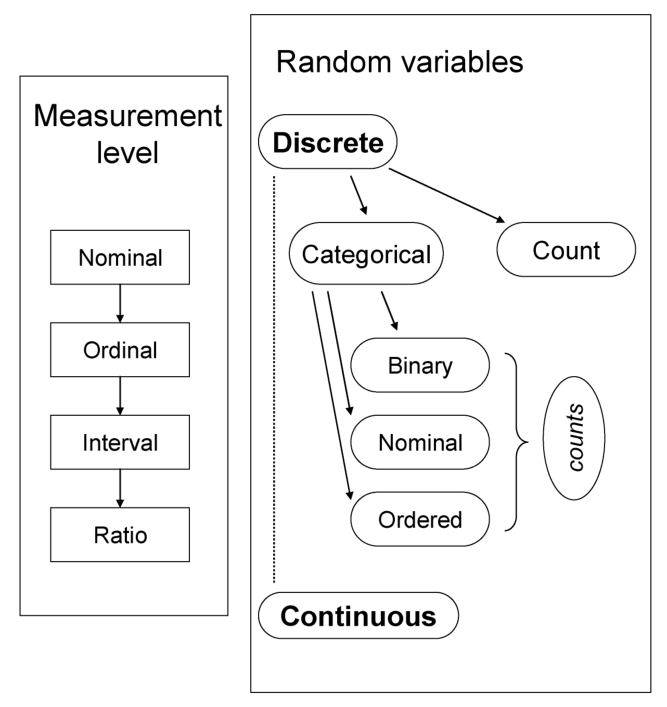{#fig-2-2}

_Interval level._ The measurement of each individual not only can be ordered, but also the differences in measurement values have direct interpretation. One can say how much larger (or smaller) one observation is, compared with another. Ambient air temperature in Celsius is an example of interval level of measurement. A defining property is that equal differences between measurements correspond to equal differences in the property being measured. For instance, the difference between, say, 20 and 25 is the same as (i.e., has the same meaning as) the difference between 25 and 30, since the numbers are not arbitrary values.

_Ratio level._ Like an interval level of measurement, the ratio-level measurements and their differences have direct interpretation. However, there is also a “zero point” or fixed origin. Plant height, yield, area of a single lesion, or disease severity for a plant are examples of ratio level measurements. A defining feature of this scale is that the ratio of two values has direct interpretation. For two severities that were 20 and 40%, then the second is twice as large as the first.

These four levels here are presented in increasing order of information content. That is, assuming that the measured values are correct, a ratio- or interval-level measurement is more informative than an ordinal- or nominal-scale measurement (Gibbons, 1976). This does not mean, however, that it is necessarily better to use ratio- or interval-scale measurements. This is discussed later in the chapter.

### 2.3.2 Random variables

Generally there will be variability when measurements of properties are obtained from individuals (animate or inanimate). Two plant pathologists may obtain different visual estimates of disease severity for the same plants, or ELISA absorbances may vary for multiple runs of the assay. For this reason, something measured is commonly referred to as a variable or _random variable_. The term random variable can be used more generally for any characteristic that differs from observation to observation (individual to individual), or from time to time, or location to location, but here we focus on its use in terms of measurements.

A variable can be classified as to whether it is continuous or discrete (Fig. 2.2). For a _continuous variable_ the number of possible values is not countable and the “distance” between values is directly interpretable. A continuous variable in this system is directly analogous to interval- and ratio-level variables in section 2.3.1. For example, consider the yield of two plots, which are recorded as 10.1 and 10.3 kg. The difference of 0.2 kg is well-defined in a physical sense. Moreover, an indefinitely large number of weights are possible between these two. Although the accuracy of the measuring and recording device may not allow it to be determined, or the person taking notes may round all values to one decimal place, there could be plots with yields of 10.11, 10.101, 10.100001, and so on. When disease severity represents the actual area of leaves or roots with symptoms, or the proportions, then severity is a continuous variable.

For a _discrete variable_, the number of possible values is countable. That is, unlike the situation for continuous variables, there is a finite number of possible values. If the discrete variable consists of counts of something, it is known as a _count variable_. Numbers of spores in volumetric spore samplers or numbers of overwintering spores per volume of soil are examples of count variables. In theory, counts may range from 0 upwards, without upper limit, although in practice there must be a finite upper bound. As long as the upper bound is very high relative to the actual counts, the simplifying assumption of an infinite upper bound is reasonable. A disease count (such as lesions per leaf) obviously is a discrete random variable.

If the values taken on by a discrete variable indicate membership of some group, it is known as a _categorical variable_ (Fig. 2.2). There may as few as two categories, in which case it is known as a _binary variable_. Disease incidence at the individual (single leaf, plant, etc.) scale is an example of a binary variable. If there are more than two categories, but there is no order to the categories, then it is known as a _nominal variable_. An example would be the species of _Phytophthora_ found in a soil sample. A binary variable is a special case of a nominal variable. It is clear that there is an equivalence of the binary and nominal categorical random variables here and a nominal-level measurement of the previous section.

If the category labels reflect an order, then the variable in question is known as an _ordered categorical variable_. Examples could be categories of plant health, or ordinal scores of disease severity (Shah and Madden, 2004). The scores, however, are just labels, and it is generally inappropriate to consider an ordered categorical variable to be the same as a continuous variable. An ordered categorical variable obviously corresponds to an ordinal level of measurement (Fig. 2.2).

There is a natural link between discrete count variables and discrete categorical variables. Consider disease incidence. At the scale of measurement (the individual plant or leaf), the disease variable is binary. However, one can total the number of diseased (and disease-free) plants to obtain a count for a plot, field, or other unit of interest. Schabenberger and Pierce (2002) call this a _count with a natural denominator_. These counts can be converted into proportions. In contrast, counts without a natural denominator cannot be converted into proportions. One can also obtain counts for nominal and ordered categorical variables; here, the total for each category is obtained, just as the total was determined for the disease and disease-free categories.

The relationship between count variables with and without a natural denominator can be even further elaborated. For instance, consider lesions on leaves. One can think of each lesion as occupying a finite site on a leaf, with a very large number of sites that could be occupied (Daamen, 1986; Hughes et al., 2004). The actual count of lesions is equivalent, conceptually, to the count of sites that are occupied. Of course, it is not possible to actually count these sites (until they are occupied), or know the actual total number of sites.

### 2.3.3 Plant disease variables

There are at least two reasons to be concerned about the level of measurement or the type of random variable. First, as described above, the measurement level is an indication of how much information is conveyed about the property of interest. Second, the type of variable dictates what types of statistical and mathematical analyses are appropriate. Many of the common statistical methods used by plant pathologists, such as analysis of variance and regression analysis, were developed and are most appropriate for continuous random variables. For counts without a natural denominator and for counts of binary variables (i.e., counts with an upper bound), the discrete variable may be reasonably approximated as a continuous variable if there is a high number of counts and a wide range of values (Schabenberger and Pierce, 2002). There are, however, many statistical methods explicitly developed for discrete variables (Agresti, 1990; Collett, 2003) which can be extremely effective in characterizing the variables of interest. For instance, several aspects of spatial pattern analysis of plant diseases (Chapter 9) depend on statistical properties of count data (with and without a natural denominator). Some alternatives to classical regression analysis and analysis of variance are found in Chapters 4 and 10.

In assessments of plant disease, for the most part there are five types of random variables that are commonly encountered:

- Continuous [e.g., severity on a 0–1 scale (0–100%), either for individual plants (leaves, etc.), or for the mean of several individuals].

- Ordered categorical [e.g., ordered rating classes of disease severity on individual plants (or leaves, etc.)].

- • Binary [e.g., disease incidence, consisting of disease status of individual plants (leaves, etc.)].

- Counts with a natural denominator [disease incidence, consisting of number of diseased plants (leaves, etc.) out of a total number assessed; often expressed as a proportion of the total].

- Counts with no natural denominator [e.g., disease count, such as numbers of lesions per plant (or per leaf, etc.)].

With a few exceptions (see section 2.5.3), we use _Y_ and _y_ for the disease intensity random variable throughout this book, upper case _Y_ for disease in absolute units (e.g., area of lesions per plant, number of diseased plants), and lower case _y_ for relative units (e.g., proportion of plant leaf area with lesions, proportion of diseased plants).

## 2.4 Assessing Disease Intensity

### 2.4.1 Incidence, counts, and severity: some general comments

Assessing disease incidence is relatively straightforward, at least in principle. One simply categorizes each individual plant unit (e.g., whole plant, leaf, root, etc.) as being diseased or not, and adds up the total number observed and number in the disease category. The categorization can be based on visual symptoms (the most common approach in epidemiology) or other technique, such as use of biochemical or molecular assays (Fox, 1998). Of course, there can be errors in assessing for disease, in particular, declaring a plant diseased when it is not or declaring a plant disease free when it is diseased.

Assessing disease counts is also straightforward in principle. For density of lesions, for instance, one simply counts the number of lesions on plants, leaves, etc. In practice, this can be more difficult than it appears, since it may not be easy to see all the lesions, or they overlap or grow together, or they exhibit misleading signs and symptoms. Counting lesions on roots is an especially difficult process (Campbell and Neher, 1994). As an alternative one can move back in the infection cycle and count the density of spores in the air, on plant surfaces, or in the soil (Benson, 1994; Fitt and McCartney, 1986).

Assessing disease severity, either as a proportion of leaf or root area affected, or as an actual area affected, is a challenging endeavor, although it may appear deceptively simple. Much has been written on the subject (e.g., Cooke, 1998, 2006; Gaunt, 1987; James, 1974; Large, 1966; Nutter and Schultz, 1995; Nutter et al., 2006) and the subject continues to be of interest (Nita et al., 2003; Nutter, 2002a; Vereijssen et al., 2003). The general approaches mostly involve visual assessment, based on symptoms, and electronic assessment, based on reflected electromagnetic radiation (e.g., light, radiation in the visible part of the spectrum). Because of their widespread use, these methods are addressed in some detail in the following subsections. With very intensive data collection and measurement efforts, one can also use disease count values to obtain directly a measure of severity. For instance, one measures the size of every observed lesion, and uses the number of lesions and their average area to calculate total area affected. Of course, it is rare that investigators can afford such intensive measurement efforts, except for a very a limited number of plant units.

### 2.4.2 Visual assessment of disease severity

Plant pathologists have been attempting to obtain quantitative information—i.e., interval or ratio-level measurements (Fig. 2.2)—on disease severity through visual assessment for over a century (Cobb, 1892). Efforts to use ordinal scale measurements go back nearly as far (e.g., McKinney, 1923). The basic idea is for an individual person (called a _rater_ here) to look at a _specimen_ (individual leaf, root section, entire plant, etc.) and estimate the area of the specimen affected by the disease. Generally, the visual measurement is of the _relative_ area, that is, the proportion or percentage of the specimen that is affected. The assumption is that raters can, indeed, make reasonable estimates of relative area by visual inspection. The validity of this assumption is discussed in section 2.5.

To facilitate assessment of disease severity, various aids have been developed to assist raters, such as text descriptions of specific severity values and diagrams of severity percentages (Campbell and Madden, 1990). These aids form a convenient basis for classifying the assessment methods. We consider four visual assessment methods.

- Direct estimation

- Direct estimation with use of disease diagrams

- Use of disease scales

- Use of ordinal rating scales.

Other classifications could be used, of course.

_2.4.2.1 Direct estimation._ With direct estimation, the rater observes a specimen and assigns it a disease severity value from 0 to 100% (0 to 1) based on perceived area affected. If the rater feels it is justified, fractions of a percentage can be recorded. One does not use any other aid to make the assignment.

_2.4.2.2 Direct estimation with use of disease diagrams._ A disease diagram is a pictorial or graphic representation of selected levels (classes) of disease severity. Sometimes they are called _standard area diagrams_. Although Cobb (1892) was the first to use disease diagrams, James (1971) is probably most responsible for their widespread use. Some examples are shown in Figs. 2.3 and 2.4. They consist of drawings of plant parts of interest (e.g., leaves, fruit, stem) covered, in part, by pictorial representations of typical lesions. Usually, the plant surface is in white and the lesion area is in black, although color photographs could be used. It is important that the lesion area in the drawing has the same shape as typical lesion areas on plants. For practical purposes, only a selected (small) number of severity levels are shown.

The rater uses a set of diagrams as a guide. In particular, the rater compares an actual diseased specimen to the set of diagrams, and decides if the severity of the specimen is close to one of the pictorial representations. In most cases, interpolation or extrapolation is needed to assign an appropriate severity percentage to the specimen. Obviously, the severities shown on the diagrams could influence how the rater interpolates between values. Although a rater may initially compare every actual specimen to the diagram, ultimately the rater “learns” the different severities of the diagrams, and just makes direct estimates of severity without reference to the diagrams (as in section 2.4.2.1).

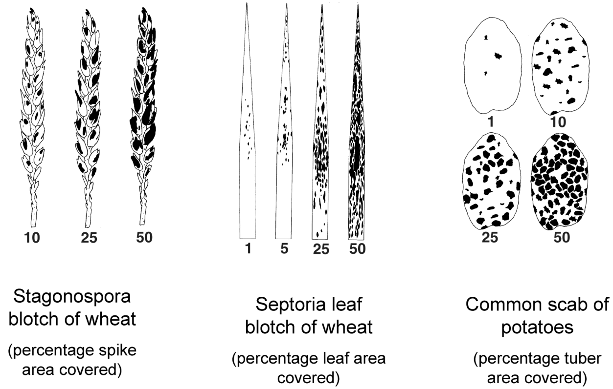{#fig-2-3}

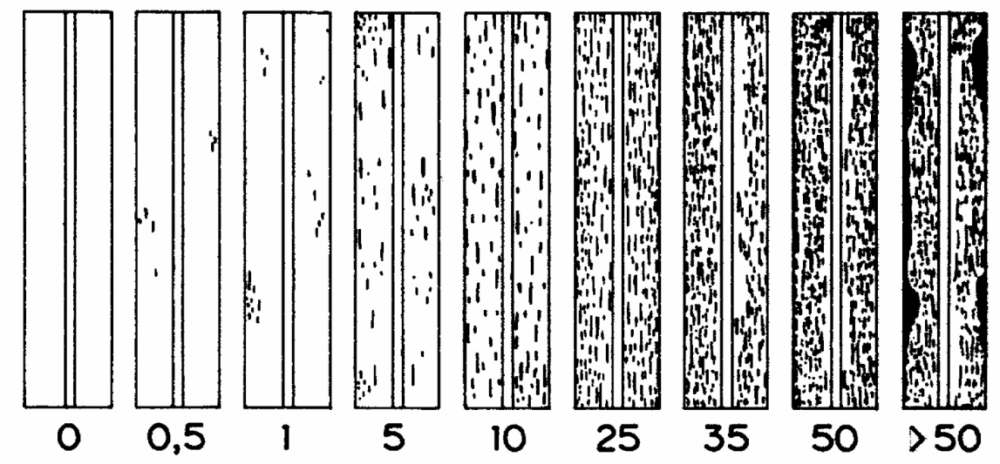{#fig-2-4}

One problem with standard area diagrams is that most show only one example of a particular severity percentage. In reality, of course, there are many ways that, for example, 25% of the surface could be covered by lesions. There may be many small lesions or a few large ones. The lesions may be aggregated at the base (or tip), or dispersed over the entire surface. Some diagrams address this issue by showing multiple versions of a particular percentage (e.g., Fig. 2.4).

_2.4.2.3 Estimation with use of disease scales._ A disease scale is a partition of the continuous severity values from 0 to 100% into a finite number of classes. Basically, a disease scale is a written and numerical representation of the severity classes to be distinguished (Cole, 1981). A simple example is:

|_Class_|_Severity range_|
|---|---|
|0|0|
|1|0+ up to 25%|
|2|25+ up to 50%|
|3|50+ up to 75%|
|4|75+ up to 100%|

Here, the superscript + means a value just slightly above the indicated value (e.g., for Class 1, any low level of severity above 0 would be assigned a 1). To use a disease scale, a rater observes a specimen (leaf, root, entire plant, etc.) and assigns it a class value based on the description of the class. The written description of the classes can be as simple as a listing of the range of percentages in the classes (as in the above example), or a detailed explanation of what diseased plants (leaves, etc.) look like when in each class.

One reason for using a scale is for convenience and speed of rating. For instance, it may take a rater a relatively long time to decide whether the severity of a specimen is 28, 29, or 30%, but the rater could quickly decide that the specimen belongs to Class 2 (as an example), and move on to the next specimen. A second reason is based on an assumption that a rater cannot easily distinguish severity values within a class. That is, there is an assumption that trying to discriminate between 28% and 32%, for example, is not worth the effort, so one should use a measurement scale that reflects measurement abilities of raters. This idea underlies the Horsfall-Barratt (HB) scale (Horsfall and Cowling, 1978b). This scale was originally proposed in 1945 (but only as an abstract), and has since become one of the most common scales, if not the most common scale, for disease assessment in plant pathology. It consists of 12 classes of disease as listed here.

|_Class_|_Severity_|_Midpoint_|
|---|---|---|
|0|0|0|
|1|0+–3|1.5|
|2|3+–6|4.5|
|3|6+–12|9|
|4|12+–25|18.5|
|5|25+–50|37.5|
|6|50+–75|62.5|
|7|75+–88|81.5|
|8|88+–94|91|
|9|94+–97|95.5|
|10|97+–100|98.5|
|11|100|100|

The most striking feature of the H-B scale is the unequal severity intervals (widths) corresponding to the different classes of disease, and the pattern to the interval widths. Close to zero, the intervals are small (e.g., 0+ –3 for Class 1, with 0+ a nonzero severity slightly above 0), and the interval width generally increases with increasing severity up to 50%, then declines again in a symmetric fashion. Variations of the scale in use include smaller and larger number of classes (e.g., Green et al., 1998).

The H-B scale is based on two assumptions. The first is that there is a logarithmic relationship between the intensity of a stimulus (i.e., reflected light from a diseased specimen) and sensation (i.e., estimated area diseased) (Horsfall and Cowling, 1978b). This is a consequence of the Weber and Fechner laws of psychophysics, which are sometimes combined into the so-called Weber-Fechner law (Bringmann, et al., 1997; Murray and Ross, 1988; Titchener, 1928). If the Weber-Fechner law held, a rater would be able to discriminate between small levels of severity (e.g., between 2% and 5%) when severity was low, but only be able to discriminate between large levels (e.g., between 20% and 40%) at higher severity.

The second assumption behind the H-B scale is that when observing an object consisting of two colors or forms, a rater focuses on the one that is smaller in size. In terms of disease assessment, this means that the human eye perceives diseased area below 50% and healthy area above 50% (Horsfall and Cowling, 1978b). This second assumption explains why the severity intervals decrease above 50% in the H-B scale, all the way down to an interval width of 0 at 100% severity. If only the first assumption held, the interval widths would continue to increase above 50%.

The problem is that there is little, if any, experimental evidence that the assumptions behind the H-B scale hold for assessing disease severity (Forbes and Korva, 1994; Hebert, 1982; Nita et al., 2003; Nutter and Schultz, 1995; Parker et al., 1995; Sherwood et al., 1983). There is even question of the general appropriateness of the Weber-Fechner law(s) for stimuli such as light and color (Murray and Ross, 1988). In fact, there is much stronger empirical evidence that a linear scale (e.g., equal interval width with increasing disease) is more appropriate for severity assessment (e.g., Nita et al., 2003; Nutter and Schultz, 1995). For instance, a straight line relationship between estimated disease and actual disease severity is often found, although a nonlinear relation is expected on the basis of the H-B scale. (The concepts of linearity and nonlinearity are explained in Chapter 3). One also expects that the greatest error in estimation is around 50% if the H-B assumptions hold. However, in studies, there is either no consistent relationship between magnitude of the error and actual severity, or if there is relationship, the highest error occurs at less than 50% severity (e.g., Forbes and Jeger, 1987; Nita et al., 2003; Parker et al., 1995).

Detailed evaluation of visual assessment methods has been done for only a few plant diseases. Certainly, it cannot be claimed that the H-B assumptions are unreasonable for all plant diseases. However, it is a mistake for plant pathologists to use the H-B scale, thinking that it is somehow justified by measurement/assessment theory. This does not mean that a scale such as the H-B one has no value. As discussed above, one reason to use a disease scale is for convenience and ease of use. The H-B scale may sometimes meet this criterion. Specifically, we have found the H-B scale or similar ones to be very useful for rapidly assigning a severity class to each specimen in the field and greenhouse. However, as a general rule, equalincrement scales may be preferable to the H-B scale (Nutter, 2002a; Nita et al., 2003; Nutter et al., 2006).

Specimens considered for disease assessment can be individual leaflets, leaves, branches, roots, stems, or even whole plants. The “specimen” assessed can even be an entire field. For example, the British Mycological Society (1947) issued a scale to determine the percentage of foliage affected by late blight in entire fields based on symptoms and patterns of severity in the field. For instance, 5% mean severity corresponds to ~50 lesions per plant or up to 10% of the leaflets with symptoms. This type of disease scale is known sometimes as a _field key_.

_2.4.2.4 Estimation with use of ordinal rating scales._ As discussed above, it can be very difficult to measure the severity of certain types of diseases. This is especially true for systemic diseases, those caused by viruses, and many root diseases. Even the concept of severity becomes a more difficult one. A popular approach to circumvent such difficulties is to use an ordinal rating scale. That is, one observes a specimen and assigns it to one of a fixed number of labeled severity rating classes. Such a scale is different from the disease scales in the previous section because there is less information in the description of the ordinal rating classes. Here, the specific ratings used do not have any particular physical interpretation.

A recent example of a rating scale is one used for Rhizoctonia damping-off of plants (Krause et al., 2001). There are five possible severity ratings for a specimen:

|_Rating_|_Description_|
|---|---|
|1|Symptomless|
|2|Small root or stem lesions|
|3|Large root or stem lesions|
|4|Post-emergence damping-off|
|5|Pre-emergence damping-off|

Higher ratings are indicative of increasing severity of the disease. However, only the order of the ratings has any direct interpretation—a 4 is worse than a 3, a 5 worse than a 4, and so on. The difference between ratings provides no quantitative information about disease severity. Even though the difference between successive ratings is 1 in all cases (in this example), the increase in disease between a rating of 2 and rating of 3 is not necessarily equal to the increase from a 3 to a 4. One could just as easily have used 0, 10, 30, 60, and 100 for the five ratings, or even A, B, C, D, and E.

Another example of an ordinal rating scale is found in Murphy et al. (2000) for assessing tomato plants infected by tomato mottle virus. The six classes are:

|_Rating_|_Description_|
|---|---|
|0|Symptomless|
|1|Mild mottling on young leaves|
|2|Obvious mottling on leaves from at least one of the main stems|
|3|Obvious mottling on leaves over most of the plant|
|4|Obvious mottling on leaves and leaf distortion over the entire plant|
|5|Obvious mottling on leaves, leaf distortion, and severe stunting|

While the descriptions of the rating classes vary in ease of interpretation, the scale does nicely summarize the sequence of symptoms that can develop during plant infection. It would be a difficult task to derive an alternative scale that could capture the meaning of some of these properties of disease severity in a more quantitative manner.

The obvious advantage of an ordinal rating scale is ease of use, making it possible to assess specimens rapidly for disease. It is probably (relatively) easy to train raters to use such a scale, compared with a quantitative one. In addition, it may not always be possible to develop quantitative scales. The major disadvantage of an ordinal rating scale is that the actual rating values used are arbitrary. This can have a major impact on data analysis (Gibbons, 1976; Shah and Madden, 2004), as described at the end of the next sub-section.

2 _.4.2.5 Random variables for severity of disease._ Directly estimated severity over the 0–100% range is a continuous variable, whether or not a disease diagram is used as an aid. It may appear that disease scales (section 2.4.2.3; Fig. 2.2) that involve a finite number of severity classes result in a discrete variable (ordered categorical). In one sense this is true since a countable number of possible severities are obtained. However, the classes used are representing a continuous (0–100%) scale of measurement, and the assigned numbers are used just for convenience not because of any inherent meaning in terms of biology or epidemiology. In a sense, the severity obtained with a disease scale (such as the 12-level H-B one) can be (and usually is) considered a continuous random variable with just a great deal of rounding, so that only a fixed number of possible severities are recorded.

The question arises whether one can use analysis of variance and regression analysis for severity data obtained with a finite-class disease scale, since these statistical procedures were developed for continuous variables.

Snedecor and Cochran (1989) stated that these types of analyses may be appropriate for ordered categorical data _if_ the classes used in the scale represent equal gradations on an underlying continuous scale. Certainly, this criterion is not met for the 12 class values of the H-B scale. For example, a “2” represents severities from 3 to 6% (a range of 4), but a “5” represents severities from 25 to 50% (a range of 25%). Thus, one should _not_ use analysis of variance on the actual severity class values. Rather, one should convert each class value to a severity on a percentage scale. The most common approach is to use the midpoint of the severity range for each class (see the table). Then, because the severity data are on a continuous scale, analysis of variance may be performed. Obviously, it may be that the mid-point of a class range is not very close to the actual severity, especially with severities around 50%. This is another disadvantage of using a scale such as the H-B one, especially if the rater is better able to measure severity than assumed for the H-B scale.

Severity of disease obtained with an ordinal disease rating scale (see section 2.4.2.4) is clearly an ordered categorical variable (see Fig. 2.2), corresponding to an ordinal measurement level. Based on the conclusion of Snedecor and Cochran (1989), one should generally not use analysis of variance, because there is no way to know if the numerical classes chosen have any relation to some unknown variable characterizing degree of infection on a continuous scale. In most cases, it is not possible to identify such variables. To analyze data of this type, one should use either: (1) non-parametric statistical methods as discussed by Sprent and Smeeton (2001) and Shah and Madden (2004); or (2) parametric generalized linear models for multiplecategory data, as discussed by Schabenberger and Pierce (2002). These two general statistical methods could also be used to analyze directly the ratings obtained from disease scales with unequal class widths (such as the H-B scale), without the need for conversion of ratings to percentages based on class mid-points.

### 2.4.3 Remote-sensing and electronic assessment of disease severity

_2.4.3.1 Spectral signature._ The electromagnetic radiation emerging from a plant or plant canopy is determined by many interactions—reflections, transmission, and absorptions—between the incident radiation (joules per unit area) and the plant tissue (Nilsson, 1995; West et al., 2003). The nature of the interaction varies with the wavelength of the radiation. In broad terms, one can divide the electromagnetic spectrum into broad regions, the most important of which for studies of plant disease are:

- visible (VIS; wavelength ∼400–700 nm),

- • near-infrared (NIR; wavelength ∼700–1200 nm), • shortwave infrared (SWIR; wavelength ∼1200– 2400 nm), and

- thermal (TIR; wavelength ∼10 μm).

The VIS region can be divided by wavelength into the violet-blue (~380–450 nm), green (~550 nm), and red (∼650–700 nm) regions. The reflected radiation divided by the incident radiation for each wavelength and multiplied by 100 is the _spectral signature_ of the plant or plant canopy. Because of the division of reflected by incident radiation, the spectral signature is unitless, and ranges from 0 to 100% at any wavelength (although the realized range may be much less than this). Through this signature, many aspects of crop growth and physiology can be characterized, including infection by plant diseases (Nilsson, 1995; West et al., 2003).

In broad terms, a healthy plant (or plant canopy) is characterized by low reflectance (as a percentage of incident radiation) in the VIS and SWIR regions, and high reflectance in the NIR region. Within the VIS region, there is relatively high reflectance in the green region, but low reflectance in the other visible regions of the spectrum. This is why plants appear green. For a plant disease with necrotic or chlorotic lesions on leaves, there is an overall increase in reflectance in the VIS region. More exactly, because of the reduction in chlorophyll, there is a reduction in reflectance in the green part of the VIS region, and an increase in reflectance in the red and blue parts. Moreover, reduction in total leaf area or biomass of plants, due to senescence, reduced growth, and defoliation, results in a decrease in reflectance in the NIR region.

Many other changes in the spectral signature can occur due to infection (see Nilsson, 1995; West et al., 2003). Some of these changes may be diagnostic for particular pathogens or types of pathogens, and may be exhibited before visible symptoms are obvious. Some of the changes, however, are evidence of general stress, and may not be diagnostic for infection, _per se_.

_2.4.3.2 Multispectral radiometry._ Reflected electromagnetic radiation has been found to be of value in measuring degree of infection of some plant diseases (Nutter and Schultz, 1995; Newton et al., 2004). A multispectral radiometer is used to measure reflected and incident radiation, in order to determine a spectral signature of the plant specimens (e.g., individual leaves, whole plants, sections of a field). Changes in percent reflectance at certain wavelengths or wavebands (i.e., fixed ranges of wavelength, such as 50-nm wide regions), or changes in reflectance in combinations of wavelengths, are associated with changes in the proportion of plant tissue with lesions (or other forms of disease severity). This is generally due to a reduction in chlorophyll content of cells. The methodology is known as _remote sensing_, which is a technique for measuring the characteristic manner in which a substance emits, absorbs, transmits, or reflects electromagnetic radiation using a sensing device that is situated at some distance from the surface of the substance of interest (Campbell and Madden, 1990). As used here, emphasis primarily is on reflectance. In one sense, of course, visual assessment of disease severity is a form of remote sensing since the human eye (the sensor) is recording a portion of the electromagnetic spectrum (i.e., visible light) reflected from the plant, and the eye is not in contact with the specimens of interest. As commonly used, however, the term remote sensing is used for photographic and electronic recording of the reflected radiation.

One can classify remote sensing methods, _inter alia_, based on the distance of the sensor from the plant or crop. At the lowest level, measurements are taken within ∼2 m of the crop. At an intermediate level, sensors are ∼75–1500 m above the canopy, usually in airplanes or hot-air balloons. At the highest level, sensors are housed in satellites orbiting the earth. For the purposes of this chapter, we are concerned with the lowest level for data acquisition, although all levels can provide useful information.

For many foliar diseases, reflectance (as a percentage of incident radiation) at the low end of the NIR region (∼800 nm) has been found to be highly correlated with disease severity (as a percentage of leaf area covered by lesions). Increasing disease severity is associated with decreasing reflectance around 800 nm (Nutter, 2002a; Nutter et al., 1990). By conducting calibration studies, where reflectance and visual (or other) measures of severity are obtained for a particular pathosystem, one can develop a relationship between the two. A typical example of such a relationship is given in Fig. 2.5. On the basis of such a relationship, one can then use percentage reflectance (in the appropriate wavebands) to estimate severity (or degree of infection) for other specimens.

Sometimes, there is also a positive correlation between severity and reflectance in the red portion of the VIS region (∼600 nm). Moreover, indices based on differences and ratios of reflectance in the VIS and NIR regions have also been found to be related to severity (Nilsson and Johnsson, 1996). To characterize other aspects of disease on the plant canopy, a wide range of wavebands can be used (West et al., 2003).

_2.4.3.3 Image analysis._ One specialized type of remote sensing of particular value in assessing disease severity is image analysis (Nilsson, 1995; Lamari, _ASSESS_, APS Press; Lindow and Webb, 1983). A plant specimen is recorded by some device, such as a video or still camera, and the recorded image is digitized into a large number of pixels, generally several thousand. With digital cameras, the digital image is directly determined. Then, the reflected light—usually just the VIS is used—is recorded for each pixel, and the pixels are classified based on the light reflectance. When the healthy and the infected plant tissue can easily be distinguished on the basis of color(s), it is relatively straightforward to place all pixels into one of two categories, representing healthy or infected areas of plant tissue on the image. Dividing the number of pixels representative of disease by the total number of pixels encompassing the plant specimen produces a measurement of disease severity.

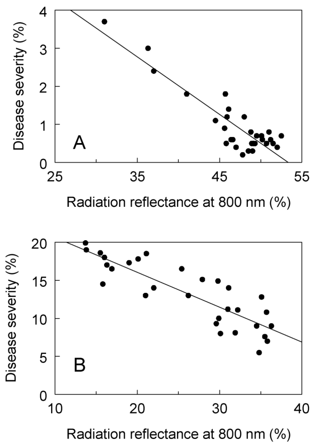{#fig-2-5}

There are at least two broad uses for image analysis in disease assessment. The first is for direct estimation of severity. That is, one uses this approach instead of visual assessment (or other method). This might entail taking photographs of specimens in the field and then determining severity in the laboratory using an image-analysis system. With portable equipment, the severity values could be determined right in the field. One could determine mean severities and other statistics from a sample of specimens. This approach might also entail destructive sampling of leaves or roots, where the specimens are actually brought into the laboratory for analysis.

The second use is in training. That is, visual assessments of severity are made as discussed in section 2.4.2, and the image analysis is used only to develop better visual assessment approaches. As discussed in section 2.5.5, one can determine the accuracy and reliability of raters’ estimates of disease severity, and, in principle, raters can learn to improve their visual assessments. Image analysis of selected specimens can provide accurate standards for training purposes. This approach can also be used to prepare standard area diagrams for certain classes of severity, based on some real specimens, that raters can refer to when estimating severity (e.g., Falloon et al., 1995).

Most disease assessments in epidemiological studies rely on visual assessments. This is partly because of the costs and time involved in using image analysis. However, with advances in digital technology, inexpensive computers and cameras, and availability of software for processing and manipulating the data, the application of image analysis will continue to become more and more common.

### 2.4.4 Indirect measurement of severity

For certain diseases, direct visual or remote-sensingbased assessment of severity can be problematical. For example, without destructive sampling, one cannot “see” root disease severity. Thus, indirect approaches are sometimes required. With root diseases, one might assess plant senescence and wilting as indicators of diseased roots. Cooke (1998, 2006) should be consulted for more examples of indirect estimation.

Another approach to determine disease severity is based on disease incidence. At the individual plant-unit level, knowing that a single plant is diseased tells you nothing about the severity of disease. However, as discussed briefly in 2.2.2 (see Fig. 2.1), for populations of plant units (e.g., plants, leaves), there is often a relationship between mean severity and incidence (McRoberts et al., 2003; Seem, 1984). Based on the premise that assessing incidence is easier than assessing severity, one can use a relationship between severity and incidence to predict mean severity from assessments of disease incidence. This is discussed further in section 9.8.

## 2.5 Reliability, Accuracy, Agreement

### 2.5.1 General concepts

Ideally, a disease assessment scheme should be both reliable and accurate (Campbell and Madden, 1990; Nutter and Schultz, 1995). These terms can have more than one meaning in sampling and data analysis, survivor analysis, and measurement science, so it is important to or explain the terms. The definition of _reliability_ of relevance here is: “the extent to which the same measurements of individuals [e.g., diseased specimens] obtained under different conditions yield similar results” (Everitt, 1999). There are two kinds of reliability of importance in assessing disease. Intra-rater reliability is the agreement between measurements of some property of specimens taken at repeated times by the same raters. For instance, intra-rater reliability is the extent to which a particular rater obtains the same estimates of disease severity for the same specimens at two or more different assessment times. This is also known as intra-rater variability, intra-rater repeatability, or simply, repeatability (Nutter, 2002a).

Inter-rater reliability is the agreement between measurements of some property of specimens among different raters. For instance, inter-rater reliability is the extent to which two or more raters obtain the same estimates of disease severity of the same specimens (at a single assessment time). This is also known as reproducibility or inter-assessor variability. High reliability (low variability) does not necessarily mean that measurements are close to the true values.

_Accuracy_ is the degree of closeness of measured values to some recognized standard, true, or actual values (Everitt, 1999; Nutter, 2002a). For instance, accurate visual measures of disease severity are close to the true severity values. The concept of accuracy is also of importance in estimating parameters in models (including the mean), a subject we address in later chapters. For now, we look at accuracy strictly in terms of measurements. One obvious issue in disease assessment is the lack of knowledge of the true value for a given specimen. Thus, in some ways, accuracy can never be fully assessed. In many disciplines, where there are multiple ways of measuring a property of interest, one of the measurements is considered a “gold standard”, and other measurements are compared with this (Lin, 1989; Shoukri, 2004). Gold standards may change as advances in science and technology result in new ways of measuring quantities of interest. For the purposes of disease assessment, especially for diseases with necrotic or chlorotic lesions, the image-analysis-based percentage of leaf area covered by lesions may be considered a gold standard, especially compared with visual estimation of severity.

With the assessment of disease on a single specimen, one can determine the difference in the measurement made at two different times, or by two different raters, or between the visual assessment and another assessment (e.g., based on spectral reflectance of radiation). These are all _components_ of reliability. The difference between the measurement and the gold-standard value involves accuracy. However, a single number does not tell one anything about the reliability or accuracy of measurements of the population or sample of interest—the specimens in a field, plot, greenhouse, or laboratory. One must obtain measurements of disease for a sample of specimens from a larger population to have some quantitative information on measurement accuracy (Shoukri, 2004; Shoukri and Pause, 1999). In the following subsections, some relevant statistics based on measurements of disease are discussed. Also, in section 2.5.3, a general statistical framework is established for agreement studies. Once the statistical framework is established, it is more straightforward to consider formally the concept of agreement in relation to disease measurements.

Despite the importance of having reliable and accurate measurements of disease intensity, there have been relatively few studies in which these properties have been addressed. Cooke (2006), Nutter and Schultz (1995), Nutter (2002a), Nutter et al. (2006), and Nita et al. (2003) should be consulted for reviews of the subject.

### 2.5.2 Reliability

Fig. 2.6 is based on a small portion of a much larger data set in which reliability and accuracy were determined for visual assessments of the severity of Phomopsis leaf blight of strawberry (Nita et al., 2003). The top frame shows disease severity estimates for 25 leaflets, made by the same rater at two separate assessments. All the leaflets were assessed once, and then the rater assessed them again later (in a different order) without looking at the notes from the first occasion. Thus, these data provide evidence of the degree of intra-rater reliability. The middle frame shows disease severity estimates for the same 25 leaflets, made by two different raters at a single assessment. Thus, these data provide evidence of the degree of inter-rater reliability. Rater 1 in this graph is the one represented in the top frame of Fig. 2.6. It should be noted the strawberry leaflets were randomly chosen by a person who did not make the disease assessments.

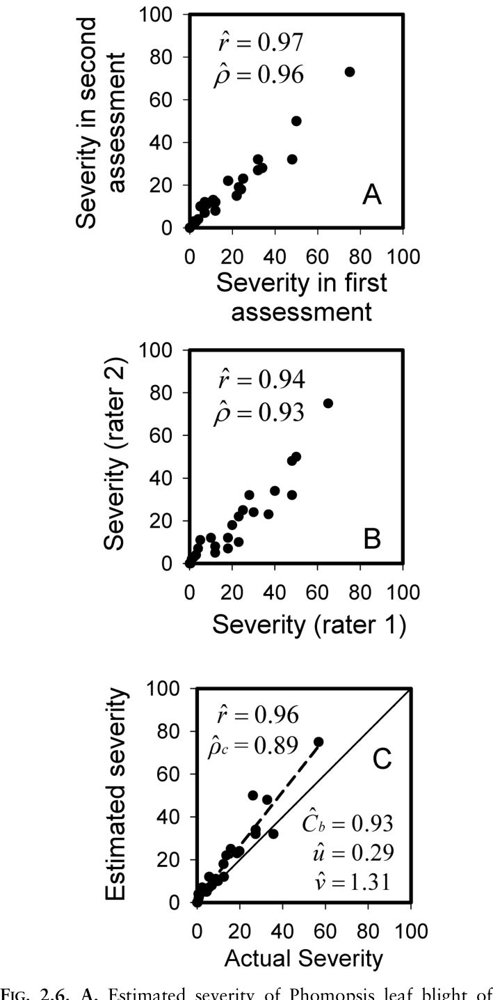

**FIG. 2.6. A,** Estimated severity of Phomopsis leaf blight of strawberry for the same rater at two different assessment times (intra-rater reliability). **B,** Estimated severity between two different raters at the same assessment time (inter-rater reliability). **C,** Estimated severity in relation to assumed actual (true) severity, as determined by the actual size of the leaflets and each lesion (Nita et al., 2003). Correlations (_r_) are shown for each case; moreover, the concordance correlation coefficient and related statistics are shown in **C** (see text for details).

These graphs show a strong relationship between the two variables (either the measurements made at two times, or by two raters). This type of graph suggests that the (Pearson product-moment) correlation coefficient, _r_, would provide a reasonable characterization of reliability. For continuous data, _r_ varies from –1 to 1, with 0 indicating no relationship between a pair of variables (Shoukri and Pause, 1999). A value _r_ = +1 means that there is a perfect straight-line relationship (with a positive slope) between the variables. Increasing variability of the data around a straight line is reflected by decreasing _r_. It is common in statistics for the term _precision_ to be used for the degree of variability (Everitt, 1999), with greater variability being equated with less precision. In this sense, then, _r_ is a measure of precision, suggesting that precision and reliability are synonymous. This is not quite true in the context of studying measurement accuracy and reliability (the current subject), although the synonym _is_ appropriate for sampling studies (when measurement accuracy is not considered). For the top two graphs in Fig. 2.6, the estimated correlation coefficient was above 0.9, indicative of high reliability (high precision, low variability).

The requirement for _r_ = 1 for continuous random variables is a perfect straight-line relationship between two variables. However, _r_ = 1 does not mean that the two variables are equal. For example, it might happen that one of the variables is always twice the value of the other. Or, one of the variables is 10 points higher than the other over the entire range of measured values. Neither of these situations occurs with the example in Fig. 2.6.

One parameter that _can_ be used to characterize both the variability and general disagreement (or agreement) between two variables is the _intra-class correlation_ coefficient (_ρ_). The intra-class correlation, also known as the intra-cluster correlation, is calculated for a wide range of analyses for continuous and discrete data (Donner, 1986; Ridout et al., 1999). For instance, _ρ_ is used in a very different manner for characterizing sampled disease incidence data in Chapter 9 (for problems that have nothing to do with measurement reliability). One way to calculate _ρ_ is through analysis of variance using a random effects linear model (Donner, 1986; Shoukri and Pause, 1999). _ρ_ is then defined as the ratio of interspecimen variability to total variability.

It is generally accepted that _ρ_ is a better indicator of agreement than _r_ (Lin, 1989; Lin and Chinchilli, 1997; Shoukri and Pause, 1999). For a pair of raters or assessment times, and a continuous variable, _ρ_ generally will be less than _r_. One additional advantage of the use of _ρ_ is that it can be determined for any number of raters (or times), not just for pairs. For the example, estimated _ρ_ values were almost as high as estimated _r_ values, showing high agreement. However, because disease severity estimated by one rater is not necessarily more correct than that estimated by another rater, one may not need to know the agreement (or disagreement) in an absolute sense. In these circumstances, knowing the strength of the relationship (association), as quantified by _r_, may be sufficient if one simply wants to know how severity measurements depend on rater or time of assessment.

### 2.5.3 Accuracy

The bottom frame of Fig. 2.6 shows Phomposis leaf blight severity estimates on 25 randomly selected leaflets, made by rater 1, and the corresponding severity values determined by a combined photographic and weight method (Nita et al., 2003; Sherwood et al., 1983). The latter are taken to be the actual (i.e., true) severity values. To understand accuracy properly, some statistical results are needed. Here, these are presented in terms of characterizing accuracy, but the theory also has direct bearing on reliability.

Consider two random variables, _W_ and _U_. For our purposes, we assume that _W_ is the actual severity and _U_ is the observed severity. Obviously, if measured and actual severity were equal, _U_ = _W_. However, even with the best possible measurement approaches, one generally cannot expect such a result. Thus, one needs a statistical protocol to characterize the degree of agreement (or disagreement) between _U_ and _W_. There are various approaches for this (Lin et al., 2002; Shoukri, 2004), and we present only a few of the possibilities.

The mean squared deviation (MSD) between _U_ and _W_ can be written as The σ _W_ 2 value is strictly a property of the population of interest (plant specimens), and is unrelated to the measurement of severity. The other variance term (σ _U_ 2) and the covariance are functions of the ability to measure the actual severity; that is, σ _U_ 2 and σ _UW_ are indicators of the extent to which the observed severity values reflect actual severity. σ _U_ 2 could be different from σ _W_ 2 if, for example, the range of measured severities is less than (or greater than) the range of the actual severities. σ _UW_ equals a positive number if observed and actual severity increase together, and equals zero if observations are unrelated to actual values. Perfect agreement occurs when: the means for the observed and actual severities are equal, the variance of the observed and actual severities is the same (σ _U_ 2 = σ _W_ 2 ), and the covariance equals the variance (σ _UW_ = σ _U_ 2 = σ _W_ 2 ). Then, MSD = 0. Obviously, one desires a small MSD for any measurement approach, but it can be difficult to interpret the MSD intuitively (other than when MSE = 0), since there is no natural upper bound. There are, fortunately, several elaborations for this measurement of agreement that are of intuitive value. We discuss in a little detail one that has become very popular in some disciplines. Lin (1989) developed a so-called _concordance correlation coefficient_ (_ρ_ c) as a measurement of agreement that is a standardized version of MSD. In particular, to obtain an index in the form of a correlation coefficient, MSD is divided by the largest possible mean square of a difference

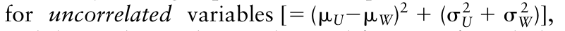{.equation width=60%}

and the resulting value is subtracted from 1. After a little algebra, one obtains:

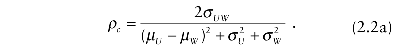{.equation width=60%}

The estimate is obtained by using means, variances, and covariances estimated from the sample of observed and actual severity values:

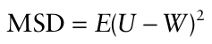

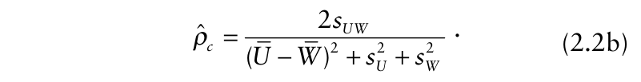{.equation width=60%}

where _E_ (_U – W_)2 is the expected value of the squared difference. This expectation can be expanded using the rules of statistics and expressed as:

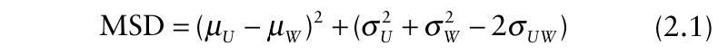{.equation width=60%}

in which _μU_ and _μW_ are expected values (means), σ _U_ 2 and σ _W_ 2 are variances, and σ _UW_ is the covariance of the two variables. Each component is directly and easily estimated from a data set comprising corresponding values of _U_ and _W_. The first term of equation 2.1 [(_μU_ − _μW_)2 ] is a measure of the squared _bias_ of the measured variable because it characterizes the difference between the mean observed severity and the actual mean. The second term characterizes the total variability of the differences.

The desirable property of equation 2.2a is that values of _ρc_ range from –1 to 1 when applied to continuous variables. _ρc_ equals 1 when there is perfect agreement, and 0 when a plot of _U_ versus _W_ is a random scatter, which one can think of as total lack of agreement (i.e., where the observed value is independent of the actual). A negative _ρc_ occurs when observed values decrease as the actual values increase, that is, when a plot of _U_ versus _W_ displays a negative trend. Less than perfect agreement could arise because of bias or variability in the observed data. It can be shown that equation 2.2a can be written as the product of two terms:

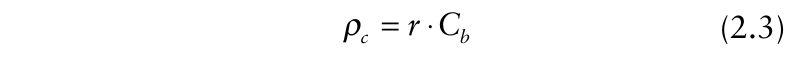{.equation width=60%}

{#fig-2-7}

in which _r_ is the usual Pearson product-moment correlation coefficient between _U_ and _W_ and _Cb_ is a coefficient equal to The _Cb_ coefficient is an indication of the difference between the best fitting line and the perfect agreement (concordance) line, which is a straight line with slope of 1 and intercept of 0:

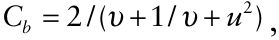

{.equation width=60%}

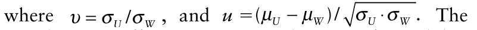{.equation width=60%}

correlation coefficient, _r_, is an indication of variability about a straight line [the best fitting line from least squares (see Chapter 3)], and thus is a scaled measure of precision, as mentioned in the previous section. The scaling guarantees that _r_ must range from –1 to 1. The best fitting line is not necessarily the line of perfect agreement, however, as seen in the right hand side of Fig. 2.7. All these graphs for the relationship between measured and true values have _r_ = 1, meaning there is an exact straight line between the two. However, only the lower right graph is representative of perfect agreement.

_Cb_ equals 1 when the best fitting line is identical to the concordance line. _Cb_ < 1 when there is a difference in the two lines. The four upper frames of Fig. 2.7 are for situations where _Cb_ < 1. There can be two kinds of disagreement between observed and actual values. The first case is when there are larger (or smaller) observed values than the actual values, on average. This is known as a “location shift”, and corresponds to _u_ being larger than 0 (i.e., when the means for the observed and actual values are not the same) (top frames of Fig. 2.7). A location shift represents the classic case of bias; the situation where the slope of the best fitting line is 1 but the intercept is not 0. The second case in which _Cb_ < 1 is when the slope of the best fitting line differs from that of the concordance line. This is known as a “scale shift” and corresponds to ν being different from 1 (i.e., when the variance for the observed values is different from the variance for the actual values). A scale shift represents the case where the slope of the best fitting line is not equal to 1; this means that the bias depends on the magnitude of the actual value. It is possible, of course, for there to be both a location and scale shift (see the middle frames of Fig. 2.7). Since _Cb_ involves more than just the difference between the means, it is probably best to consider it a _generalized_ bias parameter.

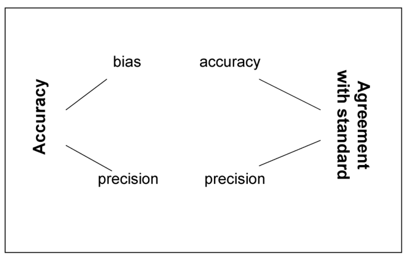{#fig-2-8}

Lin (1989) has called _Cb_ a measure of “accuracy” because it involves both the standard bias metric (difference between means of observed and expected values) and scale differences. Then, one can think of degree of agreement (as measured by _ρc_) to be the product of (scaled) precision and accuracy (Fig. 2.8). This conceptualization is very common in measurement science. However, using the general definition of accuracy as closeness of estimates to the true value(s) (Binns et al., 2000), then agreement and accuracy can be considered equivalent concepts when one of the variables is a set of data regarded as being the true values. With this conceptualization, accuracy (agreement with a standard) is a product of (scaled) precision and generalized bias (Fig. 2.8). This latter conceptualization is based on the premise that perfect accuracy can only occur if there is no variability and no bias. Depending on one’s terminology preferences, perfect accuracy or perfect agreement with a standard is characterized by MSD = 0 and _ρc_ = 1. The reader is reminded here that we use the term reliability when referring to agreement between measurements that do not necessarily involve true or standard values.

The concordance correlation coefficient has received considerable statistical attention in recent years for the study of measurement agreement (Barnhart et al., 2002; Carrasco and Jover, 2003; King and Chinchilli, 2001; Lin et al., 2002). It turns out that _ρc_ is a generalized type of intra-class correlation (Carrasco and Jover, 2003; Lin et al., 2002); however, unlike the intra-class correlation coefficient, the standard formulation for _ρc_ (eq. 2.3) allows for straight-forward and intuitive partitioning into components of bias and precision. In particular, through equation 2.3, one can determine the agreement of observed values to actual values, and for cases with _ρc_ < 1, determine whether the disagreement is due to imprecision (_r_ < 1), generalized bias (_Cb_ < 1), or both. The situation with _r_ < 1 and _Cb_ = 1 would occur when the disease measurements are equal to the true values, on average, but there is (considerable) uncertainty about the closeness of any given measurement to the true value (lower-left frame of Fig. 2.7). On the other hand, the situation with _r_ = 1 and _Cb_ < 1 would occur when there are systematic differences between measurements and true values, with either a consistent difference (_u_ > 0) or a difference that depends on the actual values (ν > 1) (see upper right frames of Fig. 2.7). The latter case is the most troubling, because the error depends on the generally unknown true value. In most situations, both _r_ and _Cb_ are expected to be less than 1.

Returning to the example in the bottom frame of Fig. 2.6, one can see that the precision was very high for this rater, with a correlation coefficient of 0.96, but the overall agreement of measured severity with actual severity was not quite as high (0.89), although still high. In addition to the slight imprecision (variation about a best fitting line), there was some generalized bias (_Cb_ < 1), with evidence of both a location shift (_u_ > 0; shift in line height) and scale shift (ν > 1; slope different from 1). It is important to note that visual disease assessment efforts are not all as precise or accurate as in this example (see Nutter and Schultz, 1995; Nutter et al., 1993). Even some other raters in the study by Nita et al. (2003) had poorer agreement with the assumed actual severities than the rater used in Fig. 2.6. Moreover, use of the H-B scale produced lower agreement than simple direct estimation of percentage severity in this study. This is further evidence against the principles underlying the H-B scale.

Standard errors can be calculated for estimates of _r_, _Cb_ and _ρc_, or for transformations of the estimated coefficients (Lin, 1989). The formulae are quite complicated and are not repeated here. They can be calculated using a specialized program in SAS described by Lin et al. (2002). Confidence intervals can also be calculated. In practice, one can test hypotheses about achieved agreement by specifying (before the study is done) the minimum acceptable values of estimated _r_, _Cb_, and _ρc_. If the lower limits of the confidence intervals for these statistics are below the pre-selected values, then one concludes that acceptable agreement (accuracy) has not been achieved.

In some situations, one can use the concordance correlation coefficient (or MSD) to evaluate inter-rater reliability. For example, it may be felt that one rater is especially proficient at visually assessing severity. This person could be considered the gold-standard rater, and measurements by other raters can be compared to this rater’s measurements. This approach can also be used to compare different approaches to measuring disease, such as spectral reflectance measurements and visual estimates (see Fig. 2.5). Shoukri (2004) and Shoukri and Pause (1999) discuss many other aspects of studying agreement. It should be noted that Barnhart et al. (2002) have recently extended the approach of Lin (1989) by showing how to simultaneously determine agreement of more than two raters at a time, using a generalized type of concordance correlation coefficient.

The concordance coefficient of correlation has not yet been used much in plant pathology. It is much more common to use regression analysis of _U_ on _W_ (see Chapter 3). In particular, one could write: where β1 is the slope and β0 is the intercept (value of _U_ when _W_ = 0). As mentioned above, a perfect agreement is represented by a best fitting line with slope of 1 and an intercept of 0. Regression analysis is a very useful method to describe and characterize relationships, and we use variations of regression methods throughout the book. However, regression analysis is _not_ a good approach for testing for agreement (Lin, 1989; Shoukri and Pause, 1999). In particular, testing for the equivalence of the slope and intercepts to certain constants can lead to misleading results in agreement studies. When there is high variability (low precision), one can too easily accept that the slope and intercept are equal to the hypothetical values, leading to the false impression of agreement. Conversely, with very low variability (high precision), it is too easy to conclude that the slope and intercept are not equal to the hypothetical values, even when the best fitting line is very close to the concordance line. This would lead to the false impression of poor agreement. Thus, it is much better to use the concordance correlation coefficient [or MSD or related statistic (Lin et al., 2002)], and not regression analysis, to test for agreement.

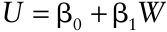

As an aside, we point out that concordance correlation methodology can be used for several other purposes. For instance, the problems of using regression analysis for testing agreement also arise in model validation. That is, the degree of precision of model predictions (say, for crop loss equations) can unduly influence the testing of bias (Madden and Nutter, 1995). Thus, the agreement between model predictions and observations can often be better evaluated using concordance correlation methodology than regression analysis.

### 2.5.4 Ordinal and binary data

The above discussion was primarily focused on disease severity as a continuous variable (i.e., an interval- or ratiolevel of measurement). For ordered categorical data (see Fig. 2.2), such as that obtained with an ordinal disease rating scale (see section 2.4.2.3), one can determine the degree of agreement of measurements using Cohen’s (1968) so-called _weighted kappa_ statistic. The statistic and its standard error are calculated by some standard statistical programs such as the FREQ procedure of SAS. It turns out that Cohen’s weighted kappa is directly analogous to Lin’s concordance correlation coefficient for continuous data (Shoukri and Pause, 1999). We do not give further details here. We do think, however, that such evaluations of ordinal disease assessments are warranted.

For binary data, such as disease incidence, measurements (visual or otherwise) of disease can take one of only two values (e.g., diseased or disease free). True incidence can take only one of these two values, as well. It is common in epidemiology to assume (perhaps implicitly) that estimates of incidence are more precise and less biased than estimates of severity (McRoberts et al., 2003). Thus, it is not common to consider the accuracy or reliability of measured disease incidence data. However, with increasing use of biochemical and molecular tests for disease (Fox, 1998), the question arises whether there is agreement between visual and other measurements of disease incidence. For instance, Nutter (2002a) showed that the percentage of plants visibly diseased by a virus was less than the percentage testing positive by ELISA. As will become apparent in Chapter 5, some disagreement may be temporary, because the biochemical test may detect infection before symptoms are visible (i.e, infections are in the “latent” state). Of greater interest are the disagreements that are not temporary, due, perhaps, to the inability of the rater to see the symptoms, or to the similar appearance of symptoms caused by more than one pathogen.

With binary data, there are many measures of agreement or association (Agresti, 1990; Gibbons, 1976; Schabenberger and Pierce, 2002; Shoukri and Pause, 1999). Most can easily be calculated using commercial software programs. In medicine, Cohen’s kappa (for binary data) (Cohen, 1960) is the most popular index for determining agreement. It takes on a value of 0 for no agreement and 1 for perfect agreement. Kappa is a standardized version of the observed proportion of values in agreement minus the expected proportion in agreement by chance alone. A standard error of the estimated kappa can be calculated.

The calculation of Cohen’s kappa is demonstrated in Fig. 2.9 for data taken from example 3.9 in Shoukri and Pause (1999). The data are from a medical study, but they are useful for demonstrating degree of agreement of two raters for any binary variable. One could consider one of the raters as providing gold-standard measurements. Estimated incidence of disease was close for the two raters (40 versus 37%), indicating little bias. A test for bias in this case can be done with McNemarχ2 -test (Shoukri and Pause, 1999); the test was not significant, indicating that one cannot reject the hypothesis of equal disease incidences by the two raters. Overall agreement consists of the number of values where both raters indicated diseased and both raters indicated disease free, divided by the total number of observations. For these data, agreement was 83.8%. However, there would be 52.6% agreement in this 2 × 2 table simply by random chance. Combining these two agreement values, one obtains 0.658 for Cohen’s kappa (see details in Fig. 2.9). A 95% confidence interval for kappa, obtained with the FREQ procedure in SAS, was 0.51–0.81. Whether or not this is acceptable degree of agreement would depend on the objectives of the investigator. For instance, Landis and Koch (1977) would classify this data set as exhibiting “substantial” agreement because kappa was between 0.6 and 0.8.

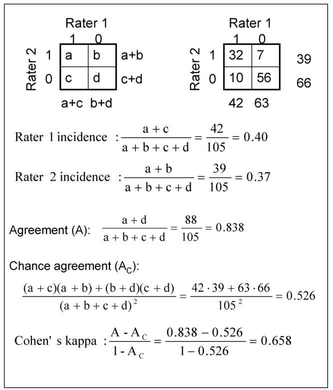{#fig-2-9}

### 2.5.5 Improving disease measurements

As mentioned above, a valuable reason for evaluation of agreement—reliability and accuracy—is to improve disease intensity, especially severity, measurements. One can determine whether particular methods or raters are better than others, and the types of disagreements that occur. For instance, there is some general evidence of (slight) overestimation of severity based on visual symptoms, and number of lesions can affect the estimate (at a given severity value) (Nita et al., 2003; Sherwood et al., 1983; Nutter, 2002a). If assessments are unsatisfactory in some sense for raters, it may be possible to improve assessments through training (Nutter and Schultz, 1995). Computer programs have been written that generate plant-specimen drawings (e.g., leaves) with varying number of lesions, of different sizes and possibly shapes, and occupying different positions on the specimen (Nutter, 2002a). The programs can provide either immediate or delayed feedback on actual severity percentages, in order to educate the user on what different percentage areas actually look like. These programs can be very useful for training raters. The generated images were originally in black and white, just like the traditional standard area diagrams (Figs. 2.3 and 2.4). Newer programs use color images to mimic more closely actual plant specimens.

Training can be of value in improving assessments of disease. One way to document any change in bias, precision, or both is through the concordance coefficient (_ρc_). In particular, a pre- and post-training determination of accuracy could be performed, and the results compared. Some statistical methods have been developed for formally comparing the reliability or accuracy of measurement devices (of which raters are a particular example) (Shoukri, 2004).

## 2.6 Attributes and Properties of the Crop

Since this is a book about disease in populations, we have spent the majority of the chapter on disease measurements. However, since this is a book specifically about plant disease, we should not ignore the plant part of the system. Of course, some aspects of the crop are considered _implicitly_ in any disease assessment procedure when one is visually observing symptoms on plants or electronically recording reflected electromagnetic radiation from plant surfaces. Depending on the objectives of the study, a large number of plant or crop properties could be explicitly measured or determined (see Chapter 3 in Campbell and Madden, 1990). In other situations, minimal crop information may be required. In this section, we briefly mention a few crop properties that can be important.

### 2.6.1 Some useful static and dynamic properties

Many of the crop attributes of value are obvious, such as plant species, cultivar or variety, growing location, time of planting and harvesting, and planting pattern (e.g., in rows, or broadcast). Planting density (seeds per unit area, plants per unit length of row, distance between rows) and area of planting (field or plot size) are important because they influence disease dynamics and crop yield.

The crop characteristics mentioned in the previous paragraph are mostly static in nature. There are also some important dynamic variables, that is, those that change over the growing season or other time period of interest. One is the _growth_ or _phenological stage_ of the crop at different times. Growth stages are key times in the life cycle of plants that have meaning in relation to crop physiology and/or yield (Campbell and Madden, 1990). Examples are given in Tables 2.1 and 2.2 for wheat and peanuts, respectively. Often, drawings, pictures, or diagrams are used to represent specific growth stages. An example is shown in Fig. 2.10, which is known as the Feekes scale for growth stages (James, 1971). Events such as emergence of the top (flag) leaf and beginning of flowering, for example, are clearly identified. The numbering system, which is really an ordinal level of measurement (ordered categorical variable), consists of a mixture of integers, fractions, and “double fractions” (e.g., “10.5.4”). An alternative ordinal scale for growth stages, consisting of just integers (called a “decimal code”) (Zadoks et al., 1974) is widely- used because it allows easy data entry into databases and spreadsheets (see Table 2.1).

**Table 2.1.** Some stages of wheat development based on the Feekes and Zadoks scales (Zadoks et al., 1974).

|**_Feekes_** **_scale_**|**_Zadoks_** **_scale_**|**_Description_**|**_Feekes_** **_scale_**|**_Zadoks_** **_scale_**|**_Description_**|
|---|---|---|---|---|---|
|||**Germination** |||**Inflorescence emergence** |
||00|Dry Seed |10.1|50|First spikelet of inflorescence visible |
||01|Start of imbibition |10.2|53|¼ of inflorescence emerged |
||07|Coleoptile emerged from seed|10.3|55|½ of inflorescence emerged |
||||10.4|57|¾ of inflorescence emerged|
|||**Seedling and main stem** |10.5|59|Emergence of inflorescence |
|||**growth**|||complete|
|1|10|First leaf through coleoptile||||
||11|First leaf unfolded|||**Anthesis**|
||19|Nine or more leaves unfolded|10.5.1|60|Beginning of anthesis|
|||||65|Anthesis half complete|
|||**Tillering**||69|Anthesis complete|
|2|21|Main stem and 1 tiller||||
||25|Main stem and 5 tillers|||**Milk Development**|
|3|26|Main stem and 6 tillers|10.5.4|71|Kernel watery ripe|
||27|Main stem and 7 tillers||73|Early milk|
||||11.1|75|Medium milk|
|||**Stem elongation**||77|Late milk|
|4–5|30|Pseudostem erection||||
|6|31|1st node detectable|||**Dough Development**|
|7|32|2nd node detectable||83|Early dough|
||33|3rd node detectable|11.2|85|Soft dough|
|8|37|Flag leaf just visible||87|Hard dough|
|9|39|Flag leaf ligule/collar just||||
|||visible|||**Ripening**|
||||11.3|91|Kernel hard (difficult to divide|
|||**Booting**|||by thumbnail)|
|10|45|Boots just swollen|11.4|92|Kernel hard (can no longer be dented by thumbnail)|

**Table 2.2.** Growth stages of peanut (Boote, 1982).

|**_Stage_**|**_Abbreviated title of stage_**|**_Description_**|
|---|---|---|
|VE|**Vegetative Stages** Emergence|Cotyledons near soil surface, with the seedling showing; some part of the plant visible|
|VO||Cotyledons flat and open at or below the soil surface|
|V−1 to V−(_N_)|First tetrafoliolate to _N_th tetrafoliolate|One to_N_ developed nodes on the main axis (a node is counted when its tetrafoliolate is unfolded and its leaflets are flat)|
||**Reproductive Stages**||
|R1|Beginning bloom|One open flower at any node on the plant|
|R2|Beginning peg|One elongated peg (gynophore)|
|R3|Beginning pod|One peg in the soil with turned, swollen ovary at least twice the width of the peg|
|R4|Full pod|One fully expanded pod, to dimensions characteristic of the cultivar|
|R5|Beginning seed|One fully expanded pod in which seed cotyledon growth is visible when the fruit is cut in cross section with a razor blade (past the liquid endosperm phase)|
|R6|Full seed|One pod with cavity apparently filled by the seeds when fresh|
|R7|Beginning maturity|One pod showing visible natural coloration or blotching of the inner pericarp or testa|
|R8|Harvest maturity|Two-thirds to three-fourths of all developed pods showing coloration of the pericarp or testa (the fraction is cultivar-dependent, being lower for Virginia types)|
|R9|Over-matured pod|One undamaged pod showing orange-tan coloration of the testa or natural peg deterioration|

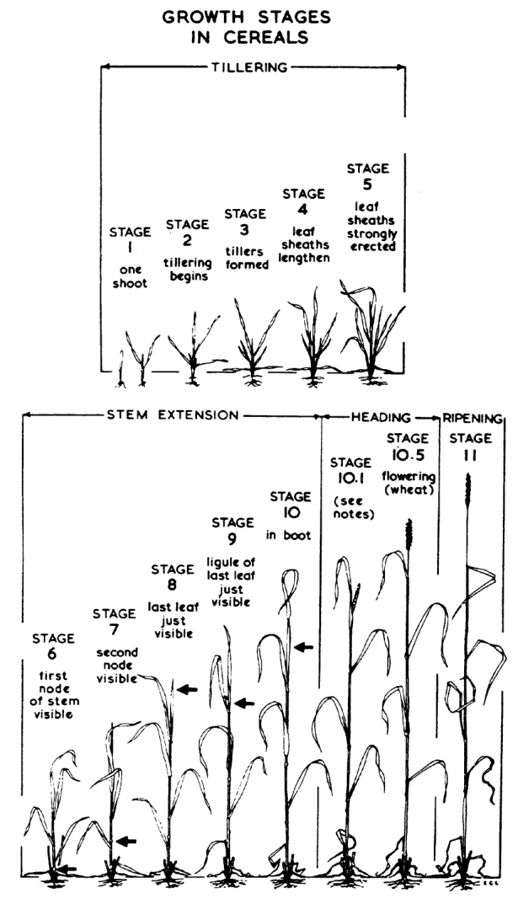{#fig-2-10}

For crops with clearly identifiable growth stages, it is desirable to record the stage at which each assessment of disease intensity is made. This makes it easier to compare results from different regions, or under different environments, or simply from different experiments. Moreover, since the yield of some crops is correlated with disease intensity (or other stresses) at certain stages (see Chapter 12), it is of practical advantage to provide growth stage observations with the measurements of disease.

### 2.6.2 Leaf area index

For studies on crop physiology, crop growth, and yield production, it is common to determine the total leaf area at various times because this is related to yield (Goudriaan and van Laar, 1994; Monteith, 1977; Watson, 1947). Rather than determining leaf area per plant, it is most useful to determine total leaf area per unit area of ground, called _leaf area index_ (LAI). Since LAI is a ratio of two values, both with units of area (e.g., m2 ), LAI is a dimensionless value. The value of LAI changes greatly during a growing season (often from <1 to >5), but characteristic values, and changes in LAI values over time, are known for various crops. The importance of LAI will become more apparent in Chapter 12 in terms of crop losses in relation to disease intensity. For crops in which other plant organs in addition to leaves (e.g., stems, pods) contribute significantly to photosynthesis, the terms green area index (GAI) or photosynthetic area index (PAI) are often used.

Direct determination of LAI generally requires the measurement of leaf area for a sample of leaves in a field or plot. This is most readily done now using an electronic and portable image analysis device, such as that sold by LI-COR (1990). There are also several indirect techniques of great value. Remote sensing methods, in general, can be used to estimate LAI based on the relationship between radiation penetration and canopy structure (Goel and Norman, 1990). For instance, the proportion of the sky visible through the canopy at various angles can be used to estimate LAI.

Another valuable indirect method is to use easy-toobtain measurements of the crop to estimate LAI. For example, the mean width or length of leaves (perhaps at a particular height or position on the plant), or the mean height of plants can be used. This requires a calibration study, where a direct measurement of leaf area is obtained, in addition to an indirect measure, and a regression equation is developed (see Chapter 3). The objective is to be able to predict LAI from relatively easy-to-obtain measurements of the crop. Visual estimation with the aid of diagrams or keys can be used, as well (Campbell and Madden, 1990). This would be advantageous when no simple indirect method has been devised, or it is impractical to measure individual leaves, or electronic equipment is not available. Previously discussed methods for evaluating the reliability and/or accuracy of measurements apply to leaf area data, as well.

Determining root area or volume is of importance for many diseases, especially those caused by soil-borne pathogens. Root “size” is especially difficult to measure, and generally requires destructive sampling. English and Mitchell (1994) and Chapter 3 in Campbell and Madden (1990) should be consulted for details.

## 2.7 Conclusions and Prelude to Following Chapters

Plant pathologists typically measure the incidence, lesion counts, or severity of disease. Depending on the objectives of the study, all of these variables can be of value, as will be made apparent in the following chapters. The measurement of disease severity has attracted the most attention in epidemiology, probably because it is perceived that accurate and reliable measurements can be difficult to obtain. Often, aids such as disease diagrams and disease scales (such as the HorsfallBarratt scale) are used. Although one can usually consider severity as a continuous variable, corresponding to an interval- or ratio-level of measurement (see Fig. 2.2), many researchers use an ordinal-scale measurement of severity. This may be for convenience, or because of difficulty in visually estimating severity on a continuous scale.

In principle, continuous variables provide more information than ordinal variables of the property of interest. However, if the measurement of the continuous variable is not reliable or accurate, then the perceived information content is illusory. More studies are needed to determine the reliability and accuracy of measured disease intensity for a range of disease types. These may show, among other things, whether a particular scale or diagram is of value, and what type of scale (if any) to use. Although scales in which the classes correspond to unequal ranges of percentages are commonly used, the limited evidence available does not support the nonlinear aspects of this type of scale. With the advances in remote sensing and image analysis, alternatives to visual estimation of severity are becoming more common. These approaches have much to offer epidemiology, although it is unlikely that visual estimation of disease intensity will disappear anytime in the near future.

In terms of any measurement, one can consider (at least conceptually) the actual value of the property (_W_) and the value obtained as the measurement (_U_). In all the later chapters, we use _Y_ (or _y_) for disease intensity (whether incidence or severity) and do not, in general, distinguish between actual and measured values. This is partly because we often do not have enough information to distinguish between these. Readers should keep in mind, however, that the interpretation of results from studies of epidemics can be affected by the accuracy and reliability of the observed disease intensity data collected over time and space.

The analysis discussed in this chapter was strictly within the context of measurement of plant-unit (e.g., leaves, roots) specimens. In other words, for practical purposes there was no direct interest in using the estimated mean or variance to make statements about properties of a larger population, other than in terms of measurement reliability and accuracy. In later chapters, most of the focus is on disease intensity collected by one (or one type of) measurement device, and used explicitly for the purpose of making statements about the mean, variance, or other attributes of a larger population.

Some statistical methods were used in this chapter to deal with accuracy, precision, reliability, and agreement, in general. Many more statistical methods are used in the following chapters. Although it is not possible to teach statistics in this book on plant disease epidemics, knowing something about modeling is of value to readers who wish to understand statistical and mathematical analyses. Thus, an introduction to modeling and data analysis is presented in the next chapter.

## 2.8 Suggested Readings

- Cooke, B. M. 2006. Disease assessment and yield loss. In: _The Epidemiology of Plant Diseases_, 2nd Ed. (B. M. Cooke, D. G. Jones, and B. Kayle, editor). Springer, The Netherlands, pp. 43–80.

- Gaunt, R. E. 1987. Measurement of disease and pathogens. In: _Crop Loss Assessment and Pest Management_ (P. S. Teng, editor). APS Press, St. Paul, MN., pp. 6–18.

- Nutter, F. W., Jr. 2002. Disease assessment. In: _Encyclopedia of Plant Pathology_ (O. C. Maloy, O. C. and T. D. Murray, editors) Wiley, New York, pp. 312–323.
