# Introduction to Modeling in Epidemiology {#sec-ch3}

_Do not worry about your difficulties in mathematics, I assure you that mine are greater._ Albert Einstein

## 3.1 Introduction

Plant disease epidemics involve changes in disease intensity over time and space in a host population. If the entire host population of interest is very small, it may be possible to actually measure or observe every individual (e.g., plant) for disease intensity (and other variables of interest). However, even having such a complete collection of data for disease intensity does not automatically lead to any insight into epidemic processes or help in communicating results to others. In general, one uses models (as defined below) to summarize the essential features of the observations or measurements of interest. With models, the many individual observations are reduced to a few model terms, making it much easier to visualize and ultimately to understand the phenomena being studied, as well as to communicate that understanding to others.

In fact, the populations that epidemiologists are interested in are seldom very small. For instance, even when epidemics are studied in small experimental plots, where every plant (or leaf, fruit, etc.) is actually observed, the host population of interest is generally much larger, such as all plants of the same crop cultivar in commercial fields, grown under conditions similar to those studied in the small experimental plots. In other words, researchers usually want to apply results obtained with small data sets to larger populations that are not observed. Thus, models are needed here to allow inferences to be made about these large populations based on more limited direct information.

Epidemiology is a science that deals with relationships at the population scale. The fundamental relationship is between disease intensity (_y_ or _Y_) and time (_t_), which in graphic form is known as the disease progress curve (see Fig. 1.1). Other relationships include disease intensity versus distance from an inoculum source (the disease gradient), and yield loss versus mean disease intensity for a field. Through various types of models, one can capture the essential features of these relationships in fairly simple and efficient form, facilitating understanding and comparison of epidemics.

There are many types of models, and even ways of labeling models. In this chapter, we first give a general overview of modeling, and then introduce some of the most commonly used models in plant disease epidemiology. This leads directly to the topic of fitting models to data. We briefly review some of the essential features of model fitting, emphasizing so-called least squares regression methods. This chapter is intended primarily for readers who do not have a great deal of experience in mathematical and statistical modeling of biological systems. Even those who have substantial experience with analysis of variance and linear regression analysis should benefit from reading about nonlinear models, since this material is usually not taught in introductory courses. By studying this chapter, readers will become better versed in the language of modeling and model fitting, and hopefully appreciate the quantification of epidemics presented in subsequent chapters. After studying the material presented here, readers should be able to fit certain types of models to data and interpret results obtained in model fitting.

## 3.2 Models

### 3.2.1 Definition and general classification

There are many ways of defining and classifying models, depending on one’s perspective and the type of research one is conducting. A useful definition of a _model is a simplification of reality_ (Edminster, 1978). Another valuable, if longer, definition is an abstraction of a real phenomenon or process that emphasizes those aspects relevant to the objectives of the user (Schabenberger and Pierce, 2002). The premise here is that any real phenomenon or process is very complicated and we may never have a complete understanding or description of reality. Even if a complete understanding was actually achieved, we would have no way of recognizing that we have reached this full understanding. The “reality” here could be anything from the multiplication and movement of viruses in plants to the spatio-temporal population dynamics of multiple diseases in large commercial fields.

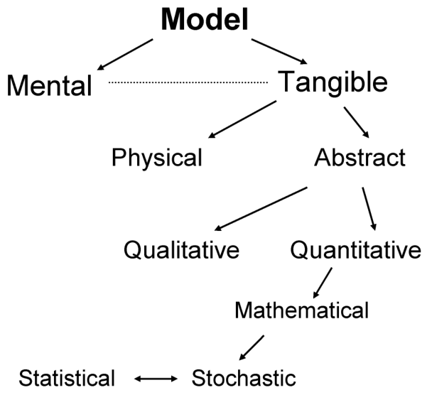{#fig-3-1}

Even if we could have a complete description of a phenomenon or process, the description would be so complicated that simplifications would be needed to meet the objectives of the investigator in relation to understanding and/or managing plant disease epidemics.

Based on the concept that models are simplifications of reality, Box (1979), a famous statistician and heavy user of models, made the often-repeated and fanciful declaration that: _“_ All models are wrong, but some are useful _”_. That is, with the supposition that reality is so complicated that no model can capture all aspects of the reality of interest, there will always be some inaccuracy or incompleteness of any model. However, this does not mean that a model is necessarily wrong within the constraints of its intended use. Models are developed for many uses or objectives. The most common ones are _description, understanding, prediction, comparison, and communication_. A given model may be used for one or several of these objectives, although it is unlikely that a single model would be used for all of them.

It is important to note that the definitions above for model do not involve equations, symbols, functions or formulae. As anyone who has read some of the primary literature in epidemiology knows, models for epidemics generally _do_ involve equations. However, these are special kinds of models. To gain a better appreciation of models and modeling, it is helpful to consider a classification system mostly based on Edminster (1978), which is summarized in Fig. 3.1. Models can be first classified into _mental_ and _tangible_ ones. A mental model is a conceptual image of a phenomenon or process (Campbell and Madden, 1990). We all use mental models to reduce the complexity of everyday reality to some manageable form. Of course, a mental model of any particular phenomenon or process depends on a person’s previous experience and education. For instance, a practicing epidemiologist has a different (and, it is to be hoped, more detailed) conceptual image of an epidemic than does an agronomist or a schoolteacher.

A _tangible model_ is a mental model that has been given some explicit form. By themselves, mental models are not very useful for communicating with others, so it is helpful to be able to express conceptual images in some tangible way. Examples could be word descriptions, flow charts, or equations. Tangible models can be of two types, _physical_ and _abstract_ (Fig. 3.1). A physical model represents some aspects of the form or function of reality in a suitably simplified form, generally using another physical medium. A classic example would be a plastic scale-model of an automobile. A well-known example from biology is the physical model on which the original proposal of a double-helix structure for the DNA molecule was based.

In contrast to a physical model, an abstract model is a tangible model based on the use of symbols and rules to represent aspects of the form and function of the particular reality of interest. Equations, flow charts and schematic drawings (say, of the structure of a chemical compound) may be used to capture aspects of the phenomenon or process in question. Abstract models can be considered either as either _qualitative_ or _quantitative_. A qualitative model, as used, here, represents some essential aspects of reality in an abstract way that is of concern to the user, without the use of equations, mathematics or statistics. A disease cycle [“infection chain”, see Gäumann (1946)] is a classic example of a qualitative model; it shows key components of the chain of events during and between epidemics without giving quantitative information on disease development. The disease triangle is another good example of a qualitative model (Francl, 2001).

A quantitative model uses mathematical notation, symbols, and rules, to represent some aspects of reality of interest to the user (Fig. 3.1). For our purposes, a quantitative model is a mathematical model, which is often simply called a _function_. The variable or variables in the model, however, can be either discrete or continuous (see Chapter 2). For instance, even if one is recording disease as a binary variable (a plant either is or is not diseased), one can still summarize the data in a such way as to be able to obtain an estimate of the probability of a plant being diseased, which is a continuous variable ranging from 0 to 1. In this book, we use quantitative or mathematical model in a very general way, and most of the models presented in this and other chapters can be considered mathematical models.

We realize there are more ways to classify models, and we present some of these below, but the system in Fig. 3.1 should serve to give a framework for the general concept of modeling. In the next section, some special kinds of mathematical models are explained.

### 3.2.2 Quantitative (mathematical) models—some general concepts

It may be easiest to discuss models by using a simple hypothetical example. This is done by linking an equation (a mathematical model) to its common depiction, the graph. Consider the upper frame of Fig. 3.2, which shows an example relationship between two variables, _Y_ and _X_. We call _Y_ the response or _dependent variable_ and _X_ the independent or _predictor variable_. Note that we continue to use _Y_ or _y_ for disease intensity for the most part in this book (with exceptions for a few special cases); upper case _Y_ for intensity in absolute units (such as number of diseased leaves) and lower case _y_ for proportions (such as the number of diseased leaves expressed as a proportion of the total number of leaves observed) (see Chapter 2). The dependent variable we are discussing in this chapter could be something other than disease intensity, but it is convenient to think of disease intensity as the response variable (for now). The original concept for the model terminology is the situation where _Y_ is actually dependent on _X_, or that _Y_ responds to _X_ in a systematic way, or that _Y_ is predicted from _X_. However, the relationship is not necessarily a cause-and-effect type, even though the names of the terms typically are still used. An example of a pair of response and predictor variables would be when _Y_ represents spores per lesion and _X_ represents lesion area. A quantitative model for this relationship is given by:

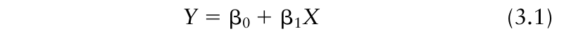{.equation width=60%}

in which β0 and β1 are constants. In other words, the upper frame of Fig. 3.2 is the depiction of the function written as equation 3.1, when β1 is greater than 0. When _X_ = 0, _Y_ = β0 + β10 = β0; thus, β0 is the value of _Y_ when _X_ = 0. The β1 constant is the change in _Y_ with unit change in _X_ (if _X_ increases from, say, 6 to 7, _Y_ increases by β1). Using terminology from statistics, when the constants are not known _a priori_, but are (ultimately) estimated from data, they are known as _parameters_. The term parameter may be used differently outside of statistics, but we use the statistical definition.

Equation 3.1 is not the only way to express the relationship in Fig. 3.2. For instance, taking the first derivative of _Y_ with respect to _X_ (_dY/dX_) for this model results in:

{.equation width=60%}

In other words, the first derivative is a constant, equal to the β1 constant of equation 3.1. Note that here and below, we do not teach how one calculates derivatives.

If _Y_ does not truly depend on _X_, but is just associated with it, one could just as easily write the equation as _X_ in relation to _Y_. Rearrangement of equation 3.1 produces: two constants (β values). If _X_ equals 10, for instance, _Y_ must equal β0 + β1(10). Put another way, there is no part of the model that allows for any value of _Y_ other than β0 + β1 _X._ Since models are simplifications of reality, one cannot expect the value of a response variable ever to be _completely_ specified by a function such as equation 3.1, or indeed any other deterministic function of a predictor variable. The model can, however, be easily expanded in an efficient manner to encompass deviations in _Y_ from that specified by β0 + β1 _X_. Consider the lower frame of Fig. 3.2. The line is the same as in the upper frame; now, however, there are points shown at four different values of _X_. In fact, there are 40 data points at each of these four chosen _X_ levels, and the average (central value) of these values falls on the line. To represent each point on this graph, a random variable (ε) is added β0 + β1 _X_ to obtain the actual _Y_. The specific values of ε vary from observation to observation, and are not known _a priori_. The new model is written as:

{#fig-3-2}

Equation 3.1 is known as a _deterministic model_. That is, in the model _Y_ is completely determined from _X_ and the

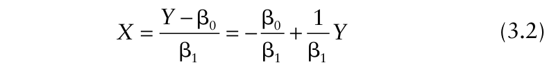{.equation width=60%}

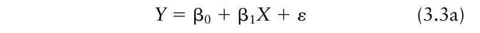{.equation width=60%}

One can think of ε as representing the combined influences of all factors or variables that affect _Y_, other than that represented by the deterministic part of the model (β0 + β1 _X_). In other words, it is a term for the unexplained variation in _Y_. In typical formulations of models of this type (see section 3.3 below), it is standard to assume that the random variable ε has an expected value (mean) of 0 and a constant variance given by _σ_2 . Means of populations are known as expected values, and we can use the notation _E_ (•) for the expectation. Thus, we write _E_ (ε) = 0. It is further generally assumed that the ε values are independent (i.e., they do not affect each other). Finally, it is often assumed that the εs have a normal distribution. (See the next section for an introduction to the normal distribution function.) There are ways, fortunately, of dealing with violations of the assumptions of constant variance, independence, and normality, and some of these issues are addressed in this or later chapters, where relevant. The assumption of normality is not necessarily that important (Neter et al., 1983) and it is generally satisfactory to assume that ε has any continuous distribution for many models.

Recall that a random variable is an observation or measurement of a variable phenomenon (Chapter 2). Because _Y_ is a function of a random variable (ε) in equation 3.3a, it also is a random variable. As indicated above, the β values are constants. _X_ is a variable that could be either a collection of fixed values (e.g., of time, or distance), or an actual random variable. We take the usual approach (Schabenberger and Pierce, 2002) and assume the former (this simplifies the statistics considerably). Equation 3.3a is referred to as a _stochastic model_ because it involves random variation, as represented by the ε term (in addition to the deterministic part represented by β0 + β1 _X_). A stochastic model is a special form of a mathematical model (see Fig. 3.1). The deterministic component of a model could be very complicated, a simple function of _X_ (as exemplified in equation 3.3a), a single parameter (β0; i.e., β1 = 0 in equation 3.3a), or even be 0 (i.e., β0 = β1 = 0 in equation 3.3a). Viewed from a slightly different perspective, ε is the difference between an observed value of the response value and the value specified by the deterministic component of the stochastic model (e.g., equation 3.3a), namely ε = _Y_ − (β0 + β1 _X_). Often, ε is called the _error term_ in the model. Use of “error” here does not imply a mistake, but is simply an indication of the discrepancy between the calculation from the deterministic part of the model and the observation. One could also refer to equation 3.3a as a _statistical model_. Schabenberger and Pierce (2002) prefer to label a stochastic model as statistical only if one or more of the constants or parameters are unknown and are actually estimated from observed data. In this section, since we have not addressed the issue of parameter estimation at all, we tend to refer to models such as equation 3.3a as stochastic.

Using statistical theory, we can define the expected (mean) value of the random variable _Y_ by determining the expected values of all terms on the right-hand side of the equation. This can be written as:

{.equation width=60%}

Expectations of constants are just the constants themselves. For the case when _X_ is a collection of fixed values (e.g., time during the growing season), _E_ (β0 + β1 _X_) = _E_ (β0) + _E_ (β1 _X_) = β0 + β1 _X._ Thus, one can write equation 3.3a as:

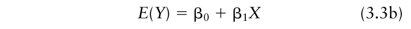{.equation width=60%}

(since _E_ (ε) = 0). Equations 3.3a and 3.3b are equivalent ways of expressing the same relationship. Using this formulation, one can see that the error (ε, as defined above) is just _Y_ − _E_ (_Y_), the difference between the observed value and its expectation at the given _X_. From a slightly different perspective, one can think of a stochastic (or statistical) model as being correct on average (as long as the deterministic component has been correctly specified).

For teaching purposes, sometimes it is useful to write equation 3.3a as a pseudo-equation. Then, the lower frame of Fig. 3.2 can be expressed as:

Response = (systematic or deterministic part) + (random part) or Response = (structure) + (error)

The structural (i.e., deterministic) part of the equation 3.3a is very simple (representing a straight line), but much more complicated deterministic functions are common in epidemiology. As indicated by equation 3.3b, the structural part is describing the mean (expected) response at each level of _X_, and the random part of the model is describing the deviation of the actual _Y_ from the mean _Y_ (for the specific level of _X_).

Consider the depiction of equation 3.1 for the situation with β0 = 5 and β1 = 4. When _X_ = 9, the straight-line equation gives 5 + 4 × 9 = 41 for _Y_. Obviously, most points on the graph at _X_ = 9 do not equal 41. For instance, the largest value of _Y_ at _X_ = 9 is 47. Here, ε equals 47 − 41 = 6. In other words, one can write 47 = 5 + 4 × 9 + 6 for this specific value of _Y_. Since each value of _Y_ can be different (potentially) even when _X_ is the same, ε is different (potentially) for every observation. To keep track of the individual values, it is sometimes useful to add a subscript (_j_) to the terms of equation 3.3a that can change from observation to observation, giving:

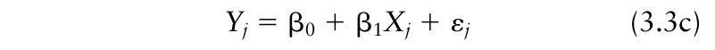{.equation width=60%}

With _N_ observations in total, _j_ ranges from 1 to _N_ (i.e.,

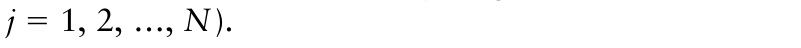{.equation width=60%}

### 3.2.3 Probability distributions

There is a probability distribution associated with every random variable, although it may not be known. For discrete data (e.g., number of spores on a lesion), the probability distribution is a function (equation) that specifies the probability of obtaining each possible value of the variable (e.g., probability of 0, 1, 2, and so on, spores). For discrete data, the probability distribution may be called the _probability mass function_. Properties of some discrete probability distributions useful in epidemiology are used extensively in Chapters 9 and 10, and little further is said about them here.

Because, by definition, the number of values taken on by a continuous variable is not countable (see Chapter 2), the meaning of a probability distribution for a continuous variable is a little more complicated. In this situation the distribution is a function that is used to specify the probability of a continuous variable falling within a particular _range_ of values (Everitt, 1999). For continuous data, the probability distribution may be called the _probability density function_. In the realm of data analysis, it is common to assume that the variable of interest has a normal distribution, or at least that that the normal distribution provides a reasonable approximation to the unknown true distribution. The probability density function of the normal distribution can be written as:

{.equation width=60%}

in which _μ_ and _σ_ are constants (parameters), and exp[•] means that _e_ (the base of the natural log system; _e_ = 2.718…) is raised to a power. In particular, _μ_ represents the expectation (mean) of _Y_ [ _μ_ = _E_ (_Y_)], and _σ_2 is the variance of _Y_ (i.e., _σ_ is the standard deviation). To represent the parameters explicitly, the left-hand side of equation 3.4 could be written as _f_ (_Yj_; _μ_, _σ_2 ), where _f_ (•) indicates a function (equation).

Equation 3.4 is actually a stochastic model for the distribution of random variable _Y_. In fact, any statistical probability distribution can be considered a type of stochastic model because it describes aspects of variability through the calculated probabilities. In addition to their importance in fitting models to data, such distributions are of use in simulating biological and other processes (Renshaw, 1991).

### 3.2.4 Is the model linear?

An extremely important property of a model is its linearity (or lack thereof, in which case we are interested in its nonlinearity). The concept can be difficult to appreciate at first, especially for those who are not especially well versed in mathematics or statistics. We can apply the concept both to purely deterministic models (such as equation 3.1) and to stochastic models (such as equation 3.3a). For ease of presentation, we deal only with deterministic models here.

One can ask whether a model is “linear in the parameters” and/or “linear in the variables”? A model is linear in the variables if it does not contain powers, other transformations, or products of two or more variables on the right-hand side of the model equation. Equation 3.1 is linear in this regard. However, a model _Y_ = β0 + β1 _X_3 is not linear in the variables with regard to _X_. Of course, one can define a new variable as the cube of the original (i.e., let _X__*_ = _X_3 ); then the model _Y_ = β0 + β1 _X_* is linear in terms of _X_* . The following model, with two variables on the right-hand side (e.g., _X_ 1 for temperature and _X_ 2 for relative humidity), is linear in the variables:

{.equation width=60%}

However, the following two expressions are examples of models nonlinear in the variables (in terms of the original two variables _X_ 1 and _X_ 2):

{.equation width=60%}

For a one-variable model, the derivative of _Y_ with respect to _X_ does not involve _X_ when the model is linear in the variables. For example, as stated above, _dY/dX_ is a constant for equation 3.1, not a function of _X_

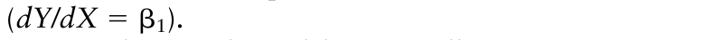{.equation width=60%}

In working with models, especially in parameter estimation (see section 3.4), it is of relatively little concern whether or not a model is linear in the variables. Of much greater importance is whether or not a model is _linear in the parameters_. A model that is linear in this sense can be written as a summation of terms, where each term is a product of a parameter (i.e., a constant that is estimated from data) and a variable. Equation 3.1 is linear in the parameters. Using β with subscripts for parameters, some other models linear in the parameters are:

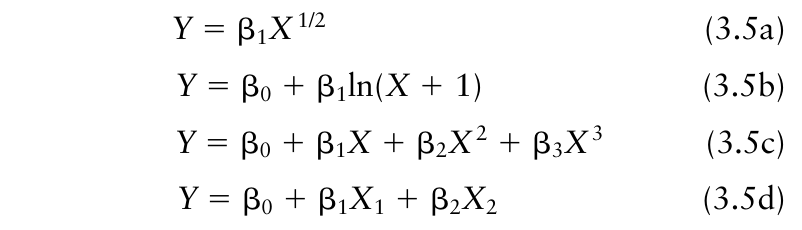{.equation width=60%}

where ln(•) is the natural logarithm (base _e_) function. These models can be written generally as:

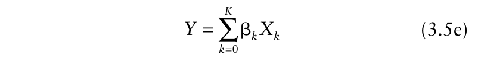{.equation width=60%}

where the subscript represents the different variables in the model (e.g., temperature and relative humidity) or different functions (transformations) of variables [e.g., _X_, ln(_X_ + 1), _X_3 , etc.], and the βs represent different parameters. With this formulation, there are _K_ + 1 parameters in the model (e.g., in equation 3.1, there are two parameters, so _K_ = 1). For the mathematically inclined, linearity is defined in terms of the _partial_ derivative of _Y_ with respect to each parameter (e.g., ∂ _Y_ /∂β1), not the derivative(s) with respect to the predictor variable(s). For a linear model, the partial derivative is _not_ a function of the parameter of interest. For instance, for equation 3.1, it can be shown that ∂ _Y_ /∂β1 = _X_, so the partial derivative of _Y_ with respect to β1 is not a function of β1 and linearity with respect to the β1 parameter is established.

Some of the examples above, including equation 3.1, contain a single parameter that does not multiply a variable (β0). These models still meet the linear-in-theparameters definition of equation 3.5e because a stand-alone additive term of β0 is equivalent to β0 _X_ 0, where _X_ 0 equals 1 for all cases (_X_ 0 ≡ 1).

Models that are nonlinear in the parameters cannot be written as a summation of terms, as in equation 3.5. In particular, one or more of the parameters appear as exponents, or as functions that involve variables, or are multiplied or divided by other parameters. Using Greek symbols for parameters, a few examples include:

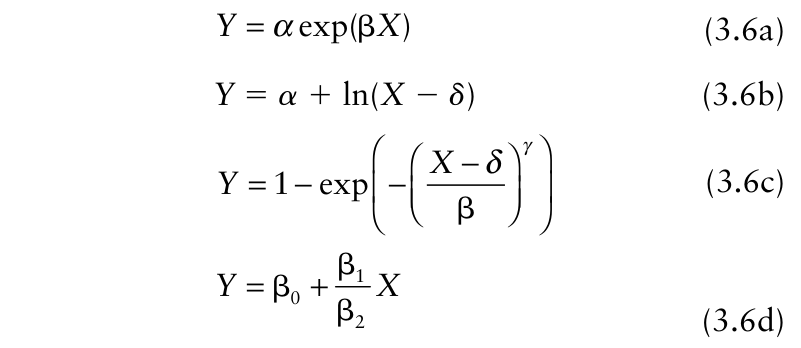{.equation width=60%}

Consider equation 3.6b. It looks little like linear equation 3.5b. However, one parameter appears inside the log function in equation 3.6b. In terms of partial derivatives, ∂ _Y_ /∂ _δ_ = −1/(_X_ − _δ_); that is, the derivative with respect to _δ_ is a function of both _X_ and the parameter, making the model equation nonlinear with respect to the _δ_ parameter.

Now consider equation 3.6d. In terms of the three parameters listed, it is nonlinear, since β1 is divided by β2. However, a constant divided by a constant is still a constant. Thus, one can think of β1/β2 as being equal to a (_new_) parameter labeled _γ_, in this case, equation 3.6d is linear in terms of parameters β0 and _γ_.

The concept of linearity (or nonlinearity) is particularly important when it comes to the estimation of parameters from data. Parameter estimation is much easier for linear models, compared with nonlinear ones. This issue is dealt with on several occasions, starting in section 3.4.

Some models that are nonlinear in the parameters can be transformed algebraically into a linear form. Consider equation 3.6a, which is a classic model for exponential growth (see Chapter 4) of a population. Taking natural logs of both sides results in:

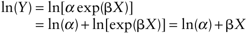

This is a linear model for ln(_Y_) as the dependent variable (= _Y__*_ ) and _X_ as the predictor variable. In fact, a straightline model is produced. The new intercept parameter is ln(_α_), which we call _α_* , and the slope is β. We can write the new equation as:

{.equation width=60%}

This model is not linear in terms of the original _α_ parameter, but in terms of its natural logarithm. Models that can be transformed into linear form are called _intrinsically linear_.

Unfortunately, many nonlinear models are not intrinsically linear. Consider equation 3.6c, which is known as the Weibull function and describes and increase in _Y_ from 0 at _X_ = _δ_ to 1 at large _X_. Use of logs and some algebra results in the transformed version:

{.equation width=60%}

which is an equation for a straight line relationship between _Y__*_ = ln(−ln(1− _Y_)) and _X__*_ = ln(_X_ − _δ_). The slope is _γ_ and the new intercept is − _γ_ ln(β). However, this model is still nonlinear because the parameter _δ_ appears as part of a log function involving variable _X_. Further algebra cannot separate out the _δ_ term to produce a linear model. If _δ_ was known (e.g., _δ_ = 0), and so was not a parameter to be estimated, one can consider this new model as being linear. A different algebraic manipulation of equation 3.6c produces another straight-line equation:

{.equation width=60%}

This model is also nonlinear, because _γ_ appears as the exponent of a variable, and on the left-hand side of the model equation. If _γ_ was known (e.g., _γ_ = 1) and so was not a parameter to be estimated, then this model is linear, with slope 1/β, and intercept − _δ_ /β. Finding a linearized form of a nonlinear model can be tricky, and may involve several algebraic steps. We demonstrate the approach with another nonlinear model in 3.5.2.

## 3.3 Methods of Model Development

Models for biological or other processes can be developed in numerous ways. The methodology of model development provides another useful classification system for models. We first present two approaches for model development in an idealized sense, and then show that in practice many models are developed using a hybrid of both approaches.

An _empirical model_ is developed to describe an observed process, phenomenon, or relationship between variables, using accepted statistical principles, and does not use previously developed theory or concepts to establish the relationship between the response variable and predictor variables. In other words, empirical models have the potential to provide a good fit to observed data, but in so doing do not take into account the biological mechanisms (molecular, biochemical, population, etc.) that generate the relationship characterized by the data. For instance, given only the data points in the lower frame of Fig. 3.2, and no information on the mechanism(s) that generated the observed relationship between variables _Y_ and _X_, it is natural to consider a straight-line equation (such as equation 3.1) as an empirical model to represent the relationship. Empirical models may also be referred to as correlative models or descriptive models. These models are especially useful in exploratory data analysis for determining whether there is a relationship between two (or more) variables and for comparing the effects of experimentally imposed treatments (e.g., fungicide applications) on biological processes (e.g., epidemic development). Empirical modeling is the method of model development taught in many introductory data analysis courses.

The steps involved in empirical model development can be summarized as follows:

- Obtain data; that is, collect the observations or measurements of disease intensity and other variables of interest from a planned experiment or from a survey;

- Describe the phenomenon or process in question, generally using simple models (often, but not exclusively, of the linear type);

- Evaluate the fit of the model (see section 3.4.2);

- Use other empirical models if the fit does not appear to be acceptable (see section 3.4.5);

- Once a model is selected (on the basis of an acceptable fit), use it to achieve the previously-stated objectives, for example, predict future _Y_, compare treatments, determine if a variable significantly affects the response, and so on.

In contrast to empirical model development, a _mechanistic model_ is developed by starting with a theory, hypothesis, or concept of how a (biological, in our case) phenomenon or process occurs. Data are only considered _after_ a mechanistic model is developed. The steps involved in (quantitative) mechanistic model development can be summarized as follows:

- Represent the theory by specifying a quantitative model in mathematical notation;

- Obtain relevant data, either from new experiments or surveys, or from previous studies;

- • Evaluate the fit of the specified model to the data;

- If the model is consistent with data (i.e., provides a satisfactory fit), then use the model to achieve previously-stated objectives;

- If the model is not consistent with the data (i.e., it provides an unsatisfactory fit), then reject the initial theory (as represented by the quantitative model) and consider how or why the initial theory does not (fully) apply to the data.

This may lead to specification of a new mechanistic model for investigation. Mechanistic models may also be referred to as explanatory, theoretical, biological, or physical models.

It may be argued (at least by some) that mechanistic models are superior to empirical models (Diekmann and Heesterbeek, 2000; Waggoner, 1990) for various reasons. For instance, there can be inadequacies with observed data used to develop an empirical model. As discussed in the previous chapter, measurements of disease severity are not (and probably can never be) completely accurate (reliable and unbiased). But even if the individual observations were fully accurate, only a fraction of a larger host population typically is observed in characterizing epidemics. Because of this, estimates of the typical response variable in epidemiological models, mean intensity, can be imprecise, depending (in part) on the spatial pattern or heterogeneity of disease intensity and number of samples used (see Chapters 9 and 10). Moreover, empirical models are often unsatisfactory in extrapolation, that is, in predicting _Y_ at values of _X_ outside the range of the data used in developing the model.

If we think that we understand a phenomenon, we should be able to specify a model for it, at least in a simplified way, before seeing the data. Population genetics and epidemiology are two areas of biology (not just plant pathology) where mechanistic models are commonly developed and used (Diekmann and Heesterbeek, 2000; Daley and Gani, 1999). For population dynamic processes, it turns out that almost all reasonable quantitative models used to characterize the mechanisms of biological processes are nonlinear in the parameters. This is of concern when a mechanistic model is specified but some (at least) of the parameter values are to be estimated empirically from data. Although mechanistic models appear at various places throughout this book, Chapters 5, and 8 have a special emphasis on the use of these types of models in understanding epidemic processes.

In practice, model development may involve both mechanistic and empirical approaches, and a model, once developed, may be considered neither fully empirical nor fully mechanistic. For instance, the theory used to develop a mechanistic model may itself have arisen from a consideration of previously observed data and empirical models fitted to those data. Mechanistic models are ultimately tested against data, using principles of empirical modeling for the appraisal of their validity. Thus, in epidemiology, a considerable amount of modeling, and related data analysis, is based on a combination of the methods of model development outlined above. For instance, in the next chapter, several alternative mechanistic models for disease progress curves are presented in some detail, and it is shown how to use modeling results to both understand epidemics (including the evaluation of control strategies) and to compare epidemics occurring under different conditions. The different models shown can all be developed mechanistically, based on some of the known or accepted properties of population dynamics for diseases and other organisms, independent of observed data points. Using wording of Cousens (1985) for a different situation, such models are constructed “based on biologically sound premises”, whether or not they account for all the relevant features of the reality being represented. However, until there are data for comparison, it may not be clear which of the alternatives is most appropriate, among those that are candidates as mechanistic models for the process under study. This leads to an empirical approach, where a few candidate models are evaluated for their fit to data points. The candidate models are _not_ chosen from the collection of all possible models that will provide a satisfactory fit to the observed data, but rather from the limited number of previously developed models that are based on sound biological premises. This general approach to model development can be called _semi-empirical model_ building (Cousens, 1985), and the approach is followed often in botanical epidemiology.

To conclude this section, we point out that intense argument about the general value of empirical and mechanistic modeling is not really productive. Models are developed and used for many purposes, and different objectives may require different types of models. The relevant issues are whether or not the type of modeling used is reasonable for the objectives of the investigator, and (when model fitting is being done) whether or not the method of model fitting is consistent with the type of random variable being analyzed, the nature of the process being represented, and the manner in which the data are obtained. Throughout this book, readers will find a wide range of models, and a corresponding range of approaches to model fitting. Because plant pathologists study epidemics for many reasons, many modeling approaches are used, and there is probably no textbook in mathematics or statistics that covers the entire range of models (and associated analyses) used here. Thus, in the various chapters and sections of chapters, we direct the reader to books and articles to gain more background on the topics being presented.

## 3.4 Fitting of Linear Models to Data

“ _Data! data! data!_ ” _he cried impatiently_. “ _I can’t make bricks without clay_ ”. Sherlock Holmes (“ _The Copper Beeches_ ” by Arthur Conan-Doyle)

### 3.4.1 Introduction

Although some research in epidemiology only deals with data indirectly, most quantitative research involves observed data _and_ models that may describe the data. Here, and elsewhere, we use data to refer to a collection of observations or measurements. Usually, models are fitted to data, whether the models were developed strictly for descriptive purposes, or were developed based on elaborate theoretical considerations of the biological processes involved in epidemics. In this section, we briefly discuss some standard methods for fitting models to data. Other methods, somewhat less common than those mentioned here, are discussed elsewhere in the book with regard to specific applications. This presentation is intended for those readers with little familiarity with statistical model fitting. By studying the following sections, it will hopefully be easier to follow the presentation in other parts of the book and to fit linear models to data. To conduct research in epidemiology, however, individuals will need to learn considerably more about model fitting than what we present here. Some excellent textbooks, not specifically orientated towards plant disease epidemiology, include: Collett (2003), Neter et al. (1983), Draper and Smith (1998), and Schabenberger and Pierce (2002). The last book is especially helpful, since it deals exclusively with agricultural (i.e., plant and soil) topics.

### 3.4.2 Least squares regression—general concepts

Fitting models to data is equivalent to estimating the parameters in a model such as equation 3.1. The two most common approaches to estimate parameters of models are the method of _least squares_ (or least squares regression) and the method of _maximum likelihood_. The two approaches can give the same results under _some_ circumstances. In this section, the emphasis is on least squares regression, and we consider models that are linear in the parameters. For such linear models, the method is often referred to as linear least squares, ordinary linear least squares, or ordinary least squares regression.

We present the concept of least squares regression through examples, one taken from the plant pathology literature and one small hypothetical one. Jeger and Lyda (1986) studied the relationship between incidence of Phymatotrichum root rot of cotton (caused by _Phymatotrichum omnivorum_) and ambient weather conditions in Texas. Their goal was to develop a predictive model for this disease based on easily obtained environmental variables. Incidence of disease was determined yearly in field plots and empirical models were developed to predict incidence based on temperature and precipitation over periods of time during the growing season. Fig. 3.3A is a display of the relationship between final incidence in each year and accumulated precipitation (in centimeters) during the growing season (up to 31 August), together with a best-fitting line that is explained below. The data are given in the Appendix of this chapter.

![Incidence of Phymatotrichum root rot of cotton at the end of the growing season (_y_) and cumulative precipitation (_X_) in centimeters up to 31 August during the growing season. (**A)** fit of equation 3.7c based on ordinary least squares. (**B)** standardized residuals from A. (**C)** fit of equation 3.7c based on weighted least squares. (**D)** standardized residuals from C. (**E)** fit of equation 3.17 based on weighted least squares. (**F)** standardized residuals from E. Inset in E: same results as in E, but shown on original _X_ scale. Data taken from Jeger and Lyda (1986). Note: the time period for cumulative precipitation used here is somewhat different from that used in the model developed by Jeger and Lyda.](figures/fig3-img04.png){#fig-3-3}

Disease incidence is a discrete variable, specifically a count with a natural denominator [i.e., number diseased (_Y_) out of a total of _N_ observed] (see Chapter 2). As usual, we use lower case _y_ to indicate incidence as a proportion (_y_ = _Y/N_), so we present the models here with _y_ on the left-hand side. There are specific model-fitting methods for discrete response variables (when the actual count and _N_ are known), some of which are covered in other chapters (see also Collett, 2003); however, if the number of observations made to determine incidence is fairly large (>30), then _y_ can be approximated as a continuous random variable and represented with a continuous probability distribution (Neter et al., 1983). The assumption of a continuous random variable is very often made in model fitting, and we do so here.

We consider disease incidence to be a deterministic function of accumulated precipitation (_X_) and a stochastic (error) term with a normal distribution. We can use a general expression, _g_ (_X_), to represent the deterministic function. Using the convention of a _j_ subscript to indicate the specific observation, we can write a model for incidence as:

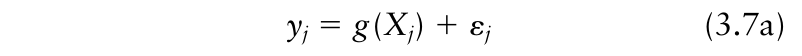{.equation width=60%}

We assume that the random variable ε has a mean of 0 and a constant variance of _σ_2 , and that the ε values are independent. We consider alternatives to the assumption of constant variance below. Taking expectations of both sides of equation 3.7a, one obtains:

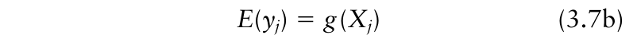{.equation width=60%}

In other words, the deterministic function of _X_ [ _g_ (_Xi_)] gives the expected (average, mean) disease incidence at _Xj_, _E_ (_yj_). It is equivalent, then, to use either equation 3.7a or 3.7b for describing the relationship; the latter shows how the mean varies with _X_, and the former shows how the individual observations vary with _X_ and with the random error.

The specific form of _g_ (_X_) could be based on mechanistic modeling (where a specific equation is developed before seeing the data points) or empirical modeling (where the data fully guides the choice of equation). We take the empirical approach here, for the most part. The data in Fig. 3.3A clearly do not follow a straight line, but it is informative to consider, as a first step, the fit of equation 3.7a when β0 + β1 _X_ is used for _g_ (_X_). The model then is written as:

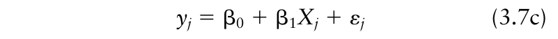{.equation width=60%}

or

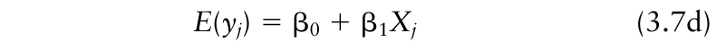{.equation width=60%}

Although the model parameters are unknown constants, their estimates are random variables. If one could repeat the same study, generating data several times, and fit the same model to the data from each repetition, different estimates of the parameters would (in all probability) be obtained each time.

The principle of least squares in model fitting is to consider the _sum of squared differences_ between _yj_ and _g_ (_Xj_). One can define:

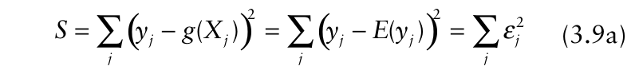{.equation width=60%}

as the sum of squares based on any parameter values. For the case where equation 3.7c is the chosen model, _S_ is given by: or

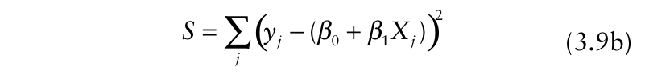{.equation width=60%}

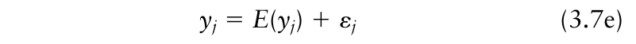{.equation width=60%}

These are all equivalent ways of writing the linear model. Equations 3.7c and 3.7d explicitly show the functional relationship between the response and predictor variables (a simple linear model in this case). In contrast, equation 3.7a and 3.7e are more general, emphasizing the stochastic nature of the response. Equation 3.7e demonstrates that an individual _y_ value is composed of a mean and a random term, but does give any information on how _E_ (_yj_) is related to _X_.

Fitting a model like equation 3.7a to data by least squares requires estimation of the parameters of the deterministic part of the model so that _g_ (_Xj_) comes “as close as possible” to the collection of data points. This means the same thing as finding parameter values so that the ε _j_ s are “as small as possible”, given the data points and the choice for _g_ (_X_). To distinguish estimates of parameters from the unknown parameters themselves, a “hat” is placed over the symbols when estimates areˆ ˆ indicated (e.g., β1, β0 ). When one uses estimates of the parameters in the model, one calculates the so-called predicted or fitted value of _y_ at each _X_. This is written as:

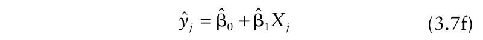{.equation width=60%}

It should be noted that _y_ ˆ is not just a predicted individual value of _y_ at a given _X_; it is also an estimate of the expected (mean) _y_ at that given _X_ (Neter et al., 1983) _._ We do not provide the proof of this; however, a comparison of equations 3.7d and 3.7f may help the reader see that the right-hand side of the equations without an error term specify expected responses (either actual or predicted). Continuing, the difference between the observed _y_ and the fitted _y_ is the estimated error term for the model, usually known as the _residual_. This is written as:

With least squares, one finds the parameter values that give the minimum sum of squares (the “least squares”). In practice, one _could_ try a large number of possible values of the parameters and determine the achieved _S_ value for each, and choose the parameter values that give the smallest obtained _S_. This is equivalent (for equation 3.7c) to drawing a large number of possible lines through the data points in Fig. 3.3A and using the line that gives the minimum observed _S_. The method can be visualized by the simple hypothetical example with four points in Fig. 3.4. Three possible straight lines are drawn, and the residual (_ε_ ˆ _j_; equation 3.8) for each of these is shown (as the thin vertical line) for the observation with the smallest _X_. The residuals for the other data points would be calculated in the same way for the different lines. To calculate _S_ for a given line, the residuals for all the different _X_ values are squared and totaled. In this case it turns out that the minimum sum of squares (for the three possibilities considered in Fig. 3.4) corresponds to the solid line.

Fortunately, because of the properties of linear models (Neter et al., 1983), trial and error consideration of parameter values is totally unnecessary. As shown in most elementary statistical textbooks, one can determine the minimum value of the sum of squared differences for any linear model fitted to a data set (equation 3.9a or 3.9b) through formulae derived from calculus. The formulae are not repeated here, but are incorporated into standard statistical analysis computer programs. When the least squares estimates of the parameters are inserted into equation 3.9a or 3.9b, we call _S_ the sum of squares for _error_ (SSE) or the residual sum of squares (RSS or SSR), and write it as:

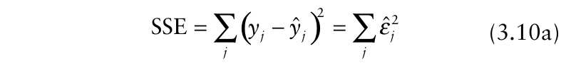{.equation width=60%}

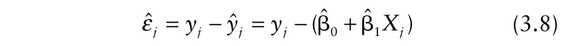{.equation width=60%}

{#fig-3-4}

For the case of the straight-line model, one can write:

{.equation width=60%}

Returning to the root rot example, the straight line in Fig. 3.3A represents the ordinary least squares fit of equation 3.7c to the data. The fitted model can be written as:

{.equation width=60%}

In other words,βˆ 0 = −0.108 andβˆ 1= 0.0105. Then, for instance, with 60 mm of precipitation, the model provides a predicted incidence of −0.108 + 0.0105 × 60 = 0.52. This is the estimated mean incidence for all observations with _X_ = 60. These interpretations are based on the assumption that the correct model (i.e., the correct deterministic component) was chosen and all the statistical assumptions were met. These issues are addressed below.

Using the values of the parameter estimates in equation 3.10b, it is found that SSE = 0.33. It is pretty clear from Fig. 3.3A that a straight line does not provide a good fit of the data; in fact, the example was chosen for this reason. Before showing alternative models, we discuss the meaning of the results presented for this model, and show how to evaluate the model fit.

As indicated above for the general situation, the slope parameter (β1) in a linear model such as equation 3.1 represents the change in _y_ with change in _X_ (_dy/dX_). Thus,βˆ 1 is an estimate of this derivative. The intercept parameter (β0) represents the expected value of _y_ when _X_ is zero, andβˆ 0 is an estimate of this. In this case, the negative value for the estimate of the intercept may seem to be nonsensical, since disease incidence (by definition) cannot be below 0. However, there are no data points at _X_ < 30, so there is considerable extrapolation to get to _X_ = 0.

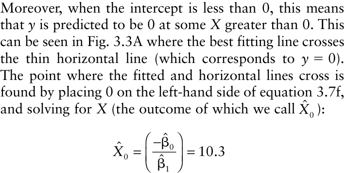

This can be thought of as an estimated threshold value of _X_ required for disease to occur. Note that this value of _X_ is considerably below the smallest _X_ value used, so one would need to be cautious in using this estimated threshold (and especially so here, since the simple straight-line model is not satisfactory). Evidence for a threshold would be stronger if there were observed data points with _X_ > 0 for which _y_ = 0.

If the fit of a model to data were perfect (so that _y_ = _y_ ˆ at every _X_), SSE = 0 and _ε_ ˆ _j_ = 0 for all observations. Values of SSE greater than 0, therefore, indicate some deviation from a perfect fit (| _ε_ ˆ _j_ | > 0 for some or all observations). The magnitude of SSE (when it is not equal to zero) depends on the number of data points and the scale (magnitude) of the _y_ values. For instance, an SSE value of 0.1 would be considered relatively small if the response variable was the number of rust spores per leaf, but relatively large if the response variable was the proportion of diseased leaves. Thus, it is helpful to have a unitless measure of goodness of fit (or lack of fit). This measure is easily constructed by considering another sum of squares, this time for the difference between _y_ and overall mean _y_ (_y__–_ ). We call this the total sum of squares (SST), which is written as:

{.equation width=60%}

Conceptually, one can think of SST as the error sum of squares when one fits to data a straight-line model (equation 3.7c) in which the slope parameter (β1) is set to zero. This model can be written as:

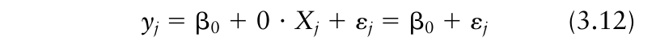{.equation width=60%}

Graphically, equation 3.12 specifies a horizontal line, where the height of the line is β0. For linear models, SSE is always less than or equal to SST. The ratio of SSE to SST is the proportion of variability that is unexplained by the model (i.e., the one that includes _X_). Thus, the proportion of _explained_ variability is determined by subtracting SSE/SST from 1. One defines the coefficient

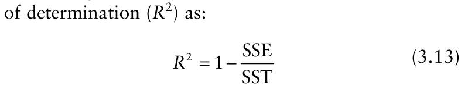{.equation width=60%}

which, for linear models, ranges from 0 to 1. Sometimes _R_2 is multiplied by 100 so that it is presented as a percentage. _R_2 does not depend of the scale of the response variable or of the number of data points. For the Phymatotrichum root rot example, SST equals 1.043, so

{.equation width=60%}

### 3.4.3 Distributional results

It is often assumed that ε (and hence _y_) has a normal distribution. If the dependent variable is normally distributed, then the estimated parameters of a linear model and the predicted _y_ based on the estimated parameters (_y_ ˆ _j_) also have normal distributions. Even when the distribution of _y_ is not normal, the estimated parameters may be approximately normally distributed at typical sample sizes (Schabenberger and Pierce, 2002). We assume here that the assumption of normality is reasonable for the data in the example.

The estimated variance of the _y_ (or ε) values is called the mean-square error (MSE) or residual mean square: where _N_ is the number of data points. The “2” in the denominator arises because in this case there are two parameters estimated in the model; for linear models generally, the denominator is the number of data points minus the number of estimated parameters. The 2 estimated variance of , as well as of the estimated _y s_ ˆ(_y_ ˆ ) 2 2 parameters, , and , are all functions ofMSE, and increase with increasing MSE. We do not _β_ˆ 0( _sβ_ ˆ0 ) _β_ˆ 1( _sβ_ ˆ1 ) show the formulae here since these are routinely calculated using standard statistical software for regression analysis.

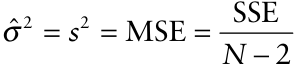

It is often desirable to determine a confidence interval estimate for a parameter. To do so, one needs the (estimated) standard error of the estimated parameter, which is just the square root of its (estimated) variance. We use different convenient forms of notation for representing a standard error, both here and other places in the book. For instance, the standard error of the estimated slope can be written as:

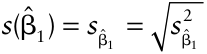

Although this formula is for the estimated standard error of the estimated slope, we often omit the first “estimated” for ease of expression. For the example, _s_ˆ( β1) = 0.00217. (More generally in some other chapters, we use _SE_ for the standard error a random variable). A confidence interval is calculated as: in which _tα_ /2, _df_ is the upper 100 _α_ /2 percentile of the Student _t_ distribution with _df_ degrees of freedom. For a linear model with two parameters, _df_ = _N_ − 2, the same as the denominator in the formula for MSE. For the example data, _df_ = (13 − 2) = 11. More generally, _df_ = _N_ − (number of estimated parameters).

For a 95% confidence interval, one specifies _α_ = 0.05, so that one uses the _t_ -value for an upper percentile of 0.025 (which may be given as the lower 1− 0.025 = 0.975 percentile in some references). The value of _t_ 0.025,11 equals 2.2 here. Thus, a 95% confidence interval for the slope is

## 0.0105 ± 2.2 × 0.00217

which is the interval [0.0057, 0.0153]. One general way of interpreting this interval is that there is a probability 1 − _α_ that the calculated interval contains the true slope β1. A more thorough explanation is that if the experiment resulting in the estimated β1 was repeated a very large number of times, and the slope was estimated for each repetition, (1 − _α_) × 100% (e.g., 95%) of the calculated intervals would contain the true parameter value. In terms of hypothesis testing, for this example, any slope values from 0.0057 to 0.0153 cannot be rejected as an hypothesized slope of the model. If _X_ really had no effect on _y_, then the true slope would be 0 (for a linear model). Since the calculated confidence interval for the estimated slopeβˆ 1 does not include 0, there is evidence that _X_ does affect _y_.

The confidence interval estimate for the intercept is calculated in the same way. Here, _s_ˆ( β0) = 0.139. The reader can confirm that the 95% confidence interval is [−0.414, 0.198]. Since this interval includes 0, there is evidence that the intercept is not significantly different

{.equation width=60%}

The concept of hypothesis testing mentioned above can be expressed much more formally. For instance, one can test the null hypothesis (_H_ 0) that there is no relation between _y_ and _X_, compared with the alternative hypothesis (_H_ a) that there is a relationship. For the simple linear model in equation 3.7c, it turns out that the null (_H_ 0) and alternative (_H_ a) hypotheses are identical to:

{.equation width=60%}

_H_ a: β1 ≠ 0. A _t_ -test can be done to test this hypothesis. Specifically, one calculates:

{.equation width=60%}

and rejects _H_ 0 if the absolute value of _t_ is larger than the _α_ /2 percentile of the tabulated Student’s _t_ distribution (with _df_ = _N_ − 2). The _t_ statistic is routinely displayed by statistical computer programs used for the kind of data

{.equation width=60%}

analysis described here. The _t_ test will result in rejection of _H_ 0 only if the confidence interval estimate for β1 does not include 0.

A short comment on significance levels is warranted here to conclude this section. A significance level is a probability, and we use both _P_ and _α_ for probability in this and several other chapters, as well as the _Pr_ (•) function. In general, _P_ is used to represent the realized or _achieved_ significance value when a statistical test is performed (i.e., the calculated probability of rejecting the null hypothesis when the null hypothesis is true), and it can take any value between 0 and 1. In contrast, _α_ is an investigator-chosen specific value of the significance level. Any time that _P_ is less than the chosen _α_, one rejects the null hypothesis (which is equivalent to rejecting the null hypothesis when the calculated test statistic is larger than the theoretical value calculated (or looked

{.equation width=60%}

### 3.4.4 Model evaluation

The determination of estimated variances or standard errors, and their subsequent use for making inferences about parameters, are conditional on the use of an appropriate (i.e., reasonable) model for the data. Evaluation of the appropriateness of a model is often simply called model evaluation, model checking, or model criticism. Most evaluations focus on the residuals, i.e., the differences between the observed responses andˆ ˆ those predicted by the model (_ε j_ = _yj_ − _yj_). Often, the residual is represented by _e_ ( ). _ε_ ˆ _j_ =_e_ _j_ If a model is appropriate, a plot of the residuals versus the predictor variable will be a random scatter. Like the unknown error term (ε), the estimated error [i.e., residual ( ˆ(_ε_))] is a random variable. However, even if ε has a constant variance, the residual variance is not (quite) constant (Neter et al., 1983). The variance of the residual is proportional to MSE; in fact, MSE can be used as an approximate estimate of the residual variance, although statistical computer programs used for data analysis directly calculate the actual value for each residual. A standardized (or “studentized”) residual (_ε_) is determined by dividing _ε_ ˆ by the estimated standard deviation of the residuals (i.e., the square root of the estimated variance of the residuals). This standardization ensures that most of the _ε_ ˆ) values fall in the range from about −2 to +2; therefore, it is easy to identify unusually large or small values that might warrant some investigation of data-collection or datahandling procedures.

A plot of (_ε_) versus _X_ is shown in Fig. 3.3B for the root rot example. Although there are no extremely large or small residuals, there is a strong pattern visible in the plot, with _ε_ ˆ values tending to first increase and then decrease with increasing _X_. Thus, a straight-line model (equation 3.7c) is clearly not appropriate for the data. This conclusion can be just as easily reached by a plot of _y_ and versus _y_ ˆ _X_ (Fig. 3.3A) in this example, because the departure from a straight line is so pronounced. However, the residual plot can be diagnostic for an inappropriate model choice when the evidence from the plot of _y_ versus _X_ is ambiguous. Moreover, the residual plot can easily be used for models with multiple predictor variables or when the model is not a straight line. For these situations, viewing the residuals is an essential part of model evaluation.

In addition to the evidence provided by studying the residuals against the use of equation 3.7c as an appropriate model for the data in question, there is another potentially important problem here. The standard (default) assumption is that there is a constant variance of _y_ (or ε) for all data points. However, the response variable here is a proportion. As discussed in Chapters 9 and 10, the variance of a proportion is not expected to be constant, but is a function of the proportion. In particular, _σ_ 2 = _ξy_ (1 − _y_) , where _ξ_ is a constant [i.e., the variance is proportional to _y_ (1 − _y_)]. For count data with a natural denominator (i.e., disease incidence; see Chapter 2), _ξ_ is a function of the number of individuals observed in determining the proportion diseased and, for certain sampling approaches, the degree of heterogeneity of incidence from sampling unit to sampling unit. For the purpose of fitting a model for _y_ as a function of _X_ using least squares methodology, one only needs to know that the variance is proportional to _y_ (1 − _y_), and not the actual value of the variance (that is, one does not need to know _ξ_).

The precision of a measured variable (see section 2.5) is inversely proportional to its variance. Therefore, it is often assumed that more weight should be given to observations with smaller variances (i.e., to more precise observations). One can attach a weight (_wj_) to each data point, defined by:

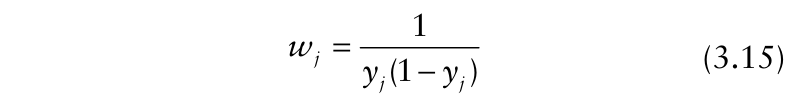{.equation width=60%}

The sum of squares is now calculated by multiplying each squared difference between _y_ and _y_ ˆ by the corresponding weight given by equation 3.15. The error sum of squares of equation 3.10a is thus generalized to:

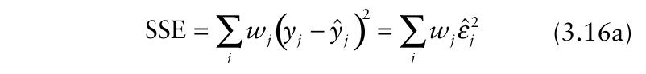{.equation width=60%}

For the case of the straight-line model (equation 3.7c), as with the root rot example, one can write:

{.equation width=60%}

In other words, parameter estimates are calculated that give the minimum possible value for equation 3.16a or 3.16b (for a given data set and model choice). Because the weights vary among observations, the estimates of slope and intercept that minimize equation 3.16b are not the same as the estimates that minimize equation 3.10b.

Use of equation 3.16b for fitting a model to data is known as _weighted least squares_ or weighted linear least squares (when models such as equation 3.7c are used), or weighted regression analysis. Note that _y_ (1 − _y_) is at its largest value when _y_ = 0.5, and declines towards 0 as _y_ approaches either 0 or 1. Thus, the weights calculated from equation 3.15 are smallest in value at _y_ = 0.5, and increase as _y_ approaches 0 and 1. Thus, more weight is given in parameter estimation to _y_ values near the extremes, and less to _y_ values near the midpoint of the range of possible incidence values. The residual plot can be very useful for identifying situations where the magnitude of the variance is related to the response variable. In such cases, there will be regions of the residual plot where the variation in residuals (or standardized residuals) is noticeably larger than in other regions on the plot. Identification of regions where the variation is relatively large may require a considerable number of data points (certainly more than are available here).

Fig. 3.3B did not provide any real evidence of unequal variances, and so the need to use weighted least squares. However, we do so for demonstration purposes. Typically, in purely empirical models, one first attempts to find a reasonable model for the relation between _y_ and _X_, and then determines whether weights are needed. However, we use weights here at the outset because of the known theoretical relationship between the variance and _y_ for incidence data. Fig. 3.3C shows the fit of equation 3.7c to the root rot data based on weighted least squares. Model parameters were estimated as:

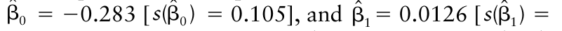{.equation width=60%}

0.0012]. In comparison to ordinary (i.e., unweighted) least squares, the slope was slightly higher and the intercept lower (Fig. 3.3C versus Fig. 3.3A); however, the difference between the two lines was minor. The standardized residual plot (Fig. 3.3D) was very similar to that obtained without use of weights; this is not surprising since the fitted line was not very different for the original (i.e., unweighted) one.

For the weighted root rot analysis, SSE = 2.50, SST = 29.51, _R_2 = 0.915. Despite the larger _R_2 , the fit is not necessarily better. This is because in assessing a model fit based on weighted least squares, the summary statistics are also calculated using the weights. For instance, calculation of SSE (equation 3.16a) and the corresponding equation for calculating SST (not shown) involve the chosen weights. Thus, the magnitudes of these values, and those derived from them (e.g., _R_2 , MSE) cannot be directly and quantitatively compared to the values from ordinary (i.e., unweighted) least squares.

For alternative models in the next section, we continue to use weighted least squares, even though in this case the weights may not be necessary.

### 3.4.5 Model adjustments

Clearly, equation 3.7c is not satisfactory for representing the root rot data. If the model was chosen based on mechanistic grounds, one might stop here and simply conclude that either the theory is wrong or that it does not apply here for various reasons. However, as is often (but certainly not always) the case in epidemiological studies of disease incidence and composite environmental variables (such as cumulative hours of rain, or cumulative precipitation over time), there is no _a priori_ theoretical model for the relationship under investigation here. It is a standard, and good, practice to consider alternatives to straight-line models for describing the data from field observations. The approach we explain here is based on a continuous response variable (or where a continuous distribution for the response variable is a reasonable approximation) and a single predictor variable. For examples with more than one predictor variable, readers will need to consult textbooks dealing in more detail with regression analysis in more detail than is possible here (e.g., Draper and Smith, 1998; Neter et al., 1983).

The plot of _y_ versus _X_, and resulting residual (or standardized residual) plot, give guidance on modifying the empirical model. When a plot of _y_ versus _X_ is concave (i.e., decreasing slope of _y_ versus _X_, so that there is “bending” of the curve towards higher _X_ values), certain transformations of _X_ are generally useful for obtaining a more satisfactory fit than is possible with a straight-line model for _y_ versus _X_. In particular, with data of the form in Fig. 3.3A, instead of modeling _y_ as a linear function of _X_, one often considers models for _y_ as a function of _X_ (= _X_1/2 ), ln(_X_), or 1/ _X_. Both the logarithm and the reciprocal of zero are undefined, so for empirical modeling a small constant is added to _X_ before either of these transformations are applied [e.g., ln(_X_ + 1), 1/(_X_ + 1)]. For demonstration purposes, we consider only the (natural) log transformation, and fit the following model to the data using weighted least squares:

{.equation width=60%}

Equation 3.17 is linear in the parameters. One can think of ln(_X_) as a new predictor variable (_X__*_ ). The fit of this model to the data is shown in Fig. 3.3E, based on weighted least squares. Although the standardized residual plot (Fig. 3.3F) is still not ideal, this model does provide a reasonable fit to the data, and there was just a little curvature of _y_ versus ln(_X_). Estimated parameters wereβˆ 0 = −2.97 [ _s_ˆ( β0) = 0.285], andβˆ 1 = 0.858 [ _s_ˆ( β1) = 0.0644]. This can be written in equation form as:

{.equation width=60%}

{.equation width=60%}

Other statistics were: SSE = 1.72, SST = 29.51, _R_2 = 0.942. Note that both the response variable and the weights are the same here as used when fitting simple equation 3.7c to the data using weighted least squares (as above). Thus, one can directly compare the goodness-of-fit results. SSE was reduced by 0.78 (2.50 − 1.72), indicating an improvement in fit. There was also an increase in _R_2 .

Because the predictor variable is different between equations 3.7c and 3.17, the parameters (or their estimates) have different meanings. The slope represents the change in _y_ with change in ln(_X_) [i.e., β1 = _dy_ / _d_ ln(_X_)], not with change in _X_. In fact, if _X__*_ is any transformation of _X_, then _dy/dX_ cannot be constant if _dy/dX__*_ is constant. This can be seen by the inset graph in Fig. 3.3E. Both _y_ and predicted _y_ (_y_ ˆ ) from equation 3.17 are shown versus _X_, not versus ln(_X_).

The intercept parameter in equation 3.17 represents expected _y_ when ln(_X_) equals 0, not when _X_ equals 0. Because ln(1) = 0,βˆ 0 is the estimate of expected _y_ when _X_ = 1. The negative value indicates that _y_ is predicted to be 0 at some value of ln(_X_) greater than 0. This issue is especially relevant for the analysis of plant disease gradients with models that use log of distance as the predictor variable (see Chapter 7). A little algebra shows that the value of predicted _X_ when _y_ is 0 is estimated as:

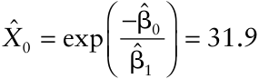

Note that this estimate of _X_ 0 is much closer to the lowest observed _X_ in the data set, where the observed incidence was near 0, than for the straight line model (for which_X_ˆ 0 = 10.3 , above). This is further evidence that equation 3.17 is a more appropriate model for describing these data.

With the empirical modeling approach, one would not necessarily just accept this “ln(_X_)” model without trying some alternative transformations of _X_, such as 1/ _X,_ for the predictor. One can think of equation 3.17 as the (new) starting model, and determine whether other descriptive (generally, linear) models can be found that provide a better fit. We do not pursue this here. As discussed in section 3.5 (below), there are still some problems with the use of equation 3.17 (or similar ones) for representing the relationship described by the observed data.

We return briefly here to the general topic of finding an appropriate linear model when the straight-line model (equation 3.7c) between _y_ and _X_ is not satisfactory. If the plot of _y_ versus _X_ is convex to the _X_ -axis (i.e., increasing slope of _y_ versus _X_, so that there is “bending” of the curve upwards), which is not the case for the root rot observations, transformations of _y_ (rather than transformations of _X_) can be considered. Standard transformations in this case include _y_, ln(_y_), and 1/ _y_. When _y_ = 0 is found in the data, a small constant is added to _y_ before either of the transformations ln(_y_) and 1/ _y_ are applied, to avoid problems of undefined values of I NTRODUCTION TO M ODELING IN E PIDEMIOLOGY 47 the transformed variable. An example of such a model would be:

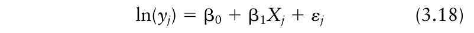{.equation width=60%}

Some forms of curvature in _y_: _X_ graphs are not readily described using linear models with just a transformation of _X_ or _y_. In these cases, transformations of both the predictor and response variables may be very beneficial. For instance, a common model in many disciplines involves the log transformation of _X_ and _y_. These so-called log–log models appear elsewhere in this book for different situations.

A word of caution is needed for those comparing the fit of various models that involve different transformations of _y_. When the models being compared involve only differences on the right-hand side of the equal sign [e.g., _X_, ln(_X_), etc.], direct comparison of statistics such as SSE can made in evaluating fits (when using a consistent model fitting method, with the same weights for different models). This is because the _y_ values are the same for each model, and model evaluations are based on _y_, , and statistics based on these values (e.g., SSE). _y_ ˆ However, if one model involves _y_ as the response variable and another involves ln(_y_), for example, then one cannot _directly_ use SSE (and similar statistics) to compare fits, at least in a quantitative sense. This is because the left-hand-sides of the equations are different for the different models, so there is no common scale when calculating SSE. For instance, suppose that equation 3.7c _is_ appropriate for a data set, but that one also fitted equation 3.18 to the same data. The SSE may well be lower for the fit of (inappropriate) equation 3.18 because the log transformation reduces the scale of the observed and predicted values. The scale changes for SST (equation 3.11) as well as for SSE when the response variable represents different transformations of _y_, so _R_2 (equation 3.13) still reflects the relative fit of the data by the model, and provides some basis for comparing fits of different models. However, there is still not a common left-hand-side to the models, which means that one should be cautious in over-interpreting small “improvements” in _R_2 when comparing models. This is relevant in modeling of disease progress curves (see section 4.6.2), where theoretical and empirical considerations lead to linear models of disease intensity that involve different transformations of _y_ as dependent variables.

### 3.4.6 Other considerations

In empirical modeling of data, finding an appropriate equation to represent the data is the primary objective. Although there are useful formal tests to choose among some models and to determine the goodness of fit of a given model (Draper and Smith, 1998), simple residual plots and plots of the responses versus the predictor are often most beneficial for choosing a reasonable model.

More sophisticated and elaborate assessments of the residuals can also be performed (Neter et al., 1983). Once a reasonable model is chosen, the statistical assumptions underlying the model fitting (parameter estimation) are evaluated.

The main statistical assumption considered so far involves the variance of _y_ (or ε). This is taken to be constant under the standard (“default”) assumptions for least squares analysis, although weighted least squares can be used when constancy of the variance is not expected. Often, with empirical modeling, one chooses a reasonable model first [i.e., the form of _g_ (_X_) in equation 3.7a], and then addresses the underlying statistical assumptions utilized in model fitting. This is different from the approach taken above where the decision to use weights was made before finding an appropriate model. Our approach here was used for demonstration purposes and to emphasize that some random variables have a variance that is a function of the variable itself.

The other two standard statistical assumptions of relevance are that the ε values are independent and normally distributed. Least squares regression is robust to _reasonable_ departures from normality under many circumstances (Neter et al., 1983). There are formal statistical tests as well as powerful graphical methods to evaluate departures from normality of the residuals, but we do not elaborate these further here.

A more serious assumption is independence of the errors. When not independent, estimates standard errors of the parameter estimates using ordinary least squares can be considerably smaller than the correct values (Neter et al., 1983). This affects calculations of confidence intervals and tests of the equality of parameters for different treatments. The issue is especially relevant for models of disease progress curves, and approaches for assessing this assumption, and making adjustments when the assumption is violated, are discussed in section 4.6.2.

## 3.5 Fitting of Nonlinear Models to Data

### 3.5.1 General considerations

As already mentioned above, many theoretical considerations in epidemiology, especially for population dynamics, lead to the development of models that are nonlinear in the parameters (e.g., equation 3.6a). Moreover, to account for some essential features of observed data, nonlinear empirical models may also be quite useful. Here, we briefly introduce some of the methodology for fitting nonlinear models to data, a very complicated and difficult subject. Other textbooks and articles must be read to gain a fuller understanding of the subject (e.g., Madden and Campbell, 1990; Ratkowsky, 1983, 1990; Schabenberger and Pierce, 2002). We use the Phymatotrichum root rot data set (Fig. 3.3A) as the main example to demonstrate the procedure.

Although equation 3.17 provides a fairly good description of the data, there are still some problems that, depending on the objectives of the investigator, may or may not be of concern. First, the fitted model predicts negative values for _y_ at values of _X_ below 31.9. As discussed above, it is easy to consider this value of _X_ as a threshold, and just specify that predicted _y_ equals 0 for all values of _X_ below the threshold. However, such a conclusion would be more justified if there were actual (observed) values of _X_ between 0 and 32 with corresponding observed _y_ values equal to 0. On the other hand, it is entirely possibly that _y_ is nonzero (but small) at _X_ values 0 < _X_ < 32. Second, the predictions from the model at large _X_ may become nonsensical. Using the estimated parameters for equation 3.17, one can determine the estimated _X_ (_X_ˆ 1 ) where one predicts 100% incidence (1.0). By replacing the left-hand-side by 1, and rearranging, one obtains:

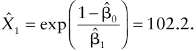

Any value of _X_ larger than 102.2 (or, more generally, )_X_ˆ 1 results in _y_ ˆ > 1, an undesirable result since this has sssssno physical meaning. Both of these problems may be resolved, either by using certain transformations of _y_ in linear models or by using a nonlinear model for the data. Here, we describe the use of a nonlinear model, and then apply the model to derive a linear (linearized) model for the data.

### 3.5.2 Nonlinear least squares

Equations 3.7a and 3.7b provide a very general expression for a response variable in relation to a predictor variable. In the previous section on model fitting, we considered forms of _g_ (_X_) that were strictly linear in the parameters. Here we abandon this restriction. There are many specific forms of _g_ (_X_) that could be used when _y_ takes values only between 0 and 1 (see Chapter 5 in Schabenberger and Pierce, 2002), but we only consider one of these here. One useful two-parameter function can be written, without subscripts for observation number, as:

{.equation width=60%}

where _λ_ and β are parameters (both greater than 0). Representing this as a statistical model, with explicit consideration of unexplained variability, and adding a subscript for each individual observation, one obtains:

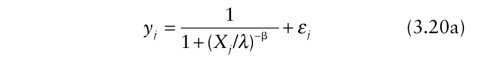{.equation width=60%}

We assume that ε has a mean of 0 and a constant variance (_σ_2 ), and that the ε _j_ values are independent. By determining the expected value for both sides of the equation, one can write equation 3.20a equivalently as:

{.equation width=60%}

In other words, the average (expected) value of disease incidence at a given value of _X_ is represented by the right-hand side of 3.20b. This model, or variations of it, have been found to be very useful for representing nutritional uptake by plants, plant response to herbicide dose, and other relationships (Brain and Cousens, 1989; Morgan et al., 1975; Schabenberger et al., 1999).

One appealing feature of equation 3.20a or 3.20b is that the parameter _λ_ has a very direct interpretation: _λ_ is the value of _X_ for which _E_ (_y_) = 1/2. That is, _λ_ represents the _X_ value that results in expected _y_ being exactly halfway between its lowest and highest possible values (0 and 1, respectively, in this model formulation). This can be easily seen by substituting _λ_ for _X_ in equation 3.20b:

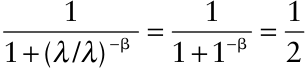

In other words, the interpretation does not depend on the other parameter (β) because 1 raised to any power is still equal to 1.

Fitting nonlinear models to data via least squares is an iterative process because there is no exact (analytic) solution to the equation for SSE when a model is nonlinear (equations 3.10a or 3.16a). The methodology by means of which the numerically smallest SSE is found is often called _optimization_. Interested readers should consult textbooks or reviews to learn more about the methodology (e.g., Madden and Campbell, 1990; Schabenberger and Pierce, 2002). Some key points to keep in mind are: that the model fitting does not always work (i.e., an acceptable numerical solution, based on the rules for the chosen optimization method, may not be achieved); and that even when the computer program indicates that model fitting was “successful”, the resulting estimates of parameters may not be the definitive least squares estimates (i.e., the method is iterative, and the definitive parameter estimates may not be found).

The investigator must supply initial guesses of the parameter values as starting points in the iterative search for the numerical solution (the parameter values that give the smallest calculated SSE). For some models and data sets, success depends heavily on the initial guesses, and investigators generally should try a few different initial guesses to see if the same numerical solution is obtained each time. If the initial guesses are too far away from the true values, parameter values near the true values may not be evaluated during the parameter estimation process. In such cases, what is reported as the smallest SSE is actually not the smallest SSE for the data set and chosen model—a better initial guess would have provided a smaller SSE. Despite these cautions, nonlinear model fitting is fairly routine in statistics, because either empirical evidence or theoretical arguments lead to nonlinear models for many biological phenomena and processes.

{#fig-3-5}

We fitted equation 3.20a to the root rot data by weighted least squares, using the NLIN procedure of SAS (Fig. 3.5). The default options were utilized, which means that the so-called Gauss–Newton optimization method was used. The weights were the same as used with equations 3.7c and 3.17 (for linear models). In this case, different attempted initial guess of the parameters gave the same results, so we feel confident in the estimates. The parameter estimates (and their estimatedstandard errors) were: _λ_ ˆ = 52.88 [ _s_ (_λ_ ˆ) = 2.34], and βˆ = 5.77 [ _s_ ˆ( β) = 1.07]. The estimated value of _λ_ means that _y_ is predicted to be 50% at ∼53 mm of rainfall.

The model is useful for representing responses that increase monotonically between 0 and 1 with increasing _X_. In Fig. 3.6, example responses for three different values of _λ_ (at a single β) and three different values of β (at a single _λ_) are shown. With increasing _λ_, the curve is simply shifted to the right (lower frame of Fig. 3.6). With increasing β, the steepness of the curve increases (primarily at _X_ values near the chosen _λ_ value).

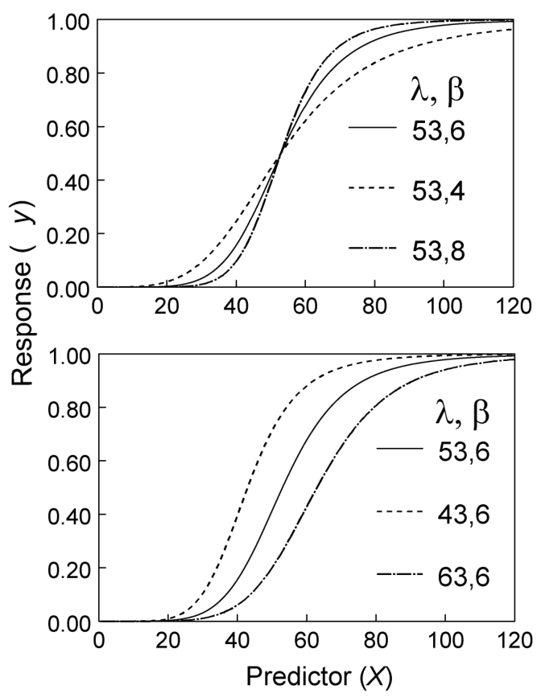{#fig-3-6}

The predicted values of _y_ (based on the estimated parameters) are shown, together with the observed _y_ values, in the top frame of Fig. 3.5. SSE (see equation 3.16a) was equal to 1.55, which was smaller numerically than the SSE found when linear equation 3.17 [with ln(_X_) as the predictor variable] was fitted to the data. In general, the prediction curve was consistent with the scatter plot of _y_ versus _X_. The standardized residual plot (Fig. 3.5, lower frame) displayed a random scatter, indicating that the model choice was reasonable. Although the predictions are very close to 0 at small _X_, they are never quite 0 for this model. For instance, at _X_ = 10, one obtains: _y_ ˆ = 6.7 × 10−5 . Moreover, _y_ ˆ does not exceed 1 no matter how large the value of _X_ is. Consider _X_ = 200 (almost double the largest observed _X_); predicted incidence is calculated to be _y_ ˆ = 0.99954.

The _R_2 summary statistic (equation 3.13), so commonly used with linear models, is somewhat controversial with nonlinear models. In fact, some authors indicate that it should never be calculated (Ratkowsky, 1990), and statistical computing programs often do not display it. One problem is that with nonlinear models, SSE could actually be greater than SST, meaning that _R_2 could be less than 0! Of course, this would only happen if there was no relation at all between _y_ and _X_, or the model choice or the parameter estimates were very far from being appropriate. Thus, with nonlinear models, _R_2 is no longer interpreted in an exact sense as the proportion of explained variability. We agree with Schabenberger and Pierce (2002) who state that 1−(SSE/SST) is, nevertheless, a useful measure of the goodness of fit of a model to data. It has the desirable property of having an upper limit of 1, which is only achieved when observed and predicted _y_ values are identical at all _X_ values. Since both SSE and SST are printed by most model fitting programs, it is easy for the investigator to calculate the value of _R_2 . For nonlinear-estimation programs that do not display SST, it can be easily determined by multiplying the variance of _y_ (ignoring the predictors) by _N_ −1. It could be argued that the left-hand side of equation 3.13 should be called a pseudo- _R_2 when calculated for nonlinear model fits, but for simplicity of presentation, we often just refer to it as _R_2 . For the example in Fig. 3.5, _R_2 = 1−(1.55/29.51) = 0.947. Because both SSE and SST were determined based on the weights, the relevant comparisons are with linear models (with _y_ as the response variable) fitted with weighted least squares.

Another relevant issue for fitting of nonlinear models to data can be brought up here. If the errors (εs) are normally and independently distributed with a linear model (such as the straight-line equation 3.7c), the leastsquares estimated parameters are, among other things: (1) normally distributed (very useful for determining confidence intervals); (2) unbiased when there is one predictor variable (meaning that the expected values of estimated parameters are equal to the true but unknown parameter values); and (3) the estimates that have the smallest variances of all possible estimates of the true parameters (meaning that they have narrower confidence intervals than other possible parameter estimates) (Ratkowsky, 1990; Schabenberger and Pierce, 2002). Even if the εs are not normally distributed, the parameter estimates approximately have these same desirable properties at moderate sample sizes.

In contrast, with nonlinear models, statistical theory shows that the least-squares estimated parameters do not have any of these properties at finite sample sizes, whether the εs are normally distributed or not. These properties are achieved at infinite sample sizes, but this does not help researchers working with finite and typically small sample sizes. It turns out that these properties _can_ be approximately achieved at small sample sizes, but this actually depends on the specific form of the nonlinear model and the actual _X_ and _y_ values used in model fitting (Ratkowsky, 1990). In this book, we generally accept that the estimated parameters have these properties as an approximation.

Finally, the residuals obtained from nonlinear model fitting have more complicated statistical properties than those obtained when fitting linear models. In particular, the residuals (or standardized residuals) may have a mean that is not zero, even though the assumed unknown error has an expected value of 0. Furthermore, there may be a small negative correlation of the residuals with _y_ ˆ (Seber and Wild, 1989), meaning that there may be a (slight) trend of residuals with _X_ even when an appropriate model is chosen. This depends on the form of the nonlinear model used. Thus, examination of residual plots is a little more difficult than with linear models. However, with these caveats, we still find the examination of residual plots (see Fig. 3.5, lower frame) to be helpful for many of the nonlinear models of value for epidemiologists.

### 3.5.3 Linearized models

_3.5.3.1 From nonlinear to linear._ As discussed in section 3.2.4, some nonlinear mathematical models are intrinsically linear. Thus, although the inherent biological process may lead to a nonlinear model as a fundamental representation of the process (e.g., population growth, as discussed starting in Chapter 4), sometimes one can use linear model fitting methods instead of the more difficult nonlinear model fitting methods. Consider the model suggested above for the Phymatotrichum root rot data (equation 3.20b). Temporarily, assume that the nonlinear function in equation 3.19 provides a perfect description of the data, so that ε = 0 for all observations. Dropping the subscript denoting individual observations, we can write the model as:

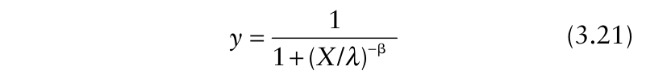{.equation width=60%}

Equation 3.21 represents a deterministic model. When there is no variability (as assumed here), the expected and actual _y_ values are the same [i.e., _y_ = _E_ (_y_)].

This model can be expressed in linear form. For this one example, we give some of the intermediate algebraic manipulations to help the reader see the steps needed to obtain a linear model. First, one takes the reciprocal of each side of equation 3.21, and then subtracts 1 from each side. The left-hand side is then (1/ _y_)−1, which is the same as (1− _y_)/ _y_, and the right-hand side is (_X_ / _λ_)−β . Taking natural logs of both sides gives:

{.equation width=60%}

which is still not linear because _λ_ appears within the log function. However, because ln(_A/B_) = ln(_A_) − ln(_B_), by definition, the right-hand side can be written as: −β[ln(_X_)−ln(_λ_)]. Multiplying through by −β, one then obtains:

It is customary (but not required) to express the function of _y_ on the left-hand side in a slightly different way, as ln[ _y_ /(1− _y_)] instead of ln[(1− _y_)/ _y_]. This change is easily done by first noting that ln(_A/B_) = −ln(_B/A_). So, multiplying both sides of equation 3.22a by −1, one obtains:

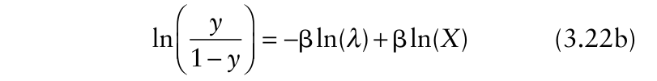{.equation width=60%}

The function of _y_ on the left-hand side of the model represented by equation 3.22b, known as the _logit_ of _y_, is now the new response variable (_y__*_ = ln[ _y_ /(1− _y_)]), and ln(_X_) is the new predictor variable [ _X__*_ = ln(_X_)]. This is a straight-line model with slope equal to β(=β1) and intercept equal to −βln(_λ_) (=β0*). Equation 3.22b is not linear in terms of _λ_, but in terms of −β times the natural log of _λ_ (recall that products, ratios, and other functions of constants not involving variables are still constants). We can write equation 3.22b as:

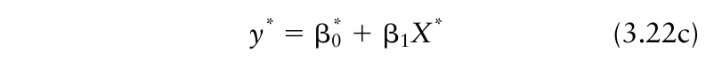{.equation width=60%}

in order to emphasize the linear relationship between the logit of _y_ and the natural log of _X._ Because the linearization of equation 3.21 results in the logit of _y_ as a linear function of the natural log of _X_, the model (in either nonlinear or linear form) is often called the _log-logistic model._

The deterministic equation 3.22b can be expanded into a stochastic model in order to account for unexplained variation in _y__*_ at each value of _X__*_ . This is done by adding an error term (a random variable with mean 0 and constant variance _σ_2 ). Using a _j_ subscript to denote an individual observation, as we did in the previous sections, one obtains from equation 3.22b:

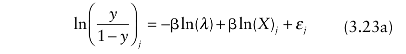{.equation width=60%}

which can also be written as:

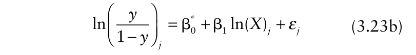{.equation width=60%}

in which β0* = −β ln(_λ_) and β1 = β. In fact, this is the model formulation used by Jeger and Lyda (1986) in their development of a forecasting system. One could also directly choose to model the relationship between disease incidence and _X_ using this linear model without first considering an intermediate nonlinear model. Taking expectations of both sides, one obtains:

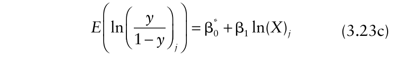{.equation width=60%}

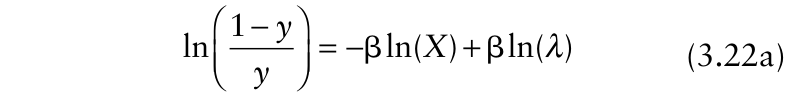{.equation width=60%}

which indicates that the mean value of the logit (not the mean _y_) is a linear function of ln(_X_). Note, the left-hand side of equation 3.23c is the mean or expected value of the logit [ _E_ (_y__*_ )], _not_ the mean of _y_, at each value of ln(_X_). Thus, ε equals _y__*_ − _E_ (_y__*_ ) here.

_3.5.3.2. Model fitting_. Fitting equation 3.23b to the logit transformation of the root rot incidence values can be done directly with ordinary least squares, using the logittransformed _y_ values as the response variable and ln(_X_) as the predictor variable. Using ordinary least squares,one obtains:βˆ *0 = −19.67 [ _s_ˆ( β*0) = 3.891], andβˆ 1= 4.95 [ _s_ˆ( β1)= 0.960]. SSE = 14.73, SST = 50.31, and _R_2 = 0.707. Note that is a direct estimate ofβˆ 1 β of nonlinear equation 3.20a (i.e., there is a direct correspondence). However, thisβˆ 1 has no relation to the slope of the linear models above with _y_ as the response variable. One has to do a little algebraic manipulation to determine the estimated* _λ_ based onβˆ 0 :

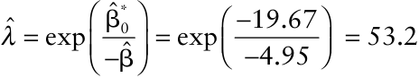

For the regression analysis involving _y_ as the response variable, we made the point that the variance of incidence is not expected to be constant but to be proportional to _y_ (1 − _y_). If this is true (and we were assuming so above), then the variance of the logit will be neither constant nor proportional to _y_ (1 − _y_) (Schabenberger and Pierce, 2002). There are rules to determine (or approximate) the variance of a function of a random variable that can be applied to this problem. Details are given in the next chapter (specifically, section 4.6.2) for disease progress curve models, and we do not pursue this any further here.

The parameter estimates are not the same as those obtained with nonlinear least squares. In general, unless there is a perfect fit (SSE = 0), the estimated parameters will vary between different estimation methods (ordinary versus weighted least squares) and different ways of expressing the model (linear or nonlinear versions). As stated before, one cannot directly compare the SSE (and related statistics) for unweighted (i.e., ordinary) and weighted least squares results. Moreover, because the response variable differed between equation 3.20a (_y_) and equation 3.23b (logit), one should be cautious in comparing goodness of fit of the models.

The interested reader should plot graphs of the logit(_y_) versus the ln(_X_), and the standardized residuals versus ln(_X_), to see if a linear model seems appropriate.

_3.5.3.3 Where is the error additive_ ? Linear equation 3.22b and nonlinear equation 3.21 are two equivalent ways of expressing a _deterministic_ relationship between _y_ and _X_. It is tempting to think of linear equation 3.23a and nonlinear equation 3.20a as two equivalent ways of expressing a _statistical_ (or stochastic) relationship between _y_ and _X_. However, the latter interpretation would be incorrect. Although one can algebraically rearrange equation 3.21 to obtain equation 3.22b, there is no way to rearrange the nonlinear equation with the additive error term (equation 3.20a) to obtain a linear model with a function of _y_ (and no parameters) on the left-hand side and an additive error term on the right-hand side.

One _can_ obtain the statistical linear equation 3.23b from a different version of a statistical nonlinear model for _y_. That is, instead of equation 3.20a, one can write:

{.equation width=60%}

in which ε′ is an error term (a random variable). However, this error term has a mean of 1, and takes on only positive values. When observed _y_ is fully specified by the deterministic part of the model, then ε′ = 1 (not 0). When _y_ is differs from that given by the deterministic part of the model, then ε′ will be either smaller or larger than 1. Algebraic manipulation of equation 3.24 results in:

{.equation width=60%}

where −ln(ε′ _j_) is the “new” error term (=ε). Note that when ε′ is 1, ln(ε′) = 0, the desired property for an additive error. Linear statistical equation 3.25 is the same as linear statistical equation 3.23a [with ε= −ln(ε′)]. In fact, if ε′ has a log–normal distribution with expectation of 1, then ε has a normal distribution with expectation of 0.

It can be seen that the error (unexplained variation) can be either additive in _y_ (equation 3.20a) or in _y__*_ (equation 3.25 or 3.23a), but not both. If the error is additive on a transformed scale, then it cannot be additive in the original scale. Conversely, if the error is additive in the original scale, then it cannot be additive in the transformed scale (i.e., the scale that gives a linear model). For the latter situation, use of equation 3.25 to estimate parameters is undesirable, since the errors would not be added to the deterministic part of the linearized model.

When a deterministic model (such as equation 3.21) is appropriate, it is not necessarily clear on general theoretical grounds whether the error (discrepancy between observed _y_ and that determined by deterministic part of the model) is additive in a nonlinear model or a linear one. In practice, investigators simply assume the error is additive in the form of the model they find convenient or practical to work with (whether or not this is theoretically justified). For instance, when using a linearized version of a model, it is assumed that the discrepancy between each _y__*_ and _E_ (_y__*_ ) can be expressed as the difference of the two [ε = _y__*_ − _E_ (_y__*_ )]. When it is possible to model a nonlinear relationship by both nonlinear and linear equations, and number of data points is large, it is possible to examine the residuals for both models to determine which appear to be closer to random when plotted against the predictor variable. However, the results of this comparison may be affected by some of the complex distributional properties of residuals for some nonlinear models (Seber and Wild, 1989) mentioned above.

One more way to help understand the linkage between nonlinear and linear formulations of a model is to consider the expected (mean) value of _y_ for a nonlinear model. As mentioned in section 3.5.2, equations 3.20a and 3.20b are two equivalent statistical ways of showing the relationship between disease incidence and _X_, one directly for _y_ and one for _E_ (_y_). Although one cannot transform equation 3.20a into a linear equation, one _can_ transform equation 3.20b for the expectation [E(_y_)] into a linear equation. Using the same algebraic manipulations, one obtains:

{.equation width=60%}

* in which β0 = −βln(_λ_) . This equation may look somewhat like equation 3.23c for expectations, but there is a fundamental difference. Equation 3.23c is a model for the _expectation of the logit of y_, and is the proper formulation for regression analysis, but equation 3.26 is a model for the _logit of the expectation of y_. Equation 3.26 is not a formulation that can be used for linear regression analysis. Note, however, that equation 3.26 does serve as the basis for another type of model fitting, known as generalized linear modeling (Collett, 2003).

_3.5.3.4 Nonlinear or linearized statistical models_ ? To conclude these sub-sections, we reiterate that some deterministic models can be expressed in linear form, after one or many algebraic steps. However, it may not be possible to linearize a statistical nonlinear model (with an additive error term) even when the deterministic component of the model (i.e., without the error term) can be converted into linear form. Whether or not a statistical nonlinear model can be linearized depends on the nature of the error term, that is, the discrepancy between the observed response variable and that specified by the deterministic component in the model. In other words, it depends on whether ε is additive to the deterministic component, or appears as a more complicated function on the right-hand side of the nonlinear model.

Researchers often find it desirable to work with linear models, even when the biological process may be directly described by a nonlinear model. In fact, we place a great deal of emphasis in this book on the use of linear models (for those nonlinear models that can be linearized). These are especially easy to fit to data, and to use in comparing epidemics. The estimated parameters and the _y_ ˆ values have well understood and desirable statistical properties when the model is appropriate. However, if the error is truly additive in the nonlinear model, then linear least squares will only result in rough estimates of the actual parameters. Although various theoretical arguments as well as empirical evidence often leads to the choice of deterministic nonlinear models for biological processes, considerably less attention is paid to determining the form of the error term in the models. In fact, some detailed statistical research shows that the so-called error structure can be quite complicated for many population-dynamic processes (see Chapters 6 and 7 in Seber and Wild (1989) for details). Thus, all the statistical models discussed may be approximations for the true error structure. Since all models are simplifications, this is not necessarily a problem. What matters is that one is using a model that is reasonable for the data and for the specified objectives of the study in question. Whether one is fitting linear or nonlinear models to data, residuals should be checked to see if the statistical model appears reasonable. If residuals appear reasonable, this is evidence (although definitely not proof) that the chosen statistical model (including the way the error term enters the model) provides a satisfactory description to the data.

## 3.6 Applications

Two useful applications of nonlinear modeling are given here to help the reader become more familiar with model fitting procedures. We will assume that the statistical model for the response comprises a nonlinear deterministic component and an additive error term (ε, which we assume is independently and normally distributed with mean 0 and constant variance, _σ_2 ). That is to say, the response is given by _g_ (_Xj_) + ε _j_, where _g_ (•) is nonlinear in the parameters (see equation 3.7c for a linear version). For simplicity of presentation, we generally show the following models only in deterministic form (i.e., with an implied additive error and without a subscript for the specific observation). This approach is consistent with many other parts of the book.

### 3.6.1 Disease intensity in relation to inoculum density

Epidemiologists often inoculate plants with different densities of inoculum (e.g., conidia per milliliter of water), or expose plants to different inoculum densities in the soil, and determine resulting disease intensity at each density. The relationship can be used to characterize the susceptibility of the host genotype and aggressiveness of the pathogen strain under a given set of environmental conditions (Baker, 1978; Gilligan, 1985). The relation is important for determining the rate of disease increase over time, as will be discussed in the next two chapters.

{#fig-3-7}

We consider an example taken from Hartman et al. (1999), where they determined the number of apple scab lesions per plant [a type of disease density (see Chapter 2); _Y_] in relation to inoculum dose of _Venturia inaequalis_ (spores/ml of water in the spore suspension; _X_). Because disease is measured in numbers of lesions, rather than as a proportion, we use upper case _Y_ for intensity. The observed relationship between _Y_ and _X_ in Fig. 3.7 is typical for disease intensity in relation to inoculum density (Vanderplank, 1975). There is an initial sharp increase in _Y_ with _X_, and the increase becomes less and less with increasing _X_, and eventually very little or no increase is seen at very high values of _X_. An upper limit to _Y_ is expected because there is a limit to the possible number of infections with a finite area of plant tissue (whether or not that upper limit is obvious from the observations). One useful model to describe this relationship is:

{.equation width=60%}

in which β and _κ_ are parameters. Here, _κ_ is the _asymptote_, the maximum possible _Y_ (under the conditions being studied) at very large _X_. Mathematically, _Y_ never quite reaches _κ_ (which is why it is labeled an asymptote), but in practice, it is convenient to think of _κ_ as an actual achievable maximum (at very large _X_). β is a type of rate parameter, reflecting the steepness of the _Y_: _X_ curve (but, of course, the steepness changes with increasing _X_). Equation 3.27, or variations of it, are used in many disciplines; it is sometimes known as the Mitscherlich or von Bertalanffy model, in honor of earlier users of this equation (Ratkowsky, 1990). The model is also known as the _negative exponential_ or restricted exponential.

At _X_ = 0, _Y_ = 0 in equation 3.27. This is a desirable property for the relationship being modeled, since no disease is expected when there is no inoculum. There are more general versions of the equation, which include a third parameter to allow for a possibly nonzero value of _Y_ at _X_ = 0 (for other types of relations where such a result is expected theoretically), and one formulation is seen in the next chapter (see section 4.4.2). This model is nonlinear in the two parameters, and cannot be linearized unless _κ_ is known (so that equation 3.27 is just a one-parameter model). An attempt to linearize this model results in an unknown parameter appearing on the left-hand side of a straight-line equation.

The statistical version of equation 3.27 was fitted to the data using the default least squares algorithm of the NLIN procedure of SAS. No weights were used, although one could argue that the variance of a count will increase with the mean (see Chapter 9). The parameter estimates were: βˆ = 5.8 × 10−5 [ _s_ ( βˆ ) = 6.5 × 10−6 ], and _κ_ ˆ = 88.3 [ _s_ ( ) _κ_ ˆ = 2.94]. SSE = 67.6, and _R_2 = 0.988. As can be seen in Fig. 3.7, the predicted _Y_ values are very close to the observed ones.

There is an interesting property of equation 3.27 when the exponent value is small. It can be shown that exp(−β _X_) is approximately equal to 1−β _X_ when β _X_ is small, in which case _Y_ ≈ _κ_ β _X_. In other words, there is (to a reasonable approximation) a straight-line relation between disease intensity and inoculum dose at low spore density, with an intercept of 0 (no spores means no disease) and slope of _κ_ β. For the example, the slope for the example data set is approximated as 88.3 × 5.8 × 10−5 ≈ 0.0051. The straight line with this slope is shown in Fig. 3.7, which overlaps the fitted values for the more general equation 3.27 at low _X_. This straight-line relationship is of epidemiological relevance because inoculum density is likely to be much lower in actual epidemics than in controlled-inoculation studies.

If one knew the milliliters of spore suspension per plant, one could convert spores/ml (_X_; spores/cm3 ) to spores/plant (_X_ ′). If one uses _X_ ′ instead of _X_ in equation 3.27, then _κ_ β represents infection efficiency (“lesions/ spore”) of the pathogen for the given host genotype under the studied environmental conditions. Infection efficiency is a key parameter in determining the rate of disease increase in epidemics, a topic dealt with in Chapter 5.

### 3.6.2 The cumulative response

Plants infected by fungi and oomycetes produce spores for a certain amount of time. Typically, the rate of production of spores per unit time (e.g., spores/day) is low at first, followed by an increased spore production rate for a period of time. Eventually, no new spores are produced. One way (but not the only way) of depicting this process is by plotting the cumulative number of spores produced over time. For example, consider the data in Fig. 3.8, which is based on some of the data collected by Kolnaar and van den Bosch (2001). The upper frame shows the cumulative average number of spores produced per rust plant (caused by _Puccinia lagenophorae_). The lower frame shows the average spores produced per day.

![Upper frame: Cumulative number of spores per plant produced by _Puccinia lagenophorae_ on inoculated _Senecio vulgaris_ plants over time (_Z_), based on an example in Kolnaar and van den Bosch (2001). Data are from the “16 C pre-inoculation, 16 C incubation” treatment. Each point is from a mean of seven plants. Time 0 is the day of first observed spore. Curves represent the fit of equation 3.27 (negative exponential) and 3.28 (log-logistic). Lower frame: mean number of new spores produced per day (daily increments; _dZ/dt_) corresponding to the cumulative values. Curves are based on the first derivatives of the two equations.](figures/fig3-img16.png){#fig-3-8}

One can model either the cumulative numbers or the daily increments in spore numbers, but here we restrict ourselves to the cumulative response. For comparative purposes, we first consider two previously described nonlinear models, the negative exponential (equation 3.27) and the log-logistic (equation 3.21), after which two alternatives are presented. Because the response variable is not a version of disease intensity here, we use the generic _Z_ symbol for the dependent variable; that is, _Z_ replaces _y_ or _Y_ in the previously given equations. Moreover, because the predictor variable is time, we denote it _t_ instead of _X_. As usual, we assume the error is additive, and is independently and normally distributed with mean 0 and variance _σ_2 . Because _Z_ represents cumulative number of spores, then the _new_ spores per unit time (really, the instantaneous rate of change of _Z_ with _t_) is represented as _dZ/dt_. One can think of _dZ/dt_ loosely as the daily spore production since the analyzed data are expressed as daily counts (see below).

Equation 3.21 was used previously when the maximum possible response (the asymptote) was 1, which is not satisfactory here. So, the model was expanded to include a _κ_ parameter for the asymptote by multiplying equation 3.21 by _κ_. The model can be written as:

{.equation width=60%}

With unknown _κ_, this nonlinear model cannot be linearized.

The negative exponential model (equation 3.27, using _Z_ and _t_) provided a relatively poor fit to the data, as seen by the dashed line in Fig. 3.8. Fitted values were consistently above the observed _Z_ values at very small and very long times, and below the observed _Z_ values at intermediate times. The (pseudo-) _R_2 value was 1 − (1.35 × 1014 /2.32 × 1015 ) = 0.942. It should be noted that for increment data expressed as cumulative values, as here, there is a _forced_ increasing trend of _Z_ with _t_, which results in small SSE and large _R_2 even for model fits that are not acceptable. We do not show residual plots, but the pattern should be obvious from the discrepancies between observed and fitted values noted above.

The expanded log-logistic model (equation 3.28) provided a much better fit to the data. The SSE was 2.8 × 1012 , which may seem like a large number; however, the SST was also very large (2.32 × 1015 ). The (pseudo-) _R_2 was 0.9988. Normally, it is sufficient to express _R_2 with three decimal places, but we show four here to emphasize the very good fits for some models. Estimated parameters

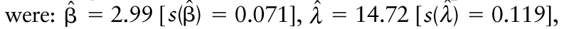{.equation width=60%}

and _κ_ ˆ = 24.9 × 106 [ _s_ ˆ(_κ_) = 1.24 × 105 ]. Based on the estimated _κ_, ∼25 million spores were produced per plant over the “lifetime” of the lesions (under the conditions studied). Moreover, based on estimated _λ_, it took ∼15 days for a lesion (on average) to produce half of its spores (i.e., _λ_ ˆ is the estimate of the time when _Z_ = _κ_ /2 in this model formulation).

The lower frame in Fig. 3.8 shows the daily increments in spore numbers and the predictions from the two models. The spores were collected every 2 days in the original study, so that the original data represented new spores produced per 2-day interval. Thus, we divided each spore-count by 2 to obtain average spore production per day over time. The predicted increments were determined by inserting the estimated parameters into the equation for the first derivative of _Z_ with respect to _t_ (_dZ/dt_) for the two models. The instantaneous rate of change (“daily increment” here) is predicted to be: for the negative exponential model (equation 3.27), and: for the log-logistic model (equation 3.28). With this view the data, one can readily see the poor fit of the negative exponential model to the data, because the curve described by the model is nothing like that of the observed points.

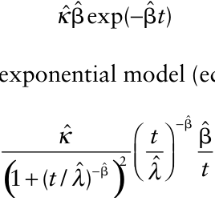

If an investigator simply wished to obtain a good fit to the data, and possibly to compare the estimated parameters corresponding to different conditions, the loglogistic would be a satisfactory choice of model, based on model-fitting results shown here. However, this model may not be satisfactory for different conditions, or for different imposed treatments (e.g., for different temperature regimes). In fact, the main reason for adopting the log-logistic model here was simply that it can describe a relationship where _Z_ increases monotonically with _t_ up to an asymptote _κ_. One can also consider other models that may have more of a theoretical justification. The next two models are presented to demonstrate (at least in part) the rich diversity of models that can be used to describe and understand biological processes.

To motivate the next model, we temporarily stop thinking of the data in Fig. 3.8 as a relationship between two variables, _Z_ and _t_, and the resulting population of _Z_ values at each time _t_. Instead, we think of a _single_ population of _κ_ spores produced by lesions on a plant, and consider a _single_ random variable, _T_, which is the time until each individual spore is produced. The random variable _T_ cannot be any smaller than 0, but has no upper limit. Since the normal probability distribution (equation 3.4) has no lower bound, it is unlikely that _T_ can adequately be represented by this distribution. In such circumstances, a potentially useful model for _T_ is the two-parameter gamma distribution, a statistical probability distribution for a continuous random variable that takes on only positive values. The probability of a spore being formed at or before a given time _t_ [i.e., Pr(_T_ ≤ _t_)] is specified by integrating the gamma distribution (or probability density) function from 0 up to _t_. This is written as: in which _λ_ and _η_ are parameters, Γ(•) is the gamma function (sometimes known as the generalized factorial), and _x_ here is just an index for any value of time between 0 and _t_. Then the cumulative number of spores produced per plant at a given time _t_ is modeled as:

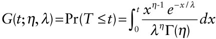

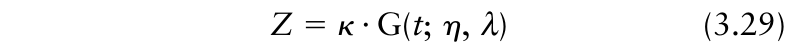{.equation width=60%}

Thus, the _Z_ -axis in Fig. 3.8 (the ordinate) can be viewed as the cumulative probability of a spore being formed at or before _t_, multiplied by the total number of spores that are produced. It is interesting to note that there is no analytical solution to the integration of the gamma distribution; that is, one cannot write out an equation for _G_ (•) without including the integral symbol. Fortunately, the cumulative gamma distribution is calculated (really, approximated with very high accuracy) by many statistical programs, such as SAS, simply by specifying the parameter values in a program-defined function. Then one can use the function _G_ (•) just as one would use the negative exponential or any other specified equation. In other words, _G_ (•) is simply utilized as a flexible function to represent a monotonically increasing response. One reason to use it here is to demonstrate explicitly that many useful models for biological processes may not be expressible as linear or nonlinear equations without the use of the integral symbol. In fact, this situation is quite common for theoretical models of disease dynamics (see Chapter 5). In these circumstances, we say that the model does not have an analytical solution.

There are specialized statistical methods in the lifetime and survival analysis literature for estimating parameters of (cumulative) distribution functions for time of occurrence of events (Scherm, 2004; Lawless, 1982). However, these are difficult to apply when population sizes are in the millions. Moreover, the relationship illustrated in Fig. 3.8 is not quite the same as that typically analyzed in lifetime studies. This is because the number of spores produced is really an estimate based on sampling, and represents an average across multiple plants and lesions per plant (Kolnaar and van den Bosch, 2001). Thus, we return to modeling a response variable as a function of a predictor variable, but now use _κ_ · _G_ (_t_; _η_, _λ_) as the nonlinear function of time (plus the assumed additive error term, ε). Using the NLIN procedure in SAS, which permits the use of the gamma distribution function in addition to standard functions for nonlinear models, the following parameter estimates for equation3.29 were obtained: _η_ ˆ = 3.60 [ _s_ ˆ(_η_) = 0.070], ˆ = 4.48

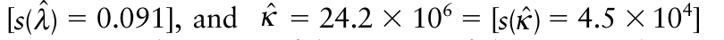{.equation width=60%}

spores per plant. A useful property of the gamma distribution is that expected (mean) time of spore formation is given by _η_ · _λ_. The estimated mean here is 3.60 × 4.48 = 16.1 days. This is close to the value determined by Kolnaar and van den Bosch using a different parameter estimation method.

The (pseudo-) _R_2 for the analysis based on equation 3.29 was 1 − (7.03 × 1011 /2.32 × 1015 ) = 0.9997, slightly larger than that obtained with the log-logistic model. The top frame of Fig. 3.9 shows the fit of equation 3.29 to the data. For comparison purposes, the fit of the log-logistic model (equation 3.28) is repeated from Fig. 3.8. Clearly the cumulative gamma function provided an excellent fit to the data. When shown in terms of daily increments of spores (obtained as the first derivative of equation 3.29 with respect to time), one can better see the differences in fit for the cumulative gamma and log-logistic models (bottom frame of Fig. 3.9). The predicted daily increment (i.e., estimate of _dZ/dt_) was determined by multiplying the estimated _κ_ by the gamma distribution (density) function (not cumulative function) using estimated parameters:

![Upper frame: Cumulative number of spores per plant produced by _Puccinia lagenophorae_ on inoculated _Senecio vulgaris_ plants over time (_Z_). See Fig. 3.8 for more details. Curves represent the fit of equation 3.28 (log-logistic), equation 3.29 (cumulative _γ_ distribution function), and equation 3.30a, b (segmented equations). Time 0 is the day of first observed spore. Lower frame: mean number of new spores produced per day (daily increments; _dZ/dt_) corresponding to the cumulative values. Curves are based on the first derivatives of the equations.](figures/fig3-img19.png){#fig-3-9}

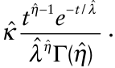

We now consider an additional approach for representing these data. Between times _t_ ∼ 3 and _t_ ∼ 30 days, there is _roughly_ a straight-line relation between _Z_ and _t_. Before _t_ = 3 days and after _t_ = 30 days (or so), there appears to be no or little change in _Z_ with change in _t_; it may be reasonable to describe these regions using an equation with a slope of 0. One can, in fact, model the overall relation with a mixture of equations for the different segments of the time axis. We can consider _Z_ to be a constant (β0) at all times between 0 and _α_ 0 (another constant), and then a linear increase in _Z_ with time between times _α_ 0 and _α_ 1 (another constant). Finally, we can consider that _Z_ is a constant for all times above _α_ 1. This can be written as:

{#fig-3-10}

The middle equation represents the straight line increase in _Z_ with _t_, with slope of β1 and intercept of β0 −β1 _α_ 0. The third equation is just a function of constants, so it is also a constant at all times. Essentially, this third equation indicates that all times greater than _α_ 1 are identical to _α_ 1 in terms of predicting _Z_. Note that β0 + β1(_α_ 1 − _α_ 0) is analogous to _κ_ in the previously discussed models.

Equation 3.30a is a type of segmented or “broken stick” model, in which the transition between segments is not smooth (Schabenberger and Pierce, 2002). In other words, there is an abrupt change in slope at each of the _join points_ (as specified by the _α_ values). The model is also called a linear-plateau model. A hypothetical graph for equation 3.30a is shown in Fig. 3.10 (solid line). For comparison, a graph of a simpler segmented model, with one join point rather than two, is also shown (dashed line). Equation 3.30a has four parameters (the unknown constants _α_ 0, _α_ 1, β0, and β1). If one does not estimate the join points, but uses assumed known values, then one can use linear least squares to estimate parameters. For instance, if one could assume that there is a linear increase between times of 4 and 30; then model fitting would be done just using the data between times of 4 and 30. However, here we assume that the join points are unknown and must be estimated, together with the other model parameters.

Equation 3.30a can be written as a single equation by using an indicator function, _ζ_ (•), that takes on two possible values, 0 and 1. For instance, _ζ_ (_t_ ≤ _α_ 0) equals 1 if _t_ is any value at or below _α_ 0, and equals 0 otherwise. The segmented model can then be written as:

{.equation width=60%}

{.equation width=60%}

This model is nonlinear in the parameters. Although we do not show the details, equation 3.30b is equivalent to a scaled version of the cumulative uniform (rectangular) distribution function with parameters _α_ 0 and _α_ 1. In Chapter 12 it is shown that the uniform distribution serves as a good tool to model crop loss data in relation to disease intensity (see section 12.4.2.2).

We fitted equation 3.30b to the cumulative rust spore data using the NLIN procedure of SAS, because this program allows the user to specify indicator functions. However, we specified β0 as 0 instead of as an unknown constant; this means we assume no sporulation before _α_ 0. There actually are some spores produced at all times shown in the graph, but here we make this assumption about β0 for the purpose of demonstration. Thus, the model as fitted had three parameters (β1, _α_ 0, and _α_ 1), the same number in the cumulative gamma (equation 3.29) and log-logistic (equation 3.28) models.

The fitted values are shown in Fig. 3.9 for equation 3.30a. There was a reasonable fit to the data, with a (pseudo-) _R_2 of 1 − (1.23 × 1013 /2.32 × 1015 ) = 0.995. = Estimated parameters were:βˆ 1 = 1.01 × 106 [ _s_ ˆ( β )

{.equation width=60%}

0.40]. This means that the model predicts no sporulation (because β0 = 0) until _t_ = 3.5 days, then a linear increase in cumulative number of spores until _t_ = 26.9 days. After this time, there is no further increase in spores. The maximum cumulative amount of sporulation is predicted as:

{.equation width=60%}

This prediction is close to _κ_ ˆ in the previous models. The nature of the relationship represented by equation 3.30a is that there is no change in _Z_ with increasing _t_ outside of the time period between _α_ 0 and _α_ 1 (i.e., _dZ/dt_ = 0), and a _constant_ change in _Z_ with change in _t_ between these two times (_dZ/dt_ = β1). From Fig. 3.9, one can see that the segmented model underpredicts daily spore production for _t_ < _α_ 0 and _t_ > _α_ 1. For _α_ 0 < _t_ < _α_ 1 the model underpredicts daily spore production in the period with the highest observed increments, but overpredicts in the periods before and after the period with the highest observed increments. Clearly, this model is less desirable than the other two (i.e., those based on equations 3.28 and 3.29), judged in terms of goodness-of-fit for this data set. However, the segmented model may be acceptable in some circumstances, depending on the objectives of the user.

The four models demonstrated here for the cumulative response are examples of possible ways of describing this relationship. For those interested, Ratkowsky (1990) should be read for a presentation of a very large number of useful nonlinear models for responses that increase with the predictor variable. We evaluated the models presented in this section primarily in terms of fit to the data, and did not discuss the reasonableness of the standard statistical assumptions about the implied additive error (ε). For cumulative responses, the error term may have a non-constant variance and individual errors may not be independent (Schabenberger and Pierce, 2002). This is addressed in Chapter 4. There was no substantial evidence for these departures from standard assumptions with the current data.

All of the models presented can be expanded for more complicated scenarios. For instance, instead of modeling spore production over time from the start of sporulation, one can model spore production from the time of inoculation. This will require incorporation of a parameter in all the potential models that is equivalent to _α_ 0 in the segmented model (equation 3.30b) that represents the time from inoculation until the first spore is produced.

## 3.7 Maximum Likelihood

Least squares regression is the most common method for fitting linear and nonlinear models to continuous data, or to data that—as an approximation—are taken to be continuous. However, there are other methods of model fitting, some of which depend explicitly on the statistical distribution of the response variable, and some which are distribution free (Sprent and Smeeton, 2001; Schabenberger and Pierce, 2002). One alternative to the method of least squares is the method of maximum likelihood. The likelihood is the _joint_ probability or probability density of the observed data as a function of the parameters in the model. This depends explicitly on the probability distribution or probability density function (e.g., equation 3.4) of the response variable. Here, we briefly demonstrate the method for normally distributed data and a simple linear model for _Y_ as a function of _X_ (e.g., equation 3.7c).

The normal probability density function for a single observation is given in equation 3.4. This function is easily generalized for relationships between variables, after noting that _μ_ is the expected value of _Y_, _E_ (_Y_), which is expressed as a function of predictor variables. With equation 3.7d, for example, _E_ (_Yj_) is β0 + β1 _Xj_ for the _j_ th observation. One can then write the density for the two-variable situation as:

{.equation width=60%}

The product of the _f_ (_Yj_) values for all _N_ observations is the likelihood, _L_ = Π _j f_ (_Yj_). For the normal distribution, and the linear two-parameter model, this is written as:

{.equation width=60%}

The principle of maximum likelihood estimation (MLE) is to find the parameter values that result in the largest value of _L_, given the observed data. These values of the parameters, the maximum likelihood estimates, are the most likely ones to have produced the observations in the data set. Note that in equation 3.31b, the term outside the bracket does not depend on the observations. Because _e_ is raised to a negative power, the largest _L_ is obtained when the summation in the exponent is at its smallest possible value. However, this expression [Σ _j_ (_Yj_ − (β0 + β1 _Xj_))2 ] is identical to the sum of squared differences minimized with ordinary least squares (see equation 3.9b). Thus, for normal distributions and a constant variance, least squares and maximum likelihood result in the same parameter estimates!

The equivalence of least squares and maximumlikelihood parameter estimates does not extend beyond the normal distribution case, nor to situations with multiple error terms (say, with complicated experimental designs such as split plots). If the response variable has (or is assumed to have) a binomial distribution, for instance, least squares and maximum likelihood approaches will provide different estimated of model parameters. Generally, the maximum likelihood estimates will be considered more appropriate, because they are based on the actual distribution of the random variable of interest. However, assuming an inappropriate distribution for the random variable of interest could lead to misleading results, because the expression from which the maximum _L_ is obtained is of the wrong form.

The disadvantage of MLE is that a unique analytical solution may not exist for some distributions, even for a linear model. That is, parameter estimation would entail an iterative search for the parameter values that give the largest achieved _L_ for a data set (much as is done with least squares model fitting for nonlinear models). Conversely, there are some advantages of MLE in terms of hypothesis testing, inference, and the distributional properties of estimated parameters (e.g., Schabenberger and Pierce, 2002).

In addition to the direct link between least squares and MLE for normal distributions, there is an additional link for some other situations. In particular, for certain distributions in the so-called _exponential family_ (which include the Poisson, binomial, and gamma), the iterative maximum likelihood estimation can be conducted by the utilization of an iterative least squares methodology. That is, iterative and weighted least squares estimation is performed on a transformation of _E_ (_Yj_), not on the expectation of the transformation of _Yj_. Models of this type are known as _generalized linear models_ (GLMs) (see equation 3.26 for an example). Some practical applications of GLMs are demonstrated in Chapter 4, and (in rather more detail) in Chapter 10.

## 3.8 Discussion and Prelude to Later Chapters

Models are indispensable tools for investigators in probably all fields of study. For plant disease epidemiologists, mathematical models are used to describe, understand, predict, and compare epidemics or components (e.g., sporulation) of epidemics. Deterministic mathematical models are especially popular and useful to characterize the dynamics of disease intensity in time and space, and numerous versions of these models are used throughout the book. There is an inherent randomness to biological processes, and sometimes—depending on the objectives of the study—explicitly stochastic models are needed (Renshaw, 1991; Gibson et al., 1999). Based on the principles of population dynamics, as well as on observations of relations between variables, model that are nonlinear in the parameters are often needed to represent processes or phenomena of interest. Fortunately, some nonlinear models can be re-expressed in linear form using algebraic manipulation, facilitating both model fitting and making various types of calculations with the models (as will be demonstrated in the next chapter).

Even when one takes a deterministic approach to modeling of epidemics, or their components, ultimately parameters are estimated by fitting models to observed data. The two main methods of model fitting are least squares and maximum likelihood, with the former being most commonly used when the response variable is continuous, or assumed to be so. When one fits models to data, randomness (i.e., stochasticity) is incorporated as part of the model, typically expressed as an additive error term—a random variable with expectation of 0, representing the combined effects of all the variables and factors affecting the response that are not considered in the deterministic component. Essentially, this means that one is using a statistical model at this stage, whether or not one is considering variability in the original modeling formulation. The magnitude of the estimated variance of the error term (_σ_2 ), or of related metrics (e.g., SSE), serve as a basis, among other things, for: determination of the precision of estimated parameters; testing hypotheses about the relationship between the response and predictor variables; and comparison of estimated parameters.

In this book, we show how to use models—and the results of model fitting—to describe and understand dynamics of disease development over time (Chapters 4–6) and over space (Chapters 7–9), and to relate yield loss of crops to disease intensity (Chapter 12). We apply statistical models, and results from previous chapters, to a range of problems in epidemiology, including sampling, in Chapters 10 and 11. The principles of modeling are further applied in Chapter 11 to evaluate controls and management decision making. The current chapter focused on model fitting methods that are most applicable to continuous random variables, or variables that are approximately continuous, and where a relatively simple function (linear or nonlinear) can be used to relate a response variable to a predictor variable. Some of the more complicated scenarios that can arise are considered in the context of epidemiological problems presented in other chapters.

Modeling and analysis in plant disease epidemiology have been directly influenced by many other disciplines, including statistics, biomathematics, medical and theoretical epidemiology and population dynamics, geostatistics, ecology, and crop physiology. The symbols used in equations thus vary considerably within botanical epidemlology (e.g. between crop loss assessment and spatial pattern analysis), and there is no practical way to use a notation throughout the book where each symbol has one and only one interpretation. As mentioned in this and the previous chapters, we use _Y_ and _y_ in this book for disease intensity, but most other symbols have multiple interpretations depending on the topic. Even the _r_ symbol, generally understood to be a rate parameter for disease increase (as readers will see in the next two chapters), also can be used as a calculated correlation coefficient. Moreover, the symbol _s_ can represent an estimated standard deviation and also the spatial dimension (distance from an inoculum source). We have strived to be consistent regarding notation within a specific topic in this book (temporal analysis, spatial analysis, etc.). Where a symbol has multiple meanings, the context should make the specific meaning clear.

It should be noted that there are several applications of modeling in botanical epidemiology that we do not cover in much detail, beyond what was covered briefly in this chapter. In particular, a major aspect of epidemiology is determining the relationship between observed disease intensity and the abiotic environment (e.g., climatic and weather variables, edaphic soil conditions), biotic environment (e.g., biocontrol agents, competitors of the pathogens), and anthropogenic factors (e.g., cropping history, crop production systems). We touched on this subject with the Phymatotrichum root rot example (Fig. 3.5) for the situation with a single predictor variable. Typically, there are many interrelated potential predictor variables, and a major part of the modeling is determining which variables should be included in the model, coupled with an evaluation of whether or not transformations of the variables are needed. Some examples of this approach (out of the many) can be found in: De Wolf et al. (2003), Mila et al. (2004), Chtioui et al. (1999), Coakley et al. (1988), Reynolds et al. (1988b), and Wheeler et al. (1994). Although model choice (and interpretation) should always be guided by knowledge of the epidemiology of the disease, the modeling approach is more statistical than it is epidemiological. That is, the analysis is based more on determining statistically significant relationships, rather than building models incorporating temporal, spatial, or spatio-temporal features of the epidemics. This is a very valuable exercise in epidemiology, which can lead to some useful predictive models of disease to be used in disease-management decision making (see Chapter 11; also see Chapter 15 in Campbell and Madden, 1990). Alternatives to traditional statistical models, such as artificial neural networks, have also found good use for these purposes (Francl, 2004). Interested readers who wish to pursue this kind of modeling in an epidemiological context will have to study textbooks, or part of textbooks, such as Neter et al. (1983), Schabenberger and Pierce (2002), Mead et al. (1993), and Collett (2003), in conjunction with this textbook. Two excellent book chapters on regression methods written for plant pathologists or ecologists are Butt and Royle (1990) and Philippi (1993).

To conclude, it must be emphasized that in addition to the mathematical and statistical methodology of modeling, there are philosophical issues of concern. Apart from the argument over empirical and mechanistic modeling, there are general issues that transcend which model-fitting protocols to use and other such technical details. For example, as will be seen in Chapter 5, one mechanistic approach for capturing relevant details of reality is to use a relatively small number of differential equations that result in a large number of epidemic outcomes (Jeger, 1986a). Known sometimes as the “analytical” approach, it is very useful in epidemiology and other areas of population dynamics for deriving general principles of disease dynamics. An alternative mechanistic approach, based on a more reductionist philosophy, is to partition the epidemic into many small parts or components (e.g., spores in air, spores on leaves, infection rate as a function of individual leaf age and position, spore production rate, and so on), with the assumption that all components require description, develop models for each component, and assemble the models into a “systems” type or “simulation” model of epidemics (see chapter 12 in Campbell and Madden, 1990; Miyai et al., 1986; Waggoner, 1990). This simulation approach was very popular in the 1970s and early 1980s, but is less commonly pursued today. As with all models and model types, the value of simulation models is conditional on the objectives of the user. There are some excellent simulation models that have been of tremendous value in representing the complexities of plant disease epidemics and evaluating management approaches (Bruhn and Fry, 1981; Gilligan, 1994; Gilligan et al., 1994; Reynolds and Arneson, 1997; Xu and Ridout, 1998). Here, we generally prefer to take the analytical approach to modeling plant disease epidemics, and to use simulation when, for various reasons, analytical models are inadequate.

Finally, we point out that both empirical and mechanistic models, or their hybrids, are based on the premise that models are simpler than reality, or in the words of Buckland et al. (1997), “that truth is high (effectively infinite) dimensional.” An obvious question is: how simple (or complex) should a model be? Quoting again from Buckland et al.:

_The more information that is gathered, the greater is the model complexity that the data can support. If data are sparse, they can support only a simple model with few parameters. In our view, model selection is the process of identifying the best approximating model, accepting that the data can never support, and can never identify the true model._

We would add that model selection should be based on our understanding of the underlying process or phenomenon of investigation (determined from previous investigations), and the intended use of the model, in addition to the sparseness of the data used to develop the model. Many mathematicians, statisticians, and philosophers have argued about how best to represent the complexity of reality in an efficient and useful manner and to characterize the resulting goodness (or “badness”) of fit. Interested readers should consult Forster and Sober (1994), Zucchini (2000), and Bozdogan (2000) for a more thorough, although statistically challenging, discussion of these issues.

## 3.9 Suggested Readings

- Hau, B. 1990. Mathematics and statistics for analysis in epidemiology. In: _Epidemics of Plant Diseases: Mathematical Analysis and Modeling_, 2nd Edn. (J. Kranz, editor). Springer, Berlin, pp. 12–52.

- Quinn, G. P., and Keough, M. J. 2002. _Experimental Design and Data Analysis for Biologists_. Cambridge University Press, Cambridge, UK (Chapters 2–6).

- Schabenberger, O., and Pierce, F. J. 2002. _Contemporary Statistical Models for the Plant and Soil Sciences_. CRC Press, Boca Raton, FL (Chapters 4 and 5).

Appendix Data for incidence Phymatotrichum root rot in cotton (_y_) and cumulative precipitation (_X_) (Jeger and Lyda, 1986), and cumulative number of rust spores per plant (_Z_) and time (_t_) (Kolnaar and van den Bosch, 2001) used in example analyses of Chapter 3.

|**_Ro_**|**_ot rot_**||**_Cumulat_**|**_ive spor_**|**_es_**|
|---|---|---|---|---|---|
|_X_|_Y_|_t_|_Z_ (×104)|_t_|_Z_ (×104)|
|42.7|0.22|0|2|30|2266|
|43.9|0.28|2|11|32|2297|
|56.6|0.32|4|46|34|2329|
|57.9|0.65|6|188|36|2355|
|37.3|0.04|8|408|38|2371|
|85.1|0.91|10|634|40|2385|
|63.8|0.75|12|871|42|2397|
|56.9|0.58|14|1085|44|2402|
|46.5|0.32|16|1380|46|2409|
|101.6|0.995|18|1600|48|2414|
|46.5|0.68|20|1738|50|2416|
|106.1|0.79|22|1888|52|2418|
|38.9|0.33|24|2015|54|2422|
|||26|2157|58|2422|
|||28|2226|60|2424|
|||||62|2425|
