# Temporal Analysis I: Quantifying and Comparing Epidemics {#sec-ch4}

_And time waits for no one, and it won’t wait for me._ M. Jagger, K. Richards (_The Rolling Stones_)

## 4.1 Introduction

As discussed in the first chapter, a plant disease epidemic can be viewed as a change in disease intensity in a host population over time and space. In many situations, the spatial component is not explicitly considered, and the focus is on the change in intensity over time. As we show in this and the next chapter, a tremendous amount of epidemiological insight can be gained by characterizing disease progress over time. In fact, this characterization is essential to understand how plant diseases develop in populations and how disease control measures affect epidemics.

A graphical plot of disease intensity (_y_) versus time (_t_) is known as a _disease progress curve_ (DPC). For many purposes, this is the primary depiction of an epidemic, serving to summarize the interactions of host, pathogen, and the biological and physical environment on disease development. For convenience of expression, ‘epidemic’ and ‘disease progress curve’ often are used interchangeably in this book, although, in fact, the latter is merely a graphical summary of the former biological process. Although researchers have published disease progress curves throughout the 20th century, it was Vanderplank (1960, 1963) who made the most compelling case for the preparation and analysis of disease progress curves (see section 1.3.1). Vanderplank’s concepts, originally proposed four decades ago, will be brought up several times in this and later chapters. Although considerable advances have been made in recent years, it should be pointed out here that the ideas and approaches of Vanderplank still have a large influence on plant pathologists who are trying to understand epidemics.

Researchers may have many (possibly overlapping) goals in characterizing a plant disease epidemic. At one level, a researcher may only be interested in determining if two or more epidemics are different (in some sense) from each other. In this situation, the population dynamics of disease are not of direct interest; rather, one is interested in which ‘treatments’ have higher (or lower) intensities of disease or rates of disease change. At another level, a researcher may be interested in quantifying how the environment, host, and pathogen affect disease dynamics for the explicit purpose of understanding the complex interactions that influence disease development. This understanding can be used, among other things: to predict disease intensity at a particular time; to quantify the effects of control strategies on epidemics; or ultimately, to develop a theoretical basis for determining whether or not an epidemic will occur, and in the event of occurrence, to identify factors affecting the magnitude of the rate of disease increase and the final intensity of disease.

A central feature of this book is that models (of various degrees of complexity) are used to quantify epidemiological processes of interest. This use of modeling is certainly reflected in the approach taken in this and the following chapters to characterize the typical types of disease progress curves that can be found in plant pathology. Several population-dynamics models that are of direct value in summarizing the essential features of epidemics are introduced and described (more-or-less in order of increasing complexity). By choosing an appropriate model, an entire epidemic can be characterized with a small number of parameters. This makes it relatively easy to compare epidemics and evaluate the effects of biological and environmental factors, as well as possible disease controls, on epidemics. None of these models will provide a perfect fit to observed epidemics. Thus, unexplained variability, or _error_ (in a statistical sense, see section 3.4), must be considered, and the models viewed from a statistical as well as a mathematical perspective. Fitting these models to data, and comparing epidemics based on estimated parameters, can be done using various statistical methods (Campbell and Madden, 1990; Madden, 1986), the choice depending on the design of the experiment or survey that produced the data and the assumptions made about the unexplained variability.

When the investigator is only interested in determining if various treatments affect intensity of disease over time, comparisons of disease progress curves can be done without assuming a particular population-dynamics model. Two general approaches are then possible. First, one uses a form of repeated-measures analysis of variance (ANOVA) to test for treatment (or multiple factor) effects. Here, disease assessment time is considered an explicit factor that affects _y_, and the appropriate error term for this ‘repeated measure’ is determined (Wolfinger, 1996; Zeger and Liang, 1992). Second, one can calculate the so-called area under the disease progress curve (AUDPC) for each replicated epidemic, and then compare epidemics based on ANOVA or _t_ -test results, depending on the size of the study.

A considerable amount of theoretical research has been conducted on disease dynamics over the last decade or so. Several of these advances are covered in Chapter 5, partly because the research depends on the use of more complicated models than used in this chapter. The current chapter, however, sets the stage for more elaborate material by showing some alternative ways of representing disease progress curves.

## 4.2 General Concepts

### 4.2.1 Notation and introduction to models

Epidemics are dynamic processes, and dynamic processes are typically represented by rates of change. If we use the symbol _y_ to represent disease intensity (either incidence or severity) and _t_ to represent time (days, weeks, years, etc.), then _y_ (_t_) is disease intensity at time _t_, and _dy_ (_t_)/ _dt_ denotes the absolute rate of change in _y_ at _t_. Loosely speaking, the absolute rate is a representation of how much _y_ changes over a very small change in time, relative to the small change in time (at any time point during the epidemic). As shown in the subsequent sections, it is not expected that the absolute rate of change _dy_ (_t_)/ _dt_ will be constant for any epidemic; rather, _dy_ (_t_)/ _dt_ generally changes with time in an often predictable manner, given the type of disease being considered. For convenience of presentation, it is standard with population dynamics models to write the absolute rate of change for a variable _y_ over time as _dy/dt_ [i.e., the “(_t_)” is omitted], because the dependence of the rate on _t_ is implicit. In some more complicated models or analyses, returning to the more detailed version of the notation is useful, however.

Several things should be noted about this formulation for disease dynamics. First, lower-case _y_ is used to express disease intensity on a proportion scale (0−1). Thus, _y_ can represent the proportion of plants diseased or the proportion of leaf area covered by lesions. For incidence data, _y_ is an estimate of the expected probability of a plant (or leaf, root, etc.) being diseased, _p_. The symbol _Y_ is used to represent disease intensity on an absolute-unit scale (e.g., square centimeters of lesions per plant, number of diseased plants), although most of the discussion of disease on an absolute scale takes places in later chapters. Sometimes, _Y_ specifically refers to _density_ of disease intensity (e.g., number of diseased leaves per m2 ); this is important for certain formulations of models of disease dynamics (see Chapter 5).

For general modeling purposes, it is assumed that _y_ (or _Y_) changes continuously over time (Madden and Hughes, 2002). Models based on this assumption are called _continuous-time models_. Obviously, this is an oversimplification, as an example will demonstrate. Spores of many fungal diseases are only produced, and infections of plants only occur, when certain environmental conditions are met. In many cases, free moisture is required for sporulation, infection, or both. Thus, _y_ does not increase every day, minute, and second, but only during certain periods of time. However, it turns out that the continuous-time model formulation is not problematic for theoretical and empirical studies of epidemics, unless one is interested in what is happening over very small increments of time. Actual observations of disease intensity seldom occur more frequently than every 5–7 days during epidemics of annual crop diseases, and perhaps only every year or two for epidemics of forest tree diseases. Thus, a range of actual absolute rate values are ‘averaged out’ between the well-separated times at which observations of disease are recorded, and as a result, discrete-time models—in general, more complicated than continuous-time models—are not required. There are some situations, however, in which discretetime models can be used to develop an intuitive understanding of the population mechanisms underlying epidemics, as described in section 5.2.1 of the next chapter. Chapter 8 uses some discrete-time models as well.

The population-dynamics models considered in this chapter can all be considered deterministic (see Chapter 3), at least in their original derivation. That is, for a given set of parameter values, a given model will always predict the same absolute rate of change, _dy/dt_, at any given time _t_. Put another way, variability is not explicitly considered in the models. This is obviously a simplification, because in reality there is variability in biological processes. For instance, the lesions resulting from infection of a particular host by a particular pathogen do not always produce the same number of spores 10 days after infection, and infection of a leaf by a deposited spore may or may not occur on any given day. Stochastic models can be used to deal with this kind of variability, but the complexity of the modeling increases dramatically (Gibson et al., 1999; Renshaw, 1991). Stochastic models probably are of greatest value when the population size of interest is small (e.g., a small host population), or one is interested in the disease status of the individual plant (e.g., characterizing the probability of a plant at location _s_ being infected). The latter is relevant when characterizing spatial patterns of disease (discussed in Chapter 9). When one is interested in modeling the mean disease intensity for a fairly large population of plants, the deterministic approach is reasonable.

We do discuss and use one specific model formulation that is stochastic. This is in relation to fitting models to observed data. Because the models shown here (and elsewhere) never fully describe the observed disease intensity values, it is typically assumed that the statistical model for an epidemic involves a deterministic component and a random error (unexplained variability) component (Madden and Campbell, 1990; Neter et al., 1983), the latter encompassing all the factors that can determine _y_ (_t_) that are not explicitly considered in the deterministic part of the model. In this chapter we expand the presentation of Chapter 3 (section 3.4) on statistical models to show how to fit population-dynamic models to data and compare two or more epidemics.

Relative to the alternatives, continuous-time deterministic models are the easy to use, to fit to data, and to manipulate, and this probably explains their popularity in the general fields of population dynamics and medical, animal, and plant disease epidemiology (Anderson and May, 1991; Diekmann and Heesterbeek, 2000; Gilligan et al., 1997). For most applications, researchers give up very little (if anything) in using these models over the (much) more complicated stochastic or discrete-time models. In fact, continuous-time deterministic models can represent a rich diversity of epidemic types and outcomes, and form the basis for a general set of concepts of disease progression. It should be pointed out that some strong arguments have been made in favor of stochastic models for the general characterization of population dynamics (Daley and Gani, 1999; Renshaw, 1991; Shaw, 1995). Nevertheless, few plant pathologists have found the need to use stochastic models as their first choice in characterizing disease progress curves.

### 4.2.2 Disease progress curves

Integration of the absolute rate of change leads to the determination of _y_ [i.e., _y_ (_t_)] as a function of _t_. A graph of _y_ versus _t_ for a particular model is a theoretical disease progress curvebased on the assumed model and parameter values. A plot of observed _y_ versus _t_ is an observed disease progress curve. Fig. 4.1 exhibits some observed disease progress curves corresponding to a range of pathogens, host crops, and biological/environmental conditions. Multiple curves on the same frame are for a given pathosystem with a range of different experimental treatments, cultivars, or other conditions. The examples were chosen to demonstrate the diversity of curves that can be obtained, and to stress that there is a great deal of similarity of many of the curves. The time scale varies from days to years, and intensity of disease can be given as incidence or severity. Observed intensity could also be based on a (scaled) disease rating scale (see Fusarium wilt of chickpea). Chapter 2 discusses diseaseassessment schemes in some detail.

Many, but not all, of the disease progress curves have a so-called sigmoid (‘slanted _S_ ’) shape. There are biological reasons for this, as will be made clear below. The potato late blight data were originally published in 1954(!), and were used by Vanderplank (1963) in his classic book (also see the hypothetical DPC in Fig. 1.1). Other curves were published after 2000, thus showing the continuing value of disease progress curves in epidemiology. Most of the curves increase monotonically towards a maximum value of disease intensity which may be 1 (100%) or lower value. The Dutch elm disease progress curve rises to a maximum and then declines somewhat. This is due to the dynamics of the host population (i.e., the planting of new disease-free elms), a subject addressed in Chapter 6. Although the host crop is not necessarily static in the other examples, it is with the Dutch elm disease pathosystem that the impact of host dynamics is most obvious in Fig. 4.1.

## 4.3 How Does an Epidemic Occur?

### 4.3.1 Contact of inoculum with the crop host

Plant disease epidemics occur through the _‘contact’_ between inoculum of the pathogen and the disease-free host. The units used to quantify ‘host’ here depend on the disease and crop. Examples include plants, leaves, stems, roots, and leaf area. For convenience of expression, we often refer to plants or just individuals, but the concepts hold for other units. Inoculum is being used fairly loosely here, on purpose. Agrios (2005) defines inoculum as “the pathogen or its parts that can cause infections”. Often the term _infectious unit_ is used for a unit of inoculum produced by a diseased individual (see section 5.1.1). For many fungal pathogens, inoculum consists of spores. However, the inoculum could be comprised of mycelia. Bacterial cells constitute the inoculum for bacterial diseases. For plant viruses, the concept of inoculum becomes more nebulous. Obviously virus particles (virions) comprise the inoculum that can cause infections. However, for most plant viruses, infections occur (naturally) only through virus transmission by arthropod (insect, mite), nematode, or fungal vectors (Thresh, 1983; 1985). Thus, the ‘inoculum’ in the epidemiological sense is comprised of the vectors that have acquired the pathogen and are capable of transmitting the pathogen to another individual. This concept also holds for other prokaryotes (e.g., spiroplasmas, phytoplasmas) that are transmitted by vectors. For a detailed understanding of plant disease epidemics in relation to the biology of the pathogen and host, chapters in the following books are beneficial: Agrios (2005), Campbell and Benson (1994), Fry (1982), Jones (1998a), McLean et al. (1986), and Zadoks and Schein (1979).

### 4.3.2 Epidemic classification

In principle, plant disease epidemics can be classified into two basic types, depending on the source of the inoculum that comes in contact with the host over the course of disease development. In the first type, inoculum that can cause infections is produced _during_ the epidemic by the pathogen in or on individuals that had been previously infected during the current epidemic. Potato late blight is a good example of this. Lesions on infected leaves produce sporangia, some of these sporangia are dispersed to other parts of the same leaves or other leaves or other plants, and some of these cause infections. These new infections result in new lesions, new sporangia, and then additional infections. Epidemics of this type are called polycyclic, and diseases that cause them are called _polycyclic diseases_. This is because there are (typically) multiple cycles of infection (e.g., lesion → spore → lesion → …) during the epidemic. There may be many cycles or just a few in an epidemic, depending on how long it takes to complete an infection cycle. Many of the foliar diseases caused by fungi, oomycetes, and bacteria are polycyclic. These diseases are also called _compound interest_ diseases (Vanderplank, 1963), because in the early part of an epidemic, a model that describes disease increase is identical to the model that describes the compound-interest accumulation of money. A convenient way of thinking of a polycyclic epidemic is one in which there is _spread from plant to plant_ (or from individual to individual, etc.) during the epidemic. The term _transmission_ may be used broadly to represent the process of transfer of infectious units from individual to individual (e.g., plant to plant), including the production of inoculum, dispersal, and subsequent infection of contacted individuals.

![Example disease progress curves from several pathosystems. Severity of _late blight_ of potatoes, caused by _Phytophthora infestans_, corresponding to three potato treatments. Data originally collected in 1954 and reported in Vanderplank (1963). Incidence of plants with _cassava mosaic_ virus symptoms in Africa (Sserubombwe et al., 2001). Intensity of _Fusarium wilt_ of chickpea for a controlled study in which plants were grown in soil with different inoculum densities of _Fusarium oxysporum_ f.sp. _ciceris_ (Landa et al., 2001). Intensity determined from an ordinal disease-rating scale and converted to a 0−1 scale. Incidence of _bud blight_ of soybeans, caused by tobacco streak virus (Almeida et al., 1994). Incidence of elms with _Dutch elm disease_, caused by _Ophiostoma_ spp. (Swinton and Gilligan, 1996). Data compiled for the total number of elms in the UK that were healthy, weakly infected or strongly infected. Severity of sorghum with two diseases in the same field, _anthracnose_ (caused by _Colletotrichum sublineolum_; solid line) and _leaf blight_ (caused by _Exserohilum turcicum_; broken line) (Ngugi et al., 2001).](figures/fig4-img01.png){#fig-4-1}

In the second type of epidemic, inoculum that can cause infections is _not_ produced during the epidemic by the pathogen in or on individuals that had been infected during the current epidemic. Rather, the inoculum that infects the host individuals during the current epidemic may be in the soil, on weed plants, in infected crop plants in another field, or elsewhere. During the current epidemic, infected plants may produce inoculum, but the inoculum is not available (in some sense) to cause additional infections in the current epidemic. Many soil-borne pathogens cause epidemics of this type. For example, with Verticillium wilt of potato, caused by _Verticillium dahliae_, roots of plants become infected by the germinating microsclerotia (the survival spores of the fungus) in the soil. The pathogen moves through the vascular tissue of the plant and ultimately produces new microsclerotia within the infected plant. This inoculum is only released into the soil when the plant decays at the end of the season. Thus, healthy plants do not contact the newly produced inoculum during current epidemic. In other cases, inoculum is only produced at the end of a growing season, such as with maize smut (caused by _Ustilago maydis_). Several plant virus diseases are also of this type (Thresh, 1983), possibly including soybean bud break (Almeida et al., 1994), one of the examples in Fig. 4.1. A typical situation would be when the arthropod vector is capable of acquiring the virus from infected plants of one species and then transmitting the virus to plants of a second species, but the vector is not capable of acquiring the virus from infected plants of the second species. Then, there can be no spread from plant to plant within a crop comprising plants of the second species.

Epidemics of this latter type are called monocyclic, and diseases that cause them are called _monocyclic diseases_. This is because there is just one cycle of infection in an epidemic, although the infections can be spread out over a very long period of time. Vanderplank (1963) called these diseases _simple interest_, because one mathematical model that describes disease increase is the same as a model that describes the simpleinterest accumulation of money. A convenient way of thinking of a monocyclic epidemic is one in which there is _no spread from plant to plant_ (or from individual to individual, etc.) during the epidemic. One might be tempted to think of simple-interest diseases as causing less serious epidemics because infections do not lead to further infections. Indeed, in medical and veterinary epidemiology, only polycyclic epidemics would generally be considered as ‘real’ epidemics. However, simpleinterest diseases of crops are important. With either type of disease it is possible for 100% of the plants to become infected, depending on factors which will be considered below.

In the discussion of polycyclic diseases, we ignored the initial infections that start an epidemic. Previously infected plants do not cause this initial infection, since there are no previously infected plants at the start of the epidemic. This initial level of disease, often called the _primary infection_, is a result of the contact between disease-free host individuals and inoculum produced elsewhere or in a previous year (at the same location). Any infection that results ultimately from the primary infection is called a _secondary infection_. A secondary infection could be a late blight lesion formed from a spore produced in the first lesion in the field, or from spore that was produced in a lesion that resulted from another secondary infection. It should be noted that the primary infection process that starts a polycyclic epidemic is analogous to the process that occurs throughout a monocyclic epidemic. In this sense, one can think of monocyclic epidemics as consisting of only primary infections.

### 4.3.3 Nuances of classification of epidemics

Classification of an epidemic as being monocyclic or polycyclic can depend on several factors. In particular, time scale and host-plant scale both affect the classification. For instance, although Verticillium wilt of potato is monocyclic in a single growing season, over the course of multiple growing seasons the disease can be considered polycyclic. This is because the inoculum produced in one season infects plants the next season; thus, inoculum originating in previously infected plants (from the previous year) can infect other plants in the current year. Sometimes the term _polyetic_ epidemic or polyetic disease is used for disease development over multiple growing seasons. Often, this book focuses on what happens in a single growing season, because this is a natural unit of time to consider for disease dynamics, at least in the context of diseases of annual crops. For diseases of annual crops, the natural time scale for an epidemic, then, is a fraction of a year. For diseases of perennials, however, the natural time scale may cover a number of growing seasons, and an epidemic can take place over many years. If the host individual of direct interest, and the basis for disease assessment, is the plant, then the statements above about soil-borne pathogens causing monocyclic diseases are reasonable for many situations. However, if the unit of interest is the individual root, or a site on a root, then many soil-borne pathogens cause polycyclic diseases (of roots) (Gilligan et al., 1994). For instance, epidemics of take-all disease of wheat, caused by _Gaeumannomyces graminis_ var. _tritici_, occur by root contact with inoculum in the soil. In addition, there are secondary infections of other parts of the same roots or different roots of the same plant, resulting from mycelial growth. In fact, with this disease, there also could be some spread from plant to plant within a season by mycelial growth.

## 4.4 Models

Five population-dynamics models that can be of value for representing, comparing, and understanding plant disease epidemics are presented in some detail. These can be also called disease-progress or _growth-curve models_. The latter term arises because the models used here in a populationdynamics context can also be used to represent the growth in size (mass, length, etc.) of individual organisms over time (Richards, 1969). The first three of the models presented below are especially important, because they serve as the bases for the most detailed empirical and theoretical research and application in epidemiology.

### 4.4.1 Exponential model

The first model considered is called the exponential, and has been used to represent population growth for more than two centuries. The equation for the absolute rate of disease increase is written as:

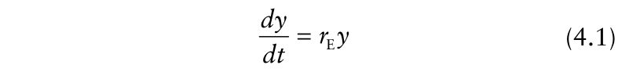{.equation width=60%}

in which _r_ E is a rate parameter (constant). All of the models discussed here have a rate parameter, and we use a subscript to identify the model. This subscript is needed because the scale (magnitude) of the parameter for a set of disease observations depends on the model. It is often convenient to refer to the rate parameter in general, rather than for a specific model; we use _r_ with an asterisk subscript (_r*_) for this purpose.

The absolute rate of increase divided by _y_ [(_dy_ / _dt_) · (1/ _y_)] is called the _relative rate of increase_. Rearrangement of equation 4.1 shows that the relative rate for the exponential model is equal to the parameter _r_ E. Thus, exponential growth is characterized by a constant relative rate of increase. If _y_ is representing the proportion of diseased individuals (e.g., plants), and time is expressed in days, then _dy/dt_ represents the new diseased individuals (on a proportion basis) per day. The parameter _r_ E, in this case, would be interpreted as the new diseased individuals per diseased individual per day. The “diseased individual” terms cancel out, and the units simple become days−1 (or more generally, time−1 ).

The absolute rate of disease increase is plotted versus time for two values _r_ E in Fig. 4.2. A property of this model is that _dy/dt_ increases continuously, without limit, over time. The higher _r_ E value results in higher _dy/dt_. The exponential model may be useful for representing the early part of polycyclic epidemics. This is a logical initial model to consider for such circumstances because the absolute rate of disease increase is directly proportional to the level of intensity at a given time. Given that polycyclic epidemics are characterized by the production of inoculum by diseased individuals during the epidemic, the absolute rate needs to be related to the level of disease intensity.

{#fig-4-2}

Assuming that the exponential model is representing a polycyclic epidemic, then _r_ E summarizes—in some complex sense—all the biological and physical factors that can determine the increase in disease, other than the intensity of disease itself (which is explicitly incorporated into the model). Inoculum production per diseased individual, probability of the inoculum contacting and infecting a disease-free host plant individual, time for a new infected individual to start producing spores, the length of time that an infected individual produces inoculum, virus titer in infected plants, probability of a vector acquiring and then transmitting a virus to a plant, and other factors, all affect the magnitude of _r_ E. Although the inter-relationships between the variables that contribute to the value of _r_ E may be complex, the exponential model provides a simple way of summarizing their overall effect.

Although absolute rates are useful for understanding dynamic processes, _dy/dt_ is not directly measured with actual epidemics. Rather, disease intensity (i.e., _y_) at selected times are observed, as shown in Fig. 4.1. To obtain _y_ as a function of _t_, one integrates equation 4.1. Integration leads to:

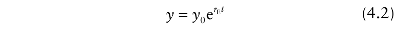{.equation width=60%}

in which _y_ 0 is a (new) parameter, and e is the base of the natural log system (2.718…). Mathematically, _y_ 0 is the constant of integration, that is, the additional parameter (constant) that is obtained when analytically integrating an equation. It also has a biological interpretation. If _t_ = 0 represents the start of the epidemic, then _y_ 0 is the initial disease intensity (i.e., using equation 4.2, _y_ 0 is the value of _y_ when _t_ is equal to zero). Reverting back to the more thorough notation, which is generally not needed here, _y_ 0 = _y_ (0) and equation 4.2 could be written as _y_ (_t_) = _y_ (0)exp(_r_ E _t_). Note that exp(•) is an alternate notation for e raised to a power. It is important for the reader to realize that the description of the epidemic given above started with one parameter in the model for the absolute rate of disease increase (equation 4.1), but that after integration the resulting model for the disease progress curve (equation 4.2) has two parameters.

Equation 4.2 can be used to model any variable that ‘grows’ exponentially. In fact, the equation even represents the compound-interest accumulation of capital when the interest is added to the principal continuously; here, _y_ 0 represents the initial investment and _r_ E represents the compound-interest rate. A plot of equation 4.2 shows that _y_ increases continuously over time, with no upper limit (Fig. 4.2 upper frame). That is, for any positive value of _r_ E, _y_ will increase indefinitely over time. Thus, this model is not realistic for any epidemic in the long-term, but it can be useful—often as an approximation of more complicated models—before intensity of disease is too large. Just what constitutes ‘too large’ depends on the extent of the approximation one is willing to accept: for intensities up to about 0.05 the simplicity of the exponential model is often worth the trade-off involved in accepting an approximate calculation.

Equation 4.2 is nonlinear in the parameters (see sections 3.2.4 and 3.5). However, it can be linearized by taking logarithms of both sides. This results in the following equation:

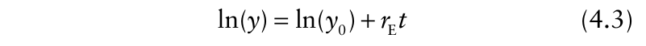{.equation width=60%}

This linear model describes a straight line relation between ln(_y_) and _t_, with slope of _r_ E, and intercept ln(_y_ 0). Each of the models discussed in this section can be expressed in linear form. However, the transformation of _y_ is different in each case. We use the symbol _y*_ to represent the transformation of _y_ that produces a linear model. For the exponential, _y*_ = ln(_y_). One advantage of equation 4.3 is that parameters can be estimated with linear regression. Another advantage is in ease of manipulation in calculations.

_Some calculations._ In section 4.4.6, a considerable amount of detail is given on performing calculations with the growth models. However, we take a slight diversion here from the presentation on models and show some example calculations in order to preview the application of disease progress models in an epidemiological context.

Assuming that one is describing a tree disease over multiple years, that _y_ 0 is 0.005, and that _r_ E equals 0.1/year (see Fig. 4.3), one can calculate, for example,

{#fig-4-3}

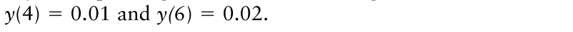{.equation width=60%}

disease intensity at year 3. One way of doing the calculation is based on equation 4.3:

{.equation width=60%}

In this calculation, ln(_y_) is determined at year 3, _not y_. One needs to ‘backtransform’ this value. For the exponential model, the backtransformation is

{.equation width=60%}

So, for the example, _y_ = exp(−5.0) = 0.0067. With this model, it is probably just as convenient to use the nonlinear version of the model directly for the calculation:

{.equation width=60%}

However, for the more complicated models discussed subsequently, calculations such as this one are more straightforward with the linear, rather than the nonlinear version of the model.

A conceptual advantage of a straight-line model is that any point can be treated as the starting point for some calculations. Using the same example, assume that one knows that _y_ at _t_ = 8 years into the epidemic is 0.0111, _r_ E is 0.1/year, but that one does not know _y_ at the start of the epidemic. If one wanted to predict _y_ at year 15, one could first extrapolate backwards to first find _y_ 0. Rearrangement of equation 4.3 gives:

{.equation width=60%}

Backtransformation gives a _y_ 0 of exp(−5.30) = 0.005, the original starting disease level. Then, the calculation of ln(_y_) at year 15 could be done with equation 4.3 as −5.30 + (15) · (0.10) =−3.8. Backtransformation gives exp(−3.8) = 0.022 for _y_ (15). The determination of _y_ 0 is _not_ needed however, by simply considering _t_ = 8 as the first time. The same prediction for _y_ at _t_ = 15 years is obtained by using _t_ = 7 in equation 4.3, ln(0.0111) + (7) · (0.10 ) =−3.8, and then backtransforming the resulting ln(_y_) value.

This is one place where a version of the alternate notation is useful. If one is interested in the change in disease between two specific times, labeled _t_ 1 and _t_ 2, one can write equation 4.3 in the following equivalent form:

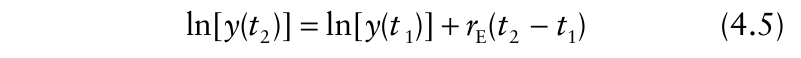{.equation width=60%}

Here, the starting time is _t_ 1, the later time is _t_ 2, and the time period is _t_ 2 − _t_ 1. Using this formulation, ln(_y_) at

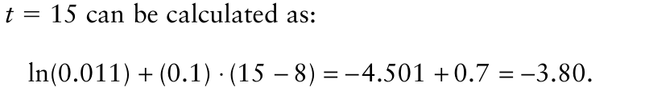{.equation width=60%}

Based on the rules of algebra, the numerator can be written as: ln[2 _y_ (_t_ 1)/ _y_ (_t_ 1)] = ln(2). In other words, the disease-intensity terms cancel out, and the doubling time is given very simply as:

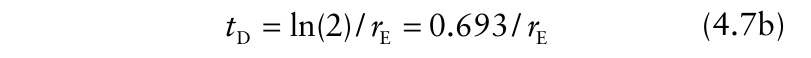{.equation width=60%}

This relation can be easily derived directly from equation 4.2, by writing it as 2 _y_ = _y_ exp(_r_ E _t_ D), and algebraically rearranging the formula so that _t_ D appears alone on the left-hand side. With this model, for a given value of _r_ E, it takes the same amount of time for disease to increase from 0.01 to 0.02 as it does to increase from 0.05 to 0.10. Note that the doubling time is inversely related to the rate parameter, meaning that a small rate constant corresponds to a large doubling time. When _r_ E = 0.1/year, then disease intensity doubles every 0.693/0.1 = 6.93 years; when _r_ E = 0.35/year, disease doubles every 2 years (or every 2 days if _r_ E = 0.35/day).

### 4.4.2 Monomolecular model

Backtransformation, once again, gives _y_ = 0.022 for disease intensity at _t_ = 15 years.

Through rearrangement of equation 4.5, one can easily determine the rate parameter (with the assumed exponential model) as:

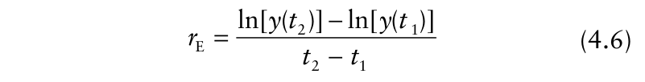{.equation width=60%}

If, as a different example (Fig. 4.3), _y_ = 0.01 at _t_ 1 = 4 years and _y_ = 0.02 at _t_ 2 = 6 years, then _r_ E is calculated as:

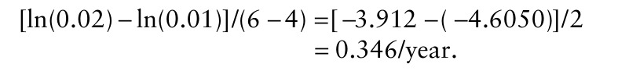{.equation width=60%}

More sophisticated approaches are available for parameter estimation, as discussed later.

In the examples used here, it was either assumed that _r_ E equaled 0.1/year, or that it was calculated as 0.346/year (Fig. 4.3). It is natural to ask: what is a large value for this rate parameter? Although researchers can answer this question with experience, there is also a direct way of gaining a general understanding of large and small rates. In particular, one can determine how long it takes disease intensity to double with a particular value of the rate parameter. Using symbols, one can determine the time to increase from one specific value of intensity, _y_ (_t_ 1), to _y_ (_t_ 2) = 2 _y_ (_t_ 1). Then the time period in equation 4.5, (_t_ 2 − _t_ 1), is the time to double, which can be written simply as _t_ D. Rearrangement of equation 4.5 with the symbol substitutions given here results in:

The so-called monomolecular model has been used to describe numerous phenomena, including certain chemical reactions (from where the name derives) and the growth of plants and animals. It can also be called the negative exponential or restricted exponential model. With this model the absolute rate of disease increase is given by:

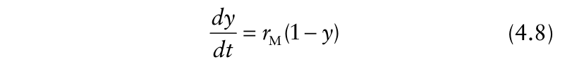{.equation width=60%}

in which _r_ M is a rate parameter with units of time−1 . For this model, _dy/dt_ is not directly proportional to _y_. Instead, the absolute rate is directly proportional to 1 − _y_. Because disease intensity is represented as a proportion, 1 − _y_ is equal to disease-free individuals (e.g., leaves, plants, etc.), or plant area, when we assume (as is normally done) that maximum possible _y_ is 1. It is common to refer to the disease-free individuals (or area) as healthy individuals (or area). This does not mean that the plants are healthy in an absolute physiological sense, but simply that they are deemed not infected (for example, by visual inspection) by the pathogen of interest.

With a constant and positive _r_ M, _dy/dt_ for this model _decreases_ towards 0 as _y_ increases, because 1 − _y_ becomes smaller with increasing _y_. This decline can be seen in Fig. 4.4 for two values of the rate parameter. The mathematical reason for the decline can be seen by writing equation 4.8 in an expanded form:

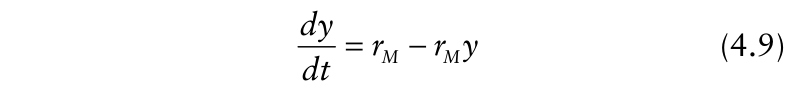{.equation width=60%}

The absolute rate is highest when _y_ = 0 (with _dy/dt_ = _r_ M), and then declines to 0 when _y_ = 1. In epidemiological

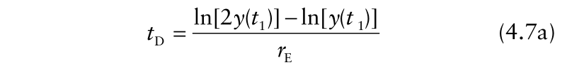{.equation width=60%}

{#fig-4-4}

terms, the absolute rate declines because healthy individuals are fewer (or healthy plant area is smaller) as disease intensity increases. Once an individual plant (or an individual unit of plant tissue) is infected it cannot be infected again. Thus, as _y_ increases, inoculum is more likely to come in contact with already infected individuals and so less likely to cause a new infection.

Because _dy/dt_ in equation 4.8 is directly proportional 1 − _y_, and not to _y_, the monomolecular is an appropriate model to consider for monocyclic epidemics. Infected individuals during a monocyclic epidemic do not produce inoculum that can infect other individuals or plant area (during the _current_ epidemic). Thus, disease intensity does not contribute to new disease, and _dy/dt_ should not be proportional to _y_ for this type of disease.

If equation 4.8 is used to represent monocyclic epidemics, then a straightforward interpretation of the rate parameter is possible. Dividing both sides of equation 4.8 by 1 − _y_, _r_ M [=(_dy_ / _dt_) ·(1/(1 − _y_)) is seen to be equal to the increase in diseased individuals per healthy individual (both on a proportion scale) per unit of time. Moreover, _r_ M is the product of the amount of inoculum (_x_ ′ ) available for infection and the rate (i.e., per unit of time) at which this inoculum causes infection (φ); that is, _r_ M = φ _x_ ′. The fuller definition for φ is the number of new diseased individuals per healthy individual (on a proportion scale) per unit of inoculum per unit of time. This simplifies to “per unit of inoculum per unit of time” because disease and healthy individuals are represented as proportions (essentially, unitless). The φ term can be considered a type of efficiency _._ By multiplying φ by _x_ ′, we see that the units simplify to just time−1 .

The concept behind _r_ M is embedded in diseaseinoculum curves that are often determined for plant diseases, in which plants are exposed to increasing densities of inoculum (in the soil or on the leaf surface) and disease intensity is determined after so much time has elapsed (Baker, 1978). Although these curves are almost always concave over the full range of inoculum densities, the curves are actually straight lines at low densities with slope equal to φ or a scaled value of φ (Vanderplank, 1975). See sections 3.6.1 and Fig. 3.7 for an example data set. Both an increase in inoculum and an increase in probability of inoculum causing infections (say, through a more favorable physical and biotic environment) result in higher _r_ M. There is some similarity of φ _x_ ′ of the monomolecular model and _y_ 0 of the exponential (and other polycyclic-disease models). However, there is a difference: _y_ 0 in equation 4.3 is an instantaneous value, not a change over time.

This concept of _r_ M as the product of inoculum and inoculum efficiency can be expressed another way. Instead of thinking of inoculum density as being fixed in time, one can consider a continuing influx of inoculum into a field. Then, inoculum has units of “per unit time” and written here as _x_ 0. This influx could be in the form of spores blown in per hour from outside sources (e.g., from weeds) or viruliferous insect vectors arriving per day from other fields. Then, the efficiency of infection term (φ) is unitless, giving 1/time units to the product φ _x_ 0. As long as the product of inoculum and its efficiency is a constant (or approximated reasonably well by a constant), with 1/time units, the following mathematical derivation is appropriate. When the product of inoculum and efficiency varies over time then more complicated mathematical models are needed, as discussed in section 6.3.

Analytical integration of equation 4.8 results in the following expression for _y_:

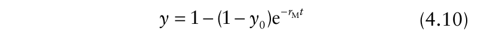{.equation width=60%}

in which _y_ 0 is a constant of integration (equal to the value of _y_ at _t_ = 0). A graphical plot of _y_ versus _t_ is concave to the time axis (Fig. 4.4); _y_ increases rapidly at low _t_, and steadily approaches an upper limit of 1 with everdecreasing slope. The shape of this curve is fundamentally different from the _y_: _t_ curve for the exponential model (see Fig. 4.2). At small times, the monomolecular curve is nearly a straight line. This can be seen by considering the second version of the differential equation (equation 4.9) for monocyclic diseases. At small _y_ (_y_ ≈ 0), _dy_ / _dt_ ≈ _r_ M.

Integration then leads to _y_ = _y_ 0 + _r_ M _t,_ an equation for a straight line with slope _r_ M on an untransformed scale _._ This is the equation for the simple-interest accumulation of money at rate _r_ M. Disease intensity must be very low for the approximation to hold, and we will not explore this situation any further here.

It should be noted that one can use equation 4.10 for an increase in disease intensity over time even when _y_ 0 = 0. The equation then simplifies to: _y_ = 1 − exp(− _r_ M _t_). On the other hand, if _y_ 0 = 0 for the exponential model, _y_ = 0 at all times, and hence there is no epidemic. This difference between the two models can be explained by consideration of the underlying epidemiology. For polycyclic diseases, epidemics occur by the multiplication of effective inoculum, and the compounding of disease, through the epidemic; hence, disease at any time is based on disease at the previous times (back to time 0). With monocyclic diseases, however, the increase in disease (during the current epidemic) is not due to multiplication of inoculum, or compounding of disease; rather, the increase in disease is due exclusively to the plant contact with inoculum produced in previous epidemics or in epidemics at other locations (and restrained by the available disease-free host area). Thus, there need not be any disease at a specific time (e.g., _t_ = 0) for an epidemic to occur.

Equation 4.10 can be linearized to:

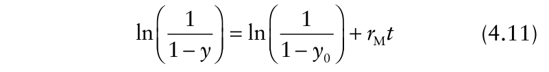{.equation width=60%}

increases. For instance, transformed values of a few disease intensities are given in Table 4.1. Given that the solution to equation 4.8 is _y_ 0 + _r_ M _t_ at small _y_, it should not be surprising that _y_ and ln[1/(1 − _y_)] are similar at small _y_. The linearized version of the model can also be written as:

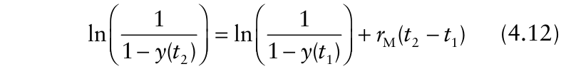{.equation width=60%}

The linear form of the monomolecular model (either equation 4.11 or 4.12) can be used to predict the multiple-infection transformation of _y_ at a given _t_. One can then obtain the corresponding predicted value of _y_ by backtransformation:

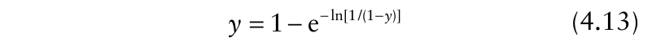{.equation width=60%}

For example, suppose that _y_ 0 = 0.01 and _r_ M = 0.05/day. One can predict _y_ at _t_ = 6 days by first calculating:

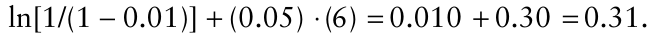

To obtain a prediction of _y_, one backtransforms 0.31 with equation 4.13 to obtain _y_ = 0.267. Further discussion of calculations involving the monomolecular model is delayed until after some other models have been presented. in which ln[1/(1 − _y_)] is known as the multipleinfection transformation. This transformation can be obtained in a different context based on the Poisson probability distribution (see sections 5.2.1 and 9.7.2). It should be noted that ln[1/(1 − _y_)] is equivalent to −ln(1 − _y_). Equation 4.11 is an expression for a straight line with intercept of ln[1/(1 − _y_ 0)] and slope of _r_ M. At low _y_, ln[1/(1 − _y_)] is roughly equal to _y_, but the transformation deviates substantially from _y_ as _y_

### 4.4.3 Logistic model

We now consider a model that is more generally appropriate than the exponential model for representing polycyclic epidemics over the full range of disease intensity values. The model incorporates features of both the exponential and monomolecular models, as already discussed, and thus is presented here, following the discussion of the two simpler models. The model is known as the logistic and has a long history in population biology, going back at least to 1838 (Madden and Campbell, 1990). It has been widely used in plant pathology over the last 40 years or so, on the basis of compelling arguments presented by Vanderplank (1963). The logistic model also serves a ‘stepping stone’ to the more sophisticated models presented in the next chapter.

**Table 4.1.** Transformation of disease intensity (_y_) for some different disease progress models.

|**_y_**|**_ln(y)_** **_equation 4.3_**|**_ln[1/(1_**−**_y)]_** **_equation 4.11_**|**_ln[y/(1_**−**_y)]_** **_equation 4.16_**|−**_ln[_**−**_ln(y)]_** **_equation 4.21_**|
|---|---|---|---|---|
|0.005|−5.298|0.0050|−5.293|–1.67|
|0.01|−4.605|0.0101|−4.595|–1.53|
|0.05|−2.996|0.0513|−2.944|–1.10|
|0.10|−2.303|0.1054|−2.197|–0.83|
|0.25|−1.386|0.2877|−1.099|–0.33|
|0.50|−0.693|0.6932|0.0|0.37|
|0.75|−0.288|1.386|1.099|1.25|
|0.90|−0.105|2.303|2.197|2.25|
|0.95|−0.051|2.996|2.944|2.97|
|0.99|−0.010|4.605|4.595|4.60|
|0.995|−0.005|5.298|5.293|5.30|

The differential equation form of the logistic model is given by:

{.equation width=60%}

in which _r_ L is a rate parameter. For this model, the absolute rate of disease increase is proportional to both diseased and healthy plant individuals (both on a proportion basis in this formulation). As such, the logistic model can be considered a combination of the exponential, where _dy/dt_ is proportional to _y_, and the monomolecular, where _dy/dt_ is proportional to 1 − _y_. We assume here, as with the previous model, that maximum possible value of _y_ is 1. By itself, the _y_ term in equation 4.14 accounts for the fact that the absolute rate increases with increasing disease, since increasing disease means more inoculum produced for further infections. By itself, the 1 − _y_ term accounts for the fact that the absolute rate decreases with increasing _y_ because there is a decreasing number of healthy individuals (or a decreasing amount of healthy plant tissue) for this inoculum to infect as _y_ increases. This combination of properties of the exponential and monomolecular models provides a basis for a model description of polycyclic epidemics.

With the logistic model and positive _r_ L, _dy/dt_ starts low, increases to a maximum, and then declines towards 0 (Fig. 4.5). Early in the epidemic (specifically, at values of _y_ close to 0), the rate curve resembles the exponential model (Fig. 4.2); mathematically, this is because 1 − _y_ ≈ 1 when _y_ is near 0. Late in the epidemic (specifically, as _y_ approaches the maximum value of 1), the rate curve resembles the monomolecular model (Fig. 4.4); mathematically, this because _y_ ≈ 1 when 1 − _y_ is near 0. This pattern in the absolute rate can also be seen by rewriting equation 4.14 in an alternative format, _dy/dt_ = _r_ L _y_ − _r_ L _y_2 , which makes it clear that the right-hand side is a quadratic function of _y_. With a positive _rL,_ the quadratic function increases to a maximum and then declines. The maximum can be obtained by differentiating equation 4.14 with respect to _y_, setting it equal to 0, and solving for _y_. The derivative of equation 4.14 is _r_ L − 2 _r_ L _y_. Equating this to zero and rearranging shows that the maximum value of _dy/dt_ occurs at _y_ = 1/2, and is not dependent on _r_ L _._ In other words, for a logistic-type epidemic, the maximum absolute rate always occurs at a disease intensity that is exactly 50% of the maximum. The value of _dy/dt_ at the maximum is obtained by substituting 1/2 for _y_ in equation 4.14. This results in

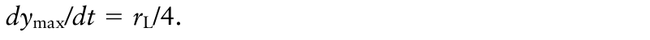{.equation width=60%}

{#fig-4-5}

At the beginning of this chapter we emphasized that an epidemic occurs because of the contact between inoculum and healthy individuals. The healthy individuals are incorporated in the logistic model with the 1 − _y_ term. The reader may now notice that there appears to be an essential shortcoming of the exponential model (as discussed above) for polycyclic diseases—it does not have an explicit healthy-individual term. In fact, the exponential can be viewed as a special case of the logistic in which healthy individuals (on a proportion scale) are fixed at the maximum possible value (=1) at all times. Obviously, this is not realistic in general, but can be useful near the start of an epidemic, as already mentioned.

Inclusion of the _y_ term in the model recognizes that the inoculum in a polycyclic epidemic comes from the infected individuals during the epidemic. The production of inoculum from diseased individuals, the movement of inoculum to other individuals, and the infection of healthy individuals by dispersed inoculum are all incorporated into the rate parameter _r_ L. This parameter also accounts (in a rather complicated manner) for the time between infection and the production of inoculum by infected individuals and the time period over which infected individuals can produce inoculum. These latter properties are addressed more fully in the next chapter.

More formally, _r_ L in equation 4.14 is equal to (_dy_ / _dt_) · (1/ _y_ (1 − _y_)). That is, the logistic rate parameter is the increase in diseased individuals per diseased individual per healthy individual (all as proportions) per time. The diseased individuals cancel out in the definition. Furthermore, since “healthy individuals” is represented as a proportion, the only unit remaining in the definition is time. Thus, _r_ L has units of time−1 . The parameter is sometimes known as the secondary infection rate because it summarizes the secondary infections occurring throughout polycyclic epidemics.

Integration of equation 4.14 results in the following expression for _y_ as a function of _t_:

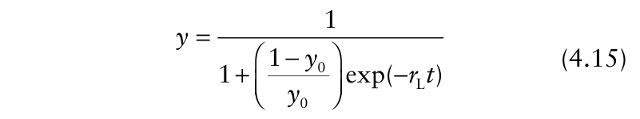{.equation width=60%}

Fig. 4.5, with _y_ 0 = 0.001, one can calculate _t_ ′ values of 69 and 23 days.

It should be noted that there are many equivalent ways of writing the nonlinear solution to the differential equations presented for disease progression. Because of the widespread application of the logistic model in epidemiology, it is helpful to see some of the alternatives. For example, we can write:

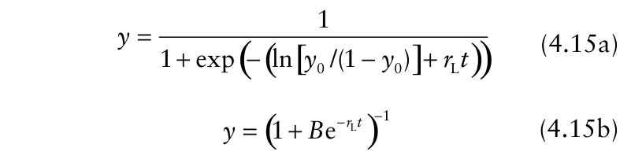{.equation width=60%}

and

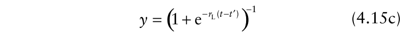{.equation width=60%}

As above, _y_ 0 is a constant of integration and represents disease intensity at _t_ = 0. A graph of equation 4.15 produces a ‘classic’ sigmoid (_S_ -shaped) disease progress curve (Fig. 4.5), in which _y_ increases slowly at first, rises rapidly in the middle range of intensities, and then slowly approaches the maximum. One can see that the maximum _dy/dt_ occurs at _y_ = 1/2 by plotting both the rate and disease on the same graph (Fig. 4.6). The time at which the maximum rate occurs can now be found by substituting 1/2 for _y_ in equation 4.15 and solving for _t_. We call this time _t_ ′ _._ Mathematically, this is known as the inflection point— _dy/dt_ is increasing at times less than _t_ ′, and decreasing at times greater than _t_ ′ _._ A little algebra results in the following expression: _t_ ′ = −ln[ _y_ 0/(1 − _y_ 0)]/ _r_ L. That is, although the value of disease intensity where maximum _dy/dt_ is reached does not depend on _r_ L, _r_ L (and _y_ 0) determine how long it takes to reach the maximum. In general, higher values of _r_ L mean shorter times to reach any particular _y_ value. For the two curves in in which _B_ = (1 − _y_ 0)/ _y_ 0, and, as above, _t_ ′ = −ln[ _y_ 0/ (1 − _y_ 0)]/ _r_ L. As with the exponential model, the logistic model is undefined when initial disease is 0. Biologically, this makes sense since disease increase during the current epidemic for a polycyclic disease is dependent on diseased individuals that are already present.

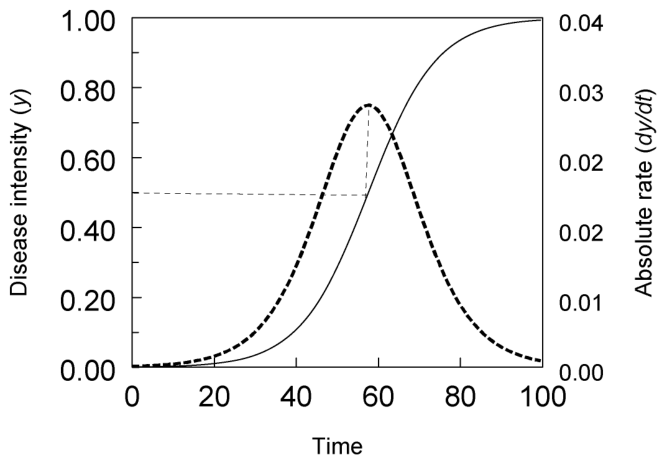{#fig-4-6}

The logistic model of equation 4.15 can be linearized to:

{.equation width=60%}

which is an equation for a straight line with intercept of ln[ _y_ 0/(1 − _y_ 0)] and slope of _r_ L. The term ln[ _y_ /(1 − _y_)] is known as the _logit transformation_. Logits are similar to natural logs at small values of _y_ (say, <0.05), but then deviate substantially as _y_ increases (see Table 4.1). At large _y_, logits are similar to the multiple infection transformation values of the monomolecular model (equation 4.11). The logit of _y_ is never similar to _y_. It should be noted that logits are negative at _y_ < 0.5, and positive at _y_ > 0.5. The linearized logistic model can also be written as:

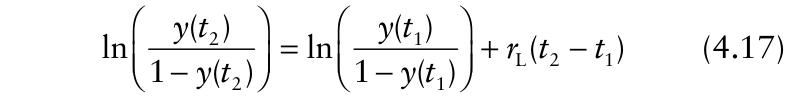{.equation width=60%}

for transformed disease intensity at two times. The rationale for an alternative expression for a linearized model was given in the discussion of the exponential model. Specifically, when one is dealing with a straight line, _y_ at any time (e.g., _t_ 1) can be considered the starting point for performing calculations.

As a simple example using equation 4.16 (or 4.17), assume that _y_ 0 = 0.01 and _r_ L = 0.10/day. Then disease intensity at day 60 can be calculated by first determining the logit of disease intensity at _t_ = 60 days: ln(0.01/0.99) + (0.10) · (60) = −4.595 + 6 = 1.405. To obtain the disease intensity at this time, backtransformation is accomplished using:

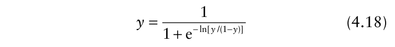{.equation width=60%}

For the example here, _y_ = 1/[1 + exp(−1.405)] = 1/[1 +

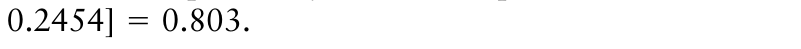{.equation width=60%}

### 4.4.4 Some other population dynamics models

We made the point that the logistic model is often appropriate for quantifying polycyclic epidemics. However, it should be noted that there are other nonlinear models that have been used for representing such epidemics. The more common ones are discussed briefly in this section.

_4.4.4.1 Gompertz model._ A characteristic feature of the logistic model is that the absolute rate curve is symmetrical about _y_ = 1/2. This can be quite restrictive, because there is no biological reason why the maximum observed _dy/dt_ for an epidemic should not be at either a higher or a lower value of _y_. One commonly-used alternative to the logistic is the Gompertz model, which is named after the 19th Century scientist who proposed its use for animal growth (Madden and Campbell, 1990). The Gompertz model is written as:

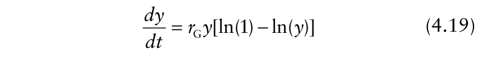{.equation width=60%}

in which _r_ G is a rate parameter. This is similar to the logistic model, except that the “1 − _y_ ” term (i.e., the _correction_ for healthy plant individuals) of equation 4.14 is replaced by “[ln(1) − ln(_y_)]”. The effect of this is to produce a skewed (asymmetrical) _dy/dt_ curve, which rises relatively rapidly (depending on the rate parameter) to a maximum at _y_ = 1/e (≈0.367), and then declines slowly towards zero (Fig. 4.7).

Integration of equation 4.19 results in:

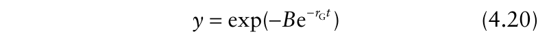{.equation width=60%}

in which _B_ is a constant of integration equal to −ln(_y_ 0). A plot of _y_ versus _t_ is _S_ -shaped (Fig. 4.7), but is not quite of the same form as the logistic graph. With the logistic, the disease progress curve above _y_ = 1/2 is just a “flipped-around-and-up” version of the disease progress curve below _y_ = 1/2; such symmetry is absent with the Gompertz curve (a consequence of the asymmetrical _dy/dt_ curve). A linear form of equation 4.20 is:

{#fig-4-7}

Note that there is a minus sign in front of the log. Back transformation is accomplished using:

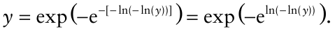

The Gompertz model has often been found to provide a better fit to observed disease progress curves than the logistic model (Berger, 1981).

_4.4.4.2 Richards model._ There are numerous other ways of modifying the logistic model to account for asymmetry of the _dy/dt_ curve. Most of these involve modifying the simple “1 − _y_ ” term, into a more complicated expression. In the Richards model, the modification involves use of an additional unit-less parameter (η). This model can be written as:

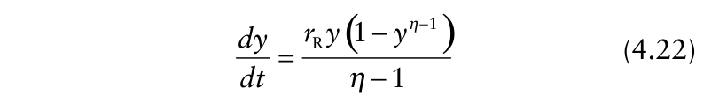{.equation width=60%}

in which _r_ R is a rate parameter. Actually, the last term in the numerator of equation 4.22 can be written as: 1(η−1) − _y_(η−1) , but 1 raised to a power is equal to 1, so the simpler version is used.

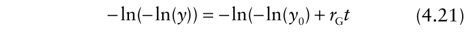{.equation width=60%}

The parameter η can take on any real value between 0 and infinity. However, at specific values of η, the Richards model reduces to some of the models already discussed. The reader can perform the necessary algebra to see that when η = 0, equation 4.22 reduces to the monomolecular model (equation 4.8), and that when η = 2, equation 4.22 reduces to the logistic model (equation 4.14). The Richards model is undefined when η = 1, but when η approaches 1 in the limit (i.e., gets very close to 1 without actually reaching it), the Richards model reduces to the Gompertz (equation 4.19), in that the two models are indistinguishable. When η approaches infinity in the limit, the Richards model approaches the exponential; that is, _dy/dt_ increases continuously (without an inflection point) until _y_ = 1 is reached. Because different shapes are obtained depending on the exponent in equation 4.22, η typically is called a _shape parameter_. When 0 < η < 2, the _dy/dt_ curve rises rapidly to a maximum at a disease incidence less than 1/2; when η > 2, the _dy/dt_ curve rises slowly to a maximum, the maximum occurring at a value of _y_ greater than 1/2, and then the absolute rate declines quickly. An example of the latter is given in Fig. 4.8. Because the Richards model can accommodate a wide variety of shapes, and includes simpler models as special cases, it is sometimes referred to as a _general or flexible disease progress model_.

{#fig-4-8}

Integration of equation 4.22 leads to two possible solutions, depending on whether η is less than or greater than 1:

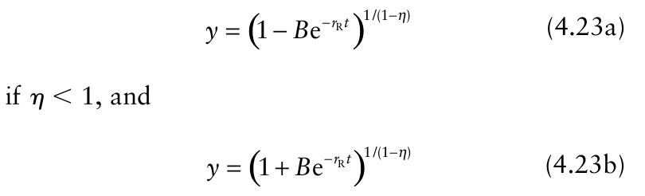{.equation width=60%}

if η > 1. _B_ is the constant of integration, and its specific form depends on the shape parameter: and **S** -shaped disease progress curves can be obtained for many values of η, especially for η values greater than 1/2 or so. The example disease progress curve in Fig. 4.8 is

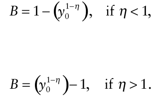

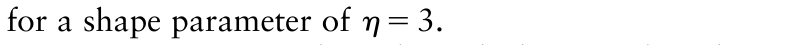{.equation width=60%}

Equations 4.23a and 4.23b can be linearized to obtain the following equations:

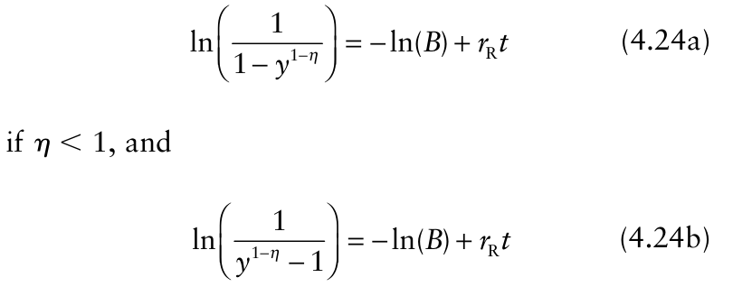{.equation width=60%}

if η > 1. The reader can confirm that substitution of η = 0 into the left-hand side of equation 4.24a results in the multiple infection transformation of the monomolecular model [ln(1/(1 − _y_)); see equation 4.11] and substitution of η = 2 into the left-hand side of equation 4.24b results in the logit transformation [ln(_y_ /(1 − _y_)); see equation 4.16]. We emphasize here that the Gompertz model is a special case that is determined in the limit (i.e., η → 1). Back transformation depends on whether the shape parameter is greater than or less than 1: and Calculations with the Richards model can be done as with the other models. The maximum _dy/dt_ occurs at _y_ ′ = η1/(1−η) . This is obtained, as discussed for the logistic model, by taking the derivative of the _dy/dt_ equation, setting this to zero, and solving for _y_. Increasing values of η produce larger values of _y_ where the maximum rate occurs. The reader can try using very large values of η to see that _y_ ′ approaches 1 as η increases indefinitely. The actual value of the maximum rate can be obtained by substituting this disease value into equation 4.22. Although one cannot use η = 1 directly for the Gompertz model, a value of η = 1.01 can be used as an approximation. This results in an estimated maximum _dy/dt_ occurring at 1.01(1/−0.01) = 0.3697, fairly close to the true (i.e., directly from the Gompertz) value of 1/e (=0.3678...).

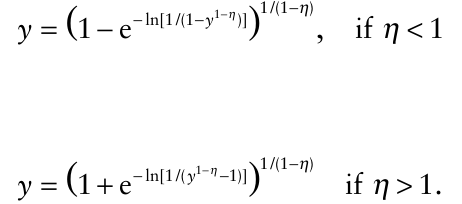

### 4.4.5 Model comparisons

Several models have been presented in this chapter that can be useful for representing disease progress curves. The models have several properties in common. In all cases, there is only one variable being analyzed, disease intensity (_y_). All the models are expressed in terms of the absolute rate being proportional to: (1) a rate parameter (_r*_, in general); (2) a function of diseased individuals [ _f_ (_y_)]; and (3) a function of disease-free individuals or area [ _f_ (1 − _y_)]. These functions can be the variables themselves [e.g., _f_ (_y_) = _y_], 1 [e.g., _f_ (_y_) = 1], or a transformation of the variable [e.g., _f_ (1 − _y_) = 1 − _y_η−1 ]. Here is a summary of the models discussed:

|**_Model_**|**_f(y)_**|**_f(1_**−**_y)_**|
|---|---|---|
|Exponential|_y_|1|
|Monomolecular|1|1−_y_|
|Logistic|_y_|1−_y_|
|Gompertz|_y_|ln(1)−ln(y)|
|Richards|_y_|1−_y_η−1|

There are other models that are of the same general form as the ones shown here that can provide a range of shapes for the _dy/dt_: _t_ curve. These include the Weibull, the log-logistic, and the Turner generic model. Some of these are discussed in some detail in Madden and Campbell (1990), Birch (1999) and Ratkowsky (1990). Although one or more of these may give a good fit to a given data set, for our purposes here, these other models do not provide a great deal of additional information for epidemiological interpretation of disease progress curves. There _are_ more general models of epidemics that are of tremendous value in interpretation, but these are discussed later.

Integration of the differential equation versions of the models discussed above leads in each case to a nonlinear model (in terms of the parameters), with one additional parameter (a constant of integration) that can be equated to a transformation of disease intensity at _t_ = 0. Although the nonlinear solutions can be of direct use, it is often convenient to express the models in linear form.

All of the models presented here can be linearized in terms of some of the parameters, and written in a form so that there is a straight-line relationship between a transformation of _y_ (_y*_) and _t_:

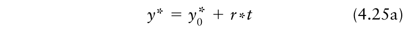{.equation width=60%}

or

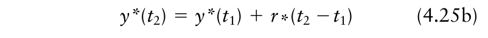{.equation width=60%}

Here, _y_ 0* is a transformation of initial disease intensity, _y_ * or _y_ *(•) is a transformation of _y_ at any given time, and _r*_ is the slope of the _y_ *: _t_ line. Besides aiding in interpretation and in making calculations (see next section), the straight-line form is useful for parameter estimation with most of the models. However, _y*_ for the Richards model contains a parameter (η); thus, one cannot use equation 4.24 to estimate η. For the linear model, one must assume that a particular value of η is correct and then use the appropriate transformation to achieve linearity and perform the desired calculations. In this sense, one can think of choosing a η of the Richards model as being equivalent to choosing a particular (inflexible) model to represent an epidemic. For instance, using the logistic model (equation 4.16) is the same as using the Richards model with η = 2 (equation 4.24b).

Even though we will not directly use the Richards model very much in this book, the model is of interest at the introductory stage in that it nicely shows that many of the models used for representing disease progress curves are, in fact, part of a continuum that covers a range of curves of various shapes. It also serves as a basis for making formal comparisons between models, especially in terms of the rate parameter. As shown in equation 4.25, _r*_ is a slope of the _y*_: _t_ straight line. However, the transformation of _y_ required to achieve linearity depends on the specific model adopted (or, equivalently, on the choice of η). Because of this, one cannot directly compare rate parameters from two different models, such as the logistic and monomolecular. For instance, if one knew (or determined) that _r_ L = 0.1/day for one epidemic and that _r_ M = 0.033/day for another, one could not conclude that disease increases faster for the first epidemic. The dynamic process of disease increase is qualitatively different for these two epidemics— _dy/dt_ is high at low _y_ in a monomolecular epidemic, whereas _dy/dt_ is high around _y_ = 1/2 in a logistic epidemic. In one sense, then, if two epidemics are described by different models, there is no single number that can be used to capture fully the differences in the pattern of disease increase between the two epidemics.

All is not lost when wanting to compare epidemics described by different models. Richards (1959) proposed a summary parameter for comparing rates between different models. The parameter is known as the weighted mean absolute rate (ϖ), which can be written as

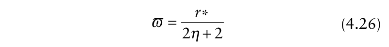{.equation width=60%}

This composite parameter is equal to the mean weighted value of _dy/dt_ over the entire epidemic, with weights equal to _dy/dt_. It is a measure of the average height of the _dy/dt_ curve. To calculate ϖ for one of the inflexible models, one uses the implied value of the shape parameter for the model. With the logistic model, ϖ = _r_ L/[2 × 2 + 2] = _r_ L/6; with the monomolecular model, ϖ = _r_ M/[2 × 0 + 2] = _r_ M/2. For the example in the previous paragraph, one can determine that the two apparently different rates correspond to virtually the same weighted mean rate: ϖ = 0.1/6 = 0.0167/day for the logistic epidemic and ϖ = 0.033/2 = 0.0165/day for the monomolecular epidemic. If one is using the Richards model directly, and estimates parameters from observed data (see section 4.6), then ϖ would be calculated using the estimate of η and _r_ R.

A final note on ϖ and η should be made, concerning the exponential model. It was previously stated that at very large η values (i.e., as η → ± in the limit), the exponential model is approximated by the Richards model over the full range of _y_ values (_y_ ≤ 1). This would also require the use of a large _r*_ to obtain a specified ϖ (e.g., for ϖ = 0.0165/day and η = 100, _r*_ = 3.33/day; see equation 4.26). On the other hand, it was also stated that the exponential is a good approximation of the logistic model when _y_ is small (i.e., _r_ L = _r_ E at _y_ < 0.05). The latter situation corresponds to using a η value of 2 in the Richards model to obtain the logistic equation; the exponential model and corresponding _r_ E (= _r_ L) that approximates the logistic at low _y_ would quickly breakdown at higher _y_ values, producing nonsensical values of disease intensity (e.g., >1). The exponential-type epidemic obtained by using a very large η in the Richards model (and corresponding _r*_) would not necessarily approximate very well the logistic model at low _y_. In general, we use the exponential model as an approximation for the logistic (at low _y_). This means that we are

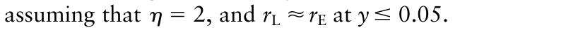{.equation width=60%}

### 4.4.6 Calculations with the models

One can use the linear formulation of the disease progress models (equation 4.25a or b) to predict disease intensity at any time, to determine the value of the rate parameter, and to evaluate the effects of changing initial disease intensity and the rate parameter on disease development. Of course, one can directly use the nonlinear versions of all the models for these purposes, but many users find it more convenient to work with the straight line versions.

Consider a situation with _y_ 0 = 0.01 and _r*_ = 0.15/day. It is helpful in performing calculations to realize that equation 4.25a consists of four terms: 1) a transformation of initial disease intensity (_y_ 0*); 2) a rate of increase or slope term (_r*_); 3) a time period beyond the starting time (_t_); and 4) a transformation of disease intensity at a selected time period (_y_ *). In the problems we address here, three of the four terms are known, and one solves for the fourth. The calculations shown here can be done with any of the specific models, but we primarily use the logistic (equation 4.16 or 4.17) as the basis of the examples, because of its widespread application in epidemiology (some similar calculations were done previously for the simple exponential model; section 4.4.1). Thus, for the logistic model, using the values given above, we have _y_ 0* = ln[ _y_ 0/(1 − _y_ 0)] =

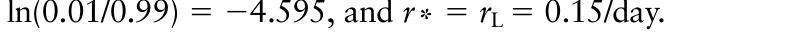{.equation width=60%}

_What is disease intensity at t_ = _20 days and t_ = _40 days?_ The transformation of disease intensity at 20 days is obtained from:

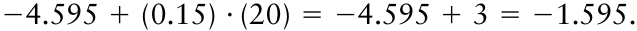

Disease intensity at 20 days [ _y_ (20)] is obtained by backtransformation. For the logistic model, one uses equation 4.18:

{.equation width=60%}

Note that the e is raised to the power of minus the predicted logit; thus, −1.595 becomes +1.595 in the backtransformation. Care is needed with this particular aspect of the calculations for several of the models, because _y*_ may be negative or positive, depending on the value of _y_. This calculation is demonstrated graphically in Fig. 4.9. To calculate _y_ at 40 days, one can continue to use _t_ = 0 as the starting point, and calculate the logit as:

{.equation width=60%}

Backtransformation produces: 1/[1 + exp(−1.405)] = 0.803. Alternatively, one could treat _t_ = 20 days as the starting point (because one advantage of a straight line is that any point can be considered a new starting point), and calculate the logit for 20 days later:

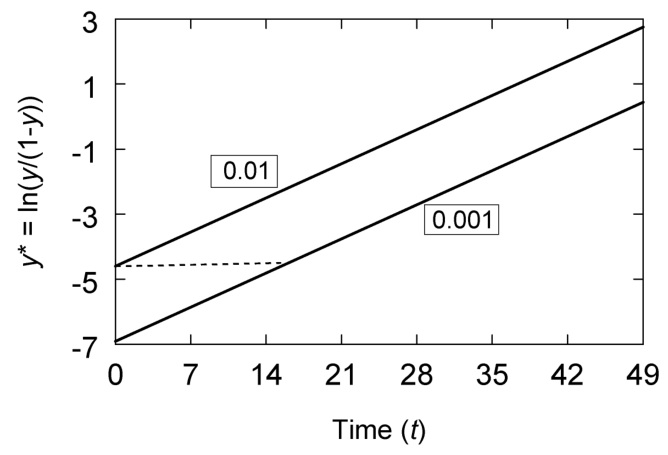{#fig-4-9}

{.equation width=60%}

The general steps here using equation 4.25a apply to any model (assuming that the right transformation was used to obtain _y_ 0*. However, the appropriate backtransformation is model dependent. One has to be careful to use the backtransformation for the assumed/selected model to properly obtain _y_ from _y*_.

_What was initial disease intensity?_ Suppose that at _t_ = 35 days, disease intensity is 0.16 [i.e., _y_ (35) = 0.16], and one “knows” that _r_ L = 0.15/day. Initial disease can be determined by rearranging equation 4.25a to:

{.equation width=60%}

equations 4.7a,b). Here, it may be intuitive to use the alternative version of the linear model (equation 4.25b). One can then think of doubling time as _t_ D = _t_ 2 − _t_ 1 when intensity at the second time is double disease at the first time, that is, _y_ (_t_ 2) = 2 _y_ (_t_ 1). This is equivalent to simply writing equation 4.25a as

{.equation width=60%}

in which _y_ * is now the transformed starting disease intensity and (2 _y_)* is the transformation of the doubled diseased intensity. Note that although 2 _y_ is double the magnitude of _y_, in general, (2 _y_)* is not double the magnitude of _y_ *. Using this notation, one can write doubling time as:

{.equation width=60%}

Using the logistic example with _r_ L = 0.15/day, the time for _y_ to increase from 0.01 to 0.02 is calculated as:

For the example, _y_ *(35) = ln(0.16/0.84) = −1.657, and transformed initial disease is calculated as:

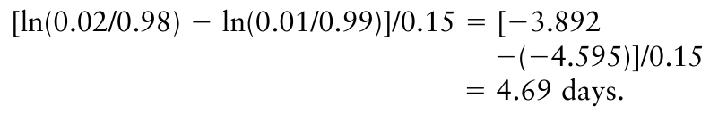{.equation width=60%}

{.equation width=60%}

Backtransformation shows that _y_ 0* is

{.equation width=60%}

This can also be seen in Fig. 4.9.

If one used the exponential-based equation (equation 4.7b), doubling time would be calculated as _t_ D = 0.693/ 0.15 = 4.62 days, which is almost the same as the logisticbased calculation here. This is because the exponential and logistic models are almost the same at low _y_.

The time for _y_ to increase from 0.10 to 0.20 is:

_How long does it take disease intensity to reach a certain level?_ Returning to the first set of conditions in this section (_y_ 0 = 0.01, _r*_ = 0.15/day), one can determine how long it takes to reach some specific intensity. This is done by rearranging equation 4.25a to solve for _t_:

{.equation width=60%}

For example, the time taken to reach _y_ = 0.75 is determined by first calculating the logit of 0.75 [=ln(0.75/

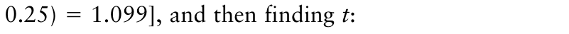{.equation width=60%}

_t_ = [1.099 −(−4.595)]/0.15 = 37.96 ≈ 38 days.

The reader should see that the time taken to reach a given disease level is inversely related to the rate parameter, meaning that small changes in the rate can have a big effect on time taken. For instance, if _r_ L was reduced to 0.12/day, the time taken to reach _y_ = 0.75 would be 47.4 days, almost 10 days longer than when _r_ L = 0.15/day. Note also that the time taken to reach a certain _y_ is inversely dependent on initial disease intensity— the smaller the initial intensity, the longer the time taken.

_How long does it take disease intensity to double?_ A special case of this “time” concept is the doubling time (_t_ D), already discussed for the exponential model (see

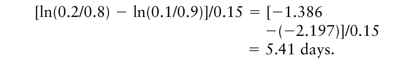{.equation width=60%}

One can see from these two examples with the logistic model that _t_ D depends on the starting value of _y_ in the calculations. The reader can confirm that _t_ D increases as _y_ increases for all of the models discussed, except for the exponential. Obviously, doubling time can only be calculated when the starting intensity is less than 1/2. At moderate-to-high values of _y_ (e.g., _y_ > 0.05 or > 0.10), it is important to take the specific disease values into account in making calculations (and not use the calculations based on the exponential model, where the specific disease values are not utilized).

_What is r* between two times?_ One can easily determine the value of _r*_ between two times by rearranging equation 4.25b to:

{.equation width=60%}

For instance, if disease intensity at day 16 was 0.10, and at day 25 was 0.30, for a logistic epidemic we can write _t_ 1 = 16, _t_ 2 = 25, _y_ (_t_ 1) = 0.10, _y*_ (_t_ 1) = ln(0.10/0.90) = −2.197, _y_ (_t_ 2) = 0.30, _y*_ (_t_ 2) = ln(0.30/0.70) = −0.847. Using equation 4.27 we obtain:

[−0.847 − (−2.197)]/[25−16] = 1.35/9 = 0.15.

Thus, the estimate of _r_ L equals 0.15/day. This corresponds to the top line in Fig. 4.9 that was used in several of the exercises here. The reader can confirm on their own that if the monomolecular model is assumed, the estimated _r_ M equals 0.021/day, based on the same disease intensity and time values.

## 4.5 Control

### 4.5.1 Control strategies for polycyclic diseases

Vanderplank (1963) elegantly explained that disease control for polycyclic diseases involves a reduction in either the initial disease intensity (_y_ 0) or the rate of disease increase (as summarized by the parameter _r*_), or in both. Initial disease intensity is reduced by any control that lowers either the amount of inoculum available for infection of the host or the probability of the inoculum causing infection. Examples include crop rotation, soil fumigation, removal of weed hosts, elimination of seedborne pathogens in the planting material, addition of certain biocontrol agents, and so on (Fry, 1982; Zadoks and Schein, 1979). The term _sanitation_ is sometimes used to refer to any control that reduces inoculum and, hence, initial disease intensity. Although others might prefer to use sanitation in a more specific sense, we use the term here for any control method that results in reduction of _y_ 0.

The rate parameter _r*_ is reduced by any control that lowers either the number of infections or the increase in lesion area throughout the entire time span of the epidemic subsequent to _t_ = 0. For polycyclic diseases, reducing inoculum production per diseased individual per unit time, probability of the produced inoculum of causing new infections, growth of lesions, and time that a diseased individual can produce inoculum will all result in a reduction in _r*_. Furthermore, increasing the time between the start of the infection process and the production of inoculum can lower _r*_. Environmental manipulation that results in less favorable conditions for disease development, such as use of some cultural practices, can also reduce _r*_.

Pesticides (fungicides) and plant disease resistance can affect _y_ 0, _r*_, or both. Protectant fungicides typically reduce the probability of infection of deposited spores, either at the beginning of the epidemic or throughout the epidemic, depending on when the chemical is applied. Systemic fungicides may also reduce the probability of infection or reduce spore production, at the start or throughout the epidemic. Cultivars with so-called vertical resistance (major gene resistance) reduce _y_ 0, possibly to 0, if no individuals in the pathogen population can overcome the plant resistance gene(s). If a fraction (<1) of the pathogen population can overcome the resistance gene(s), then _y_ 0 will be reduced, but not to zero, and secondary infections will continue to occur throughout the epidemic as if no resistance genes were present. Cultivars with so-called horizontal resistance (minor gene resistance, rate-reducing resistance, partial resistance, field resistance) do not prevent infection from occurring. Instead, probability of a spore causing infection is reduced (but not to zero), or the time interval between infection and spore production by an infected individual is increased, or the number of spores produced per diseased individual per unit time is reduced, or the period over which a diseased individual produces spores is reduced. These changes mean there are fewer new infected individuals per unit time and _r*_ is reduced. Of course, a cultivar may have both vertical and horizontal resistance. There is a considerable body of literature on vertical and horizontal resistance, and a great deal of controversy has erupted over the years regarding the genetic basis of these two forms of resistance, but we do not consider the specifics here. Interested readers should consult Fry (1982) and Zadoks and Schein (1979).

Of particular relevance in this chapter is the relative impact of reducing _r*_ or _y_ 0 on disease development. Although epidemics are nonlinear processes, there are some fairly straightforward ways of seeing the effects of changes in _r*_ or _y_ 0 on plant disease epidemics, using the types of calculations done in section 4.4.6. More general information on control strategies can be found in Fry (1982), Strange (1993), and Arneson (2001). We discuss the situation first for polycyclic diseases, and then deal with the special circumstances of monocyclic diseases. Subsequent chapters will deal with many other aspects of plant disease management.

### 4.5.2 Calculations for polycyclic diseases

The linearized version of the epidemic model shown in equation 4.25a provides a convenient way of evaluating the impact of reductions in _y_ 0 on disease development. Although one could simply determine predicted _y_ at any given _t_ with a new _y_ 0, a useful alternative is to use the kind of calculation presented previously, relating to the time taken to reach a certain value of _y_. We take the latter approach here. Assume that without control, _r*_ = 0.15/day and _y_ 0 = 0.01 (top line in Fig. 4.9). If _y_ 0 is reduced by a factor of 10 to _y_ 0 = 0.001, one obtains the lower line in Fig. 4.9 (if _r*_ remains unchanged). We refer to the new (lower) initial disease as _y_ 0 _S_, where the “ _S_ ” subscript indicates “sanitation”. One can ask the question: is it useful to reduce initial disease 10-fold if no other controls are used during the epidemic (i.e., if _r*_ is not changed)?

One can determine the effect of this sanitation by calculating the time required for disease intensity to increase from 0.001 (initial disease after sanitation) to 0.01 (initial disease if sanitation had not occurred). Generally, this is the time it takes for disease intensity “to get back to” the value it _would_ have had at the start of the epidemic if sanitation had not been used. By using the straight-line equation 4.25a, we can write: in which _y*_ 0S is the transformed disease intensity after sanitation (starting disease value in the equation), _y*_ 0 is the transformed disease intensity before sanitation (now, the “final” disease value), and _tS_ is the time for disease to increase from _y*_ 0S to _y*_ 0, the _sanitation time_. One can think of _t_ S as the time savings from sanitation. In Fig. 4.9, this equation represents the broken horizontal line from _t_ = 0 to the point where it intercepts the lower line. Rearrangement leads to:

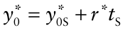

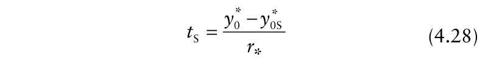{.equation width=60%}

If the logistic model is appropriate, then _r*_ = _r_ L = 0.15/day in the example. The logistic version of equation 4.28 is written as:

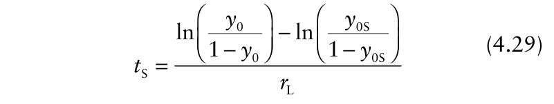{.equation width=60%}

The calculated time is given by:

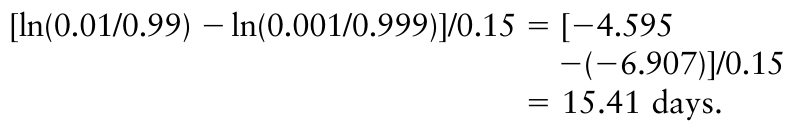{.equation width=60%}

Obviously, based on equation 4.28, the greater the reduction in initial inoculum (and, hence, initial disease intensity), the longer the time it takes disease to reach the original intensity (as if initial disease intensity had not been lowered). The value of _t_ S is strongly influenced by the rate parameter; the higher is _r*_, the lower is the value of _t_ S. In other words, a big reduction in initial disease intensity may have little effect on _t_ S if _r*_ is high. This can be seen most easily with the exponential version of equation 4.28. To see this, we must first give background on the exponential model. Here, _r*_ = _r_ E, _y*_ 0 = ln(_y_ 0), and _y*_ 0S = ln(_y_ 0S). Because ln(_A_) − ln(_B_) = ln(_A_ / _B_) for any two positive _A_ and _B_, one can write:

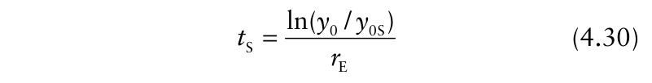{.equation width=60%}

for the exponential model. With the example values used here, one finds that _t_ S = ln(10)/0.15 = 15.35 days. This is almost identical to that obtained with equation 4.29 for the logistic model, which is expected because the exponential and logistic models are very similar at small _y_.

The use of equation 4.30 is specific to the exponential model. However, this is a reasonable equation to use for the early part of a polycyclic epidemic when _y_ is small and most newly produced inoculum does not contact previously infected individuals. A key feature of this equation is that the specific values of _y_ 0 and _y_ 0S do not matter in determining the effect of sanitation; all that matters is the ratio, which is known as the _sanitation ratio_ (SR). Use of sanitation ratio when referring to initial disease intensities is warranted because it is assumed that _y_ 0 is proportional to inoculum (especially at low _y_). That is, if _x_ and _x_ S represent inoculum before and after sanitation, respectively, then SR = _y_ 0/ _y_ 0S = _x_ / _x_ S. The percent reduction in _y_ 0 is related to the SR using: 100 × [1−(SR)−1 ]. For instance, an SR of 10 means that 100 × (1−0.1) = 90% of the inoculum was removed or eliminated.

The specific values of disease intensity are not relevant for calculating _t_ S in equation 4.30, _if_ the exponential model holds. For instance, a situation with _y_ 0 = 0.05 and _y_ 0S = 0.01 gives the same SR as a situation with _y_ 0 = 0.01 and _y_ 0S = 0.002 (in both cases, SR = 5). This makes it easy to evaluate, in a general sense, the impact of reducing initial disease intensity at different values of the rate parameter _r_ E. Fig. 4.10 shows the timesavings for SRs of 5, 10, 20, 100, and 1000 for _r_ E values up to 0.5/day. At _r_ E = 0.4/day, SRs of 20 or less have only minor effects on timesavings. Even an SR of 100 provides only ∼11 days of savings at this rate. Although 0.4/day is high, it is also typical of diseases such as potato late blight under favorable environmental conditions. At lower rates, the effect of sanitation is much greater. At _r_ E ≤ 0.1/day, and especially at _r_ E ≤ 0.05/day, reducing initial disease intensity can have a big impact on the epidemic. At _r_ E = 0.05/day, a SR of 20 (95% reduction in _y_ 0) gives a _tS_ value of ∼60 days. Even an 80% reduction in _y_ 0 (i.e., SR = 5) gives a _tS_ of ∼32 days when _r_ E = 0.05/day.

The general conclusion that can be obtained from assessment of equation 4.30 and Fig. 4.10 is that reducing initial disease intensity for a polycyclic disease is most beneficial when the rate parameter is low. Put another way, unless the rate is relatively low, the reduction in _y_ 0 must be large (enormous) to have much of an effect on the epidemic. Thus, in general, control of polycyclic diseases cannot be based on reducing _y_ 0 alone; one must reduce the rate to obtain a substantial change in the epidemic. Fry (1982) and Vanderplank (1963) discuss this at greater length.

{#fig-4-10}

One can, in fact, directly evaluate the effect of changes in both _y_ 0 and _r*_ using the linear version of the epidemic model (equation 4.25a). We demonstrate this graphically in Fig. 4.11 for a logistic epidemic, showing both logits (upper frame) and backtransformed disease intensities (lower frame). The solid and dashed lines represent identical conditions to those in Fig. 4.9, although the time period is extended to 98 days (solid line: _y_ 0 = 0.01 and _r_ L = 0.15/day; dashed line: _y_ 0 = 0.001 and _r_ L = 0.15/day). The other two lines represent the same two initial disease values, but with an _r_ L value of 0.075/day. In this example, the outcome of reducing the rate parameter by a factor of 2 is that, there is actually less disease after about 30 days than when initial disease is reduced 10-fold. Reducing the rate and initial disease simultaneously has an even greater impact. One could quantify the effects of changing _y_ 0 and _r*_ by determining disease intensity at some selected time (e.g., at _t_ = 70). The reader can confirm that _y_ *(70) equals 5.90, 3.59, 0.65, and −1.62 for the four epidemics of Fig. 4.11. These correspond to _y_ (70) values of 0.997, 0.98, 0.67, and 0.16. Thus, cutting the rate in half produces a larger reduction in _y_ (0.997 → 0.67) than does a 10-fold reduction in initial disease intensity (0.997 → 0.98).

{#fig-4-11}

Another way of evaluating the reduction in _r_ L and/or _y_ 0 is to determine the time to reach some specified disease intensity larger than _y_ 0. This is analogous to the calculation of _tS_ for the reduction in initial disease intensity. However, if _r_ L is reduced but _y_ 0 is unchanged, one does not calculate the time to reach _y_ 0 from _y_ 0S, because there is no _y_ 0S. We show this with the examples of Fig. 4.11. The time to reach _y_ = 0.50 (or ln[ _y_ /(1 − _y_)] = 0), labeled as _t_ 0.5, for a logistic epidemic can be calculated by rearranging equation 4.25a to:

It takes over 61.3−30.6 = 30.7 days longer to reach 50% intensity when _r_ L is reduced to half of its original value; in contrast, it takes only 46.0−30.6 = 15.4 days longer when _y_ 0 is reduced to a tenth of its original value. When both initial _y_ and the rate are reduced to the values used in this example, it takes 92.1−30.6 = 61.5 days longer to reach _y_ = 0.50. This calculation confirms the fact that a relatively small change in _r_ L is can produce the same effect as a large change in _y_ 0. The reader can determine these results graphically (and approximately), by drawing a horizontal line in the top frame of Fig. 4.11 at a logit of 0, and finding where this line crosses each of the four disease progress lines. As another exercise, the reader can determine how much _y_ 0 must be reduced to give the same result as halving _r_ L. That is, with _r_ L = 0.15/day, what value of _y_ 0 (or _y*_ 0) is needed so that _t_ 0.5 = 61.3 days? Remember: there are four terms in equation 4.25b, one knows three of them, and solves for the fourth.

Because the above calculations were based on use of a disease intensity considerably above 0.05, the exponential model could not be used as an approximation. Specific results will depend on the initial disease, the rate parameter, and the selected disease intensity that must be reached. As always, the specific result will also depend on which model was used. For comparison, the reader can try these calculations with, for example, the Gompertz model.

One final item can be noted about the disease progress curves of Fig. 11 shown in untransformed and transformed versions. When observing _y_ versus _t_, it is very difficult to see the impact of changes in _y_ 0 and _r_ L at low _y_. In fact, at small _t_, the curves appear to virtually overlap. In fact, there are major differences in the epidemics at small _t_ that can clearly be seen when logits are graphed.

### 4.5.3 Control for monocyclic diseases

In reading section 4.5.2, one might get the impression that one should evaluate disease controls for monocyclic diseases using the same calculations as for polycyclic diseases. This would be a mistake. Of course, one can use the linear form of monomolecular model (equation 4.11 or 4.12) to determine disease intensity at a particular time, calculate _r_ M between two times, or determine how long it takes disease intensity to reach a certain value, for specified values of _y_ 0 and _r_ M. However, one should _not_ consider the effects of reducing _y_ 0 independent of _r_ M or of reducing _r_ M independent of _y_ 0. The reason for this is related to the epidemiological interpretation of the model parameters.

As discussed previously, _r_ M is a product of amount of inoculum and probability per unit time of a unit of inoculum causing an infection. Thus, the slope of the _y*_ line for the monomolecular model reflects the amount of inoculum. Any reduction in inoculum or the effectiveness of the inoculum (e.g., as a result of sanitation) does not just change _y_ 0 (_y*_ 0), it also changes the rate parameter _r_ M. Moreover, _y_ 0 (or _y*_ 0) is just an instantaneous value of disease intensity (or transformed disease intensity) at _t_ = 0. Unlike the models for polycyclic diseases, _y_ 0 can even equal 0. Therefore, one does not necessarily calculate a time for disease to increase from _y_ 0S to _y_ 0 (_tS_), because _y_ 0 could be 0.

Disease control can be quantified in terms of the change in disease intensity at a particular time. We show this for day 60 of an epidemic using equation 4.11, with _y*_ 0 = 0. If _r_ M = 0.02/day, then _y_ * at _t_ = 60 [i.e., _y_ *(60)] is given by:

{.equation width=60%}

Backtransformation (equation 4.13) gives: _y_ = 1 − exp (−1.2) = 0.70. Now, if 90% of the inoculum is removed or eliminated (say, by crop rotation), so that SR = 10, what is _y_ at _t_ = 60? This could be calculated by dividing _r_ M by SR to obtain a new rate _r_ MS (= _r_ M/SR), and using equation 4.13 to obtain disease intensity at day 60:

{.equation width=60%}

Backtransformation gives _y_ = 1 − exp(−0.12) = 0.11. Note that the ratio of ln[1/(1 − _y_)] at a particular time before and after sanitation (=1.2/0.12 in example) is directly related to the SR, but the ratio of the corresponding untransformed _y_ values (=0.70/0.12) is not (although when disease intensity is low (e.g., <0.1), the ratio of _y_ values will be fairly close to the SR). We emphasize that the specific results for _y_ depend on the specific time during the monocyclic epidemic (e.g., _t_ = 60). For simplicity, one would not even have to use equation 4.11 to evaluate sanitation. One could simply divide an assumed _y*_ (at a particular time) without sanitation by SR, and then backtransform to find the corresponding value of _y_ with sanitation.

Other calculations can be done as well. For an example, we use the same original _r_ M as above (=0.02/day), but specify that _y_ 0 = 0.01 (or, _y*_ 0 = 0.01 in this case). The reader can determine that _y*_ at _t_ = 60 is 0.01 + 1.2 = 1.21, resulting, through backtransformation, in a _y_ value of 0.702. One can ask: with a SR of 10, how long will it take disease to increase to 0.702? To calculate this, one reduces _y_ 0 _and r_ M by a factor of 10, and writes equation 4.11 as:

{.equation width=60%}

in which _t_ 0.702 is the time taken to reach _y_ = 0.702. Solving this equation to find _t_ 0.702 gives: _t_ 0.702 ≈ 604 days. Thus, for an annual crop, such a high level of disease intensity would never be reached with a SR of 10.

### 4.5.4 Summary of disease control strategies

The discussion on control can be summarized as follows.

1. Monocyclic diseases are controlled by reducing the amount of inoculum or the efficacy of inoculum.

2. Effective (or efficient) control of polycyclic diseases depends on initial disease intensity (a function of inoculum and its efficacy) and the rate parameter. a. At low _r*_, reducing _y_ 0 can be valuable;

- b. At high _r*_, reducing _y_ 0 is not effective unless SR is very large;

- c. _r*_ must be kept at a relatively low value to obtain effective control, unless the time period of the epidemic is very short.

Although control of polycyclic diseases emphasizes reduction in _r*_, it may be necessary to reduce _y_ 0 as well, for example in cases where there is a high value of _y_ 0 that requires reduction even in the absence of further disease progress. For example, initial disease intensity of apple scab from overwintering inoculum (‘primary scab’) can be very high, with 50% of the leaves infected (MacHardy, 1996). Even if there was no further increase in disease intensity (perhaps, by excellent disease control with fungicides), the initial disease intensity would be sufficient to cause economic losses.

As shown above with theoretical examples, reducing _r*_ a small amount can have a big effect on a polycyclic epidemic. This is fundamental to Vanderplank’s thesis on disease control. The question remains: how difficult is it to reduce _r*_ by, say, 20%? This can be ascertained empirically and theoretically. The empirical method involves determining _r*_ for observed epidemics corresponding to a range of disease control treatments. One could then evaluate the changes in _r*_ with different treatments. The theoretical method involves formally relating _r*_ to specific components of the epidemic, such as the production of inoculum per diseased individual per unit time. This requires a more detailed characterization of plant disease epidemics, especially for polycyclic diseases, which is covered in the next chapter.

Most of the discussion on control here has focused on diseases of annual crops. With perennials (e.g., forest trees), the perspective can be different. For instance, even with a low _r*_, ultimately disease intensity approaches high values if the models presented so far are appropriate. For instance, with _r_ L = 0.10/year (=0.00027/day), 50% of the trees would be infected (_y_ = 0.5) in 69 years if _y_ 0 = 0.001. For a long-lived tree species, 69 years is not an unrealistic time frame to consider. To obtain a better perspective on disease epidemics in perennials, and the control of diseases of perennials, the dynamics of the host—such as planting, harvesting, replanting; or change in size (biomass or numbers) over time—often need to be considered. Host dynamics will also be discussed at length in Chapter 6.

## 4.6 Model Fitting

For the most part, plant disease epidemics have been considered theoretically so far in this chapter. We introduced various differential-equation models for the dynamics of disease development, and presented the biological rationale for the terms in the model. We discussed some of the properties of the models and showed how to make various calculations using the model terms. We further demonstrated that the models produce predicted disease progress curves that are at least qualitatively similar to observed curves (see Fig. 4.1).

It is uncommon for epidemic model parameters to be known _a priori_ for a particular disease-host-environment situation. Even when reasonable values can be given for _r_ L, as an example, based on the known susceptibility of the host genotype and aggressiveness of the pathogen strain, the favorableness of the environment can dramatically influence the actual rate in a given year and location (Kim et al., 2005). Thus, one usually needs to estimate model parameters. Parameter estimation is done through fitting a model to observed data. Of course, model fitting involves use of a statistical method, such as ordinary least squares or maximum likelihood (see Chapter 3) (Neter et al., 1983; Schabenberger and Pierce, 2002). Model fitting can be viewed much more broadly, however. First, a decision must be made on which model to fit. With a mechanistic approach, the decision will be made ahead of time regarding the model to use (e.g., logistic); with an empirical approach, the decision will be made based on the observed data. A hybrid approach is often taken when analyzing disease progress curves. Graphs of the observed data are used to suggest models to use _within_ the set of models developed for epidemics. That is, the investigator would choose among the models presented so far, or those to be presented later, based on the observed data and knowledge of the biological system. Many of the typical linear models used by statisticians to provide good fits to data that do not fall on straight lines (e.g., polynomials) would _not_ be considered because they have no biological basis. We go through this hybrid approach in the following sections.

Once the parameters are estimated, then the general model fitting protocol involves an appraisal of the goodness of fit. As discussed in Chapter 3, the investigator can use various statistics and graphical methods to determine if a chosen model is appropriate. If it is decided that a model is not appropriate for describing the data, then this appraisal can suggest alternative models, which can then be fitted to data (depending on the objectives of the investigator).

### 4.6.1 Choosing a model

We demonstrate the protocol for model fitting with data for an epidemic of tobacco etch disease of peppers, caused by tobacco etch potyvirus (from Fig. 9 in Nutter, 1997). The proportion of diseased plants (i.e., disease incidence) was determined eight times during the epidemic, and the data are given in the first two columns of Table 4.2. A plot of _y_ versus _t_ shows a classic _S_ -shaped curve (Fig. 4.12). Based on this graph, the logistic model should certainly be considered as a reasonable way of representing the data. However, the Gompertz and the Richards model (with a range of η values >1/2 also produce _S_ -shaped curves, so this graph alone cannot indicate the most appropriate model. It is clear from the graphical plot of the data that the disease progress curve is not at all consistent with the monomolecular or exponential models (see Figs. 4.2 and 4.4).

A plot of the absolute rate of disease increase (_dy/dt_) versus time can be very informative for discriminating among the models. However, _dy/dt_ is not observed directly, and must be estimated. The simplest way of approximating or estimating _dy/dt_ (Δ _y/_ Δ _t_) is to use the difference in _y_ between each successive pair of times:

{.equation width=60%}

where the number subscripts here refer to two successive times. Essentially, this equation provides an estimate of the _average_ rate between times 1 and 2. To plot these estimated rates, one immediately faces the issue of what value of time to use for each Δ _y/_ Δ _t_ value, since equation 4.31 is not giving a rate at each time, but a rate of disease progress _between_ times. A convenient approach is to use the mid-point between times 1 and 2. For instance, for the estimated rate between _t_ 1 = 0 and _t_ 2 = 7 days, one would use _t_ = 3.5 days. Following the same approach, to relate the estimated rate to level of disease, one would use the mid-point (average) between _y_ 1 and _y_ 2. With the tobacco etch example, between days 7 and 14, Δ _y/_ Δ _t_ = (0.09 − 0.01)/(14 − 7) = 0.011/day. This rate can be paired with _t_ = 10.5 [=(7 + 14)/2] days

{#fig-4-12}

**Table 4.2.** Results of fitting the linearized logistic model (equation 4.32a) to the tobacco etch disease data of Fig. 4.12 using ordinary least squares regression and the predicted (fitted) values based on nonlinear least squares regression (last column only).

|**_t (time)_**|**_y (observed_** **_incidence)_**|**_y* (observed_** **_logit)_**|**_(predicted_** **_logit)_** ˆ**_y*_**|**_Residual (based_** **_on logits)_**|**_(back-_** **_transformation)_** ˆ**_y_**|**_(nonlinear_** **_fit)_** ˆ**_y_**|
|---|---|---|---|---|---|---|
|0|0.001|−6.907|−6.590|−0.918|0.0014|0.00034|
|7|0.010|−4.565|−4.640|0.117|0.0096|0.0035|
|14|0.09|−2.314|−2.691|0.920|0.064|0.035|
|21|0.25|−1.099|−0.741|−0.847|0.323|0.269|
|28|0.80|1.386|1.208|0.423|0.770|0.790|
|35|0.98|3.892|3.157|1.791|0.959|0.975|
|42|0.99|4.595|5.107|−1.327|0.994|0.997|
|49|0.999|6.907|7.056|−0.432|0.999|0.9998|

{.equation width=60%}

Plotting the estimated _dy/dt_ versus _t_ for the tobacco etch epidemic produces a fairly symmetrical curve, with a maximum around 25 days (Fig. 4.12 top right). A plot of the estimated _dy/dt_ versus _y_ is also fairly symmetric, with a maximum rate near _y_ = 1/2. Both graphs strongly suggest a logistic model for the epidemic. It should be noted that the rate curves depend heavily on interpolation. Unlike the curve of _y_ versus _t_, which is monotonically increasing (for the situations we are considering here), _dy/dt_ can increase to a maximum somewhere between _y_ = 0 and _y_ = 1. There can be large gaps in time or disease where no estimated _dy/dt_ information is available, or major interpolation is needed, depending on how often disease is measured over time. Consider the graph of estimated _dy/dt_ versus _y_: there is no estimated _dy/dt_ value between intensities of about 0.2 and 0.5. Thus, actual _dy/dt_ might be increasing to a maximum at _y_ = 0.37 (the Gompertz model), but there is no information on this available.

A further limitation of using _dy/dt_ graphically is that it is only useful when epidemics go close to completion. If disease intensity is low throughout the epidemic, because of a low _r*_, the inflection point (if any) may never be reached within the time period of disease assessment. For instance, if only the first four data points of the tobacco etch epidemic were available, then the _dy/dt_ curve would have increased monotonically with _t_ or _y_, highly suggestive of an exponential model. Because the exponential model is a good approximation of the logistic when _y_ is low, this would not be an unreasonable conclusion. Although an exponential model would be a satisfactory equation to use for characterizing this epidemic (at low _y_), and evaluating control strategies, one would make inaccurate predictions of future _y_ values if the exponential model were used over the full range of times. The main point we emphasize here is that an absolute rate graph (as well as the disease progress curve) can suggest appropriate models, and definitely eliminate other models, but these graphs will not necessarily indicate the ideal model to represent the data.

If one of the models presented so far in this chapter is appropriate, then there will be a straight line when the appropriate linearizing transformation of _y_ (_y*_) is plotted versus _t_. In Fig. 4.12, _y_ * is plotted for the exponential, monomolecular, logistic, Gompertz, and Richards (η = 3) models (see equations 4.3, 4.11, 4.16, 4.21, and 4.24b). As expected, based on the graphs of _y_ versus _t_, _dy/dt_ versus _t_ and _dy/dt_ versus _y_, neither the exponential nor the monomolecular transformation produce anything close to a straight line, indicating that these models are not appropriate. There is also a fair amount of curvature with the Gompertz-based transformation. The logistic-based (logit) transformation does result in a fairly straight line, consistent with the _y_: _t_ curve, and the _dy/dt_: _t_ and _dy/dt_: _y_ curves (Fig. 4.12). The logistic model corresponds to η = 2 of the Richards model. When _y*_ for the Richards model is based on η = 3 (bottom right frame of Fig. 4.12), curvature is returned to the _y*_: _t_ graph. In fact, if one looks at the _y*_ graphs in order of increasing η [monomolecular(0) → Gompertz(1) → logistic(2) → Richards(3)], one can see a pattern to the changing line shapes, with concave lines to the time axis for η < 2, little if any curvature for η = 2, and convex line for η > 2. For the example epidemic, it should also be noted that there is a fairly straight line with the exponential-based transformation for the first three times; as stated in the previous paragraph, this is expected here because the exponential is a good approximation of the logistic at small _y_. If the epidemic was truly of the monomolecular type, then the _y*_: _t_ graph for this model would be a straight line, and there would be increasing degree of curvature with increasing (implied) η of the model.

The conclusion based on the graphs in Fig. 4.12 is that the logistic is the most appropriate model, among those considered, for the example epidemic. Readers should note that such straightforward conclusions often do not happen. This is typically because a smaller number of assessment times is used, because there is more variability than seen here, and because _y_ has not leveled off by the last assessment time.

### 4.6.2 Estimating parameters and assessing model fit—linear least squares

We have already dealt with the issue of parameter estimation a little, by showing how to determine _r*_ between two times (equation 4.27). One must assume a particular disease progress model to use this approach, because there is no information available from the calculation to know if the assumed model is reasonable or not. Of course, the graphs of Fig. 4.12 can be used to determine if the assumed model is reasonable when there are multiple assessment times. However, equation 4.27 does not lend itself to calculations based on data from multiple assessment times (such as in Figs. 4.1 and 4.12), because it works only on pairs of times. Moreover, there is no way to determine the uncertainty associated with the estimate of _r*_ using equation 4.27. For these reasons, most investigators do not use equation 4.27 to estimate the rate parameter in detailed studies; however, the equation is quite useful to quickly obtain an estimate of _r*_, especially when one only has access to published disease progress curves and not the raw data.

We can estimate _y_ 0 (or a transformation of _y_ 0) and _r*_ using linear or nonlinear parameter-estimation methods such as least squares or maximum likelihood (see sections 3.4 and 3.5; Neter et al., 1983). This requires the mathematical model of the epidemic to be written as a statistical model, taking account of the fact that fitted disease progress curves do not exactly follow observed data. We mostly work with the linearized versions of the epidemic models here. Equation 4.25a can be written as the following statistical model: example, the logistic version of equation 4.32a can be written as:

{.equation width=60%}

{.equation width=60%}

in which the _j_ subscript indicates _j-_ th data point or time (_j_ = 1,…, _nj_) and _ε_ is the ‘error’, a random variable which is the difference between the appropriate transformation of observed disease intensity and the same transformation of disease intensity as determined from the model, with intercept _y*_ 0 and slope _r*_. For the data in Fig. 4.12, _nj_ = 8. The part of equation 4.32a before the _ε_ term is known as the deterministic component (corresponding to the simple mathematical model of an epidemic), and the _ε_ part is known as the stochastic (random) component (see Chapter 3 for background). It is typically assumed (at least in the initial analysis) that _ε_ is normally and independently distributed with mean 0 and constant variance σ2 , that is, _ε_ ∼ NID (0, σ2 ) (where ∼ means ‘is distributed as’). As one specific Although the evidence is fairly strong that the logistic model is the most appropriate model for representing the disease progress data in Fig. 4.12, we show graphic results for fitting the linearized logistic (equation 4.16) and Gompertz (equation 4.21) models to the data (Fig. 4.13), and provide some statistics for the other models. High coefficients of determination (_R_2 ) were obtained by fitting all of the considered models to the data. _R_2 values were 0.81, 0.86, 0.99, 0.94, and 0.96 for the exponential, monomolecular, logistic, Gompertz, and Richards (η = 3) models, respectively. High values are expected, in general, because of the cumulative nature of disease progress curves—when host ‘size’ is not changing, or not changing much, _y_ increases between times. Almost any model that specifies increasing _y_ over time will have a high _R_2 . Likewise, all of the models considered resulted in good fits when assessed in terms of a significance probability based on the _F_ -test (_P_ < 0.01 in each case). However, as indicated in Chapter 3, high values of _R_2 and statistically significant _F_ -tests are not sufficient indicators of an appropriate model. For the example data set, the logistic provided a better fit compared to the Gompertz model (Fig. 4.13). The residuals (_ε_ ˆ ) for the logistic model appeared to have a random scatter about the fitted line, a strong indicator of an appropriate model being used. In contrast, the residuals for the Gompertz model exhibited a strong pattern, reflecting the overprediction of _y*_ values in the middle portion of the disease progress curve and underprediction of _y*_ values at times near the beginning and the end of the observed data.

{#fig-4-13}

The fitted logistic model can be written as:

{.equation width=60%}

in which the numbers in parentheses are the estimated standard errors of the parameter estimates. Note that the estimated intercept (−6.59) is the logit of _y_ 0. To calculate the estimate of _y_ 0 using this value, one utilizes the backtransformation (equation 4.18):

The same backtransformation (which is specific to the logistic model) can be used to determine the predicted disease intensity from the predicted logit of disease. There is a subtle point to make here. The predicted values, based on ordinary least squares regression, are estimates of the expected (i.e., mean) values of _y*_ at each _t_ (for the assumed distribution of _y*_ values at each _t_; see Chapter 3). Because the backtransformation function (e.g., equation 4.18) is a nonlinear expression, the value of _y_ ˆ calculated from _y_ ˆ* is _not_ the expected _y_ at that time (Neter et al., 1983). When the exponential model [ _y*_ = ln(_y_)] is fitted to data, the backtransformation ˆ ˆ [ _y_ = exp(_y_ *)] ) actually calculates the _median y_ of the assumed distribution of _y_ values at each _t_. For more complicated models, it is sufficient to know that the backtransformation is producing some measure of central tendency of the distribution of _y_ at each _t_, although not necessarily the mean.

One can use the estimated parameters (from ordinary least squares regression) to calculate predicted _y_ values at the full range of _t_ s by using the nonlinear versions of the models (e.g., equations 4.15 and 4.20). This is shown in the bottom frames of Fig. 4.13. The curves also could be generated by predicting _y_ * at _t_ values between 0 and 50 and using the backtransformation to obtain _y_. It is easy to see here that the Gompertz model results in substantial overprediction of _y_ between times of 15 and 30, and that the logistic model provides an overall good fit with these data. This is a good place to note that the _R_2 values given above were for the agreement between observed and predicted _y*_ values, not for the agreement between observed and predicted _y_ values. Furthermore, _y*_ was different for each model. A type of _R_2 (_R*_2 ) can be determined for the goodness of fit of the observed _y_ values when comparing results for models with different transformations of the dependent variable. The easiest way of calculating _R*_2 is to backtransform the _y_ ˆ * (using the appropriate function) to obtain _y_ ˆ , calculate the correlation coefficient between and _y_ ˆ _y_, and then square this correlation. The reader can use the results in Table 4.2 to confirm that the _R*_2 equals 0.996 for the fit of the logistic model. With a little more work, the reader can fit the Gompertz model to the data, obtain the predicted _y*_ and then _y_ values, and determine that _R*_2 equals 0.903. The _R*_2 values for the exponential, monomolecular, and Richards models were 0.428, 0.449, and 0.972, respectively. One can more easily see the poor fit of the exponential and monomolecular models reflected in _R*_2 than in _R_2 .

The overall conclusion from the assessment of the example disease progress curve is that the logistic model is the most appropriate. Further discussion primarily centers on an evaluation of the appropriateness of the standard model assumptions for the particular data set. For the most part, evaluation focuses on the residuals. In addition to assessing the residuals for randomness (one indicator of an appropriate model), they can be checked for normality, independence over time, and constant variance. Normality is not overly critical to model fitting; however, a so-called normal probability plot (Neter et al., 1983) indicated that normality of the residuals was a reasonable assumption in this case.

Independence is critical in model fitting (Madden, 1986). Because of the cumulative nature of disease progress curves, discussed previously, there is a possibility that the errors, and hence their estimates (residuals) will be positively correlated over time (i.e., autocorrelated or serially correlated). If this occurs, the value of _εj_ will be affected by _εj_ −1, and so on. A so-called first-order autoregressive model [AR(1)] is often considered as a possible description of the serial correlation of the errors for many situations (Schabenberger and Pierce, 2002). In this setting, the correlation between errors one time period apart (i.e., between _εj_ and _εj_ −1) is given by ρ1 = ρ, and correlation between errors two time periods apart (i.e., between _εj_ and _εj_ −2) is given by ρ2 , and so on. A statistical model for this is: in which ζ is a random variable with mean 0 that _is_ independent of _ε_ and independent over time. The parameter ρ is known as the first-order autocorrelation coefficient (−1 ≤ρ ≤ 1). The general formula for the correlation between errors at times | _j_ −′ _j_ | _j_ and _j_ ′ is given by Corr(_εj_, _εj_ ′) = _ρ_, where | _j_ − _j_ ′| is the number of time periods separating _j_ and _j_ ′. Because of this serial correlation, one can also say there is a nonzero covarariance in _ε_ between times. This is discussed in detail by Madden (1986). What this means in practice when ρ > 0, is that large positive residuals will, on average, be followed by large positive residuals, and that large negative residuals will, on average, be followed by large negative residuals. The consequence of positive autocorrelation among the residuals (i.e., of the assumption of independence being violated) is that standard errors of the estimated parameters (especially the slope) will, without correction, be artificially small. This can lead, among other things, to falsely declaring significant differences between slopes that are not truly different.

One way of checking for this is to analyze the residuals (estimates of _ε_) with a time series procedure that determines first-order temporal autocorrelations. This analysis of the logistic model residuals (see Table 4.2) indicated that the first-order autocorrelation was −0.296, which was not significantly different from 0 (_P_ > 0.05). Although the general concern is of a positive autocorrelation, a negative autocorrelation of residuals can occur when there is a very good fit of a model to the above and below the predictions (data, and the temporal sequence of _y_ ˆ _j_ *). Thus, there is no _y_ * _j_ values alternate reason to correct for the autocorrelation with this particular data set. There are specialized statistical procedures [e.g., PROC AUTOREG in SAS (part of the ETS system of SAS for analyzing data collected over time)] that can directly adjust for the first-order autocorrelation in fitting models to data. This procedure can also automatically determine the first-order autocorrelation coefficient (ρ) using different methods. There are also specialized tests for autocorrelation which are not covered here. Madden (1986) gives a detailed description of the ways to correct for serial correlation without using specialized programs. If one corrected for the autocorrelation of residuals with the example (even though this is not actually required in this case), one obtains an estimate of _r*_ of 0.279/day and standard error of the estimated rate parameter of 0.0087, nearly identical to the ordinary least squares results because of the lack of significant autocorrelation in this case. When the serial correlation is more negative than found here, standard errors of the estimated slope will be too large when no corrections are made; corrections for large negative serial correlations would lead to smaller standard errors.

Although first-order autoregressive serial correlation of residuals is the most common assumption (when independence is unlikely), there are many other possible socalled structures to the correlations (see Wolfinger, 1996). In other words, the appropriate equation for Corr(_εj_, _εj_ ′) may be simpler, or more likely, much more complicated than _ρ_ | _j_−′ _j_ |. Some possibilities are discussed in section 4.7.2.3. The complexity is an outcome of the cumulative process of epidemics.

The residual plot also showed no evidence for nonconstant variance for the error term (unexplained variability). With nonconstant variance, there will be some parts of the residual plot with a high scatter of points and other parts with a low scatter. However, with only one observed disease value at each time, it is difficult to determine nonconstancy using a residual plot, because such a condition can be confused with nonrandomness. Based on statistical properties of disease intensity, one would actually expect the error term not to be constant. For instance, if disease incidence is being considered, then the random variable _y_ is an estimate of the probability of an individual (e.g., plant) being diseased, _p_. For binary data such as incidence, the variance of _y_ [Var(_y_)] is proportional to _y_ (1 − _y_). Further details of this are given in Chapter 9.

Because one is using a transformation of _y_ (i.e., _y*_) with the (ordinary least squares) linear regression analysis, one needs to know the variance of _y*_, or at least know if the variance of _y*_ is a function of _y_. Largesample statistical theory shows that the variance of a function of a random variable can be determined based on the variance of the variable and the mathematical form of the function. Specifically, if we write _g_ (_y_) for _y*_, to clearly indicate that the transformation is a function of _y_ [e.g., _y*_ = _g_ (_y_) = ln(_y_) for the exponential model], then the variance of _g_ (_y_) is given by:

{.equation width=60%}

in which _g_ ′(_y_) is the first derivative of _g_ (_y_) with respect to _y_. For instance, with the logistic model, _g_ (_y_) = ln[ _y_ /(1 − _y_)], and _g_ ′(_y_) = [ _y_ (1 − _y_)]−1 . Assuming that Var(_y_) = _y_ (1 − _y_) (i.e., ignoring a proportionality constant), one can show that the variance of the logit transformation of _y_ is [ _y_ (1 − _y_)]−1 . For the models considered so far in this chapter, the variances of _y*_ are:

|**_Model_**|**_Var[g(y)]_**|
|---|---|
|Exponential|1 _y_ _y_   −    |
|Monomolecular|1 _y_ _y_     −  |
|Logistic|1 (1 ) _y_ _y_     −  |
|Gompertz|2 1 ln( ) _y_ _y_ _y_   −    |
|Richards|( ) 2 1 2 1 2 1 (1 ) ( 1) _y_ _y_ _y_ _η_ _η_ _η_ − −   − −   −  |

Note that the variance for the Richards model is the same whether η is greater than or less than 1. Strictly speaking, the above formulae hold only asymptotically (i.e, at very large sample sizes). At small sample sizes, the variance formulae for functions of _y_ should be considered approximations.

If disease is measured as severity (a continuous variable) rather than incidence, there is no _a priori_ relationship between _y_ and the variance of _y_ based on statistical theory. However, it is reasonable to assume that Var(_y_) is still proportional to _y_ (1 − _y_) because the maximum possible variation in severity is at _y_ = 1/2, and the range of possible severity values declines at _y_ approaches 0 and 1. Thus, one could still use these functions for Var[ _g_ (_y_)] with severity data, at least as an approximation. The important point is that the variance of _y*_ is expected to vary with _y_ in a nonlinear fashion. To account for the nonconstant variance, one can use _weighted_ least squares, with weights (_w_) equal to _w_ = 1/Var[ _g_ (_y_)]. Using this method for fitting the logistic model to the example data resulted in the following fit:

{.equation width=60%}

with _R_2 = 0.970. It should be noted that the _R_2 value will always be lower for weighted least squares compared with unweighted least squares, even if weighted least squares is the appropriate approach to take (Neter et al., 1983). The interested reader can confirm that the residual plot exhibited a random pattern for this fit. Estimated initial disease (_y_ˆ 0) is calculated from the intercept to be 0.0013. With this example, the estimates of the parameters were very similar to the estimates obtained from the unweighted analysis; this is primarily because the fit is so good here for the logistic model. When there is greater variation (lower _R_2 ), there will be greater differences between the parameter estimates obtained from the two approaches.

When there is just one observation at each time, there is no simple test for unequal variances; rather, one uses residual plots as an indication of this heterogeneity. If the residual plot does not reveal unequal variability, then it is debatable whether or not weighting is needed. It is a good idea to use weighted least squares for a variable that is expected to have unequal variances _unless_ there is evidence that the unweighted approach gives satisfactory results.

### 4.6.3 Estimating parameters—nonlinear least squares

Except for the Richards model with unknown shape parameter, the models considered so far in this chapter can be written in linear form to estimate all parameters, even though _y_ is actually a nonlinear function of _t_ (see section 3.5). Many models to be considered later cannot be linearized, so model fitting (or parameter estimation) must involve nonlinear methods. Even when a model can be linearized, fitting can still be done using nonlinear least squares. This is demonstrated with the logistic model fitted to the example tobacco etch data. We use equation 4.15a as the mathematical representation of the epidemic.

The statistical version of equation 4.15a can be written as:

{.equation width=60%}

where _εj_ is the error for the _j_ -th time, which is assumed (here) to be normally and independently distributed with mean 0 and constant variance. Fitting this model to the data using nonlinear least squares (e.g., utilizing PROC MODEL of the ETS system of SAS, or the more common PROC NLIN of the STAT system of SAS), resulted in the following parameter estimates (with standard errors in parentheses): _y_ ˆ 0 = 0.00034 (0.00021),_r_ˆ L = 0.332 (0.0249). The _R_2 value is 0.997. Note that the estimate of initial disease incidence is lower than with linear least squares, and that the estimate of the rate parameter is higher. Predicted (fitted) values of _y_ are not quite the same as with linear least squares (see Table 4.2). In particular, fitted values are lower at times 14 and 21 days.

The fit of the nonlinear model can be evaluated in the same way as is done for linear models. In particular, residuals are evaluated for random scatter, normality, independence (over time), and constant variance. We do not show these results here, but point out that the diagnostics indicated that the logistic model is appropriate and that the statistical assumptions are reasonable. Correcting for serial correlation of the residuals (i.e., lack of independence) is more difficult for nonlinear models, but options in PROC MODEL can be used to adjust for the correlation. The issue of constant variance should be addressed. As discussed above, it is reasonable to assume that Var(_y_) is proportional to _y_ (1 − _y_). Thus, weighted nonlinear least squares, with weights of 1/[ _y_ (1 − _y_)], should be considered. Unlike the case for the linearized versions of the epidemic models (see section 4.4), the same weight function is used for all the nonlinear versions of the models. This is because the dependent (response) variable, _y_, is the same for all models. Using weighted nonlinear least squares, the following estimates were obtained: _y_ ˆ 0 = 0.0006 (0.00035),_r_ˆ L = 0.314 (0.0247). For this example data set, there was no empirical evidence that weighting was needed because the fitted values were so close to the observed.

The reader may ask why the parameter estimates obtained with linear and nonlinear least squares are different. The answer involves the difference between equations 4.32a (with the logit used for _y*_) and 4.34. This was addressed in Chapter 3, but is discussed here specifically in terms of disease progress curves. Without the error terms added, nonlinear equation 4.15a and linear equation 4.16 are equivalent ways of representing a logistic epidemic. However, equations 4.32a and 4.34 are not equivalent. For instance, one _cannot_ rearrange nonlinear equation 4.34 to obtain linear equation 4.32a. To obtain linear equation 4.32a (with logit as the dependent variable), the nonlinear version would have to be of the following form: equations 4.32a and 4.34 are approximations to a more complicated stochastic process. Since all models are simplifications of reality, this is not necessarily a problem. The important issue is whether or not the epidemic model of interest (e.g., logistic) in one of its standard statistical forms (equation 4.32a or 4.34) adequately describes the disease progress curve. In our experience, both the nonlinear and linear versions can provide very good descriptions. With more complicated models, the researcher typically must use nonlinear modeling methods.

{.equation width=60%}

Note that the error term is not additive, as in _yj_ = _f_ (_tj_) + _εj_, but is related to _y_ in a more complicated (nonlinear) manner. Put another way, if one fits a disease progress model using linear least squares, one is implicitly assuming that the error is not additive for the original untransformed disease data. Conversely, if one fits a disease progress model using nonlinear least squares, one is implicitly assuming that the error is _not_ additive on the transformed (i.e., logit) scale. Note that the _ε_ of equation 4.34 is not equal to the _ε_ of equation 4.35, even though they both represent the unexplained variability.

There is no straightforward way of knowing which model form for the error is appropriate before analyzing a disease progress curve. In fact, because an epidemic is determined by the integration of _dy_ over time, the actual error form may be more complicated than represented by either of the above formulations (Schabenberger and Pierce, 2002). For instance, to incorporate all the factors that can influence an epidemic that are not incorporated into the deterministic part of a model, it could be argued that an error term be added directly to the model for _dy/dt_. With the logistic model, we could write this as: _dy/dt_ = _r_ L _y_ (1 − _y_) + ζ, in which ζ is an error term (Marcus, 1991; Sandland and McGilchrist, 1979). Models of this type can be called stochastic differential equations. [Note that the term ‘stochastic epidemic model’ often refers to other types of models that explicitly deal with probabilities of plant individuals making transitions, for example, transition from healthy to infected per unit time (Renshaw, 1991). This is different from the model discussed here]. For reasons we will not go into in this chapter, ζ can actually be a function of (i.e., proportional to) _y_, so that ζ = _ε_ · _y_ [in which _ε_ ∼ NID(0, σ2 )]. _y_ at a given time is given by:

{.equation width=60%}

where _t_ indicates a time between 0 and _t_. In general, there are not analytical solutions to stochastic differential equations of this type, except under special circumstances. The point here is that if equation 4.36 is correct (in some sense), there is no reason to believe that numerical solutions will produce results that will be totally consistent with either equation 4.32a (or 4.35) or 4.34. Both of

### 4.6.4 Parameter estimation—generalized linear models for disease incidence

As discussed in Chapter 9, the number of diseased individuals per plot has a discrete statistical distribution (binomial or related), not a continuous normal distribution. The expected value of the binomial distribution can be written as _p_, which is the probability of a plant individual being diseased. An estimate of _p_ is _y_. Thus, the standard methods of using linear or nonlinear least squares may appear to be inappropriate, since these methods assume a normal distribution. However, it is known that the binomial distribution is well approximated by the normal if the sample size is large enough (Snedecor and Cochran, 1989). So, if the number of observations used to determine _y_ is large (e.g., >50), the normality assumption is quite reasonable. If number of observations is low, results could be strongly affected by use of a normal-based parameter estimation method.

As an alternative to least squares, one can express the epidemic models of this chapter in the form of generalized linear models (GLMs). A GLM is not the same as the linear model such as equation 4.32a, although the distinction may not be obvious at first. To see the difference, we consider an alternative way of writing equation 4.32a. By starting with this equation, one can write the expected (mean) value of _y*_ at any time, _E_ (_yj_ *), as:

Because _y*_ 0 and _r*_ are constants (not random variables), _E_ (_y*_ 0) = _y*_ 0 and _E_ (_r*tj_) = _r*tj_. Moreover, _E_ (_εj_) = 0 (with Var(_ε_) = σ2 ), by definition. Thus, one can write equation 4.32a as:

{.equation width=60%}

In a statistical sense, this indicates that the mean _transformed_ disease intensity (e.g., logit) for the population of logits at time _tj_ is given by _y*_ 0 + _r*tj_, and the variance of this population of logits is given by σ2 . For the logistic model, we would write:

{.equation width=60%}

with _a_ representing the logit transformation at _t_ = 0

{.equation width=60%}

The GLM version of the logistic model would be written as:

{.equation width=60%}

with the assumption that _y_ has a binomial distribution with mean of _p_ [i.e., _E_ (_y_) = _p_]. In other words, the logit on the left-hand side of equation 4.37b could be written as:

Thus, in a linear model for a logistic epidemic, the _expected value of the logit_ is a straight-line function of _t_, but in a generalized linear model, the _logit of the expected value_ of disease incidence is a straight-line function of _t_. This was discussed more in section 3.5.3.3 of the previous chapter. The transformation of the expected value is known as the _link function_ in the terminology of generalized linear models. In order to estimate parameters of a GLM, maximum likelihood or other related method based on the binomial distribution is needed, rather than least squares. PROC LOGISTIC or GENMOD in SAS, or the GLIM program of NAG can be used for the analysis. For this analysis, one must specify both the number of diseased individuals (_Y_) and total number of individuals (_M_) at each time used to calculate _y_ (= _Y/M_), not just the proportion diseased. One does not calculate the logit before the model fitting; rather, one specifies the selected link, and the program does the calculations. The assumed variance of a binomial variable, which is not a constant but a function of _y_ and _M_, is incorporated in the model fitting (Collett, 2003).

Using _M_ = 500, equation 4.37b was fitted to the tobacco etch epidemic example using PROC LOGISTIC. Parameter estimates were: _a_ ˆ = −6.856 (0.250) and _r_ ˆ _L_ = 0.290 (0.0102). These parameter estimates are close to those obtained with linear ordinary (normal-distribution-based) least squares regression, either weighted or unweighted. This is mostly because of the large value for _M_ used and the good fit obtained with the logistic model. With a small _M_, both the estimates and the standard errors can be considerably different, especially if there is more variation around the predictions than found for this epidemic. Our general recommendation is to use GLMs when _M_ is small (especially if _M_ < 30). Even when total number of individuals is large for a field, sometimes one is interested in characterizing disease progress at individual sites (with small _M_) within the field. Then GLMs should be used for these data.

Because the default link for binomial data is the logit, fitting the GLM version of the logistic model to epidemic data in the form of disease incidence is usually quite straightforward. However, fitting the GLM version of models other than the logistic to epidemic data is more difficult than for the logistic model. Some of the link functions for the other models are not standard ones, so one must use several options with PROC GENMOD, and one must know a fair amount of GLM theory to be able to correctly specify these procedure options (Collett, 2003).

## 4.7 Comparing Disease Progress Curves

Although sometimes the goal of a researcher is to fit a model to a single disease progress curve to characterize an epidemic, it is often the case that what is required is to fit a model (or models) to several curves representing different epidemics. Using the estimated parameters, the epidemics can then be compared in terms of initial disease intensities and rate parameters. The different disease progress curves may originate from planned experiments, where treatments (e.g., fungicides) are imposed on experimental plots, or from observations of natural epidemics in commercial fields or in forests.

In the models discussed so far, epidemics can be characterized by two parameters (_y_ 0 and _r*_). For more detailed or complicated descriptions of epidemics, additional parameters are required. Epidemic comparisons can involve a consideration of several parameters, and involve some elaborate multivariate statistical procedures that we will not discuss here (e.g., see Mora-Aguilera et al., 1996; Sanogo and Yang, 2004). The term ‘Comparative Epidemiology’ is used for the general approach (Campbell, 1998; Kranz, 1980; 2003). Comparative epidemiology seeks to define “what is different, similar, or identical among diseases” and to “derive models and principles of more general application from the multitude of singular events in plant diseases and their epidemics” (Kranz, 1974b). The models used so far in this chapter, and those to be presented later, have the general applicability needed to compare epidemics using the principles of population dynamics. The new book by Kranz (2003) should be required reading for those interested in the subject.

In this section, we show how to compare epidemics through the estimated parameters of disease progress models fitted to the data. We show how to do this in the general sense, when no information is available on the experimental design, or when the data resulted from a survey of natural epidemics. Then we show how to compare epidemics by fully utilizing information from the experimental design used to obtain the data. We use covariance and repeated measures concepts throughout this section.

### 4.7.1 Simple comparison of epidemics

In section 4.6, we showed that the logistic model provided a good description of the tobacco etch epidemic in peppers (Fig. 4.13). The data in Fig. 11 of Nutter (1997) actually consists of three disease progress curves, corresponding to three treatments (which we can just call groups). The data for all three treatments are given in Fig. 4.14 in the form of a program file for SAS, and _y_ is plotted versus _t_ in the top frame of Fig. 4.15. The data used above in the example correspond to treatment “2”. In this book we do not, in general, give specific instruction on the use of statistical software, because for many analyses there are different programs that can be used for the same purpose, and the format is different for each. However, for the covariance analysis to be presented below (and for some other analyses in this and subsequent chapters), we feel it is difficult to follow the steps without seeing example input and output from a statistical program. Thus, we show how to do some of the analysis with SAS code. The last part of the SAS program in Fig. 4.14 also shows how to do some of the linear and nonlinear modeling of the single disease progress curve presented above.

![Input program file of SAS to read in incidence data for three treatments of pepper with tobacco etch disease, transform the data, and fit the logistic model to the data. Data input format is: treatment, time, and _y_. The “@@” on the input record indicates that a single record can contain multiple observations for the three variables: treatment, time, and _y_. Data are sorted by treatment, and then the REG procedure is used to fit the linear version of the logistic model to the data. The “by” statement in REG indicates that separate analyses are to be done for each treatment. Then the MIXED procedure is used to perform a covariance analysis, with treatment (cult ) as a factor (class variable) and time (_t_) as a continuous variable.](figures/fig4-img26.png){#fig-4-14}

{#fig-4-15}

We assume that the logistic model is appropriate for all three epidemics and use only the linear version of the model (equation 4.32b or 4.37a). The interested reader can confirm that the logistic model is reasonable for all three disease progress curves. It should be noted that because _y_ for the third treatment does not come close to 1.0 by the last assessment time, one must be careful in use of the _dy_ / _dt_ graphs in making model selections. Based on use of the REG procedure, the following model fits were obtained for the treatments (G1, G2, G3):

{.equation width=60%}

The observed and predicted logits are shown in Fig. 4.15. Backtransformation of the estimated intercepts gave 0.092, 0.0014, and 0.0008 for _y_ 0. All results are based on unweighted least squares regression analysis. To use weighted least squares, one would simply add a statement to the REG procedure as “weights wt”, in which wt is the weight variable for the logit transformation (created in the data step in Fig. 4.14). Note that we use Arial font to indicate exact SAS statements.

Just based on the estimated parameters, it appears that there is a much higher initial disease incidence for treatment 1 than the others, and that the rate parameter for treatment 3 was lower than for treatment 2 and perhaps lower than for treatment 1. These observations, and less obvious ones, can be evaluated with _t_ -tests of the estimated parameters. For instance, one can test the hypothesis that _r_ L for the first and second treatments are equal. In statistical notation, one would write this in terms of a null (_H_ 0) and alternative (_H_ a) hypothesis:

{.equation width=60%}

in which the number subscripts refer to the treatments. A _t_ -test is used to test the null hypothesis; this is done by calculating the _t_ -statistic: in which the denominator is the standard error of the difference between the two estimated slopes. This can be estimated (for independent data) as:

2 2 in which _s_ ˆ(_rL_ 1) and _s_ ˆ(_rL_ 2) are the squares of the standard errors of the estimated slopes. For the comparison of estimated slopes for treatments 1 and 2, the t-statistic is given by:

{.equation width=60%}

The degrees of freedom for the _t_ -test is equal to the sum of the error degrees of freedom for the two disease progress curves. There were 6 error degrees of freedom for each epidemic (because in each case there were 8 data points and two parameters were estimated), so degrees of freedom (_df_) for the _t_ -statistic here is 6 + 6 = 12. Since the alternative hypothesis is not directional (i.e., we did not specify that one of the slopes was larger, just that they were not equal), large absolute values of _t_ indicate statistical significance _._ With _df_ = 12, any value of _t_ greater than 2.179 or less than −2.179 indicate significance at a pre-selected probability (α) of 0.05. The achieved significance level (i.e., the value of _P_ exactly corresponding to | _t_ | = 3.3) is _P_ = 0.0016. Thus, there is clear evidence that these two slopes are different.

The interested reader can do the _t_ -test for the equality of initial disease incidence for treatments 1 and 2. Since a transformation of _y_ 0 is estimated, the _t_ -test must be based on the transformed values. The reader should be able to show that the achieved t-statistic is 7.2, which corresponds to _P_ < 0.001. One can continue this to compare the estimated slopes and intercepts between treatments 2 and 3, and 1 and 3. This general method works for any number of disease progress curves, but can become quite tedious with many epidemics. Moreover, there is a danger of performing these unrestricted multiple comparisons of parameter estimates (Neter et al., 1983) because overall error rate can be (much) higher than 5% (when, for instance, a 0.05 significance level is used for each comparison). However, there is a more direct and efficient approach to determine if the slopes and/or intercepts vary among epidemics. This is done with an _analysis of covariance_. The use of ‘covariance analysis’ here should not be confused with the covariance (=correlation × variance) that can exist between two random variables, or the same variable (such as _ε_) at two times. The approach we take here continues to use normal-distribution-based ordinary least squares, but expands the model to explicitly account for treatment.

A linear model for the logit of disease intensity in the _i_ -th treatment at the _j_ -th time, _y*ij_, can be written as:

{.equation width=60%}

in which _tij_ is _j_ -th time for the _i_ -th treatment, and _y*_ 0 _i_ and _r*i_ are the intercepts and slopes for the _i_ -th treatment. Equation 4.38a indicates that there are three intercepts and slopes, because _i_ = 1, 2, 3 (e.g., _r*_ 1, _r*_ 2, _r*_ 3). Analysis based on models (such as equation 4.38a) that include continuous variables (time) and class or factor variables (treatment) is traditionally called covariance analysis. Models of this type can be fitted using many statistical programs. However, some covariance programs or procedures only allow a single slope parameter, not slopes that depend on the factors of interest (e.g., treatment). PROC GLM and MIXED in SAS do allow for the more general situation encountered here. We use MIXED below because some later analysis (section 4.7.2) can be done most readily with MIXED. This procedure actually uses restricted maximum likelihood, which is a special form of maximum likelihood. But as discussed in Chapter 3, for a normal distribution, this estimation method is equivalent to least squares. Before working with equation 4.38a, we present an even more general model for covariance analysis. One can write _y*ij_ as:

{.equation width=60%}

in which _a_ is constant (an overall intercept term), _y*_ 0 _i_ is now the effect of the _i_ -th treatment on the intercept, _ι_ is a slope parameter, and _r*i_ is now the effect of the _i_ -th treatment on the slope. This model can be written in a more mnemonic form without subscripts as:

YSTAR = CONSTANT + TREATMENT + TIME + (TREATMENT × TIME) + ERROR in which YSTAR is the transformed _y_, TREATMENT is a class (factor) variable, TIME is a continuous variable with an _implied_ slope term, and the product of these two terms means that there is a treatment-dependent slope. In common statistical packages, when a listed variable is continuous (time), then a slope parameter is estimated for the continuous variable. When a class variable is listed, then a separate parameter is estimated for each level of the variable (and the means for these levels are determined from the parameters). When a continuous variable appears as a product with a class (factor) variable, then a separate parameter is estimated for each level of the class variable, corresponding to the effect of each class level (e.g., treatment) on the slope.

With the more cumbersome equation 4.38b (relative to equation 4.38a), the intercept for treatment 1 is _a_ + _y_ 01*, and the slope is _ι_ + _r*_ 1. Other intercepts and slopes would be determined in the same way (e.g., slope for treatment 3: _ι_ + _r*_ 3). The main reason for using the cumbersome version is for hypothesis testing. In particular, if one fits equation 4.38b to data, an _F_ -test of _y_ 0* indicates whether there is a treatment effect on initial disease intensity (the intercept) and an _F_ -test of _r*_ (really, a test of the interaction of time and treatment) indicates whether there is a treatment effect on the rate parameter. For instance, the _F_ -test for interaction of treatment and time is evaluating the following hypothesis:

{.equation width=60%}

The ‘model’ statement in the MIXED procedure shown in Fig. 4.14 fits equation 4.38b to the data. As with many statistical program, the intercept parameter (_a_), as well as the error (_ε_) term, are assumed and not explicitly written. This is consistent with the REG procedure, where intercept and error terms were not written in the model statement. The _y*_ 0 _i_ term is specified by group (in essence, a main-effect factor [or class] variable), _t_ is specified by _t_ in the SAS program (the covariable or continuous variable), and _r*itij_ (the interaction of the covariable and the factor) is specified by group* _t_ (where ‘*’ is used for multiplication in SAS). Because of prior evidence (shown for treatment 2), we did not adjust for nonconstant variance or serial correlation of the residuals. We do make adjustments of this kind later, for another data set (section 4.7.2).

Output of the MIXED procedure (Fig. 4.16) shows that large and significant F values are achieved for treatment, time, and their interaction (Type 3 Tests of Fixed Effects). Thus, the overall tests indicate that there are treatment effects on both the intercept and slope of the disease progress curves, on a linear scale. The output under Solution for Fixed Effects contains the estimated parameters of equation 4.38b. Using the notation of this equation, one can write the estimates (with standard errors in parentheses) as:

It should be noted that these are the slopes given above for the individual regression analyses with each treatment. Similar calculations would be made for the intercept (i.e., _a_ ˆ + _y_ ˆ 0* _i_):

{.equation width=60%}

{.equation width=60%}

This format for the parameters is not directly useful without some manipulation, but as indicated above, the formulation allows for the _F_ -tests of interest. Note that the effects of the third treatment on the intercept and slope are 0 (by definition). This is a consequence of using more parameters than the number of treatments to represent either the intercept or slope. Consider the slope as an example. There are four parameters for specifying the slope in the model, _ι_, _r*_ 1, _r*_ 2, and _r*_ 3, but only three treatments. In a statistical sense, the model is overparameterized. SAS deals with this by assigning the parameter for the last level (treatment 3 in this case) a value of 0. Estimates of the actual slopes for the three treatments are obtained by:

The first six estimate lines following the model statement in Fig. 4.14 use SAS conventions to calculate the intercepts and slopes for each treatment using the method given in the previous paragraph. These estimates and their standard errors are given in the last part of the printed output in Fig. 4.16. Several things can be noted. The _t_ -values in the output test the equality of the parameter estimate to 0. Thus significance means that the slope or intercept is different from 0. The _df_ (DF) are higher than for the individual regressions. This is because all 3 × 8 = 24 observations are used in a single analysis instead of 8 observations for a single treatment. The increased _df_ is one practical outcome of doing the full covariance analysis compared with the individual regressions for each group. The standard errors in the output for the three slopes and three intercepts are not the same as shown above for the separate regressions. This is because a single error variance (estimated as the residual variance) is assumed, based on the input program (value not shown in the partial output given here). Separate error variances could be determined for each treatment by adding the following line after the model statement:

{#fig-4-16}

= repeated/group group;

In the convention of MIXED, the repeated statement refers to the (residual) error variation. In other words, one uses a repeated statement when one wants to specify properties of _ε_ that are different from the default. With this option, the same standard errors of estimated parameters are obtained as calculated with individual regressions (results not shown).

The estimate statements (Fig. 4.14) can be used for many valuable manipulations of the parameter estimates. The last six estimate statements calculate the differences between the intercepts and between the slopes for the pairs of treatments. In the jargon of statistical models, these are called contrasts. Consider the third estimate statement from the end of the first mixed procedure (SLOPE, one vs two): extra manipulation, because there are exactly three intercepts and three slopes for the three treatments (results not shown). Note, however, that the _F_ -tests for treatment and the interaction _do not_ have the same interpretation. Specifically, the _F_ -test for treatment (_F_ = 196.94) is testing the null hypothesis that the intercepts are all equal to zero (_not_ that they are equal among the treatments). In general, the latter MIXED version of the SAS analysis (or similar from another statistical package) should only be used to easily get the slopes and intercepts (and their standard errors, and contrasts of the parameters), and _not_ to test for treatment (or any grouping) factor.

Performing the same type of covariance analysis for the nonlinear version of the logistic (or other) disease progress model is much more tedious, and we do not discuss this here (see Schabenberger and Pierce, 2002, for some innovative new approaches). Most researchers find it more convenient to fit a nonlinear model to the epidemic data for each group separately, as done above with the linear version of the logistic model, before the formal covariance analysis, and then to compare parameter estimates with _t_ -tests. A more general approach to this problem with nonlinear models is described in Gilligan (1990). estimate ‘SLOPE, one vs two’ group*t 1 − 1 0;

ˆ ˆ ˆ ˆ ˆ ˆ which estimates: (_ι_ + _r_ *1) − (_ι_ + _r_ *2) = _r_ *1 − _r_ *2 = −0.067. The standard error of the difference between the slopes, and the corresponding _t_ -statistic, are given; the _t_ value is for testing the equality of the difference to 0. The stated value (−3.38) is close to the _t_ -statistic determined above for the comparison of two separate regression slopes; the difference in the _t_ -statistic arises as a result of a slightly different standard error estimate (because we are using a single error variance).

The main conclusion from the covariance analysis with this example is that the initial disease intensity (on a logit scale) and the rate parameter are both affected by treatment (_F_ -tests). The estimates of parameter differences indicated that initial disease is different for each pairwise comparison of treatments, except for treatments 2 and 3 (_P_ = 0.378; see Fig. 4.16). The slopes are different for each pairwise comparison of treatments, except possibly for treatments 1 and 3 (_P_ = 0.082).

One can avoid some of the awkwardness of using equation 4.38b and fit equation 4.38a directly to the data. This is done in the last MIXED procedure in Fig. 4.14. Since MIXED (and most programs of this type) implicitly assume that an intercept term is included (_a_), one must explicitly state that there is not an intercept (see the noint option in the model statement). The model statement specifies group and group* _t_ for the treatmentdependent intercepts and slopes, respectively, for equation 4.38a. Note that no individual time (_t_) terms are given for the model in this form. Then the solution gives the three intercepts and slopes directly, without any

### 4.7.2 Epidemics in designed experiments

Researchers often collect disease intensity data over time in designed experiments. For example, a randomized complete block experiment may be used, in which an area is divided into four blocks and then six plots are established within each block, corresponding to six different treatments. Observations of disease intensity are recorded in each plot at, say, weekly intervals. Although more complicated designs can be considered, we limit the discussion here to this randomized complete block. Because data are collected over time in the experimental unit (the plot), this is often called a _repeated measures_ or a randomized complete block repeated measures design. The data in section 4.7.1 were also from a repeated measures design (Nutter, 1997). However, in that case we calculated means across replications at each time, and therefore did not really utilize the experimental design to the full.

_4.7.2.1 Choosing a disease progress model._ Fig. 4.17 is an example of the type of disease progress data that one might obtain in a designed experiment. The data are in Fig. 4.18 in the form of a SAS program. Almeida et al. (1994) conducted an experiment to determine the effects of planting date and cultivar on epidemics of soybean bud blight, caused by tobacco streak virus (TSV). The experimental design consisted of four blocks, with two cultivars and four planting dates, and the study was done in two different years. We only consider here the results for one of the cultivars (‘IAC-4’) from one year.

![The incidence (left-hand column) and monomolecular-transformed incidence (right-hand column) of soybeans with bud blight, caused by tobacco streak virus, in Brazil for four planting dates (PD) (Almeida et al., 1994). Data for each of the four blocks are shown as separate symbols. The straight lines in the right-hand column of frames are the fits of the linear version of the monomolecular model to the transformed data. The curves in the left-hand column of frames are the backtransformations of the predicted transformed values.](figures/fig4-img33.png){#fig-4-17}

The proportion of plants with symptoms was determined at five assessment times in each plot. For some cultivars and planting dates, no diseased plants were found at the first assessment date, so there is uncertainty when the first infections occurred in some plots. Thus, we analyzed data from the last four assessment times for all planting dates and blocks. The first question the investigator might ask is: which disease progress model is reasonable to use for these data? Because the data from each block are being considered separately, one has, in fact, four disease progress curves for each group (planting date). Thus, there are 16 disease progress curves in this relatively small experiment (in terms of number of experimental factors [treatments]). One should generally follow the methods discussed above to choose a model for the data over time. For the graphical appraisal of _y_ versus _t_, _dy/dt_ versus _t_ and _dy/dt_ versus _y_, one considers the epidemic for each planting date and block separately (i.e., for each plot). One can also determine the mean incidence for each planting date at each time (across the four blocks), and assess these data for an appropriate model. On the other hand, the graphical appraisal of _y*_ versus _t_ (where several transformations are tried) can be done for each block separately or for the combined data for all the blocks (i.e., using four incidence values at each time for each planting date).

![Input program file of SAS to read in incidence data for four planting dates (PD) of soybean bud blight, transform the data, and fit the monomolecular model to the data with weights based on the inverse of the theoretical variance. Data input format is: planting date, time, block, and _y_. The “@@” on the input record indicates that a single record can contain multiple observations. Data are sorted by planting date, and then the REG procedure is used to fit the linear version of the logistic model to the data. The “by” statement in REG indicates that separate analyses are to be done for each planting date. Then the MIXED procedure is used to perform a linear mixed model (covariance) analysis with a autoregressive structure for the error.](figures/fig4-img34.png){#fig-4-18}

Residual-plot assessment, based on regression analysis, can be based on individual blocks or the combined data.

When there is a large number of data sets, it is not reasonable for the investigator to carry out the complete set of model assessments described in this chapter for each disease progress curve. Furthermore, it is very unlikely that a single disease progress model will be found to be the best model for every epidemic. However, it is important that a model is used that is reasonable for the epidemics, at least for most of them. It is also important that a population-dynamics model is used that is consistent with the biological properties of the disease. Because one ultimately needs to perform regression (or similar) analyses, researchers often find it satisfactory to simply use the residual plots for different transformations to find a reasonable model. For soybean bud blight, Almeida et al. (1994) make the case that the disease is monocyclic under the conditions in the study. Thus, the monomolecular model (equations 4.10−4.11) should be considered. Graphical appraisal of the disease progress curves showed that maximum estimated _dy/dt_ (i.e., Δ _y_ /Δ _t_) occurred very early in the epidemics (i.e., at low _y_), so that a Richards-type model with a shape parameter 0 ≤η < 1 is a possibility. However, because _y_ does not approach a maximum in several cases, it is difficult to make a decision on the appropriate model to use on the basis of the graphical plots of _dy/dt_ versus _y_. The monomolecular model was found to be adequate for describing many of the disease progress curves, and the Gompertz model was also found to be adequate for several curves (including those not shown here). Although using the Richards model with η equal 1/4 or 1/2 would result in a good description of the data, these shape-parameter values are not commonly used by epidemiologists. Assuming the disease to be of the monocyclic type, we have chosen to use the monomolecular model here.

A final note on model selection for these epidemics is warranted. In many ways, the data in Fig. 4.17 are ‘messier’ than the tobacco etch data in Fig. 4.15. However, the soybean bud blight data are fairly typical example of epidemiological data in plant pathology. Often, the number of disease assessment times is not sufficient to observe the ‘entire’ epidemic. Plus, no single model is found to be completely satisfactory for all the data sets. Nevertheless, a reasonable model can often be chosen and used to characterize and compare the epidemics.

_4.7.2.2 Fitting one or more disease progress models._ For the purpose of analysis, we consider only linear models here, and fit equation 4.32a with _y*_ = ln[1/(1 − _y_)] = −ln(1 − _y_) (i.e, the monomolecular transformation) to the data. We use weights equal to the inverse of the theoretical variance of _y*_ when _y_ has a binomial distribution. That is, _w_ = (1 − _y_)/ _y_. The SAS program is shown in Fig. 4.18. The fitted equations for the four planting dates (PD1 − PD4) based on using PROC REG are:

{.equation width=60%}

The fitted lines are given on the right-hand graphs in Fig. 4.17; backtransformation is done to obtain the predicted _y_ values on the left-hand graphs. The residual plots indicate that the monomolecular model is reasonable for these data. All of these model fits are based on using the data from the four individual blocks at each time. Thus, a high _R_2 indicates that the incidence values for a given block are consistent with the chosen disease progress model _and_ that there is relatively little variation in incidence among the blocks at each time.

To recap, graphs of the data and of the residual plots after regression analyses indicate that the monomolecular model was a reasonable choice for the epidemics. We used weighted regression to adjust for the lack of constant variance. With this example, using weights only makes a small difference in the results, but we continue with the weights below. The reader can determine that the estimates of the rate parameters are higher, and the intercepts are lower, if no weighting is used with these data. The standard errors also are different. With this example data set, there is strong evidence that the rate decreases with increasing (i.e., later) planting date. Based on the calculations in previous sections of this chapter, readers should be able to predict when a certain disease incidence is reached (e.g., 0.80) based on the estimated parameters. If the epidemics are truly of the monocyclic type, then the rate (_r*_ = _r_ M here) is the product of inoculum amount (_x_ ′) and the per unit probability per time of the inoculum causing an infection (φ). Later planting dates may be associated with lower numbers of vectors or lower numbers of vectors that are viruliferous (both components of _x_ ′), or with environmental conditions that result in a lower probability of a thrip transmitting the virus (a component of φ).

The estimated intercepts shown here are all negative. If one used the backtransformation (equation 4.13), one would obtain negative estimates of _y_ 0. For example, for the first planting date, one would obtain _y_ˆ 0 = 1 − exp[−(−0.62)] = −0.86. This is epidemiologically meaningless, of course. However, the correct interpretation of a negative intercept is based on the proper use of the monomolecular model. We remind the reader that initial disease intensity for the monomolecular model can be 0, because, for this model, disease increase is not based on the how much disease is initially present. The first nonzero _y_ is at some point along the time axis, but not necessarily at exactly _t_ = 0, since the time of the first assessment is chosen by the observer. In the analysis, we used time after plant emergence as _t_. Because _y*_ = 0 when _y_ = 0 for this model, one can set 0 on the left-hand side of equation 4.11, and rearrange to solve for the estimated “starting time” (_t_ 0). In _y*_ notation, this is written as: _t_ 0 = − _y*_ 0 / _r_ M = ln(1 − _y_ 0)/ _r_ M. With the first planting date, one obtains 0.62/0.025 = 24.8 days (about half way between the first and second assessment dates). So, when the estimate of _y*_ 0 is negative for the monomolecular model, this simply means that the estimated start of

{.equation width=60%}

One could use _t_ -tests to determine which slopes and intercepts are different from each other, or one could use covariance analysis to more formally test for effects of planting date on the intercepts and slopes (rates). However, the analysis shown so far does not take into account the potential for serial correlation of the error term, as indicated by nonzero correlation of the residuals. It is more difficult to test for serial correlation with replicated data at each time. In particular, procedures such as AUTOREG in SAS are designed for a _single_ series of observations (residuals in this case) over time. The serial correlation correction methods in Madden (1986) for regression analysis also are all directly applicable to a single series, not for the situation with multiple observations at each time.

Statistical methods that can be used to determine serial correlation for the type of data in Fig. 4.17 are based on advances in theory and application of linear mixed models for data analysis (Littell et al., 1996, 2006; Piepho et al., 2004; Wolfinger, 1996). To understand some of the concepts behind this analysis, one needs to consider the four values of _y*_ at each time in Fig. 4.17 for one of the planting dates. They might appear to be four independent values of incidence, with no relation between times in the four replicate values.

In reality, the data from the four blocks actually comprise four (transformed) disease progress curves. One can think of these as four profiles of observations over time for each planting date. Each profile comes from a single experimental unit, which in this example is a plot in a single block with one specific planting date. So, one could have connected the points for each of the four blocks in the figures, but this is often not done because the investigator or reader typically is more interested in expected or mean results for a given treatment at a given time. One could determine the fit of a selected model to the data in each profile, determine the variation within each profile (i.e., residual variance or mean square error about the line), and determine the serial correlation of the errors. All of this, and more, can be done simultaneously with a mixed model (Garrett et al., 2004; Wolfinger, 1996).

The linear model in equation 4.38b for the covariance analysis of tobacco etch in pepper over time is expanded to incorporate the specific features of the experimental design and correct for serial correlation (if it exists). One way of writing the linear mixed model is:

{.equation width=60%}

in which _y_ * is the transformed disease intensity (multiple _ijk_ infection transformation of incidence in this case; see equation 4.11) in treatment _i_ (planting date here; _i_ = 1, _…_ 4), block _k_ (_k_ = 1, …, 4 here), and time _j_ (_j_ = 1, … 4), _a_ is a constant, _Bk_ is the effect of the _k_ -th block on transformed disease, _Ai_ is the overall effect of the _i_ -th planting date (or, in general, the _i_ -th level of the experimental factor _A_) on transformed disease, _ι_ is a slope (rate) parameter, _r*i_ is the effect of the _i_ -th planting date (_i_ -th level of factor _A_) on the slope, and _εijk_ is the (random) error term (the difference between observed _y*_ and that determined by all the other terms in the model). Unlike the simpler regression or analysis of variance situations, it is assumed that the _εijk_ within a plot are not independent. In fact, the correlations of the error values within a plot (combination of planting date and block) between times could follow some complicated structure (Littell et al., 2006; Wolfinger, 1996), including first order autoregressive (as shown for the TEV).

Using this model is a form of covariance analysis for this repeated measures design. The term _Ai_ could be equivalently written using _y_ *; then it is obvious that this0 _i_ term is representing the effect of planting date on transformed initial disease incidence. The estimated transformed initial incidence is given by _a_ + _Ai_, and the estimated slope by _ι_ + _r*i._ Note that there is an _i_ subscript on both _A_ and _r*_; this signifies that both terms refer to planting date.

Block is often considered a so-called random effect factor (but not always; see Piepho et al., 2004), with an assumed normal distribution (with a mean 0 and vari2 ance _σ B_), and treatment (planting date here) and time are considered so-called fixed effect factors (Littell et al., 1996; Schabenberger and Pierce, 2002). It is assumed that block and error are independent. We do not go into the concepts of random and fixed effects in any detail here, but simply state that with fixed effects, one is interested in how the specific levels of the factor studied (e.g., the four specific planting dates) affect the response variable (e.g., transformed diseased intensity). With random effects, the levels of the factor studied are only considered a sample from a much larger population, and one is not interested in how specific levels of the factor affect the response (e.g., one is not specifically interested in how block 1 affects transformed disease). Rather, one is interested in the variation (variance) of the effects of the factor on the response.

As with the simpler covariance analysis for tobacco etch, readers may find it useful to see equation 4.39 written in mnemonics, without subscripts:

As noted above, the constant term and the error term are implied when writing models in many statistical programs. A slope parameter is indicated when there is a continuous variable in the model (time); also, separate slope-effect parameters are specified for each level of the factor if an interaction is specified with a continuous variable ((planting date) × time). In Fig. 4.18, the MIXED procedure has the code to fit equation 4.39 to the soybean bud blight incidence data. Because there are fixed- (planting date, time) and random-effects (block) terms in equation 4.39 (or in the pseudo-equation), it is considered a _linear mixed model_. Analysis based on this model can be called mixed-model analysis. (As an aside, we point out that even if the random block-effect term was not in the model, it would still be a linear mixed model if the error [ _ε_] values within a plot were correlated, although we do not go into the theory here). Furthermore, because the model contains both continuous and factor (planting date) variables, the analysis can be termed a covariance analysis. Finally, because the data are collected over time, and time is a variable in the model, the analysis can also be called a repeated measures analysis. The most general label is a linear mixed model, and the covariance and repeated measures labels are special features of this particular linear mixed model.

The model statement in PROC MIXED specifies transformed disease incidence as a function of planting date, time, and the interaction of planting date and time (Fig. 4.18). The convention of MIXED is to specify all random-effect terms (except for the error) of the model (equation 4.39) using random statements (and _not_ place these in the model statement). The weight statement specifies the weight variable (created in the data step). The possible serial correlation of the errors, or any special features of the errors, is specified with the repeated statement. When one is accepting the default assumptions about _ε_, as in the previous section for the tobacco etch epidemics, the repeated statement is not needed. The full statement here is:

= = repeated/subject block *PD type AR(1); in which the statements after the “/” are important options. The subject statement defines the experimental unit (plot) where data are recorded over time; here, block and planting date together give a unique label for each plot (4 × 4 = 16 unique plots). The type statement defines the type of serial correlation being hypothesized in the model. For this model fit, we adopted a first-order autoregressive correlation for the residuals, which is a widely-used specification. Finally, note that in the model statement, an option of ddfm = betwithin was specified. This is instructing MIXED to calculate the degrees of freedom for the repeated measures design with the socalled “Between-Within” method. This is the default for repeated measures models when there are no random effects, so we explicitly specify it here since there is a random effect in the model. In fact, there has been considerable recent advances in the proper determination of degrees of freedom for mixed models with random effects or repeated measures. Many of the ‘conventional’ rules about determining degrees of freedom are now considered inadequate. It has been argued that the socalled ‘Kenward-Roger’ method be used in general (this is obtained with the ddfm = KR option in MIXED) (Schaalje et al., 2002).

The linear mixed model analysis for the soybean bud blight in Fig. 4.17 indicated that the effects of planting date (_F_ = 9.8; _df_ = 3, 12), time (_F_ = 720.1; _df_ = 1, 44), and interaction (_F_ = 26.7; _df_ = 3, 44) were significant (all at _P_ < 0.001). Thus, planting date affected the intercept and slope (rate). The estimate of the block variance (σΒ2) was 0 in this example, and the estimate of the first-order autocorrelation (−0.076) was not significantly different from 0 on the basis of a standard normal test (see Littell et al., 1996). (As an aside, because the block variance was 0, the denominator _df_ for the planting date factor test are larger than the conventional number). Because of the small level of 1st order autoregressive correlation (if any) and the lack of effect of block on _y*_, estimates of the intercepts and slopes, determined from the model parameters, were very similar to those obtained with standard weighted regression with no block effects and no adjustments for serial correlation (see above). Just one example is given here. For planting date 3, the estimated slope is As with the tobacco etch epidemics in pepper, a simpler way of obtaining the slopes and intercepts for each planting date is to take out the _t_ term and specify the noint option; thus one would replace the model statement with: and rerun the program.

Using this approach, the results for each planting date are:

{.equation width=60%}

Because the block variance is 0 here, one could obtain identical results as obtained with individual regressions (above) by specifying a separate error variance for each planting date, and ignoring serial correlation. This can be done by replacing the repeated statement with: repeated/group = PD;

By not specifying a type in the statement, an assumption of independence is made. In general, however, if the block variance is not zero and there is serial correlation, one would not expect the model parameters or their standard errors to be the same as those obtained with linear regressions that do not take into account random effects or the repeated nature of the time variable.

Before moving on to further analysis of this data set, we point out that PROC MIXED can be used instead of PROC AUTOREG to adjust for serial autocorrelation with single disease progress curves (with no replications), such as the TEV example in Fig. 4.13. The statistical method of estimating ρ is different (at least with default options for the two procedures), however, and estimates could be different for the two procedures for small data sets.

_4.7.2.3 Comparing models with different error (residual) variance_ - _covariance structures._ Because the estimate of ρ was very close to 0, one might believe that that there is no serial correlation. This would not necessarily be correct. The estimate of ρ in the MIXED procedure is based explicitly on fitting a power-law model between error autocorrelation and temporal lag (difference in time) _within_ each combination of planting date and block, _ρ_ | _j_−′ _j_ | . This means that the correlation declines towards 0 at increasing lags. Put another way, ρ is not just calculated from the residuals and assumed to be of the autoregressive form, but the autoregressive form is part of the mixed model. If there is correlation of the errors that is not of this form, then the estimate of ρ could be (very) inaccurate. There are many other possible autocorrelation structures (Wolfinger, 1996) that can now be considered and compared, thanks to advances with linear mixed models. One simple correlation model we consider here is referred to as ‘compound symmetry’ (CS). In this case, the serial correlation in error between _any_ two times is constant, so that corr(_εj_, _εj_ ′) = ρ, no matter how far apart the times are. This structure for serial correlation can be incorporated into the program of PROC MIXED by changing the repeated statement in Fig. 4.18 to: repeated/subject = block *PD type = CS;

In this formulation, the parameter estimated is the covariance between times (σ _jj_ ′) _within_ a plot (planting date and block combination), equivalent to the _between_ -plot (but within a block) variance when the covariance is nonnegative. The estimate of this correlation is given by the estimate of (σ _jj_ ′) divided by the estimate of the total variance (here, total variance is residual variance plus the covariance). Fitting this model to the soybean bud blight data gives an estimate of (σ _jj_ ′) equal to −0.00136. The correlation estimate is equal to −0.00136/(0.0131 − 0.00136) = −0.116. Thus, the average serial correlation in this model is small and negative. The parameter estimates and their standard errors, as well as _F_ -tests and other statistics, are similar to those obtained with the firstorder autorgressive error structure. (As an aside, it should be noted that within-plot covariance can also depend on the variance between blocks, but since this is estimated as 0 here, then there is no block effect on results).

The relationship, if any, in the errors over time (within plots), as well as the variability of errors within each plot (within plots) can be totally specified with a variance– covariance matrix of the errors, with the serial correlations determined from the variances and covariances. For simplicity of expression, we refer to the lack of independence of the errors as the error structure (which is really the variance–covariance structure). The fitting of a model with two different error structures (first-order autoregressive and compound symmetry) exemplifies a common and valuable practice in fitting linear mixed models to data. That is, where appropriate (e.g., in repeated measures designs), several possible error structures are evaluated for the fit of the model (Littell et al., 1996). This relatively new concept—that is possible because of advances in statistical algorithms—is analogous to fitting different disease progress models to a single data set consisting of one _y_ value at each time. With mixed models, one can decide which model provides the best fit by using the loglikelihood (ln _L_) obtained from the fit of each model. If the error structure in one model is a special case of a more general structure, then the difference in ln _L_ values can be used in a likelihood ratio test to determine the model fit [see Hughes and Madden (1995, 1998) for a general discussion of this approach for another type of problem]. However, very often the variance−covariance error structures in the models are not special cases of each other. This is the case with the compound symmetry and autoregressive errors (Wolfinger, 1996). One valuable approach for comparison purposes is to calculate a version of Akaike’s Information Criterion (AIC), which is written as:

{.equation width=60%}

in which _q_ is the ‘effective’ number of random-effects parameters in the model (i.e., number of nonzero variance or covariance parameters). The model with the smallest value of AIC is considered to provide the best fit. For the model considered here, _q_ could be 3, because the variance 2 parameters are _σ B_ (block variance), σ2 (residual variance), and either σ _jj_ ′ (compound symmetry) or ρ (first order autoregressive). However, because the block variance was estimated as 0, _q_ = 2. PROC MIXED automatically calculates AIC for any model. For the two model forms considered here, AIC was −103.4 for first-order autoregressive and −104.3 for compound symmetry. Thus, the latter error structure was (somewhat) more appropriate.

There are numerous error variability structures that can be considered (see SAS manual for MIXED). One very common one (additional to those already used here) is known as unstructured. In other words, for the transformed within-plot disease values, a separate variance is determined for each time and a separate covariance is calculated for each pair of times. With four times, there are 4 × (4 + 1)/2 = 10 within-plot variance−covariance parameters. This is a substantially larger number of random-effects parameters than for the other models, and it may not always be possible to fit such a model to data (i.e., the maximum likelihood procedure may fail to converge). One can fit the unstructured model to the soybean bud blight data by replacing the model statement in Fig. 4.17 with: repeated/subject = block *PD type = UN;

With this error structure, an AIC of −113.2 was obtained, considerably lower than for the other models. Although not shown here, the covariance (and hence serial correlation) between times did not decline with increasing time lags or remain constant, indicating a much more complicated structure than specified by the previous two models. The _F_ -tests were substantially different from those calculated with an assumed first-order autoregressive error structure. In particular, the test statistics for effects of planting date (_F_ = 19.7; _df_ = 3, 12), time (_F_ = 1585.4; _df_ = 1, 44), and interaction (_F_ = 74.6; _df_ = 3, 44) were all much larger than previously found. The reader should note that the test statistics for the intercept, slope, and interaction will not necessarily be larger when an unstructured error variance/covariance is assumed, although they were larger in this example. The important point is that choosing an appropriate error structure will result in more accurate tests of the effects of experimental factors (e.g., planting date) on the intercepts and slopes, and more realistic estimates of the parameters and their standard errors.

With the unstructured case, the following model fits were obtained for each planting date:

{.equation width=60%}

The estimates of the intercepts and slopes were close to those obtained with the first-order autoregressive model form (see above). Moreover, the standard errors were all smaller, especially for the slopes. Thus, tests of the equality of pairs of intercepts or slopes could be affected. Note that because we now explicitly allow for unequal variances, we could certainly drop the weighting, although we do not do so here (by using consistent weighting for all modeling, it is easier to compare AIC values).

The reader should realize that often AIC does not decline when a model with unstructured error is fitted to data compared with a simpler error structure. Specifically, although ln _L_ will increase with the more complicated model (by definition), the increase in _q_ can more than offset this larger ln _L_ (or smaller −2ln _L_), resulting in a larger AIC. There are many error structures to choose from for repeated measures designs that allow for more complicated error structure but require fewer parameters than the unstructured choice (Littell et al., 2006; Wolfinger, 1996). We will not discuss these further here. Readers should also note that for the autoregressive error structure (but not the others described above), a more complete model would include a _uik_ random-effects term in equation 4.39 (representing overall plot variability). This is specified in the MIXED procedure with random block block*PD; in addition to the other statements. This made no difference in the example analysis.

_4.7.2.4 Summary of model fitting and comparisons._ When data are from a designed experiment, with multiple blocks (and possibly other random-effect factors), one should strongly consider using linear mixed models for analyzing the data. Compared with the use of nonmixed models, this will lead to more accurate tests for significance and more accurate estimates of standard errors of estimated parameters (Schabenberger and Pierce, 2002). For characterizing disease progress, it is first necessary to find an appropriate population dynamics model. It may be difficult to find a single model that is satisfactory for all observed disease progress curves from an experiment, and some compromise over model selection may be necessary to find a generally reasonable model. Model selection may become overly tedious if one works with the data individually for each block of each level of each experimental factor, but residual plots from regression analysis may give enough information to select an appropriate model. The monomolecular and logistic models are simple enough to be easily applied in the analysis of disease progress curves, yet sufficiently detailed to embody some key epidemiological concepts, and thus usually deserve serious consideration.

A model such as equation 4.39 can then be used to determine the effects of the experimental factor on the intercept (transformed disease intensity at time 0) and slope (rate of increase on a transformed scale). This is done by testing for, and then estimating, the main effects of the experimental factor (a class variable) and time (a continuous variable), as well as their interaction, on _y*_. Weighting can be used to correct for nonconstant variances. With modern linear mixed statistical programs (such as PROC MIXED in SAS), one can simultaneously estimate the variances-covariances (correlations) of the errors within plots over time, and incorporate other parameters for representing this correlation (Garrett et al., 2004; Schaalje et al., 2002). It is natural to consider a first-order autocorrelation error structure, because this is consistent with the assumed error structure in many other regression algorithms that characterize data over time. However, more complicated structures, especially those that allow for unequal variances, may be more appropriate. More research is required in this area.

_4.7.2.5 General repeated measures analysis._ Sometimes an investigator collects data over time but does not want to characterize the epidemics with parameters for transformed initial disease intensity and rate of increase on the transformed scale. This might be because disease was only assessed at a small number of times (e.g., three), making it difficult to choose a reasonable disease progress model. Or, the disease progress curves for the different levels of the experimental factor(s) (e.g., different treatments) were very different in shape, and no single model seemed satisfactory. Or, the disease progress curves were not typical of those resulting from the (relatively) simple models that are usually used for describing plant disease epidemics. An example of this would be a disease progress curve that first increases and then decreases over time. Then, general repeated measures analysis is an appropriate method of analysis. We call this ‘general’ here to distinguish it from more specialized analysis for repeated measures designs, such as the covariance analysis in the previous sub-section with time as a continuous variable.

For simplicity of presentation, we consider only a randomized complete block design with data collected over time in each plot, and continue to use the soybean bud blight example. In this case, an area is divided into blocks, and a single plot is randomly selected for each of the levels of the experimental factor within each block. Then, data are collected over time. The analysis here is, in many ways, conceptually the same as the covariance analysis presented in the previous subsection. The only difference is that time is now a so-called class variable (with discrete possible levels, corresponding to each assessment time) rather than a continuous variable. One now views the soybean experiment as a factorial, with fixed-effects factors of planting date and time, plus the random-effects factor of block. Time, however, is not the same kind of factor as an experimental treatment factor because of the possible correlations of errors over time within plots (see Brown and Prescott, 2001).

The linear mixed model for the soybean bud blight experiment can be written as:

{.equation width=60%}

in which _yijk_ * is the transformed disease intensity (multiple infection transformation of incidence in this case; see equation 4.11) in treatment _i_ [planting date here; _i_ = 1, _… ni_ (=4 here)], block _k_ (_k_ = 1, …, 4 here), and time _j_ [ _j_ = 1, … _nj_ (=4 here)], _a_ is a constant, _Bk_ is the effect of the _k_ -th block on transformed disease, _Ai_ is the overall effect of the _i_ -th planting date (or, in general, the _i_ -th level of the experimental factor _A_), _Tj_ is the effect of the _j_ -th time, _ATij_ is the interaction effect of the experimental factor (e.g., planting date) and time, and _εik_ is the error term (difference between observed _y*_ and that determined by all the other terms in the model). It is assumed that the _ε_ values are correlated within plots. All terms are for fixed effects except for _B_ and _ε_. Compared to equation 4.39, _Tj_ and _ATij_ replace the terms for the overall slope and the effects of the experimental factor on the slope. Often, one uses a transformation of disease intensity that stabilizes the variances rather than a transformation based on a disease progress model. For binary data, such as plant disease incidence, the angular transformation is often appropriate. This transformation is written as _y_ * = arcsin(_y_) . Readers should note that even with this transformation, the variance may still be nonconstant when _y_ is very close to 0 and 1. Moreover, when incidence data are aggregated (see Chapter 9; Madden and Hughes, 1995), the angular transformation also may not produce a constant variance at all _y_ values (Hughes and Madden, 1992). To be consistent with the previous sub-section, we use the monomolecular-based transformation for _y_, and use weights to adjust for the nonconstant variance.

The code with PROC MIXED of SAS is _almost_ the same as for the earlier analysis: class PD t block; model ystar = PD t PD*t/ddfm = betwithin; random block; weight wt; repeated/subject = block*PD type = un; lsmeans PD t PD*t;

Note that _t_ (time) is now defined as a class (factor) variable. Also, the solution option is not specified in the model statement; this could be kept, but the solution is not relevant here. Means for the main effects and interaction are specified with lsmeans (‘least squares means’—estimated expected values based on the model parameters, not necessarily the same as the arithmetic means). For this example, we use the unstructured variability specification (un) for the errors based on the results in the section 4.7.2.3. We could have used ar(1), cs, or any of several other options (Kowalchuk et al., 2004; Littell et al., 2006; Wolfinger, 1996), and chosen the model with the lowest AIC.

Since the emphasis in this chapter is in characterizing disease progress curves, we considered different error structures when time was a continuous variable; then, we simply accepted this structure (un here) for the general repeated measures. It may actually be more advantageous to start with the general repeated measures (time as a class factor) and find the error structure with the lowest AIC; then use this structure for any covariance (continuous time) analysis (Wolfinger, 1996). Interested readers can try this with the data set.

The analysis indicated that planting date (_F_ = 360.7; _df_ = 3, 13), time (_F_ = 517.5; _df_ = 3, 35), and the interaction (_F_ = 25.1; _df_ = 9, 35) all had highly significant effects on transformed disease incidence. It should be noted that the numerator _df_ (first of the pair of _df_ values) for the _F_ -test of time is 3, one less than the number of assessment times. (With continuous time, the numerator _df_ was only 1). The variance for block was estimated as slightly larger than 0 (0.00018). Results from this type of analysis are presented graphically or in tabular form as means for each factor level at each time. These are shown in Table 4.3 (readers Standard errors vary with the planting date and time because of the weighting in the mixed model analysis and also because an unstructured error variability was specified. should now know how to convert the presented estimates of _y*_ back to estimates of _y_). Because of the interaction, one compares means among the planting dates at each time separately, or compares means among times at each planting date separately. It is typical in this kind of analysis for there to be no significant difference among means for factor levels at the early assessment times, because disease intensity starts low for all treatments in most studies. Then, at later times there are more substantial differences among the treatment means. This is a reason for a significant interaction. This scenario was found with the current example. When there is no interaction, one compares the main-effect means across all times or all planting dates, depending on which factors were significant. Note that in cases where disease intensity approaches 1 towards the final assessment times (this is not the case here) there may be no significance differences among treatment means.

**Table 4.3.** Means (and standard errors) of transformed disease incidence of soybean bud blight (see Fig. 4.17) for four planting dates based on fitting a linear mixed model (equation 4.40) to the data.

|**_Planting date_**|**_t_**=**_30 days (j_**=**_1)_**|**_t_**=**_40 days (j_**=**_2)_**|**_t_**=**_50 days (j_**=**_3)_**|**_t_**=**_60 days (j_**=**_4)_**|**_Mean_**|
|---|---|---|---|---|---|
|1|0.12 (0.02)|0.42 (0.02)|0.73 (0.05)|0.81 (0.05)|0.53 (0.01)|
|2|0.10 (0.02)|0.37 (0.02)|0.61 (0.04)|0.66 (0.05)|0.43 (0.01)|
|3|0.08 (0.02)|0.27 (0.02)|0.49 (0.04)|0.53 (0.04)|0.34 (0.01)|
|4|0.02 (0.01)|0.12 (0.01)|0.24 (0.02)|0.35 (0.03)|0.18 (0.008)|
|Mean|0.08 (0.01)|0.30 (0.01)|0.52 (0.02)|0.59 (0.02)||

Fitting equation 4.40 to data requires computer software that allows flexibility in defining the error structure. Before the development of programs such as MIXED in SAS, the common statistical model for a general repeated measures was of the form:

{.equation width=60%}

in which _ABik_ is the interaction of block and the experimental factor (a random-effects term), which is also considered to be the proper error term for testing the effects of planting date (_A_) on _y*_ (Madden, 1986). Equation 4.41 is, essentially, an analysis of variance (ANOVA) model. Here, at least initially, it _is_ assumed that the _ε_ s are independently distributed over time (with a constant variance). In this model, there are three random-effects terms, corresponding to _B_, _AB_, and _ε_, and it is assumed that they are independent. Equation 4.41 is also appropriate for a split plot (split block) design, in which _T_ corresponds to the ‘sub-plot’ factor that is randomized within the ‘whole plots’ (_A_). It can be shown that use of equation 4.41 is equivalent to using equation 4.40 with compound symmetry (cs) for the error structure (Littell et al., 1996) as long as the within-plot covariance is not negative. This is a very restrictive assumption for repeated measures, because under compound symmetry the correlation of the error between any two disease intensities [within a plot (the primary experimental unit)] does not depend on the time period between the two disease values. Because of this, specialized statistical methods were developed and incorporated into some ANOVA procedures (e.g., PROC GLM in SAS) to evaluate whether or not compound symmetry was reasonable based on the data collected over time; when there was evidence that compound symmetry was not appropriate (e.g., when an autoregressive error structure was reasonable), some _ad hoc_ adjustments were calculated to improve the accuracy of _F_ -tests. Equation 4.41 is still routinely used by many, even though it is quite limiting in terms of the error structure. In general, use of equation 4.40 is preferable if one has access to statistical software that allows flexible specification of _ε_ in a mixed model framework.

From an epidemiological perspective, characterizing epidemics in terms of estimated rate and initial disease parameters (equation 4.39) is more intuitive than characterizing epidemics in terms of a general time factor and the interaction of time and experimental factors (equation 4.40). However, as mentioned at the start of this subsection, there are some circumstances where the latter approach is of value, especially when it is not realistic to characterize the observed epidemics with one of the standard disease progress models or when there are a small number of assessment times. When there are many assessment times, repeated measures analysis is possible but can be quite difficult to interpret, and presentation of the results is more cumbersome. For instance, means of two treatments could be significantly different at times 2, 3, 7, and 9, but not at other times. There is no simple way to relate this result to the dynamics of disease development. Furthermore, when there are many experimental factors, it also can be extremely difficult to interpret the _F_ -tests for main effects and twoway, three-way, and higher-order interactions. As discussed next, there are alternatives to the general repeated measures analysis that do not require the use of one of the disease progress models of section 4.4.

_4.7.2.6 Area under the disease progress curve._ A simpler empirical approach than using repeated measures analysis is to represent the profile of disease observations in each plot [i.e., for each combination of block and level of the experimental factor (e.g., planting date)] with a summary variable. A very common and useful summary variable is the _area under the disease progress curve (AUDPC)_ (Jeger, 2004). It should be noted that the concept of using area under a curve is common in many disciplines where data are collected over time (see Brunner et al., 2002). As with general repeated measures analysis, analysis of AUDPC may be beneficial when the observed disease progress curves are not typical of the ones that can be described with the common population dynamics models presented in this chapter, or when the disease progress curves do not have fairly consistent shapes in the different plots. Unlike the situation with general repeated measures, however, use of AUDPC can also be beneficial when there are many assessment times, since the observations are summarized by a single number.

There is more than one way to estimate area under a curve. A common approach with observed disease progress curves is to use the so-called mid-point or trapezoidal method. The concept is to break up a disease progress curve (or, in fact, any curve of interest) into a series of trapezoids, calculate the area of each, and then add up the areas. If _l_ is the length of a trapezoid and the short and tall heights are, respectively, _h_ 1 and _h_ 2, then the area is [(_h_ 1 + _h_ 2)/2] · _l_. The area of a trapezoid is equivalent to the area of a rectangle (_h_ · _l_) with length _l_ and height _h_ = (_h_ 1 + _h_ 2)/2. The AUDPC calculation is demonstrated in Fig. 4.19 for soybean bud blight progress in one plot. The observed (_t_, _y_) values are: (20, 0.01), (30, 0.05), (40, 0.22), (50, 0.38), and (60, 0.44). Note that because there was a nonzero incidence at _t_ = 20 days in this plot, results from five times are being used (the first time was not used in the above modeling because sometimes there were no visible infections at _t_ = 20). With five times, there are four areas that are calculated (i.e., one less than the number of times), for time periods of 30−20, 40−30, 50−40, and 60−50. Thus, the length of each rectangle in this example is _l_ = 10 (days). Now consider the area under the curve between the last two times. We use the midpoint of the last two _y_ values, (0.38 + 0.44)/2 = 0.41, as the height (_h_) of the last rectangle in Fig. 4.19. The area of this rectangle (or the corresponding trapezoid) is 0.41 × 10 = 4.1. The total area under the curve simply involves adding up all the areas.

{#fig-4-19}

For a single disease progress curve, the mathematical formula for calculating the AUDPC is:

{.equation width=60%}

where _j_ is the order index for the times (and _nj_ is the number of times). The total area for the example is calculated using this equation as:

[((0.01 + 0.05)/2) · 10] + [((0.05 + 0.22)/2) · 10] + [(0.22 + 0.38)/2) · 10] + [((0.38 + 0.44)/2) · 10] = 8.75.

As an exercise, the reader can confirm that the area under the tobacco etch disease progress curve in Table 2 (and Fig. 4.12) is 25.3. Units for AUDPC are intensity · days (or whatever time units are being used). If disease intensity is a proportion (as is typical), then the units are time.

Equation 4.42 is based on the assumption that there is a straight-line change in _y_ between times. Of course, the evidence is strong that _y_ rarely changes in a straight-line fashion over time, based on all the realistic disease progress models that represent epidemics and our theoretical understanding of epidemics. However, with short intervals between disease assessments, the straight-line assumption is reasonable. Thus, the accuracy of equation 4.42 increases with increasing number of assessment times (over a fixed total time period). Researchers often use equation 4.42 for both small and large numbers of assessment times. With a small number of times, the calculated AUDPC may not be an accurate estimate of the true (but unknown) area, but it may still be a useful summary variable for comparing epidemics.

The linear mixed model for analyzing AUDPC is simpler than the ones given above. This may be one of the reasons why many investigators calculate and compares AUDPCs. Because there is only a single number for each experimental unit (e.g., a plot), there is no issue with serial correlations within experimental units. A model for the soybean bud blight experiment is:

{.equation width=60%}

in which AUDPC _ik_ is the area for planting date _i_ and block _k_. Here it is assumed that _ε_ is normally and independently distributed with constant variance. The assumption of constant variance can be easily relaxed to accommodate a variance proportional to AUDPC; then weighting would be used. Fitting this model to the data, it was found that planting date had a highly significant effect on AUDPC (_F_ = 83.1; _df_ = 3, 9). Mean areas (and standard errors) for planting dates 1 through 4 were: 13.06 (0.36), 11.1 (0.36), 9.2 (0.36), and 5.3 (0.36). These were all significantly different from each other.

The areas in the example are directly related to the magnitude of the estimated _r_ M parameters for these four planting dates (see above). This makes sense because the higher the rate, the greater _y_ will be at any time (for a single _y_ 0), and thus the greater the AUDPC. Although it cannot be seen in this example because _y_ 0 is essentially 0 (because of negative intercept on the linear scale; see section 4.7.2.2), increasing _y_ 0 also leads to increasing AUDPC. In fact, there is an exact relationship between AUDPC and the parameters of the disease progress models presented in this chapter. We discuss this in general and then give specific results for the logistic and monomolecular models.

One can mathematically write the area as AUDPC = _y_ (_t_) _dt_. By substituting the logistic (equation 4.15) or some other population growth models for _y_ (_t_), it is possible to perform the integration analytically and express AUDPC as a function of total time of the epidemic and the epidemic parameters _y_ 0 and _r*_. Some algebraic manipulation of the integration solution can produce an equation written terms of _y_ at the first and last assessment times (Jeger and Viljanen-Rollinson, 2001). For the logistic model, AUDPC is equal to:

{.equation width=60%}

in which _t_ 0 and _t_ F are the initial and final times, _y_ F is the final disease intensity, and _y_ 0 and _r_ L are the logistic parameters as defined previously (see equation 4.15). Thus, if disease increase is logistic, one can determine AUDPC using estimates of the logistic parameters, the final observed disease intensity, and the time period over which disease was assessed. Even _y_ F can be estimated by using the estimates of _y_ 0 and _r_ L to determine disease intensity at _t_ F [i.e., _y_ F = _y_ (_t_ F)]. Although it appears in equation 4.44 that AUDPC would decrease with increasing _r_ L (because the rate is in the denominator), this is not true. The reason is the last term in equation 4.44 is a negative number (because _y_ 0/ _y_ F < 1), meaning that an increase in _r_ L leads to an increase in area. Moreover, it should be noted that _y_ F will also change with changing rate for a given final assessment time. Using equation 4.44 for the tobacco etch epidemic, one finds that AUDPC is predicted to be:

{.equation width=60%}

This is almost identical to the value obtained with the observed _y_ s and equation 4.42. The strong agreement is because the logistic model provided a very good fit in this example.

If one assesses disease intensity for long enough (i.e., _t_ F is a large number), final disease intensity ultimately will reach 1 if the logistic model is correct. Then, the last term in equation 4.44 becomes a constant, ln(_y_ 0)/ _r_ L. Once this happens, AUDPC increases in a direct linear manner with increasing _t_ F. For instance, if _t_ F was increased by 7 days to 56 (and not 49) with the tobacco etch epidemic in Table 4.2, one would calculate AUDPC as 56 − 23.6 = 32.4, which is simply an increase of 7 units over the value calculated above. This time dependence is a good reason to scale the calculated AUDPC values (AUDPCS or AUDPC*)—either estimated from model parameters or from the mid-point rule—by dividing by the time duration (_t_ F − _t_ 0). Then, one can write:

In general, one should use the scaled version of the area whenever one is comparing epidemics over different time durations.

For the monomolecular model, the area under the curve is given by:

This model has the same qualitative properties as equation 4.44. Quantitatively, there are some differences in that the area is based on the difference of initial and final disease intensity and not on the logarithms of the ratio. There is also one special feature that must be considered for monocyclic epidemics. As shown above for the soybean bud blight example, _estimates_ of _y_ 0 can be negative, which really means that the predicted start of the epidemic is at a time after _t_ = 0 (i.e., _t_ 0 > 0) and that

{.equation width=60%}

For the example data in Fig. 4.19, and using _r_ ˆ _M_ = 0.0156/ day, and _y_ ˆ* 0 = −0.351 (obtained in a separate regression analysis for just this single disease progress curve, based on the _five_ assessment times), one obtains_t_ˆ 0 = 22.5 days. Using equation 4.45b, AUDPC = (60 − 22.5) − (0.44/ 0.0156) = 9.3. This is fairly close to the AUDPC of 8.75 calculated above directly from the data (without curve fitting). The reason for the discrepancy is that the monomolecular model did not provide a perfect fit to the data.

AUDPC is a very convenient summary of a plant disease epidemic that incorporates initial intensity, the rate parameter, and the duration of the epidemic (which determines final disease intensity). The essential point that can be derived from equations 4.44 and 4.45a is that one does not need to empirically determine AUDPC from a profile of _y_ values over time (equation 4.42) because one can calculate the area from the parameters of a population-dynamic model of the epidemic. In fact, with only a small number of assessment times, it may be more accurate to fit the logistic model to the data and use the estimated parameters to determine AUDPC than to directly determine AUDPC as the summation of areas (equation 4.42) (Jeger and Viljanen-Rollinson, 2001). Of course, equations 4.44 and 4.45a are based on the assumption that disease progress is adequately described by the chosen model. If there is no credible evidence that one of the standard models fits the observed disease progress data, or that the disease progress data varies substantially in shape for different factor levels, then the empirical determination of AUDPC is justified.

_4.7.2.7 Some other approaches._ At the risk of being excessive, some other approaches for analyzing epidemics from designed experiments will be briefly considered here. One can revert to treating time as continuous rather than as a class (factor) variable, and once again look at fitting disease progress models (e.g., logistic) to the data. It is possible to fit a model separately to the data from _each_ plot and each block, and then to use a linear mixed model to determine if the factor levels affected results. For instance, one can determine _r*_ for each of the 16 (4 blocks × 4 planting dates) disease progress curves in Fig. 4.17, and then use equation 4.43

{.equation width=60%}

(with _r*ik_substituted for AUDPC_ik_) to statistically determine the effects of planting date on the rate. One could then perform the analysis on the transformed initial disease values. Fortunately, there is a more efficient way of carrying out this analysis that does not individually fit a model to separate disease progress curves followed by ANOVA or linear mixed model analysis. The approach is based on so-called _random coefficients models_, which has a strong connection to Bayesian analysis (Littell et al., 2006; Wolfinger, 1996).

With this approach, one is implicitly assuming that the _y_ 0* and _r*_ values are not constants (to be estimated) but a random sample from a population of possible intercept and slope values. Using this concept, the random coefficients model for the soybean bud blight data set can be written as: _yijk_ * = _a_ + _Ai_ + _uik_ + _Bk_ + _ι tijk_ + _r*itijk_

{.equation width=60%}

in which _uik_ and _vik_ are random variables, with variances of _σ u_ 2 and _σ v_ 2, respectively, and covariance σ _uv_. The mean of both _u_ and _v_ is 0. It is usually assumed that here that the error (_ε_) is independently distributed over time, and that _ε_ is independent of the other random terms. However, a consequence of the additional variance terms is that the _y_ * values within plots are correlated, with possibly complicated structure. One can fit this model to the soybean data using PROC MIXED of SAS. Thus, one does not have to first calculate slope and intercept values for each epidemic, store the results, and analyze the effects of planting date (or other factor) on them in a separate step. Instead, one can do all the calculations with one step. Interested readers should read Littell et al. (1996) or Littell et al. (2006) to learn how to fit equation 4.46 to data.

One can compare the fit of equation 4.46 to others such as equation 4.39 through the AIC values. Thus, equation 4.46 can compete with others as being the most appropriate for representing the data. For the soybean example, AIC = −110.7, smaller than found with outoregressive or compound symmetry models, but considerably larger than found for the unstructured errors. Although the random coefficients model is very flexible, it also is known to produce conservative (i.e., excessively large) estimates of the standard errors of model parameters (e.g., slopes). Thus, in using this model, one is likely to find an artificially small number of significant differences. Although the random-coefficients approach makes some intuitive sense, it is probably desirable to use equation 4.39 (covariance and repeated measures analysis, with appropriate error structure), because of its higher power.

One can also use nonlinear models to determine the effects of factors in designed experiments (see Chapter 8 in Schabenberger and Pierce, 2002). However, the methodology is quite complicated, and it is not possible to fully address many of the features that can be handled with linear models, such as multiple sources of variation. With more complicated population-dynamic models, researchers do not have the option of using linear versions for analysis. In these cases, direct use of nonlinear models is required. Comparisons then are typically based on fitting the model individually to the data for each treatment (e.g., each planting date) and comparing epidemics with _t_ -tests of pairs of estimated parameters. One can fit the nonlinear model to data in each plot (each combination of treatment and block), and then fit a linear mixed model to the estimated parameters (such as the slopes). As mentioned in the previous paragraph, this is analogous to performing a random coefficients analysis (Wolfinger and Lin, 1997). Although the approach is conservative (in a statistical sense), there are fewer alternatives for analysis of this type within the nonlinear framework than are available for linear models.

All of the analysis in this section is based on an assumed normal distribution for the dependent or response variable (_y*_ or _y_). As discussed in section 4.6.4, the normal distribution is an approximation for disease incidence because of the binary nature of the variable. The normality approximation of the binomial distribution is reasonable when assessing relatively large numbers of plant individuals per plot (the basic experimental unit), but will be unreasonable when incidence is based on small numbers of individuals. Generalized linear models (GLMs) and generalized linear mixed models (GLMMs) can and probably should be used instead of equation 4.39 for analyzing disease progress curves obtained in designed experiments (Littell et al., 1996; Madden et al., 2002). We do not give any detail here because there has been little consideration of these non-normal models for characterizing epidemics in the general sense. Detailed information on the use of GLMs and GLMMs for non-temporal disease data has been published (Hughes and Madden, 1995; Madden et al., 2002).

## 4.8 Models with Maximum Disease Intensity as a Parameter

### 4.8.1 General concepts

In most of the disease progress models discussed so far, two parameters were used to characterize an epidemic, _y_ 0 (initial disease or constant of integration) and _r*_ (rate). Through these two parameters, two or more epidemics can be compared and a considerable understanding of disease dynamics is achieved. However, not all epidemics can be described by models with two parameters. Through the Richards model, we have already showed that an additional parameter is needed to account for disease progress curves that do not have the same basic shape. In the next chapter, we develop a general theory of plant disease epidemics that involves additional parameters and equations that have direct biological interpretation. Here, we deal with one specific generalization of the models presented in section 4.4.

The versions of the logistic, monomolecular, and other models for epidemics presented in previous sections are based on the assumption that maximum disease intensity is 1 (100%). This can be seen by the “1 − _y_ ” or similar [e.g., “ln(1) − ln(_y_)”] term for disease-free (healthy) individuals or area in the models. The “1” is the maximum of disease intensity on proportion scale. However, it is well known that maximum disease intensity can be less than 1 (Gilligan, 1990; Kranz, 2003; Madden and Campbell, 1990). Some of the disease progress curves in Fig. 4.1 clearly show the behavior of intensity leveling off before 100% intensity is reached. With some rust diseases, only a certain percentage (around 37%) can be visibly diseased. If this maximum was, in fact, fixed, so that it applied to all epidemics of a given disease, then one could simply define _y_ as the observed severity divided by the known maximum severity. However, diseases do not always have a fixed or repeatable maximum severity. This maximum (denoted here _K_) then becomes a parameter in a disease progress model. There may or may not be a mechanistic interpretation for _K_ < 1. As presented in Chapter 5, theoretical population-dynamics theory leads to a maximum _y_ less than 100% for polycyclic diseases. However, it is also possible that unfavorable environment, lack of insect vectors (for pathogens obligately transmitted by vectors), or other unspecified physical or biological factors may cause _dy/dt_ to decline to 0 before _y_ reaches 1.

The approach discussed here is applicable to all of the population-dynamic models discussed in this chapter (see also Madden and Campbell, 1990), and is valid whether or not there is a clear reason for _K_ being less than 1. For brevity we focus on logistic disease increase. In Table 4.4 we give model forms for other cases. With the symbol _K_ representing the maximum possible disease intensity for a given epidemic (_K_ ≤ 1), then _K_ − _y_ is a measure of how far disease intensity is from it maximum (on a proportion scale). Although 1 − _y_ represents the disease-free plant individuals (e.g., healthy leaf area), _K_ − _y_ represents the disease-free plant area or individuals that _could_ become diseased. For this situation, the logistic model can be written in various ways, such as:

{.equation width=60%}

At very small _y_, the term in parentheses in the first two versions of equation 4.47 is almost 1; then the logistic model reduces to the exponential (_r_ L _y_), as was shown previously for the case of maximum disease intensity equal to 1 (i.e., implicitly, _K_ = 1). Furthermore, when _y_ increases and comes close to _K_, _y/K_ approaches 1, and the logistic model reduces to _r_ L(_K_ − _y_). This latter expression is the general (_K_) form of the monomolecular model. Integrating equation 4.47 results in:

{.equation width=60%}

At large values of _t_ (depending on the other parameters), _y_ gets very close to _K_. However, it never quite reaches this value. Thus, _K_ is known as an asymptote. Numerically, _y_ can be so close to _K_ (say, to five or six decimal places) that, through rounding, _y_ appears to equal _K_.

**Table 4.4.** Versions of four disease progress models when maximum disease intensity (_K_) is a parameter.

|**_Model_**|**_dy/dt_**=|**_y_**=|**_y*_**=|
|---|---|---|---|
|Monomolecular|( ) _M_ _r_ _K_ _y_ −|( ) 1 _M_ _r t_ _K_ _Be_ − −|ln _K_ _K_ _y_     −  |
|Logistic|( ) 1 ( / ) _L__r y_ _y K_ −|( ) 1 1 _L__r t_ _K_ _Be_ − − +|ln _y_ _K_ _y_     −  |
|Gompertz|(ln( ) ln( )) _G__r y_ _K_ _y_ −|( ) exp _G_ _r t_ _K_ _Be_ − −|( ) ln ln( / ) _y K_ − −|
|Richards (η <1)|( ) 1 1 1 ( 1) _R__r y K_ _y_ _K_ _η_ _η_ _η_ _η_ − − − − −|( ) 1/(1 ) 1 _R__r t_ _K_ _Be_ _η_ − − −|1 1 ln 1 ( / ) _y K_ _η_ −     −  |
|Richards (η >1)||( ) 1/(1 ) 1 _R__r t_ _K_ _Be_ _η_ − − +|1 1 ln ( / ) 1 _y K_ _η_ −     −  |

The definition of _B_ depends on the model: (_K_ − _y_ 0)/ _K_ (monomolecular), (_K_ − _y_ 0)/ _y_ 0 (logistic), −ln(_y_ 0/ _K_) (Gompertz), 1−(_y_ 0 _/K_)1−η

{.equation width=60%}

With some algebraic manipulation, a straight-line equation can be obtained from equation 4.48 as:

{.equation width=60%}

It should be noted that in the logit transformation, _K_ replaces 1 for this general situation. The transformation can also be written as which should help make it clear that the transformation involves expressing _y_ as a fraction of its maximum. The relevant equations for the other models are given in Table 4.4.

The situation with a maximum disease intensity less than 1 is demonstrated in Fig. 4.20. The absolute rate increases and decreases symmetrically around a maximum; disease intensity increases in a sigmoid manner, and levels off as it approaches _K_. This brings up one major comment: the _dy/dt_: _t_ and _y_: _t_ curves have the same general shape with _K_ < 1 as they do with _K_ = 1. This applies to all the population-dynamic models presented in section 4.4. In Fig. 4.20, the maximum _dy/dt_ does not occur at _y_ = 1/2, but at _y_ = 0.325. This value of _y_ equals _K_ /2. Stated another way, the maximum rate for the logistic model occurs when _y/K_ = 1/2. For the Gompertz model, the maximum rate occurs when _y/K_ = 1/e ≈ 0.37, or when _y_ = _K/_ e. For the general Richards model, the

![Theoretical epidemic corresponding to a logistic model with maximim _y_ (_K_) less than 1 (see equations 4.47− 4.49). Upper frame: _y_ versus _t_ (solid line) and _dy/dt_ versus _t_ (dashed line). Lower frame: logit [ln(_y_ /(_K_ − _y_))] versus _t_, for three values of _K_ (indicated on the graph).](figures/fig4-img42.png){#fig-4-20}

{.equation width=60%}

The lower frame in Fig. 4.20 shows the logit transformation of _y_ for three _K_ values, when the true _K_ = 0.65. If one used _K_ = 1 in the logit transformation (i.e., one used the ‘standard’ equation 4.16), the line is originally straight but then curves towards the right as _y_ approaches 0.65. If one used _K_ = 0.55 in the logit transformation, the obtained line is also straight originally, and then curves upward as _y_ nears _K_. In this case, the logit is undefined at _y_ > 0.55. If one used _K_ = 0.65 (the correct value), then the line is straight over the entire range. An important point here is that the choice of _K_ has little effect on the logit until _y_ is close to _K_. This is especially true when a value of _K_ larger than the true one is used. If one did a regression analysis on the data from _t_ = 0 to _t_ = 60 (in this example), one would obtain roughly the same _r_ L estimates using a wide range of _K_ values between 0.65 and 1.0. This is analogous to the situation where one can use the exponential model as a good approximation of the logistic model when _y_ is low. The intercept is also affected by the choice of _K_ (Fig. 4.20). This is because the intercept is now a function of initial disease and _K_ (equation 4.49). It is helpful that _K_ does not have much of an effect on the rate calculation when _y_ is far from _K_, because it is very difficult to determine _K_ precisely if the largest _y_ is not close to _K_.

The epidemics depicted in Figs. 4.6 and 4.20 both correspond to a rate of _r_ L = 0.12, athough the _K_ s are different (1 versus 0.65). Both _y_ and _dy/dt_ are higher at a given _t_ for the epidemic in Fig. 4.6 (_K_ = 1) than for the epidemic depicted in Fig. 4.20 (_K_ = 0.65), even though they both started with the same initial disease intensity (_y_ 0 = 0.001). This is because _r_ L is a measure of how fast _y_ approaches _K_ and not how fast it approaches 1 (unless _K_ = 1). Thus, equality of the two _r_ L values is misleading whenever the _K_ s are different. Fortunately, one can adjust for difference in _K_ values in comparing epidemics. This is done by calculating the more general form of the weighted mean absolute rate (equation 4.26):

{.equation width=60%}

In fact, the expression for ϖ in equation 4.26 was specifically for _K_ = 1. When all the curve shapes are the same, so that one is using a single disease progress model for the epidemics of interest (such as the logistic here), one can simply multiply _r*_ and _K_ to obtain a scaled version of the rate for each epidemic. Using this argument, one can see that _r_ L _K_ is higher for the epidemic in Fig. 4.6 than for the one in Fig. 4.20 (0.12 versus 0.078/day).

Besides the modification of the population growth models for an asymptote less than 1, other generalizations are possible. Gilligan (1990) and Schabenberger and Pierce (2002) show how to incorporate a _lower_ asymptote into nonlinear models (where _K_ would then be considered an upper asymptote). We do not pursue this here.

### 4.8.2 Choosing a model

One uses the same general procedures, presented in section 4.6, to choose a model when there is evidence that _K_ is less than 1. In particular, one plots _y_ versus _t_, estimated _dy/dt_ versus _t_, and various transformations. This is demonstrated in Fig. 4.21 for leaf blight of sorghum (Ngugi et al., 2001). The disease progress curve is sigmoid shaped and shows strong evidence of a leveling off at a value of _y_ considerably less than 1. It should be noted that if the last two disease assessments were not made, there would be no evidence of a leveling off, and one would be justified in assuming that _K_ = 1. With some disease progress curves, there is no increase in _y_ over the last few times. Then one could use this final _y_ as an empirical estimate of _K_, divide all _y_ values by this _K_, and proceed as discussed in 4.6. However, there is still a slight increase in _y_ over the last few times in the example, and therefore one must assume that _K_ is probably (somewhat) larger than the highest observed _y_.

{#fig-4-21}

The plot of the absolute rates shows that the largest values of _dy/dt_ in the example is around _t_ = 92 days, corresponding to _y_ ≈ 0.12. Τhis brings up the one tricky issue in working with disease progress curves that level off at _y_ < 1. If one ignored the actual disease progress curve, the _dy/dt_ curve would suggest that a model such as the Richards with η ≈ 1/4 would be appropriate because the absolute rate peaks at a low _y_. However, except for the logistic model, theoretical _dy/dt_ curves are asymmetrical; thus, it should be possible to distinguish between, for instance, a logistic model with Κ < 1 and another model with _K_ = 1. The problem is that it may be difficult to observe the asymmetry unless there are many disease assessment times. By looking at the disease progress curve, one can clearly see that _y_ is not approaching 1 in this epidemic. If one used _K_ = 0.25 as a rough guess of the maximum, one can see that the highest _dy/dt_ is around _y_ = 0.12/0.25 = 0.48. This is consistent with a logistic model (with _K_ of about 0.25). Thus, whenever _K_ is clearly less than 1 (because of leveling off of the disease progress curve at _y_ < 1), one should adjust all the calculations for the value of _K_.

One can plot the various transformations of _y_ versus _t_ to find the one that gives the straightest line. However, the transformation also depends on choice of _K_. Fortunately, as shown in Fig. 4.20, choice of _K_ mostly affects the curvature of the _y*_: _t_ line when _y_ is close to _K_. If _y_ < _K_ /2, the _y*_: _t_ line will be fairly straight for the appropriate model, even if the guess of _K_ is far from the true value. Plots of _y*_ versus _t_ (all for _K_ = 1) for the first four times produced no evidence that the logistic model was inappropriate, so we assume here that the logistic model is correct for this polycyclic disease. The lower frame in Fig. 4.21 shows the logits for several values of _K_. When one uses _K_ = 1, the logits level off at large _t_ values. The leveling off is less pronounced as smaller values of _K_ are used. Moreover, if too small of a _K_ is used (e.g., _K_ = 0.19 here), the transformed values curve upwards at large _t_. Based on this graph, the appropriate value of _K_ is between 0.19 and 0.21.

### 4.8.3 Parameter estimation

As with the situation when _K_ = 1, various methods can be used to fit models to data and estimate _y_ 0, _r*_, and _K_. Although equation 4.49 produces a straight line when _r_ L is fixed, it is not linear in terms of all the parameters (see Chapter 3). In particular, _K_ appears on the left-hand side of the equation, and thus cannot be estimated directly with ordinary least squares regression or other fitting procedures for linear models. One _ad hoc_ approach for using linear methodology follows from the graphical appraisal of logits in Fig. 4.21. One calculates logits for a range of _K_ values, from 1 down to a number slightly above the largest observed _y_, and finds the _K_ that produces the straightest _y*_: _t_ line and most desirable residual plot. Then, the estimates of the intercept and slope are _conditional_ on the chosen value of _K_. There is no easily obtained measure of precision of this value of _K_, but this approach is useful when there are not many observations in a disease progress curve. Following the _ad hoc_ method of finding a _K_ that produces the straightest _y*_: _t_ line (see Fig. 4.21), a value of _K_ = 0.20 was chosen for subsequent analysis of this disease progress curve. Using this _K_, the rate estimate was found to be_r_ˆ L = 0.10 (0.012), and the _R_2 value was 0.908.

Nonlinear least squares, with an assumed normal distribution for the errors, typically is the most useful method for estimating all three parameters. If one was using the general form of the Richards model (see Table 4.4), then one could directly estimate all four parameters. Usually one should only use nonlinear least squares (or other nonlinear method) when there are many disease values (e.g., at least twice as many disease values as parameters). To estimate the logistic-model parameters for the leaf blight data (Fig. 4.21), we used equation 4.48 in its statistical form. That is, we add an error term (_ε_) that was assumed to be normally distributed with mean 0 and constant variance. The reader should go back to equation 4.34 to see how this is done for the simpler logistic model with _K_ = 1. Using PROC MODEL (or NLIN) in SAS, we obtained the following parameter esti

{.equation width=60%}

reminded here that parameter estimates from nonlinear modeling may be biased, and the various statistics calculated are only valid at large sample sizes (Bates and Watts, 1988; Ratkowsky, 1990). How large is “large” depends on the data and the choice of model (Ratkowsky, 1990). The predicted values from this model fit are given on the top frame of Fig. 4.21 as the smooth curve. The scaled version of the rate (_r_ L _K_) is estimated as 0.121 × 0.209 = 0.025/day. The residual plot seemed acceptable for this model fit, and the estimated serial correlation of the residuals was only 0.07, indicating no evidence for lack of independence of the errors. Weighted nonlinear least squares can, and typically should, be performed because of the dependence of the variance on _y_. As an exercise, the reader can determine the parameter estimates for the data set using binomial-based weights.

As with the simpler situation in section 4.6, there are multiple approaches for comparing epidemics. We do not go into these approaches here. With an unknown _K_ that must be estimated, it is more difficult to use the general approach of linear covariance analysis (equation 4.38b) and linear mixed models (equation 4.39) for comparing epidemics. This is because _K_ is on the left-hand side of the equations (part of _y*_) and cannot be simultaneously estimated, for example, with the parameters for the effects of treatment on the intercept and slope. One approach is to find a reasonable single value of _K_ (<1) based on a detailed assessment of select disease progress curves. One would use this _K_ in the _y*_ transformation, and then carry out the analysis with this new transformed disease intensity. As shown above, if most of the observed intensity values are not close to the maximum (i.e., no clear leveling off of _y_ at different maxima), then the results will not be greatly affected by the exact choice of _K_. If there are large apparent differences in _K_ among the epidemics, and observed intensity values often are near the maximum (leveling-off point), then one will typically needs to use nonlinear methods.

Comparisons of epidemics can be done with _t_ -tests of pairs of estimated parameters, in which the parameters are based on fitting the chosen model to each disease progress curve separately. This was done in section 4.7.1 for a simpler (_K_ = 1) situation. For planned experiments with blocks or replications, one can estimate the parameters for each epidemic, and then use linear mixed models to relate the estimated parameters (as the response variable on the left-hand side) to the treatment and block levels. This is analogous to a random coefficients model for linear models. Or, comparisons can be made with more general and sophisticated methods based on changes in residual sums of squares or deviances with the subtraction of terms for treatment effects on _K_, _y_ 0, and _r_ L (see Schabenberger and Pierce, 2002; Gilligan, 1990). However, it is not generally possible (yet) to account for all the features of complicated experimental designs with standard nonlinear modeling programs, although progress is being made with nonlinear mixed models (Wolfinger and Lin, 1997).

## 4.9 Time-Varying Rate Term

In this chapter, we have generally considered models with a single rate parameter, _r*_. However, there is no reason why _r*_ must be constant, even as an approximation. One scenario that could result in a systematically changing _r*_ is a systematically changing environment, where conditions for infections become progressively more favorable. One can write a time-varying _r*_ as _r*_ (_t_).

The population growth models can all be generalized to accommodate such a phenomenon (Hau et al., 1993; Jeger, 1987). For instance, the logistic model (with _K_ = 1) would be written as _dy/dt_ = _r_ L(_t_) _y_ (1 − _y_) and the monomolecular model as **_d_** _y/dt_ = _r_ M(_t_)(1 − _y_). Whether or not these models can be integrated analytically will depend on actual form of _r*_ (_t_). A very simply example is:

{.equation width=60%}

where ζ0 and ζ1 are parameters. A positive ζ1 means that the _r*_ rate term increases during the epidemic, and a negative means that the _r*_ rate term decreases during the epidemic. When ζ1 = 0, the rate term is a constant (_r*_ (_t_) = ζ0 = _r*_, the original situation). Using equation 4.51, the general solution for the epidemic models (such as exponential, monomolecular, logistic, and Gompertz) in linear form is given as:

{.equation width=60%}

Note that a linear increase in _r*_ (e.g., _r_ L) during the epidemic results in a quadratic change in _y*_ over time (and that the coefficient for _t_2 is ζ1/2).

Examples of the use equation 4.51 for the rate term (with both positive and negative ζ1, as well as with ζ1 = 0) are shown in Fig. 4.22, for both the logistic and monomolecular models. One can see that a time-varying _r*_ complicates the possible curves. For instance, the _dy/dt_: _t_ and _y_: _t_ curves of the monomolecular model can appear more like Gompertz curves if _r_ M increases over time. In contrast, the _dy/dt_: _t_ and _y_: _t_ curves of the logistic model can appear more Gompertz like if _r_ L decreases over time. The clearest evidence of a timevarying rate term is the plot of _y*_ versus _t_ (lower panels Fig. 4.22), where curvature results when ζ1 is not 0.

We indicated previously that curvature to a logit: _t_ plot can mean that the logistic model is not the most appropriate for describing a data set (see Fig. 4.12), or that the assumed value of _K_ is not reasonable (see Fig. 4.20). Similar comments can be made regarding curvature to a plot of the multiple-infection transformation versus _t_ for assumed monomolecular-type disease dynamics. Now, the graphs in Fig. 4.22 show that nonconstant _r*_ can also lead to curvature of a _y*_: _t_ graph. An improved fit can be achieved (when one has the objective of finding a very good description of observed data) by choosing a different function for _y_ in the _dy/dt_ equation [e.g., _y_ · (−ln(_y_)) instead of _y_ (1 − _y_); see section 4.4.4], or selecting a different _K_ in the 1 − _y_ portion of the _dy/dt_ equation (if the data exhibits leveling off at large times; section 4.8), or using a time function (e.g., equation 4.51) for _r*_. However, the curvature to _y*_ versus _t_ does not disappear in the last situation). The mechanisms (population processes) implied by each of these generalizations of _dy/dt_ models are different, of course. It is unlikely that an individual data set will be extensive enough to result in unambiguous evidence as to why a polycyclic epidemic is not described by the simple logistic model (equation 4.15 or 4.16) or monocyclic epidemic is not described by the simple monomolecular model (equations 4.10 and 4.11). This concept in choosing a model was discussed in more detail in section 4.6.2 and elsewhere in the book. Analysis of many disease progress curves for a given pathosystem or use of ancillary evidence can indicate which process (and thus, which model form) is most reasonable for a given disease.

{#fig-4-22}

Depending on the function used for _r*_ (_t_), parameter estimation may be quite straight-forward using linear or nonlinear least squares. For equation 4.52, for instance, it is easy to use _polynomial_ regression methods (Neter et al., 1983) to estimate the parameters _y_ 0*, ζ0 _,_ and ζ1/2. The use of a straight-line function for _r*_ (_t_) (giving a quadratic _y*_ versus _t_) is probably only reasonable for short-duration epidemics, since it is difficult to hypothesize a continuously increasing or decreasing rate term (with no upper or lower bound, respectively) over long time periods. Much more complicated functions can be considered (Amorim et al., 1993; Hau et al., 1993) that are linear or nonlinear in the parameters. Trigonometric functions could also be used to account for, as an example, cyclical changes in environmental favorability for disease development. Constraints may have to be placed on some parameters (e.g., forcing a parameter to be negative) or nonsensical results could occur (e.g., a predicted decrease in _y_ where only increases (or no changes) are expected or biologically relevant).

We do not elaborate further here because investigators can often use epidemic models with fixed _r*_ or can use more mechanistically based models discussed in the next chapter. There are some circumstances where use of a variable in models is desirable. Interested readers should study Hau et al. (1993), Jeger (1987), or section 9.4 of Campbell and Madden (1990), and references therein.

## 4.10 Concluding Comments and Prelude to Advanced Topics

In this chapter, we have showed how one can describe and compare epidemics using models such as the logistic and monomolecular. For these and some related models, the absolute rate of disease increase is defined in terms of a single variable (_y_) and a rate parameter. Integration leads to the addition of one more parameter which can be used to represent disease intensity at _t_ = 0. The models could be made more flexible by incorporating a parameter for maximum disease intensity or for the shape of the disease progress curve. Methods were presented for selecting a model, estimating parameters, and comparing epidemics through the model parameters. It was also shown how to use model parameters to calculate synoptic variables, such as AUDPC, and to evaluate control strategies. Fundamental qualitative and quantitative differences were shown between monocyclic and polycyclic diseases.

A fuller biological or mechanistic understanding of plant disease epidemics requires the consideration of additional variables and parameters in the populationdynamic models. This is the subject of the next chapters. To ease the transition between the models and analysis presented so far, and what the reader will find in Chapter 5, an alternative way of describing epidemics with the logistic model is outlined here. We could also do this with the monomolecular (or other) model, but for brevity we focus on the logistic. In all of the models and analysis presented so far, disease intensity was represented as a proportion. This is because most plant pathologists record disease incidence or severity as a fraction of the total number of individuals or total area (Chapter 2). Vanderplank (1963), and others who followed, generally followed this convention and presented models for _y_.

One can, however, characterize epidemics in terms of the actual _number_ of infected individuals or actual _area_ of plant (or root) tissue diseased. We use upper case _Y_ to represent this measure of disease intensity and upper case _M_ to represent total number of individuals or total area of plant (root) tissue. Then, _y_ = _Y/M_. Both _Y_ and _M_ can be considered abundances; if they are expressed in terms of a fixed area of land (for instance), then they are densities. In this formulation, _H_ = _M_ − _Y_ is disease-free numbers of individuals or area of plant tissue. For convenience, we call _H_ the ‘healthy’ area or numbers.

If one multiplies both sides of the logistic differential equation (equation 4.14) by _M_, one obtains:

Because _Y_ = _yM_ (and _Y/M_ = _y_), one can write the logistic equation as:

This model represents the change in _Y_ over time as a function of _Y_ and the proportion disease free [1 − (_Y/M_)], up to a maximum of _M_. To express both diseased (_Y_) and disease-free (_H_ = _M_ − _Y_) values in absolute units (rather than as proportions), we can move the _M_ denominator under the rate parameter (see last version of the above equation), and can call this ϒ (= _r_ L _/M_). Then, using _H_ for _M_ − _Y_, the logistic model for _Y_ is:

{.equation width=60%}

Because _H_ decreases directly as _Y_ increases, we can also write the differential equation for _H_:

{.equation width=60%}

Equations 4.53a and 4.53b are called _coupled differential equations_. Equations are coupled or linked when one or more variables appear in one or more of the equations. Together, the pair of equations can be used to represent both _Y_ and _H_ over time.

Because in this chapter we considered _M_ to be fixed—in the models, if not (fully) in reality—we have not needed to use a pair of coupled differential equations. That is, if one knows _Y,_ then _H_ is easily determined because _Y_ + _H_ is fixed (= _M_). However, if the host is actively growing or changing in numbers, _M_ is not fixed and one needs to use (at least) two equations to characterize the epidemic. This is considered in subsequent chapters. Even with fixed _M_, we could have expressed all the models and analyses in terms of _H_ instead of _y_ (= _Y/M_). Integration results in an equation for _H_ as a function of ϒ, _H_ 0, and _t_, and one can plot _H_ (or _h_ = _H/M_) versus _t_. Disease could then be calculated from _Y_ = _M_ − _H_. As mentioned above, by tradition this is not done. However, with more detailed mechanistic representations of plant disease epidemics (see Chapter 5), all diseased individuals will not be treated the same, and it actually will make a lot of sense to focus on _dH/dt_ as well as other coupled equations for components of disease. Through the use of coupled differential equations, a fuller understanding of the mechanisms involved in epidemics will be achieved, and a theory can be developed for the population dynamics of plant diseases.

## 4.11 Suggested Readings

- Jeger, M. J. 2004. Analysis of disease progress as a basis for evaluating disease management practices. _Ann. Rev. Phytopathol._ 42: 61–82.

- Kranz, J. 2003. _Comparative Epidemiology of Plant Diseases_. Springer, Berlin (chapter 5).

- Madden, L. V., and Campbell, C. L. 1990. Nonlinear disease progress curves. In: _Epidemics of Plant Diseases: Mathematical Analysis and Modeling_ (J. Kranz, editor), 2nd Edn. Springer, pp. 181–229.

- Thresh, J. M. 1983. Progress curves of plant virus diseases. In: _Applied Biology_ (T. H. Coaker, editor). Vol 8. Academic Press, NY, pp. 1–85.
