# Temporal Analysis II: The Components of Disease {#sec-ch5}

_Everything should be made as simple as possible, but not simpler._

Albert Einstein

## 5.1 Introduction

In the previous chapter, we discussed several types of disease progress curves. Such progress curves are valuable instruments to describe and compare epidemic progress, as we have shown. In this chapter, we will expand on the insight obtained in the previous chapter. Our focus will, however, be different. Although the population biology of plant diseases was discussed at length in the previous chapters, the models presented in Chapter 4 were chosen because of their ability to describe disease progress curves with known dynamics at the level of the population. In this and the next chapter, we will model the mechanisms at the level of the _individual_ infection process, including latent period, infectious period, formation of daughter infections, etc., and study what type of dynamics result in the population of plants. Thus, the primary goal of Chapters 5 and 6 is not to choose equations to fit data, _per se_, but to determine the implications of basic biological processes on the population dynamics of disease.

We first develop a series of disease progress models, from very simple caricatures of epidemics, to more complex and realistic ones (section 5.2). Based on the analysis of these models, we discuss when and why epidemics will develop, how fast they will increase and what levels of severity (or incidence) they will reach or approach. An important element of the presentation will be how the more detailed model results here relate to empirical findings shown in the previous chapter. Then in Chapter 6, we consider the complexity of crop growth on epidemics, as well as other advanced topics. In particular, we explore the role of primary infections throughout epidemics, insect transmission of plant pathogens, seasonal disruption of multi-year epidemics (by harvest and subsequent replanting), and other complicating factors on disease dynamics.

The current chapter deals with models for polycyclic diseases with many disease cycles during an epidemic. Such epidemics are generally initiated with a very low level of infection (i.e., low initial disease incidence; _y_ 0).

For example, potato late blight epidemics, such as those depicted in Fig. 4.1, start with spores blown into the potato field, where the spores originated from infections that had survived the crop-free period on cull piles, plant volunteers, or debris left from the previous growing season. The amount of this initial disease starting the epidemic is usually negligible compared to the total amount of disease that develops during the epidemic. We will thus consider polycyclic epidemics starting from a very small initial infection. This makes the mathematics a little simpler for presentation purposes. However, all the models presented can be generalized to situations with non-small _y_ 0.

For the models introduced we will study:

1. _Shape of the disease (epidemic) progress curve_. How does disease intensity develop throughout the epidemic? In the previous chapter, most of the epidemic progress curves for polycyclic diseases were _S_ -shaped. The models used in the previous chapter were, however, specifically chosen because they are known to produce _S_ -shaped curves. The models studied in this chapter do not _a priori_ specify that the disease progress curve is _S_ -shaped, and we will study which shapes are produced by the (realistic) models.

2. _Threshold for epidemic development_. What characteristics of a disease and of the crop determine whether an epidemic develops or not? In this chapter, we find thresholds expressed in terms of the characteristics of the disease that determine whether an epidemic will develop or not. This is of considerable practical importance in trying to determine the factors that lead to epidemics, and determining how best to prevent epidemics from occurring.

3. _Epidemic development in the initial stages_. Once disease intensity has reached high levels, disease management can hardly be effective in preventing substantial crop losses (Chapter 12; Fry, 1982).

Therefore, effective management of polycyclic diseases has to be targeted at the early stages of an epidemic where disease intensity is low. Information on the epidemic development during these initial stages will be very helpful in developing appropriate disease management strategies. For this reason, throughout this chapter, we will discuss the initial stage of the epidemic for the models to be discussed and show how initial disease increase can be predicted from biologically meaningful parameters.

4. _Final disease level_. What will be the final level or final intensity of disease in an epidemic? By choosing a disease management method to reduce the epidemic development in the initial stage, does this automatically imply that the final levels the epidemic will reach are minimized? We will discuss the final intensity of the disease for each of the models we study in this chapter.

As a final note, we comment on the necessity of complex models. Plant pathologists and other biologists sometimes prefer to incorporate as many aspects or properties of a disease as possible into an epidemic model. The assumption is that a complex model would be more realistic than a simple model, because it has more details, and thus gives more insight into the dynamics of plant disease epidemics. However, even if it was possible to incorporate all/most information available for a disease into a model, the modeler faces the problem of intractability. That is, such complex models are difficult to work with, and mathematical analysis of the model is seldom possible (see Jeger, 1986a, and Chapter 12 in Campbell and Madden, 1990). If all information were incorporated, the “model” would be as complex as reality and thus as difficult to study. As discussed in Chapter 3, we assume that models are simplifications of reality that incorporate the features of reality that are of direct relevance to the investigator. The point of studying models (i.e., studying reality through models) is precisely to isolate the governing aspects of the system from all other aspects, and study the consequences of these important aspects on the dynamics of the system. Once these are understood, additional aspects can be added to the model to see whether they change the dynamics. In this and the following chapter, readers will see that incorporating more aspects of the biology of a disease does not necessarily result in better understanding of the epidemiology of the disease.

A highly relevant question in this regard is: To what extent does a simplification of reality tell us something useful about reality? In the remainder of Chapter 5 we will show, in sequential fashion, that increased realism (i.e., increased model complexity) does not necessarily give us more insight into epidemic development, and that simple models do not necessarily lead to incorrect understanding about the system of interest. The question about how simple models can or should be related directly to the quotation at the start of this chapter. We hope that the reader can be convinced that high model complexity is not always necessary to gain insight in the dynamics of plant disease epidemics.

As discussed in section 4.2 of the previous chapter, deterministic models are used throughout and, with the exception of section 5.2.1 (below), we assume that time is continuous. A distinguishing feature of most of the models in this chapter is that determining disease intensity as a proportion at any given time, _y_ (_t_), requires numerical integration because there is no analytical solution for the models for all times during an epidemic. This means that the function for _y_ (_t_) involves an integration symbol. However, as will become apparent in addressing items 2– 4 above, analytical solutions (or very good approximations) exist for the early stages (small _t_) and very late stages (generally, large _t_) of polycyclic epidemics under the conditions we are concerned about.

### 5.1.1 Terminology

The models we introduce in this chapter apply to a wide range of diseases. However, specific terminology may vary with the disease system. For example, with a rust disease, we could use the lesion (or pustule) as the unit of disease, and spores as the units of inoculum that are produced, transported, deposited on healthy leaves, and ultimately cause new infections. For viral plant diseases that are systemic, the entire plant could be the unit of disease, and the units of inoculum would be more nebulous (as discussed in the previous chapter), involving viruliferous insects (for example). When describing a model using the terminology of a particular disease, it often becomes difficult to appreciate that the model can also be used for another disease by simply substituting the appropriate terminology for that disease. To help minimize this problem we will mostly use terminology not related to a specific disease. Although this might seem a bit artificial in the beginning, our experience indicates that it helps greatly to understand the generality of the models presented.

In this and the following chapter, we use the following terms:

1. _Individual_ for the unit of host crop or disease. As discussed below, an individual can be healthy (disease free in terms of the disease of interest), latently infected, infectious, or removed from the epidemic. The individual could be a plant, a leaf, a fruit, a root, a unit area of a leaf that can contain a lesion, and so on. Even though plant diseases are often measured on a continuous scale (see Chapter 2), it is very awkward to refer to unit areas (e.g., cm2 ) of leaf area and individual plants or leaves in the same sentence, for instance. Thus, we generally maintain the term _individual_ for the both continuous and discrete units of host and disease for ease of presentation. The presented models do not depend on discrete units of host or disease.

2. _Infectious unit_ is the unit of inoculum that is produced by diseased individuals and is dispersed to other host units where infection may occur. As emphasized in section 4.2, epidemics occur from the contact of inoculum with disease-free (healthy) plant individuals, but the nature of the inoculum varies quite a bit for different diseases. Readers can refer to Chapter 7 for a thorough discussion on infectious units and their dispersal.

3. _Transmission_ is used for the transfer of infectious units from individual to individual (e.g., plant to plant). The transmission rate then is the rate at which the disease is transmitted from infectious individuals to healthy individuals. Although the word transmission is often reserved in plant pathology for processes involving insect (or other) biological vectors, we follow Shurtleff and Averre (1997) and use it here in a more general sense. The term is used to include production of inoculum, dispersal, and infection of individuals from the dispersed inoculum.

In many of the models that are discussed in this chapter, diseased individuals are divided into three categories. After the infection takes place, the infected individual first goes through a phase where the disease develops and “grows” in the individual (e.g., fungal colonization of leaves, virus multiplication and movement within plants), but the infected individual does not produce infectious units. This infected individual is in the _latent state_. After a latent period, the infected individual becomes an _infectious_ individual, meaning that it now produces infectious units that have the potential to cause daughter infections (i.e., new diseased individuals). The infected individual is in the _infectious state_. For viruses, the infectious state means that vectors can acquire the virus and potentially inoculate a disease-free individual. After a certain length of time, the production of infectious units ceases and the infected individual enters its post-infectious or _removed state_. The individuals are said to be removed from the epidemic (in terms of producing new diseased individuals).

We can define:

1. _Latent period_. This it the length of time between the start of the infection process by a unit of inoculum and the start of production of infectious units (i.e., the beginning of infectivity). Individuals in this period are called latently infected individuals or latent infections. The length of this period is denoted by .

2. _Infectious period_. This is the length of time between the start of production of infectious units and the end of the production of infectious units. Individuals in this period are called infectious. The length of this period will be denoted by _ι_.

For a single individual, it is straightforward to define latent and infectious periods. For a population of individuals, the definitions (or even the concepts) become a little more complicated. For instance, even if the infection process starts at the exact same moment, there will be a distribution of latent periods since the start of the infectious period will not be exactly the same for every individual. Likewise, there will be a distribution of infectious periods in a population. The transition from individual to population is addressed in the relevant models below. Note that _ι_ and are used for _mean_ times when representing a population of individuals, unless indicated otherwise.

## 5.2 Disease Progress Models with Fixed Host Density

### 5.2.1 A simple discrete-time model

_5.2.1.1 Model derivation_. In the first model to be discussed, we assume that disease generations are separated in time. By this we mean that infectious individuals produce infectious units that infect healthy individuals during a fixed period of time, after which the infectious individuals stop producing new infections. Then, the new group (generation) of diseased individuals becomes infectious and the process is repeated. We also assume a fixed _total_ number of host individuals in the population. The number of infectious individuals in the _n_ + 1th generation, _In_ +1, then is simply the number of new infections produced by the infectious individuals in the previous, i.e., _n_ th, generation, _In_. How many new infections occur is calculated from the number of healthy individuals in generation _n_, _Hn_, multiplied by the probability for each healthy individual to be infected by infectious individuals in that generation. Concurrently, the number of healthy individuals in generation _n_ + 1, _Hn_ +1, equals the number of healthy individuals in the previous generation _n_, _Hn_, multiplied by the probability for an individual _not_ becoming infected in generation _n_. In pseudo-equation form, we thus have:

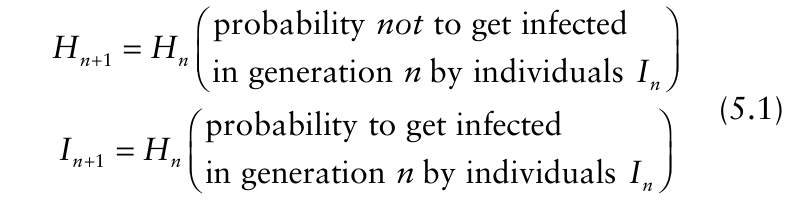{.equation width=60%}

Each infectious individual produces, on average, _α_ viable infectious units. The probability that an infectious unit is deposited on a particular host individual (i.e., comes in contact with a particular host) is _θ_; this means that, on average, a particular host receives _αθIn_ infectious units (that is, on average _αθIn_ units of inoculum come in contact with each host individual). The probability that an infectious unit deposited on a healthy individual is effective, meaning it causes an infection, is denoted by _ψ_. In summary, this means that when the infectious units are randomly distributed, each individual will, _on average_, receive _ψθαIn_ effective infectious units. Not every individual will receive exactly this average number of effective infectious units; due to the random nature of the dispersal of infectious units, some individuals will receive less, and some more than this average. Those individuals that receive no effective infectious units at all will be the ones not getting infected in generation _n_ by individuals _In_.

In the situation described here, the probability that an individual receives a certain number, _X_, of infectious units, when individuals receive on average _ψθαIn_ infectious units, is a very well known one in statistics. In particular, _X_ has a Poisson distribution with parameter _ψθαIn_, The reader is referred to Chapter 9 for a detailed description of this probability distribution in other contexts. The only aspect we need to know here is the probability that the individual does not receive any effective infectious units. According to the Poisson distribution, this probability equals exp{− _ψθαIn_ }, which is the term needed in the equation for the number of healthy individuals in equation 5.1. The probability to receive any number of effective infectious units (rather than 0), and thus to become infected, is, of course, equal to one minus the probability not to receive any effective infectious units. Substituting this information in our system of equations 5.1 we have:

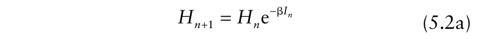{.equation width=60%}

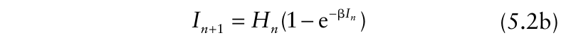{.equation width=60%}

where we simplified the notation by using β = _ψθα_. In the general epidemiological literature, β is often called the per capita disease transmission probability, or per capita infection probability (Daley and Gani, 1999; Anderson and May; 1991). The model equations 5.2a and 5.2b have, as far as we know, first been studied by Dr. J. Gielen from Wageningen University (_unpublished_), and the third author of this book has used this model for teaching for many years. In Diekmann and Heesterbeek (2000) a more mathematical discussion can be found.

The model equations 5.2a and 5.2b are very simple to solve numerically. After deciding on the value of the parameter β, we choose a value for the number of healthy and infectious individuals at the beginning of the epidemic (at _n_ = 0), _H_ 0 and _I_ 0, respectively. Substituting these in the right-hand side of equations 5.2a and 5.2b we find the number of healthy and infected individuals at _n_ = 1. Substituting these numbers again in the right-hand side of the equations we find results for generation _n_ = 2, and so on. Plotting the numbers against time (=generation here), we can visualize the epidemic progress curve generated by the model. To enable a comparison with the epidemic curves we studied in Chapter 4 (and later sections of this chapter), we also want to plot the total number of individuals that have been infected (i.e., diseased) since the start of the epidemic, _Yn_. Calculating this number is simply a matter of adding up all numbers of infectious individuals in the various generations, from

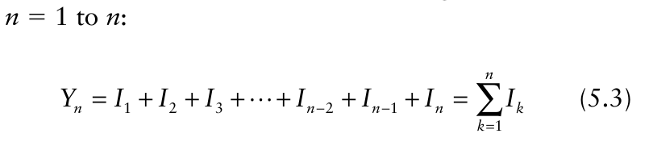{.equation width=60%}

In this model, there is no carryover of infectious individuals beyond a single time generation, so total disease is simply the sum of the generation values of _I_. Note that we do not add the starting number of infectious individuals, _I_ 0, in equation 5.3. In section 5.2.1.5 it will become clear why.

_5.2.1.2 Model simulation_. Fig. 5.1 shows a series of solutions of the model for different values of the parameter β. All these solutions start with 1000 healthy individuals, _H_ 0 = 1000, and one infectious individual, _I_ 0 = 1. From these figures we can draw some conclusions about the epidemic dynamics the model generates.

First of all, the disease progress curves, _Yn_ versus _n_, are _S_ -shaped curves, similar to some of those we studied in Chapter 4. At first sight this might seem logical, but readers are reminded that in Chapter 4 models were chosen that are known to produce an _S_ -shape. That is, the _S_ -shape was incorporated into the disease progress curve before hand. In the derivation of our present model (equations 5.2a and 5.2b), we did not _a priori_ specify that the disease progress curve should be _S_ -shaped. The only thing we have put into the model is a biologically reasonable bookkeeping of the transmission of disease from infectious to healthy individuals. That this results in _S_ -shaped disease progress curves shows that the biology underlying epidemic development (in this simple

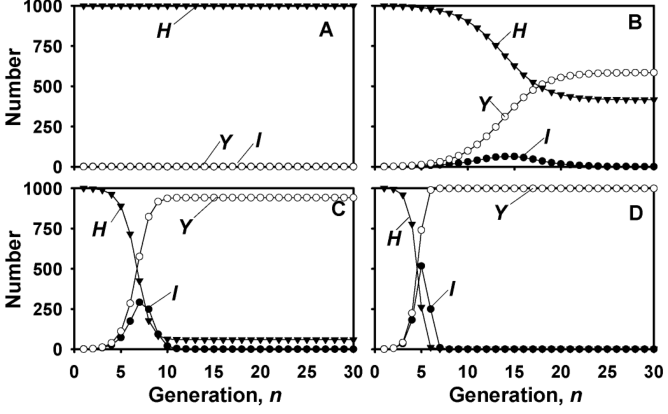{#fig-5-1}

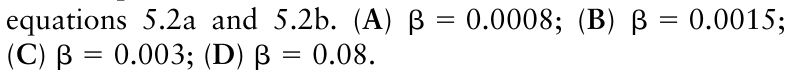{.equation width=60%}

scenario) can generate _S_ -shaped disease progress curves, and therewith underpins the use of selected models in Chapter 4.

The _initial_ increase in the number of infectious individuals for the first few generations, _In_, and the total number of infected individuals, _Yn_, seem to resemble an exponential curve as described in Chapter 4 (see Fig. 4.2).

Even though we did not _a priori_ incorporate into our model an upper limit for _Y_, there seems to be one. After the number of infectious individuals per generation has decreased to zero after a long time period, the total number of infected individuals is still smaller than the number of healthy individuals at the start. For example, for β = 0.0015, only ~60% of the total number of healthy individuals present at the start of the epidemic become infected. The larger the value of the parameter β, the larger the percentage of the population that becomes infected. We will in the following denote the final number of infected or diseased individuals by _Y_ ±, to denote that this number is reached after the epidemic has petered out (as _In_ goes to 0), that is, _Yn_ for _n_ very large. That not all individuals fall victim to an epidemic is a very well known phenomenon for epidemics in humans, animals and plants (Daley and Gani, 1999). For example, readers are encouraged to think back to the most recent influenza virus strain that caused an epidemic in their country or region. There will definitely be people you know that did not get infected by the end of the epidemic, even though they were likely exposed to the pathogen. This phenomenon is also known from plant disease epidemiology; some of the graphs in Fig. 4.1 demonstrate this leveling off of disease at less than 100%. Here we have shown that even a very simple model only incorporating some aspects of the population biology of infectious diseases shows this phenomenon.

Perusal of Fig. 5.1 shows that for values of β smaller than 0.001, no epidemic develops. This is consistent with the interpretation of this parameter (β = _ψθα_). If, for example, the number of infectious units produced by one infectious individual (_α_) is very small, we expect that the disease is not capable of building up a population of infectious individuals and that the disease will simply die out. Further simulations, not shown in the figure, indicate that the apparent threshold for an epidemic depends on the combination of the initial number of healthy individuals (_H_ 0) and the parameter β. Fig. 5.2 shows a plot of _H_ 0 and β for which an epidemic develops or does not develop. There clearly seems to be a threshold line. For combinations of _H_ 0 and β that fall above this line, an epidemic will develop (based on this simple model), whereas for combinations that fall below the line, no epidemic will develop.

Our model analysis using numerical solutions and graphs thus reveals several interesting phenomena, but it is natural to ask: Are these phenomena the result of the particular parameter values we used, or are they general phenomena of this model irrespective of parameter value? For example, would other parameter values result in an epidemic progress curve that is not an exponential type in the initial stage of the epidemic? How exactly does _Y_ ± depend on β and _H_ 0? These questions cannot be adequately answered by further model simulation; we can, however, find general answers using analytical methods. These analytical methods will be developed in the following sub-sections where we concentrate on the questions posed in the introduction: (i) when does an epidemic develop; (ii) how fast will the number of infected individuals grow in the initial stages of the epidemic; and (iii) what fraction of the host individuals will be infected at the end of the epidemic?

{#fig-5-2}

_5.2.1.3 The threshold for epidemic development_. Consider the situation where the number of infectious individuals is very small in the initial stages of an epidemic. It is possible to approximate several terms in equations 5.2a and 5.2b by simpler terms which make it easier to analyze the model. First of all, when _In_ is very small, the number of healthy individuals, _Hn_, will remain very close to the initial number of healthy individuals at the start of the epidemic, _H_ 0. So as long as _In_ is very small, we can replace the term _Hn_ on the right-hand side of equation 5.2b. by _H_ 0 (i.e., _Hn_ ≈ _H_ 0) and still have a good description of the dynamics of the epidemic model. Next, as shown in Box 5.1, for small values of _In_ the term 1−exp(−β _In_) can be approximated by the much simpler term β _In_. This concept was also used in Chapter 3 (section 3.6) to characterize dose-response relations for inoculum density studies. The model equation for the infectious individuals thus becomes:

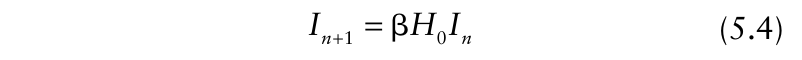{.equation width=60%}

This simplified model—a good approximation to equation 5.2b as long as _In_ is very small—has a simple BOX 5.1 Consider the function _f_ (_I_) = exp(−β _I_). Fig. B5.1 shows the graph of this function for β = 0.1. In the graph we have also drawn the straight line _g_ (_I_) = _a_ + _bI_ that intersects the graph of _f_ (_I_) at _I_ = 0, and has the same slope as _f_ (_I_) at that point. This figure shows that the non-linear function _f_ (_I_) is very well approximated by the linear function _g_ (_I_) for small values of _I_. Forcing _g_ (_I_) to intersect _f_ (_I_) at _I_ = 0 amounts to taking _a_ = 1, as then _f_ (0) = _g_ (0). The slope of the function _g_ (_I_) is _b_. The slope of the function _f_ (_I_) at the intersection point equals the derivative of _f_ (_I_) at _I_ = 0. Since _df/dI_ = −βexp(−β _I_), the appropriate value of _b_ = −β. This shows that for small values of _I,_ the function _f_ (_I_) can be approximated by 1−β _I_.

In model equation 5.2b we thus have that 1−exp(−β _In_) ≈ β _In_ as long as _In_ is small.

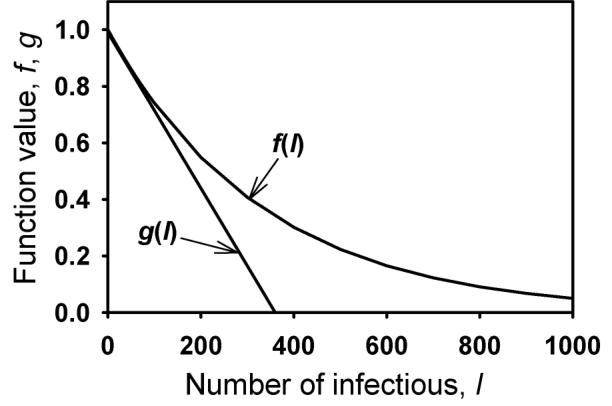

**FIG. B5.1.** Exponential decay function, _f_ (_I_), and its approximating linear function, _g_ (_I_). The functions are

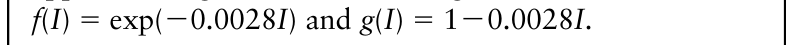{.equation width=60%}

solution. Starting with the initial number of infectious individuals _I_ 0, we find after substitution into equation 5.4 that _I_ 1 = β _H_ 0 _I_ 0. Substituting _I_ 1 again into equation 5.4 we get _I_ 2 = β _H_ 0 _I_ 1, which can be rewritten as _I_ 2 = β _H_ 0 _I_ 1 = (β _H_ 0)2 _I_ 0. Again repeating this procedure, we find _I_ 3 = β _H_ 0 _I_ 2 = (β _H_ 0)3 _I_ 0, and repeating this it become clear that the solution to model equation 5.4 is:

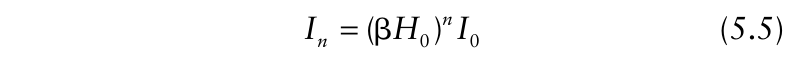{.equation width=60%}

Equation 5.5 tells us for which values of β and _H_ 0 an epidemic will or will not develop (in terms of whether or not _In_ increases). In Fig. 5.3, _In_ is plotted as a function of _n_ for a range of values of β _H_ 0. The figure shows that when β _H_ 0 < 1 the number of infectious individuals decreases in subsequent generations to zero and we conclude that no epidemic develops. When β _H_ 0 > 1 the number increases and we conclude that an epidemic does develop. The situation where β _H_ 0 = 1 clearly separates the cases where an epidemic develops from those where no epidemic develops, and the reader can verify that this equation defines the line in Fig. 5.2 that separates epidemic from non-epidemic situations.

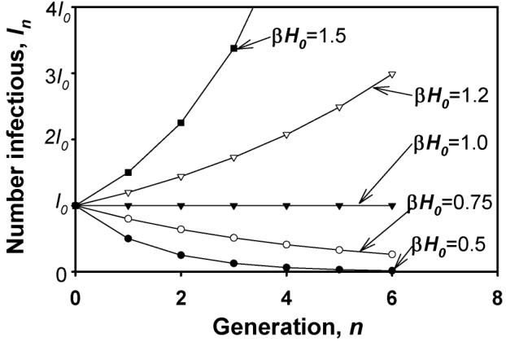{#fig-5-3}

The quantity β _H_ 0 has a clear biological interpretation. β is the per capita disease transmission probability, and the quantity β _H_ 0 thus has the interpretation of “the number of new infections (or diseased individuals, in general) in the _next_ generation caused by one infectious individual if it is placed into a completely healthy population”. Essentially, this is a generation-to-generation multiplication factor. Note that the derivation of equation 5.5 assumed that the number of infectious individuals was very small, and the epidemic is thus in its initial stage. It is intuitively clear that when _In_ is small, an epidemic will develop when each infectious individual gives rise to more than one new infectious individual in the next generation, and an epidemic will not develop when each infectious individual gives rise to less than one infectious individual.

The quantity “the number of new infections (or diseased individuals, in general) due to one infectious individual placed in a completely healthy population” is called the basic reproduction number, _R_ 0. When _R_ 0 > 1, an epidemic will develop and when _R_ 0 < 1 no epidemic will develop. For model equation 5.5 being considered here, we thus found that _R_ 0 = β _H_ 0. For further reading on the basic reproductive number see Diekmann et al. (1990), Anderson and May (1991), Adler (1992), Jeger and van den Bosch (1994a), and Gubbins et al. (2000).

_5.2.1.4 Initial disease increase_. Equation 5.5 also shows us what the shape of the epidemic curve in the initial stage of the epidemic is. Equation 5.5 can be written as:

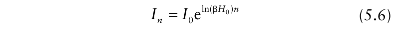{.equation width=60%}

which is an exponential growth equation similar to equation 4.2 of the previous chapter (which was written for total disease as a proportion, not just infectious disease, and continuous time). The exponential growth rate _r_ E = ln(β _H_ 0). We thus conclude that independent of the value of β and _H_ 0, if an epidemic is started from a small _I_ 0, there is initially exponential growth of the number of infectious individuals. How long this initial exponential stage will last depends on β and _I_ 0 relative to _H_ 0. The expression for _r_ E indicates that increasing β (either through increases in _α_, _ψ_, or _θ_), or increasing _H_ 0 will lead to a larger _r_ E.

_5.2.1.5 Final disease level_. To calculate the final disease intensity (after a long period of time) we will use the full model equations 5.2a and 5.2b since, by definition, final disease level will occur after the initial stages. Starting an epidemic with the initial conditions _I_ 0 and _H_ 0, we find from equation 5.2a for generation _n_ = 1:

This expression shows us that if we have a value for the parameter β and values for the initial conditions _H_ 0 and _I_ 0, the total number of infected individuals, after the epidemic has ran its course, _Y_ ±, can be calculated directly. Note that equation 5.12 does not depend on a small value for _I_ 0.

For the further discussion of this final level equation, we restrict ourselves to the situation where the epidemic has started with a very small _I_ 0, as we have done throughout the presentation of the model. When _I_ 0 is very small, _I_ 0 + _Y_ ± ≈ _Y_ ±, which is substituted in equation 5.12. Furthermore, we are interested in the fraction of the initial number of healthy individuals that will finally have been infected (diseased) during the epidemic, _Y_ ±/ _H_ 0. This fraction will be denoted by _y_ ± = _Y_ ±/ _H_ 0. Equation 5.12 then becomes:

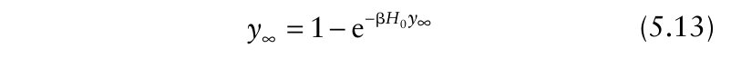{.equation width=60%}

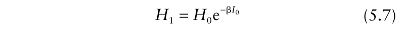{.equation width=60%}

Substitution this again in equation 5.2a, we get for the

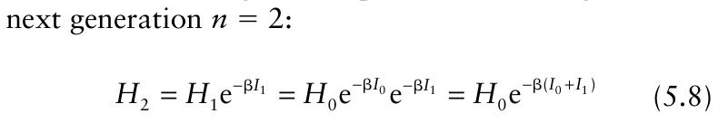{.equation width=60%}

For generation _n_ = 3 and 4, respectively, we find:

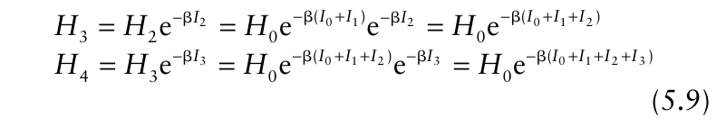{.equation width=60%}

From this it is clear that the number of healthy individuals in generation _n_ equals:

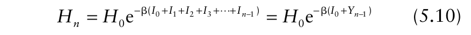{.equation width=60%}

where we used the definition of total number of infected individuals from equation 5.3. As we saw from Fig. 5.1 for some specific combinations of β and _H_ 0, the number of healthy individuals, _H_, and the total number of infected individuals, _Y_, converges to a final level when _n_ gets indefinitely large (mathematically, _n_ → ±). The model solution we just derived allows us to let _n_ go to infinity by simply

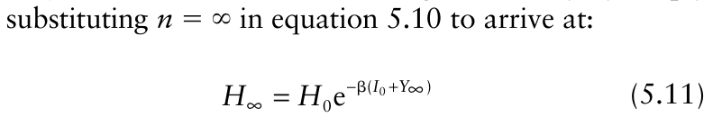{.equation width=60%}

Note that _I_ 0 is kept separate from _Y_ in the exponent. Realizing that the final total number of infected individuals and the number of healthy individuals are related by _Y_ ± = _H_ 0 − _H_ ± (since the total population size is fixed at _H_ 0 in this model scenario), equation 5.11 can be written as:

Note that β _H_ 0 is the basic reproduction number, _R_ 0. Equation 5.12 can thus be written as:

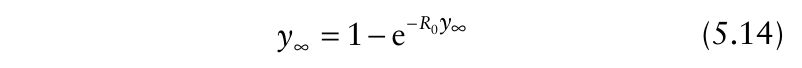{.equation width=60%}

This final disease level equation has been discussed extensively in the literature and more information can be found in Reddingius (1971), Metz (1978b), Jeger (1986b), Jeger and van den Bosch (1994a), Diekmann and Heesterbeek (2000) and Segarra et al. (2001).

Unfortunately, equation 5.14 cannot be solved explicitly for _y_ ±. It is however easy to find the solutions numerically. In Box 5.2 one way is shown to calculate solutions. Fig. 5.4 shows the final fraction _y_ ± as a function of _R_ 0. The figure shows again the threshold for the development of an epidemic, _R_ 0 = 1 (as explained above). Furthermore, it shows that the final fraction of the individuals that get infected increases quickly with increasing _R_ 0. For example, when in the beginning stages of the epidemic, each infectious individual infects three healthy individuals (_R_ 0 = 3), more than 90% of all healthy individuals will ultimately get infected during the epidemic.

If the epidemic is not started with a very small initial number of infectious individuals, _I_ 0 has some effect on _y_ ±. We refer reader to Metz (1978b), Jeger and van den Bosch (1994a), and Segarra et al. (2001) for a discussion of this situation. Furthermore, we point out that there are several related but slightly different definitions of _y_ ±, some of which include _I_ 0 in the total population size and others that keep _I_ 0 separate from the total population size. The various possibilities are discussed in a plant pathology context in Jeger and van den Bosch (1994a).

_5.2.1.6 Concluding remarks._ We have studied a very simple model describing the dynamics of an epidemic with non-overlapping generations. The formulation introduced some basic features of plant diseases in

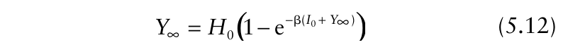{.equation width=60%}

BOX 5.2 We need to find a solution to the equation _fy_ (∑ _y_ ±= ) =1 − _g_ e(− _yR_ ±0 _y_), where ∑ .First, write this equation in the form _f_ (_y_ ±) = _y_ ± and . _g_ (_y_ ∑)= 1 − e− _R_ 0 _y_ ∑ The functions _f_ and _g_ are plotted in Fig. B5.2 for _R_ 0 = 2. The value for _y_ ± where the functions _f_ and _g_ intersect is the value for which _f_ = _g,_ and this is the solution for the final level equation 5.14. For different values of _R_ 0, the function _g_ becomes less or more steep and the intersection point is different from the one in Fig. B5.2. Using such a graphical method, _y_ ± can easily be found. This graphic method is crude, and only approximate values are found. Using root finders available in many computer packages, the final levels can be calculated very exactly. mathematical terms to develop a model for epidemic development. Numerical study of the model, Fig. 5.1, showed some interesting features. These features were further studied using analytical tools. The combination of the two approaches showed that 1. An epidemic will develop when β _H_ 0 > 1 and no epidemic will develop if this product is smaller than 1. The interpretation of this quantity, the number of new infections resulting from one infectious individual when it is placed in a completely healthy population, is the definition of basic reproduction number _R_ 0.

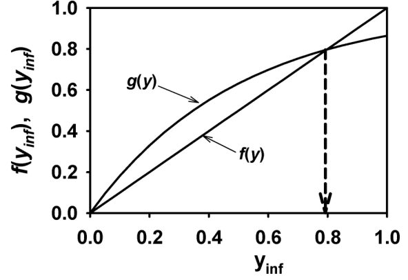

**FIG. B5.2.** Curves of the functions _f_ (_y_) = _y_ and _g_ (_y_) = 1−e−2_y_ , where _f_ (_y_) = _g_ (_y_) is the final disease level equation 5.14. The intersection point at _y_ = 0.8 is the final disease level for _R_ 0 = 2.0.

2. Starting with a small number of initial infectious individuals, the initial stage of the epidemic shows an exponential increase in the number of infectious individuals. The exponential rate parameter, _r_ E, is a function of _R_ 0.

3. The shape of the full epidemic curve is sigmoid.

4. Not every individual will become infected when an epidemic occurs. The fraction of individuals that will become diseased after the epidemic runs its course depends on _R_ 0, and can be calculated from equation 5.14.

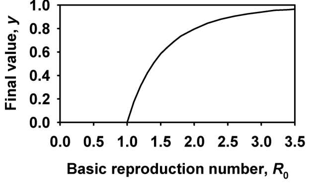{#fig-5-4}

The model equations 5.2a and 5.2b are very simple, and the model is a caricature of a real epidemic. In reality, generations are for most diseases not separated. In the model no account is given to latently infected individuals. The infectious period is not mentioned at all. We assumed that infectious individuals in generation _n_ only can cause new infections for one generation. Other discrepancies with a real epidemic could be listed here. The question: “Do these four listed conclusions apply to real epidemics or are they simply artifacts of the simple nature of the model specification?’’ is a very valid one. In the next sections we will, therefore, consider four other models for plant disease epidemics that incorporate additional aspects of the biology of plant diseases.

### 5.2.2 The H-I-R epidemic model

The next model we study does not make the unrealistic assumption, as in the previous model, that the disease generations are separated. Now considering time as continuous, the model is formulated as a set of differential equations for the rate of change in the number (or proportion) of individuals in the various states (disease free or healthy, infectious, removed).

In the previous model, we discussed all processes in terms of numbers of individuals. This was done to ease the introduction of the models we consider in this chapter. In practice, one will usually be interested in densities of individuals, such as the number of healthy or diseased plants per square meter. In the next model, as well as the ones that follow, we thus change our vocabulary and discuss densities rather than just numbers.

The reader should be remembered here that in Chapter 2, we discussed three categories of disease intensity: (1) incidence, (2) severity, and (3) count. It is possible to represent incidence, severity and counts per unit area of land, such as 50 diseased leaves per square meter, 0.5 square centimeters of lesion per square meter, and 25 lesions per square meter. In this chapter we use density in this sense.

_5.2.2.1 Model derivation_. As done in section 5.2.1, we assume that the host population size is fixed. The density of healthy individuals at time _t_ will be denoted by _H_ (_t_). The density of healthy individuals decreases due to infectious units causing them to become infected (i.e., by the production of infectious units, some of which come in contact with disease-free individuals and cause infections). The density of infectious individuals (i.e., number of individuals in the infectious state per unit area), _I_ (_t_), increases due to these new infections. Furthermore, the density of infectious individuals decreases due to individuals reaching the end of their infectious periods. These individuals stop being infectious and are called removed. The density of removed individuals, _R_ (_t_), increases due to infectious individuals reaching the end of their infectious period. Denoting the rate of change in the density of healthy, infectious, and removed individuals by _dH_ (_t_)/ _dt_, _dI_ (_t_)/ _dt_, and _dR_ (_t_)/ _dt_, respectively, the set of pseudo-equations is: individual has a probability ψ of infecting the individual. We thus have in pseudo-equation format:

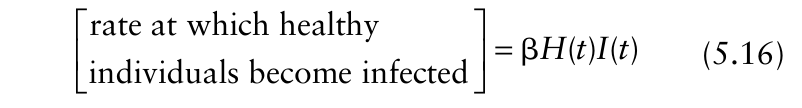{.equation width=60%}

where we simplified the notation by using β = _αθψ_. In the general epidemiological literature, β is often called the per capita disease transmission rate. (Again note the difference with the dimension of the β parameter in the previous model. There it was a value per generation, whereas in the present model it is a rate parameter (value per time unit.)

Each individual has a probability per time unit, _μ_, to reach the end of its infectious period and thus transfer to the removed category. The total density of infected individuals transferring from infected (or infectious) to removed thus equals _μI_ (_t_), and we have:

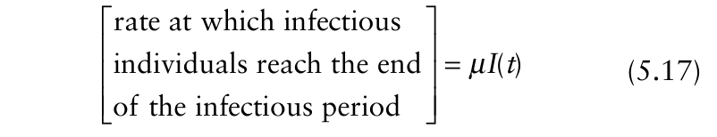{.equation width=60%}

Putting the pieces together, the model to be studied in this section is:

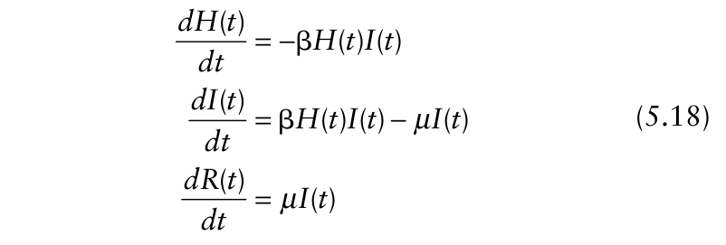{.equation width=60%}

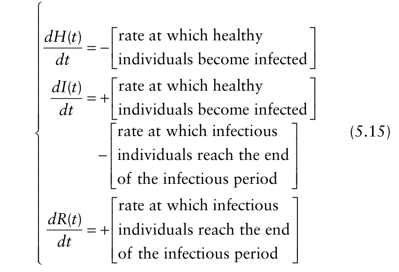{.equation width=60%}

Each infectious individual produces _α_ infectious units per time unit, on average. (Note the difference with the definition of _α_ in the previous model, where _α_ was the number of infectious units produced by one infectious individual during the entire generation.) Consequently, _αI_ (_t_) is the total density of infectious units produced per time unit per unit area. The probability that an infectious unit comes in contact with a healthy individual in a unit area is _θ_. That is, the average number of healthy individuals per unit area that are contacted by an infectious unit is given by _θH_ (_t_). Thus, the number of infectious units transmitted from infectious to healthy individuals per time unit per unit area equals _I_ (_t_) _θH_ (_t_). An infectious unit deposited on a healthy The concepts underlying equation 5.18 were first used by Kermack and McKendrick (1927), and this model is still the starting point of many studies in human, animal and plant disease epidemiology (Anderson and May, 1991; Daley and Gani, 1999; Jeger, 1982). In Box 5.3, we show in a little more depth how differential equations result from simple bookkeeping of the densities in the different categories or states of disease. To allow a comparison of the epidemic curves generated by this model with those of the previous model we also want to calculate the total density of individuals that has become infected since the start of the epidemic, _Y_ (_t_). This density is the sum of the infectious individuals and the removed individuals at a given time, _Y_ (_t_) = _I_ (_t_)+ _R_ (_t_). The differential equation describing the dynamics of this quantity is:

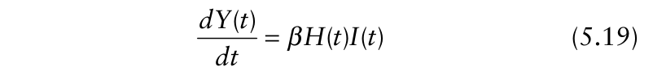{.equation width=60%}

which is easily obtained by adding _dI_ (_t_)/ _dt_ and _dR_ (_t_)/ _dt_. _Y_ (_t_) here and _Yn_ in the previous model have the same interpretation.

BOX 5.3 We consider how the densities of healthy, infectious and removed individuals change in a very small time step of length Δ, between time _t_ and time _t_ + Δ. The density of healthy individuals at time _t_ + Δ, _H_ (_t_ + Δ), equals its density at time _t_, _H_ (_t_), minus the number per unit area that became infected between time _t_ and time _t_ + Δ. To calculate the number per unit area that became infected in this time step, we assume here that the time step, Δ, is very small, implying that the difference between the density of healthy and infectious individuals at the start of the time step, time _t_, and at the end of the time step, time _t_ + Δ, is very small.

As in the derivation of equation 5.16, each infectious individual produces, on average, _α_ spores per time unit. In the time step Δ, every infectious individual thus produces _α_ Δ infectious units. Using our assumption that the time step is very small we can approximate the density of infectious individuals during this time step with the density at the beginning of the time step, _I_ (_t_). Consequently, _α_ Δ _I_ (_t_) is approximately the total number of spores produced in the time step Δ per unit area. The average number per unit area of healthy individuals contacted by an infectious unit is given by _θH_ (_t_). (Note that we make use of the approximation of small time step again.) Thus, the number of infectious units transmitted from infectious to healthy individuals equals _α_ Δ _I_ (_t_) _θH_ (_t_). An infectious unit deposited on a healthy individual has a probability _ψ_ of infecting the individual. The total density of healthy individuals that becomes infected in the time step between _t_ and _t_ + Δ is _ψα_ Δ _I_ (_t_) _θH_ (_t_). In equation form:

Each individual has a probability _μ_ per time unit to reach the end of its infectious period. In the small time step Δ the probability to reach the end of the infectious period thus is approximately _μ_ Δ, and the density of individuals that reach the end of their infectious period in the time step from _t_ to _t_ + Δ is approximated by _μ_ Δ _I_ (_t_). The equation for the change in the density of infectious individuals thus becomes: and for the removed:

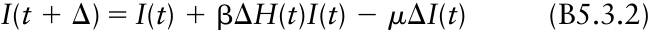

{.equation width=60%}

As discussed previously, differential equations model the rate of change at time _t_. The rates of change in the densities of healthy, infectious and removed individuals in the time step from _t_ to _t_ + Δ are given by respectively. We can rewrite equations B5.3.1–B5.3.3 such that they reflect these rates, by subtracting in each equation the first term on the right-hand side of the equal sign from both sides of the equal sign, and subsequently dividing both sides by Δ. This yields:

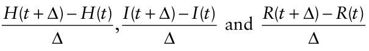

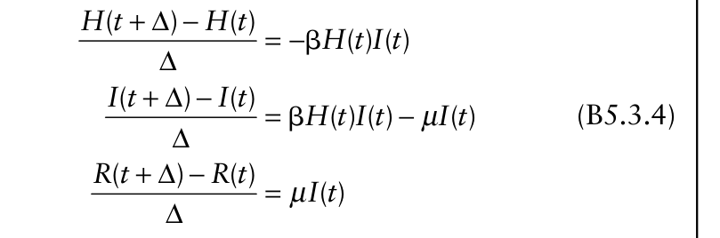{.equation width=60%}

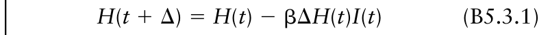{.equation width=60%}

were, again, β = _ψαθ_.

The number per unit area of infectious individuals that reach the end of their infectious period between time _t_ and _t_ + Δ can be calculated in a similar way.

_5.2.2.2 Model simulations_. Equations 5.18 and 5.19 cannot be solved analytically. That is, one cannot derive an equation for _H_ (_t_) or _I_ (_t_) (or _Y_ (_t_)) simply as a function of time and parameters that does not involve the integration symbol. There is, however, a range of methods to _numerically_ solve the set of differential equations 5.18 plus 5.19. It is beyond the scope of this book to go into detail on this topic, especially as there is a range of computer packages available that can numerically solve such systems of differential equations. To give some idea of such methods, however, we can simply consider the equations B5.3.1–B5.3.3 in Box 5.3. First, take a small value for Δ, choose a value for the parameters β and _μ_, and choose values for the initial conditions _H_ (0)

If we now let the time step Δ become smaller and smaller, the left-hand side of the equations become closer and closer to the instantaneous rate of change at time _t_ (equation 5.18). and _I_ (0). Now substituting these values in the righthand side of the equations B5.3.1–B5.3.3, we find the densities of healthy, infectious and removed individuals at time _t_ = Δ. Substituting these calculated density values again into the right-hand side of equations B5.3.1, B5.3.2 and B5.3.3, we find the densities of healthy, infectious and removed individuals at time _t_ = 2Δ. Repeating this process over and over again results in the solution of the model equations. Remember that the equations B5.3.1–B5.3.3 are approximations for small values of Δ, the smaller the value of Δ the better the approximation of the solution we find, but at the expense of having to take large numbers of time steps.

![The density of healthy (_H_), infectious (_I_), and removed (_R_) individuals, and the total density of infected individuals (_Y_ = _I_ + _R_), in relation to time since the start of the epidemic (_t_). Curves represent solutions to model equation 5.18. At the start of the simulation (_t_ = 0), _H_ (0) = _H_ 0 = 1000, _I_ (0) = 1 and _R_ (0) = 0. **(A)** _μ_ = 0.1 (implying _ι_ = 10) and β = 0.00015 per time unit; **(B)** _μ_ = 0.1 (_ι_ = 10) and β = 0.000375 per time; **(C)** _μ_ = 0.25 (_ι_ = 4); and β = 0.00015 per time. **(D**) _μ_ = 0.25 (_ι_ = 4) and β = 0.000375 per time.](figures/fig5-img09.png){#fig-5-5}

There are many more efficient numerical methods to solve differential equations (such as with the programs MATHCAD, MATHEMATICA, and MAPLE). However, the simple method of Box 5.3 can be easily programmed and will give surprisingly accurate solutions for a range of parameter values. Fig. 5.5 shows some numerical solutions of the model equations 5.18 and 5.19. Our initial conditions are again _H_ 0 = 1000 and _I_ 0 = 1 (together with zero removed individuals). Note that in this model β and _μ_ both have an effect on the shape of the epidemic curves.

As in the previous model, when an epidemic develops, the disease progress curves [i.e., _Y_ (_t_) versus _t_] show a sigmoid shape. Also, the initial disease increase shortly after the start of the epidemic closely resembles an exponential curve (as described in Chapter 4). As we have discussed in detail for the previous model, the present model also shows that not every individual becomes infected during the epidemic.

For small values of β and large values of _μ_, no epidemic seems to develop (Fig. 5.5C). This agrees with our biological intuition about epidemic development. One expects that if an infectious individual transmits the disease at a very low rate (because of low _α_, _θ_, and _ψ_), no epidemic will occur; even when a single infectious individual is surrounded by an entirely healthy population, less than one new infection will result, on average. Similarly, when the probability per time unit that infectious individuals become removed is very large, an individual has a short time to transmit the disease; if this time is very short, one expects that an epidemic may not develop because of the smaller opportunity to produce new infections. Two other trends seen in Fig. 5.5 are biologically intuitive. The initial rate of exponential increase, _r_ E, is larger when β is larger, and _r_ E is smaller for larger values of _μ_.

Comparing Fig. 5.5A and D we see that the epidemic curves strongly differ in the initial rate at which the epidemic increases. Both epidemics do, however, finally approach the same total density of infected individuals, _Y_ ±. The _r_ E value thus does not seem to determine the final level of disease intensity, and the simulations do not show what combination of parameters exactly determines the final level of the epidemic.

The simulations suggest that there is a great deal of similarity between the epidemic curves resulting from this model and the model discussed in section 5.2.1 (with continuous time substituted for discrete generations). This is, however, just an impression on basis of visual inspection of graphs. The question on how much the dynamics of these models are the same is answered by analyzing certain aspects of the model. We will in the next sections show, among other things, to what extend the final number of infected individuals, as analyzed in section 5.2.1.5, corresponds to the final level shown by the model equations 5.18 and 5.19.

To aid the interpretation of the analysis, we first consider the parameter describing “the probability per time unit that an individual reaches the end of its infectious period”, _μ_, in some more detail. In the model described here, the probability per time unit to stop producing infectious units is a _constant_, which results in a random variable for time-to-removal (duration of the infectious period for a population of individuals infected at the same time) that has an exponential distribution (see Lawless, 1982). This distribution is discussed in some detail in Chapter 7 in relation to distance of spore flights. For the exponentially distributed infectious period, the _mean_ infectious period is the inverse of the rate parameter. We, thus, conclude that for the present model, the mean duration of the infectious period, _ι_, and the probability per time unit to leave the infectious stage, _μ_, are related by:

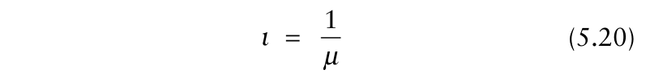{.equation width=60%}

Note that in this model, the diseased individual starts producing infectious units immediately when it becomes infected because we have ignored the latent period.

_5.2.2.3 The threshold for epidemic development_. Consider the situation where, in the initial stage of the epidemic, the density of infectious individuals, _I_ (_t_), is very small. With this condition, the rates of change of the density of healthy individuals, _dH_ (_t_)/ _dt,_ is very small. The number of healthy individuals will therefore not change very much during the initial stage of the epidemic and will remain close to its initial value, _H_ 0. We thus approximate the density of healthy individuals in equation 5.18 by its initial condition, _H_ (_t_) ≈ _H_ 0, which give us:

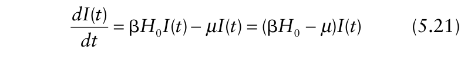{.equation width=60%}

This differential equation is the model for exponential growth of _I_ (_t_) and is equal to equation 4.1 for _Y_ (_t_) or _y_ (_t_)

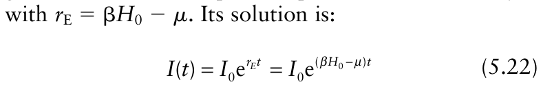{.equation width=60%}

Referring to the discussion on the exponential growth curve in Chapter 4, we can conclude from equation 5.22, that an epidemic will develop (_r_ E > 0) only when β _H_ 0 − _μ_ > 0, and no epidemic will develop when β _H_ 0 − _μ_ < 0. These inequalities can also be written as (β _H_ 0/ _μ_) > 1 and (β _H_ 0/ _μ_) < 1, and β _H_ 0/ _μ_ can also be written as β _H_ 0 _ι_. In this format, the inequalities have a simple biological interpretation. Because β is the per capita disease transmission rate, the quantity β _H_ 0 is the number of new infections produced by one infectious individual per time unit when it is surrounded by an entirely healthy population. As discussed above (equation 5.20), the mean infectious period is _ι_ = 1/ _μ_ time units. If an infectious individual produces new infections at a rate of β _H_ 0 per time unit and it does that for on average 1/ _μ_ time units, then the product of these, β _H_ 0/ _μ_, has the interpretation of “the mean number of new infections (or diseased individuals) produced by one infected individual during its entire infectious period when placed in an entirely healthy population”. One example would be the number of _daughter_ lesions resulting from a single _mother_ lesion in a field over the entire time period that the mother lesion is producing spores, when the number of lesions is so small that there is no chance that a spore produced by the mother lesion lands on a lesion. Vanderplank (1963) called _R_ 0 the progenyparent ratio, although he developed the term in the context of a different model (see section 5.2.4). Clearly, when _I_ (_t_) is small, an epidemic will develop when every infected or diseased individual produces more than one new infection. When every infected individual produces, on average, less than one new infection, no epidemic will develop because the infectious individuals do not replace themselves during the time available for transmission. This result is equivalent to what we found in the previous model. The interpretation of the threshold quantity, β _H_ 0/ _μ_, is again equal to the definition of the basic reproduction number, _R_ 0. To be explicit, we write:

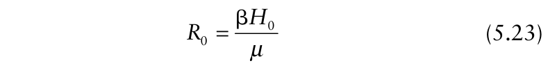{.equation width=60%}

and state that an epidemic will develop when _R_ 0 > 1 and will not develop when _R_ 0 < 1. Sometimes the term _invasion_ is applied to the situation when an epidemic occurs (Diekmann et al., 1990, 1995; Mollison, 1995). In other words, _R_ 0 > 1 is known as the invasion criterion.

_5.2.2.4 Initial disease increase_. As equation 5.22 shows, when an epidemic is started with a small density of infected individuals, in the initial stage of the epidemic the density of infectious individuals will grow exponentially with rate _r_ E = β _H_ 0 − _μ_. As in the previous model, this initial exponential growth is a general property of the model and does not depend on the parameter value (as long as _R_ 0 > 1). The total density of diseased individuals, _Y_ (_t_), also increases exponentially. This can be seen from model equation 5.19. As discussed above, in the initial stages of the epidemic, the density of healthy individuals can be approximated by its initial value,

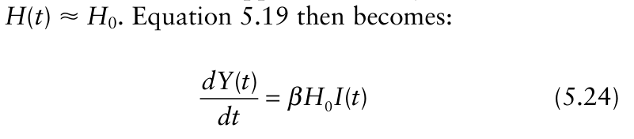{.equation width=60%}

and substituting equation 5.22 for _I_ (_t_) we find

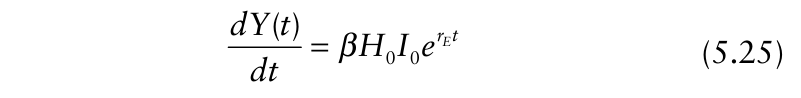{.equation width=60%}

which after integration yields

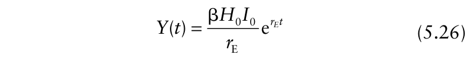{.equation width=60%}

in which _r_ E = β _H_ 0 − _μ_ = _μR_ 0 − _μ_. Increases in β (from either increases in _ψ_, _α_, or _θ_) or decreases in µ (increases in _ι_) lead to larger _r_ E.

_5.2.2.5 Final disease level_. In the previous model (section 5.2.1), we derived step-by-step the final level equation. For model equation 5.18, the derivation of the final level equation involves solving a linear differential equation. This calculation is developed in Box 5.4. Here we will only discuss the result of the calculation. The fraction of the initial population of healthy individuals that will become infected during the epidemic, _y_ ± = _Y_ ±/ _H_ 0 when started with a very small initial infection is calculated from:

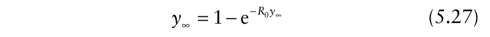{.equation width=60%}

where, in this case, _R_ 0 is given by equation 5.23. Thus, the final level equation is the same as in our first model.

_5.2.2.6 Concluding remarks_. There is a strong similarity in the epidemic dynamics resulting from the model equations 5.18 and 5.2. Both have a threshold parameter, below which no epidemic will develop and above which an epidemic does develop. This threshold is the basic reproduction number, _R_ 0. Both models show that when BOX 5.4 This derivation of the final level equation follows that in Murray (1991). We here refer to the three equations in 5.18 as a, b, and c. Dividing equation 5.18b by equation 5.18a we find:

Rearranging this equation, and substituting the relations _Y_ ± = _H_ 0 − _H_ ±, _y_ ± = _Y_ ±/ _H_ 0, and _R_ 0 = β _H_ 0/ _μ_ we finally find equation 5.27 (when _I_ 0 is very small).

A similar way to derive this expression is by dividing equation 5.18a by equation 5.18c:

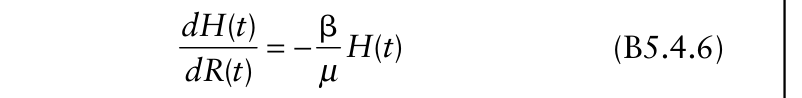{.equation width=60%}

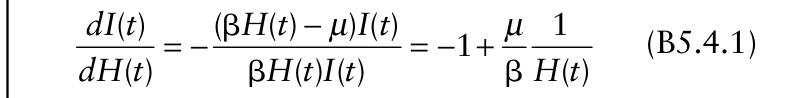{.equation width=60%}

Separating variables and integrating both sides we find Separating variables and integrating both sides we find

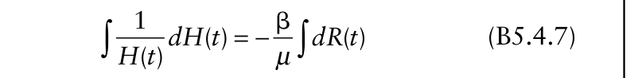{.equation width=60%}

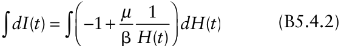

which gives which gives

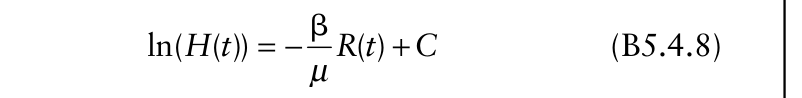{.equation width=60%}

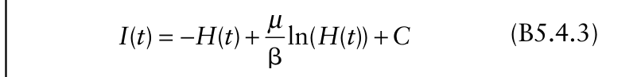{.equation width=60%}

where _C_ is the integration constant that is found by considering the state of the system at time _t_ = 0

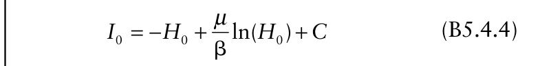{.equation width=60%}

Substituting equation B5.4.4 into equation B5.4.3 and letting time go to infinity we find, realizing that _I_ ± = 0 (because all diseased individuals will finally become removed in a epidemic with a fixed total number of individuals):

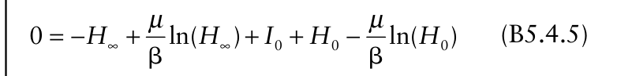{.equation width=60%}

an epidemic is started with a small density of infectious individuals the initial growth of the density of infectious individuals is exponential in form. The exponential rate parameter, _r_ E, can be expressed as a combination of the model parameters, β _H_ 0 and _μ_. Both models have exactly the same final level equation, when expressed in terms of _R_ 0.

### 5.2.3 The H-L-I-R epidemic model

So far none of the models we have shown included a latent period. This is a serious shortcoming of the models because it is very well known that many diseases have a considerable latent period, some even longer than the infectious period (Vanderplank, 1963). Therefore, we will extend the model from the previous section to include a latent period. Since this model is a little more complicated, we present a schematic form for the model (Fig. 5.6) to help the reader. The boxes refer to the The integration constant _C_ can again be found by considering the state of the system at time _t_ = 0

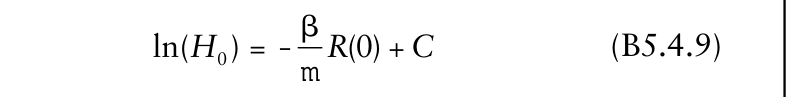{.equation width=60%}

At time _t_ = 0 there are no removed individuals yet, so _R_ (0) = 0. Substituting equation B5.4.9 in equation B5.4.8 and letting time go to infinity we find

{.equation width=60%}

Realizing that _R_ ± = _I_ 0 + _Y_ ± and rearranging the equation a little we find again equation 5.27 when _I_ 0 is very small (~0). densities of individuals in the different states, and the arrows show the transitions from one state to the next.

{#fig-5-6}

_5.2.3.1 Model derivatio_ n. We use the same notation for the density of healthy, infectious and removed individuals, _H_ (_t_), _I_ (_t_) and _R_ (_t_), respectively, as in the previous model. Adding to this we introduce the density of latently infected individuals as _L_ (_t_) (i.e., the number per unit area of individuals in the latent state). The main difference with the H-I-R model is that healthy individuals that become infected first enter the latently infected state. The latently infected individuals transfer after their latent period into the infectious category. The pseudomodel equations that describe this are:

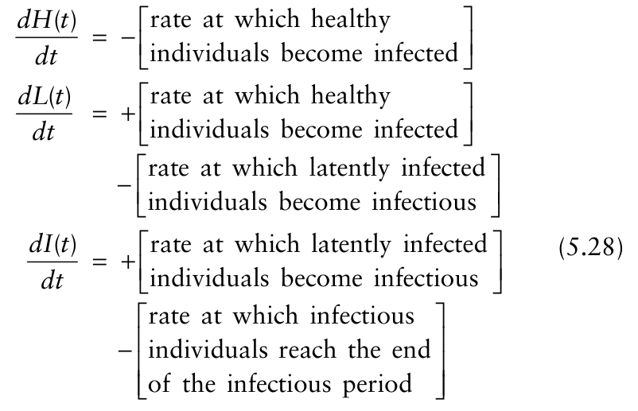{.equation width=60%}

_dR t_ <u>( )</u> rate at which infectious individua ls = + _dt_ reach the end of the infectious period calculate the total density of individuals that has become infected since the start of the epidemic, _Y_ (_t_). This density is the sum of the latently infected individuals, infectious individuals and the removed individuals at a given time, _Y_ (_t_) = _L_ (_t_) + _I_ (_t_) + _R_ (_t_). The differential equation describing the dynamics of this quantity is:

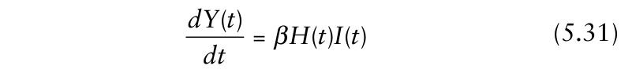{.equation width=60%}

obtained simply from _dL_ (_t_) _/dt_ + _dI_ (_t_) _/dt_ + _dR_ (_t_) _/dt_.

Before discussing the disease progress curves generated by this model let us first consider the relation between the parameter _ω_, “the probability per time unit that a latently infected individual reaches the end of its latent period and becomes infectious’’, and the latent period. In the model described here, this probability per time unit is a constant. We are thus in the same situation as with the mean infectious period, equation 5.20 (where latent period was ignored), and we refer to that discussion on the exponential distribution. In short, the time that individuals are in the latent state is a random variable with an exponential distribution. The mean time an individual stays in the latent state for a population of infected individuals with an exponential distribution equals the reciprocal of _ω_. Thus, we can consider to be the _mean_ latent period, given by:

{.equation width=60%}

The only new term in this model is the rate at which latently infected individuals become infectious. We assume that each latently infected individual has a constant probability, _ω_, per time unit to reach the end of its latent period and become infectious. The total density of latent individuals transferring from latent to infectious per unit time thus equals _ωL_ (_t_) and we have:

{.equation width=60%}

Substituting the relevant equations from the previous section and equation 5.29 in equation 5.28 we arrive at the model equations:

{.equation width=60%}

To make the epidemic curves generated by this model comparable to the previous model we again want to Now that both latent and infectious periods have been explicitly incorporated into the epidemic model (equations 5.30 and 5.31), it is useful here to compare the model for _Y_ (equation 5.31) with the logistic model for _Y_ given at the end of Chapter 4, _dY_ (_t_)/ _dt_ = ϒ _Y_ (_t_) _H_ (_t_) (equation 4.51a). For the logistic model, ϒ = _rL_ / _M_, with _M_ being the total host “size” (density here). If initial disease is very low, _H_ 0 ≈ _M_, and we can write the rate parameter as ϒ = _rL_ / _H_ 0 _._ In one sense, β in the H-L-I-R model is _analogous_ to ϒ (= _rL_ / _H_ 0) of the logistic model (or β _H_ 0 is analogous to _rL_). Increases in _r_ L or β _H_ 0 result in faster rates of disease increase (_dY/dt_) overall. However, β _H_ 0 is clearly _not_ the same as _r_ L. This is because in the logistic model, the rate of disease increase is proportional to _total_ disease, _Y_ (_t_), which includes both latent and removed disease as well as infectious disease density. Thus, the logistic model can never fully represent the dynamics of disease development since, for polycyclic diseases, new diseased individuals result only from infectious individuals. As stated by Vanderplank (1963) for a different model (see section 5.4 below), this means that the logistic rate, _r_ L, depends on the transmission rate (β) as well as on and _ι_. However, the relationship is quite complicated over the duration of the epidemic. Nevertheless, the logistic model is easy to use for describing and comparing disease progress curves.

When _Y_ (_t_) or _y_ (_t_) is low, the exponential model is a good approximation for the logistic, with _r_ E ≈ _r_ L, as shown in Chapter 4. For the two previous models in this chapter, we have already shown that disease increase is also approximately exponential during the initial stages of polycyclic epidemics. We continue to explore the relationship between the exponential model and those based on more biological realism in this and the following sections.

We note that in human epidemiology, disease-free individuals typically are labeled “susceptible” (_S_), and those in the latent state are labeled “exposed” (_E_). Thus, the H-L-I-R model is simply referred to as an S-E-I-R model in the literature (Diekmann and Heesterbeek, 2000), even without explanation. Plant pathologists often use terms such as susceptible for other purposes; for instance, susceptible is used as a label for a genetic trait, not the temporary status of an individual or group of individuals within the time scale of an epidemic. Thus, we use the H-L-I-R label in this book.

_5.2.3.2 Model simulations_. With three parameters, β(= _ψαθ_), _μ_ (=1/ _ι_), and _ω_ (=1/), it starts to become more difficult to get a general overview of the effect of parameter values on disease progress curves. Fig. 5.7 shows a number of simulations with various parameter combinations. As in the previous models: (i) the curves are generally _S_ -shaped; (ii) for some parameter combinations, an epidemic develops and for other combinations, no epidemic develops; (iii) the initial phase of epidemic increase seems to be of the exponential type; and (iv) decreased probability per time unit that an infectious individual reaches the end of its infectious period increases the growth rate of the epidemic.

The primary effect of the mean latent period is that the rate of increase appears to be large for small values of , which is biologically intuitive—the sooner that infections become infectious, the higher the rate of disease increase. Furthermore, the length of does not seem to determine whether an epidemic does or does not develop, nor does it seem to determine the final disease level. Fig. 5.7 does, however, show only a small range of parameter values and a further mathematical analysis of the model is needed to show the generality of these simulation results.

Analysis to answer our three key questions relating to the epidemic threshold, the initial disease increase rate and the final disease level is still possible for this model. The threshold for epidemic development will be discussed without detailed derivation. The derivation of the final level equation has, as will be discussed, already been shown. To calculate the exponential growth rate we need solutions of a system of linear differential equations. This technique is not too complicated but would need several pages to explain. We will therefore only state and discuss the results of the analysis and sketch its derivation in Box 5.5.

![The density of healthy (_H_), latently infected (_L_), infectious (_I_), and removed (_R_) individuals, and the total density of infected individuals (_Y_ = _L_ + _I_ + _R_), in relation to time since the start of the epidemic (_t_). Curves represent solutions to model equations 5.30. At the start of the simulation (_t_ = 0), _H_ (0) = _H_ 0 = 1000, _L_ (0) = 0, _I_ (0) = 1 and _R_ (0) = 0. Upper four frames: short latent period; lower four frames: longer latent period. **(A)** _μ_ = 0.1 (implying _ι_ = 10), _ω_ = 0.2 (implying = 5), and β = 0.00015 per time. **(B)** _μ_ = 0.1 (_ι_ = 10), _ω_ = 0.2 ( = 5), and β = 0.000375 per time unit. **(C)** _μ_ = 0.25 (_ι_ = 4), _ω_ = 0.2 ( = 5), and β = 0.00015 per time unit. **(D)** _μ_ = 0.25 (_ι_ = 4), _ω_ = 0.2 ( = 5) and β = 0.000375 per time unit. **(E)** _μ_ = 0.1 (_ι_ = 10), _ω_ = 0.1 ( = 10), and β = 0.00015 per time unit. **(F)** _μ_ = 0.1 (_ι_ = 10), _ω_ = 0.1 ( = 10), and β = 0.000375 per time unit. **(G)** _μ_ = 0.25 (_ι_ = 4), _ω_ = 0.1 ( = 10), and β = 0.00015. **(H)** _μ_ = 0.25 (_ι_ = 4), _ω_ = 0.1 ( = 10) and β = 0.000375 per time unit.](figures/fig5-img12.png){#fig-5-7}

_5.2.3.3 The threshold for epidemic development_. As before, the threshold for epidemic development is the basic reproduction number, _R_ 0. The formulation for _R_ 0 expressed in the parameters of model equations 5.30 is:

{.equation width=60%}

which is exactly the _same_ expression as for the basic reproduction number of the H-I-R model equations 5.18 that did not include a category of latently infected individuals. At first sight this might seem strange. However, BOX 5.5 For the H-L-I-R model, we start with the same approximation as we have used before. In the initial stages of the epidemic we can approximate _H_ (_t_) by its initial value _H_ 0. Substituting this in equation 5.30 we get for the differential equations describing the density of latently infected and infectious individuals:

This is a system of linear differential equations. These can be solved explicitly. The book by EdelsteinKeshet (1988) describes the method in detail. The solutions are: where λ1 and λ2 are the eigenvalues of the matrix:

{.equation width=60%}

which are given by individual during its entire infectious period when placed in an entirely healthy population does not depend on the latent period. With increasing , it will take longer to produce all the new infections, but ultimately the same number is produced.

An other way to see this is to consider the sum of _L_ (_t_) and _I_ (_t_) [= _Q_ (_t_)], which is all the non-removed disease. The equation for _dQ_ (_t_)/ _dt_ can be obtained from equations 5.30 by _dQ_ (_t_) _/dt_ = _dL_ (_t_) _/dt_ + _dI_ (_t_) _/dt_. Assuming that _H_ (_t_) = _H_ 0 (as before), because we are concerned here with the early stages of an epidemic when _I_ (_t_) is very low, the reader is left to confirm that _dQ_ (_t_)/ _dt_ is given by equation 5.21, with _Q_ substituted for _I_ on the left-hand side. _Q_ (_t_) can only increase if β _H_ 0 is larger than _μ_, or equivalently _R_ 0 = β _H_ 0/ _μ_ > 1. In the next chapter, we discuss the basic reproduction number in a situation where latently infected individuals can leave the system due to, for example, death.

_5.2.3.4 Initial disease increase._ As in the previous two models, it can be shown that when the epidemic is started with a very small initial number of latently infected or infectious individuals, or a very small combination of these densities, infectious disease density will initially increase exponentially as:

{.equation width=60%}

with the exponential growth rate parameter, _r_ E, given by:

{.equation width=60%}

{.equation width=60%}

The quantities _ci_ depend on the initial conditions. The eigenvalue λ2 is negative and with increasing time, the exponential term with this eigenvalue will vanish (go to zero). This implies that the densities of latently infected and infectious individuals is given approximately by:

From which we conclude that both densities grow exponentially, with growth rate λ1; thus, _r_ E = λ1 in equation 5.34. Note that λ1 is only above 0 when β _H_ 0 − _μ_ > 0 (or β _H_ 0/ _μ_ > 1) in equation B5.5.4. Thus, there is only an epidemic when _R_ 0 > 1, as demonstrated with other models. in this model, individuals in the latently infected state will eventually all transfer into the infectious category (i.e., we have not included in the model the possibility that a latently infected individual might leave the system due to, for example, death). Therefore, the mean total number of new infections produced by one infectious See Box 5.5 for further details. In section 5.2.3.1, we compared the differential equations for the logistic and H-L-I-R models, and pointed out that the logistic rate (_r_ L)—or for small _y_ (_t_), the exponential rate (_r_ E)—incorporates aspects of β _H_ 0, (1/ _ω_), and _ι_ (1/ _μ_). Equation 5.35 here formalizes this relationship mathematically for the early stages of a polycyclic epidemic. In the previous two models, _r_ E could be expressed as a very simple function of the parameters, and the dependence of _r_ E on the parameters could simply be understood from its expression. Unfortunately, because of the extra complications of a latent period, equation 5.35 is not very instructive. Drawing graphs of _r_ E as function of the parameters helps in this respect. To make the interpretation easier and to make the results comparable to the next model we will discuss, we change the parameters from the probabilities per time unit, _μ_ and _ω_, to the parameters for mean infectious period, _ι_, and mean latent period, , using equations 5.20 and 5.32. Some rearranging of the expression finally yields:

{.equation width=60%}

Introducing the expression for _R_ 0 in equation 5.36 we have

{.equation width=60%}

The reader can confirm that when β _H_ 0 _ι_ (= _R_ 0) = 1, both equations 5.36 and 5.37 indicate that _r_ E = 0, as required, and that _r_ E is only larger than 0 when _R_ 0 > 1. That is, there is no epidemic unless _R_ 0 > 1. This relationship between _r_ E and the parameters of the H-L-I-R model serves as an excellent way to contrast the simple growth-curve models of Chapter 4 and the more realistic ones in this chapter. Stating that an epidemic requires that _r_ E be greater 0 is, in a sense, an empty conclusion or criterion because it does not tell you very much about the population biology of the disease of interest. For instance, with a fungal pathogen, one might think that any sporulation rate per diseased individual (_α_) above zero, any positive probability of a spore reaching a host plant (_θ_), or any positive probability of a spore causing an infection when in contact with a healthy plant individual (_ψ_) could lead to an epidemic. However, as shown in this and the previous sections of this chapter, there is a _nonzero_ threshold combination of _α_, _θ_, and _ψ_, expressed by their product, β = _αθψ_, that must be exceeded for an epidemic to occur.

We intentionally give these two slightly different models for _r_ E (equations 5.36 and 5.37) because, as we will see, it changes the _apparent_ dependence of _r_ E on the parame ters (when _r_ E > 0). But before going into the difference between equations 5.36 and 5.37, let us discuss some numerical examples. Assume we have done a series of experiments and found that the disease under study has an average latent period of = 7 days and an average infectious period of _ι_ = 10 days. Further we have monitored an epidemic that has started in a crop field, and after analyzing the data using the methods discussed in Chapter 4, we conclude that in the beginning stages of the epidemic _r_ E = 0.05/day. What does this tell us about _R_ 0 and the β _H_ 0 transmission rate parameter? To calculate β _H_ 0 we first have to express β _H_ 0 as a function of the other known (or assumed known) parameters from equation 5.36. Some algebraic manipulations show that:

{.equation width=60%}

Substituting = 7 and _ι_ = 10 in _m_ = ( + _ι_)/(2 _ι_), we find that _m_ = 0.1214. Next substituting _m_, , _ι_, and _r_ E = 0.05 into equation 5.38 we find that the transmission rate is β _H_ 0 = 0.2025/day. Furthermore, we know that _R_ 0 = β _H_ 0 _ι_, and substituting the calculated or assumed numbers we find that _R_ 0 = 2.025. The reader should be reminded here that β _H_ 0 has units of time−1 , but that _R_ 0 is unitless.

Suppose we can choose between two disease management methods, one reduces the transmission rate by 50%, the other one increases the mean latent period of the disease by a factor of 2. The first scenario can be achieved using a protective fungicide that reduces the probability that an infectious unit that landed on a healthy individual actually infects the host (_ψ_, one of three terms making up β). The second scenario can be achieved using a curative fungicide that reduces the development rate of the pathogen. To calculate the effect of these two possibilities we substitute for the first one = 7, _ι_ = 10 and β _H_ 0 = 0.2025/2 = 0.10125 into equation 5.36 and the expression for _R_ 0. We find _R_ 0 = 1.0125 and _r_ E = 0.0007/day. In other words, because _R_ 0 is very close to 1, there is very slow increase in disease. For the second possibility we substitute = 7 × 2 = 14, _ι_ = 10 and β _H_ 0 = 0.2025 into equation 5.36 (with _m_ now given by 0.0857), and find that _r_ E = 0.035/day, lower than before the control, but not changed nearly as much as found when changing β. Clearly, the protective fungicide is the most effective control in this example situation. Note that this is only an example, and we do not advocate that protective fungicides are more effective than curative fungicides, in general—it all depends on the parameter values and on the magnitude of the effect of the fungicide on these parameter values that can be achieved in field applications.

We return to our discussion on the equations 5.36 and 5.37. Before drawing the graphs we have to choose parameter values. We choose values characteristic for two contrasting plant diseases, one highly infectious (large β _H_ 0) with a long infectious period and one moderately infectious with a short infectious period. Stripe rust, caused by _Puccinia striiformis_, is a disease of wheat. The foliar fungal pathogen has a high rate of spore production (_α_) and long infectious period (_ι_), characteristic for many rust fungi. Downy mildew, caused by _Peronospora farinosa_, is a disease of spinach. The foliar oomycete plant pathogen has a low spore production rate and short infectious period. In a reanalysis of data published by van den Bosch et al. (1988c), Segarra et al. (2001) estimated for the stripe rust: _R_ 0 = 55, = 10 days and an infectious period _ι_ = 20 days. In the H-L-I-R model this corresponds to a transmission rate of β _H_ 0 = 2.75/day. For downy mildew they found: _R_ 0 = 3.2, = 7 days, and _ι_ = 3.4 days. This corresponds to a transmission rate of

{.equation width=60%}

Fig. 5.8 shows the exponential growth rate of the epidemic, _r_ E, as a function of β _H_ 0, , and _ι_, for both diseases. In Fig. 5.8A and B, and _ι_ are fixed at the values mentioned above, and the transmission rate, β _H_ 0, is varied as a parameter on the horizontal axes. Similarly, in Fig. 5.8C and D, β _H_ 0 and _ι_ are fixed, and is varied on the horizontal axis. The asterisk marks the parameter value mentioned above. Fig. 5.8E and F are constructed in a similar way.

![The exponential rate of increase of disease (_r_ E) as function of **(A)** and **(B)** transmission rate; **(C)** and **(D)** latent period; and **(E)** and **(F)** infectious period, corresponding to values appropriate for _P. farinosa_, left column, and _P. striiformis,_ right column. The drawn line shows _r_ E for the H-L-I-R model, calculated from equation 5.36. The dotted line shows _r_ E for the Vanderplank model (1963), calculated from equation 5.49a. Parameter values that are not plotted in a given graph are: = 7 days, _ι_ = 3.4 days, and β _H_ 0 = 0.94/day (for _P. farinosa_); and = 10 days, _ι_ = 20 days, and β _H_ 0 = 2.75/day (for _P. striiformis_). Asterisk on the horizontal axis shows the parameter value used as default in the other graphs of this figure.](figures/fig5-img16.png){#fig-5-8}

From the figure we see that the larger the transmission rate, β _H_ 0, the larger the _r_ E, which can be understood intuitively, since both quantify the increase in disease over time. When the transmission rate of downy mildew is smaller than ~0.3/day, _r_ E is zero, indicating no epidemic develops. This, of course, corresponds to values of _R_ 0 < 1. The relation between β _H_ 0 and _r_ E is markedly non-linear for small β _H_ 0. For small values of β _H_ 0, the small changes in β _H_ 0 have a considerable effect on the exponential growth rate of the epidemic, whereas for large β _H_ 0 values, changes in β _H_ 0 have little effect on the exponential growth rate. One of the consequences of this relation between transmission rate and exponential growth rate is that disease management targeted at reducing the transmission rate will be more effective for pathogens with a small transmission rate than for pathogens with a high transmission rate.

The value of clearly has a considerable effect on _r_ E, with long mean latent periods corresponding to small epidemic growth rates, as is intuitively obvious since it takes longer for new infectious units to be first produced. When is short, a change in has a large effect on _r_ E. When the is long, a change in has much less effect on the exponential growth rate. Again this has considerable implications for disease management. A fungicide or resistant cultivar, for example, that affects the development rate of the pathogen within the host, and therewith increases the mean latent period, will be very effective for pathogens with a short mean latent period but much less effective for pathogens with a long mean latent period.

The exponential growth rate, _r_ E, increases with the length of the mean infectious period, _ι_, which again is intuitively obvious. The longer individuals are infectious, the higher the rate of increase in the population since there is more opportunity to cause infections. The dependence of _r_ E on _ι_ follows the same pattern as the dependence of _r_ E on β _H_ 0.

Fig. 5.9 is constructed in the same way as Fig. 5.8, but in this case equation 5.37 is used. The dependencies of _r_ E on _R_ 0 and are very comparable to Fig. 5.8. The main difference between the two figures is in the effect of the mean infectious period, _ι_, on _r_ E (Fig. 5.8E and F compared with Fig. 5.9E and F). The trends are the opposite for the two representations of the exponential growth rate in equations 5.37 and 5.36. The increase in _r_ E with increasing _ι_, as we discussed in relation to Fig. 5.8, is intuitively obvious, but the decreasing _r_ E with increasing _ι_ shown in Fig. 5.9 seems entirely counterintuitive. There is, however, a very essential difference between the two representations of the model. In equation 5.36 and corresponding Fig. 5.8, an increase in _ι_ has the effect of increasing _R_ 0 when β _H_ 0 is fixed; in other words, _R_ 0 is not constant in Fig. 5.8. Based on the definition of _R_ 0 (= _ι_ β _H_ 0), if we keep β _H_ 0 fixed and increase _ι_, _R_ 0 must increase. That an increase in the _R_ 0 results in an increase in the exponential growth rate is again obvious.

In equation 5.37 and corresponding Fig. 5.9, we keep _R_ 0 fixed. So in this equation and figure, a change in _ι_ does not change the _R_ 0. This implies that if we decrease _ι_ (without changing _R_ 0), the same total number of new infections per infectious individual (if surrounded by an entirely healthy population) are still produced, but in a shorter time span. This can only happen if β _H_ 0 increases as _ι_ decreases. Likewise, β _H_ 0 decreases as _ι_ increases if _R_ 0 is kept constant, since the new infections are spread out over a longer time period. Thus, it is intuitively clear that _r_ E is inversely related to _ι_ when _R_ 0 is fixed. We have brought this point up to illustrate the fact that the results and interpretation can depend on the parameterization chosen, and readers should be cautious when choosing a parameterization.

_5.2.3.5 Final disease level_. The final level equation is exactly the same as equation 5.14 for the simpler H-I-R model, with equation 5.33 for _R_ 0 (see Fig. 5.4 for _y_ ±). Because all diseased individuals ultimately become infectious and then removed (with _ω_ > 0 and _μ_ > 0) with sufficiently long time period (when there is no plant mortality as in this model), all diseased individuals will be in the removed state before 100% of the host population is diseased. This can be seen mathematically from Box 5.4 where the second method of deriving the final level equation (i.e., that based on d _H/_ d _R_) applies to the model equation 5.30 as well. As can be seen from Fig. 5.4, the effect of _R_ 0 on _y_ ± is most pronounced

![The exponential rate of increase of disease (_r_ E) as function of **(A)** and **(B)** basic reproduction number; **(C)** and **(D)** latent period; and **(E)** and **(F)** infectious period, corresponding to values appropriate for _P. farinosa_, left column, and _P. striiformis,_ right column. The drawn line shows _r_ E for the H-L-I-R model, calculated from equation 5.37. The dotted line shows _r_ E for the Vanderplank model, calculated from equation 5.49b. Parameter values that are not plotted in a given graph are: = 7 days, _ι_ = 3.4 days, and _R_ 0 = _ι_ β _H_ 0 = 3.2 (for _P. farinosa_); and = 10 days, _ι_ = 20 days, and _R_ 0 = _ι_ β _H_ 0 = 55 (for _P. striiformis_). Asterisk on the horizontal axis shows the parameter value used as default in the other graphs of this figure. Same as Fig. 5.8, except that _R_ 0 is fixed in C–F (instead of β _H_ 0), and that _r_ E is plotted against _R_ 0 in A and B (instead of against β _H_ 0).](figures/fig5-img17.png){#fig-5-9}

{.equation width=60%}

Results for the H-L-I-R model can be compared with the logistic (or similar) growth-curve model of Chapter 4. A final level of _y_ less than 1 is easily accommodated in the logistic model by use of a parameter for the upper limit (asymptote, _K_), as discussed in section 4.8. However, _K_ in equation 4.47 is purely an empirical value that is not defined in terms of the underlying mechanisms of population growth. Now, by modeling the epidemic based on more fundamental parameters, we see that a biological reason for _K_ being less than 1 is that all diseased individuals become removed before all plants are diseased. The basic reproduction number is all that is needed to determine final disease level (when initial disease intensity is low). In a sense, _y_ ∝ is analogous to _K_. It is important to note that the governing equations for the H-L-I-R model (equation 5.30) do _not_ include a parameter for final _H_ (and thus final _Y_); rather, the final values are the natural _outcomes_ of the underlying population dynamics of disease.

_5.2.3.6 Some concluding remarks_. Again many features of this H-L-I-R model are the same as for the previous two models. Basically, the only real difference between the three is the specific expression for _r_ E in terms of the parameters of the particular model. The meaning of _R_ 0 and _r_ E are unchanged, however. The expression for _r_ E is more complicated because it now accounts for the latent period. Thus, the formula for _r_ E of the previous simpler model (H-I-R) would only be appropriate to use if was very short.

_5.2.3.7 Recapitulation of the model equations—role of latent and infectious periods._ When discussing the parameters _ι_ and we referred to them as the _mean_ infectious period and the _mean_ latent period instead of simply the infectious period and the latent period. Although this might make reading tiring in some places, it was done for a very good reason. In this section we take a closer look at the latent period and the infectious period in the model.

In deriving the model we assumed that there is a constant probability per time unit, _ω_, that a latently infected individual reaches the end of its latent period and becomes infectious. Assume it would be possible to do an experiment of the following type: We start at time _t_ = 0 with a group of _L_ 0 individuals that are newly infected, and thus just entered their latent period. We stop any secondary infections developing and only observe how many of the initial group of latently infected individuals are still in the latent period. These observations are described by the differential equation:

{.equation width=60%}

This model describes a simple exponential decay and the solution of this equation is:

{.equation width=60%}

{#fig-5-10}

This means that the probability that an individual is still latent _t_ time units after it has become infected, _PL_ (_t_), is given by the exponential function: defined as a function of _R_ 0. The only difference is in how the basic reproductive number, _R_ 0, and the exponential growth rate, _r_ E, depend on the details of the model specification. We will, however, see with the next model that this last aspect has some important consequences.

### 5.2.4 The Vanderplank model

Vanderplank (1963) developed a model for the dynamics of plant disease epidemics that takes account of the latent period and the infectious period. He developed this model in 1963, a year that could be seen as the starting point of theoretical or quantitative plant disease epidemiology (see Chapter 1). In this section we study his general model in the light of the theory we have developed so far.

_5.2.4.1 Model derivation_. As in the differential equation models of the previous sections, Vanderplank’s model describes the rate of change in the density of healthy plants as:

{.equation width=60%}

{.equation width=60%}

Fig. 5.10 shows an example graph of this function. The graph makes clear that some individuals have a very short latent period and others have a long latent period. Since not all individuals will have the same latent period, the description of the latent period incorporated in the model is quite realistic. The model, however, does fall short in the sense that some individuals reach the end of their latent period very shortly after they became infected. For example, in Fig. 5.10, _x_ time units after becoming infected, a small fraction of 1 − _PL_ (_x_) individuals already moved into the infectious category. Realistically one would expect that for some period of time after becoming infected _all_ individuals remain in their latent period (so that _PL_ (_t_) = 1 for _t_ > 0) and then gradually the probability to be in the latent period decreases.

Exactly the same concept holds for the infectious period as incorporated in the model. The probability to be in the infectious period _t_ time units after becoming infectious is given by an exponential distribution function. Again the fact that there is variation in the infectious period between individuals is realistic, but some individuals will have an unrealistically short infectious period in the model.

At this point one might wonder why we expand on this in so much detail, and why there actually is a next section introducing yet another model. All models so far show the same epidemic dynamics: (i) there is a threshold for epidemic development, which is quantified by _R_ 0; (ii) when the epidemic is started with a small initial infection, the number or density of infectious individuals grow exponentially in the initial stage of the epidemic; and (iii) the same final level of disease intensity is reached, We now express the density of infectious individuals, _I_ (_t_), in terms of the density of diseased individuals, _Y_ (_t_), in the past. To follow the derivation, one has to keep the difference between infected (or diseased) and infectious in mind: infected individuals can be in their latent state, in their infectious state, or be in the removed state. The Vanderplank model assumes that the latent period has a _fixed_ duration which is the same for every individual. Further, the infectious period is assumed to have a fixed duration _ι_ which is the same for every individual. This implies that individuals that are infectious at time _t_ became infected between time units ago (the latent period) and + _ι_ time units ago (the latent plus infectious periods). Individuals infected less than time units ago are still in their latent state and individuals infected more then + _ι_ time units ago are in the removed category. The individuals that are infectious at time _t_ thus became infected between time _t_ − − _ι_ and time _t_ − . For instance, consider = 5 and _ι_ = 10. Infectious individuals at time _t_ = 40 became infected between time _t_ = 25 and _t_ = 35. Any individuals infected _before_ time _t_ = 25 are in the removed state, and any individuals infected _after_ time _t_ = 35 are in the latent state. The density of individuals that become infected in the time interval from _t_ − − _ι_ to _t_ − is simply the difference between the density of infected individuals at _t_ − − _ι_, _Y_ (_t_ − − _ι_), and the density at _t_ − , _Y_ (_t_ − ). This is illustrated in Fig. 5.11. We thus have the relation _I_ (_t_) = _Y_ (_t_ − ) − _Y_ (_t_ − − _ι_) and the Vanderplank model takes the form:

{.equation width=60%}

{#fig-5-11}

The model can entirely be expressed in the density of infected (diseased) individuals if we assume that the density of healthy individuals plus the density of diseased individuals adds up to the density of healthy individuals, _H_ 0, at the start of the epidemic, so that _H_ (_t_) = _H_ 0 – (_Y_ (_t_). Substituting this in equation 5.43 we get:

{.equation width=60%}

The density of individuals in their latent period is given by _L_ (_t_) = _Y_ (_t_) − _Y_ (_t_ − ), and the density of removed is

{.equation width=60%}

This completes the derivation of the Vanderplank model. Equation 5.44 is sometimes called a _differentialdelay equation_ or differential-difference equation. The analysis of differential equations with time delay terms, such as _t_ − and _t_ −− _ι_, is quite complicated and beyond the scope of this book. We refer the interested reader to Reddingius (1971) and Metz (1978b). However, in the previous sections we have built up some good intuition about the dynamics of epidemics, and we will show that this intuition is sufficient to express the basic reproduction number, _R_ 0, and the exponential growth rate, _r_ E, as a function of the model parameters. As it turns out, many of the interpretations of equation 5.44 here are the same as for the H-L-I-R model (equation 5.30).

Readers familiar with Vanderplank’s (1963) book know that he expressed his differential-delay equation for disease intensity as a proportion, not a density. To show how equation 5.44 can be expressed for proportion diseased [ _y_ (_t_) = _Y_ (_t_)/ _H_ 0], note that _dy_ (_t_)/ _dt_ = _d_ [ _Y_ (_t_)/ _H_ 0]/ _dt_, [ _H_ 0 − _Y_ (_t_)]/ _H_ 0 = 1 − _y_, and [ _Y_ (_t_ − ) − _Y_ (_t_ − − _ι_)]/ _H_ 0 = _y_ (_t_ − ) − _y_ (_t_ − − _ι_). Because one divides the right-hand side of equation 5.44 by _H_ 0 twice to obtain only proportions instead of densities, but the left-hand side is divided by _H_ 0 only once to obtain _dy_ (_t_)/ _dt,_ β must be multiplied by _H_ 0 on the right-hand side. This gives (β _H_ 0)[1− _y_ (_t_)][ _y_ (_t_ −)− _y_ (_t_ (_t_ −− _ι_)] for _dy_ (_t_)/ _dt._ This version of the equation makes it clear that β _H_ 0 (and not just β) is the rate parameter of interest.

_5.2.4.2 The threshold for epidemic development_. We already know that _R_ 0 is the total number of new infections due to one infected individual during the whole course of its infectious period when it is placed in a completely healthy population. We also know that _R_ 0 determines whether an epidemic will or will not develop. As in the differential equation models discussed in sections 5.2.2 and 5.2.3, in the Vanderplank model, individuals are not removed from the latent state except by becoming infectious and are not removed from the infectious state except by becoming post-infectious (i.e., there is no mortality of diseased individuals prior to being removed). This implies that the latent period will not affect _R_ 0, because all infected individuals ultimately go through all the disease states and become post-infectious.

Consider one infectious individual placed in a host population consisting only of healthy individuals, and a per capita transmission rate of β _H_ 0. Remember that this transmission rate is the number of new infections due to one infectious individual per time unit. Each individual is infectious for _ι_ time units and, thus, the total number of new infections caused before the end of the infectious period is _ι_ β _H_ 0. In other words, _R_ 0 = _ι_ β _H_ 0, the same value as determined for the H-L-I-R model. Vanderplank called β _H_ 0 the _corrected basic infection rate_ and as mentioned before, _R_ 0 the progeny-parent ratio.

_5.2.4.3 Initial disease increase_: Starting with a very small initial disease level (small _Y_ (0)), the density of infected individuals is, in the initial stages of the epidemic, negligible compared to the density of healthy individuals. This implies that _H_ 0 − _Y_ (_t_) ≈ _H_ 0. Equation 5.44 then becomes:

{.equation width=60%}

The models in the previous sections showed in the initial stages of the epidemic an exponential increase of the form:

{.equation width=60%}

Assuming that for this model the same general result holds, and that equation 5.46 is a solution of model equation 5.45 at very small disease intensity, we substitute the right-hand side of equation 5.46 for _Y_ (_t_) in equation 5.45 and obtain:

{.equation width=60%}

which becomes

{.equation width=60%}

Dividing out the term _Y_ 0exp(_r_ E _t_) on both sides, one obtains

{.equation width=60%}

The last equation specifies the exponential growth rate, _r_ E, in terms of the model parameters of equation 5.45. Equation 5.49a cannot be solved explicitly for _r_ E. But as we have seen with the equation for the final level of an epidemic, such equations can be solved numerically. Note that equation 5.49a can be written in terms of the basic reproduction number: large. This is especially relevant for diseases with a large β _H_ 0 or _R_ 0. This shows that if we want to use information on the latent and infectious periods to predict _r_ E, it is important to utilize an epidemic model that reasonably well represents the actual distribution of latent and infectious periods. In this respect, it may be quite difficult to choose between using the H-L-I-R model or the Vanderplank model to calculate _r_ E, because both model formulations have the same level of biological detail, and level of realism (or lack of realism). For the H-L-I-R model, too many individuals transfer very early from the latent to the infectious state, and from the infectious to removed state. For the Vanderplank model, all individuals have exactly the same latent period and same infectious period. In the next section we will therefore introduce a model that describes latent and infectious period more accurately, but with the penalty of being more complicated.

{.equation width=60%}

### 5.2.5 The Kermack and McKendrick model

Figure 5.8 show the exponential growth rate as function of the transmission rate, β _H_ 0, the latent period, , and the infectious period, _ι_ for the Vanderplank model (dotted curves). The solutions of equation 5.49 are plotted in the same graphs as for the solutions with the H-L-I-R model discussed in the previous section. Qualitatively, the relations between the model parameters and _r_ E are very similar to the ones discussed for the H-L-I-R model and we will not reiterate on this. There is, however, a striking _quantitative_ difference in results between the two models, especially for large _R_ 0 and β _H_ 0, as in the example of stripe rust.

For most parameter combinations, the calculated _r_ E for the H-L-I-R model is larger than for the Vanderplank model, but for some parameter combinations, the Vanderplank model has the largest calculated _r_ E. The general trend is that for parameter values that give a very small _r_ E, the Vanderplank model produces a slightly larger _r_ E, and for parameter combinations that give a high _r_ E, the H-L-I-R model produces a larger _r_ E.

_5.2.4.4 Final disease level_. Various authors (e.g., Reddingius, 1971; Metz, 1978b) have shown that the final level equation is again equation 5.27, and we do not elaborate on the proof. Jeger and van den Bosh (1994a) give a thorough presentation of the derivation of the final-value result for the Vanderplank model for a fuller range of conditions than discussed here. Vanderplank (1975) used equation 5.21 heavily to characterize diseases of perennials over many years.

_5.2.4.5 Concluding remarks_. From the discussion about Fig. 5.8, we can conclude that many of the qualitative features of the model discussed here are very similar to features of the previous model, the quantitative differences in calculated _r_ E between models can, however, be Nearly 80 years ago Kermack and McKendrick (1927) developed a very general model for epidemics that still has a remarkable and profound influence on theoretical epidemiology (Daley and Gani, 1999; Diekmann and Heesterbeek, 2000; Diekmann et al., 1995). One important property of the model is that few assumptions are made regarding the distribution of latent and infectious periods. For the application to plant diseases, van den Bosch et al. (1988b) and Segarra et al. (2001) introduced a quite general model description of latent and infectious period that fits measurements well, and use it to calculate the exponential rate of increase for the early stages of an epidemic.

The full Kermack and McKendrick model and its analysis are beyond the scope of this book. We will, however, show the derivation of the model for the initial stage of the epidemic when the epidemic is started with a very small initial infection level. For further reading on the full model we refer to the extensive literature on this model (Kermack and McKendrick, 1927; Metz, 1978b; Diekmann and Heesterbeek, 2000 and references therein). For an introduction to this model in a plant pathology context we refer to Segarra et al. (2001).

In this section, we introduce the description of “infectiousness of an individual” (or _infectivity_ of an individual) and describe the basic reproduction number and the method by which the exponential growth rate is calculated. The model has been used in plant pathology primarily for fungal (or oomycete) foliar plant diseases with spores being the infectious units (units of inoculum). We therefore change our phrasing slightly and often discuss infectious units and the production of infectious units as spores and spore production, respectively. We also assume here that the individual disease unit is the lesion. However, these changes to more specific labels for individuals and infectious units are for ease of expression, because the model can be applied to most if not all plant disease scenarios.

One basic aspect of the Kermack–McKendrick model is in the description of the infectiousness of an individual. In the H-L-I-R and Vanderplank models, all diseased individuals are placed into non-overlapping states (latent, infectious, and removed), and all individuals in a state are treated alike. But in the Kermack–McKendrick model, these categories disappear (in a sense) and a diseased individual is “simply” characterized in terms of time elapsed since the initiation of infection. This time will be denoted by _τ_ and referred to as “time since infection”; infectiousness can vary continuously throughout this time period. One can think of _τ_ as ‘age’ of the diseased individual.

_5.2.5.1 The sporulation curve_. Consider an experiment where a group of leafs or plants is inoculated with a spore suspension at one moment in time (_τ_ = 0) and a number of lesions is produced. For a sufficiently long period the development of these lesions is observed. The produced spores are harvested and counted daily. Plotting the number of spores produced per day per lesion, _S_ (_τ_), as a function of time since infection, _τ_, we will find that during the first days no spores are produced because the latent period has not yet ended. Then, spore production starts and the rate of spore production increases to a peak level and then falls off again, and finally decreases to zero. Some examples for a range of fungal foliar pathogens are shown in Fig. 5.12. An example of this was analyzed in section 3.6.2 to demonstrate other modeling concepts (see Fig. 3.9). This sporulation curve, _S_ (_τ_), characterizes both the latent period _and_ the infectious period in terms of time since infection.

A model that fits most of the data sets on sporulation is the equation

{.equation width=60%}

where Γ(_w_) is the gamma function which is tabulated in several textbooks (e.g. Abramowitz and Stegun, 1965). Equation 5.50 is known as the delayed gamma distribution multiplied by the parameter Ω.

In this description of the sporulation curve, the parameter Ω is the total number of spores produced per lesion during its entire lifetime, and is, as before, the latent period. The parameters _λ_ and _w_ determine the shape of the sporulation curve during the infectious period. In Fig. 5.12 the drawn line shows the model fit to the data which justifies (for these data sets) the use of equation 5.50. Certainly, other equations could be used for _S_ (_τ_), including ones that do not require a threshold to be exceeded before sporulation occurs. However, equation 5.50 appears to be a reasonable general model for the infectiousness of individuals.

![Sporulation (or more generally, infectivity) curves for four foliar diseases. The vertical axis is the relative spore production rate, and the horizontal axis is time since initiation of infection. Points are the measured values; the drawn lines are fit for a delayed-γ distribution function (equation 5.50). (**A**) _Puccinia recondita_; = 10 days, λ = 0.218, and _w_ = 2.34 (data from van den Bosch et al., 1988b, c). (B) _Peronospora striiformis;_ = 10 days, λ = 0.213, and _w_ = 3.15 (data from van den Bosch et al., 1988b,c). (**C**) _Peronospora farinosa;_ = 7 days, λ = 0.91, and _w_ = 2.33 (data from van den Bosch et al., 1988b,c). (**D**) _Puccinia lagenophora_; = 16 days, λ = 0.23, and _w_ = 4.00 (data from Kolnaar and van den Bosch, 2001).](figures/fig5-img20.png){#fig-5-12}

_5.2.5.2 Model derivation_. The starting point of the derivation of the Kermack and McKendrick model is very similar to the starting point of the derivation of the Vanderplank model. The number of spores produced per time unit per unit area by all infectious individuals present in the crop is denoted by Λ(_t_). The number of healthy individuals per unit area that will be contacted by an infectious unit is given by _θH_ (_t_), where, as before, _θ_ is the probability that a spore reaches a particular host individual. Thus, the number of infectious units transmitted from infectious to healthy individuals per time unit equals Λ(_t_) _θH_ (_t_). An infectious unit deposited on a healthy individual has a probability _ψ_ of infecting the individual. We thus have for the rate at which individuals become infected:

{.equation width=60%}

In the H-I-R and H-L-I-R models Λ(_t_) was _αI_ (_t_); that is, all infectious individuals were treated the same (they each had a constant sporulation rate, _α_). However, here we do not place individuals into states and we have to derive an expression based on the sporulation curve. The differential equation _dY_ (_t_)/ _dt_ is, as before, the number of new infections in the population per time unit per unit area. For ease of explanation we use the notation _b_ (_t_) for this quantity and use the slightly simpler label ‘number of new infections per time unit’.

{.equation width=60%}

When the epidemic starts with a very small number of initial infections we can, as before, approximate the density of healthy individuals by its initial density and sub- For the current model, we assume that equation 5.56 holds for small _Y_ 0. Equation 5.56 implies that the number of _new_ infections per time unit, _b_ (_t_), also increases exponentially because the derivative of the exponential model (equation 5.56) is still an exponential growth function. Therefore,

{.equation width=60%}

Substituting this equation into equation 5.55 we find

{.equation width=60%}

{.equation width=60%}

We now need to calculate Λ(_t_), which is the sum (integral) of the rates of spore production of all infected individuals in the population. By definition, all infected individuals present at time _t_ have become infected at some point in the past. For example, the density of individuals that have been infected 10 time units ago is the ‘number of new infections per time unit’ at time _t_ − 10, _b_ (_t_ − 10). In general, the density of individuals at _t_ that have ‘time since infection’ _τ_ is given by _b_ (_t_ − _τ_). As stated above, individuals that are infected _τ_ time units ago produce _S_ (_τ_) spores per time unit. Therefore, the total number of spores produced by all individuals that became infected _τ_ time units ago equals _b_ (_t_ − _τ_) _S_ (_τ_). Calculating Λ(_t_) is a matter of summing up over all possible values of _τ_. In continuous time, this summing up over all possible values of _τ_ amounts to integrating over _τ_. We have

{.equation width=60%}

Substituting equation 5.54 in equation 5.53 the model becomes:

{.equation width=60%}

for the rate of increase of lesions (or diseased individuals, in general). Note that equation 5.55 for the rate of disease increase involves an integration over _τ_ for any given time. To determine _Y_ (_t_), one then integrates equation 5.55 from 0 to _t_, which means that one must integrate a function that involves an integral, making this model more complex than the ones discussed in previous sections.

_5.2.5.3 The exponential growth rate and derived R_ 0. The models in the previous sections showed in the initial stages of the epidemic an exponential increase of the form Dividing out the term _b_ 0e_r_E_t_ on both sides we have

{.equation width=60%}

This equation allows us to calculate the exponential growth rate, _r_ E, after substituting an appropriate equation for _S_ (_τ_) and calculating the integral. In demographics, equation 5.59 is called the Euler equation. A detailed discussion on this equation can be found in Keyfitz (1968) and Roughgarden (1979).

To summarize the model at this point, the total number of spores produced by one infectious individual throughout its infections period equals Ω (equation 5.50), and the number of healthy individuals per unit area that will be contacted by each spore is given by _θH_ 0. Thus, the total number (_not_ per unit time) of spores transmitted from one infectious individual to healthy individuals equals Ω _θH_ 0. An infectious unit deposited on a healthy individual has a probability _ψ_ of infecting the individual. We can thus conclude that for this model the basic reproduction number is given by _R_ 0 = _ψ_ Ω _θH_ 0. This can be compared to the formula derived for other models, _R_ 0 = _ψαιθH_ 0. In other words, _α_ ι of the previous models serves the same role as Ω in the current general model. This is as expected, because _αι_ is the total number of spores produced per infected individual (=rate per time unit multiplied by time duration of infectiousness) when the sporulation rate is constant over the infectious period.

Let us now, as an example, reconsider the Vanderplank model, in which an infected individual has a fixed latent period, and a fixed infectious period, _ι_. In terms of the general epidemic model of Kermack and McKendrick, the equation that describes the sporulation curve for the Vanderplank model is:

{.equation width=60%}

{.equation width=60%}

Substituting this equation in the Euler equation 5.59, we obtain BOX 5.6 We define

{.equation width=60%}

{.equation width=60%}

Calculating the integral we finally find

{.equation width=60%}

where we have used, as before, β = _ψθα_. Equation 5.62, which is solved numerically to determine _r_ E, is identical to equation 5.49, which we derived for the Vanderplank equation in section 5.2.4.3.

In Box 5.6 we discuss a very general approximation formula for _r_ E, which is unfortunately only a valid approximation for very small _R_ 0.

_5.2.5.4 The exponential growth rate for sporulation curve 5.50._ One advantage of using equation 5.50 for the sporulation curve is that it leads to a fairly simple expression to determine _r_ E for the initial stages of an epidemic. Substituting the sporulation curve 5.50 (based on the delayed gamma distribution) into the Euler equation 5.59, we find that _r_ E is calculated from the equation: as the relative sporulation curve. Referring to equation 5.50 and the discussion following that equation, _s_ (_τ_) is a probability density or distribution for sporulation time, implying that integrating _s_ (_τ_) over _τ_ from 0 to ± equals 1 (by definition). Substituting equation B5.6.1 in equation 5.59 we get For small values of _R_ 0 the exponential rate of increase, _r_ E, can be approximated from equation B5.6.2 by: where ϑ is the expected value based on the _s_ (_τ_) function,

{.equation width=60%}

{.equation width=60%}

where we used _R_ 0 = _ψθΩH_ 0. As for the Vanderplank model, this equation cannot be solved explicitly to express _r_ E in terms of the model parameters. An estimate of _r_ E can be obtained when, after substituting the parameters values for _R_ 0, , _w_ and _λ_, the right-hand side of equation 5.63 is plotted over a wide range of values for _r_ E and reading of from this graph where the value of the function equals 1. As discussed in Box 5.2, more accurate solutions can be obtained using a numerical root finder in one of the available computer packages.

It is important to point out that other functions lead to different functions for calculating _r_ E.

_5.2.5.5 Final disease level_. Various authors (Metz, 1978b; Diekmann and Heesterbeek 2000, and references therein) have shown that the final level equation for the Kermack and McKendrick model is again equation 5.14.

_5.2.5.6 Concluding remarks_. The Kermack and McKendrik model is a very flexible and general model that can incorporate realistic descriptions of the spore production curve. Contrary to the H-L-I-R and Vanderplank models, investigators do not need to choose which of the very specific types of transitions The interpretation of ϑ is the average time elapsed since start of the infection process at which an infectious unit is produced. For the Vanderplank model,

{.equation width=60%}

The derivation of this equation can be found in Metz and Diekmann (1980), or Seggara et al. (2001). The equation is only a valid approximation for small values of _R_ 0, where small here means smaller than 5. A slightly more accurate approximation formula is discussed in Segarra et al. (2001). In general these approximation formulae have a limited applicability to plant diseases because plant diseases often have large basic reproduction numbers. When _R_ 0 is low, however, such as when a disease control is _almost_ effective enough to prevent an epidemic, one can see the consequence of the achieved _R_ 0 by estimating the exponential rate of increase using equation B5.6.3. between infection categories (latent, infectious removed) should be used; rather, on basis of information on the biology of the disease, investigators can derive a function _S_ (_τ_) and substitute it in the Euler equation. Because this model has been little used in plant pathology, there are ample opportunities for further research.

## 5.3 Discussion

We have introduced five models in this chapter for polycyclic epidemics. The models were developed in sequence, from the very simple caricature one (section 5.2.1) to the very realistic (but much more complex) Kermack and McKenrick one (section 5.2.5). The first, and in our opinion, and most important conclusion to be drawn from the discussion of these models is: if we are interested in _qualitative_ features of disease dynamics, like thresholds for epidemic development, initial rate of increase of disease intensity, shape of the disease progress curve, and final intensity of disease (size of the epidemic), a simple model yields the same results as a very complex model. This shows that it is often not necessary, as some biologists and plant pathologists are inclined to think, to incorporate as many aspects (details) as possible of the biology of the pathogen and host under consideration to gain insight into the epidemiology of the disease. However, if we are more concerned about _quantitative_ features of epidemics, such as accurate predictions of the exponential growth rate in the initial stage of disease increase, we do need realistic descriptions of the components of the epidemic, especially distribution of latent and infectious periods. In this situation, the Kermack and McKendrick model is a very good tool to arrive at such quantitative estimates.

The models presented here all have their advantages and disadvantages. The simplest model, equations 5.2a and 5.2b, are very easy to solve numerically. Furthermore, equations for the threshold for epidemic development, the exponential growth rate, and the final disease level are easily derived from this model. This is the reason we started with this model. The disadvantage of the model is that it does not include some very important features of plant diseases. The absence of latent and infectious periods, and the restriction to non-overlapping generations, make this model unrealistic. This model is seldom used in animal, human and plant disease epidemiology, but it is an ideal tool to introduce some important qualitative aspects of epidemics of infectious diseases.

The H-L-I-R model, as we showed, is a more realistic description of the population dynamics of plant diseases. This model is still analytically tractable with commonly used mathematical techniques. The disadvantage, as we discussed, is in the restrictive assumptions of the distribution of the latent and infectious periods. Despite this disadvantage, the H-L-I-R model and its variations (not explained here) are extremely popular in theoretical epidemiology, and this model is generally used as a starting point for more model developments to incorporate specific features of the pathosystem of interest. We will discuss examples of such further developments in the next chapter. Some valuable papers in botanical epidemiology based on this general model framework include: Swinton and Gilligan (1996), Chan and Jeger (1994), Gilligan et al. (1997), Jeger (1982).

The H-I-R model is even simpler to work with than the H-L-I-R one. It is thus easy to use the model to explore many qualitative aspects of epidemics, especially the derivation of a basic reproduction number, threshold for an epidemic, and final disease intensity. Its disadvantage is that it produces an unrealistic prediction of _r_ E, since latent period is not included (or, equivalently, a latent period of 0 time units). As we have seen, however, latent period does not affect the definition of _R_ 0, and corresponding thresholds and final level.

The Vanderplank model incorporates, in some ways, a somewhat more realistic description of the latent and the infectious periods compared with the H-L-I-R model, which is definitely an advantage of this model over the H-L-I-R one. It is, however, much harder to analyze mathematically differential-delay equations than it is to analyze the differential equation models of the H-L-I-R type. It is also very hard to fit such models to data. Nevertheless, because of the strong influence of Vanderplank (1963), botanical epidemiologists have been more interested in using the differential-delay approach than investigators in the rest of theoretical epidemiology (e.g., Jeger, 1984; Jeger and van den Bosch, 1994a). The model also serves as a good foundation for numerical simulation studies (e.g., Zadoks, 1971; Zadoks and Kampmeijer, 1977) since the time delays are handled in a natural way in computer programs with single-day time steps in the model. Because of the many practical advantages of H-L-I-R models, the Vanderplank model is becoming considerably less popular for theoretical studies even in botanical epidemiology. We note that in the ecological literature, differential-delay equations play a useful role in some aspects of the study of population dynamics (Nisbet and Gurney 1982, and references therein).

As we have seen, the Kermack and McKendrick model is the most realistic of the models discussed in this chapter. But it is a difficult model to work with and to fit to data. For these reasons, extensions and applications of this model are not common in plant pathology, with the notable exception of its generalization for studying the spatial spread of plant diseases (see Chapter 8).

We end this discussion on disease progress models with a cautionary note. Considered in more biological detail, the introduced parameters (β _H_ 0, , _ι_, and so on) may be considered to be functions of other properties of diseases, and not just constants. There are two essentially different situations: (i) _A parameter depends on other parameters_. We have already considered one example of this when we have used β for the product _ψθα_. Each of these component parameters could be functions of other parameters. In these situations, the results, such as equations for _R_ 0, _r_ E, and final disease level, can simply be applied with no additional difficulty. For example, the probability of a unit of inoculum contacting a host (_θ_) could be considered to vary with the initial disease-free host density _H_ 0, say, for example, _θ_ = _ζ_ 1 _H_ 0/(_ζ_ 2 + _H_ 0) (where the _ζ_ s are positive parameters). Then it is valid to substitute this new definition of _θ_ into the equations for _R_ 0, _r_ E, and the final level. One especially useful choice of parameters is _ζ_ 1 = 1/ _H_ 0 and _ζ_ 2 = 0 (so that _θ_ = 1/ _H_ 0). This results in a transmission rate of β (rather than β _H_ 0), and an _R_ 0 of β/ _μ_.

It should be pointed out that most measurements of epidemics involve the proportion of plant area affected by disease (severity) or the proportion of plants (leaves, etc.) that are diseased. That is, actual densities are not known, and more importantly, there have been few studies that quantitatively compared epidemics with different host densities. Thus, whether or not _θ_ (for instance) or other components of β depends explicitly on host density is not necessarily known (as a general rule), and the transmission rate β _H_ 0 should be treated as a single term, not necessarily as two separate (and unrelated) parameters. For instance, β _H_ 0 is analogous to _r_ L of the logistic model, and not just β, as mentioned above. An implication of this can be addressed in terms of _R_ 0 (β _H_ 0/ _μ_). It would appear that host density is a determinate of the basic reproduction number, and directly determines whether or not there is an epidemic. But, as mentioned in the previous paragraph, it is possible that β goes down as _H_ 0 goes up; in this case, _R_ 0 would not vary linearly with host density when other parameters are fixed. What we can say definitively is that _R_ 0 goes up with increases in β _H_ 0. de Jong et al. (1995) nicely describe some ways of deciding from data whether β depends on host density. (ii) _A parameter depends on variables in the system_. In the second situation it is _not_ valid to simply substitute the new expressions in the equations for _R_ 0, _r_ E, and the final level! For example, if _θ_ is considered to vary with the healthy host density _H_ (_t_), say, for example, _θ_ = _ζ_ 1 _H_ (_t_)/(_ζ_ 2+ _H_ (_t_)), then it is not valid to substitute this new definition into the equations for _R_ 0, _r_ E, and the final level. This expression has to be incorporated in the governing model equations (e.g., equation 5.30) and the mathematical analysis has to be redone to see how this new formulation affects _R_ 0, _r_ E, and the final level. In fact, all qualitative and quantitative features of the model _could_ be affected in this scenario. We do not pursue this subject here.

## 5.4 Suggested Readings

- Diekmann, O., and Heesterbeek, J. A. P. 2000. _Mathematical Epidemiology of Infectious Diseases: Model Building, Analysis, and Interpretation_. John Wiley and Son, Ltd, Chichester (A mathematically challenging text, but full of excellent insights on epidemic processes).

- Jeger, M. J., and van den Bosch, F. 1994. Threshold criteria for model plant disease epidemics. I. Asymptotic results. _Phytopathology_ 84: 24–27.

- Segarra, J., Jeger, M. J., and van den Bosch, F. 2001. Epidemic dynamics and patterns of plant diseases. _Phytopathology_ 91:1001–1010.

- Vanderplank, J. E. 1963. _Plant Diseases: Epidemics and Control_. Academic Press, New York (Chapters 5, 6, and 8).
