# 6 {#sec-ch6}

Temporal Analysis III: Advanced Topics _It is the mathematicians’ inclination to strive for an abstract and general theory, the hope being, that once such a theory exits, one can make it operational by mere specification and elaboration._ Odo Diekmann and J.A.P. (Hans) Heesterbeek

## 6.1 Introduction

In the previous chapter, we considered models of increasing complexity for characterizing various aspects of plant disease dynamics. Among other things, we showed that many useful epidemic properties can be elucidated using simple (but well formulated) models. We now consider additional complexities of epidemics that are important in some circumstances. In section 6.2, we introduce crop growth into the models. This section will introduce two main categories of crop growth scenarios. The section serves as an introduction to the many possible types of disease dynamics that can occur when the host population “size” changes.

In section 6.3, we consider in more detail the primary infections that initiate an epidemic. It will be discussed how disease dynamics change when these primary infections occur over the duration of the epidemic rather than just at the start. A special case of the model is the one for a monocyclic disease.

In section 6.4, we use the insight gained from the previous sections to study plant diseases caused by viruses. In particular, we deal with the situation in which the pathogen is transmitted from infected plants to healthy plants by the feeding activity of vectors, usually herbivorous insect species (such as aphids and leafhoppers). In this section, we study the consequences of vectored transmission on the development of epidemics, and use this system to demonstrate how such models can be utilized to evaluate disease control strategies.

In section 6.5, we expand on several of the earlier topics of this and the former chapter and address additional aspects of plant disease epidemics. In particular, we discuss situations where insight into epidemics depends on more than the use of mathematical analysis, and results are obtainable only by the use of computer programs. Finally, in section 6.6, we conclude the chapter by discussing ways of fitting some of the differential-equation models directly (or indirectly) to data.

## 6.2 Models with Crop Growth

In the previous chapter, we have assumed that the host population density is fixed during the epidemic. Obviously, crops do grow over time, and leaf area index or root mass is clearly dynamic. However, over limited periods of time in which the epidemic occurs, the change in host size may be relatively small, so that the assumption of a fixed size is reasonable. For situations where the entire plant is the host unit (such as for systemic diseases), host size may still be assumed fixed in the sense that total number of plants is not changing (even if leaf area, etc., is changing).

We now discuss models that include the increase and decrease in the density of the crop. As before, we present this in terms of healthy and diseased _individuals_, even when the “individual” refers to unit area of host tissue. The host crop dynamics can be due to planting, plant growth, and harvesting. The literature on models including crop growth is extensive and we can only give a general overview of the subject that will set the scene for reading papers on this subject. For further reading we refer to Gilligan (2002 and references therein) and for the mathematics theory to Edelstein-Keshet (1988 and references therein).

Broadly, there are two categories of models with crop growth. The first category describes crop growth as a continuous process. This is often done by including a growth term in the differential equation for the density of healthy individuals. The dynamics of this type of model can partly be studied using analytical techniques (Jeger and van den Bosch, 1994b), and be further explored numerically. The second category describes planting and harvesting at fixed times during the year, and modeling of the initial disease level at the start of a growing season as a function of disease level at the end of the previous growing season (Madden and van den Bosch, 2002). Such models are often only studied numerically, although, as we will see, thresholds for epidemic development can be derived analytically.

### 6.2.1 Continuous crop growth

Epidemic models including a dynamic term for the healthy, or sometimes both healthy and diseased, individuals are used by several authors for several purposes. Objectives include:

1. To properly account for change in leaf area index, root mass, or other characteristics of crop growth, in a particular field, or growth in a region where crops are planted around the same time.

2. To approximate continuous cropping systems where crop plants are planted and harvested continuously, as, for example, in several tropical agrosystems. As we will see later in section 6.4, this is, for example, used to describe virus epidemics in cassava crops.

3. To describe perennial crops where part of the plants are harvested every year and replanted with new crop individuals. This, for example, describes tree plantations and nurseries where garden shrubs are grown.

4. As an approximation, to model seasonal cropping over multiple seasons where planting and harvest take place at certain times in each year. Though describing seasonal cropping with a continuous crop growth term is crude, remember that in the previous chapter we obtained a wealth of qualitative insight into plant disease epidemics from simple models, and that these qualitative results carried over to more complex models.

_6.2.1.1 Model derivation_. We will use as our starting point the H-L-I-R model equation 5.30 of the previous chapter and expand this to incorporate crop growth. Probably the simplest way to incorporate crop growth is to add a growth term to the equation for the density of healthy individuals:

Note that this expression is the same as in the logistic growth curve discussed in Chapter 4. In our present interpretation of crop growth, the parameter _H_ max represents the maximum crop density in the field and _rH_ is the growth rate parameter for the crop. The logistic function is chosen here simply to describe continuous increase in total crop density over time. In the absence of disease, the total crop density and healthy crop density is the same, which increases with an _S_ -shaped curve towards its maximum value _H_ max. Substituting this description of crop growth into the model we have the model:

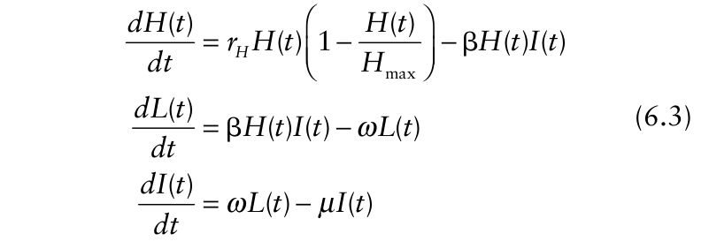{.equation width=60%}

Accounting for crop growth using a model such as this one will be justified when total host density varies considerably during the epidemic. An example would be an epidemic with low transmission rate parameter β, and disease increase from plant emergence to harvest. Of course, when _rH_ = 0, equation 6.3 reduces to equation 5.30 (fixed host).

Another frequently used crop growth model captures the essentials of the continuous cropping systems as mentioned earlier. Assume that there is continuous planting of new crop, with the density of new crop planted per time unit denoted by σ. The crop growth period equals 1/η time units. This implies that the probability per time unit that a crop individual is harvested equals η. To understand the relation between harvest rate and growth period see the discussion on the relation between infectious period and probability per unit time to reach the end of the infectious period in section 5.2.2.2. Equation 6.2 then becomes:

{.equation width=60%}

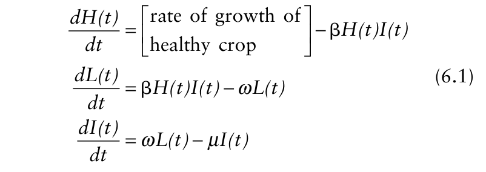{.equation width=60%}

At this stage we leave out the model equation describing the removed category. In section 6.2.1.3, we will discuss the removed category in some detail. To describe the rate of crop growth, various model terms have been used (Gilligan, 2002 and references therein; see also Jeger and van den Bosch, 1994b). The most commonly used one for theoretical studies may be However, note that here not only healthy individuals are harvested (or die) but that latent and infectious individuals are harvested (or die) as well. This feature has to be added to the model, and terms –η _L_ (_t_) and –η _I_ (_t_) have to be added to the equation for the densities of latent and infectious individuals, respectively. The model then takes the form:

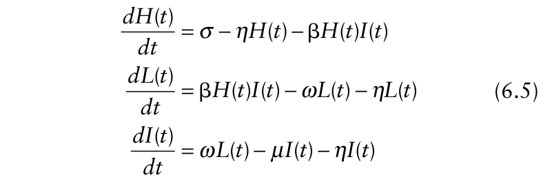{.equation width=60%}

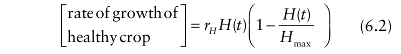{.equation width=60%}

This way of representing host growth could also be used for a perennial crop, with continuous emergence of new leafs or shoots and death or senescence of old ones (both diseased and healthy ones).

In the following sections we will analyze model equation 6.3 in some detail. Model equation 6.5 show some similar dynamics and we will only discuss the threshold for epidemic development for this model.

_6.2.1.2 Model simulations_. In Fig. 6.1 we show the dynamics of healthy, latent and infectious individuals for a range of values of the transmission rate parameter β, starting at time _t_ = 0 with a small initial infection. The set of graphs in the Fig. 6.1 shows the range of dynamics that can be found for this model. For other parameters, the densities of healthy, latent and infectious individuals might be different but the qualitative dynamics are the same.

The simulations show that when β is small, no epidemic develops, whereas for larger values of β, an epidemic does develop. There is clearly a threshold for epidemic development. In section 5.2, we also found such threshold behavior, and an interesting question is what the relation is between thresholds in disease progress models with fixed host and thresholds in models including crop growth. We will discuss this in the next section.

In the initial stage of the epidemic, the densities of latent and infectious individuals again seem to increase exponentially. As with the threshold situation, it is interesting to ask what the _r_ E value is and how it relates to the _r_ E value for the disease progress models studied in section 5.2.

![The density of healthy, (_H_) latently infected (_L_), and infectious (_I_) individuals as function of time (_t_) for the epidemic model with host growth (equation 6.3). _H_ max = 1000 for all graphs. (**A**) _H_ (0) = 1000, _L_ (0) = 0, _I_ (0) = 1. _rH_ = 0.05, μ = 0.1 (implying _ι_ = 10), ω = 0.2 (implying = 5) and β = 0.00015 per time unit. (**B**) _H_ (0) = 99, _L_ (0) = 0, _I_ (0) = 1. Same parameters as in (**A**). (**C**) _H_ (0) = 1000, _L_ (0) = 0, _I_ (0) = 1. _rH_ = 0.05, μ = 0.1 (_ι_ = 10), ω = 0.2 ( = 5) and β = 0.000099 per time unit. (**D**) _H_ (0) = 1000, _L_ (0) = 0, _I_ (0) = 1. _rH_ = 0.05, μ = 0.1 (_ι_ = 10), ω = 0.2 ( = 5) and β = 0.000375 per time unit.](figures/fig6-img01.png){#fig-6-1}

In the simulations shown, the density of healthy individuals first decreases when _H_ 0 is at or near _H_ max, then fluctuates for some time for some parameter values, and finally settles down to a constant level. When _H_ 0 is much less than _H_ max, _H_ (_t_) initially increases, fluctuates, and then settles down (Fig. 6.1B). In some cases, it may take a very long time to settle down (e.g., Fig. 6.1D). This constant level is called the _steady state_ or equilibrium value. Mathematically, the steady state for a variable _X_ is the value at which _dX/dt_ = 0. For the latent and infectious individuals, a similar pattern is seen of initial increase, possible fluctuations, and finally settling down at a steady state value. At first sight this might seem similar to the dynamics we found for the disease progress models in section 5.2. There is, however, a very essential difference. In the disease progress models without host growth, the densities of latent and infectious individuals ultimately decreased to zero (because all infected individuals ultimately become removed). In the present model, the densities in the latent and infectious categories do not decrease to zero but converge to a largerthan-zero density. The difference is, of course, due to the crop growth incorporated in the model equation 6.3. The continuous inflow of new healthy individuals sustains the epidemic and causes the density of latent and infectious not to decrease to zero. When there are infectious individuals in the system continuously, new infections will occur continuously (as long as there are disease free individuals).

_6.2.1.3 The removed category_. The density of the removed state, _R_ (_t_), and the corresponding total density of infected individuals, _Y_ (_t_), are less commonly incorporated into the models with continuous crop growth as formulated in equation 6.1. This is because, at first sight, strange phenomena can occur. Consider the situation where we add the standard equation for the density of removed individuals to model equation 6.3 or 6.5. This equation reads:

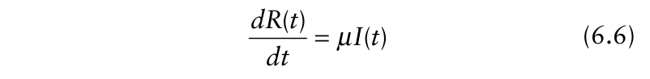{.equation width=60%}

As we have discussed above, the density of infectious individuals will finally approach a steady state with _I_ > 0. This implies that the right hand side of equation 6.6 becomes a constant greater than 0, which in its turn implies that the density of removed individuals will grow continuously without bound. The same holds for total disease _Y_ (_t_) = _L_ (_t_)+ _I_ (_t_)+ _R_ (_t_). The reason for this is obvious: as long as new healthy individuals enter the population and infectious individuals are around, healthy individuals will become infected (assuming β > 0) and finally end up in the removed category.

There are two situations that have to be distinguished in this case. In the first situation, the removed state _is_ a relevant state throughout the epidemic, and equation 6.6 is the correct description for this state. For example, the situation applies if we study an epidemic within one growing season in which removed individuals comprise simply dead leaf tissue which remains on the plants till the end of the growing season. At the end of the finitelength growing season, the density of the removed category can be large but is not infinite (because time is limited). The density of the removed category can simply be calculated using equation 6.6. Whether the epidemic has approached its steady state (in terms of _H, L_, and _I_) by the end of the growing season is to be decided on basis of the simulation results.

In the second situation, individuals in the removed state can be removed (i.e., eliminated) physically from the system. For example, in our model described by equation 6.5, individuals are harvested including the removed individuals. The differential equation for the density of removed individuals then becomes: by _H_, _L_, and _I_, respectively. Substituting these into model equation 6.3 together with 0 for the rates, we find

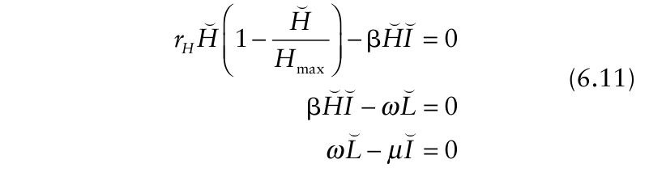{.equation width=60%}

This set of equation is easily solved, and shows, after some algebraic manipulations, to have three solutions.

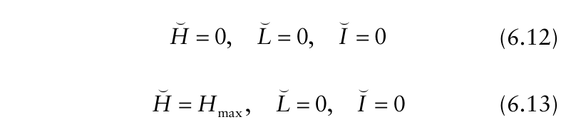{.equation width=60%}

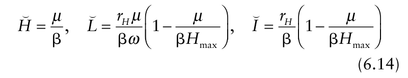{.equation width=60%}

{.equation width=60%}

In this situation, the density of removed individuals (that have not yet been physically removed from the system) will, in the long term, approach a steady state value itself, which can be calculated from

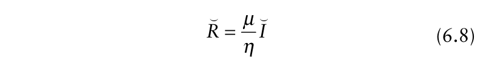{.equation width=60%}

(As explained in more detail in the next sub-section, the overstriking of variables indicates steady states.) Another example where removed individuals become eliminated from the system is when leaves drop off the crop plant and the leaf material is degraded by microorganisms or is consumed by earthworms, insects, or other organisms. In that case, assuming that each removed individual has a constant probability per time unit δ to fall off and be degraded or eaten, the differential equation for the density of removed individuals becomes:

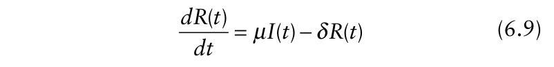{.equation width=60%}

and the steady state of this density is The first steady state where all densities are zero is not very interesting for our purpose. It is, however, a real steady state of the systemwhen there is no healthy host, then there will never develop a population of healthy hosts. (Note that in the selected logistic model for _H_, there can be no increase in _H_ if _H_ is 0.) If there is no healthy host the disease will not be able to establish and these densities also remain zero.

The second and the third steady state are the interesting ones from our perspective. In the second steady state, the host is at its maximum density and the disease is absent from the system. The third steady state is the one for which an epidemic has developed. Since densities of latent and infectious individuals cannot be negative (by definition), this steady state is only biologically relevant when _L_ and _I_ are greater than or equal to zero. This implies that the expression in brackets on the right hand side of these steady state equation has to be larger than or equal to zero. This implies,

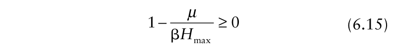{.equation width=60%}

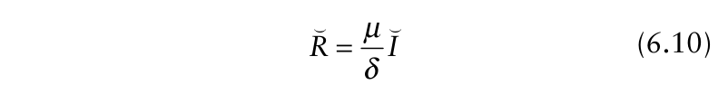{.equation width=60%}

_6.2.1.4 Steady states and thresholds for epidemic development_. As mentioned above, a steady state occurs when the densities of healthy, latent and infectious individuals do not change. Lack of change implies that the rate of change in their densities, _dH_ (_t_)/ _dt_, _dL_ (_t_)/ _dt_, and _dI_ (_t_)/ _dt_, respectively, are all zero. The densities are thus not functions of time anymore, and we replace _H_ (_t_), _L_ (_t_) and _I_ (_t_)

Clearly, with this inequality we have found the threshold for epidemic development. There is a steady state with disease present when this quantity is larger than zero and there is no steady state with disease present when this quantity is smaller than zero. The quantity being equal to zero serves as the threshold.

It is natural to ask: How does this compare to the threshold for epidemic development found for the model without crop growth, which is given in equation 5.23?

Rearranging equation 6.15, the relation will become clear. We consider the inequality:

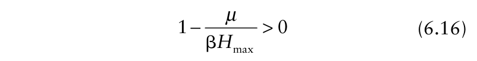{.equation width=60%}

which after some rearrangement of the expression becomes:

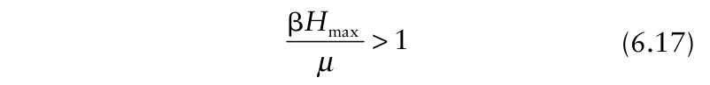{.equation width=60%}

This last form of the expression is exactly the same as equation 5.23, with _H_ 0 replaced by _H_ max. Without host growth, the initial host density, _H_ 0, _is_ the largest possible host density, so there is an equivalence in meaning to _H_ 0 and _H_ max. We will not reiterate and do the stepby-step interpretation of this quantity again, but it is clear that β _H_ max/μ is the basic reproduction number, _R_ 0, of the disease in this situation (_R_ 0 = β _H_ max/μ). We thus conclude that the threshold for epidemic development is the same for model equation 6.3 (host growth) and equation 5.30 (fixed host).

Below the threshold, when _R_ 0 < 1, no epidemic develops and the system converges to the steady state equation 6.13 (where ultimately all individuals are disease free). The steady states of the system are shown in Fig. 6.2 as function of β. For β values smaller than the threshold value (with the chosen _H_ max and μ approximately 0.00025), no disease is present in the system at the steady state. The density of healthy individuals at the steady state decreases with increasing β (for _R_ 0 > 1). For β values larger than but close to the threshold value (and the chosen other parameters of equation 6.14), the density of latent and infectious individuals increases with increasing β. This is due to the depletion of the healthy population by the disease (i.e., replacement of healthy individuals with either latent or infectious individuals). For β values larger than approximately 0.0004 (with the chosen values of the other parameters of equation 6.14), the density of latent and infectious individuals then _decreases_ with increasing β. When β is larger than 0.0004 (in this example), the healthy population cannot produce new healthy individuals fast enough to permit increasing _L_ and _I_ with increasing transmission rate at the equilibrium densities. In other words, the density of healthy individuals is small enough that it only supports small densities of latent and infectious individuals.

{#fig-6-2}

The steady state or equilibrium density of healthy individuals can also be expressed as:

{.equation width=60%}

based on the formula for _R_ 0 (=β _H_ max/μ). This formula often results from calculating the steady state for the density of healthy individuals. Unfortunately, this expression does not necessarily hold for _all_ models of epidemic dynamics with host growth.

It is useful to compare results here with those obtained from the models without host growth (section 5.2 of the previous chapter). Of course, there is no steady state without host growth; instead, _H_ (_t_) (= _H_ 0 − _Y_ (_t_)) approaches an _asymptotic_ value as all diseased individuals become removed (final level; _H_ ±). Equation 5.27 defines the final level of disease as a proportion, but a little algebra can show the value of _H_ ± for the H-L-I-R model (which is essentially the same as equation 5.11 for the discrete generation model). In a practical sense, _H_ ± for fixed host size is analogous to the steady state _H_ for a dynamic host because they are indicators of the longterm number of disease-free hosts when time is not limiting. (However, they are not the same mathematically). For comparisons, consider the situation with _H_ 0 = _H_ max = 1000. Consider the following example results:

|**_R0_**|**_H_**±|**_H_**|
|---|---|---|
|1.5|420|670|
|2.0|200|400|
|3.0|60|333|

As is clear with just a few values, with host growth there are more disease-free individuals in the long term than without host growth for a given value of the basic reproduction number. This is logical because with host growth, new healthy individuals are continuously added to the system, but obviously there is no change in the total host density when the host is not growing.

_6.2.1.5 Initial disease increase_. Without showing this, we note here that the initial disease increase, when the epidemic is started with a very small density of infected individuals, is again exponential with rate parameter, _r_ E. _r_ E is given by the same equation as used for the H-L-I-R model (equation 5.30) without host growth (see equation 5.36) when _H_ 0 is replaced by the maximum host density, _H_ max.

_6.2.1.6 Threshold of epidemic development of model equation 6.5_. We now return to the second type of host growth situation, where there are new plantings (or new host growth) coupled with harvesting (or loss of host area through mortality), summarized by equation 6.5. Calculating the steady states of the model using the method discussed in section 6.2.1.3, we find as the steady states where disease is present category before it is harvested (or dies) equals ω/(ω+η). The mean time that an infected individual is in the latent stage is 1/(ω+η). When the individual does reach the infectious stage, it causes βσ/η new infections per time unit. Since infectious individuals can either reach the end of their infectious period or be harvested or die, the mean time the individual remains infectious equals 1/(μ+η). The individual that does reach the infectious stage thus will, on average, produce β(_σ_ /η)/(_μ_ +η) new infections. The quantity on the left hand side of equation 6.21 is thus, again, the average number of new infections cause by one newly infected individual when it is placed in an entirely susceptible population, _R_ 0.

Substituting _H_ max for σ/η we can write _R_ 0 as:

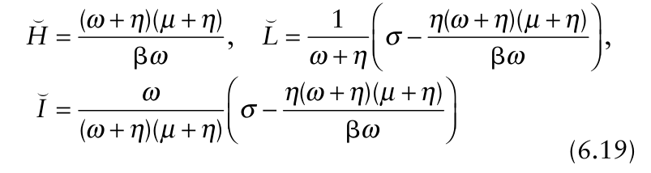{.equation width=60%}

The density of latent and infectious individuals is larger than zero only if

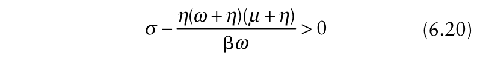{.equation width=60%}

This expression is most easily interpreted if we rearrange it into the inequality

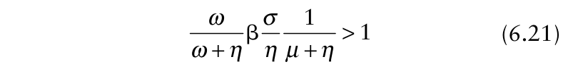{.equation width=60%}

To understand this, first consider the system in the absence of disease. In this situation the differential equation describing the density of healthy individuals is

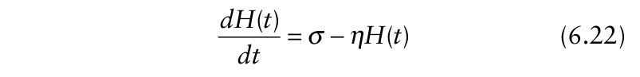{.equation width=60%}

This equation has steady state density of healthy individuals _H_ = _σ_ / _η_ (i.e., at long time, _H_ (_t_) approaches σ/η). So the quotient σ/η has the same role as the maximum host density, _H_ max, in equation 6.17. One could then actually write the right-hand-side of equation 6.22 as η(_H_ max − _H_ (_t_)). Now consider that we place one freshly infected individual in a completely healthy population. Because we included a harvest or death term into the model equation 6.5, not every individual will go through the latent period and become infectious. There is a probability that an infected individual is harvested (or dies) before it reaches the infectious stage. A latently infected individual has a probability per unit time ω to reach the end of its latent period and become infectious, and a probability per unit time η to be harvested (or die). This implies that the probability that an individual reaches the end of its latent period and moves into the infectious

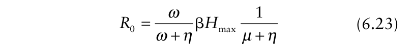{.equation width=60%}

When η = 0, this reduces to the expression for _R_ 0 in the model with logistic healthy host growth. The difference is only because here we are specifying host harvest or death in all categories. As with the previous model for host growth, _H_ max has the same role as _H_ 0 when there is no host growth (so that initial healthy host density is the same as maximum healthy host density). A little algebra shows that the steady state value of _H_ is given by _H_ = _H_ max / _R_ 0 (with _R_ 0 given by equation 6.23), the same as found for logistic host growth (equation 6.18).

It is straightforward to use equation 6.5 for the epidemic coupled with equation 6.7 for the death/harvesting of removed individuals. It is useful to use η(_H_ max − _H_ (_t_)) for the equation for _dH_ (_t_)/ _dt_, as discussed above. We leave it as an exercise for the reader to further explore this model. The reader should be able to discover that when the epidemic starts with initial _H_ + _I_ equal to the maximum (_H_ 0 + _I_ 0 = _H_ max = σ/η), that there is _no_ net change in the _total_ density of the host (_dH_ (_t_)/ _dt_ + _dL_ (_t_)/ _dt_ + _dI_ (_t_)/ _dt_ + _dR_ (_t_)/ _dt_ = 0), which means that the total host density is unchanged throughout the epidemic, even though there are new healthy individuals produced (and, of course, mortality/death of individuals in all states). With this situation, one can easily determine steady state disease intensity (_Y_ = _H_ max − _H_) . In particular, based on equation 6.18 for steady-state value of healthy individuals, , and . _Y_ = _H_ max (1 − 1/ _R_ 0) _y_ = _Y_ / _H_ max = (1 − 1/ _R_ 0) It is easy to show that steady state _y_ is less than asymptotic _y_ (_y_ ±) when there is no host growth.

_6.2.1.7 Concluding remarks_. This section on models with continuous crop growth showed some basic features of epidemics with non-constant host size. Some of these features clearly are identical to the ones we found in the previous chapter on epidemic progress models without host growth, but some other features are new. The concept of the basic reproduction number and its role in a threshold for an epidemic is the same for all these models. The densities of healthy, latent and infectious individuals finally reach steady state levels, and we have shown how these steady states can be calculated.

The models discussed here have in common that the density of healthy, latent, and infectious individuals will, after a shorter or longer time, settle down at their steady state densities. This is, however, not the case in general. In some models the densities of these variables do not settle down at a steady state but keep fluctuating forever, either in a regular way with fluctuations of a fixed amplitude and a fixed period, or irregularly (perhaps chaotically). It is beyond the scope of the book to discuss this situation in more detail and we refer to the book of Edelstein-Keshet (1988) for a discussion on such topics.

Steady states of systems of differential equations are often easy to calculate. In the general theoretical literature, when the steady state for _L_ and _I_ are above 0, the disease is said to _persist_ (Mollison, 1995). Therefore, the _persistence criterion_ is the value of the threshold that must be surpassed for disease to remain in a system. Whether the steady state expression is of relevance for a plant disease epidemic is another matter. As Fig. 6.1 showed, it takes a certain period of time before the system approaches the steady state. Whether the steady state is reached within the time span to which the model applies depends on the parameter values and the relevant time scale of the system of interest. Especially when a model like equation 6.3 is used to describe the growth of an epidemic within a single growing season, it might very well be that at the end of the growing period the epidemic still is far from its steady state values. Under these circumstances, it is more meaningful to determine _Y_ (or _H_, or _I_) at particular times this will generally require numerical solutions to the differential equations.

### 6.2.2 Seasonal cropping

Many cropping systems are seasonal. The crop is planted and harvested at a certain moment in each year. Planting increases the density of susceptible individuals abruptly. Harvesting abruptly decreases both the density of susceptible individuals and the density of latent, infectious, and removed individuals. In the period between harvest and planting, the disease (pathogen) has to survive on plant material left in the field, in the soil, or in other locations (for example, in infected perennial weeds). This situation leads to a model for the development of an epidemic in a seasonal environment. In this section, we will discuss one of these models in some detail. Very few applicable mathematical methods are available to analyze such systems over multiple seasons, and simulation usually is the main tool to study these models. However, we will show that the threshold for epidemic development can be calculated explicitly for such models. The approach shown is based on a simplified version of the model presented by Madden and van den Bosch (2002). Other approaches have been published by Gubbins and Gilligan (1997), Shaw (1994), and Thrall et al. (1997). As mentioned in Chapter 4, sometimes the term _polyetic_ is used to describe epidemics over multiple growing seasons.

_6.2.2.1 Model derivation_. At the start of the growing season, the crop is planted at density _H_ 0. The cropgrowing season has a length of _T_ time units, and during the crop-growing season the epidemic develops. We use the equation 5.18, which we studied in section 5.2.2, as the model for the development of the epidemic during the crop-growing season. Instead of the H-I-R model, we could have used an H-L-I-R model, or even one based on a growing crop, but chose the simpler one for presentation purposes.

At the end of the crop-growing season, at time _t_ = _T_, the crop is harvested. At this time the density of infectious and removed individuals are _I_ (_T_) and _R_ (_T_), respectively. At harvest, most of these individuals are removed or destroyed by harvesting, and only a small fraction remains on the field or in the soil as crop residue. During the period when no crop is grown, these remaining individuals experience adverse conditions (for example, low temperatures, humid conditions, etc.) so that from these individuals only a small fraction survives till the start of the next crop-growing season. Moreover, the pathogen may live saprophytically during this time, so that the concept of a diseased individual becomes nebulous (although we can still consider this surviving inoculum as units of diseased individuals for modeling purposes). Often fungal plant pathogens go through a sexual stage on the debris during the time where no crop is grown.

Moreover, some types of infectious units (spores) are only released from infected plants when they decay over time. Verticillium wilt of potato is an example, where the microsclerotia are released into the soil when potato tissue decays (Powelson and Rowe, 1993). Thus, although _R_ (_T_) may be removed from the current epidemic, these individuals may still contribute to the epidemic the next season. The infectious and removed diseased individuals survive the crop-free period with probabilities ξ _I_ and ξ _R_, respectively. Thus, the density of infection-producing “individuals” at the start of the _next_ epidemic is ξ _II_ (_T_) + ξ _RR_ (_T_). (A gradual exponential decline in diseased individuals throughout the crop-free period could be equivalently modeled.) At the start of the next growing season the crop is planted again at density _H_ 0 and the epidemic process is renewed. Each of the [ξ _II_ (_T_) +ξ _RR_ (_T_)] units of infection-producing “individuals” produces γ initial infections to start the epidemic in the new growing season. All initially infected individuals in the model are infectious. Thus, initial conditions at the start of the next season are _I_ (0) = γ[ξ _II_ (_T_) +ξ _RR_ (_T_)], _R_ (0) = 0, and _H_ (0) = _H_ 0, where the _I_ (_T_) and _R_ (_T_) terms are for the _previous_ season. The epidemic then proceeds for _T_ time units to reach the end of the next growing season, and the process repeats itself. We add another subscript to _I_ 0 to indicate the season order; _I_ 0,0, _I_ 0,1, _I_ 0,2, and so on.

We maintain the concept of individuals for both between and within-season situations for ease of presentation. As eluded to above, ξ _II_ (_T_) +ξ _RR_ (_T_) can be interpreted more broadly (by extending the definitions of the parameters) to represent the total primary inoculum availably at the start of the next season as a function of diseased individuals at the end of the current seasons. seasonal cropping model under consideration, we have to distinguish two different basic reproduction numbers. First of all, as we have seen in section 5.2.2, the model for the within-growing-season epidemic has an _R_ 0 given by equation 5.23. We will use the expression _R_ 0within for this number _6.2.2.2 Model simulations_. Fig. 6.3 shows a number of simulations of the model for different values of the withinseason transmission rate parameter β. Conceptually, the simulations are not difficult. Within each season equations 5.18 are solved. The only additional aspect is that _I_ 0 each year depends on the densities of _I_ and _R_ at the end of the previous year and the parameters γ, ξ _I_, and ξ _R_.

For small values of β, no epidemic develops, showing that there is a threshold for epidemic development. When an epidemic develops, the density of infectious and removed individuals increases during the growing season and abruptly change at the end of the growing season at harvest. The larger the value of β, the steeper the epidemic increase and, hence, decline from one growing season to the next.

{.equation width=60%}

This _R_ 0within value is not the same as the _R_ 0 of our multiseason epidemic model, which will be denoted by _R_ 0multi.

The multi-season _R_ 0 can be calculated as follows: Assume we start in year 0 with a very small initial density of infectious individuals, _I_ (0) = _I_ 0,0. We will explicitly calculate expressions for the initial infection in successive years, _I_ 0,0, _I_ 0,1, _I_ 0,2, _I_ 0,3, etc. As we have used before, in the situation where the density of infectious individuals is very small in the beginning stages of an epidemic, the density of healthy individuals is very well approximated by its initial density _H_ 0. The within season model equation 5.18 then become _6.2.2.3 Threshold for epidemic development_. As we have seen in all models so far, the threshold for epidemic development is the basic reproduction number, _R_ 0. In the

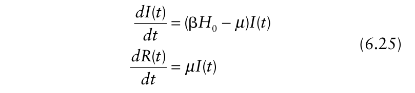{.equation width=60%}

![The density of healthy (_H_), infectious (_I_), and the total infected (or diseased) (_Y_) individuals in relation to time (_t_; days) for an epidemic of an annual crop over multiple years. The model is described in section 6.2.2.1. The growing season is _T_ = 100 day (with 365− _T_ days between seasons). _H_ 0 = 1000 for each growing season. For the first growing season, _I_ (0) = 1. (**A**) β = 0.00023 per day, ξ1 = ξ2 = 0.001, γ = 0.001, _R_ 0within = 2.3, _R_ 0multi = 0.78. (**B**) β = 0.00023, ξ1 = ξ2 = 0.001, γ = 0.01, _R_ 0within = 2.3, _R_ 0multi = 7.8. (**C)** β = 0.0003, ξ1 = ξ2 = 0.001, γ = 0.001, _R_ 0within = 3.0, _R_ 0multi = 727.7. (**D**) β = 0.0003, ξ1 = ξ2 = 0.0001, γ = 0.00001, _R_ 0within = 3.0, _R_ 0multi = 0.728.](figures/fig6-img03.png){#fig-6-3}

Note, we do not write out an equation for _dH_ (_t_)/ _dt_ since we are concerned here with the early stage when _H_ (_t_) ≈ _H_ 0 so that _dH_ (_t_)/ _dt_ ≈ 0. The first equation of equation 6.25 is an exponential growth equation with solution:

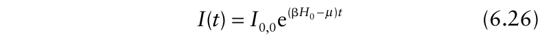{.equation width=60%}

Substituting this equation into the second equation of equation 6.25 we find

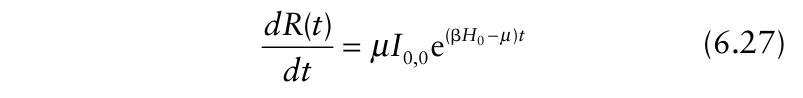{.equation width=60%}

This equation can be solved simply by integrating from 0 to _t._ Realizing that the initial condition for _R_ is zero, we find for season 0 as solution

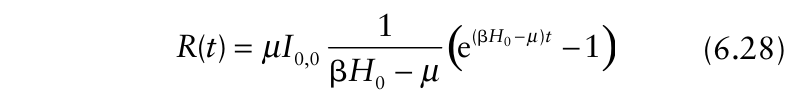{.equation width=60%}

Using equations 6.26 and 6.28, the initial condition for the _following_ growing season, _I_ 0,1 = γ[ξ _II_ (_T_) +ξR _R_ (_T_)], leads to

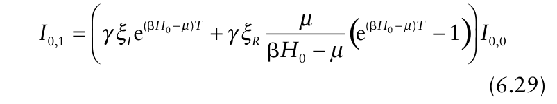{.equation width=60%}

Equation 6.29 is obtained simply by multiplying equation 6.26 for _I_ (_T_) by γξ _I_ and equation 6.28 for _R_ (_T_) by γξ _R_. Using the same method we calculate the initial condition for year 2 as:

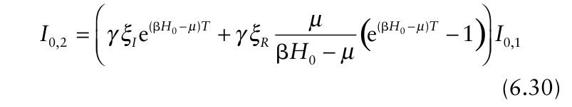{.equation width=60%}

and, in general, for the initial infection in year _n_ +1 we find and no epidemic will develop when this quantity is smaller than 1. In other words, there is a multi-seasonal epidemic when _I_ 0, _n_ +1/ _I_ 0, _n_ > 1. We, thus, have found the expression for the multi-season basic reproduction number, _R_ 0multi. To make the relation between the two basic reproduction numbers clearer, we substitute the expression for _R_ 0within (equation 6.24) into the expression for the expression for _R_ 0multi.

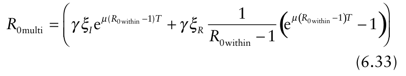{.equation width=60%}

Fig. 6.4 shows _R_ 0multi in relation to _R_ 0within for a range of the other parameters.

Fig. 6.4 clearly shows that a _R_ 0within value larger than 1 does not directly imply that _R_ 0multi is larger than 1, although increasing _R_ 0within leads to increasing _R_ 0multi. The length of the growing season, _T_, the mean infectious period, 1/μ, the survival of the pathogen between two successive growing seasons, ξ _I_ and ξ _R_, and the efficiency of the initial infection at the start of each subsequent season, γ, all have a crucial effect on the _R_ 0multi. When _R_ 0within < 1, it takes very large values of γξ1 and/or γξ2, meaning that there must be very high between-season survival probability (ξ) and/or very high primary infection efficiency (γ) for there to be increasing _I_ 0 over multiple years. Note that the relationships are highly nonlinear in that a small increase in _R_ 0within can have a large increase in _R_ 0multi. Moreover, _R_ 0within could be relatively large (say, >5) and still the disease will die out over multiple years because of low between-season survival or low probability of infection from surviving infected individuals.

It should be emphasized that equation 6.25 and its solution (equations 6.26 and 6.28) are specified when healthy host density is not limiting. But this is precisely the situation that applies when determining thresholds for epidemics. However, Fig. 6.3 was prepared by using the more general equation 5.18 for the within-season dynamics (which adjusts for declining _H_ (_t_)), and not using equation 6.26 and 6.28.

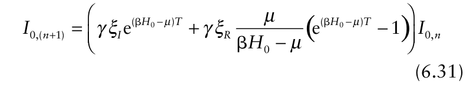{.equation width=60%}

This equation has exactly the same form as equation 5.4, with the density the _next_ season being equal to the density _this_ season multiplied by a constant. Now, however, a complicated parameter combination is involved in the “constant”. Following the same reasoning as done for equation 5.4 in section 5.2.1.3, we conclude that an epidemic will develop when _6.2.2.4 Concluding remark_ s. There are several models in the literature with seasonal dynamics incorporating additional aspects of multi-season epidemics (Gubbins and Gilligan, 1997; Gilligan, 2002; Madden and van den Bosch, 2002). Among other things, one can deal with both latent and infectious periods within seasons, and explicit consideration of inoculum in the soil or during the epidemic. Furthermore, the simplistic assumption here that surviving diseased individuals are based on densities at _t_ = _T_ can certainly be relaxed. There may not be, in general, analytical solutions for multi-seasonal final disease values, rate of increase of _I_ 0, _n_ over multiple seasons, or other results. However, in some situations

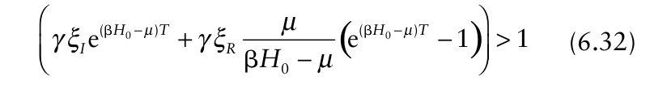{.equation width=60%}

![The basic reproduction number of the multi-seasonal epidemic model, _R_ 0multi, as a function of the within-season basic reproduction number, _R_ 0within. Lines are calculated using equation 6.33. (**A**) _R_ 0multi as function of _R_ 0within for various values of the product of the rate at which infectious individuals become removed, μ, and the duration of the growing season, _T_. (**B**) _R_ 0multi as function of _R_ 0within for various values of the product of: the probability that an infectious individual at the end of a growing season survives until the next season (ξ _I_) and the number of infections at the start of a growing season caused by an infectious individual surviving from the previous season (γ). (**C**) _R_ 0multi as function of _R_ 0within for various values of: the probability that a removed diseased individual at the end of a growing season survives until the next season (ξ _R_) and the number of infections at the start of a growing season caused by a removed diseased individual surviving from the previous season (γ).](figures/fig6-img04.png){#fig-6-4}

_R_ 0multi is related to a seasonally recurring final density of _Y_, _Y_ (_T_), (Madden and van den Bosch, 2002). That is, when _R_ 0multi > 1, an apparently stable end-of-the-season disease intensity, _Y_ (_T_), can be reached after a few seasons, which can be approximated based on _R_ 0multi (Madden and van den Bosch, 2002). With the short introduction in this section we hope to have provided sufficient overview for those interested to be able to read the key papers. Considerably more research is needed, both theoretical and experimental (observational) to develop a more formal understanding of plant diseases over many individual seasons. Such an understanding should help clarify the development of long term disease management strategiesfor instance, would it be more efficient to reduce β _H_ 0 or between-season survival of infectious units for a given disease?

## 6.3 The Role of Primary Infection

In sections 5.2 and 6.2, each epidemic was started in the model(s) by introducing a number of infected or diseased individuals instantaneously at time _t_ = 0. For the H-L-I-R model (equation 5.30), for example, starting the epidemic with _I_ 0 newly infected individuals is specified with the conditions: _H_ (0) = _H_ 0, _L_ (0) = 0, _I_ (0) = _I_ 0, and _R_ (0) = 0, and, thus, the density of initial diseased individuals, _Y_ (0) = _Y_ 0 = _L_ (0) + _I_ (0) + _R_ (0), is given simply by _I_ 0. The source of the infectious units that initiate the epidemic may be spores in the soil, migrating viruliferous insect vectors, or infected perennial weeds in the area. This approach to the primary infections that initiate an epidemic is common in most modeling of epidemics for polycyclic diseases in animals, humans, and plants (Anderson and May, 1991; Daley and Gani, 1999). The concept is that, with sufficient time, the secondary infections “overshadow” the initial events, especially if _I_ 0 is very small and β is not very small. However, it may not be realistic in some cases to assume an instantaneous start to the epidemic. It is possible, for instance, that the primary infections occur over an extended period of time, possibly concurrently with the new (secondary) infections occurring due to spread from individual to individual (plant, root, leaf, etc.).

For example, epidemics of light leaf spot of oilseedrape, caused by the fungus _Pyrenopeziza brassicae,_ are initiated from the ascospores produced on the plant debris left in the field from the previous year (the primary infections). The ascospores are released from around September until the following January. The ascospore release rate increases from zero before September to a maximum value and then drops off slowly towards zero around February (Papastamati et al., 2002; Gilles et al., 2000, 2001). Another example is take all of wheat, caused by _Gaeumannomyces graminis_ (Bailey and Gilligan, 1999). Primary infections occur as roots grow through the soil and contact inoculum, which occurs for an extended period of time, and secondary infections of roots occur from the contact of healthy roots with diseased roots.

The process of non-instantaneous initiation of the epidemic by primary infections can be incorporated into the models discussed so far in this chapter. As will be seen below, this essentially means combining models for polycyclic and monocyclic epidemics (see section 4.4.2) into a single model formulation. The consequences of such model combinations on predicted disease dynamics is, however, less clear-cut compared to the results obtained for strictly polycyclic or monocyclic epidemics. The approach we introduce here has been studied intensively and extensively. Leading work in this area stems from Gilligan and co-workers (e.g., Truscott et al., 1997; Gilligan and Kleczkowski, 1997; Gilligan, 2002, and references therein). As in some previous sections, we give an introduction to this work, showing some interesting phenomena, and suggest further reading on the subject for those who have interest.

We use the term _primary infectious units_ for the infectious units that cause the primary infections. Essentially, primary infectious units comprise the initial (or primary) inoculum. Readers should return to section 4.3 of Chapter 4 for a more complete discussion of these concepts. In the example of light leaf spot, primary infectious units would the ascospores. We can use the term secondary infectious units for the inoculum (broadly defined) that are produced during the current epidemic that can potentially infect other plant individuals.

### 6.3.1 Model derivation

We base our discussion around the H-L-I-R model we discussed in section 5.2.3. If we assume that all primary infection is brought into the crop _after t_ = 0 we have as initial conditions _H_ (0) = _H_ 0, _L_ (0) = 0, _I_ (0) = _I_ 0 = 0 and _R_ (0) = 0. The primary infections are introduced into the model equation 5.30 in pseudo-equation form as:

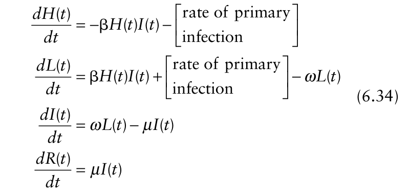{.equation width=60%}

The primary infections are, of course, due to primary infectious units “released” into the system starting at _t_ = 0. The term “release” should be considered broadly here to mean the inoculum per unit area or volume per time unit in the soil or on the surface, possibly in neighboring areas, which is available for contact with the healthy host individuals. The inoculum might have all been produced in the previous epidemics (as discussed in section 6.2 for multi-season epidemics), or it could actually be produced (say, from saprophytic growth of the pathogen) between growing seasons or during the current epidemic. The density of available primary infectious units per time unit at _t_ is given by _x_ (_t_). This function can take many forms. For the example of light leaf spot on oilseed rape as described above, _x_ (_t_) would be a bell-shaped curve. For many pathogens, one can assume that _x_ (_t_) is at its highest at the beginning of the epidemic (_t_ = 0), and declines towards 0 with increasing _t_ due to mortality of the inoculum. The number per unit area of healthy individuals that are contacted by a primary infectious unit is given by θ _H_ (_t_). Thus, the number per unit area of primary infectious units coming in contact with healthy individuals per time unit equals _x_ (_t_)θ _H_ (_t_). A primary infectious unit in contact with a healthy individual has a probability _ψ_ p of infecting the individual. Note that this infection probability can be different from the infection probability of a secondary infectious unit, so we add a _p_ subscript to _ψ_. It has, for example, been shown that the primary infectious units for light leaf spot on oilseed rape (ascospores) have a higher probability of infection than the secondary infectious units (conidia) (Gilles et al., 2001). The rate of infection due to the primary infectious units thus is:

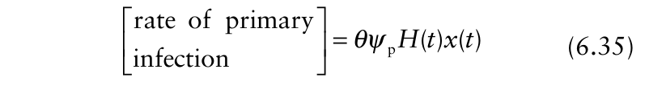{.equation width=60%}

and the model equation 6.34 become

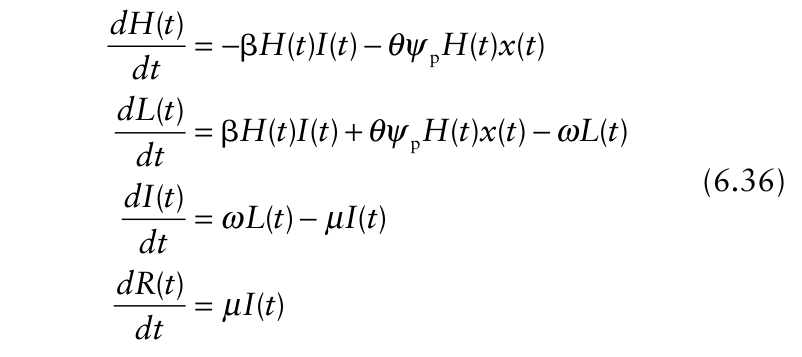{.equation width=60%}

where, as before, β (=θ _ψ_ α) is the transmission rate for secondary infections. As we have usually done in this chapter, we keep track of the total density of infections (total disease intensity) since the start of the epidemic, _Y_ (_t_) = _L_ (_t_) + _I_ (_t_) + _R_ (_t_). The differential equation for this quantity is:

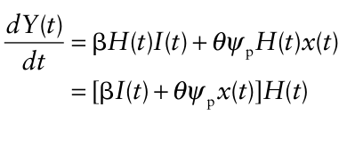

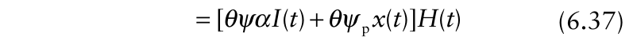{.equation width=60%}

The later expression in equation 6.37 makes it clear that _x_ (_t_) for primary infections plays the same role in the model as α _I_ (_t_) for secondary infections.

Some special cases can be directly elucidated from equation 6.37 that are worth consideration. If β = 0, there are no secondary infections, and disease progress is strictly of the monocyclic type (see section 4.4.2). Depending on the value of _ψ_ p, θ, and _x_ (_t_), _Y_ (_t_) can remain low or go to the maximum possible value (_H_ 0) by the end of the epidemic. If the availability of primary infectious units is fixed (so that _x_ (_t_) _x_ 0), and β = 0, then the model reduces to: _dY_ (_t_)/ _dt_ =θ _ψ_ p _x_ 0 _H_ (_t_) = θ _ψ_ p _x_ 0[ _H_ 0− _Y_ (_t_)], which is identical to the monomolecular model (equation 4.8) used for monocyclic (simple interest) diseases in Chapter 4 (with _Y_ = _yH_ 0). In other words, the _r_ M parameter of the monomolecular model is equivalent to θ _ψ_ p _x_ 0. Decreases in the amount of inoculum, the probability of contacting a host, and/or the probability causing infection when in contact with a host all lead to lower _r_ M. A higher _r_ M means a steeper slope of ln[1/(1−(_Y/H_ 0))] versus _t_. However, if there is enough time, _Y_ can go to _H_ 0 (or _y_ to 1) for any positive value of _r_ M if _x_ (_t_) is a constant (_x_ 0).

If β > 0 and θ _ψ_ p _x_ 0 > 0, the epidemic consists of a mixture of polycyclic and monocyclic processes. Several years ago Brassett and Gilligan (1988) utilized simplified versions of this mixture model for root disease epidemics. A practical simplification is to use the logistic function (see section 4.4.3) for the polycyclic portion of the epidemic, rather than the more complex H-L-I-R coupled equations here. In other words, using our current notation, one can write: _dY_ (_t_)/ _dt_ = [ϒ _Y_ (_t_)+ _r_ M] _H_ (_t_), with ϒ = _r_ L / _H_ 0 and _r_ M = θ _ψ_ p _x_ 0. There is an analytical solution to this model (see also section 9.5 in Campbell and Madden, 1990), allowing for direct (and relatively easy) estimation of the rate parameters from a data set.

Our concern here is with the general model equation 6.37, with the more realistic assumption of a nonfixed availability of primary infectious units, _x_ (_t_), and the more realistic H-L-I-R structure for the polycyclic component (with β > 0). Note, for θ _ψ_ p _x_ (_t_) to be constant when _x_ (_t_) is variable, then either θ or _ψ_ p must vary over time in such a way that the three-way product is constant. Since this is unlikely (except as an approximation), one can generally expect a more complex pattern to disease progress curves than found for the pure H-L-I-R or the monomolecular models, or the mixture of the logistic and monomolecular (with fixed _r_ M) models mentioned in the previous paragraph, or the mixture of the H-L-I-R and constant- _x_ monocyclic models.

Of the forms of _x_ (_t_) that are possible, we only consider the exponential decay equation. In other words, we assume that _x_ declines during the epidemic, from a maximum at _t_ = 0. The expression for _x_ is:

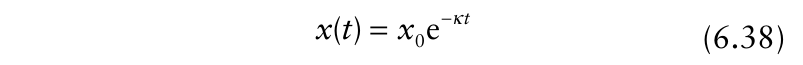{.equation width=60%}

in which _x_ 0 is the value of _x_ at _t_ = 0 and κ is a parameter (with units of 1/time). (Of course, a special case is κ = 0, which gives _x_ (_t_) = _x_ 0.) The _total_ number of primary infectious units that will enter the system per unit area over all possible times, ℜ, equals the constant The implication of equation 6.39 is that there is a finite amount of primary inoculum available, and once this is released there can be no more individuals infected from the primary inoculum. If β= 0, as well, the epidemic would cease at this point.

### 6.3.2 Model simulations

Fig. 6.5 shows a number of simulations of the model equations 6.36 and 6.37, using equation 6.38 for _x_ (_t_). In all cases, κ = 0.052/day, a value found by Bailey and Gilligan (1999). This means that ℜ = 19.23 _x_ 0 total units of inoculum are released over a long period of time. For convenience, we use _x_ 0 = 1/day. With the exception of Fig. 6.5A, a single nonzero value of θ _ψ_ p _x_ 0 was used for all model epidemics. In Fig. 6.5A, θ _ψ_ p _x_ 0 = 0 (either from θ = 0 or _ψ_ p = 0), which means that the epidemic is purely of the polycyclic type. This graph corresponds to Fig. 5.7A already discussed (_H_ 0 = 1000, _I_ 0 = 1; β _H_ 0 = 0.15/day, 1/ω = = 5, and 1/μ = _ι_ = 10). The _R_ 0 is 1.5. Fig. 6.5B corresponds to the same polycyclic parameters, but with the additional monocyclic component (θ _ψ_ p _x_ 0 = 0.0105/day). Because of the contributions of the primary infectious units to the epidemic over time, there is higher disease intensity (_Y_ (_t_))

![The density of healthy (_H_), latently infected (_L_), infectious (_I_), and removed (_R_) individuals, and the total density of infected individuals (_Y_ = _L_ + _I_ + _R_) as function of time (_t_) when there are (potentially) both secondary and primary infections throughout the epidemic. The figure is calculated using model equation 6.36, with equation 6.38 describing density of primary inoculum. In all cases, _x_ 0 = 1, κ = 0.052 and ω = 0.2 (implying a mean latent period of = 5) per time unit, and at the start of the simulation (_t_ = 0), _H_ (0) = 1000, _L_ (0) = 0, _I_ (0) = 1, and _R_ (0) = 0. (**A**) β = 0.00015, θψp = 0, μ = 0.1 (implying a mean infectious period of _ι_ = 10) per time unit. (**B**) β = 0.00015, θψp = 0.0105, μ = 0.1 (_ι_ = 10) per time unit. (**C**) β = 0, θψp = 0.0105, μ = 0.1 (_ι_ = 10) per time unit. (**D**) β = 0.00001, θψp = 0.0105, μ = 0.001 (_ι_ = 1000) per time unit.](figures/fig6-img06.png){#fig-6-5}

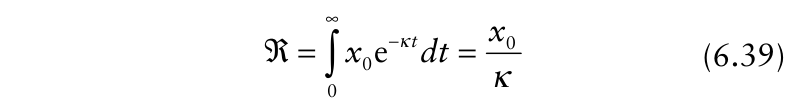{.equation width=60%}

throughout, and the plot of _Y_ (_t_) versus _t_ has less of a sigmoid shape than seen for Fig. 6.5A.

Fig. 6.5C depicts the epidemic for the same situation as in Fig. 6.5B, except that β=0 (_R_ 0=0); that is, the graph is for the pure monocyclic epidemic with declining value of θ _ψ_ p _x_ (_t_). As discussed in the previous subsection, final _Y_ is less than _H_ 0 because _x_ (_t_) declines over time to 0, meaning that _dY_ (_t_)/ _dt_ ultimately declines to zero. For instance, with the chosen value of κ, _x_ (50) is only 0.074 _x_ 0. Note that, technically, there are still latent, infectious, and removed individuals with this epidemic. However, since the transmission rate (secondary infection rate) is 0 here, new infections are not developing from the infectious individuals.

Fig. 6.5D is for the same monocyclic process as depicted in Figs. 6.5B and C, but with much lower β _H_ 0 (0.01/day) and much longer mean infectious-period parameter, 1/μ (=1000), than depicted in Fig. 6.5B for the polycyclic component. The _R_ 0 for the polycyclic component of the epidemic is quite large (=10), meaning that even without the monocyclic component, the _Y_ (_t_) values would approach _H_ 0 with enough time. Due to the small value of β _H_ 0, the new infections during the first 30–40 days are due mostly to the primary infectious units, and the early stages of the epidemics in Fig. 6.5C and D are very similar. A slight leveling off of the disease progress curve is apparent around day 40 because of the diminishing primary inoculum (_x_ (_t_)). Then there is an apparent increase again in _Y_ (_t_) as the secondary infections start to have a discernable effect on the disease progress curve. Because of the lack of primary infectious units at times greater than 40 (in this example), disease progress after this time in Fig. 6.5D (as well as in Fig. 6.5B) is almost entirely of a pure H-L-I-R type. Unlike the situation in Fig. 6.5B, the temporary plateau in _Y_ is discernable in Fig. 6.5D because of the slow rate of disease increase due to secondary infections (due to low β). section 4.4.2). But, if the magnitude of this contribution is small relative to the polycyclic component, then there may be an approximately exponential increase. Moreover, if the monocyclic component is short-lived (due to rapid decline in _x_ (_t_), represented by a high κ in equation 6.38), then _Y_ (_t_) may still be very low when the polycyclic component starts to dominate; then one would definitely expect an exponential increase until _Y_ (_t_) becomes larger. The exponential rate of increase for this later situation would be approximately the _r_ E value calculated for the H-L-I-R model in section 5.2.3.4. Of course, if _Y_ (_t_) is already relatively high by the extinction of the monocyclic phase of the epidemic (for situations when this phase is short lived [large κ]), then it would be too late for exponential increase to be manifested (even though there may be very high _dY_ (_t_)/ _dt_ if β _H_ 0 is large).

The final level for the epidemic with a monocyclic and a polycyclic component is well defined. Its derivation is beyond the scope of this chapter, but we refer to Metz (1978b) for a derivation in the context of the Kermack and McKenrick model. This derivation is given in a plant pathology context in Segarra et al. (2001). The final level of the epidemic can be calculated from

{.equation width=60%}

Fig. 6.6 shows the final level of the epidemic as a function of _R_ 0 for various values of θ _ψ_ pℜ. Note that θ _ψ_ pℜ can be considered the total amount of released primary infectious units per unit area per host individual that actually contact and infect host individuals. For the simulations in Fig. 6.5 (except for 6.5A, which had no

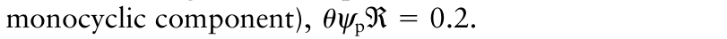{.equation width=60%}

When θ _ψ_ pℜ = 0, the epidemic is purely of the H-L-I-R type, and final _y_ given by equation 6.39 is the same as that given by equation 5.27. Final _y_ increases with increasing θ _ψ_ pℜ at any given _R_ 0, but the effect depends

### 6.3.3 Discussion

As mentioned in the context of the simulations above, it is straightforward to calculate the basic reproduction number (_R_ 0) for the polycyclic component of a epidemic. Whether or not an epidemic occurs (when there is the possibility of infections from primary and secondary infectious units), however, depends on _both R_ 0 and the parameter combination for the monocyclic component of the epidemic. In other words, _R_ 0 could still be less than 1 and there can be an increase in _Y_ over time, as shown in Fig. 6.5C (or in Chapter 4 for monocyclic diseases). Whether the epidemic curve still has an approximate exponential phase, as with the models discussed in section 5.2 for pure polycyclic epidemics, depends on the balance between the primary/monocyclic and secondary/polycyclic components of the epidemic. Certainly, a monocyclic process results in a nonexponential-type increase in _Y_ (see Fig. 4.17C; also see on _R_ 0. At _R_ 0 > 3, there is just a little increase in _y_ ± with increasing primary infections; this is because the polycyclic component dominates at high _R_ 0. The effect of θ _ψ_ pℜ is clearly seen at low _R_ 0, when _y_ ± would be relatively low without an influx of primary infectious units (Fig. 6.6). Note that _y_ ± can be larger than 0 even for values of _R_ 0 from 0 up to 1, due to the influence of the primary infectious units. For example, with _R_ 0 = 0 and θ _ψ_ pℜ = 0.2, about 20% of the individuals become diseased ultimately (_y_ ± ≈ 0.2) in Fig. 6.6, which is in agreement with the simulation results shown in Fig. 6.5C. Likewise, with _R_ 0 = 1.5 and θ _ψ_ pℜ = 0.2, _y_ ± ≈ 0.72, in agreement with the simulation results in Fig. 6.5B.

{#fig-6-6}

The final question we address here is: When is it important to consider a mixture of monocyclic and polycyclic processes? There is no formal answer, but guidelines are clear from numerical and some analytical results. For epidemics with a definite polycyclic component, little is gained by the complexity of adding a monocyclic component if β _H_ 0 and/or _R_ 0 are high (higher than in the simulations of Fig. 6.5), unless θ _ψ_ pℜ is very high. Moreover, for epidemics with a definite monocyclic component occurring over a long time period (say, the duration of the season), and moderate or higher θ _ψ_ pℜ, little is gained by the complexity of adding a polycyclic component in the model when _R_ 0 is very low, especially for short-duration epidemics in which there is little time for the compounding effects of polycyclic epidemics to have much of an influence. As one would expect, it is the intermediate situation with moderate _R_ 0 and θ _ψ_ pℜ that the mixture model is of great value. Examples include root diseases when the host individual of interest is the root (or root segment), not the entire plant. When entire plants are the units of host being considered, it is much more likely that the epidemic will be of the monocyclic type. Gilligan (2002) thoroughly reviews the topic.

To conclude this section, we point out that the link between the H-L-I-R model (equation 5.30) and the one of this section (equation 6.36) is even stronger than one might think. Using equation 6.38 for _x_ (_t_), it can be shown mathematically that as κ goes to infinity and θ _ψ_ p goes to infinity in such a manner that the ratio θ _ψ_ p/κ is constant (=ℵ), then ℵ _x_ 0 _H_ 0 is the initial density of infected individuals (_L_ (0)), and _x_ (_t_) equals 0 immediately after _t_ = 0. With a high efficiency of infection but rapid loss of inoculum, the monocyclic phase is very short lived. In other words, consideration of equation 6.36 as a general model with the additional assumptions here, leads to a formal expression for the starting conditions of a pure polycyclic epidemic in terms of initial inoculum density and how this inoculum infects the host individuals.

## 6.4 Epidemics with Vector Transmission

Many plant pathogens are transmitted from infectious plants to healthy plants by means of vectors. Plant viruses are the largest group of pathogens causing plant diseases that are transmitted by vectors, mostly herbivorous insects, especially aphids, leafhoppers, planthoppers and some beetles (Nault, 1997; Madden et al., 2000b). Phytoplasmas, spiroplasmas, and some other prokaryotes (such as the agent of Pierce’s disease of grape) are also transmitted by vectors. Other arthropods (e.g., mites) and other organisms (e.g., nematodes, fungi) may also transmit some viruses, but we restrict attention here to insects as vectors.

When the insect vector feeds on an infectious plant, it can acquire the virus if virus titer is high enough in the plant. For several viral plant diseases, the plant virus has no, or very little, effect on the insect vector (Nault, 1997). When the insect subsequently feeds on a healthy plant the virus can be inoculated into the plant, and a new infection occurs. Viral plant diseases are generally systemic, meaning that once infected, the virus can multiply and move throughout the plant. Because virus diseases are systemic, the natural definition of an individual for these diseases is the whole plant, and in the section we use the term plant rather than individual for ease of presentation.

The latent period in the plant is the time it takes for sufficient virus multiplication and within-plant movement so that the virus can be acquired by a vector individual. The infectious period in the plant is over when there is sufficient reduction in virus titer in the plant so that a vector cannot acquire the virus when feeding. There are four basic transmission types or classes for plant viruses with insect vectors, which are discussed in an epidemiological context by Madden et al. (2000b). The types are based on a combination of: (i) the length of time that a vector remains infective after acquiring the virus from a plant; and (ii) on the physiological mode of transmission (e.g., whether or not the virus multiplies in the vector). In terms of population dynamics, however, the transmission type directly determines the length of the latent period and infectious period in the vector, and the rate at which the virus is acquired from the infectious host plant (or rate at which it is inoculated to a healthy plant). We consider only a small subset of the multiple possibilities.

Since all models are simplifications of reality, it is certainly possible to model and analyze plant virus disease epidemics without explicit consideration of the vector population. Examples of this are in Chapter 4 and elsewhere (e.g., Chan and Jeger, 1994; Madden and Campbell, 1986; Madden et al., 1987b; Nutter, 1997; Zhang et al., 2000a). For instance, if an H-L-I-R model (equation 5.30) was used, the transmission parameter, β, would be a function of, among other things, rates of virus acquisition and inoculation, and the density of the vector population. The functional relationship likely is very complex, depending on the transmission class (Madden and Campbell, 1986). Here we are concerned with expanding the models considered so far to explicitly relate the vector population to the population of diseased plants to develop a better understanding of plant virus epidemics.

As an introduction into the area of virus-vector modeling and analysis, we discuss a version of a general model that has been developed (in various forms) to study management strategies of virus diseases (Chan and Jeger, 1994; Holt and Chancellor, 1996; Holt et al., 1997, 1999; Jeger and Thresh, 1993; Jeger et al., 1998, 2002, 2004; Zhang et al., 2000a,b; Madden et al., 1990b, 2000b). The model is very similar to the first model for virus vector diseases in humans developed by Ross (1911, 1915) to study malaria. Wherever we plot densities of healthy and infected individuals, or the thresholds for the development of an epidemic, we will mostly use parameter values applicable to cassava mosaic virus disease. This disease has attracted a great deal of attention due to the very severe pandemic that has caused dramatic yield losses over the last decade in Africa (e.g., Otim-Nape et al., 2000).

The discussion of the model development here for virus–vector systems also serves the additional purpose of outlining some of the key steps in formulating a model for a plant disease using coupled differential equations, and then exploring the properties of the model, including model predictions for different parameter values.

### 6.4.1 Model derivation

The host population is divided into healthy and infectious plants. As before, the density of healthy plants is denoted by _H_ (_t_) and that of infectious plants by _I_ (_t_). We thus assume that the latent period is 0 and the infectious period is infinite (i.e., the duration of the epidemic or longer). These are obvious simplifications but allow us to consider some long-term dynamics here. This model is an acceptable simplification of reality whenever actual latent period is short and infectious period is long. The vector population is divided into non-viruliferous and viruliferous, where the term viruliferous stands for vectors that have acquired the virus by feeding on an infectious plant and can (potentially) transmit the virus when feeding on healthy plants. The density of nonviruliferous vectors is denoted by _X_ (_t_) and the density of viruliferous by _Z_ (_t_). We are thus assuming that there is no (or as a simplification, a very short) latent period in the vector and that the infectious period is very long. The dynamics of the virus-vector system is depicted in Fig. 6.7.

In the model, _H_ (_t_) increases due to planting of new crop plants and decreases due to harvesting of plants. This part of the model is analogous to the second dynamic-host model of section 6.2 (equation 6.5), applicable for relatively large regions over long time scales (several crops being planted and harvested). The density of healthy plants also decreases due to plants becoming infected with the virus when viruliferous vectors feed on the plant. This is described in the pseudo-equation

{#fig-6-7}

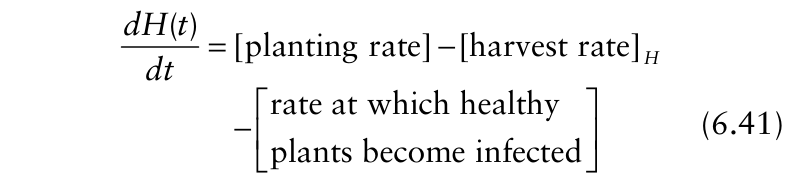{.equation width=60%}

The _H_ subscript explicitly refers to harvesting of healthy individuals. _I_ (_t_) increases due to the infections that reduce the density of healthy plants, and decreases due to harvest and due to death of infectious plants. The pseudo-equation describing the dynamics of the density of infectious plants thus is:

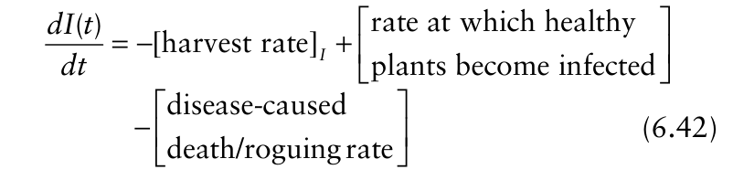{.equation width=60%}

The _I_ subscript refers to the infectious plant individuals. As in the model in section 6.2.1 we assume that there is a constant planting rate σ and a harvest rate η (a constant), giving the terms

{.equation width=60%}

Note that η can also be a death rate of plants due to all factors other than disease (so that it is the same for healthy and infected individuals. In fact, η could be the sum of the rates of harvesting and “natural” death/ mortality (as long as natural death does not depend on infection status). Infectious plants can die due to the dis- ease, or if sanitation programs are initiated, by removal (roguing) by the grower. We assume that there is a constant probability _φ_ per time unit that an infectious plant is removed from the system due to the disease. The death rate term thus is: latent period in the vector. The number of viruliferous vectors, _Z_ (_t_), increases due to non-viruliferous vectors acquiring the virus by feeding on infectious plants and decreases due to viruliferous vectors losing the virus and due to vector death. The pseudo-equations for this category is:

{.equation width=60%}

For the rate at which healthy plants become infectious, we assume that there is a constant transmission rate β1 and that the infection term takes the form

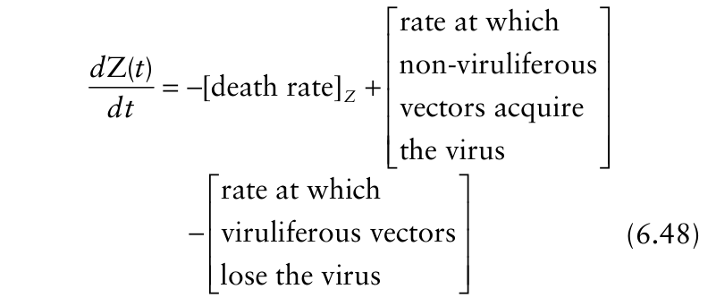{.equation width=60%}

{.equation width=60%}

Substituting equations 6.43–6.45 into equations 6.41 and 6.42, the model describing the plant population thus takes the form For now we will denote the birth rate of the insect vector by the general function υ(_t_). Each insect vector has a probability Ξ per time unit to die. This gives us

{.equation width=60%}

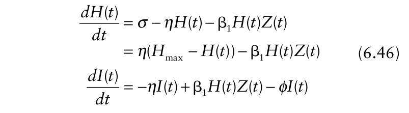{.equation width=60%}

The viruliferous vector has a probability _τ_ per time unit to lose the virus, which gives This completes the specification of the dynamics of the plant population. Note how this equation differs from equation 5.18, where no vector was involved. In the contact rate term for host plant infection, _I_ (_t_) is replaced by _Z_ (_t_), the density of viruliferous vectors. We _could_ consider the special case of no dynamics to total host density (in the absence of disease). This would mean using η = 0, so that there is no planting or harvesting. However, for long-term scenarios being of interest here, with new planting and harvesting, this is not a useful simplification, so we only consider η > 0.

The density of non-viruliferous vectors (i.e., those free of the virus), _X_ (_t_), increases due to birth (hatching, emergence, and so on) of vectors and decreases due to vector death. Further, the density of non-viruliferous vectors decreases due to acquisition of the virus by individuals feeding on infectious plants and density increases due to _viruliferous_ vectors loosing the virus they acquired. This is described by:

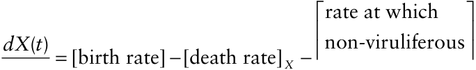

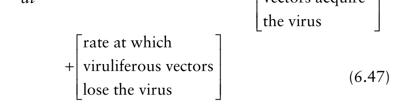{.equation width=60%}

{.equation width=60%}

Referring to our discussion in sections 5.2.2.2 and 5.2.3.1 on latent and infectious periods in relation to probabilities per time unit to leave a category, we note that this assumption implies that the mean infectivity period of the vector equals 1/ _τ_.

For the rate at which vectors acquire the virus we apply a similar term as for the rate at which plants become infected through vector feeding, describing the dependence of acquisition on non-viruliferous vector and infectious plant density as:

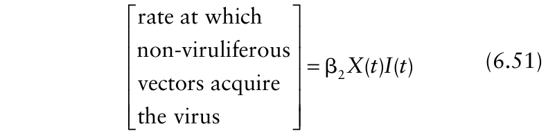{.equation width=60%}

Note that the acquisition rate is a function of the product of densities of non-viruliferous vectors and infectious plants. The model equations for the dynamics of the vector population thus are Note that we use “viruliferous” here as a synonym for infective or infectious, since we are not considering a

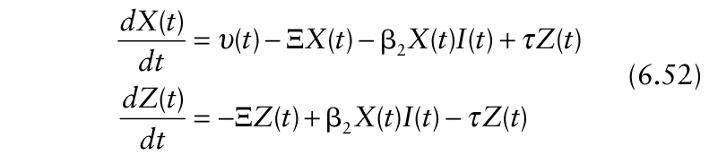{.equation width=60%}

We now need to specify the vector birth (emergence, hatching) rate in more detail. We are considering here only those plant viruses that do not have an effect on the biology of the vector. Madden et al. (2000b), and references therein, cover the issue more broadly. Thus, the total vector density, _X_ (_t_) + _Z_ (_t_), does not depend on the virus nor on the density of healthy or infected plants. A simple assumption we can make to derive the birth rate is that every insect vector that dies is replaced by a new vector through birth in the population. This means that we assume the vector population to be of constant size, which we will denote by _P_. In other words, total vector density is a parameter, not a variable. The total vector population being constant implies that

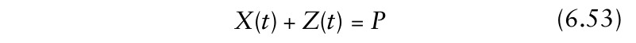{.equation width=60%}

Taking the derivative of equation 6.53 with respect to time yields

{.equation width=60%}

when _P_ is a constant. This is because the total rate of change of the vector population must be 0 if _P_ does not change. Of course, the rates of change for non-viruliferous and viruliferous vectors can both be nonzero even when their sum is zero. Substituting the equation 6.52 in equation 6.54 we find:

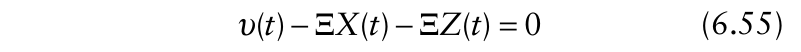{.equation width=60%}

which can be written as

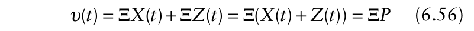{.equation width=60%}

We thus find that _υ_ (_t_) = Ξ _P_, and substituting this in the model equation 6.52, we complete the model specification.

Our assumption about constant vector population density leads to a simplifying consequence: one of the vector equations has become redundant. To see this, rewrite equation 6.53 in the form _X_ (_t_) = _P_ − _Y_ (_t_). Substituting this expression for _X_ (_t_) in the equation for _dZ_ (_t_)/ _dt_ we find

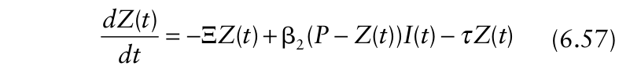{.equation width=60%}

and based on equation 6.54, _dX_ (_t_)/ _dt_ is obtained as − _dZ_ (_t_)/ _dt_. Thus, the rate of change in the density of viruliferous vectors can be calculated independently of the density of non-viruliferous vectors (i.e., _X_ is not in equation 6.57 for the rate of change in _Z_). Note that whenever we know the density of viruliferous vectors, _Z_ (_t_), the density of non-viruliferous vectors is then easily calculated from _X_ (_t_) = _P_ − _Z_ (_t_). Putting all the pieces together, the model describing the epidemic dynamics of a virus-vector disease is:

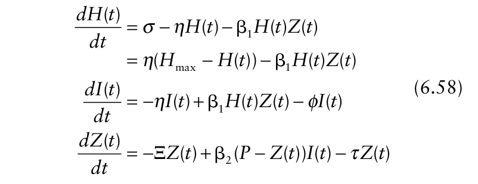{.equation width=60%}

Equation 6.58 is a variation of the epidemic models with host growth (see section 6.2), generalized to account for transmission by a vector. Note that if no roguing (or infection-caused mortality) occurred for infected individuals (ϕ= 0), then a fixed total plant density of _H_ max (= _H_ + _I_) would be maintained throughout the epidemic if initial host density (_H_ 0 + _I_ 0) equaled _H_ max. We do not, however, restrict the model to situations with fixed total host density. It should be further noted that density of individuals that are rogued [ _B_ (_t_)] could be explicitly accounted for by using an additional equation in equation 6.58 for _dB_ (_t_)/ _dt_ [=+ϕ _I_ (_t_)], but such explicit representation is not needed.

### 6.4.2 Model simulations

The left-hand column of Fig. 6.8 shows a series of simulation results of model equation 6.58 for different values of the inoculation rate parameter β1 when there is no roguing (removal) of diseased plants (ϕ = 0). We assume the acquisition and inoculation rates were the same (which is reasonable for many plant viruses [Madden et al., 2000b]). The epidemics started with _I_ 0 = 1 (so, _H_ max = 1000), and _P_ = 50 and _Z_ 0 = 0 (so that all vectors were virus free). The plotted values of plant densities were rescaled to 0−1 so that they could be shown readily on the same graph with viruliferous vectors. For very small values of β1, no epidemic develops, whereas for larger values an epidemic does develop. A high percentage of the plants become infected at high β1, but as found for polycyclic epidemics in general (see sections 5.2 and 6.2), not all individuals become infected. An apparent steady state is seen where loss of infected plants (through harvesting) is balanced by new planting. Furthermore, there is an apparent threshold behavior for epidemic development, which is very similar to the threshold behavior for diseases that are transmitted directly from plant to plant. The simulations also show that after the start of the epidemic, the density of infected plants appears to increase exponentially with time in the initial stages of the epidemic (when β1 is high enough for an epidemic to occur).

The right-hand column of Fig. 6.8 corresponds to β1 = β2 = 0.008/day (same as for Fig. 6.8B), but with ϕ > 0

![The density of healthy plants, _H_, infectious plants, _I_, and viruliferous vectors, _Z_, as function of time, for a plant disease with an insect vector specified by model equation 6.58. At the start of the epidemics (_t_ = 0), conditions were _H_ (0) = 1000, _I_ (0) = 1 and _Z_ (0) = 0. Plant variables (but not the vector variable) were re-scaled between 0 and 1 in the graphs by dividing values by 1000; all parameter values shown are in terms of rescaled disease variables. _H_ max = 1 (σ = 0.003, η = 0.003), and Ξ = 0.12 and τ = 0.1 per time unit for all cases. Left-hand column of graphs: increasing β1 and β2 with roguing rate (_φ_) equal to 0. Right-hand column of graphs: increasing _φ_ (all above 0) and/or vector density (_P_) at fixed values of β1 and β2.](figures/fig6-img11.png){#fig-6-8}

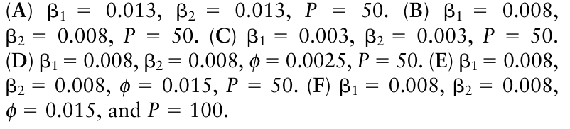{.equation width=60%}

(indicating the removal of infected plants). A small value for _φ_ (=0.0025/day) resulted in lower density of diseased plants throughout (Fig. 6.8D) compared to the situation with _φ_ = 0. Also, density of diseased plants increased to a maximum before declining somewhat to an apparent steady state. When the roguing rate was increased to _φ_ = 0.015/day, no epidemic occurred (Fig. 6.8E). However, if vector density was doubled to _P_ = 100 at this high roguing rate, an epidemic did occur (Fig. 6.8F), although the density of infected plants was relatively low.

### 6.4.3 Steady states and thresholds for epidemic development

The steady state densities of healthy plants, infectious plants (same as infected plants in this model, since latent period is 0 and there is no finite infectious period) and of viruliferous vectors can be calculated in the same way as discussed in section 6.2.1.3. Equating all rates of change to zero and replacing _H_ (_t_), _I_ (_t_) and _Y_ (_t_) by _H_, _I_ and _Z_, respectively, we find that the steady states can be calculated from:

{.equation width=60%}

Solving this set of equations we find two steady states of the system

{.equation width=60%}

Note that we saved space above by expressing the densities of healthy plants and viruliferous vectors in terms of the density of infectious plants. Equation 6.60 is the steady state when the disease is not present. As discussed in section 6.2.1.5, the density of healthy plants converges to _H_ max when disease is not present for any nonzero starting value of _H_ (this is why _H_ max = σ/η). The second set of steady states correspond to when the disease is present (equation 6.61). Similarly to our discussion in section 6.2.1.3, we note that these steady states are only biologically relevant if all these densities are larger than or equal to zero. Some algebra shows that all three steady state densities are larger than zero when

{.equation width=60%}

with _H_ max = σ/η. We have organized the expression in such a way that it helps the interpretation. Note that there are several algebraic steps involved in obtaining this expression.

The left-hand side of equation 6.62 is the basic reproduction number, _R_ 0, for this virus disease represented by epidemic model equation 6.58. With a dynamic host, the disease will only persist (i.e., _I_ (_t_) will stay above 0) if _R_ 0 > 1. A heuristic explanation follows. Consider the situation where one viruliferous vector flies into the crop, which is disease free but does contain a population of non-viruliferous vectors. This viruliferous vector will infect β1 _H_ max plants per time unit. Referring to the discussion in sections 5.2.2.2 and 6.2.1.6, we know that a viruliferous vector remains viruliferous for, on average, 1/(Ξ + _τ_) time units (i.e., it either dies or loses the virus). Therefore, the total number of plants one viruliferous vector infects before it reaches the end of its viruliferous period equals the first part on the left hand side of equation 6.62. Next we consider the infected plants (which are also infectious in this model formulation). Each infected plant will be visited by healthy vectors that then can become viruliferous themselves. The vector population is in this stage still entirely healthy (except for this one individual that entered the system) and thus the number of vectors that become viruliferous per time unit per infectious plant equals β2 _P_. Again referring to the discussion in section 5.2.2.2 we know that an infectious plant remains infectious for, on average, 1/(η + _φ_) time units (i.e., either the plant is harvested or is rogued/removed). Therefore, the total number of vectors per infectious plant that acquire the virus before the plant is removed due harvesting and roguing equals the second part on the left hand side of equation 6.62. The product of the two terms thus has the interpretation of the number of viruliferous vectors resulting from one viruliferous vector, with infected plants as intermediate step, when the viruliferous vector is surrounded by an entirely healthy plant population and an entirely nonviruliferous vector population. This explanation can also be reversed, to obtain the number of new infected plants from one infected plant, with viruliferous vectors as the intermediate step, when the infected plant is introduced into an otherwise disease-free plant population with initially no viruliferous vectors. It is clear that if this number of new “cases” per case is larger than unity, an epidemic will develop, whereas if it is smaller than unity, no epidemic will develop. We have thus found the threshold for epidemic development in a virus-vector system.

It is useful to compare the equation here for _R_ 0 with equation 6.23 which was derived for a similar (but not identical) dynamic-host situation in section 6.2. Because there is no latent period, the term with ω in equation 6.23 does not appear here. We also do not consider the infectious period in the current simple model for virus epidemic, which is equivalent to assuming that infected plants remain infectious until harvest. Thus, there is no μ in the current _R_ 0 calculation (equation 6.62). Because we explicitly consider roguing of infected plants, _φ_ plays the same role in determination of _R_ 0 here as μ does in equation 6.23. Finally, the β _H_ max term in equation 6.23 is replaced by the four-way product, β1β2 _H_ max _P_; this is because epidemics are functions of the host and vector densities, and depend on both virus acquisition and inoculation rates.

### 6.4.4 Some notes on disease management

As mentioned earlier, we have chosen parameter values for the simulations that reflect the situation of cassava mosaic virus transmitted by the whitefly _Bemisia tabaci_. As given in the legend of the figure, the parameters all have days as time unit and m2 as unit of area. Characteristically, the whitefly density (_P_) is between 50 and 500 individuals per square meter (see Jeger et al., 2004 and references therein for motivation of these parameter values). When studying virus disease management, three potential strategies are often considered for this and similar diseases (see Jeger et al., 2004, for a general overview of the topic).

- _Roguing_. This was brought up in terms of model development, but we elaborate here. At regular time intervals, fields are inspected and plants showing disease symptoms are removed and destroyed. In our model such sanitation programs are reflected in the parameter _φ_, which is the product of the number of inspection rounds made per time unit and the probability that the inspector (farmer) recognizes and rogues infected plants. The experience of development workers with growers of small cassava plantations in Africa is that they are maximally willing to do one inspection round each month (Fauquet and Fargette, 1990). If they, with certainty, recognize each infected plant, this would mean that the rouging parameter _φ_ equals approximately 0.03/day. Since the detection of infected plants is not very easy and many infected plants will be missed during sanitation rounds, we take the value _φ_ = 0.02 as the very maximum possible.

- • _Resistant cultivars_. Several organizations are breeding cassava for resistance to cassava mosaic virus. Some of these cultivars are being used at present, but further developments in this area are continuing. The resistance level of the plant to the virus is expressed in β1 and β2, the inoculation and acquisition rate by vectors, respectively. Resistant cultivars that have a lower probability to become infected when exposed to a viruliferous vector have a smaller value of β1. Resistant cultivars that result in a lower probability of a non-viruliferous vector acquiring the virus when exposed to the infectious plant have a smaller value of β2.

- _Reducing vector density_. In some crops it is possible to reduce vector densities with well-targeted pesticide programs or through changes in the agronomics of the system. Reducing the vector density is reflected in the model parameter _P_.

Which of these disease management methods will work best in the case of cassava mosaic virus? One way to answer this question is to determine if it is possible, in the long run, to eradicate the disease in an area. By ‘eradication’ here we explicitly mean that an epidemic will not occur (at the temporal/spatial scale of interest). The question can be answered by considering both _R_ 0 (equation 6.62) and the steady state of the densities of healthy and infected plants and the density of the viruliferous vectors.

{#fig-6-9}

In Fig. 6.9, we plotted the roguing rate _φ_ on the abscissa and the product of the acquisition and inoculation parameters, β1β2, on the ordinate. The lines in the figure are where _R_ 0 = 1. These lines thus separate parameter combinations for which an epidemic will develop from parameter combinations for which no epidemic will develop. Such lines are drawn in the figure for three different values of the vector density (_P_). Parameter combinations above the line will lead to the development of an epidemic, but no epidemic will develop for parameter combinations below the line (assuming, of course, that the model is appropriate). For example, consider the situation with _P_ = 50, β1β2 = 6.4 × 10−5 , and no roguing (_φ_ = 0), which corresponds to the simulation in Fig. 6.8B. This combination of β1β2 and _φ_ falls above the line; thus, an epidemic will develop when the virus is introduced in the system (as demonstrated numerically in Fig. 6.8). Increasing the roguing rate to above ∼0.012/day will cause the parameter combination to fall below the threshold line for _P_ = 50, and no epidemic will develop (as shown numerically for _φ_ = 0.015 in Fig. 6.8E). The star on the ordinate depicts the parameter values of the default “standard” system chosen for this example analysis, where susceptible cultivars are used and no roguing is applied.

The figure shows that roguing as _the_ disease management measure can only prevent an epidemic when the density of whiteflies, _P_, is relatively small. For the nominal values of the other parameters (e.g, β1 and β2), roguing alone can eradicate the disease when _P_ = 50 but cannot control the disease for the other values of _P_ shown in the figure. For instance, with β1β2 = 6.4 × 10−5 , an epidemic will occur for all values of the _φ_ when _P_ is 100 or higher. A resistant cultivar, if it is to eradicate the disease, should decrease the product of the acquisition and inoculation parameter, β1β2, to less than 20% of its chosen nominal value for susceptible cultivars. For instance, with _P_ = 50 and _φ_ = 0 (no roguing), β1β2 must be reduced from 6.4 × 10−5 to 1.8 × 10−5 or less in order to prevent an epidemic. It seems unlikely that this reduction in the parameters can be achieved through breeding.

We can conclude that individual disease control strategies cannot be expected to eradicate the disease. A combination of the two disease management strategies, however, shows tremendous promise for disease control. Bringing the roguing rate to close to its maximum (0.02/day) and introducing a resistant cultivar that decreases the product of the acquisition and inoculation parameters, β1β2, to about 60% of its value for susceptible cultivars (4 × 10−5 ) will eradicate the disease even at _P_ = 100. With lower _P_ (=50), even a moderate roguing rate (_φ_ = 0.01) will result in disease eradication if β1β2 can be reduced to 4 × 10−5 . Experiments have shown that reducing the vector population density using insecticides is very difficult (Palumbo et al., 2001; Dittrich et al., 1990). Thus, although reducing the vector density would be effective in disease control, if used in conjunction of reduction of β1β2 and increase in _φ_.

In Fig. 6.10, the density of healthy and infected (=infectious in this case) plants and the density of viruliferous vectors are plotted as function of all four disease management parameters. Graphs such as these are very useful to determine epidemic outcomes when epidemics cannot be prevented (_R_ 0 > 1). The nominal values of the parameters not shown on the graphs correspond to those for susceptible cultivars (β1 = β2 = 0.008/day), no roguing (_φ_ = 0), and a vector population density of 50 insects per plant. These figures show that the density of healthy plants increases in close to a linear manner with the roguing rate until _φ_ ≈ 0.01/day, and then _H_ is no longer affected by _φ_ (because the steady state equals _H_ max; the disease “dies out”) (Fig. 6.10D). Moreover, _H_ increases with decreasing vector density, but the relationship is not linear; in fact, there is little change in _H_ as _P_ decreases from 100 until about 40 (Fig. 6.10A); at lower _P_ values, there is a rapid change in _H_ with change in _P_. The parameters reflecting host resistance, β1 and β2, show a similar relationship to _H_ (Fig. 6.10A, B) as that found for _P_. That is, small reductions in β1 or β2 away from the nominal 0.008/day had little impact on _H_; the

{#fig-6-10}

{.equation width=60%}

value of _H_ only changed markedly when the parameters decreased by 50% or more (approaching the values that result in eradication). Therefore, in cases where disease is not eradicated, and a _single_ control measure has to be used, roguing is more efficient than using resistance. Of course, combinations of controls can be even more effective (not shown here).

### 6.4.5 Concluding remarks

In this section, we have introduced a simple model for the dynamics in virus–vector systems. Using parameters for the cassava mosaic disease we have demonstrated an application of the model by evaluating the effect of control strategies on epidemics and we were able to draw some general conclusions about disease management. A warning is at place here. It would be unwise to simply implement the results of such a simple model into practice without further work. Other models also describing the cassava mosaic system, but based on different assumptions, should be studied to see whether the conclusions are general and that hold for a larger set of models (as we saw in section 5.2). Several models, some considerably more detailed than the one here, have been studied (e.g., Holt et al., 1997, 1999; Jeger et al., 1998, 2002, 2004; Zhang et al., 2000b, Madden et al., 2000b). The simple model here does serve the purpose of showing how disease dynamic models can be used to evaluate controls, or to suggest the likelihood that a certain control will be effective.

The model we have studied falls short in several aspects. As mentioned at the start of this section, no allowance for latent and infectious periods in the plant host were considered. We also did not consider a latent period in the vector. Both the latent and infectious periods in the vector, together with the parameters β1 and β2, are of fundamental importance in classifying plant viruses. Jeger et al. (1998, 2004) and Madden et al. (2000b) show the linkage between these transmission traits and the most effective means of control for the different types of plant viruses.

Lastly, our appraisal of control strategies does not consider the cost of developing the control (e.g., cost of breeding) and the costs of implementing the controls. The issue of control costs and the resulting benefits from the controls are addressed somewhat in Chapter 11. However, the representation of the epidemics is much more superficial in that chapter. Considerably more work is needed to link economic decision theory to population-dynamic modeling of plant disease epidemics.

## 6.5 Transitional Dynamics and Other Complexities

### 6.5.1 Models considered so far

In this and the previous chapter we have shown that a considerable understanding of plant disease epidemics can be reached by the use of just a few differential equations and a limited number of well-defined parameters. When host growth and mortality are not major issues during the time period of interest, the models of Chapter 4 for polycyclic diseases are easily expanded to consider latent and infectious periods, allowing for a more realistic model for _dY_ (_t_)/ _dt_ [or _dH_ (_t_)/ _dt_] compared to the logistic and similar models. Essentially, major results can all be expressed in terms of , _ι_, and β _H_ 0, although the latter can be considered the product of multiple parameters (αθ _ψ_). Additional complexities, such as host growth and mortality, as well as the mixing of polycyclic and monocyclic (primary infection) processes over time and the development of epidemics in annual crops over many years, are readily incorporated into the models, as needed, to satisfy the objectives of the investigator and the type of disease development. Often, a sigmoid disease progress curve is produced by the models, especially for polycyclic diseases when there is no host growth. A fundamental result is that for many scenarios for compound interest diseases, it is possible to define (in terms of a few parameters, or a composite parameter): (1) a threshold for epidemic development; (2) the exponential rate of increase during the early part of the epidemic (_if_ there is an epidemic); and (3) a value for the final proportion of diseased individuals (or steady state value of _H_ if the host is dynamic). The basic reproduction number, _R_ 0, is the key composite parameter that is of great value. With proper formulation of the models, results for specific parameter combinations can be found with a calculator, or even by hand. Of course, spreadsheets facilitate the calculations, but are not required.

Researchers sometimes require more than the results for these three numbered issues. In particular, it is often of interest to know the density or proportion of diseased individuals at any given time during an epidemic, and not just at small and very large _t_. The term _transitional dynamics_ is sometimes used when referring to population dynamics between small and very large _t_ (i.e., between small and large _y_ (_t_)). Because the time duration of many crops is not long enough for asymptotic (final level) or steady-state epidemic results to be achieved, calculated values of _Y_ (_t_) [or other densities, such as _H_ (_t_)] are required for intermediate times (i.e., beyond the initial stages, where exponential-model approximations no longer are reasonable). In general, such calculations require numerical integration techniques since there is typically no analytical solution to the equations in this or the previous chapter (i.e., _Y_ (_t_) cannot be written as a function of _t_ without the use of the integral symbol). This was once a serious limitation to the use of some of these epidemic models, but the limitation is becoming much less important because of the development of relatively easy-to-use computer programs (such as MATHCAD and MATHEMATICA) for numerically solving coupled differential equations. All the plots of density versus time were obtained based on numerical integration (see Figs. 5.5, 5.7, 6.1, 6.3, 6.5, 6.8).

As pointed out for several of the models in section 5.2, plots of _Y_ (_t_) versus _t_ are often _S_ -shaped (see Fig. 5.7) when the epidemics start with a small density of infected individuals, suggesting that a logistic or similar diseaseprogress model might be reasonable for describing the epidemics. In fact, a more detailed analysis than presented in these chapters shows that the logistic (or similar) model _can_ approximately describe disease dynamics even when the generating models consider the realism of, among other things, a finite infectious period and a nonzero latent period. This should be expected since numerous published disease progress curves are adequately represented by the logistic model (see Chapter 4 for examples), and the models of this chapter would be problematical if they did not duplicate actual observations of plant disease epidemics.

The degree of similarity between the generated disease progress curves based on the H-L-I-R model (as an example) and the logistic model depends on the values of 1/ω, 1/μ, and β. As shown in Fig. 6.11, plots of logits versus _t_ can be fairly straight over all actual times, indicating a very high similarity in results between simple and more complicated models, or the logit curve can bend to the left or right, even with sigmoid curves of _Y_ (_t_) versus _t_.

{#fig-6-11}

Note that logits were calculated using ln[ _y_ (_t_)/(1 − _y_ (_t_))] in the graph, in which _y_ (_t_) = _Y_ (_t_)/ _H_ 0, and parameter choices for the H-L-I-R model were deliberately chosen to emphasize deviation from a logistic relation at high disease density. Most combinations of parameters from H-L-I-R (and related models without host growth) result in logit lines that are fairly straight.

Very long mean infectious period (_ι_ = 1/μ) typically results in logit curves bending to the left, and very short mean infectious period typically results in logit curves bending somewhat to the right. The curvature typically is an issue only at large _y_ (_t_). The value of _R_ 0 was above 5 for the three curves in Fig. 6.11, so final disease level as a proportion was near 1 in all cases. If one is interested in approximating a realistic epidemic model when _R_ 0 is small (but still above 1), it is recommended that the more general version of the logistic model [i.e., with a parameter for maximum _y_ (= _K_)] be utilized (equation 4.47), and that _y_ ± from equation 5.27 be used for _K_ (Segarra et al., 2001). Then, the logit is given by ln[ _y_ (_t_)/(_y_ ±− _y_ (_t_))].

A direct comparison of the equations for _dY_ (_t_)/ _dt_ for the logistic (equation 4.51a) and for the H-L-I-R model (as an example; equation 5.31) shows that the two models can never be equal over the full range of _Y_ (or _H_) values, because the rate for the logistic model depends on all diseased individuals, _Y_ (_t_), and for the more realistic H-L-I-R model, the rate depends on just infectious individuals, _I_ (_t_). This was addressed partly in section 5.2.3.1. _Y_ (_t_) and _I_ (_t_) are not equal, unless = 1/ω= 0 and _ι_ = 1/μ = ±. Nevertheless, the logistic model can provide a good approximation to more realistic and complex models introduced in this chapter. However, with fairly easy-to-use mathematical programs, obtaining numerical solutions to H-L-I-R and similar or more complex (e.g., host growth) models is now a reasonable (but not trivial) exercise, somewhat removing the need to “force” analysis into a logistic (or similar) framework.

### 6.5.2 More complicated models

The epidemic models considered in this chapter can all be expanded, as necessary to meet the objectives of the investigator. This is often most directly done by converting parameters into variables, and having these variables be dependent on other parameters. For instance, it is generally assumed, out of convenience, that β (or β _H_ 0) is constant. One or more of the components of β (α, _ψ_, or θ) may however be functions of _H_, _t_, or other variables. This was partly addressed in section 5.3. Just a few of many possible situations are considered here.

In some systems, the susceptibility of the crop decreases over time as plants or plant tissue matures. Among other things, this could mean that the probability that an infectious unit in contact with a healthy plant causes an infection (_ψ_) decreases over time, so that _ψ_ is replaced by a function _ψ_ (_t_) (see Kleczkowski et al., 1996; Gilligan, 2002). Also, it is possible that the probability of an infectious unit coming in contact with a host plant (θ) is a function of initial host density (_H_ 0) or even total host density at any time (_M_ = _L_ + _I_ + _R_ + _H_) for situations with a dynamic host crop. Then θ is replaced by functions θ(_H_ 0) or θ(_M_) in the models, if a reasonable relationship between the variables can be formulated. Moreover, rate of production of infectious units (α) could be a function of density of infectious or even total disease intensity, α(_Y_).

In some cases, it is still possible to analyze these expanded models analytically using the generalizations of the mathematical methods discussed in previous sections of this chapter. However, in general, analysis is based on numerical solutions of the equations, as discussed above for transitional dynamics. It may turn out that the use of constants gives about the same results as more complicated variables in the models. The “parameters” of the simpler models would then be considered types of “averages” of underlying variables (e.g., average of _ψ_ (_t_) over time). It is important to keep in mind that the “simple” models of this and the previous chapter, with a small number of parameters, _do_ provide a realistic description of epidemics. This may be because some variation of the terms “cancel out”, on average. For instance, even if _ψ_, α, and θ all depend on time or densities of diseased individuals, their product (=β) may be reasonably constant (as an approximation) over time, depending on the direction of the underlying dependencies.

There is one obvious “parameter” dependency that does need some discussion in terms of the spatial component of epidemics. Except for some general statements, we have so far ignored the spread of diseased individuals in space as the density increases over time. The probability that an infectious unit contacts a given host individual (θ) obviously depends on the distance (_s_) between where the infectious unit (e.g., spore) was produced and the location of the given host individual. In general, the greater the distance, the lower the probability of contact. To account more fully for this dependency, _explicit_ modeling of the dynamics of _Y_ (or _H_, etc.) in space _and_ time is required. This is addressed in some detail in Chapter 8, after first presenting the concepts and analysis of disease gradients in Chapter 7. This issue is most relevant when the diseased individuals are in a limited number of patches (foci), so that some parts of the field are disease free and other parts have high density of diseased individuals. With this situation, healthy individuals far from the disease will have a very different probability of contact with inoculum than healthy individuals near the focus. With a random pattern of disease (see Chapter 9), however, there is less of an issue in terms of temporal modeling, because there are many distances between diseased and healthy individuals that are “averaged out” (in some circumstances) to permit use of a constant (average) θ in temporal models of epidemics. In other words, disease-free plants would not differ greatly in their distances to diseased individuals.

### 6.5.3 Computer simulation modeling?

The physical and biotic environment clearly affects the parameters in the models presented in this chapter. For example, the mean length of the latent period (), sporulation rate (α), and probability of infection (_ψ_) are all temperature dependent for fungal diseases, and the latter two are affected by free moisture (e.g., Kolnaar and van den Bosch, 2001; Lalancette et al., 1988a, b). Furthermore, most plant virus epidemics depend on the density and behavior of viruliferous or infective insect vectors. With a few exceptions, the models of this and the previous chapter do not deal with the explicit dependencies of model parameters on these environmental variables. By ignoring any driving variables, the investigator is, in reality, using an “average” value for the parameters (averaged over the different environments). Such an approach is very useful because models with a few parameters often are sufficient to characterize epidemics.

Of course, researchers often are explicitly interested in how the environment affects disease development under specific conditions. Unless one assumes there is systematic variation in these environmental variables over time that can be described by a simple model, or the driving environmental variables do not change (as we assumed in section 6.4 for total vector size in the plant virus model), there are more difficulties in modeling the population dynamics of plant diseases compared with the approaches discussed elsewhere in the chapter. Numerical simulation often is the only possibility. This generally requires utilization of discrete-time analogues of the population-dynamic dynamic models, where new values of the driving environmental variables are input to the model at the time scale of relevance (day, hour, etc.). Results typically are expressed simply as the graphs of disease density versus time (Reynolds and Arneson, 1997).

The topic of environmental variation leads directly into the topic of computer simulation based on the principles of systems analysis. The topic is reviewed in Chapter 12 of Campbell and Madden (1990), and in Teng (1981), Zadoks (1971), and Waggoner (1978). Sometimes the approach is called _simulation modeling_ or computer simulation modeling to emphasize that the approach essentially requires a computer program. The models may simply be called simulators. Readers should be cautious when seeing the term simulation, however. After all, the term simulation could be applied to the method of generating the disease progress curves in this chapter since analytical solutions do not exist for all times. Here we are specifically referring to models with numerous linked equations (perhaps in the hundreds), with numerous parameters (perhaps dozens or hundreds or more) that attempt to describe disease development over time, often in relation to the environment or other external factors (e.g., fungicide applications).

This type of systems-based simulation modeling is very important historically in plant disease epidemiology because the early model by Waggoner and Horsfall (1969), and those that followed in the 1970s and later, helped demonstrate the quantitative nature of the discipline and showed that one could explore and understand disease dynamics with the use of models. A reductionist approach has generally been taken in constructing the models, which means that epidemics are broken down into multiple sub-parts (components), models are written for each component, and then the simulation model is constructed by linking the individual models within a computer program. The terminology is heavily influenced by systems analysis (de Wit and Rabbinge, 1979).

Such models are most useful when researchers are interested in _specific_ answers to _specific_ questions. That is, a computer simulation model can be useful for determining disease intensity with certain hourly or daily profiles of temperature, relative humidity, surface moisture, and rainfall over a growing season when a crop of a particular susceptibility is grown and fungicides are applied on an irregular basis in response to identified risk factors. Some excellent simulation models include those published by Bruhn and Fry (1981), Andrade-Piedra et al. (2005), Gilligan (1994), Gilligan et al. (1994), and Irwin et al. (2000). These types of models are not useful for developing a general understanding of epidemics, and ascertaining such population-dynamic features such as thresholds for epidemics and final disease levels in relation to underlying processes. In particular, none of the principles of epidemics discussed in this and the previous chapter were elucidated using these complex simulation models.

The authors of this book are great believers in the principle of model _parsimony_ keeping the model(s) as simple as possible to meet the objectives of the investigator. We agree with the philosophy advanced by Mollison (1995) that “we aim to find a small set of model components that determine the dynamics, and to describe these as far as possible in terms of simple parameters with clear ecological interpretations.” In Chapter 4, we showed that a single equation is sufficient for many purposes when quantifying rates of disease increase and comparing epidemics for different treatments. In this chapter, we showed that the use of two-to-four components (linked differential equations), with just a few parameters (e.g., β, , and _ι_), leads to a very rich understanding of epidemic processes that is applicable to many pathosystems, and allows for predictions of disease density at certain stages of epidemics. The general approach taken is to start with the simplest model possible, and then to expand it just enough to answer the questions of interest to the researcher. A thorough discussion of simulation models in comparison to the ones of this chapter (often called analytical models) is given by Jeger (1986a).

### 6.5.4 Stochasticity

As explained in the first part of Chapter 4, we focus on the use of deterministic models in representing plant disease epidemics because of the large population sizes in typical fields or plots. When population sizes are low, or the interest is in the individual rather than in the sum or average of many individuals, then stochastic models can be of benefit. The models of this chapter can be formulated as stochastic ones, but at a cost of additional model complexity (see Daley and Gani, 1999; Renshaw, 1991). Moreover, the threshold and final level results can be constructed within a stochastic framework. For those interested in this subject, Gibson et al. (1999) and Filipe and Gibson (1998) show how stochastic models can be used for understanding temporal or spatio-temporal dynamics of epidemics.

The extra complexity of stochastic models was not needed to make the general points of this chapter, so we do not find it necessary to deal with the topic. As shown by Diekmann and Heesterbeek (2000), deterministic models can be used to address many of the issues of interest in studying disease dynamics, and deterministic models can result in a rich diversity of disease progress curves. However, stochastic models are of value for some applications, such as determining if there is a critical size or density of the _pathogen_ population (in contrast to the host population, _H_ 0) for an epidemic to occur, and the mean time for the disease to go extinct in a dynamic system (Daley and Gani, 1999; Shaw, 1994).

Stochasticity and variability arise in a different context later in this book under the topic of spatial pattern analysis (Chapter 9).

## 6.6 Parameter Estimation

Although the emphasis in this chapter is on determining the epidemic outcomes from known parameters (i.e., from assumptions about the pathogen-host interaction), for a given set of starting conditions, one can take the approach emphasized in Chapter 4 and explicitly estimate parameters from observed disease progress curves. To inform the reader on this subject, we conclude the current chapter with some discussion on parameter estimation. For brevity, we restrict attention to the H-L-I-R type model (i.e., no host growth considered, and primary

{.equation width=60%}

### 6.6.1 Estimating parameters without direct curve fitting

A practical advantage of the realistic models of this chapter is that, in principle, parameters can be estimated (or approximated) separate from an observed disease progress curve. There are three relevant parameters in the differential equations of the H-L-I-R model, (or 1/ω), _ι_ (or 1/μ), and β, although the later is a product of three other parameters (β=αθ _ψ_). Integration of the coupled differential equations (equation 5.30) results in a constant of integration (as discussed for the population growth models of Chapter 4), which can be considered an additional parameter to be estimated. However, we will consider _y_ 0 to be known here. Both and _ι_ can be determined directly from controlled studies (e.g., see Kolnaar and van den Bosch, 2001; Chapter 8 in Vanderplank (1963), and references therein), or from observations of infected individuals during epidemics of interest. That is, one can continually monitor inoculated plants (leaves, etc.) to determine when spores are produced in new lesions. Further monitoring can determine when older lesions no longer produce new spores. The procedure could be somewhat more tedious for other pathogens. For plant viruses with insect vectors, the methods would be more complicated, since one would expose inoculated plants at various times after inoculation with non-viruliferous vectors (and then expose the vectors to healthy plants for possible transmission) to determine when vectors first acquire the virus and when vectors no longer can acquire the virus from diseased plants. There is more information on latent than on infectious periods, because researchers seem less interested in determining _ι_ directly. This could be because of the long time required before individuals are no longer infectious. It is possible that _ι_ is the life span of the crop plant.

Determining β (or β _H_ 0) generally involves consideration of the three component parameters (αθ _ψ_). Sporulation rate per unit area of infected host provides an estimate of α. An estimate of _ψ_ is obtained by inoculating plants with different densities of inoculum, and determining the number of lesions divided by the number of spores (as long as inoculum density is not too high). In some respects, estimating θ may be the most challenging. As will become clear after reading Chapters 7 and 8, spore dispersal studies can be used to determine the probability of spore contact with a host in relation to distance from an infected individual.

As mentioned in section 6.5 and elsewhere, all of the “constants” in the models are likely “averages” of underlying variables that may or may not be measurable, and all depend on the environment. The transmission parameter, β, may be the most dependent on specific environmental conditions, meaning that it may not be possible to use prior information on sporulation rate, infection efficiency, and so on, to determine a value for representing a particular disease progress curve. Even if some components of β were known with some certainty (say, _ψ_), other components may be unknown (say, θ); thus, β would only be known up to a proportionality constant. Fitting the H-L-I-R model to a disease progress curve could then provide a direct estimate of the realized β under a given set of circumstances.

A transmission rate is also of relevance for pathogens with vectors (and other complicated scenarios not discussed here). For convenience, we only showed in this chapter a virus-vector model when there is also host growth (section 6.4). An expanded H-L-I-R type model with fixed host density could also be used (see Madden et al., 2000b). The parameter product β1β2 (see equation 6.58) plays an analogous role to β in the simpler standard H-L-I-R model. The parameters for acquisition and inoculation probability can also be determined (or determined up to a proportionality constant) by determining in controlled studies the proportion of vectors that acquire the virus from infectious plants with a fixed feeding time (β2) or the proportion of plants that become infected when exposed to viruliferous vectors for a fixed feeding time (β1). Jeger et al. (1998) and Madden et al. (2000b) provide more details.

### 6.6.2 Fitting models to data

It was once very difficult to directly fit models such as equation 5.30 to disease progress curves. Model fitting requires a computer program for estimating parameters of nonlinear models, which is an iterative process (see Chapter 3), which can _also_ calculate numerical solutions to linked differential equations at each step of the iterative process. In other words, parameter estimation is a doubly iterative process. With programs such as PROC MODEL of SAS (part of the SAT/ETS package) and fast computers, this is less of an obstacle than it was in the past. However, it is our experience that the general problems in performing nonlinear least squares or maximum likelihood (as discussed in Chapters 3 and 4) are magnified when the nonlinear models are only definable as numerical solutions to differential equations (see Madden et al., 1987b, for an early use of such methodology for a different set of differential equations).

We demonstrate direct fitting of equation 5.30 to data below, but first we emphasize a practical alternative. As mentioned in section 6.5.1, disease progress curves for polycyclic diseases often are reasonably described by the logistic model with parameter _r_ L. It was shown in Chapter 4 that when _y_ (_t_) is low, _r_ L ≈ _r_ E, and in several places in section 5.2 we showed how _r_ E can be determined from the parameters of the more realistic models (e.g., equations 5.35–5.37). Thus, one can: (i) fit the logistic model to the data, using standard linear or nonlinear techniques (see sections 4.62–4.64); (ii) use the estimate of _r_ L (for the entire data set) as the estimate of _r_ E (for low disease intensity); and (iii) use the relevant equation for _r_ E to estimate β _H_ 0, given assumed values of and _ι_, and use the parameter combination to obtain an estimate of _R_ 0; and (iv), if desired, use simulation to generate a disease progress curve for the H-L-I-R model (equation 5.30) based on the estimated β _H_ 0 determined from _r_ E.

The procedures are demonstrated for the tobacco etch virus disease epidemic considered in Chapter 4 (see Fig. 4.13). The pathogen, tobacco etch virus (TEV), is transmitted by aphids in a non-persistent manner. This means that the latent and infectious periods are both very short in the vector, with aphids continually acquiring and losing the virus from their stylets. As shown by Madden et al. (2000b), this simplifies the modeling because temporal periods need not be considered in the vector population. When not directly considering the vector population (as here), β of equation 5.30 reflects the joint probability of the virus being acquired from a diseased plant and then inoculated to a healthy plant, and the density of the vector population. As done in Madden and Campbell (1990), we assume = 7 days (or ω= 1/7). There is no direct evidence about the length of the infectious period in the plants, but it is possible that once infectious, plants remain infectious for the duration of the epidemic. We, thus, first assume that _ι_ = 50 days (or μ = 1/50).

The logistic model with _K_ = 1 provided an excellent fit to the disease progress curve. We use the estimates obtained from nonlinear weighted least squares:

{.equation width=60%}

0.0247). Based on the good fit of the logistic model, we can assume that _r_ˆ E = 0.314/day when _y_ (_t_) is low. Using equation 5.38 (with _m_ = (7 + 50)/(2 × 7 ×50) = 0.081), we obtain an estimate of β _H_ 0 of 1.03/day. This gives an estimate of _R_ 0 (equation 5.33) of 51.5. One can see in Fig. 6.12 that the numerical solution to equation 5.33 with these parameters provides a very good fit to these data. One can ask: what if the estimate of μ is very far from the true value. It turns out in this case that the estimate of β _H_ 0 is robust to errors in μ. For instance, using μ = 1/25 in equation 5.38, one obtains 1.05/day, and with 1/100 for μ, one obtains 1.02/day for the estimate of β _H_ 0.

We then used the MODEL procedure of SAS to directly fit equation 5.33 to the tobacco etch data (with, once again, ω = 1/7 and μ = 1/50). We used the estimate of _y_ 0 from the logistic model as the starting intensity of disease. The estimate of β _H_ 0 was 0.85/day (s.e. = 0.017), just a little below the estimate obtained without direct fitting of the model (above). With this estimate of the transmission parameter, there also was a good fit to the data (see dotted line in Fig. 6.12. The coefficient of determination (_R_2 ) was above 0.999. The estimate of _R_ 0 here was 42.5. Although less than the 51.5 determined above, both values are far above the number that gives _y_ ± ≈ 1.

{#fig-6-12}

Attempting to simultaneously estimate β _H_ 0, μ, and ω using the MODEL procedure is problematical with the number of data points available. Our experience is that one should have more than eight assessments of disease in order to estimate all three parameters of equation 5.33 through nonlinear optimization methods. Further adding to the challenge is that with a final disease intensity of ∼1, a wide range of β _H_ 0 and μ combinations can result in the same high final level. This is because _y_ ± ≈ 1 is obtained with any _R_ 0 above 5 or so with the H-L-I-R model. Thus, there was little information in the data set (with a third of the observations corresponding to _y_ ≥ 0.98) to, for example, distinguish between an _R_ 0 of 10, 20, 50, or higher. In fact, assuming μ = 0 resulted in a transmission rate of 0.80/day, little different from when μ = 1/50.

It is now becoming more common to use nonlinear least squares or maximum likelihood to directly estimate parameters of H-L-I-R or other coupled-differentialequation models for population processes. This is opening up new opportunities for linking theoretical epidemiological studies to observations of disease progress in annual and perennial crops. Gilligan (2002, and references therein) nicely demonstrates some of these linkages. However, the general problems of using nonlinear model fitting methods compared with linear fitting methods (see discussion in Chapters 3 and 4) are magnified when the nonlinear model consists of a collection of differential equations. Clearly, applied statistical research is needed to further assess the distributional properties of parameters estimated using these sophisticated and powerful methods. One important outcome of new statistical research (involving direct or indirect estimation of parameters) is an appraisal of how uncertainty in model parameters (e.g., α), determined from other epidemics or the current epidemic, affects the accuracy and precision of predicted _R_ 0.

## 6.7 Suggested Readings

- Gilligan, C. A. 2002. An epidemiological framework for disease management. _Adv. Bot. Res._ 38 **:** 1–64.

- Gubbins, S., and Gilligan, C. A. 1997. Persistence of host– parasite interactions in disturbed environments. _J. Theor. Biol._ 188: 241–258.

- Jeger, M. J., Holt, J., van den Bosch, F., and Madden, L. V. 2004. Epidemiology of insect-transmitted plant viruses: modeling disease dynamics and control interventions. _Physiol. Entomol._ 29: 1–14.
