# Spatial Aspects of Epidemics—I: Pathogen Dispersal and Disease Gradients {#sec-ch7}

_Everything is related to everything else, but near things are more related than distant things._ W. R. Tobler (_Tobler’s Law of Geography_)

## 7.1 Introduction

Epidemics are population processes that occur in time and space (see Chapter 1). For the previous three chapters, however, we have mostly ignored the spatial component of epidemics so that a general framework could be developed to characterize and analyze disease development over time. Plant diseases generally do spread in space as they increase in time, and an understanding of plant disease epidemics would be incomplete without consideration of this aspect of disease development.

Disease spread is the result of inoculum dispersal. _Dispersal_ is the movement of infectious units (e.g., spores) of a pathogen from one place to another or the movement of infectious units from the place they were formed to other locations (Campbell and Madden, 1990). We consider the terms propagules, propagative units, and units of inoculum as being equivalent to infectious units in this and other chapters. Because propagative units mostly move short distances, new infections primarily occur near other infections and, therefore, there usually is higher disease intensity in some locations than others. If the inoculum initially is concentrated in one location, one can study dispersal by measuring the spore deposition on surfaces (e.g., leaves, flowers) at a range of distances from the inoculum source. Likewise, if diseased individuals are initially concentrated in a focus in one area, disease spread can be determined by measuring disease intensity at a range of distances from the initial disease source. These types of situations are considered in this and the next chapter. However, if there are many inoculum sources, or diseased individuals are located at multiple locations at the start of an epidemic, then disease spread may not be easily measured (although the same biological process is occurring). This is because it will not be known where a deposited spore originated or which inoculum source produced the spore that resulted in a new diseased individual at a given location. In this situation, different spatial methods typically are used for characterizing epidemics (see Chapter 9).

By re-addressing the models and analysis of the previous chapters, one can easily see the importance of the spatial component of epidemics. For instance, for monocyclic diseases, the probability per unit time that a unit of inoculum will come in contact with a host individual and cause an infection (see section 4.4.2) is a function of the distance between the inoculum and the host. Also, the probability that a spore produced on a lesion during the epidemic of a polycyclic disease will reach another host individual is a function of distance between the diseased individual and the “other” host individual. By treating these terms as constants, one is assuming that the epidemic is homogeneous in space, in that there are many inoculum sources and/or infected individuals evenly positioned throughout the host population. Such an assumption is not realistic when the epidemic starts with a single (or a few) spatially-restricted inoculum sources.

We now explicitly consider the spatial component of epidemics. In particular, this chapter deals directly with characterizing disease spread from a single (original) inoculum source. Relatively simple models are presented and their properties discussed. It is shown how to estimate model parameters, and how to compare the spread of two or more epidemics based on the fitted models. It is assumed here that the reader has already digested the information in Chapter 4 on the temporal characterization of epidemics, especially the concepts related to statistical model fitting and comparisons. Thus, where the concepts are the same, the detailed statistical methods presented in Chapter 4 will not be repeated here.

In the next chapter, a much more mechanistic approach is taken to understand the spread of disease through the movement of inoculum. There, we expand on the rate equations (_dy/dt_) for epidemics in Chapter 5, by explicitly incorporating distance functions into terms for the probability of a spore starting at one location coming in contact with a host at another location. Then, in Chapter 9, we take a different approach and show how to characterize spatial patterns of epidemics without explicit reference to the source(s) of inoculum.

## 7.2 Dispersal Gradients, Disease Gradients, and Disease Spread

### 7.2.1 Concepts

The study of spore dispersal is very important historically in plant disease epidemiology. In fact, before the concepts of Vanderplank (1963) started to take hold, “epidemiology” often was used to describe the study of pathogen spores in the atmosphere, including the study of spore movement to new infection sites, and how the environment affected the production, movement, and germination of spores. Gregory (1968, 1973) was a pioneer in the study of spore dispersal, and many of the concepts and principles he developed are still valid today and are reflected in this chapter. Gregory’s work was even instrumental in the ultimate formation of an entire scientific discipline— _aerobiology_ —that focuses on all aspects of spores, pollen, and other organisms in the atmosphere. Although plant disease epidemiology is now considered to involve a lot more than dispersal, this process is clearly a key component of disease development.

Dispersal of propagative or infectious units (e.g., spores) involves liberation (takeoff), transport (flight), and deposition (landing). The terminology is heavily influenced by the study of spore movement in the atmosphere, but dispersal certainly occurs in the soil as well, although the distances involved are generally much shorter. Inoculum also needs to be considered more broadly than just spores in order to account for the movement of bacterial cells and pathogens in arthropods or other vectors. As discussed in Chapter 4, we deliberately use a loose definition of “inoculum” in this book that can accommodate the movement of vectors that have acquired plant viruses, spiroplasmas, phytoplasmas, and other pathogens.

Liberation of inoculum involves removal of spores or cells from diseased individuals and their release into the transport medium (i.e., air, water, or soil). Transport involves movement of inoculum through a turbulent medium such as air or water. Deposition involves the removal of the inoculum from the transport medium and placement on a surface (e.g., leaf). Overall, dispersal is both a physical and biological process, and research on the topic typically is interdisciplinary in nature. We will not cover the physics of inoculum dispersal in this book, but refer the interested reader to several thorough references (Aylor 1999, and references within; Ferrandino, 1993; Madden, 1992; McCartney and Fitt, 1985).

Instead of focusing on the biophysical details of inoculum movement, we summarize the dispersal processes by the _disease gradient_ the change (generally, decline) in disease intensity or number of infections over distance from an inoculum source. A note of caution should be mentioned here. Gradients of disease can be due to multiple causes. For instance, there can be a gradient of root disease incidence from one side of a field to the other due to an _environmental gradient_ such as decreasing soil moisture. We do not deal with such environmental gradients here, but limit our discussion (for the most part) on gradients of disease that are caused by dispersal. Often, the term _dispersal gradient_ is used to describe a disease gradient that is caused by variation in deposition of inoculum in relation to distance from an inoculum source. By moving a little earlier in the chain of events, one can deal directly with a _deposition gradient_, which is a measure of spores per unit area or length in relation to distance from an inoculum source. Multiplying this spore (or infectious unit) density by an infectionefficiency factor produces number of infections in relation to distance (i.e., the disease gradient).

Typically, observed gradients may be caused by a mixture of inoculum dispersal and environmental gradients, and researchers should be careful in over-interpreting disease gradient data if they do not have some evidence that dispersal is primarily responsible for the observed systematic change in disease over space. Because this is a book about diseases in plant populations, we focus mainly on disease gradients, and assume in this chapter that they are the result of dispersal. That is, we assume that the disease gradient is a dispersal gradient. One can categorize the dispersal gradient as either primary or secondary. In a _primary gradient_, all infections are due to spores (or other infectious units) originating at the inoculum source. Essentially, primary gradients are due to primary spread of disease (from initial inoculum, which, in this situation, is located at a well-defined inoculum source). In a _secondary gradient_, infections are due to inoculum produced beyond the original source. Essentially, secondary gradients occur when there is secondary spread of disease during an epidemic, which occurs for polycylic diseases (see Chapter 4).

Typically, diseased plants do not move. Thus, plant disease spread is not exactly the same as, for example, the spread of insects from one field to another. The inoculum does move, and as mentioned in the Introduction (section 7.1), spread can be considered the result of inoculum dispersal. In other words, the area occupied by diseased individuals, and the intensity of disease at a given distance from the source, increase due (at least in part) to the dispersal process. In this sense, disease spread is analogous to the population expansion of animals where the parents do not move but the offspring move out to new areas.

Example gradients are shown in Fig. 7.1. These were chosen to show a wide range of pathogen and host systems, and to show that distances of disease spread can be short or long. In most studies, disease gradients are measured over a few meters; thus, most disease gradients are quantified for distances less than 10 m. However, in some cases, gradients are determined over greater distances (>1 km), but this is most easily done when there is a known single inoculum source. In Fig. 7.1, disease intensity is measured or expressed in various ways, such as number of infected or diseased leaves, rust pustules per plant, proportion of individuals infected (incidence), and proportion of area with lesions (severity). An example of a spore deposition gradient is also shown for comparison purposes.

![Exampled dispersal and disease gradients. _Left-hand column_: Number of cabbage leaves infected by _Xanthomonas campestris_ pv. _campestris_, cause of black rot, from a point source (Kocks and Ruissen, 1996). Incidence of Septoria leaf spot of tomato, caused by _Septoria lycopersici_, in relation to distance from a point source (Parker et al., 1997). Lines are for two different years. Incidence of tomato spotted wilt of peppers, caused by tomato spotted wilt virus, from an area source in Georgia (Gitaitis et al., 1998). Number of spores of _Colletotrichum acutatum_ deposited over 1 min at 5 and 15 min into a generated rain over a plastic mulch surface (Yang et al., 1991). _Right-hand column_: Severity of grey leaf spot of maize, caused by _Cercospora zeae-maydis_, in relationship to an area source (Asea et al., 2002). Lines are for two different seasons. Number of shoots of blueberry infected by _Monilinia vaccinii-corymbosi_, cause of mummy berry disease, from a point source (Cox and Scherm, 2001). Lines are for up- and down-wind from the source. Number of bean rust pustules, caused by _Uromyces appendiculatus_, in relation to distance from a line source (Aylor and Ferrandino, 1989). Lines are for different times. Number of lesions/leaf of citrus bacterial spot, caused by _Xanthomonas axonopodis_ pv. _citrumelo_. Lines are for two treatments at one assessment time (Gottwald et al., 1997).](figures/fig7-img01.png){#fig-7-1}

The disease gradients have, for the most part, a characteristic shape that is determined largely by the physical process of dispersal. Disease intensity is high at and near the inoculum source (especially if the inoculum source is at or near the soil surface), and generally declines with increasing distance from the source. The rate of decline is usually large at small distances from the source, especially early in the epidemic, and small at large distances from the source. When disease intensity is moderately high near the source (e.g., considerably more than 10% of the maximum possible), intensity only declines slowly at small distances, and then a steeper decline occurs before the decline becomes small again at large distances (see _Septoria_ example). In some cases, there is an increase in disease intensity before the general pattern of decline in disease with distance is observed (see mummy berry disease example). This is more typical when the inoculum source is elevated (i.e., in the upper parts of the host plants).

The disease/dispersal gradients shown in Fig. 7.1 may be quantified and compared using the models presented in this chapter.

### 7.2.2 Inoculum sources

We have used the term “inoculum source” so far without really defining it. For a polycyclic disease, any infected (and infectious; see Chapter 5) individual is an inoculum source for other healthy individuals. For a monocyclic disease, an inoculum source can be infected individuals from another location or a previous year, or the source can be overwintering spores in the soil. For the purposes of characterizing disease spread, however, we tend to think of an _inoculum source_ as a spatiallyrestricted concentration of infectious units, such as spores, bacterial cells, or even diseased individuals that can be producing the infectious units. That is, the source is separate from, or on the “edge” of, the area over which disease spread is measured, at least at the start of the epidemic. The inoculum source can also be called a disease _focus_, but we mostly use this term in the following chapters. Generally, the source covers an area far less than the area where disease is measured, although this is not a requirement.

It is important to note that this spatially-restricted concept of an inoculum source is, in part, a matter of convenience. That is, in many (most) epidemics, the inoculum source is not separate from the host individuals, but is part of the system where disease is developing. With polycyclic diseases, every lesion (for example) can be an inoculum source. Likewise, with monocyclic diseases, overwintering spores may be found throughout the soil where the host crop is grown. To _study_ disease gradients and spread, in practice, one often must use systems where the (original) inoculum source is welldefined in space. Exciting new statistical approaches have been developed in recent years, where such as restriction is not needed, as will be discussed in section 9.10 (Gibson, 1997a, b).

There are three general types of inoculum sources based on geometry and relative size: point, line, and area sources. The distinction is important for the characterization of physical movement of propagules across a plane. Even if the physical process is not of direct concern, parameters in gradient models will depend on source type; thus, one must be cognizant of the source type when comparing results among systems. Although a point is mathematically dimensionless, in the context of disease spread, the term _point source_ is used for a very small source relative to the area where spread is being studied. A single infected plant with sporulating lesions in the center or at one corner of a field is an example of a point source. For practical purposes, the diameter (or, more generally, width) of a point source is about 1% of the distance over which spread is being measured. One can think of a _line source_ as a point source stretched out across the entire width of a field or plot, perpendicular to the direction of measured disease spread. An example could be a row of infected plants along one edge of a field, or across the center of a field. Fig. 7.2 shows idealized examples of a point and line source, but these are placed at difference locations for clarity of presentation.

An _area source_ is bigger than a point or line source, but the meaning is relative to the size of the area over which dispersal or spread is measured. A planting of cedars infected by the cedar apple rust pathogen, _Gymnosporangium juniperi-virginianae_, is an area source for a neighboring apple orchard. One can think of an area source as a line source with depth, so that there is, for example, more than one row of infected (and infectious) plants. One can also think of an area source as an expanded point source, such that its diameter is considerably more than 1% of the distance over which spread is quantified. A potato field with late blight may be considered an area source for an adjacent field but a point source for a region, county, or province. Fig. 7.2 shows diagrammatically one version of an area source.

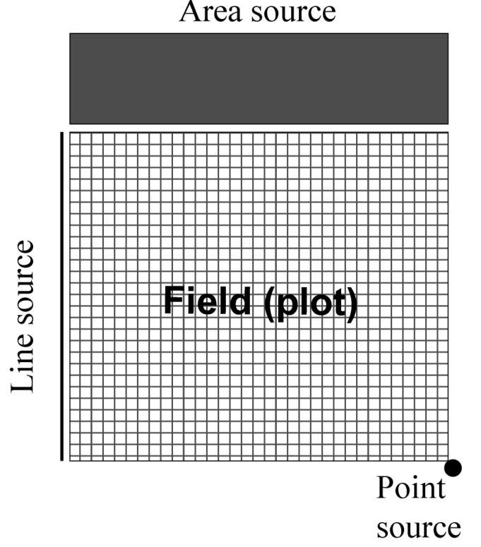{#fig-7-2}

## 7.3 Models

There are many ways of modeling dispersal and disease spread. Although not presented here, spore dispersal can be characterized by various types of models based on the physics of particle movement in different types of media (Aylor, 1999; Ferrandino, 1993; McCartney and Fitt, 1985). There are also many relatively simple nonlinear models for representing spore deposition, infections, or disease intensity in relation to distance from a source (Jeger, 1983; Maffia and Berger, 1998; Minogue, 1986). These typically are correlative or descriptive (see Chapter 3), but they can be consistent with known mechanisms of dispersal. There are also quite elaborate theoretical mathematical representations of dispersal (and movement of individuals, in general) that account for many population attributes of the biological processes involved without explicitly dealing with physics of particle transport (Othmer et al., 1988; Pielaat and van den Bosch, 1998; van den Bosch et al., 1990a).

For the most part, we focus our attention on some fairly simple nonlinear models of disease gradients that have been proposed. Being consistent with the models used in previous chapters, the ones used here throughout most of the chapter are deterministic and treat distance (_s_, as in “ _s_ pace”) as a continuous variable. Although descriptive in nature, they are also generally consistent with more mechanistic models of dispersal and can accurately characterize observed gradients. These models also have stochastic versions that are useful for understanding certain aspects of the dynamics of disease development over time and space.

As before, we use _Y_ to represent disease in absolute units, such as number of lesions, number of infected leaves, or area of lesions, and _y_ for disease intensity as a proportion (_y_ = _Y/M_, where _M_ is number of individuals or area of host that can be infected). For convenience, we can refer to _Y_ as number of infections, because if intensity is not too high, one can count lesions and consider these to represent individual infections. Assuming that a fixed proportion (_ψ_) of deposited spores (or other infectious units) cause infections, then _Y_ / _ψ_ represents the number of deposited spores when _Y_ is not high. For completeness, we can write _Y_ (_s_) for _Y_ at distance _s_ from the inoculum source, but typically we do not need the extra notation in this chapter. Moreover, because space is explicitly dealt with here, _Y_ represents infections per unit area (such as infections per square centimeter of the surface where infections are counted or measured), or infections per unit length (such as lesions per centimeter distance along a radius of the circle centered on a point source).

For the physical purists, our presentation below is strictly valid for a line source of inoculum, with spread perpendicular to that source. In other words, we present model just for a one-dimensional spatial system. In Chapter 8, we discuss some of the issues regarding spread in one versus two dimensions.

### 7.3.1 Exponential

The first model we consider is the exponential, sometimes called the negative exponential, which has been used to represent gradients since at least 1940’s (Frampton et al., 1942; Gregory and Read, 1949). Here, _Y_ is proportional to an exponential function of distance from the source:

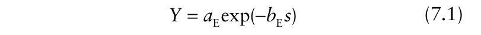{.equation width=60%}

in which _a_ E and _b_ E are parameters. The parameter _a_ E represents the (theoretical) level of _Y_ at the inoculum source (_s_ = 0), because at the inoculum source one writes equation 7.1 as:

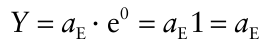

This parameter is thus an indication of _source strength_ the amount of inoculum or inoculum-producing disease intensity at _s_ = 0. The parameter _b_ E, sometimes known as the _spread parameter_, measures the steepness of the gradient and has units of 1/distance. The inverse of _b_ E (i.e., 1/ _b_ E) has units of distance and is an indicator of the spatial scale over which spread (or dispersal) is occurring. More will be said about this later. The lower limit for each of the two parameters is 0 (when _Y_ is nonincreasing with distance) and there is no upper limit (at least in the model). Obviously, if _a_ E = 0, there are no diseased individuals (infections), and no dispersal is being assessed (_Y_ = 0 at all _s_). When _b_ E = 0, there is no decline in _Y_ with increasing distance. This would be an indication that there was no true inoculum source at _s_ = 0; it also could be because disease intensity was measured after a long time and that all plant individuals were diseased. Example realizations of equation 7.1 are shown in Fig. 7.3. As expected, increasing _b_ E results in a steeper decline in _Y_ over _s_, and increasing _a_ E results in an increase in the height of the curves. Equation 7.1 can also be used for disease intensity as a proportion (_y_). If _M_ is the number of sites that can be infected at a given distance (e.g., maximum possible number of lesions), then _y_ = _Y/M_. Dividing both sides of equation 7.1 by _M_ gives an equation for _y_ instead of one for _Y_.

The exponential model can be linearized by taking natural logs of both sides of the equation, producing:

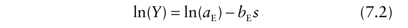{.equation width=60%}

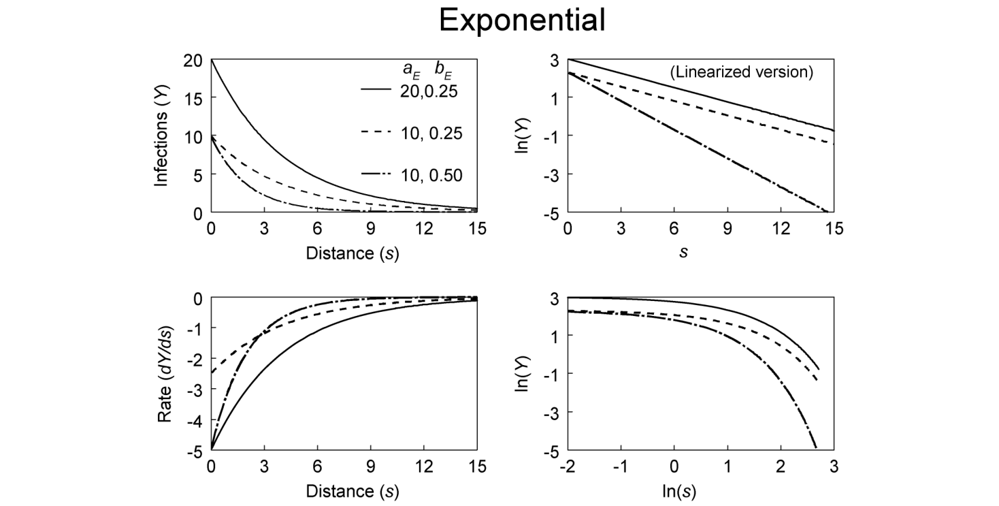

**F IG** **. 7.3.** Dispersal gradients (_Y_ versus _s_) characterized by the exponential model (equation 7.1).

Equation 7.2 is a straight-line relationship between ln(_Y_) and _s_, with slope of − _b_ E and intercept ln(_a_ E) (linearized version frame in Fig. 7.3). In this transformed scale, it can be easier to see the effects of _a_ E and _b_ E on the gradients. For instance, two gradients with the same _b_ E but different _a_ E values are seen as parallel lines when ln(_Y_) is plotted versus distance. With different _b_ E values, two gradient lines would not be parallel, and the lines could cross depending on the values of _a_ E. On an untrasformed scale (i.e., _Y_ versus _s_), it can be very hard to see the effects of different spread parameters on the gradients. If one only had observations of _Y_ at two distances, _Y_ (_s_ 1) and _Y_ (_s_ 2), one could determine _b_ E using: _b_ E = [ln{ _Y_ (_s_ 2)} − ln{ _Y_ (_s_ 1)}]/(_s_ 2 − _s_ 1). Equation 7.2 is useful for visualizing disease gradients and for parameter estimation (see below). However, the actual exponential gradient of disease is a curve and not a straight line (equation 7.1), meaning that the steepness varies continuously with distance from the source. This can be seen by writing the exponential gradient model in differential-equation form:

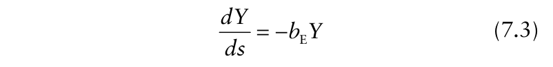{.equation width=60%}

in which _dY/ds_ is the rate of change in _Y_ over distance from the source. We could have introduced the exponential model with equation 7.3 instead of equation 7.1 to emphasize the dynamics of disease spread in space. However, because these gradient models often are justified based on their ability to describe observed gradients and not based on dynamics arguments, we have elected to present the models first in their integrated form.

Readers should refer to Chapter 4 for detailed explanations of differential equations and rates of change.

The rate _dY_ / _ds_ is a direct measure of the gradient steepness. As shown in the bottom-left frame of Fig. 7.3, the rate is a large negative value close to the source (near _s_ = 0), and approaches zero at large _s_ (depending on the value of the spread parameter). It can be shown that _dY/dt_ = − _a_ E _b_ E at _s_ = 0 (because _Y_ at _s_ = 0 is given by _a_ E). The steepness of the gradient is a function of only one variable, _Y_, and one parameter, _b_ E. The spread parameter can, therefore, be thought of as a summary of all the conditions and factors (e.g., environment) that influence disease gradients other than the actual level of disease intensity. Two exponential gradients that have the same _b_ E can be said to have equal gradients, no matter what average disease intensity is found for a data set, because they will have the same _dY/ds_ at any common _Y_.

### 7.3.2 Power model

The second model considered in this chapter for representing disease gradients is known as the power, power law, or inverse-power model. It has also been called the _Gregory model_, because he was an early proponent of its use to describe gradients and he utilized it extensively to summarize dispersal results (Gregory, 1968, 1973). For the power model, _Y_ is proportional to a power of distance:

{.equation width=60%}

in which _a_ P and _b_ P are parameters. These parameters have some similarity to the parameters of the exponential model, but there are also some fundamental differences. Note that when _s_ = 1, equation 7.4 reduces to _Y_ = _a_ P1− _b_ P = _a_ P1 = _a_ P . Thus, _a_ P represents theoretical _Y_ at a distance of 1 unit from the source [i.e., _a_ P = _Y_ (1)], not at the source. In fact, _Y_ becomes indefinitely large as _s_ approaches 0 (if _b_ P is positive), which is biologically meaningless. However, just because the model gives a meaningless result at one particular distance does not mean that it is not useful at all (or most) other distances. Moreover, if the distance between plants (or between the source and the nearest plant) is, say, _x_ cm, it does not matter if the model generates unrealistic values at distances less than _x_ cm. What matters is that the model generates realistic values at distances of _x_, 2 _x_, and any actual distance between the source and a plant.

Because the meaning of _a_ P is linked to a non-zero distance, its physical meaning depends on the units for recording _s_. For instance, if equation 7.4 was appropriate for representing the gradients in Fig. 7.1, and distance was recorded in meters, then _a_ P would be the (theoretical) value of _Y_ at 1 m from the source. However, if the distances were recorded in centimeters, then _a_ P would be the value of _Y_ at 1 cm from the source. Thus, one must always keep the distance units in mind when interpreting the specific value of _a_ P. If one wants to use _a_ P as an approximate measure of _Y_ at (more precisely, “very near”) the source, then the distance units should be chosen so that _s_ = 1 is a lot closer to the source than to the first observed _Y_ value. For example, if the closest distance to the source with observed _Y_ was at 0.5 m, then recording distance in centimeters (and not meters or kilometers) would be appropriate.

In equation 7.4, _b_ P is also known as a spread parameter. However, it is a unitless term, unlike _b_ E, which has units of 1/distance. Thus, there is a fundamental difference in the physical interpretation of the exponent parameter of the two models. A rescaling of distance (say, from kilometers to centimeters) will change the value of _b_ E but not of _b_ P. (In contrast, remember that a rescaling of distance will change the value of _a_ P but not of _a_ E).

Because the value of _Y_ at _s_ = 0 is not defined with the power gradient model, the model often is modified by adding a small positive constant (_λ_) to _s_:

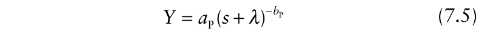{.equation width=60%}

We call this the _modified power model_ or _modified power-law model_. Here, _λ_ has the same units as _s_ (i.e., units of distance). When _s_ = 0, equation 7.5 reduces to _Y_ = _a_ P _λ_ − _b_ P = _Y_ (0) = _Y_ 0, which is a positive constant for positive values of _a_ P and _b_ P. In other words, is the _a_ P _λ_ − _b_ P source-strength term for the power model. The interpretation of _a_ P can be determined by inserting 1− _λ_ for _s_ in equation 7.5. This gives . In other words, _Y_ = _a_ P1− _b_ P = _a_ P _a_ P is the theoretical _Y_ at a distance of 1− _λ_ from the center of the inoculum source. Mundt (1989) made the interesting argument that _λ_ can be considered a measure of the physical “size” (diameter, width) of the inoculum source.

Of course, when _λ_ = 0, equation 7.5 reduces to equation 7.4. For generality, we refer to equation 7.5 as the power model for gradients, with the understanding that often it is used with an assumed value of 0 for _λ_. A plot of _Y_ versus _s_ (Fig. 7.4) for this model has some similarity to the plot for the exponential model (Fig. 7.3). However, for the power model, the curve is steeper close to the inoculum source and shallower a large distances.

Equation 7.5 can be linearized (at least in terms of the _a_ P and _b_ P parameters) by taking logs of both sides:

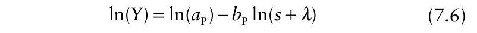{.equation width=60%}

This equation describes a straight-line relation between ln(_Y_) and ln(_s_ + _λ_) (see insert of lower right frame of Fig. 7.4). In fact, for this model, a plot of ln(_Y_) versus ln(_s_) is very close to a straight line except close to the source (i.e., where _s_ is approaching _λ_). This kind of situation could arise if the true relation was equation 7.5 or 7.6 with _λ_ > 0, but one fitted equation 7.4 (i.e., _λ_ = 0) to the data. On the other hand, a plot of ln(_Y_) versus _s_ (no transformation), which is the standard scaling for the exponential gradient model, exhibits a large amount of curvature (Fig. 7.4).

The (modified) power model can be expressed in differential-equation form:

{.equation width=60%}

As with the exponential model, _dY_ / _ds_ is proportional to _Y_, meaning that the gradient is most steep (most negative) at the highest values of disease (which are typically near the source). However, _dY_ / _ds_ is also indirectly proportional to _s_ (or _s_ + _λ_, if _λ_ is non-zero). Thus, at a given level of _Y_, the gradient is steeper close to the source than farther away. The lower left frame of Fig. 7.4 shows some typical _dY_ / _ds_ curves for the power model. These curves are similar to those for the exponential model, except the steepness is greater near the source for the power model. In fact, if _λ_ = 0, _dY_ / _ds_ becomes indefinitely large and negative as _s_ approaches 0 (or, for positive _λ_, _dY_ / _ds_ becomes indefinitely large and negative as _s_ + _λ_ approaches 0). For positive _λ_, _dY_ / _ds_ has a finite value at all _s_ values, and equals − _a_ P _b_ P _λ_ −(_b_ P +1) at _s_ = 0. This can be seen in the inset of the lower left frame of Fig. 7.4.

In some ways it is more difficult to compare powermodel gradients than exponential gradients. This is because the steepness of the gradient in the former case depends on both _Y and s_ (see equation 7.7) (see Minogue (1986) for a valuable discussion). Thus, two gradients with the same _b_ P values do not necessarily have the same gradient steepness (_dY_ / _ds_) at a given (chosen) _Y_. Nevertheless, it is still common to compare gradients through their (estimated) _b_ P values. In comparative studies, investigators must be aware that two gradients with identical _b_ P values will have equal changes in ln(_Y_) with unit changes in ln(_s_) [i.e., _d_ ln(_Y_)/ _d_ ln(_s_) = _b_ P (on average); see equation 7.6], but not equal changes in actual measures of disease intensity with unit changes in distance at a given _Y_.

{#fig-7-4}

### 7.3.3 Power versus exponential model

The exponential and (modified) power models of gradients are, by far, the most common for characterizing disease (dispersal) gradients. In fact, these two models, or similar ones, do provide a very good representation of many observed gradients (e.g., Fitt et al., 1987). Moreover, these two models serve as the basis for further model expansions that are used to represent spatiotemporal dynamics of plant disease development (Gibson and Austin, 1996; Xu and Ridout, 1998). Thus, it is beneficial to discuss these two models, and the gradients they characterize, in a little more detail. The differences in the concept (or meaning) of gradient equality for the two models was already discussed at the end of the previous sub-section. This discussion here expands on some points already made, and covers some of the similarities and differences in the model behavior and interpretation.

Both models represent a situation with a nonlinear decline in _Y_ with _s_ (Fig. 7.5, top frame). For the power model, the gradient is steeper near the source and shallower far from the source, compared with the exponential model. The model difference is even more striking when plotting ln(_Y_) versus _s_ (Fig. 7.5): the exponential model results in a straight line but the power model can show considerable curvature. This graph is especially useful to keep in mind in conceptualizing the meaning of the two models. For the power model, at large distances from the source, ln(_Y_) changes very little with unit change in distance (relative to the exponential model), and there remains a small (but non-trivial) level of disease even at very large distances. In terms of dispersal, this means there is a small (but non-trivial) chance of spore deposition even at very large distances.

As discussed in several articles (Aylor, 1999; McCartney and Fitt, 1998), the two models are representative of different physical aspects of spore dispersal in the air. Specifically, propagule dispersal is characterized by:

- the rapid decrease in the aerial spore concentration, and

- the rate of deposition of spores on plants with distance away from the source.

The rapid decrease in spore concentration is due to _filtration_ of spores by plants (or other structures) and to _dilution_ by mixing of the air, which leads to _escape_ of spores from the canopy (Aylor, 1999). When air turbulence is low, the tendency for spores to be deposited is much greater than the tendency to be diluted and escape, and spore density decreases exponentially, on average, with distance (corresponding to equation 7.1). This situation also would occur with splash-dispersed pathogens where air turbulence is less of a factor (Pielaat et al., 1998; Yang et al., 1991). Conversely, when air turbulence is high, the tendency for spores to be diluted and escape the canopy is much greater than the tendency to be deposited. In this case, spore density decreases, on average, according to a power model (corresponding to equation 7.4).

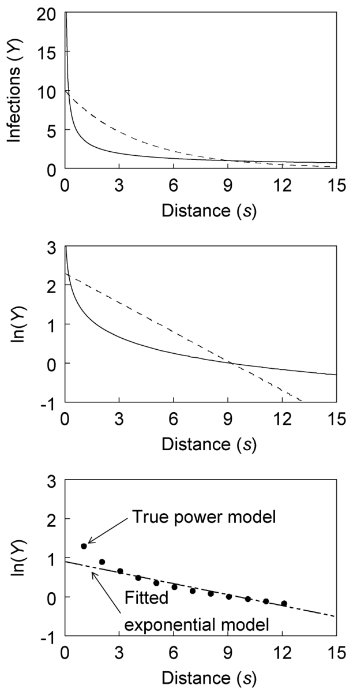{#fig-7-5}

Of course, it is quite possible for neither dilution/escape nor deposition to dominate in an actual dispersal event; then, more complex models (see section 7.3.5 and Aylor, 1999) may be needed to adequately characterize the process. In fact, Aylor (1999) points out that deposition and dilution/escape may dominate over different distances. So, in principle, if one could observe distances at a very fine spatial resolution (say, every centimeter), starting at the source and extending for several kilometers, one could observe power-type and exponential-type gradient curves over different distance segments. Fortunately, such refinement in the modeling is not needed for many purposes, and models of the simple exponential or (modified) power types are sufficient for representing a high percentage of observed gradients.

### 7.3.4 Contact distributions

So far, we have taken a mostly descriptive approach to characterize disease or dispersal gradients (Fig. 7.1), and have indicated how the power and exponential models are consistent with known physical processes of spore dissemination. It is sometimes helpful to characterize dispersal with probabilistic (i.e., statistical) models rather than deterministic ones. Assume that all spores originate at a single (line) source (_s_ = 0). Now suppose that the probability of spore deposition in a very small distance increment (Δ _s_) is constant no matter how far the spore has moved, and that the probability is also the same for all spores in a population originating at the source. Call this probability ζΔ _s_ (with ζ having units of 1/distance). Using standard methods for working with continuous distributions, it can be shown that the probability density function (_pdf_) for the random variable _s_ (distance of spore movement until deposition) is given by:

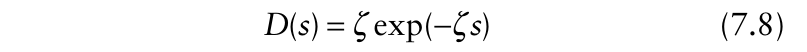{.equation width=60%}

Note that the contact distribution is utilized again in Chapter 9 for certain types of spatial pattern analysis, and is a key component of all the modeling in Chapter 8. The integration of _D_ (_s_) from _s_ to _s_ + Δ _s_ is the probability of a spore being deposited over this distance (when starting at distance 0); equivalently, _D_ (_s_) is the probability per unit distance of a spore being deposited at (“immediately around”) _s_. Borrowing terminology from general theoretical epidemiology (Diekmann and Heesterbeek, 2000), _D_ (_s_) can be called the _contact distribution_, because, in a sense, it describes the probability of “contact” between a diseased individual at one location [i.e., the source in this case (_s_ = 0)] and an individual at another location (the location identified by _s_). More precisely here, in terms of plant diseases, the contact distribution characterizes the probability of an infectious unit (e.g., spore) originating _s_ = 0 coming in contact with a host individual at distance _s_ (determined from the integration of _D_ (_s_) from _s_ to _s_ + Δ _s_). Because _D_ (_s_) is a _pdf_, its integration from _s_ = 0 to _s_ = ± is 1, by definition. Biologically, this means for spore dispersal that a spore must end up somewhere. Additional refinements to the concept of a contact distribution will be found in the next chapter.

It should be pointed out that a spore being deposited at _s_ is not quite the same thing as a spore contacting a host individual at _s_ —there may not be a host individual exactly at distance _s_ (for instance). For practical purposes, both disease gradients and spore deposition gradients are utilized to determine the appropriate (or reasonable) contact distribution. When appropriate (see Chapter 8), one can multiply a contact distribution based on spore transport by a constant to reflect the fraction of deposited spores at _s_ that actually contact a host.

Equation 7.8 is directly analogous to the exponential disease gradient model (equation 7.1), with ζ = _b_ E. The difference is that equation 7.8 is scaled so that the integration over all distances is 1. Thus, the “source strength” parameter here is simply ζ. The expected value (mean) and the variance of a random variable with equation 7.8 as its _pdf_ equal 1/ζ and 1/ζ2 , respectively. The median _s_ (_s_ 50%) equals ln(2)/ζ.

Now, suppose the probability of deposition per unit distance (ζ) is not constant, but is a random variable (with a possibly different value for each spore). This means that each spore has a different probability of being deposited, possibly because of its size or flight taken. The gamma distribution (Evans et al., 2000) is one useful distribution for ζ because it can take on any positive value. Using standard methods for mixing distributions, the following expression for flight distance is obtained:

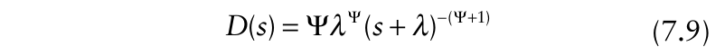{.equation width=60%}

Equation 7.9 is the _pdf_ of a Pareto distribution of the second kind (Johnson et al., 1994), often simply called a Pareto distribution (Minogue, 1989). It is directly analogous to the modified power model for dispersal gradients (equation 7.5), with _b_ P = Ψ + 1. The only difference is that scaling is used here so that the integration of equation 7.9 over all distances equals 1. In contrast, there is no scaling of spore numbers (or infections) when typically using equation 7.4, and _a_ P gives the height of the _Y_ curve. It is interesting to note that the mean and variance for the Pareto distribution are only defined for certain (large) values of Ψ. Minogue (1989) gives a very useful discussion of this property. If Ψ > 1 (i.e., _b_ P > 2), then the mean _s_ is _λ_ /(Ψ − 1). The median _s_, which is defined for all Ψ, is _s_ 50% = _λ_ (21/ Ψ − 1).

The differences between equations 7.8 and 7.9 are most apparent at very small and very large _s_ values (near and far from the source), where the Pareto function gives larger values than the exponential. This is, essentially, the same concept as shown in the middle frame of Fig. 7.5 for the deterministic dispersal models. A plot of ln[ _D_ (_s_)] versus _s_ has the same shape as a plot of ln(_Y_) versus _s_. When ln[ _D_ (_s_)] declines linearly with _s_, it is said that the distribution is _exponentially bounded_. Thus, the exponential distribution has this property. More details on the concept of exponential bounds for distributions are given in Chapter 8 and in Minogue (1989). Chapter 8 also describes generalizations of the distributions considered here.

With reference to the predicted values at large _s_, the Pareto distribution is not exponentially bounded, and therefore has a so-called “fatter tail” than the exponential. The implications of this difference can be seen in a simple simulation of spore flights. Using a random number generator, 2000 spore flight distances (from random positions along a line segment) were generated for an exponential and Pareto distribution. To make them equivalent in one sense, a median _s_ (_s_ 50%) of 0.6 was chosen for both distributions. As shown in Fig. 7.6, points are clustered close to the source, and the density of points drops off fairly rapidly, for both models. With the exponential distribution, there is a very smooth drop off in density, with the largest distance around 8. However, with the Pareto model (i.e., power-model type dispersal), there is more irregularity in the drop off of point density, and there are points found at a very wide range of distances. In fact, 26 distances (out of 2000) were actually greater than the upper limit of _s_ = 1000 used in the graph. It should be re-emphasized that half of the points in both graphs are for distances below 0.6.

One other feature of Fig. 7.6 is worth noting. For the Pareto distribution, not only are spores deposited far beyond the source, but some clumping or clustering of points at various distances are somewhat apparent. Thus, for pathogens with a Pareto-type distribution for spore dispersal, establishment of new foci of infection beyond are original source, and clustering of disease around the new infections, are standard features. These topics are dealt with in later chapters.

The exponential and Pareto contact distributions are emphasized in this sub-section because these correspond directly to the popular and useful exponential and power disease gradient models. Other distribution functions have been found to be useful, however. For instance, the normal, (half-)Cauchy, and other distributions have been used for _D_ (_s_) (Shaw, 1995; van den Bosch et al., 1988b, c; Pielaat and van den Bosch, 1998; Xu and Ridout, 1998). These all vary in their general shape, especially in terms of the “heaviness” or “fatness” of their tails at large distances (i.e., how fast _D_ (_s_) declines with _s_ at large distances). The implication of tail fatness will become even more apparent later in this chapter and the next chapter when spatio-temporal disease development is discussed.

### 7.3.5 Some other dispersal models

As with temporal models of disease progress, there are other models than can be used to represent disease gradients away from an inoculum source. As mentioned above, spore dispersal is determined by a mixture of deposition and dilution (and escape) processes (Aylor, 1999), and one or the other may be more important under different conditions. It is possible that neither process will dominate, and that an observed gradient shows characteristics of both deposition and dilution. Lambert et al. (1980) made an initial step at expanding on the above models by developing a more general gradient model. Their function can be written as:

{#fig-7-6}

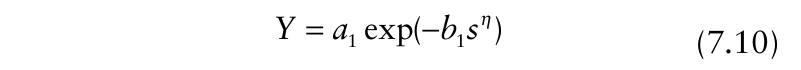{.equation width=60%}

where _a_ 1, _b_ 1, and η are parameters. When the unitless shape parameter, η, equals 1, equation 7.10 reduces to the exponential model (equation 7.1). When η approaches 0, equation 7.10 reduces in the limit to the power model (equation 7.4). Other values of η allow the model to take on other shapes.

In some ways, the generalization of equation 7.10 may not be needed. This is because the modified power model is, in fact, a generalized dispersal gradient model if _λ_ can take on any value. In this situation, _λ_ and _b_ P work together to indicate the shape of the gradient. This can be seen by the equation 7.7 for _dY_ / _ds_. At large _λ_ (for example, much larger than the largest distance considered), _s_ in the denominator has very little influence on the rate. In other words, if _λ_ is large, increasing _s_ does not change the denominator to any extent, and the model can be written as _dY_ / _ds_ ≈ (_b_ P/ _λ_) _Y_, which is the formulation for the exponential model (with _b_ E = _b_ P/ _λ_). In more mathematical terms, when _λ_ becomes indefinitely large, with _b_ P/ _λ_ held to a finite value (meaning that _b_ P also becomes indefinitely large), the modified power model reduces to the exponential model.

A different generalization is possible by combining both exponential and power functions in the same model (Maffia and Berger, 1998). One formulation is:

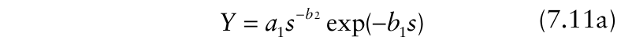{.equation width=60%}

in which _a_ 1, _b_ 1, and _b_ 2 are parameters. This model is consistent with some physical models for that have been developed for spore dissemination (see equation 15 in Aylor, 1999). When _b_ 2 = 0 (in principle, when dilution/ escape of spores is of no or little importance relative to deposition processes), equation 7.11a reduces to equation 7.1. Likewise, when _b_ 1 = 0 (in principle, when deposition is of little importance relative to dilution/escape processes), equation 7.11a reduces to equation 7.4. It is possible, however, for both _b_ parameters to be non-zero. The equation can be linearized to:

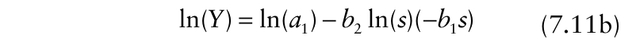{.equation width=60%}

which facilitates in parameter estimation (see below). The model can be further generalized by adding a constant (_λ_) to _s_, as done with the power model (equation 7.5).

Another possible model is based on a deterministic version of the half-Cauchy statistical distribution for _D_ (_s_). One way that this model can be written is:

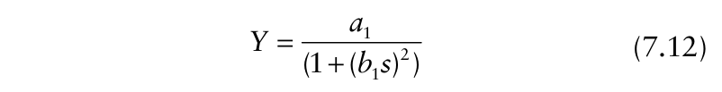{.equation width=60%}

Interestingly, Aylor and Ferrandino (1990) developed this same model for spore deposition near an inoculum source based on assumed mechanisms of spore trajectories. Like the power model (equation 7.4 or 7.5), this model involves raising _s_ (actually, a function of _s_) to a power; thus, it may be appropriate as an alternative to the power model for gradients that are very steep near the source (_s_ ≈ 0) and flat at large distances. Unlike the power model (without modification; equation 7.4), however, equation 7.12 has a finite value at _s_ = 0, namely _Y_ (0) = _a_ 1. As a contact distribution, the half-Cauchy distribution has been used heavily in simulation and theoretical studies (Shaw, 1995; Xu and Ridout, 1998), but has not gained much popularity (yet) for characterizing observed gradients. The interested reader can verify that with equation 7.12, 1/ _Y_ is a linear function of _s_2 .

Some other contact distributions are discussed in Chapter 8.

### 7.3.6 Some calculations

Readers who have learned how to perform calculations with the empirical disease progress models of Chapter 4 (see equation 4.4.6) will have no trouble performing similar operations with gradient models. It is sometimes convenient to consider that the two most common models (exponential and power) can be written generically as:

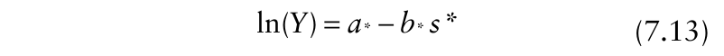{.equation width=60%}

where _a*_ represents either ln(_a_ E) or ln(_a_ P), _b*_ is either _b_ E (units of 1/distance) or _b_ P (unitless), and _s*_ is either just _s_ (for exponential) or ln(_s_ + _λ_) for (modified) power (with

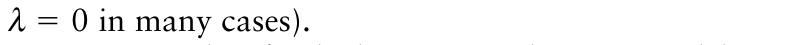{.equation width=60%}

Just a couple of calculations are demonstrated here. Suppose that distance is measured in centimeters from a source, _Y_ represents (mean) rust pustules per plant, and that _a_ E = 500 and _b_ E = 0.02/cm. _What is Y at 4 m (400 cm)?_ Using equation 7.13, ln(_Y_) = ln(500) – 0.02 × (400) = 6.215 − 8 =−1.875. Back-transformation gives a _Y_ of 0.168. Such a simple calculation could be done directly with equation 7.1. Now, with the same parameters, _at what distance is Y_ = _1_ ? Rearranging equation 7.13, leads to:

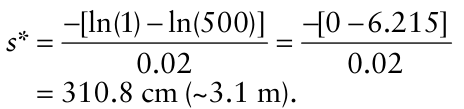

The interested reader should be able to determine _how much a_ E _or b_ E _would have to be changed so that Y declines to 1 pustule/plant not at 3.1 m but at 1 m (100 cm)_. Answer: either new _a_ E = 7.39 (a reduction in source strength of ∼496) or new _b_ E = 0.062/cm (an increase of gradient steepness of 0.042/cm).

When performing similar calculations with the power model, it is important to remember that one is dealing with a logarithmic transformation of distance. For instance, with _λ_ = 1 cm, suppose that _b_ P = 1.2 and that _a_ P = 500 (i.e., that _Y_ at the source is 500 × 1−1.2 = 500 pustules/plant). The distance at which _Y_ = 1 can be determined from: _s*_ = − [ln(1) − ln(500)]/1.2 = 5.18. Given that _s*_ = ln(_s_ + 1) here, _s_ is calculated as:

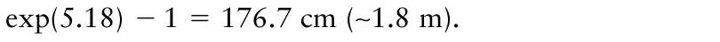{.equation width=60%}

## 7.4 Model Fitting

### 7.4.1 Choosing a model

As with disease progress curves (Chapter 4), a combination of interrelated graphic and statistical methods can (or should) be used to select a proper model for describing a disease gradient. As with all methods, the model selection process is constrained by the available data. That is, any conclusion regarding the ‘best’ model may be limited due to measurement error (see Chapter 2), sampling error (Chapter 10), and the range of distances over which _Y_ is assessed. Nevertheless, choosing a reasonable model is essential for quantifying dispersal and disease spread (see later), and in comparing results for different treatments, locations, years, pathogens, etc.

The general methods presented in Chapter 4 can typically be applied to observed dispersal gradients to select a reasonable model for the data. We demonstrate the process with data on number of pustules per plant for rust of beans (Aylor and Ferrandino, 1989). A line source was used, and results for the first assessment time in 1986 in the south direction were read from the graph. As expected, there was a decline in _Y_ with increasing _s_ (Figs. 7.7 and 7.8), which is consistent with either exponential or power-type models for dispersal. The sharp decline in the first 3 m or so, and the very flat curve at large distances are suggestive of a power model, but this could be misleading if data are not recorded for very small and large _s_.

A plot of _dY_ / _ds_ versus _s_ is of importance for theoretical distinctions between the two model processes (_dY_ / _ds_ goes rapidly to very large negative values for power, and less rapidly to finite negative values for exponential) (see Figs. 7.3 and 7.4). However, the plot of Δ _Y/_ Δ _s_ typically is not of practical value in model selection. This is because it is generally unrealistic to have a sufficient number of sampling distances very close to the source to see if _dY_ / _ds_ is declining fast enough to be representative of the power model. Since estimated _dY_ / _ds_ is a ratio, there can be considerable imprecision in its estimate, resulting in large scatter of points. This can be seen for the bean rust example: although the trend clearly is towards large negative numbers as _s_ goes towards 0, there is also a wide range of rate estimates over the first three-to-four distances (Fig. 7.7).

{#fig-7-7}

Plots of ln(_Y_) versus _s_ and ln(_s_) are especially useful for selecting a model. These graphs correspond to the linearized versions of the two dispersal models (equations 7.3 and 7.6)a straight line results if a particular model is appropriate. For the bean rust example (Fig. 7.7), the plot of ln(_Y_) versus _s_ shows considerable curvature, indicating that the exponential model would not be appropriate. The type of curvature is typical when power-model values are plotted on this scale (see Fig. 7.3). On the other hand, a plot of ln(_Y_) versus ln(_s_) (Fig. 7.7) was a fairly straight line, except very close to the source, where some curvature of the line was revealed. As discussed above, this curvature at small ln(_s_) occurs when a _λ_ is greater than 0 in equation 7.6 (see Fig. 7.4). Using a value of _λ_ equal to half the distance between the source and the first sampling distance (0.4), reduced this curvature somewhat, but as we show later, the impact of this addition was minor on model fitting. Overall, the power model seems more reasonable than the exponential model for describing the example data set.

As with all evaluations of dispersal/disease gradients, the range of sampling distances can greatly influence the results (Ferrandino, 1996). Over a limited distance range, the model predictions can be very similar, even though there are fundamental differences in the two model types at very large and small distances from the source. This can be seen with the bottom frame of Fig. 7.5. The solid points represent disease values corresponding exactly to the power model (equation 7.4), but the data are plotted in the form of ln(_Y_) versus _s_ the standard scale for the exponential model (equation 7.1). The straight line represents one fit of the exponential model to these values. The fit is quite good, except close to the source, where the exponential model underpredicts the true _Y_ values. If the first observation (at _s_ = 1) was not present (e.g., when the first row of plants was 2 m from the source), a researcher would have little evidence that the exponential model was inappropriate. If data were available far beyond _s_ = 12, the differences between the two models could become noticeablethe decrease in true ln(_Y_) with distance would continue to decline for this powermodel relation (i.e., the curve would become flatter), whereas the exponential model would indicate a continuous linear decline in ln(_Y_).

The main point from this discussion is that the investigator should never over-interpret the results from a single data set. Given that different physical processes may dominate over different distance ranges (Aylor, 1999), and that observed gradients generally represent only a portion of an entire dispersal gradient, even a perfect fit of a simple model to a small data set does not indicate that this model would necessarily hold at all distances or for all dispersal events for the same pathogen/host combination. One _does_ need to have reasonable model choices to quantify properly the spread of disease, and to compare treatment results. However, conclusions on mechanisms must always be based on cumulative evidence, and not on a limited dataset. Ferrandino (1996) further elaborates on the challenges in distinguishing between exponential-like and powerlaw-like gradients when disease is assessed over limited spatial ranges.

### 7.4.2 Estimating parameters—linear methods

A wide range of statistical methods can be used to fit disease-gradient models to data. It is assumed here that the reader has digested the presentation on model fitting for disease progress curves (section 4.6), so that considerably less detail is needed here. Least squares and maximum likelihood (as well as some other statistical methods) can be used for model fitting and parameter estimation. We focus in this chapter primarily on least squares methods.

As shown with equation 7.13, both the exponential and modified power models (with _λ_ assumed known) can be expressed as linear models. Readers can see Chapter 3 for discussion of the meaning of models that are linear in the parameters. Statistical versions of these mathematical dispersal models can be written as:

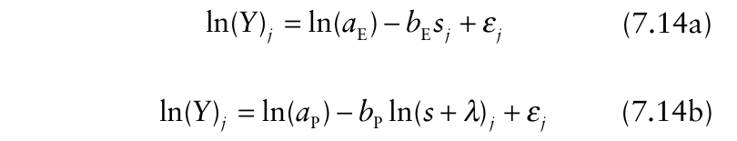{.equation width=60%}

in which the _j_ subscript indicates the _j_ -th data point or distance (_j_ = 1, …, _n_), and _ε_ is the error (residual) term, a random variable (difference between observed transformed _Y_ and that determined by the model). The intercept for the models is ln(_a_ E) or ln(_a_ P) , and the slope is _b_ E or _b_ P. Equation 7.14b is not, of course, linear in terms of the parameter _λ_, because _λ_ appears only as a logarithmic function of _s_ + _λ_. One needs to pre-specify a value for _λ_ to use linear statistical methods. The most common approach is to assume that _λ_ = 0, which results in the simpler regular power dispersal-gradient model. However, one could specify a value roughly equal to the “size” (diameter, depth) of the source (Mundt, 1989).

To use linear least squares, the standard assumptions about the distribution of the error term (_ε_), and hence the response variable [ln(_Y_) in this situation], are made (see equation 4.6.2, and Neter et al., 1983). Normality usually is not overly important, except under extreme circumstances, but independence of the observations and constant variance are very important assumptions. With disease progress curves, the response (transformed disease intensity) is cumulative, in that _Y_ at _t_ = 20 equals _Y_ at _t_ = 10, plus any new disease that develops between times 10 and 20. Thus, it is very important to check for serial correlations with disease progress modeling. However, _Y_ [or ln(_Y_)] for disease gradients, as typically expressed, is not a cumulative value over space; for example, _Y_ at _s_ = 20 is _not_ the accumulation of lesions (or infections) from distance values of 0 to 20. In this sense, one might not expect to find correlations of _Y_ values for disease gradients. In fact, because _Y is_ declining with distance (Fig. 7.1), there is (spatial) autocorrelation (lack of independence) because of this spatial trend; that is, _Y_ is serially correlated over distance. In most cases when there is a strong gradient of disease from a (single) source, the correlation of _Y_ values can be “removed” by fitting a gradient model to the data. For instance, _ε_ = _Y_ − _a_ Eexp(− _b_ E _s_) may not be correlated (if the exponential model is reasonable) even if the _Y_ values are correlated. Using time series descriptions, the trend is removed by fitting a particular model to gradient data. It is easy to check for independence by assessment of the residuals, as discussed in Chapter 4, just to be sure.

If _Y_ equals number of deposited spores or number of lesions, it is unlikely that _var_ (_Y_) is constant. In general, _var_ (_Y_) can be expected to increase with mean _Y_ (Schabenberger and Pierce, 2002). It turns out that for discrete data in the form of counts, the logarithmic transformation does a reasonable job of stabilizing variances. That is, the variable ln(_Y_) may have close to a constant variance for practical purposes, and weighting based on assumed (or calculated) variances is not necessary. Thus, we assume that ln(_Y_) does have a constant variance for model-fitting purposes here. Later in this chapter we deal with situations where the response variable (whether transformed or not) cannot be assumed to have a constant variance.

Fig. 7.8 shows the data points plotted in Fig. 7.7 in the form of a SAS program for least squares analysis. Fitting the exponential model (equation 7.14a) to the bean rust data resulted in the following equation: in which the numbers in parentheses are estimated standard errors. The coefficient of determination (_R_2 ) was 0.878, and the residual variance was estimated as 0.579. The estimate of _a_ E can be obtained by backtransformation of 4.58 as exp(4.58) = 97.5, which is considerably below the observed _Y_ at the first distance (_s_ = 0.8). It should be noted that the estimate of _b_ ˆ Ehas units of 1/distance; that is, _b_ E = 0.20/m. Evaluation of the predicted line and the residuals in the lower frames of Fig. 7.7 reveal clearly that this model did not provide an appropriate fit over the range of observed data. In particular, the (standardized) residuals showed a very strong pattern. Of course, if the observations within 2 m of the source and beyond 25 m were not made, a good fit would have been obtained.

Fitting the modified power model (equation 7.14b, with _λ_ = 0) to the data resulted in the following equation:

ˆ ˆ ln(_Y_) = 4.58(0.352) − 0.20(0.027) _s_ ln(_Y_) = 5.56(0.246) −1.70(0.119)ln(_s_) which had an _R_2 of 0.962 and an estimated residual variance of 0.179. The slope here is unitless. The backtransformation of the intercept is given as exp(5.56) = 259.8, which is an estimate of _Y_ at _s_ = 1 m, _not_ at the source. One could re-scale distance from meters to centimeters, as an example, by multiplying distance by 100, and then taking the log of _s_. Fitting the power model (with _λ_ = 0) produces the same results, except for the intercept term which is now estimated as 13.38 (standard error = 0.766). Back-transformation gives exp(13.38) = 646,934, obviously a very large number, for the predicted _Y_ at 1 cm. Re-scaling to millimeters would give an even larger number. This is because _Y_ becomes indefinitely large as _s_ goes towards 0 with this model (and _a_ P is the value of _Y_ at _s_ = 1). Using the results for the centimeter distance scale, predicted _Y_ at 100 cm (=1 m) is given by: which is the same as the original intercept with distance in meters (except for rounding error).

{#fig-7-8}

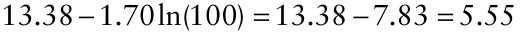

Graphic evaluation of the predicted line and residuals showed that this model was clearly more appropriate than the exponential for the bean rust data set. The greatest errors were near the source, where the slight curvature on the log-log scale was previously identified. Improvement in fit could be accomplished by consideration of a value of _λ_ greater than 0. Readers can evaluate a range of _λ_ values, but we show results for just _λ_ = 0.4 m. This is half the distance between the first sampling distance and the center of the source, which may be a reasonable choice if _λ_ is interpreted physically as a measure of size of the source. Least squares resulted in the following equation: which had an _R_2 of 0.974, slightly larger than when _λ_ = 0. The slope parameter was slightly larger (1.88 versus 1.70), and the intercept was also larger. Backtransformation of the intercept, exp(6.1) = 445.9, is an estimate of _a_ P, equaling the predicted _Y_ when _s_ + 0.4 = 1 m (or _s_ = 0.6 m). One can determine the predicted _Y_ at

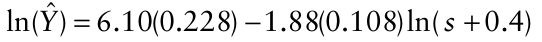

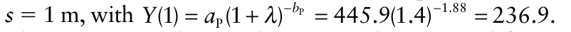{.equation width=60%}

This estimate is close to the 259.8 value obtained for _a_ P with the simpler power model above (_λ_ = 0), which is, by definition, estimated _Y_ at _s_ = 1 when _λ_ = 0.

Other than possibly improving the fit to observed data, the advantage of the modified power model (with _λ_ > 0) is that one can directly estimate _Y_ at the source, _Y_ (0), as a measure of source strength. Using the formula given after equation 7.5, one obtains:

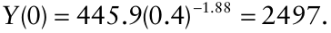

This value is considerably larger than the sourcestrength estimate based on the exponential model (_a_ˆ E = 97.5). This _Y_ (0) value, however, is considerably below the non-sensical estimate of _Y_ at 1 cm [i.e., _Y_ (0.01)], given above when the regular power model (_λ_ = 0) was fitted to the data. The reader is reminded that the exponential model provided a rather poor fit to these data close to the inoculum source, and that the regular power model breaks down as _s_ approaches 0.

In summary, for the example data set, the (modified) power model provided a better fit than the exponential model. This will not necessarily be true for other data sets. Using a value of _λ_ greater than 0 resulted in a better fit than the use of _λ_ = 0. However, it is not necessarily clear that one needs to use the more general model for these data. The improvements in _R_2 and residual plot (not shown) were marginal when using _λ_ = 0.4 m. The reader can determine that the fit can be even better with higher values for _λ_. If the goal of the research was to obtain a precise estimate of the “source strength” and the gradient of disease close to the source, then the use of a more complex model is certainly warranted. But if the goal was to provide a reasonably simple overall description of the gradient (starting around 0.7 m), to facilitate comparisons among groups (e.g., treatments, cultivars, years), then the more general model would not be needed. In fact, the use of the more general model where it is not fully needed may be disadvantageous because model fitting would be more complicated. It must be pointed out that a direct comparison of the fit of the exponential and modified power models is, in a sense, not completely fair if _λ_ is allowed to take on any positive value. In this situation, the modified power model contains three unknown parameters, whereas the exponential model has only two unknowns. Generally, a 3-parameter model will provide a better fit than a 2-parameter one, especially if the 2-parameter version is a special case of the 3-parameter model. This was seen by fitting a Richards model (with unknown η parameter) to disease progress data (Chapter 4). When _λ_ is determined directly from the observed data, the modified power model becomes a flexible (general) gradient model that can take on multiple shapes (Minogue, 1989). One cannot directly estimate _λ_ using linear least squares because the model (equation 7.24b) is not linear in terms of _λ_. Regressing ln(_Y_) on ln(_s_ + _λ_) for a large number of possible _λ_ values (say, _λ_ = 0, 0.1, 0.2, …, 1), and selecting the _λ_ with the highest _R_2 is an indirect way of estimating this parameter. We show in the next sub-section how to estimate _λ_ with nonlinear methods.

Specifying a value of _λ_ greater than 0 in the power model _is_ important if one is trying to quantify the gradient very near the source. The obvious question then arises from this discussion: how can one compare the fit of the exponential model and the modified power model (with non-zero _λ_) without giving unfair advantage to the latter? One answer to this is to choose a _λ_ independent of the gradient. This could be done before collecting the data or before looking at a graph. If _λ_ can be considered a measure of the size of the source, then this value can certainly be approximated. The rule followed above was to use a _λ_ equal to half of the distance between the center of the source and the first data point. Other possibilities exist. However, investigators should be aware that estimates of _a_ P and _b_ P are always conditional on the choice of _λ_.

### 7.4.3 Estimating parametersnonlinear methods

The standard models for dispersal gradients are all nonlinear in the parameters. In common practice, as discussed above, the models are linearized so that linear least squares can be utilized to estimate parameters. Nonlinear estimation methods offer great flexibility, in that investigators are not forced to use models that can be linearized. There is a penalty associated with nonlinear methods, however, because the methods are more complicated, may fail or may produce biased estimates of parameters, and require a considerable number of data points compared with linear methods. Experienced users, however, can benefit greatly from nonlinear estimation methods. Interested readers should refer back to sections 3.5 and 3.6 of Chapter 3. We present some analyses here for the bean rust data set. Relevant code for fitting is given in Fig. 7.8.

A dispersal model can be expressed generally as: _Yj_ = _f_ (_sj_; Θ), where Θ represents a vector of parameters. Two ways of expressing the model in statistical form are:

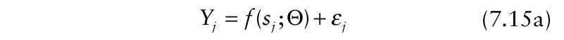{.equation width=60%}

and

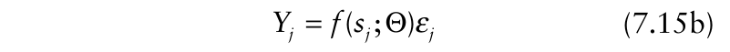{.equation width=60%}

in which the _j_ corresponds to the _j_ -th observation (distance from the source). The comments made in Chapter 4 (section 4.6.3) regarding appropriateness of the different statistical forms of disease progress models are applicable here. In short, if equation 7.15a is correct, only nonlinear methods can be used, because this statistical model cannot be linearized (but see section 3.5), even though a transformation of _f_ (•) is linear. On the other hand, if _f_ (•) represents the exponential or power models (and some others), equation 7.15b can be linearizedby taking logs of both sides. It is not clear based on our understanding of the population biology of diseases whether the error term in a nonlinear statistical model should be additive or multiplicative.

To avoid excessive repetition of ideas, we only discuss one assumption about the _ε_, and hence _Y_, values. Because spore density or lesions per plant varies greatly with distance from a source (see Fig. 7.1), it is very unlikely that the variance of _ε_ (or _Y_) will be constant. Rather, _var_ (_Y_) likely increases with increasing mean _Y_ (or some monotonically increasing function of _Y_). One approach for incorporating this property of _Y_ into the analysis is to use weighted least squares (or maximum likelihood). Reasonable choices for the weights are 1/ _Y_ or 1/ _Y_2 .

It can be shown that if _var_ (_Y_) is proportional to _Y_2 , then ln(_Y_) has an approximate constant variance (Neter et al., 1983). Given that the linearized forms of the exponential and (modified) power models involve the log of _Y_, unweighted linear least squares for model fitting can be justified. A similar approach is to use nonlinear methods, but with the model in log-transformed form. For instance, with equation 7.15b (but not 7.15a), one can write:

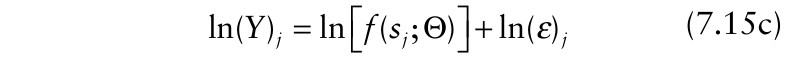{.equation width=60%}

in which ln(_ε_) = _ε_ * is a “new” error term, equivalent to the _ε_ in equation 7.14. For the exponential and power models, algebraic manipulation of ln[ _f_ (•)] results in a linear equation. However, equation 7.15c can be used directly with nonlinear parameter estimation methods with any model in which _Y_ has a variance proportional to the square of _Y_.

In Fig. 7.8 we show how to fit a few versions of the modified power model to the rust data, with the models in the form of equation 7.15c. Many other statistical programs could be used. ln(_Y_) is created in the data step (ln _Y_), and the right-hand side of equation 7.15c is given in the model statement. The error term is implied, and not written. The parameter statement identifies unknown parameters and gives initial guesses for their values. Bounds could have been placed on the parameters, and an initial search of parameter values for starting values in the optimization method could have been specified. Estimates of the parameters and coefficients of determination are given here, with standard errors in parentheses:

ˆ ˆ Power: _a_ P = 260(64), _b_ P = 1.70(0.12), 2 _λ_ = 0, _R_ = 0.96 ˆ ˆ Modified Power: _a_ P = 447(102), _b_ P = 1.88(0.11), 2 _λ_ = 0.4, _R_ = 0.97 ˆ ˆ Modified Power: _a_ P = 1993(2462), _b_ P = 2.36(0.38), ˆ 2 _λ_ = 1.7(1.1), _R_ = 0.983.

Note that we use a hat over _λ_ when it is estimated directly from the data (third case) and do not use a hat when a specific value of _λ_ is simply inserted in the model (first two cases here).

The model with _λ_ fixed at either 0 or 0.4 (first two cases) gave the same results as found with linear least squares (see above) because the log transformation results in a linear model. For nonlinear models in general, one definitely cannot expect to find this correspondence between linear and nonlinear models. Note that ln(_a_ P) is estimated with linear models, and _a_ P is directly estimated here. By allowing _λ_ to take on any value (third case), a considerable improvement in the coefficient of determination occurred, with nearly a perfect fit to the data. The estimate of _λ_ (_λ_ ˆ = 1.7) was about equal to the distance from the source to the _second_ sampling location. Thus, the concept of _λ_ as a measure of source size probably does not hold in this case. Rather, the role of _λ_ in influencing the shape of the dispersal gradient likely is dominant here. As expected, the estimates of _a_ P and _b_ P depended on the value of _λ_ (either fixed or estimated).

The estimate of _a_ P for the general case (=1993) is so different from the other estimates, that one might question the validity of the estimate. One must recall, however, that _a_ P is the predicted _Y_ at _s_ = 1 − _λ_. With _λ_ = 1.7, this means that _a_ P represents _Y_ at a distance of −0.7 m, _Y_ (−0.7), which is _not_ a physical location. It is more interesting to determine the predicted _Y_ at _s_ = 0 m. This is _Y_ indeterminate when (0) is predicted as _a_ ˆ _λ_ P = _λ_ˆ − 0. In the modified power model, _b_ˆ P . With _λ_ fixed at 0.4, the source strength is determined as 447(0.4)−1.88 = 2503; with _λ_ estimated, the source strength is determined as 1993(1.7)−2.36 = 570, a value smaller than found with the small (fixed) _λ_ value. As discussed previously, the power model becomes more exponential like as _λ_ gets very large, so it is not surprising that the _Y_ (0) predictions becomes smaller here as _λ_ increases. In one sense, _s_ = 0 is a hypothetical (theoretical) location for this data set in that the first data point occurs nearly a meter from the inoculum source. For the actual observed data points, all versions of the model fit well.

One interesting result when fitting the modified power model with unknown _λ_ was the large estimated standard errors for estimated _a_ P and _λ_. This suggests a fair degree of imprecision in the estimates of these two parameters here. These two estimates also were highly and positively correlated, because of the nature of the model formulation. For instance, as shown in the formula for estimated _Y_ (0) in the previous paragraph, as _λ_ ˆ increases, _λ_ ˆ − _b_ˆ P must decrease (for positive ˆ ˆ _b_ P). So, to achieve the same, _Y_ (0), _a_ P must increase with increasing _λ_ ˆ . Ratkowsky (1990) indicates that in models of the modified power type, _a_ P and _λ_ ˆ parameters have very nonlinear behavior (see Chapter 3 for some discussion). One way to improve the precision of the estimates, and reduce their bias, is to re-parameterize the model using the so-called “expected value” parameter in place of _a_ P. The issue is very important for those working on nonlinear modeling of dispersal gradients. The modeling presentation in Chapter 5 of Schabenberger and Pierce (2002) is very helpful in this regard.

Based on use of the nonlinear estimation procedure, other dispersal models described in section 7.3.5 can be fitted. For example, the estimate of the shape parameter in the Lambert et al. model (equation 7.10) was _η_ ˆ = 0.24 (s.e. = 0.12), close to, but slightly above the limiting value for a pure power model (η= 0). This suggests that the power model is more appropriate than the exponential, which agrees with the results already presented. Fitting the joint power-exponential model (equation 7.11a) to the data resulted in:_b_ˆ 1 = 0.05 (s.e.= 0.034) for the exponential component, and_b_ˆ 2= 1.31 (s.e.= 0.271) for the power component. Theoretically, if the gradient was purely of the power type, _b_ 1 would be 0. The estimated _b_ 1 was not significantly different from 0, which indicates the appropriateness of the power model. This can also be tested based on the reduction in residual sum of squares between the fit of the power model and equation 7.11a. However, such a simple interpretation is hindered by the fact that _s_ and ln(_s_) (see equation 7.11b) are correlated, and the correlation can be above 0.9 in many cases. Another way of looking at this is that equation 7.11a involves two functions of the _same_ variable (_s_). Because of this, tests involving the parameters can be ambiguous. Ferrandino (1996) developed an ingenious approach to replace _s_ and ln(_s_) with two uncorrelated functions, and test whether or not the power and exponential models equally fit the data. Readers should check the original article for details.

It is worth pointing out that equation 7.12 provided the best fit of all the models to the example data in terms of smallest residual sum of squares and largest coefficient of determination. This is noteworthy, because this model has only two parameters, and the next best models had three parameters (modified power with estimated _λ_). This suggests that more work is needed to assess the appropriateness of the Cauchy-like model for additional dispersal gradients.

## 7.5 Disease Gradients Correcting for Maximum Intensity

As discussed at the beginning of the chapter, dispersal of propagules typically is assessed by quantifying deposition of spores (or other infectious units) at various distances from a source, or, more commonly, by measuring disease intensity (such as number of lesions or pustules) at each distance. The latter is relevant when number of spores is directly and linearly proportional to number of lesions, which is reasonable when density of lesions is not too high. But it may be difficult to specify with great precision what is meant by “too high”. With increasing spore deposition, there is a decrease in the fraction of spores that cause countable lesions (Vanderplank, 1975). Spores may compete with each other, or spores may land on previously infected sites on plants. As shown with disease progress curves, one must account for the fact that disease intensity has an upper limit in an epidemic.

In this section, we address in detail how to make adjustments in models to account for an upper limit to disease intensity at a given location. The need for such an adjustment has been known for decades (Gregory, 1973), yet surprisingly, papers are still published in plant pathology where no adjustments are made, leading to some questionable interpretations of results. We start with an _ad hoc_ approach to altering the models. Then, we consider a more formal approach, similar to the protocol taken for disease progress, where the exponential model (equation 4.1) is expanded by the incorporation of a disease-free term. Because disease gradients are often determined for more than one time during an epidemic, we show how to quantify and compare gradients obtained at multiple times. This approach is general, and can be used to compare any gradients, not just those corresponding to different times. The developed models form the basis for additional theoretical characterization of disease in time and space.

### 7.5.1 Simple adjustment

Several decades ago, it was pointed out that a modification must be made to the common dispersal models if disease intensity is used as the dependent variable and intensity is not low (Gregory, 1973). So far in this chapter, we have operated on the assumption that _Y_ in the exponential (equation 7.1), (modified) power (equation 7.4), and similar models is a random variable with 0 as a lower bound and _no_ upper bound. However, _Y_ really has _M_ (number of plant individuals or host area that could be diseased) as a physical upper bound, which corresponds to an upper bound for _y_ of 1 (_y_ = _Y/M_). In many cases, the actual upper bound for _y_, _K_, may be even less than 1 (_K_ < 1 or _KM_ < _M_; see section 4.4.8), but we restrict our attention to the situation with _K_ = 1. The simple no-upper-bound assumption, although reasonable if _Y_ or _y_ is not too high, is unrealistic when _Y_ or _y_ is moderate or high. The recommendation of Gregory is to define _Z_ as the multiple infection transformation of disease intensity. If _y_ represents disease on a 0–1 scale, then one replaces _Y_ with ln[1/(1 − _y_)]; that is, one uses _Z_ = ln[1/(1 − _y_)] = ln[ _M_ /(_M_ − _Y_)] for _Y_ in the above models. The rationale here is that there is close to unit increase in _y_ or _Y_ with unit increase spore deposition at low disease intensity, but the increase in _y_ or _Y_ with increase in spore deposition becomes less and less at higher disease levels (because spores land on lesions, or spores compete for infection sites). The linear relation between _Z_ and spore deposition would be maintained at all disease densities, in principle. This transformation can be obtained directly from a consideration of the discrete statistical distributions that are discussed in Chapter 9.

This approach results in: for the linearized version of the exponential model (compare with equation 7.2), and:

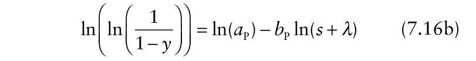{.equation width=60%}

for the linearized version of the (modified) power model (compare with equation 7.6). Note that the left-hand side of the equations involves a double-log transformation, which is known as the complementary log-log transformation of _y_, CLL(_y_), in statistics. This transformation can also be written as: CLL(_y_) = ln[−ln(1− _y_)].

The multiple infection transformation commonly is used to represent disease development over time for monocyclic diseases (Chapter 4). Thus, it _might_ appear that equations 7.16a and 7.16b are primarily of use for monocyclic diseases. This multiple-infection-transformation correction is, in fact, used for both monocyclic- and polycyclicdisease gradients. Under some circumstances, the CLL transformation _is_ obtained from more mechanistic models of monocyclic disease development in space and time (see Minogue, 1986, and section 8.3.3). However, the reader is reminded that the pure monocyclic growth model results in ln[1/(1− _y_)] on the left hand side of the temporal equation (equation 4.11), not CLL(_y_).

At a minimum, investigators should use CLL(_y_) rather than ln(_y_) or ln(_Y_) in linear models whenever they are characterizing disease gradients and _y_ is greater than ∼0.2. We show in the next sub-section that possibly more appropriate transformations can be derived for describing gradients based on a more formal analysis of _dy_ / _ds_.

### 7.5.2 Generalizations of the exponential and power models

For disease progress curves, one can model disease on an absolute scale, _Y_, or on a proportion scale, _y_ (= _Y/M_). For dispersal studies, it is more common to work with _Y_ than with _y_, but this is an arbitrary choice in many cases. In Chapter 4, it was shown that a direct approach to expanding the differential equation model for unlimited population growth was to multiply the level of disease intensity (_y_) by the level of disease-free intensity (1 − _y_). This same idea can be used here to develop models for disease gradients. In the following sub-sections, we apply appropriately expanded models to an actual data set. Because we now focus directly on disease intensity, and not just dispersal processes, we explicitly call the following equations disease gradient models.

One can divide both sides of the _dY_ / _ds_ equations for the exponential and (modified) power models (equations 7.1 and 7.7) by _M_ to obtain:

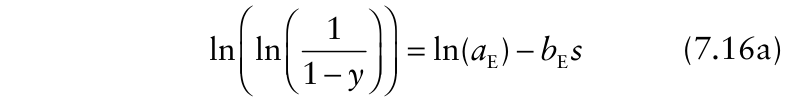{.equation width=60%}

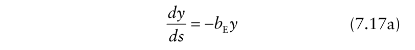{.equation width=60%}

and

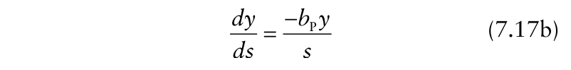{.equation width=60%}

for the rate of change in _y_ with change in _s_. Just to simplify presentation, we assume that _λ_ = 0 for the modified power model for the rest of the section. Based on the arguments made in Chapter 4, equations 7.17a and 7.17b can produce totally unrealistic values for _dy_ / _ds_ at large _y_, leading to possibly impossible predictions of _y_ (e.g., _y_ > 1) at small _s_. Multiplying the right-hand side of these rate equations by 1 − _y_ can result in more realistic and interpretable representation of spread over the entire range of disease intensities. As in section 7.5.1, we assume that _K_ = 1. The exponential model for spread becomes:

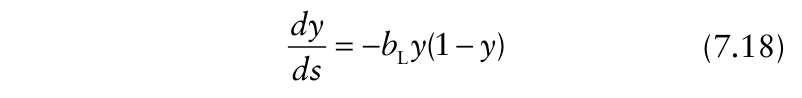{.equation width=60%}

after multiplication by the proportion of host that is disease free. This is, actually, a logistic model for a disease gradient. We use _b_ L for the gradient parameter (units of 1/distance) to be a reminder that this parameter is not quite the same as _b_ E (equation 7.17a); at low _y_, however, equations 7.17a and 7.18 are indistinguishable, in general (with _b_ L ≈ _b_ E). Integration leads to:

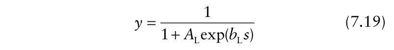{.equation width=60%}

in which _A_ L is the constant of integration, equaling (1 − _y_ 0)/ _y_ 0, where _y_ 0 is (theoretical) disease intensity at the inoculum source (i.e., at _s_ = 0). Readers should note that the exponent in the denominator is positive, which is different from the temporal version of the logistic model (equation 4.15b). This is because of the negative sign in the differential equation (equation 7.18). An equivalent way to write equation 7.19 is:

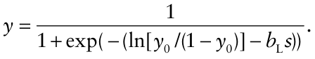

This can be compared with equation 4.15a for temporal disease progress, but now there is a negative sign before the spread parameter.

Algebraic manipulation of equation 7.19 results in the following linear equation:

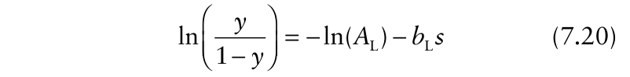{.equation width=60%}

which is an equation for a straight line with slope − _b_ L and intercept given by the logit of disease intensity at the source (see equation 4.16 for comparison).

Example disease gradients corresponding to equation 7.19 are shown in Fig. 7.9 for selected values of _y_ 0 (or _A_ L) and a single _b_ L value. These curves represent five different times in an epidemic; the choice of _A_ L values appears arbitrary here, but is explained in a later subsection. The curves are mirror images of logistic disease progress curves (because of the negative sign before _b_ L), with the highest _y_ values at the smallest _s_ values. Unlike the situation for no upper limit to the response variable, the curves level off at high _y_ (or low _s_). For cases where _y_ is not too high (e.g., <20%), the curves look the same as for the exponential dispersal model (equation 7.2).

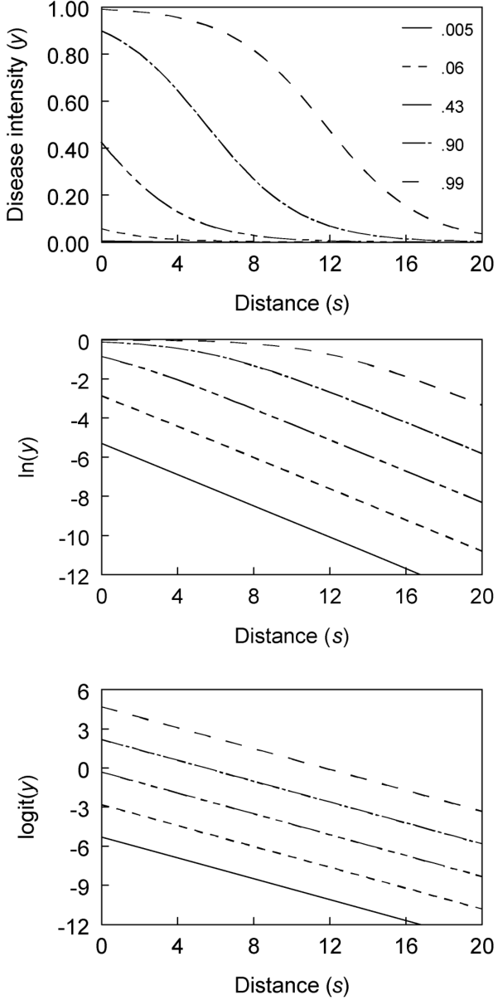

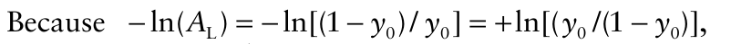{.equation width=60%}

equation 7.20 can be written as:

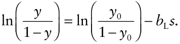{#fig-7-9}

This is because the exponential is a good approximation of the logistic model at low _y_.

If one plotted the gradients on a log-scale (middle frame of Fig. 7.9), it appears that the gradients flatten over time, especially at distances relatively near the source (_s_ < 12, here), even though a single spread parameter value was used. The idea of dispersal gradients flattening over time with polycyclic diseases has a long history in plant pathology. Gregory (1968) indicated that secondary spread flattens a primary gradient, which makes sense when untransformed disease intensity is used as the measure of infections (see top frame of Fig. 7.9). With an upper limit to disease intensity, the rate of change of _y_ with change in _s_ must slow down (with all other things being equal) as _y_ increases, because there are fewer opportunities for infections when most of the plant host is already infected. However, Zadoks and Kampmeijer (1977), van den Bosch et al. (1988a–c), and Minogue and Fry (1983b), among others, posited that infection gradients do not necessarily flatten over time during an epidemic. We only point out a few issues here related to gradient flattening.

To determine whether or not there is flattening of the infection gradient, one must use the appropriate transformation of _y_ (or a model that makes the proper adjustment for maximum _y_). If equation 7.18 is appropriate, then one must plot logits versus distance, as shown in the bottom frame of Fig. 7.9. Here, the correction for maximum disease is accounted for graphically, and one can see that the gradients are stable in the sense that there is no change in the slope for the different times. Because logit(_y_) is very similar to ln(_y_) at low _y_, one can also see the stable gradients at low _y_ in the ln(_y_) : _s_ graph in Fig. 7.9 if one just looks at the right-hand side of the graph. Of course, the steepness of the gradients does not change here precisely because equation 7.19 was used with a _fixed_ (single) value of _b_ L at all values of _y_ 0. If the gradients were becoming less steep over time, then _b_ L of equation 7.19 (or equation 7.20) would be getting smaller (closer to 0) with increasing time (if equation 7.19 was appropriate at _all_ times). Tests of _b_ L, therefore, become a basis for evaluations of gradients over time.

The power model can also be easily generalized to accommodate a limitation to disease. The model can be written in differential-equation, integrated, and linearized forms as:

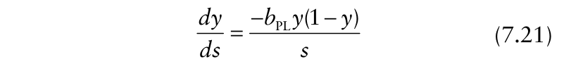{.equation width=60%}

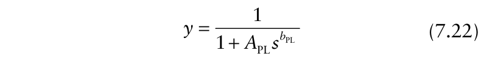{.equation width=60%}

in which _A_ PL equals (1 − _y_ 1)/ _y_ 1, where _y_ 1 is (theoretical) disease intensity at a distance of 1 [= _y_ (1)]. The intercept term in equation 7.23 is equal to +ln[ _y_ 1/(1 − _y_ 1)], the logit of disease at _s_ = 1. Note that we label the gradient parameter as _b_ PL (for “power-logistic”; unitless) because the numerator in equation 7.21 is of the logistic form, but there is also a denominator of _s_, reflecting a powertype gradient. The model can also be referred to as the _log-logistic_. The link between this model and the logistic disease gradient model may be seen more clearly by an alternative expression for _y_ of equation 7.22:

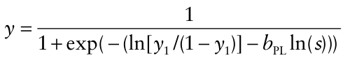

The log-logistic model, with a different parameterization, is used in section 3.5 of Chapter 3.

Disease gradients described by equation 7.22 are shown in Fig. 7.10, corresponding to five different values of _y_ 1 (or _A_ PL), for a fixed (single) value of _b_ PL. Because of the nature of power-model-type gradients, in which _dy_ / _ds_ is a large negative number at small _s_, the decline in _y_ with increasing _s_ is relatively large near the source even when overall disease intensity is high (e.g., top curve in Fig. 7.10). Nevertheless, the curves show some appearance of becoming flatter near the source as _y_ increases. This is expected since there is an upper limit to disease (=1) in this model. The flattening of the gradient is more pronounced when one plots ln(_y_) versus ln(_s_) (middle frame of Fig. 7.10), which is the proper scaling for the simpler power model (equation 7.6), but not the proper scaling when a correction for maximum disease is made. When one looks just at the right hand side of this graph, however, corresponding to relatively low _y_, one sees parallel lines (i.e., no flattening). When logit(_y_) is plotted against ln(_s_) (bottom frame of Fig. 7.10), which gives the proper scaling for the model introduced here (equation 7.23), lines with the same slope are found for each time, an indication of stable gradients. As with the logistic model above, the gradients _must_ be stable in this theoretical example because they were generated with a single spread parameter in the equation. One can ask the question for observed gradients of disease: does steepness change (as measured by _b_ PL) over time? In other words, are gradients stable? As discussed in the next paragraph, the answer is more complicated than for an exponential-type gradient.

The discussion of the power model (equation 7.7) in terms of the concept of gradient steepness also applies to any model in which distance is in the denominator of the _dy_ / _ds_ equation. In short, there is always some ambiguity of the meaning of the equality (or inequality) of two gradients in which _dy_ / _ds_ (or _dY_ / _ds_) involves both _y_ and _s_. For the simpler situation of the exponential or logistic models of spread, _dy_ / _ds_ only involves _y_ and a parameter. Then, if two gradients have the same _b_ L, steepness (as defined here

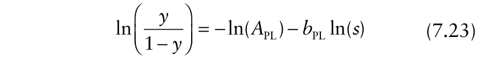{.equation width=60%}

{#fig-7-10}

by _dy_ / _ds_) is the same at a given value of _y_. However, for equation 7.21, if two gradients have the same _b_ PL, steepness is not necessarily the same at a given _y_, because steepness depends also on distance from the source. Comparing estimates of _b_ PL is, nevertheless, common and useful, but one should be cautious in not over-interpreting the meaning of the parameter differences.

### 7.5.3 Other models

In addition to the models in the above sub-section, various other generalizations and expansions of the dispersal and disease gradient models can be utilized. Just as the logistic model can be modified to account for asymmetry in _dy_ / _dt_ over time (see section 4.4.4), one can use functions of 1 − _y_ [e.g., ln(1)−ln(_y_) for the Gompertz model (see equation 4.19)] rather than 1 − _y_ directly in the equations for _dy_ / _ds_. This approach is occasionally used in practice (e.g., Maffia and Berger, 1998). One could also expand the other gradient models in section 7.3.5 to adjust for maximum disease. We do not pursue these approaches here, although they can be valuable when one has the goal of a very accurate description of observed gradients.

One can also consider simplifications of the models presented for disease gradients, at least for comparison purposes. For instance, suppose that _dy_ / _ds_ is not affected by _y_, but there is still a maximum possible disease intensity equal to 1. If distance does not affect the gradients directly, then one obtains:

{.equation width=60%}

in which _b_ M is now the spread parameter (units of 1/distance). This is analogous to the monomolecular model (equation 4.8) for temporal disease progress, and we use the M subscript for this reason. If distance does affect the gradient, then one obtains:

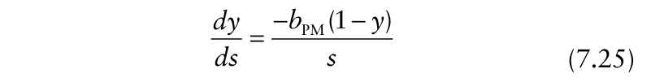{.equation width=60%}

in which the spread parameter (_b_ PM) is unitless. These and other models were developed and considered by Jeger (1983). They have occasionally been evaluated (e.g., Jeger et al., 1983; Madden et al., 1990a). Solutions are easy to obtain, as either nonlinear of linearized equations.

### 7.5.4 Model fitting

_7.5.4.1 General comments._ As with the simpler exponential and power models, one can use various model fitting methods utilizing either the nonlinear or linear versions of the disease gradient models discussed here.

One issue that needs some attention, however, concerns the variance of the response (dependent) variable in the models. For a discrete count variable with no upper limit, _var_ (_Y_) can be expected to increase with increasing _Y_. We pointed out that the transformation used to linearize the nonlinear models for _Y_, ln(_Y_), also does a good job of stabilizing variances. With disease intensity on a proportion (0–1) scale, _var_ (_y_) is a more complex function of _y_. As discussed in detail later in Chapter 9, disease incidence most likely has a binomial or more general discrete distribution. If so, _var_ (_y_) is proportional to _y_ (1 − _y_). In fitting the nonlinear models (with _y_ as the dependent variable) to data, one could then use weights equal to 1/[ _y_ (1 − _y_)].

When fitting the linearized versions of these models to data, the variance of the transformed _y_, _y*_, is the relevant quantity. In section 4.6.2, we showed how to estimate the variance of _y*_, _var_ (_y*_), when _var_ (_y_) was known (or assumed). For the logit transformation, _y*_ = ln[ _y_ /(1 − _y_)], so _var_ (_y*_) = [ _y_ (1 − _y_)]−1 . Thus, to fit either equation 7.20 or 7.23 to data (with an assumed additive error term, _ε_), one could use _y_ (1 − _y_) as weights.

When dealing with disease severity data, it is not clear which statistical distribution is most appropriate. However, one can generally assume that _var_ (_y_) is still proportional to _y_ (1 − _y_), and use the same weights as discussed for disease incidence.

For either disease incidence or severity, there may or may not be statistical evidence from the model fit that weights are required if there is one observation per distance. A residual plot can certainly provide strong evidence that variances are unequal, and hence the need for weights. However, with a limited number of data points, the residual plot may be ambiguous. Then the decision regarding weights is more subjective. One could argue that weights are always necessary for a variable that ranges between 0 and 1, especially if there are observed values close to either limit. On the other hand, if the empirical evidence from model-fit diagnostics (e.g., residual plot) does not give clear evidence of unequal variances, then there is not direct evidence to use any weights. In the latter situation, it could be argued that weighting is counter-productive, because one is obtaining a poorer fit (in terms of residual sum of squares) than without weights. In this chapter we use weights (or appropriate variance-stabilizing transformation in previous sections), but we do not take an inflexible view on this issue, and accept the merit of both arguments in cases where there is no clear evidence of unequal variances for the data being analyzed.

_7.5.4.2 Example—graphical evaluation_. We consider another bean rust example here, based on one of the data sets described in Maffia and Berger (1998). A line source of infected plants was used, and data originated in the spring-planting. Disease intensity was measured in various ways, but we only discuss results for leaf disease incidence, that is, the proportion of leaves with pustules. Results were obtained for six times, _t_ = 1, 8, 15, 22, 29, and 36 days, in which _t_ = 1 corresponded to the first day with observed pustules.

This example is typical of many in which gradients are observed at several times in the epidemic. For the first and second assessment times, there was a fairly steep decline in _y_ with increasing _s_ near the source (Fig. 7.11). At distances of 5 or more meters, incidence was very low. By later times, there was a considerable flattening of the gradients on the original scale (_y_), and _y_ was close to 1 near the original inoculum source at the later times. Moreover, at these later times, _y_ was still very high at the largest distance considered (8.5 m). Ideally, one would want to use large enough distances so that the “full” gradient could be observed at each time, but this is totally impractical in most field studies. In this case, one would need to use at least a four-fold increase in field size to observe low values of _y_ at large distances from the source.

When one ignores the fact that there is an upper limit to _y_, and plots ln(_y_) versus _s_ or ln(_s_), one sees a flattening of the disease gradients with time, especially at _s_ < 5 m. Also note that incidence is so low for the first time that it is difficult to compare these results for large distances with results for the other times. We, thus, (mostly)

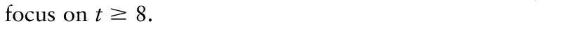{.equation width=60%}

Considering that the upper limit of _y_ (=1) is approached here, it is appropriate to utilize the logistic and power-logistic gradient models (equations 7.20 and 7.23) to represent these data. Plots of logit(_y_) versus _s_ and ln(_s_) are shown on the right-hand side of Fig. 7.11. In general, a clear choice between the two models is not possible. There is slight curvature when logit(_y_) is plotted versus _s_, with decreasing slope at increasing distance. This is indicative of a power-type model. The plot of logit(_y_) versus ln(_s_) does produce a straight line, except for large distances (high _s_), where a slight downward bending of lines could be seen. Residual plots from linear regression analysis show some pattern with both model choices (not shown). Because of the straight lines obtained for logit(_y_) versus ln(_s_) at _s_ < 6 m [ln(_s_) < 1.6], we select the power-logistic as the primary model to quantify these gradients. This is consistent with other studies that found a power-law type relation for dispersal gradients of rust spores (Aylor and Ferrandino, 1989; Mundt, 1989). However, data are insufficient in this example to interpret the gradients in terms of dispersal mechanisms. This would require other data sets and larger fields (larger maximum _s_) in the studies. In particular, for the latter issue, it would be informative to know if that slight curvature of the logit line at ln(_s_) > 1.6 (Fig. 7.11) would continue at much larger distances.

_7.5.4.3 Example linear regression._ For the interested reader, the actual data points are given in Fig. 7.12 in the form of a SAS program for regression analyses based on equations 7.20 and 7.23. Before showing results for the logistic power model, we present some results that are obtained if one (incorrectly) ignored the fact that _y_ is limited from above by 1. That is, we fitted the regular power model (equation 7.6, with _y_, rather than _Y_, used for disease intensity) to the data and compared slopes (estimates of _b_ L) among times. This analysis is not specified in the SAS program. Estimated slopes were 0.69, 0.41, 0.20, 0.12, 0.10, and 0.07 for times 1 through 36, based on weighted linear regression of ln(_y_) on ln(_s_), with weight equal to _y_ /(1− _y_) [see section 4.6.2 for variance of ln(_y_)]. Results indicate a strong tendency for decreasing slope over time. In fact, the slope for day 8 was about six times larger than the slope for day 36 (0.41/0.07).

{#fig-7-11}

For later purposes, it is helpful to indicate explicitly that the statistical form of power-logistic model (equation 7.23) can be written as:

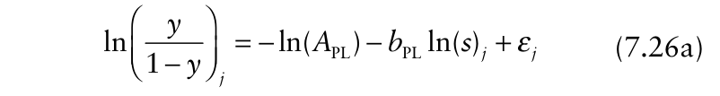{.equation width=60%}

or

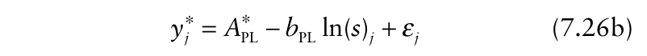{.equation width=60%}

in which the _j_ subscript refers to the _j_ -th distance (e.g., the first distance is _s_ 1 = 0.3 m), _y_ * is the symbol for the transformation that produces a linear model (logit here), and _A_ *PL = − ln(_A_ PL) = ln[ _y_ 1 /(1 − _y_ 1)] for the power-logistic model. Fitting equation 7.26b to the data for each time, using weighted least squares [with _y_ (1− _y_) as weight], produces the results in Table 7.1. The error degrees of freedom (_df_) equals 4 for each time. As shown in the top frame of Fig. 7.13, the fitted lines are very reasonable summaries of the gradients on a logit:ln(_s_) scale. The _A_ ˆ PL* values increased with time, as expected, since _y_ increased over time. Back-transformation of estimated _A__*_ PL can be used to estimate _y_ at 1 m. For instance,

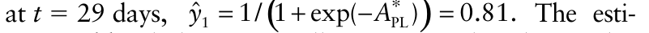{.equation width=60%}

mates of _b_ PL do become smaller over time, but the trend is much weaker than when the simpler power model (with no correction for maximum disease) was used. Although the _R_2 values were high, there was some pattern to the residual plot, indicating that the power-logistic model was not ideal. For comparison, some results from fitting the statistical version of the logistic gradient model (equation 7.20) are also shown in Table 7.1. The estimates of _b_ L declined faster with time than the estimates of _b_ PL. This and other models resulted in undesirable residual plots, although the _R_2 was very high for some assessment times with the logistic model. As discussed above, we concluded that the power-logistic model was a reasonable (but not ideal) choice for analysis.

_7.5.4.4 Example—comparing parameter estimates._ When one wants to compare two gradients, one can test the equality of the spread parameters or the intercepts (transformation of the constant of integration) using various methods. The gradients may be from disease assessments made at different times in a single epidemic (as here), or correspond to contemporaneous assessments of disease for different treatments (e.g., cultivars, fungicide applications). The approaches discussed in Chapter 4 are applicable here, and we directly address only a limited number of approaches.

{#fig-7-12}

**Table 7.1.** Fit of the logistic (equation 7.20) and power-logistic (equation 7.23) models to the bean rust data shown in Fig. 7.12, together with the estimated distance (_s_ ˆ′ ) where disease intensity equals 0.6, for the different disease assessment times.

|||_Power logistic_||||_Logistic_|||
|---|---|---|---|---|---|---|---|---|
|_t_|PL ˆ_A_ *|PL ˆ_b_|_R__2_|_s_′|Lˆ_A_ *|Lˆ_b_|_R__2_|_s_′|
|1|−1.6 (0.15)|0.88 (0.17)|0.88|–|−0.5 (0.23)|0.72 (0.15)|0.85|–|
|8|−0.3 (0.12)|0.77 (0.12)|0.91|0.4|0.3 (0.15)|0.37 (0.05)|0.92|–|
|15|0.8 (0.15)|0.71 (0.12)|0.90|1.7|1.3 (0.09)|0.29 (0.02)|0.98|3.1|
|22|1.3 (0.11)|0.58 (0.07)|0.93|4.7|1.6 (0.09)|0.21 (0.02)|0.97|5.7|
|29|1.5 (0.04)|0.53 (0.03)|0.99|7.9|1.7 (0.16)|0.18 (0.03)|0.89|7.2|
|36|1.7 (0.06)|0.41 (0.12)|0.96|23.5|1.9 (0.09)|0.15 (0.02)|0.94|10.0|

The simplest approach is to use a _t_ -test to compare the parameter estimates. For instance, if one had two gradients, each characterized by the power-logistic model (equation 7.26a), one can test the null hypothesis: versus the alternative hypothesis that the parameters are not equal. The _t_ -statistic can be written as: in which the denominator is the standard error of the difference of the two estimated slopes. This can be estimated (for uncorrelated slopes) as: in which the two terms on the right hand side are the squares of the standard errors of the estimated slopes. For the comparisons of estimated slopes for days 8 and 15 of the bean rust example, the _t_ -statistic is given by:

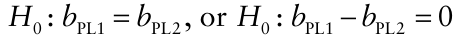

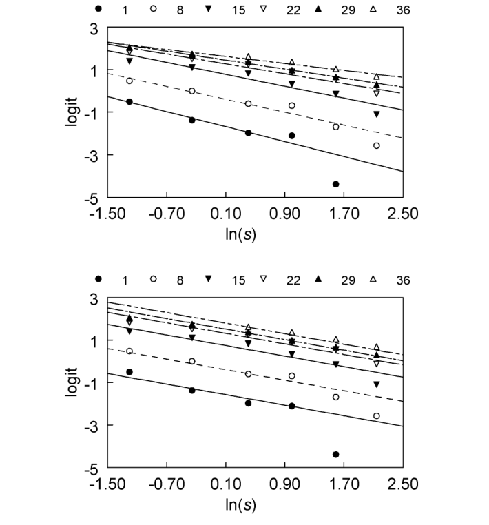{#fig-7-13}

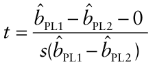

The degrees of freedom for the _t_ -test is equal to the sum of the error degrees of freedom for the two disease progress curves (_df_ = 4 + 4 = 8). This achieved _t_ -statistic is much below the critical value for 8 _df_ (2.31) to be significant at α = 0.05. Thus, the slopes are not significantly different (at α = 0.05) for these two gradients.

As an aside, readers should note that _s_ is used for both the distance variable and for an estimated standard error or standard deviation, and that _t_ is used for the time variable as well as the _t_ -statistic. Other than using unusual symbols for time and space variables (or for standard errors and _t_ -statistics), this double interpretation cannot be avoided. The meaning of the symbols should be apparent based on context of the material.

The two intercepts can be compared in the same way as the comparisons of the slopes. Then, other pairs of gradients can be compared. The reader should be able to determine that the intercepts clearly are different between many times (as expected), and that some slopes are also different from each other. This approach is very useful when there are only a small number of gradients, or the investigator only has information on parameter estimates and standard errors (say, from a published paper). With multiple gradients, it may be difficult to gain a general understanding of disease spread based on pairwise comparisons. Thus, it is generally more efficient to use a covariance analysis to test whether the heights of the lines (intercepts) or their slopes vary among groups (Milliken and Johnson, 2002). This approach also allows the investigator to incorporate features of the experimental design, such as blocking, into the analysis.

Assuming that the power-logistic model is appropriate, we can expand equation 7.26b to:

{.equation width=60%}

in which the _i_ subscript represents the _i_ -th group (time in the example). There is an _i_ subscript on ln(_s_) (in addition to the _j_ subscript) because it is possible that the distances are not the same for each group (although this is not the case here). Thus, the potential for each group to have a different intercept (_A*_) and slope (_b_ PL) is incorporated into this statistical model. An alternative way of writing this equation is:

{.equation width=60%}

in which γ and _ι_ represent overall intercepts and slopes, respectively. In this formulation, _γ_ + _Ai_ * is the intercept for the _i_ -th group, and _ι_ + _b_ PL _i_ is the slope for the _i_ -th group. Readers should compare this with equation 4.38b, and reread the discussion about use of this type of equation. The formulation in equation 7.27b is most useful in a covariance analysis for testing whether or not there is a significant effect of group on the intercept and slope. This model is fitted to the bean rust data, with time as the group, using the MIXED procedure of SAS in Fig. 7.12. Note that time (_t_) is given as a class (category or factor) variable in the program. An overall intercept (γ) is implied by the model statement and is not identified; _t_ specifies the effect of time on the intercept [a “main” effect term (_A_ PL* _i_)]. The overall slope and the group effect on the slope are specified with lns (_ι_) and lns* _t_ (_b_ PL _i_), respectively. That is, in the latter case, the meaning of a group-dependent slope is that the slopes are not the same (interaction of group and the continuous variable).

Fitting this model to the data showed the following: a highly significant effect of distance (_F_ = 246.6; _df_ = 1, 24; _P_ < 0.001), meaning that _ι_ was different from 0; a highly significant effect of time (_F_ = 103.0; _df_ = 5, 24; _P_ < 0.001), indicating that (_A_ PL* _i_) varied with time; and a marginal effect of the interaction of time and distance (_F_ = 2.6; _df_ = 5, 24; _P_ = 0.05), meaning some evidence that _b_ PL _i_ was not the same for all times. In this model formulation, the actual estimates of the intercepts and slopes for each time can be obtained by the estimates of γ, _ι_, and the group-specific parameter estimates (using the solution option). For instance, the slope for groupthree (third time) would be would be _γ_ ˆ + _A_ ˆ PL3*. A more direct way of obtaining these _ι_ ˆ + _b_ ˆPL3 and the intercept estimates would be to use the following model statement: where noint option eliminates γ from the model (“no intercept”). Because there is also no individual ln _s_ term specified (thus, no _ι_), one is essentially fitting equation 7.27a to the data. The _F_ tests displayed for group and the interaction of group and the continuous variable, however, are no longer applicable for testing group and interaction effects when these changes to the computer code are made (even though the estimates of the slopes and intercepts, and their standard errors are appropriate). Using this approach, as an example, one obtains the following parameter estimates for 15 days: which agrees with the individual regression results shown above. The agreement does not have to be this good, since the covariance analysis, as done here, is assuming a single error variance for all the data, not a separate one for each gradient (each assessment time, in this case).

Since there is only marginal effects of group on the slope (marginal interaction), it is natural to consider fitting a covariance model with a single (group independent) slope. Equation 7.27a can be simplified to:

{.equation width=60%}

Note this formulation indicates that _b_ PL _i_ = 0 for all _i_ (all groups). In other words, _ι_ now represents a single slope (i.e., _ι b_ PL, with no _i_ subscript). This model can be fitted using the following code:

With this analysis, the (single) estimated slope was: ˆ _b_ PL = 0.62 (s.e.= 0.043), intermediate among the individual slopes for the different times. Estimates of the differentintercepts can be obtained fromnoint option as well, one directly obtains _γ_ ˆ + _A_ ˆ PL* _i_. By giving the _A_ ˆ PL* _i_ (because γ = 0). The estimated intercepts for the six times were: −1.5, −0.3, 0.8, 1.4, 1.6, and 1.8, similar to those obtained when analyzing data for each time separately. The residual variance for this model was 0.0125, which is not a lot larger than the residual variance found for the fit of equation 7.27b (0.0098), indicating that a reasonable fit of this multi-time data set is obtainable with a single spread parameter. As shown in the bottom frame of Fig. 7.13, a single slope is reasonable for describing these data, although the fit is slightly better with time-dependent slopes (top frame).

To conclude this section, analysis of the bean rust gradients shows that logistic and power logistic models could be used, but latter was chosen based on common use of a power-type model for rust diseases. On the original _y_ scale, there was clear flattening of the gradients with increasing time, especially near the inoculum source. There also was some evidence that the gradients flattened over time on a logit(_y_) : ln(_s_) scale, but a constant gradient steepness (_b_ PL) over time was a reasonable approximation for the data. Through the use of the logit transformation (in this case), the limitation to disease intensity (i.e., _y_ < 1) was accounted for, so that the relationship between (transformed) disease intensity and (transformed) distance could be characterized.

## 7.6 Spatio-Temporal Dynamics of Disease Spread

### 7.6.1 General comments

By characterizing disease gradients at several times in an epidemic in the previous section, we have been casually considering the spatio-temporal dynamics of disease development in host populations. That is, we considered how _y_ changed with _s_, in the form of disease gradients, and how _y_ changed with _t_, through the change in gradient height and (potentially) gradient steepness with increasing time. Here we start to formalize the relationship between _y_ and both _t_ and _s_.

As mentioned in section 7.1, in previous chapters we mostly considered a plant disease epidemic as a temporal process, characterized by _dy_ / _dt_, even though we recognized that space was important. With monocyclic diseases, for instance, we indicated that _dy_ / _dt_ = _r_ M(1 − _y_) (equation 4.8), where _r_ M equals the product of inoculum density or abundance (_x_ ′), and the probability per unit time that a unit of inoculum causes an infection (φ = the probability per unit time that a unit of inoculum contacts a host individual multiplied by the probability that the unit of inoculum in contact with a disease-free host actually infects the host). If _x_ ′ is clustered at a single model logit = _t_ ln _s_ /solution; location (line, point, etc.), then φ is unlikely to be constant, but rather would be function of distance from _x_ ′, φ(_s_). This function, φ(_s_), is actually analogous to a contact distribution (see section 7.3.4). For polycyclic diseases, the situation is (considerably) more complicated because any infected individual can then serve as an inoculum source, at least during the diseased individual’s infectious period (see Chapter 5). Instead of a constant probability of any produced spore coming into contact with a host individual (_θ_; see sections 5.2.2 and 5.2.3), a spore produced by an infected individual at location _ξ_ has a much greater chance of contacting a host individual at location _s_ if the locations are close together (_s_ − _ξ_ is small) than if the locations are far apart (_s_ − _ξ_ is large). In other words, _θ_ is actually a function of _s_ − _ξ_, _θ_ (_s_ − _ξ_). Thus, the logistic model (equation 4.14) and the more complex models of Chapter 5 for _y_ (e.g., equation 5.30) are inadequate for representing epidemics in space and time when the epidemics start from a well-defined inoculum source (or sources). Although the temporal models of the previous chapters were quite useful for describing and understanding epidemics, the next level of quantification requires a formal consideration of space and time in disease development. The approach presented in this section is the first step towards developing a better understanding of the spatiotemporal processes within an epidemic. Through the models developed, the concept of disease spread hopefully becomes clearer, and empirical approaches for characterizing spread are obtained that are natural consequences of the developed models. However, the specific models shown here should be considered a stepping stone towards the fuller characterization of spread that is presented in Chapter 8.

### 7.6.2 Two spatio-temporal models

Previously, we sometimes found it useful to use the notation _y_ (_t_) instead of just _y_ to represent disease intensity at time _t_. With the simultaneous consideration of space and time, we can use the notation _y_ (_t, s_) to refer to disease intensity at location _s_ and time _t_. Representation in two spatial dimensions can be done by replacing _s_ with _s_ 1 and _s_ 2 (for instance) to represent row and column locations, _y_ (_t_, _s_ 1 _, s_ 2). The latter approach is not considered here. A general formulation to represent _y_ (_t, s_) can be given as:

{.equation width=60%}

where Θ is a vector of parameters. It is quite possible that _f_ (•) is not a simple (or even complicated) single equation, but can only be written as an integral

{.equation width=60%}

in which Ξ is an arbitrary general mathematical expression, _s_ and _t_ are specific locations (between 0 and _s_) and times (between 0 and _t_), respectively, and the integrations are over space and time. In this situation, numerical solutions would be required, although approximate analytical solutions may exist for certain circumstances (see Chapter 8). Here we consider situations where a solution to the integration exists, so that _f_ (•) is a single equation.

Disease intensity is now a function of two continuous independent variables, _s_ and _t_. Mathematically, partial derivatives (∂•) are used instead of ordinary derivatives to represent rates of change in models with more than one independent variable. One can take the partial derivatives of equation 7.28a to determine rates of change of _y_ with respect to time and space. In particular, we write ∂ _y_ (_t, s_)/∂ _t_ for the absolute rate of change in _y_ with time at location _s_, and ∂ _y_ (_t, s_)/∂ _s_ for the absolute rate of change in _y_ with space (distance) at time _t_. For some presentation circumstances, these can be simplified to ∂ _y_ /∂ _t_ and ∂ _y_ /∂ _s_, where the dependence on _s_ and _t_, respectively, is assumed. For this approach to work, there is a mathematical requirement that _f_ (•) is a continuous function.

For polycyclic diseases, a logistic model is often an appropriate description of disease progress over time (Chapters 4 and 5). Thus, it is natural to consider a form of equation 7.28 in which the partial derivative with respect to time is given by:

{.equation width=60%}

Other functions could be considered here, such as the Gompertz, for temporal disease progress. Likewise, a H-L-I-R-type model (Chapter 5), with the first _y_ term on the right hand side of equation 7.29 replaced by infectious disease, could be used for temporal progress. For monocyclic diseases, it is natural to consider a form of equation 7.28 in which the partial derivative for disease with time is given by:

{.equation width=60%}

We have shown in previous sections that the rate of change in disease with distance can be reasonably represented by the logistic or power-logistic models. Thus, we consider forms of equation 7.28 in which partial derivatives with respect to _s_ can be written as:

{.equation width=60%}

and

{.equation width=60%}

Of course, other models could also be considered. This is a good place to point out that a logistic (or powerlogistic) gradient model does not necessarily mean that the disease is polycyclic (compound interest) in nature.

The next step is to consider _pairs_ of partial differential equations, one for space and one for time. For instance, consider logistic equations for temporal (equation 7.29) and spatial (equation 7.31) dynamics of disease. Solution leads to the following equation:

{.equation width=60%}

in which _A_ LL is the constant of integration, equal to (1− _y_ 0)/ _y_ 0, where _y_ 0 is the theoretical _y_ at _t_ = 0 and _s_ = 0. That is, _f_ (•) of equation 7.28a is given by the right hand side of equation 7.33. Another way of looking at this is that the partial derivatives of equation 7.33 equal equations 7.29 and 7.31. A little algebra leads to the following linear equation:

{.equation width=60%}

The intercept term can also be written as +ln[ _y_ 0/(1 − _y_ 0)]. Thus, equations 7.33 or 7.34 can be used to describe disease in space and time.

Fig. 7.14 shows one example epidemic that follows equation 7.33, with _r_ L = 0.25/day and _b_ L = 0.4/m. The 3D graph in the top frame visually shows disease development in the two dimensions. Note, for visual clarity, the time axis runs into the page (at a slight angle), with the smallest times in the foreground. At any selected distance (e.g., _s_ = 4 m), there is a logistic increase in disease over time, with low _y_ at _t_ = 0, and _y_ near 1.0 at large time (when _s_ is small). The temporal curves are sigmoid in shape, although high disease intensity is not reached at large distances (within the time frame considered here). At _s_ = 0, one can see the logistic increase in _y_ at the inoculum source.

Reading the 3D graph from left to right, one can see the disease gradients over distance. These are reversesigmoid in shape as well, because equation 7.31 was specified for the gradient. The middle frame of Fig. 7.14 shows disease gradients for selected (labeled) times, although the curve for _t_ = 0 days barely rises above the 0 axis. At early times, the gradients are exponential in shape, as expected, but they flatten close to the source because of the limitations to disease. The bottom frame of the figure shows that logit-transformed disease intensity declines linearly with distance (see equation 7.34). Moreover, because the times selected were equally spaced (every 10 days), the vertical difference of the logits is constant over all distances (10· _r_ L). It should be noted that the theoretical values plotted in Fig. 7.14 are

{#fig-7-14}

{.equation width=60%}

the same as those in Fig. 7.9. The values of _y_ 0 chosen in the earlier figure were simply theoretical disease intensities at _s_ = 0 for 10-day increments with the model parameters given here.

Another natural pairing of partial differential equations is the logistic one for temporal dynamics (equation 7.29) and the power-logistic one (equation 7.32) for spatial dynamics. This corresponds to the following equation for _y_:

{.equation width=60%}

where _A_ LPL is the constant of integration, (1 − _y_ 1)/ _y_ 1, where _y_ 1 is _y_ at _t_ = 0 and _s_ = 1. In other words, the right hand side of equation 7.35 equals _f_ (•) of equation 7.28a. Equation 7.35 can also be written as:

Algebra leads to the linear equation:

{.equation width=60%}

which indicates straight-line relations between logits and both _t_ and ln(_s_). For equations 7.34 and 7.36, we can write _A_ LPL* for −ln(_A_ LPL).

An example corresponding to equation 7.35, with _r_ L = 0.25/day and _b_ PL = 2.5, is shown in Fig. 7.15. There is a sigmoid-type increase in _y_ at all distances beyond 0, because of the logistic nature of ∂ _y_ /∂ _t_, with _y_ approaching 1 near the source (over the time span considered here). Compared with the example in Fig. 7.14, there was a sharper decline in _y_ as _s_ increases, because of the _s_ term in the denominator of ∂ _y_ /∂ _s_ (see middle frame of Fig. 7.15) _._ Moreover, logits decreased in a linear manner with increasing ln(_s_), with the same slope for all times, as required by equation 7.36 (bottom frame of Fig. 7.15) in this example. In particular, the vertical difference between the lines is constant at all distances because the difference in times for the lines was 10 days (10 · _r_ L). As pointed out for the previous figure, the values in Fig. 7.15 are the same as those in the previous sections of the chapter and shown in Fig. 7.10. What looked like arbitrary choices for _y_ 1 (or _A_) in Fig. 7.10 were actually theoretical values for _y_ at _s_ = 1 at the selected time values.

Many other models for _y_ (_t, s_) can be specified by considering pairs of partial differential equations for space and time dynamics. Before discussing the usefulness of some of these possibilities, we must first present an additional concept of great importance when characterizing spatio-temporal dynamics.

{.equation width=60%}

_7.6.3.1 Isopaths._ Suppose a pathogen is introduced into a previously disease-free (perennial) host population at a single location (point, line) and the disease becomes established (see Chapter 5). With invasive diseases, it is natural to ask: How fast is disease spreading beyond the point of introduction? For this thought exercise, suppose further that one has absolute knowledge of all diseased individuals at the disease assessment times (no missed individuals due to sampling errors and no misdiagnoses of individuals for disease status). Given that the time of introduction is defined as _t_ = 0, suppose that the farthest distance (_s_)

{#fig-7-15}

{.equation width=60%}

from the initial inoculum source with a diseased individual at various times (weeks) was found to be:

The distances can be considered to represent the front of the epidemic at the listed times. As in Chapter 4, we use Δ here to indicate a calculated difference between successive values. The calculated rate of spatial spread of disease with time (Δ _s_ /Δ _t_) can be determined by dividing the difference of distances by differences in times.

Between weeks 2 and 4, the disease spread 14 m; that is, disease was 14 m farther away from the source at week 4 compared with week 2. Thus, Δ _s_ /Δ _t_ = 14/2 = 7 m/wk, or 1 m/day. With the hypothetical example, this rate is the same for all pairs of times. If this same rate continued indefinitely, one could calculate when disease would be, for example, 1 km from the original source. The answer is 1000/7 = 142.9 wk, or ∼2.7 years. Likewise, one could ask: how far will the disease spread in the next 5 years? Assuming a continuous crop in all directions and no seasonal effects, and given that there are 260 wk in 5 years, the answer is 7 × 260 = 1,820 m or ∼1.8 km.

This rate of spatial spread of disease over time tells us nothing about the intensity of disease at any distance from the original source, unless other assumptions are made or additional information is available (see below). Moreover, it is often impractical (because of costs and time) to assess disease at great enough distances from a source to find the farthest diseased individual. For instance, early in the bean rust example (Fig. 7.11), assessing leaves for pustules over 9 m from the source was satisfactory, but by 3 wk into the epidemic, about 50% of the leaves were infected at 9 m. Thus, it is quite possible that the front of the epidemic is unknown.

The practical approach to determining Δ _s_ /Δ _t_ is to choose a (generally low) fixed value of _y_, _y_ ′, and determine the distance where _y_ ′ is found at selected times. It may be more practical to work with transformed disease intensity, and select a specific _y_ *, _y_ *′, for calculations. Consider, again, Fig. 7.14 for logistic-type disease gradients over time. In the bottom frame, a thin horizontal line is shown, corresponding to _y_ *′ = −2.944, or _y_ ′ = 0.05. A line (or curve) of fixed levels of disease intensity is called an _isopath_. The horizontal line is not shown in the middle frame because it is hard to see (being so close to 0). The points where the horizontal line intersects the gradient lines (or curves) are the distances where 5% disease intensity are found for the different times on the graph. At _t_ = 0, there is no distance where 5% intensity is found. For the other shown times, the following distances are found (assuming that time is measured in days and distance in meters):

Based on these specific results, one calculates Δ _s_ /Δ _t_ as 0.625 m/day. For instance, between days 30 and 40, one obtains: (19.13−12.88)/10 = 0.625. The distances here are shown to two decimal places, although with observed gradients (e.g., Fig. 7.13), one will not be able have such precision (later, we show how we obtained such precise values for distance here). Plus, given that observations of disease are made at selected (fixed) values of distance and time, it is very possible that exactly 5% intensity is not found at any distance. This requires interpolation or use of model descriptions.

{#fig-7-16}

Before discussing model results, we reconsider Fig. 7.15 for the power-logistic type of gradients. The horizontal line is, as before, _y_ *′ = −2.944 (for _y_ ′ = 0.05). The values of log of distance, ln(_s_ ′), can be read from the intersection points, and _s_ ′ determined from exp(ln(_s_ ′)):

Although the difference in ln(_s_ ′) between times is constant here, the difference in _s_ ′ increased with each successive time period. That is, the farther the distance from the source, or the longer the time since the start of the epidemic, the greater the Δ _s_ /Δ _t_. For instance, between 30 and 40 days, Δ _s_ /Δ _t_ equaled 1.1 m/day, but between 10 and 20 days, Δ _s_ /Δ _t_ was only 0.15 m/day. The distance values for the two cases (Figs. 7.14 and 7.15) are shown in Fig. 7.16, together with lines that will become apparent shortly.

Since we are now dealing with changes in distance where a _specific_ non-zero _y_ (_y_ ′) is found, it would be more exact to represent the rate of change as Δ _s_ ′′Δ _t._ This is because the result could depend on the specific disease intensity chosen. However, with a few exceptions, such additional notation is not needed.

_7.6.3.2 Two models_. Using the models for temporal (∂ _y_ /∂ _t_) and spatial (∂ _y_ /∂ _s_) disease development in section 7.6.2, it is straightforward to characterize the rate of spatial spread of disease over time. As discussed in section 7.6.2 above, partial derivatives are used with the deterministic models for rates of change of a variable with two “independent” variables (_t_ and _s_). It can be shown (Jeger, 1983) that the rate of isopath movement,

{.equation width=60%}

for a general spatio-temporal process such as that represented by equation 7.28a. It is useful to think of ∂ _s_ /∂ _t_ as a _velocity_ since it has units of distance per time. Specifically, ∂ _s_ /∂ _t_ is the velocity (or speed) of isopath movement, how fast a given level of disease moves from one location to another, or the rate at which the disease focus expands. The Δ _s_ /Δ _t_ value calculated above for specific times and distances is replaced by the partial derivative, ∂ _s_ /∂ _t._ Because we are assuming that _y_ (_t, s_) is represented by a continuous function, one can think of a Δ _s_ /Δ _t_ calculation as an estimate of ∂ _s_ /∂ _t_. With the adoption of a particular model form for equation 7.28awhich is equivalent here to selection a pair of functions, ∂ _y_ /∂ _t_ and ∂ _y_ /∂ _s_ one can directly define spatial movement or spread using equation 7.37.

Using the logistic equation 7.29 for ∂ _y_ /∂ _t_ and logistic equation 7.31 for ∂ _y_ /∂ _s_ (with solution given by equation 7.33), one obtains the very simple expression for the velocity based on equation 7.37:

{#fig-7-17}

{.equation width=60%}

Since both the numerator and denominator are constants, equation 7.37 indicates that ∂ _s_ /∂ _t_ is a constant (_C_ = _r_ L _/b_ L), with units of distance per time. This means that any given fixed level of disease (_y_ ′) or its transformation (_y_ *′) moves a fixed distance over a fixed time. For the example in Fig. 7.14, the horizontal difference between successive lines or curves (which are for 10-day increments) is the same, and equal to _C_ multiplied by the time difference: (0.25/0.4) × 10 = 6.25 m. Although the example was worked through for _y_ ′ = 0.05, other isopaths could have been chosen. The actual distances will be different (e.g., _y_ ′ = 0.5 will be closer to the source than _y_ ′ = 0.01), but the change in distance over time will be the same (for this model).

Integration of equation 7.38 leads to the straight-line expression _s_ 0 + (_r_ L / _b_ L) , _t_ where _s_ 0 is a constant of integration, corresponding to the distance where _y_ ′ is found at _t_ = 0. For the example, _y_ at _t_ = 0 is less than 0.05 at all distances, even at the source. Thus, _s_ 0 does not necessarily have a simple physical interpretation. The straight line (with a slope of _r_ L _/b_ L) is shown on Fig. 7.16 with the previously obtained specific distances. For a selected _y_ ′ less than 0.05, the points and the line will be higher (because the low disease intensity is found farther from the source); for a selected _y_ ′ greater than 0.05, the points and the line will be lower (because the high disease intensity will be found closer to the source).

When ∂ _s_ /∂ _t_ is constant, it is said that disease spreads in a _wave-like_ manner (Diekmann, 1978; Thieme, 1977), and that epidemic develops as a traveling wave with velocity _C_. This can be seen by the top frame of Fig. 7.17, which corresponds to the same values in Fig. 7.16, but specifically for a point source (at the center of a field). The isopaths of _y_ ′ = 0.05 increase from the center in a uniform manner at rate _C_ = 0.625 m/day.

Now consider the situation where the power-logistic model describes the disease gradients (equation 7.32) and logistic model for temporal development (equation 7.29). In other words, we consider equation 7.35 as the solution for _y_ (_t, s_) in equation 7.28a. Utilization of equation 7.37 produces:

{.equation width=60%}

for the rate of isopath movement. Note that because _b_ PL is unitless, _υ_ (= _r_ L _/b_ PL) has units of 1/time; thus, _υ_ · _s_ is the velocity, and not just _υ_. Equation 7.39 is similar to the expression found in equation 7.38, except that the velocity is directly proportional to distance. That is, all other things being equal, ∂ _s_ /∂ _t_ (velocity) increases as _s_ increases. This is exactly the situation found for the situation in Fig. 7.15. Solution to this equation is given by: where the constant of integration (_s_ 0) is the theoretical distance at _t_ = 0 where _y_ ′ occurs. Taking the derivative of this equation with respect to time gives another way of expressing the disease expansion velocity:

_C t_ ( ) = (_r_ L/ _b_ PL) _s_ 0exp[(_r_ L/ _b_ PL) _t_]

Note that we explicitly labeled the velocity as _C_ (_t_) to emphasize that the implication of equation 7.39 is that velocity increases with time since the start of the epidemic. Because of the dependence of the velocity on distance, the isopaths increase exponentially with _time_, as can be seen by the broken curve in Fig. 7.16. For an idealized situation of a single point source in Fig. 7.17, one can see that the differences of the circle radii increase with time.

Epidemics characterized by equation 7.39 are said to spread in a non-wave-like manner because of the acceleration of isopath movement (Minogue, 1989). Ferrandino (1993) refers to this as _dispersive wave_ spread.

It is important to note for both equations 7.38 and 7.39, ∂ _s_ /∂ _t_ is directly proportional to _r_ L. This means that the velocity of spatial spread increases with the temporal increase in disease (where the disease is present). For instance, if infection efficiency is higher, latent period shorter, or sporulation rate per lesion higher for disease 1 compared with disease 2, then ∂ _s_ /∂ _t_ will also be higher for disease 1 than for 2. On the other hand, ∂ _s_ /∂ _t_ is inversely proportional to _b*_ (_b_ L or _b_ PL) for both models. Since _b_ L is a measure of the gradient steepness, it is logical that isopath velocity increases as _b_ L decreases. For instance, if spores travel farther (on average) for pathogen 1 than for 2, then 1/ _b_ L will be larger for 1 than for 2, producing a larger ∂ _s_ /∂ _t_ for 1 than for 2 _._ For the unitless _b_ PL parameter, interpretation is a little more difficult, as discussed for the _b_ P in the dispersal gradient models and contact distribution models. However, since _b_ P characterizes the steepness of the gradient on a log distance scale, one can (in this situation) give roughly the same interpretation to _b_ P as to _b_ L, in terms of velocity of spread (in logs).

### 7.6.4 Other models

The spatio-temporal models of equations 7.33 and 7.35 were chosen for expository purposes in the previous section, because they built on common models for temporal and spatial components of epidemics and they capture some of the essential features of velocity of disease movement. Of course, other pairings of partial differential equations can (or should) be considered as the components of equation 7.28a. For instance, consider the situation where disease progress over time is of the monomolecular form (equation 7.30) and that the disease gradients are represented by ∂ _y_ / ∂= _s b_ PM(1 − _y_)/ _s_ (a power-monomolecular type). Utilizing equation 7.37, one obtains:

{.equation width=60%}

which is identical to equation 7.39, except that different symbols are used for the parameters. Likewise, pairing the monomolecular temporal model with a pure monomolecular model for the gradients [ _b_ M(1 − _y_)] results in a constant velocity (rM _/b_ M).

However, what if temporal disease progress was of the monomolecular form (equation 7.30) and that the gradients were of the logistic type (equation 7.31)? This results in:

{.equation width=60%}

This velocity equation has some essential characteristics in common with the others we considered: ∂ _s_ /∂ _t_ increases with increasing temporal disease increase (_r_ M) and with decreasing steepness of the gradient (1/ _b_ L). However, the velocity is also related to the reciprocal of disease intensity. That is, ∂ _s_ /∂ _t_ is a function of _y_, with greater ∂ _s_ /∂ _t_ at low intensity than at high intensity. For this situation, one would obtain a different disease expansion rate for every specific disease value (_y_ ′). For this circumstance, one could be more explicit and refer to the velocity as ∂ _s_ ′/∂ _t_.

To understand disease-dependent velocities, consider a graph similar to the middle frame of Fig. 7.14 corresponding to the solution of equation 7.40. If one drew horizontal lines at different _y_ ′ values, and calculated Δ _s_ ′/Δ _t_ for each, one would find greater Δ _s_ ′/Δ _t_ at low _y_ ′ than at high _y_ ′.

Jeger (1983) showed some other interesting pairings of equations for the temporal and spatial components of epidemics. In general, however, the pairings of partial differential equations may not even lead to an analytical solution for _y_ (_t, s_) (equations 7.28a, b). The situation can be even more complicated. For instance, in this chapter we assumed that the population terms for temporal and spatial rates of change (_r*_ and _b*_) are constants. But this is not necessarily so. For instance, even if _y_ increased logistically everywhere in the population, _r_ L might not be fixed but depend on distance from (original) inoculum source; in particular, _r_ L could either increase or decrease with _s_. One would write this as _r_ L(_s_) to show that _r_ L is a function of _s_. This could be directly assessed by analyzing the disease progress curves at _each_ sampling location (e.g., the vertical slices of _y_ in Fig. 7.11) in the field to see if estimates of _r_ L changed systematically with distance. To add to the complexity, _r_ L could also vary with time, such that _r_ L values for the early and late parts of the epidemic were different. This could be written as _r_ L(_t, s_). It should be noted that if _r_ L did vary systematically with time, the disease progress curve likely would appear to be non-logistic in shape.

Additionally, disease gradients might be logistic (or power-logistic) in nature at all times, but with a _b_ L (or _b_ PL) term that is a function of time, _b_ L(_t_) [or _b_ PL(_t_)]. We assessed this directly for the power-logistic example in Fig. 7.11 and saw some evidence that the slope did decrease with time. Moreover, _b_ L (or _b_ PL) could vary with distance, so that the decline in _y_ near the source has a different rate than far from the source. This could be written as _b_ L(_s_) [or _b_ PL(_t, s_)]. This latter situation would probably appear as a non-logistic (or non-power-logistic) type of disease gradient at individual times.

The main points here are that the spatio-temporal dynamics of disease can be very complicated, and it may be very challenging to find a relatively simple model (equation 7.33 or 7.35) for representing the dynamics of disease in space and time that can be justified based on population biology. Even when the purely temporal dynamics and disease gradients are well described by standard models (e.g., logistic), characterizing the resulting spatio-temporal dynamics is a difficult endeavor. Ultimately, diffusion and/or integral modeling is necessary, as presented in the next chapter. Nevertheless, the models presented here do provide a reasonable starting point for understanding epidemics and for describing and comparing their development in space and time.

### 7.6.5 Analysis

As demonstrated above, one can (empirically) determine the velocity of isopath movement for a given epidemic, Δ _s_ /Δ _t_, by choosing a specific value of _y_, _y_ ′ (or _y_ *′), and determine the distance where this value occurs at the different assessment times. The change in distance divided by the change in time is a measure of the velocity. Generally, one should use a small value for _y_ ′, because one is usually most interested in the movement of the front of the epidemic. A reasonable choice is _y_ ′ = 0.05 or _y_ ′ = 0.10. Much smaller values can lead to some misleading results because of the low precision of the estimated _y_ (see Chapter 10). To determine whether or not Δ _s_ ′/ _t_ is affected by disease intensity, one could perform the calculations for other _y_ ′ values (e.g., 0.25, 0.5).

In attempting to apply this protocol to the example data set in Fig. 7.11, one can see some immediate difficulties. Using _y_ ′ = 0.05 (or logit(_y_ ′) = −2.94), one can only determine Δ _s_ /Δ _t_ between times 1 and 8 (with interpolation), since all _y_ values are above 0.05 at later times. If one chose _y_ ′ = 0.6, then the isopath movement rate could be determined between several times. However, if the rate depends on _y_, then it may be less interesting to know the movement of the 0.6 isopath than the 0.05 isopath (i.e., nearer the front).

One can use the model fitted to the gradient data to determine the distance where _y_ ′ is obtained. For instance, assuming that the power-logistic gradient model is appropriate (equation 7.23), and using the parameter estimates shown above for the data in Fig. 7.13, one can determine that the distance corresponding to

{.equation width=60%}

Note that the exponential function is used here because simple rearrangement of equation 7.23 produces an expression for ln(_s_ ′). This value can also be obtained by rearranging nonlinear equation 7.22 [where one usesˆ ˆ * _A_ PL = exp(− _A_ PL) = 1.35] . This actually is the type of calculation used to obtain the _s_ ′ values to two decimal places in section 7.6.3.1 for the idealized disease gradients of Figs. 7.14 and 7.15. If this calculation is done for the logistic spatio-temporal model (equation 7.34), one would not perform the exponential operation.

The calculated distance here is considerably beyond the largest distance used in the study (Fig. 7.13), and given the uncertainty about the appropriateness of the model at large distances, may not be reliable. The reason the estimated _s_ ′ is so large is because of the very shallow gradient (small _dy_ / _ds_) at large distances for power-type model processes. For the data in Fig. 7.13, the researcher who wishes to estimate disease expansion over time will be much better off using disease intensity values above 0.25 for _y_ ′. This is because the calculated distances will be (mostly) within the range of distances used in the study.

Using calculated _s_ ′ values for each time, based on the chosen disease-gradient model parameter estimates, one can then calculate Δ _s_ /Δ _t_ values. In other words, the calculated _s_ ′ values from the equation rearrangements are treated as observed distances. If we use _y_ ′ = 0.6 (so that _y_ *′ = 0.405), and the parameter estimates obtained when there was a different slope for each time, one obtains the _s_ ′ estimates shown in Table 7.1. The differences in _s_ ′ between times were: 1.3, 3.0, 3.2, and 15.6 m over the last five assessment times. One divides these by 7 days (the difference in time between the disease assessments on which the gradients are based) to obtain the following velocity values: 0.19, 0.41, 0.46, and 2.22 m/day. Clearly, there is an increasing velocity for _y_ ′ = 0.6. This is partly because of the power-type relation (_s_ in the numerator for ∂ _y_ /∂s) and also because _b_ PL was decreasing somewhat over time.

Using the models developed in section 7.6.2, one does not need to base isopath calculations on observed gradients or estimated gradients for individual times. In particular, if one can assume a specific spatio-temporal model, or find empirical evidence that such a model is reasonable, one can directly use model parameters for determining (or estimating) ∂ _s_ /∂ _t_. For the bean rust example (Fig. 7.15), we fitted the power-logistic model (equation 7.36) to the data using least squares. The statistical model can be written as:

{.equation width=60%}

where _y*ij_ is the logit of disease intensity for the _i_ -th time and _j_ -th distance, and _εij_ is the error. The SAS code for fitting this model is shown at the bottom part of Fig. 7.12. This model should be compared with equations 7.27a,b where a separate intercept and slope (on a transformed scale) were specified for _each_ group, in which “group” corresponded to time (a class/factor variable). Here, there is one intercept term, both time and space are continuous variables, and there is no interaction of time and ln(_s_). progress is not logistic, at least not logistic with _K_ = 1. This can be seen by the plot of logit(_y_) versus ln(_s_). Since disease was assessed every 7 days, a logistic increase would correspond to _equal_ vertical separation of the transformed gradients. For example, at _s_ = 0.7 m, a purely logistic increase would mean equal changes in logits between times 1 and 8, 8 and 15, and so on. If _r_ L and _b_ PL were fixed for the entire epidemic, the vertical differences (= _r_ L · Δ _t_) would be the same at each distance on the logit scale. The interested reader can construct disease progress curves for each distance by taking the vertical slices of logits and plotting these versus time. These data exhibit a slowing down of the epidemic as time increased, which corresponds to decreasing vertical differences of the logits at each time. A residual plot of the multiple regression confirmed the logistic model for temporal progress was not ideal here.

One could also fit the logistic-logistic model (equation 7.34) to the data to describe the epidemics. Then, one would use:

Fitting the model resulted in:

{.equation width=60%}

where the numbers in parentheses are standard errors of the parameter estimates. The _R_2 value was 0.84. The estimated residual variance was 0.034. Using the parameter estimates, estimated velocity of isopath movement (∂ _s_ /∂ _t_) was (0.088/0.564) · _s_ = 0.156 _s_ m/day. For instance, the estimated velocity at 1, 3, 9, and 18 m equals 0.156, 0.47, 1.4, and 2.8 m/day. Distance of a fixed _y_ at time _t_ is estimated by: where estimated _s_ 0 (distance at _t_ = 0 where _y_ ′ is found) can be estimated by: in which _y_ *′ is the logit of transformed _y_ ′. This expression for predicted _s_ 0 can be found by algebraic rearrangement of equation 7.36 (with _t_ = 0). Using the parameter estimates and _y_ ′ = 0.6 (_y_ *′ = 0.405), one obtains:

For days 8, 15, and 22, 29, and 36, one obtains estimated distances of: 0.3, 0.9, 2.7, 8.0, and 24.0 m. Based on an assessment of the data in Figs. 7.11 and 7.13, it would appear that these values are little too small for the early times. The problem lies with the fit of equation 7.36 to these data. In particular, at each distance, disease to represent isopath values. Here, _s_ 0 is estimated as [ _A_ LL* −*′ _y_]/ _b_ˆ L . However, this model also would not do any better than the power-lotgistic because of the declining temporal increase. As an alternative, one could use a different temporal model (e.g., monomolecular, Gompertz), but it is difficult to combine either of these with a power-logistic (or logistic) disease gradient model. This is, in part, because ∂ _s_ /∂ _t_ is then a function of _y_. As an alternative to using a different temporal model, one could specify a temporal model where ∂ _y_ /∂ _t_ is inversely proportional to time, which results in logit(_y_) being a linear function of ln(_t_). This is the same as specifying a logistic model but with _r_ L a function of time, _r_ L(_t_), rather than a constant. Jeger (1983), Campbell and Madden (1990), and Madden et al. (1990b) show how to use this type of temporal model.

The above discussion underlines the challenges faced with spatio-temporal modeling and analysis of epidemics. Analytical solutions to partial differential equations for temporal and spatial development (equation 7.28a) may only be obtainable by making strong assumptions about the process being modeled (e.g., pairs of partial differential equations), which may or may not be reasonable. When the assumptions are reasonably met, the solutions make it quite convenient to describe, compare, and understand epidemics. That is, models such as equations 7.33 and 7.35, and their linearized forms, offer an elegant way of characterizing disease progress in space and time. As will become apparent in the next chapter, these models, especially for polycyclic diseases, can only be considered an intermediate step in developing and understanding of epidemics in time and space.

## 7.7 Disease Management

Knowledge of dispersal gradients can be of great value in developing and testing disease controls (McCartney and Fitt, 1998). For instance, one can decide how far a host crop must be separated from an inoculum source (e.g., an alternative host) in order to maintain disease intensity below a critical value. Or, one can determine the effects of resistant cultivars, cultivar mixtures, and other control treatments on the level of disease at, say, _s_ ′ meters from an inoculum source. By having knowledge of disease development in time and space, one can determine how long it will take for disease to reach a certain critical value (say, _y_ ′) under a given set of crop and environmental conditions. Then, through experiments, one can determine which treatments will delay the occurrence of the critical disease value.

The evaluation of controls on dispersal and disease spread is done through the appraisal of (estimated) model parameters. Calculations done using example parameters throughout this chapter are, thus, of value in evaluation of controls, and we do not repeat them here. With primary gradients, the effect of many controls will be to reduce _a*_ but not _b*_ (Minogue, 1986). That is, if a control (e.g., a resistant cultivar) reduces disease intensity by a constant fraction throughout a field (because, for instance, the probability of infection by a deposited spore is reduced by 50% compared with another cultivar), then the only difference in gradients is in the height of the curves (_a*_). Thus, the spread parameter has no relation to control in this case. However, _b*_ may or may not be affected by some agricultural practices that can have an effect on disease intensity at any time, for instance, planting density (see, e.g., Madden and Boudreau, 1997). Certainly, the increased number of plants or leaves filters out spores due to barrier effects; however, spores would only have to travel short distances to reach, and possibly infect, other plants. Moreover, the crop environment may change with change in plant population density, leading to a change in the probability of infection by deposited spores.

For secondary spread, it is more difficult to make generalizations about the height of the disease gradient or the steepness of the gradient in reference to the original inoculum source. This is because the number of infections at a given location could be due to inoculum produced at many locations in a field, not just at the original source. If the control affects temporal disease development (_r*_), then the control does affect spread of disease (∂ _s_ /∂ _t_; see equations 7.38 and 7.39), whether or not _b*_ is affected.

Despite the documented evidence that dispersal is a key factor in epidemic development, Jeger (1999) has observed that knowledge of dispersal has been inadequately used in developing and implementing actual integrated pest management programs. Thus, there are considerable opportunities to improve disease control strategies and tactics by the utilization of pathogen dispersal and disease spread information obtained from epidemiological research.

## 7.8 Concluding Comments and a Prelude to the Following Chapters

In this chapter, we have considered the dispersal of spores and other infectious units (including inoculative vectors) from one location to another. More than for any other topic in botanical epidemiology, the study of dispersal involves a combination of principles and methods from physics and biology (Aylor, 1999; Madden, 1992). As is often done in epidemiology, in this chapter we condensed the complex physical models for spore transport to (relatively) simple ones for spore deposition (per unit area) or infection (e.g., pustule number per leaf) as a function of distance from an inoculum sourcethe dispersal gradient. These models are also scaled versions of the contact distribution, which specifies the probability of a spore (or any infectious unit) originating at location 0 arriving (being deposited) at location _s_.

Dispersal gradients are often of an exponential or (modified) power-law type (equations 7.1 and 7.4). Both model types can produce very similar predictions over a narrow-to-moderate distance range, and it can be difficult to choose between the models with many data sets (Ferrandino, 1996; Fitt et al., 1987). At distances very close to the inoculum source and far away, gradients corresponding to these two model types can deviate substantially. In particular, a power model is characterized by steeper declines in _Y_ near the source and shallower declines in _Y_ far from the source, relative to an exponential model (Fig. 7.5). Both linear and nonlinear statistical methods can be used to fit these models to data. Through the estimated parameters, one can compare gradients and evaluate the effects of imposed treatments or uncontrolled factors (e.g., differences between years).

When one is characterizing dispersal gradients through measurements of disease intensity (number of infections), one must be careful to adjust for the maximum possible disease whenever disease intensity is moderate or high. That is, if infections are represented on a proportion scale (_y_: 0 − 1), one should not use the simple gradient models without modification. The modification typically involves multiplying the expression for _dy_ / _ds_ by 1 − _y_ (or a function of 1 − _y_). The resulting disease gradient models can be used to determine, among other things, how disease gradients change over time in an epidemic, and how far disease spreads over time. It is especially useful to determine the rate of movement (velocity: _C_ or _C_ (_t_)) of a fixed amount of disease from a source, which depends on the form of the dispersal gradient or contact distribution. One can characterize the simultaneous spatio-temporal development of disease by linking partial differential equations for disease progress in time and disease gradient over distance. For some situations, analytical solutions that simplify epidemic descriptions are possible.

Ultimately, more elaborate modeling is required to represent the spatio-temporal epidemic process, especially for polycyclic diseases. For instance, in the derived models for disease intensity (equations 7.33 and 7.35), _y_ at a given time is related only to distance from the _original_ source. Once the primary spread of disease has occurred, however, every infected individual in the field can serve as an inoculum sourceonce the latent period has been passed and before the infectious period has ended. Thus, there is no unique (individual) distance of relevance, but many distances to consider. Infected individuals near location _s_ are more likely to cause infections at _s_ than infected individuals very far from _s_. This complicates the matter dramatically, as is shown in the next chapter.

Adding to the complexity of the quantification problem is spread of disease from multiple foci at the start of the epidemic rather from one inoculum source. Other than through simulation (as discussed partly in Chapter 8), the more common approach is to take a different perspective to the analysis, and to quantify the pattern of disease at one or more assessment times during an epidemic. This is dealt with in detail in Chapter 9.

## 7.9 Selected Readings

- Aylor, D. E. 1999. Biophysical scaling and the passive dispersal of fungus spores: relationship to integrated pest management strategies. _Agric. For. Meteorol._ 97: 275–292.

- Jeger, M. J. 1999. Improved understanding of dispersal in crop pest and disease management: current status and future directions. _Agric. For. Meteorol._ 97: 331–349.

- McCartney, H. A., and Fitt, B. D. L. 1998. Dispersal of foliar fungal plant pathogens: mechanisms, gradients, and spatial patterns. In: _Plant Disease Epidemiology_ (D. G. Jones, editor). Kluwer, London, pp. 138–160.

- Pielaat, A., Madden, L. V., and Gort, G. 1998. Spores splashing under different environmental conditions: a modeling approach. _Phytopathology_ 88: 1131–1140.
