# 8 {#sec-ch8}

Spatial Aspects of Epidemics—II: A Theory of Spatio-Temporal Disease Dynamics _Although this may seem a paradox, all exact science is dominated by the idea of approximation._

Bertrand Russell

## 8.1 Introduction

The previous chapter dealt with the basic concepts of dispersal and disease gradients and how gradients change with time. Some simple ways of characterizing the simultaneous expansion of disease intensity in space and increase in time were discussed based on descriptive models. In this chapter, we study the spatio-temporal dynamics of plant disease epidemics using a more mechanistic modeling approach.

The chapter starts with two examples of the expansion of plant diseases, and based on these examples, some key questions will be posed. These questions will be answered using a model for the spatial expansion of plant diseases. Just as we expanded the simple logistic model in Chapter 4 to the H-L-I-R or similar models in Chapter 5, we here expand on the models in Chapter 5 for temporal increase and Chapter 7 for disease gradients to obtain a more satisfactory understanding of spatial expansion of epidemics. Through the developed models, we expand on some of the finer points of the previous chapters to develop a better overall understanding of epidemics. Finally, we then show an example of how to apply the derived models to evaluate a disease control strategy.

### 8.1.1 Large scale spread: the case of potato late blight

Plant diseases newly emerging in an area can have devastating consequences for the crop and the human population (Schumann, 1991). Potato late blight, caused by _Phytophthora infestans,_ is one of the best documented examples. Information on the epidemiology of this disease has been used in several parts of this book. Here we provide a synopsis on the emergence and long-range spread of this disease based on published material (Bourke, 1964; Stevens, 1933; Schumann, 1991).

The disease, previously unknown, was first reported in 1843 in the United States around the large harbors on the east coast. Diseased specimens were possibly brought in by shipping from South America (the Andes region) where potato is an endemic plant species. Between 1843 and 1845 the disease spread in a _wave-like_ fashion, from the east coast inwards, at an average rate of 295 km/year (Stevens, 1933). Fig. 8.1, which is redrawn from Bourke’s map, shows the spatial expansion of the disease in these years. In 1845, the disease reached the geographical limits of potato production. Yield losses of up to 40% were reported for many places in the country. The social consequences were, however, limited due to the fact that several other crops were grown in sufficient quantities. Up to the present day, the disease continues to be a constraint to potato production.

In Europe the situation was much different. The disease was first found at the end of June 1845, near the west coast in Belgium (Bourke, 1964), presumably brought in by a ship from America. Within one season, the disease spread in a wave-like fashion all over Europe. Its rate of expansion was estimated by Bourke (1964) to be around 13 km _per day_. Yield losses of up to 60% were reported, and losses continued to be severe during the following years (Bourke, 1964). Fig. 8.2, which is redrawn from Bourke (1964), shows the expansion of the epidemic.

Because of the reliance on a single crop for local food consumption, coupled with a very unstable political situation, the losses were devastating to the country, both economically, politically, and socially. Many farmers in Ireland who could not pay their rents to the English landlords were evicted from their land and homes, often resulting in death due to starvation. From the eight million people in Ireland, approximately one million died due to starvation and malnutrition related diseases. Another 1.5 million people managed to emigrate, most to the United States and Canada (Schumann, 1991).

This continental expansion of an epidemic is just one well documented example of disease spread. Many more such examples are described in the literature and we refer the interested reader to Heesterbeek and Zadoks (1987, and references therein), Zadoks (2001), and Hengveld (1989, and references therein).

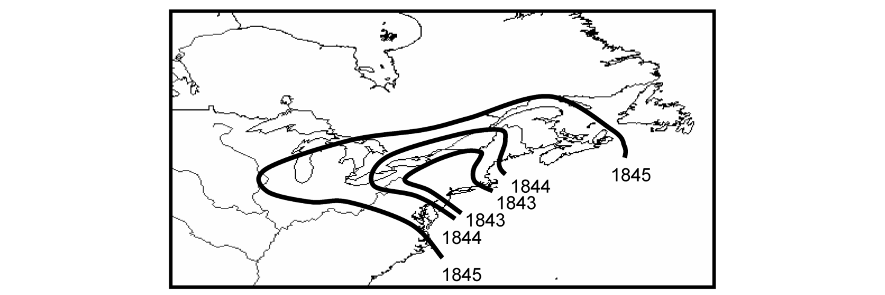{#fig-8-1}

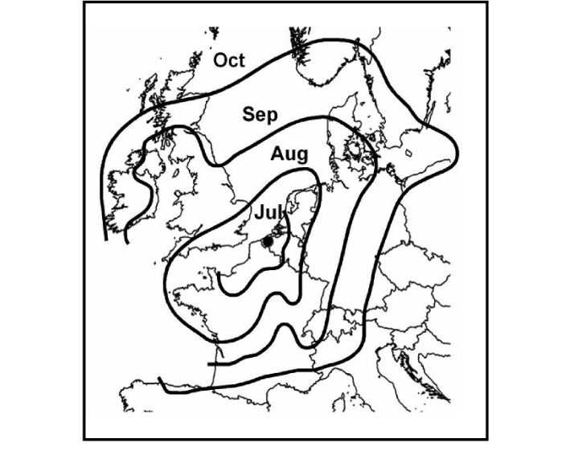{#fig-8-2}

### 8.1.2 Small scale, focus expansion

On a different spatial scale are the disease foci developing and expanding in single fields during epidemics. Such foci originate at the point of infection, where disease intensity subsequently expands radially (but not necessarily symmetrically) due to production of infectious units (e.g., spores), dispersal of the spores (or any infectious units), and new infections caused by some of the dispersed spores. Disease foci of this type were first described by Duhamel in 1728 (Zadoks, 1981)! Without knowing it at that time, he was dealing with an infectious disease of saffron crocus caused by the soil-borne fungus, _Rhizoctonia violacea_ (telemorph: _Helicobasidium_ sp _._). His work led him to recommend the containment of such foci by means of a circular trench because he realized that the disease was expanding from the center outward.

Duhamel was far ahead of his time with his research and it took centuries before the research on focal disease expansion was taken further.

One of the best studied examples of focal disease expansion in crop fields is stripe rust disease of wheat, caused by the fungal pathogen _Puccinia striiformis_. Research on foci of this plant pathogen system was done by Zadoks and co-workers (Zadoks and Schein, 1979; van den Bosch et al., 1988c, 1990b), as well as by Emge and Shrum (1976). Early work showed that the rate of focus expansion was as low as 8 cm/day (Zadoks and Schein, 1979). More recent research, based on large-size field experiments, shows that the rate of expansion for stripe rust actually increases in time under many circumstances (Cowger et al., 2005; Sackett and Mundt, 2005a, b) (Fig. 8.3).

Many other diseases are known to spread through crop fields as expanding foci. Rates of expansion vary from just a few centimeters per day, such as for downy mildew on spinach, caused by _Peronospora farinosa_ (van den Bosch et al., 1988c), to close to a meter per day for rust on oats caused by _Puccinia coronata_ (Berger and Luke, 1979). In Chapter 7 we covered the basic ways of quantifying the focus expansion through the use of observed disease (dispersal) gradients at multiple times, as well as with the use of simple descriptive spatiotemporal models for epidemics. The reader should review the material in section 7.6 before proceeding here. Those with more interest in the subject can read Zadoks and Schein (1979), Zadoks and van den Bosch (1994), Heesterbeek and Zadoks (1987), Jeger (1989), and references therein.

### 8.1.3 Common features of spatial disease expansion

Although the examples given above discuss spatial expansion of disease on widely different spatial scales, these epidemics have some basic features in common. First of all, the epidemics, whether expanding on a continental scale or on a field scale, showed this common wave-like expansion characteristic of many biological invasions. Often the rate of expansion of such epidemic waves is constant and can thus be expressed as single rate value (change in distance divided by change in time). In other cases (Ferrandino, 1993; Aylor, 1999; Frantzen and van den Bosch, 2000), it seems as if the wave increases its rate of expansion continuously, till it runs into the boundaries, either physical or climatological, of the area where disease can occur. Fig. 7.16 demonstrates both of these scenarios.

{#fig-8-3}

Underlying epidemic expansion both on a continental scale and on a field scale, and all scales in between, are two basic epidemiological processes we have studied in previous chapters. In Chapters 4, 5, and 6 we studied how epidemics develop in time. In particular, we have studied how epidemic increase depends on mean latent period () and the basic reproduction number (_R_ 0) of the disease, the latter being determined by the per-capita transmission rate (β _H_ 0) and the mean infectious period (ι = 1/ _μ_) (see equation 5.33). As will be shown, _reproduction_ [in the general sense, including transmission (from production of infectious units and probability of infectious units causing infection)] is one underlying processes of epidemic expansion. The disease can spread in space (i.e., occupy new area in the crop, region, and so on) because of the production of daughter infections over time. In Chapter 7 we discussed the dispersal of infectious units, such as spores, around sources of infected individuals, and the description of the resulting disease gradients with various nonlinear models. If all infections are originally at one location, then the disease gradient represents the new infections _beyond_ the mother infection(s), an indicator of spread. Thus, in addition to reproduction, dispersal is the other underlying process of epidemic expansion. The greater the reproduction and the greater the distance traveled by infectious units, the greater the epidemic expansion. The basic question is how the combination of reproduction (multiplication) and dispersal of the pathogen around infectious individuals adds up to the development of spatially expanding disease epidemics over time. There are several other related questions.

- How specifically does the rate of epidemic expansion (in, e.g., meters per day) depend on _R_ 0?

- How does the rate of expansion depend of the particular form of the contact distribution, as discussed in section 7.3.4?

- Under what circumstances does the epidemic expand with a constant rate and when does the rate of expansion increase (or change) continuously?

All such questions are difficult, if possible at all, to investigate with just observations of disease at various times and locations. We will, therefore, in the next section develop a model to describe the spatial expansion of disease epidemics based on the underlying mechanisms of reproduction and dispersal. Our understanding of the underlying mechanisms is based on observations and analysis of disease increase in time and dispersal of the pathogen (as presented in Chapters 4, 5, and 7). Analyzing several variants of the model we will be able to theoretically answer the questions posed above. This understanding of spread can then guide us in how we monitor and quantify actual epidemics in time and space.

Our concern in this chapter is mostly on polycyclic diseases, where there is spread from plant to plant, or individual to individual. However, in one section we discuss some of the key issues involved in the spread of monocyclic diseases.

In the next section we utilize the terminology developed in Chapter 5, section 5.1. We suggest that readers review that material before proceeding further.

## 8.2 Models for Spatial Population Expansion

### 8.2.1 Introduction

In this section we will study the rate of epidemic expansion using a model. As in Chapter 5, we describe a model that captures the bare essentials behind spatial and temporal dynamics of the epidemic. We assume here that the epidemic does not run into so-called _density dependence_ in terms of the healthy host. This amounts to saying that the density of healthy crop at any place and any time can be approximated by the density the crop had at the start of the epidemic (i.e., density of disease-free individuals, _H_ 0). The model thus describes a _density independent_ situation. Although this assumption may appear too unrealistic, it turns out, as will be discussed later, that this assumption is fully warranted for assessing expansion rates. This is because the density of infected individuals is generally low (or _H_ 0 is high) at the forefront or leading edge of the epidemic wave. This can be seen for several observed disease gradients in Fig. 7.1, where _Y_ (or _y_ = _Y_ / _H_ 0) is small at large distances from the inoculum source.

The assumption about density independence implies that each infected individual (such as a plant, leaf, or unit area of leaf surface) causes, on average, a total of _R_ 0 new infections over its entire infectious period (i.e., life-time). These infections are distributed through space in some fashion. In Chapter 7, we discussed disease gradients and contact distributions and we will use the concept of contact distribution to describe the pattern of the _R_ 0 new infections around an infectious individual. Further simplifying assumptions we use here are: (i) that disease generations are separated in time, as we also assumed for the discrete-time (non-overlapping generation) model at the start of Chapter 5 (section 5.2.1); and (ii) that space is one-dimensional. For practical purposes, the second assumption is consistent with a line source for the initially infected individuals (such as a row of diseased plants). A schematic of a line source is given in Fig. 7.2. In Chapter 7 we assumed that dispersal or spread was from the “edge” of the area of interest, so that distance (_s_) was exclusively a non-negative number (_s_ ≥ 0). Here we assume that spread can be to the “left” and “right” of the line source; in other words, we assume that the original and subsequent infections can be in any location in the area. With this assumption, _s_ can be a positive or negative value.

In section 8.3 we will discuss all these assumptions, describe how (or if) they affect the results we will obtain for the simple model, and refer to the relevant literature dealing with these issues. These assumptions can all be relaxed as needed.

### 8.2.2 Model derivation

To derive the model we show how the density of infectious individuals at position _s_ in disease generation _n_ + 1, _Yn_ +1(_s_), is related to the density of infectious individuals in generation _n_ at _all_ possible positions. We use the symbol _ξ_ for any possible (arbitrary) location and _s_ for the specific location of interest. With this notation, _Yn_ (_ξ_) is the density of infectious individuals at location _ξ_ at generation _n_. With a one-dimensional process, | _s_ − _ξ_ | then is the distance between location _s_ and location _ξ_ Note that here we assumed all diseased (infected) individuals are infectious. Thus, _Y_ = _L_ + _I_ + _R_ = 0 + _I_ + 0 = _I_. For ease of comparison with later sections, we express the models in terms of _Y_ (although this is equivalent to _I_ here).

First we calculate the contribution of infectious individuals at location _ξ_ in one generation to the density of infectious individuals in the next generation at distance _s_. We will use for this the notation _Yn_ +1(_s_)\ _Yn_ (_ξ_). Because we are considering the situation in which density dependence does not play a role (e.g., that each spore has no chance to land on an infected individual), each infected individual causes _R_ 0 new infections in the next disease generation; these new infections can be anywhere in the system. The total density of new infections in generation _n_ + 1 caused by all infectious individuals present at position _ξ_ in generation _n_ thus is given by _R_ 0 _Yn_ (_ξ_). We now have to calculate how many of these infectious individuals will develop at position _s_. The _contact distribution_, as defined in section 7.3.4, is a scaled version of the dispersal-gradient model that describes how the new infectious individuals in generation _n_ + 1 are distributed around the place where the infectious individual was in generation _n_. Equivalently, the contact distribution, _D_ (_s_ − _ξ_), multiplied by a scaling constant, is interpreted as the probability of an infectious unit produced at location _ξ_ coming in contact with a host individual at _s_. (Strictly speaking, _D_ (_s_ − _ξ_) is the _fraction_ per unit area of the _new_ infections (i.e., in generation _n_ + 1) at position _s_ due to an infectious individual at position _ξ_). The continuous distribution can also be called a probability density function (_pdf_). Fig. 8.4 represents the process for a hypothetical case of infected individuals at two locations, _ξ_ 1 and _ξ_ 2. The simplest situation would be for the infectious individuals being at one location (e.g., _ξ_ = 0) at generation _n_.

We can thus conclude that the density of infectious individuals in generation _n_ + 1 at position _s_ due to all **S PATIAL** **A SPECTS OF** **E PIDEMICS** **—II: A T HEORY OF** **S PATIO** **-T EMPORAL** **D ISEASE** **D YNAMICS** 215 infectious individuals in generation _n_ at position _ξ_ is given by:

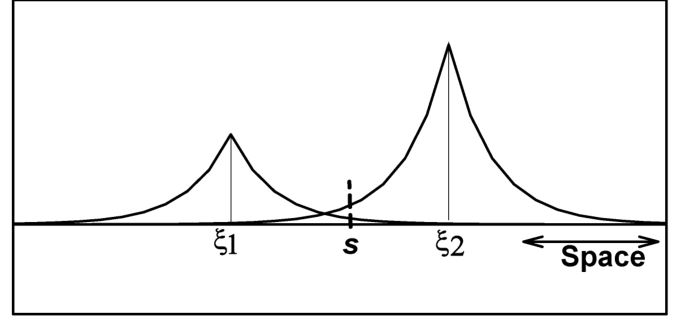{#fig-8-4}

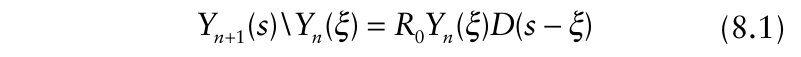{.equation width=60%}

To calculate the total density of infectious individuals at position _s_ in disease generation _n_ + 1, we have to add up all contributions to infections at _s_ from _all_ individuals in generation _n_ at _all_ possible locations _ξ_. Adding up over a continuous variable, in this case continuous space, amounts to integrating over _ξ_. The model equation, therefore, takes the final form:

{.equation width=60%}

This is a spatial extension of the purely temporal model for disease increase over discrete generations discussed in Chapter 5 (equation 5.4) for the situation when healthy host density is not limiting. Note that infected individuals at any location, including at location _s_, can contribute to infections at _s_. The magnitude of the contribution from each location depends on the distance separating _s_ and _ξ_, as quantified by _D_ (_s_ − _ξ_).

As with the discrete-time model for the temporal dynamics of an epidemic derived in Chapter 5 (equations 5.2a and 5.2b), model equation 8.2 is, in principle, easily solved, although the computations are tedious. Substituting the contact distribution and the value of _R_ 0, it is possible to calculate the density of infectious individuals in generation _n_ = 1, _Y_ 1(_s_) if we know the initial condition _Y_ 0(_s_). For instance, _Y_ 0(_s_) could be zero at all _ξ_ values except one (say, at _ξ_ = 0). The integral might be difficult to work with, but numerical procedures are available in several computer packages. To calculate the second generation, _Y_ 2(_s_), we substitute _Y_ 1(_ξ_) again in equation 8.2. This is continued for multiple generations.

The reader is reminded here that this is a density independent variant of a model first studied by Aronson and Weinberger (1978) and Weinberger (1978, 1982).

Recently this model was studied by Kot et al. (1996) and versions including more aspects of demography by Neubert and Caswell (2000).

### 8.2.3 Rates of expansion in relation to contact distributions

In this section we will consider examples of rates of disease expansion based on four different contact distributions. The four distributions are given in Table 8.1. We will discuss each of these expansion-rate results in sequence. Each epidemic is started with _Y_ 0 individuals at position _s_ = 0; that is, _Y_ 0(_s_) = 0, except for _Y_ 0(0) > 0.

Before discussing spatial dynamics based on the model, we first discuss some properties of the selected contact distributions that are relevant for the interpretation in the next sections. It is convenient to discuss these distributions in terms of spore flight distances, although the contact distribution applies to more than just spore movement (Chapter 7). In the previous chapter, we exclusively considered situations with _s_ ≥ 0, and mostly dealt with two contact distributions, the exponential (equation 7.8) and Pareto (equation 7.9). Now, we allow _s_ to be positive or negative (−± ≤ _s_ ≤+±), to allow for, for example, spore arrival from both “sides” of the location of interest (as shown schematically in Fig. 8.4).

Fig. 8.5 plots realizations of the four contact distributions, with parameter values chosen such that the predicted values had a fair degree of overlap (although total overlap is impossible). Other distributions could also be used, but these four encompass a sufficiently wide range of possibilities. The _double exponential distribution_, sometimes known as the Laplace distribution, is a generalization of the exponential when _s_ can take on any value from positive to negative infinity. Likewise, the _modified power-law distribution_ is a generalization of the Pareto distribution, which was used in Chapter 7, for the case of positive and negative _s_. The _Gaussian distribution_ is the classical normal distribution for the random variable _s_. Finally, the _root distribution_ is a nonstandard model for the distribution of _s_ that serves a useful purpose in the comparison of contact distributions, as will become clearer below.

Statistical distributions are often characterized by their first two moments, that is, the mean (expected value) and the variance. However, all distributions do not have finite or definable means and variances, as discussed by Minogue (1989) in one particular context. In Chapter 7 it was pointed out that the Pareto distribution (i.e., for the case with the distance variable being nonnegative) only has a finite mean and variance with suitably large Ψ. The distributions in Table 8.1 are specifically defined here to be symmetrical around distance 0, so they all have means of 0. The variance of the Gaussian, double exponential, and root distributions are σ2 , σ2 , and Γ(6)/ Ψ6 , respectively (where Γ(•) is the gamma function). The modified power law distribution

{#fig-8-5}

**Table 8.1.** Four contact distributions [ _D_ (_s_)]a of relevance in the spread of plant diseases.

|**_Common name_**|**_D(s)_**=**_b_**|**_ln[D(s)]_**=|**_Disease expansion rate_** **_[Cn or C(t)]_****_c_**|
|---|---|---|---|
|Gaussian|2 2 1 exp 2 2 _s_ _σ_ _σ_ _π_   −    |2 2 1 ln 2 2 _s_ _σ_ _σ_ _π_  −    |Approaches constant (_C_)|
|Double exponential|1 | | 2 exp 2 _s_ _σ_ _σ_   −    |1 2 | | ln 2 _s_ _σ_ _σ_  −  ~~~~  |Approaches constant (_C_)|
|Root|( ) 2 exp | | 4 _s_ Ψ −Ψ|2 ln( ) ln(4) | |_s_ Ψ − −Ψ|Increases linearly|
|Modified power law|( 1) ( | |) 2 _s_ _λ_ _λ_ Ψ −Ψ + Ψ +|ln( /2) ln( ) ( 1)ln( | |) _s_ _λ_ _λ_ Ψ + Ψ −Ψ + +|Increases exponentially|

> aDistributions written with ξ = 0. For a more general version of the models, one can replace _s_ by _s_ −ξ throughout. The range for _s_ is negative to positive infinity.

> bParameter units: distance for σ in double exponential and Gaussian distributions; distance−1/2 for Ψ in the root distribution; unitless for Ψ, and distance for λ in the modified power law distribution. All parameters are positive.

> cChange in distance per generation or per time period where a low value of _Y_ (_Y_ ′) is found. See equation 8.6 for general formula.

only has a finite variance at Ψ > 2, and its form is so cumbersome as to be intuitively uninformative. For the four distributions here, however, σ, 1/ Ψ (root), and λ / Ψ (modified power law) have the same general (but not exact) interpretation in terms of contact and dispersal: larger values of σ, 1/ Ψ (root), and λ / Ψ (modified power law) mean greater distances of spore movement or larger spatial ranges of contact between host individuals.

The σ parameter of the Gaussian and double exponential distributions, the Ψ parameter of the root distribution, and the Ψ and λ parameters of the modified power-law distribution were chosen for Fig. 8.5 so that _D_ (_s_) values all intersect at the same _s_ value. The vertical axis is on a linear scale (left-hand side) or a logarithmic scale (right-hand side). On a linear scale, the four distributions look quite different near the center (at distances near 0), but appear quite different in the tails (i.e., values relatively far from _s_ = 0).

The differences between the tails of the four contact distributions become very clear when using a log scale for the ordinate (Fig. 8.5). The double exponential distribution consists of straight lines. The tail of the Gaussian distribution decreases faster with distance from the origin than the exponential distribution. Both the double exponential and the Gaussian distribution are said to be _exponentially bounded_ (see section 7.3.4), meaning that the tails fall off (declines) faster than, or as fast as, an exponential function. In contrast, the root and the modified power-law distributions clearly decrease less than exponentially with distance. In particular, the rate of decline in ln[ _D_ (_s_)] decreases with increasing distance from the origin (Fig. 8.5). This is _not_ dependent on the chosen values for Ψ and/ or λ. Distributions with this property are said to be non-exponentially bounded, “fat-tailed”, or “heavy tailed”.

As discussed in Chapter 7, it was emphasized that there are many examples of dispersal gradients described by the exponential gradient model and many other examples of gradients described by the power-law gradient model. This means there are numerous examples of contact distributions that are either exponentially bounded or not exponentially bounded. In the next sections we show that there is an essential difference between the spatial expansion of the epidemic for an exponentially bounded and for a non-exponentially bounded contact distribution. These mechanistic results add to the more descriptive results given in the previous chapter. position of a pre-specified density of infected individuals, _Y_ ′, at time (generation) _n_, relative to the starting point of the epidemic, _sY_ ′, _n_. To simplify the presentation of the equations and other calculations, we simplify the notation somewhat and use _sn_ ′ for _sY_ ′, _n_. In Fig. 8.6A this concept is illustrated by the identification of _Y_ ′ on the ordinate and the position of this value of disease for each generation on the abscissa. The line of fixed disease level is known as an _isopath_ (see section 7.6.3), so _sn_ ′ is an isopath. Calculating the position of the small density of infectious individuals requires solving the equation _8.2.3.1 Gaussian contact distribution_. Model equation 8.2 with the Gaussian contact distribution (Table 8.1) can be solved explicitly (N. L. Johnson et al., 1994, 1995) for disease density at location _s_ in generation _n_. The solution is:

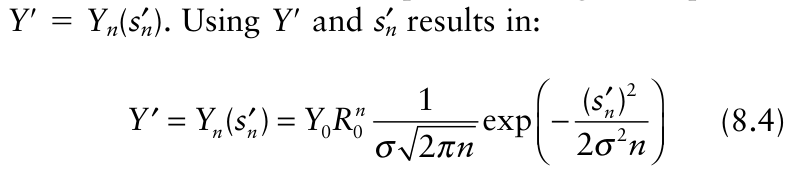{.equation width=60%}

and after some algebraic manipulation we find:

{.equation width=60%}

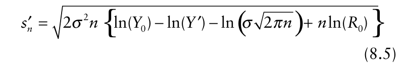{.equation width=60%}

Fig. 8.6 shows an example realization of the solution of this model. How will the front of the epidemic wave move through space over time (i.e., between generation)? To calculate this we determine from equation 8.3 the Fig. 8.7 shows _sn_ ′ as function of generation, _n_. The figure shows that after a very short initial phase, the distance of _Y_ ′ to the starting point of the epidemic increases linearly with time. This implies that the rate of expansion is a constant. To calculate the rate we will consider the average rate of expansion between the start of the epidemic, _n_ = 0, and the present generation _n._ This average rate of expansion, denoted by _Cn_, is calculated from:

![Spatial expansion of disease density, _Yn_ (_s_), as described by equation 8.2, corresponding to the four contact distributions depicted in Fig. 8.5 and listed in Table 8.1 It is assumed that the original inoculum source is at distance 0. Vertical axis is density of diseased individuals, and horizontal axis is distance from the starting point of the epidemic. Only positive distances are shown, although spread can be in both directions. (**A**) Gaussian contact distribution; (**B**) double exponential contact distribution; (**C**) root contact distribution; and (**D**) modified power law contact distribution.](figures/fig8-img06.png){#fig-8-6}

{#fig-8-7}

{.equation width=60%}

Substituting equation 8.5 in this expression we find as the rate of epidemic expansion:

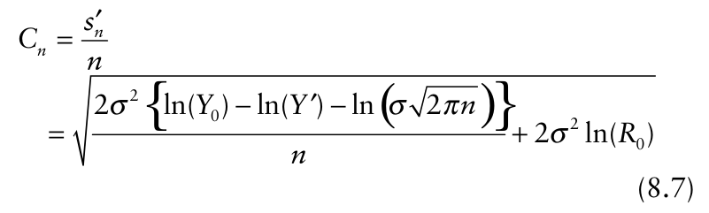{.equation width=60%}

In Fig. 8.8 the average rate of epidemic expansion is plotted as a function of time, for the same parameters and initial condition as those used in Fig. 8.6. _Cn_ is the rate (or velocity or speed) of isopath movement (as in section 7.6.3.2). We see from this figure that the rate of expansion reaches a constant rate, _C_, very soon after the start of the epidemic. This result also holds for other parameter values than the ones used to calculate Fig. 8.8. This constant rate of expansion can be calculated mathematically from equation 8.7 by letting _n_ go to infinity (i.e., increase indefinitely). We immediately see from this equation that the whole first term under the square-root sign vanishes. The constant rate of expansion thus is: deviation of the Gaussian distribution; that is, increasing _σ_, which means a shallower gradient, results in a higher _C_. Moreover, _C_ increases with _R_ 0 meaning that increasing the number of new infections resulting from each infection also results in a faster velocity of isopath movement. For large values of _R_ 0, say _R_ 0 > 10, _C_ approximately increases linearly with the logarithm of _R_ 0. The per unit increase in _C_ with _R_ 0 is higher when _R_ 0 is low than when it is high.

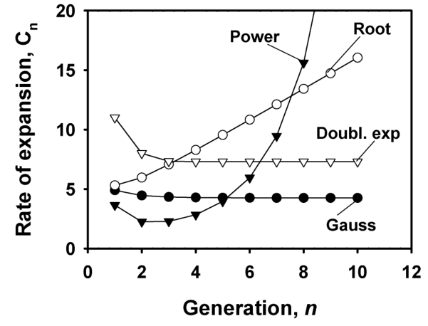{#fig-8-8}

Before assessing the model (equation 8.2) with the other contact distributions, we discuss some numerical examples. Suppose we have done a series of experiments and found that the contact distribution of the disease under consideration is Gaussian and has a standard deviation of 10 cm. This value could be obtained, for instance, with a fungal disease dispersed by spores, by introducing infectious plants in one row in a field (for generation 0), and counting new infections at several distances from the origin the equivalent of one generation later (at _n_ = 1). As long as _Y_ 1(_s_) is not high, one can regress ln[ _Y_ 1(_s_)] on _s_2 , and the slope is an estimate of 1/(2σ2 ) (see Table 8.1). Furthermore, suppose that an experiment on focus expansion of this disease, as discussed in sections 8.1.2 and 7.6.5, shows an expansion rate at around 12 cm/day over a few generations. This can be done by identifying a particular density of disease (say, _Y_ ′ = 1), determining where this density is found for each generation (_sn_ ′ ), and then using equation 8.6. What does this tell us about the value of _R_ 0? Solving _R_ 0 from equation 8.8 we find:

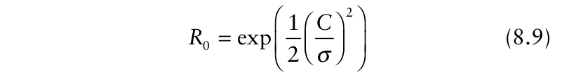{.equation width=60%}

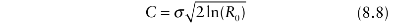{.equation width=60%}

Fig. 8.9A shows the dependency of _C_ on the parameter values _R_ 0 and σ. _C_ increases linearly with the standard Substituting σ = 10 and _C_ = 12 we find that _R_ 0 = 2.05. Suppose we can choose between two focus expansion **S PATIAL** **A SPECTS OF** **E PIDEMICS** **—II: A T HEORY OF** **S PATIO** **-T EMPORAL** **D ISEASE** **D YNAMICS** 219 management methods. First, that it is possible to reduce σ by 50%. This can be done, for example, by planting a different crop variety whose plant architecture is such that the crop is more dense, implying less air movement in the crop and consequently infectious units being dispersed over shorter distances. Substituting this into equation 8.8 we find that the rate of disease expansion is reduced to 6 cm/day. We are assuming here that _R_ 0 is not affected by this management tactic. Our second disease management method involves the use of fungicides that reduces _R_ 0 by 50%. Substituting this new _R_ 0 into equation 8.8, we find that the rate of focus expansion is reduced to 2.2 cm/day. For small values of _R_ 0 it is more efficient (at least for this Gaussian contact-distribution example) to restrict disease expansion by reducing the number of new infections from each mother infection than it is to change the length scale of the contact distribution (σ).

{#fig-8-9}

Instead of using equation 8.6, one could obtain estimates of expansion velocity for each _successive_ pair of generations. For a given _Y_ ′, we can define the generational rate (or velocity) as:

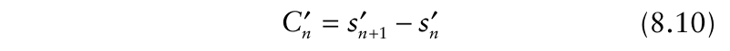{.equation width=60%}

where _sn_ ′ and _sn_ ′ +1 are the distances where _Y_ ′ is found in generations _n_ and _n_ + 1, respectively. One could plot these, and if no trend is apparent (as expected here), then an average of the _Cn_′ values could be an estimate of _C_. Equation 8.10 produces “instantaneous” values of velocity (as also utilized in Chapter 7), whereas equation 8.6 produces an overall average from the first to _n_ th generation. We emphasize the use of equation 8.6 here, since the biological interpretation is the same as that obtained with the mean of equation 8.10.

_8.2.3.2 Double exponential contact distribution._ Model equation 8.2 with the double exponential contact distribution (Table 8.1) can be solved explicitly (N. L. Johnson et al., 1994, 1995), although the solution is very messy:

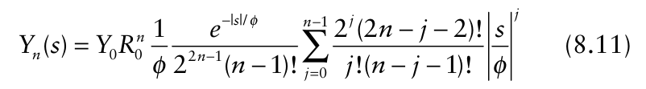{.equation width=60%}

where _φ_ = _σ_ / 2 . Fig. 8.6B shows a solution of the model for the same parameter values as used for the solution of the model with the Gaussian contact distribution. The figure shows that the solutions for density of the infected individuals are very similar to those using the Gausian density as contact distribution, except that the rate of expansion of the model with the exponential contact distribution seems to be higher.

Unfortunately, equation 8.11 is so complicated that it turns out not to be possible to explicitly derive an equation for _sn_ ′ nor for the average rate of expansion _Cn_, as was done for the model with the Gaussian contact distribution. From equation 8.11, distance _sn_ ′ and the rate _Cn can_ be calculated numerically (i.e., iteratively), and Figs. 8.7 and 8.8 show the results of this calculation. As for the model with the Gaussian contract distribution, we see from the figure that _Cn_ approaches a constant value (_C_) just a few disease generations after the start of the epidemic. Without further proof we mention that this is not due to the particular set of parameter values chosen. For each possible set of parameter values the rate of expansion approaches a constant.

Fig. 8.9B shows _C_ as a function of the logarithm of _R_ 0 for various values of σ of the double exponential distribution. This figure shows that the rate of expansion for the model with the double exponential distribution is larger than for the model with the Gaussian distribution. This is due to the fact that the exponential distribution has thicker (heavier, fatter) tails than the Gaussian distribution (but still exponentially bounded), resulting in more new infections further away from an infected individual. For values of _R_ 0 larger than approximately 2, the rate of expansion is close to linear in the logarithm of _R_ 0.

_8.2.3.3 Root contact distribution._ When using the root contact distribution in model equation 8.2, it is not possible to solve the model explicitly. Kot et al. (1996) have, however, introduced a very useful method to calculate approximations to the solution. Applying their method we find as approximate solution:

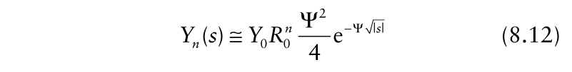{.equation width=60%}

Fig. 8.6C shows a solution of the model. The figure suggests that the rate of epidemic expansion does not apparently converge to a constant. In fact, the rate of expansion keeps increasing over time (i.e., generation) as indicated by increasing distances between low _Y_ values from generation to generation. This is a different qualitative behavior than found with the Gaussian and the double exponential contact distributions.

The average rate of disease expansion, _Cn_, can be calculated using the same procedure as for the model with the Gaussian contact distribution. This procedure yields:

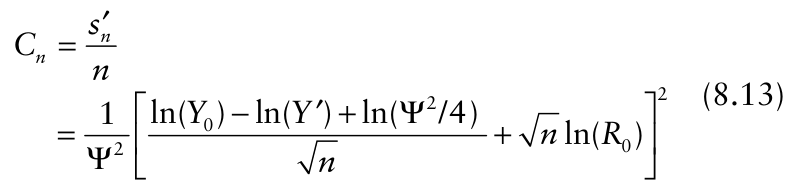{.equation width=60%}

For large values of _n,_ this becomes:

{.equation width=60%}

This last expression shows that the rate of epidemic expansion indeed increases linearly with time (generation), with a slope of [ln(_R_ 0)]2 / Ψ2 . Specifically, the rate of expansion increases per generation with the square of the logarithm of the basic reproduction number and with the square of the distances traveled by spores (related to 1/ Ψ). The plot of _sn_ ′ versus _n_ (Fig. 8.7) shows the expected upward curvature, indicating increasing rate of disease expansion. The plot of _Cn_ versus _n_ (Fig. 8.8) confirms the _linear_ increase in the expansion rate after a few generations. The implication of equation 8.14 is that the farther the distance from the inoculum source, the greater the expansion rate of the epidemic.

It was pointed out before that, all other things being equal, _Cn_ (or _C_) is higher with a double exponential than with a Gaussian distribution for contact in the epidemic model. However, there is no simple overall comparison of _Cn_ obtained with a root and the previous contact distributions. This is because the expansion rate increases with time (generation) for the root distribution. Depending on the value of Ψ, _Cn_ may be lower or higher than the corresponding rates for the previous two contact distributions when _n_ is not large. With enough time, however, the expansion rate for a root distribution will (must!) surpass that obtained with the previous two distributions, since _Cn_ is directly proportional to _n_. With sufficient time, _Cn_ for a root distribution can be considerably larger than that obtainable with the Gaussian or double exponential distribution.

_8.2.3.4 Modified power law contact distribution._ Using the modified power law contact distribution in equation 8.2, it is not possible to solve the model explicitly. Applying the method of Kot et al. (1996) again we find as approximate solution:

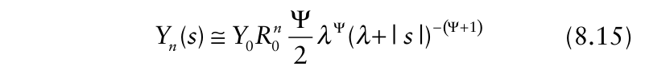{.equation width=60%}

Fig. 8.6D shows a solution of the model for one set of parameters. The figure suggests that, as for the model with the root contact distribution, that the rate of epidemic expansion does not converge to a constant, but that the rate of expansion keeps increasing over time (as demonstrated by the increasing distance between a selected low disease density for successive pairs of generations). In fact, with this example, it appears that the rate of expansion is increasing faster between generations than with the root contact distribution. How does the rate of epidemic expansion, C _n_ precisely increase with time? To answer this question, _Cn_ was calculated using the same procedure as for the model with the Gaussian contact distribution. This procedure yields:

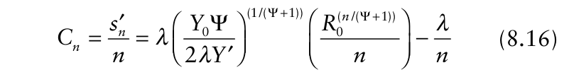{.equation width=60%}

For large times (generations), equation 8.16 approaches:

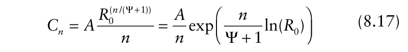{.equation width=60%}

**S PATIAL** **A SPECTS OF** **E PIDEMICS** **—II: A T HEORY OF** **S PATIO** **-T EMPORAL** **D ISEASE** **D YNAMICS** 221 where the constant _A_ is given by:

{.equation width=60%}

From equation 8.17 we see that the rate of epidemic expansion increases as an exponential function of time (_n_). However, the relationship is a little more complicated, since _n_ also appears in the denominator outside the exponential or power function in equations 8.16 and 8.17. This means that at small _n_ (i.e., when equation 8.16 applies), the expansion rate _could_ initially decrease with increasing time (depending on the other parameters), but the exponential function of _n_ will dominate after a few disease generations, giving an increasing _Cn_.

Figs. 8.7 and 8.8 demonstrate how _sn_ ′ and _Cn_, respectively, are related to time (generation) with a particular combination of _R_ 0 and contact-distribution parameters. The distance where _Y_ ′ is found (_sn_ ′ ) is clearly seen to increase over all times as the focus expands (Fig. 8.7), although there is a slight decrease in the rate of disease expansion for the first two generations, followed by an increasing rate (with no upper bound) (Fig. 8.8). Unlike the case for a root contact distribution, the increase in disease expansion rate is more than linear. That is, the change in _Cn_ ultimately becomes larger with every successive pair of generations.

As discussed for the root distribution, there is no simple comparison of _Cn_ between models with the modified power-law contact distribution and with the Gaussian and double exponential distributions. During the early stages of an epidemic, _Cn_ for a modified power-law distribution may be smaller or larger than the _Cn_ for a Gaussian or double exponential distribution (depending on the other parameters). However, with sufficient time, with the modified power-law distribution will be larger, possibly much larger, than the others.

### 8.2.4 Comparisons

Most plant diseases do not increase in discrete and non-overlapping generations (see Chapters 4 and 5). However, we showed in section 5.2.1 that use of discrete-generation models can readily lead to a general understanding of temporal dynamics of diseases. In fact, key results obtained with such a simple model— thresholds for epidemics, final disease levels, exponential increase early in the epidemic—all carry over to more realistic (but more complicated models) (sections 5.2.2–5.2.5). Here we utilize the simplicity of a discrete generation model to explore the consequences of different forms of the contact distribution (a scaled version of the disease gradient when healthy host density is not limiting) on spatio-temporal dynamics of disease. As required, the increase in disease density from generation to generation is dependent on _R_ 0. Moreover, we found that the expansion rate of a disease focus (_Cn_ or _C_) is also dependent on _R_ 0 (the descriptor of reproduction, in the general sense) for all the contact distributions considered. The functional relationship _does_ depend on the contact distribution, but typically _Cn_ is proportional to ln(_R_ 0). Since ln(_R_ 0) is only positive when _R_ 0 > 1, it is clear that for _Cn_ to be positive in the long term (e.g., Gaussian distribution), or for the increase in _Cn_ to be positive in the long term (e.g., root and modified powerlaw distributions), then _R_ 0 must exceed 1.

The results of the previous sections show that there are two very distinct qualitative classes of disease expansion in epidemics. The first one is the class of _traveling epidemic waves_, where it can be said that spread is in a wave-like manner (see section 7.6.3). A traveling wave occurs when the contact distribution is Gaussian, double exponential, or any distribution that has an exponentially bounded tail. Mollison (1972) expressed this as a more formal rule based on the moment generating function of the contact distribution. The traveling waves approach a constant rate of expansion. As far as our understanding goes, this constant rate is approached very quickly, but this does depend on the parameter values. Traveling waves for populations have been described by mathematicians as early as 1937 (Fisher, 1937). The concept has been applied to: ecology for population expansion (Skellam, 1951; Hengveld, 1989; van den Bosch et al., 1992; Kot et al., 1996; Shigesada and Kawasaki, 1997; Neubert and Caswell, 2000); animal epidemiology for disease expansion (Diekmann, 1978, 1979; Thieme, 1977, 1979; Mollison, 1972); and to genetics for the rate of expansion of a gene (Fisher, 1937). Traveling epidemic waves also have been modelled for plant disease epidemic models (Kampmeijer and Zadoks, 1977; Zadoks and Kampeijer, 1977; Minogue and Fry, 1983a, b; van den Bosch et al., 1988a–c, 1990a, b, 1999).

The second class of disease expansion is of _dispersive epidemic waves_. A dispersive wave occurs with the root and modified power-law contact distributions, or with any distribution that does not have an exponentially bounded tail (see also section 7.6.3). Waves of this type continuously keep increasing in their rate of expansion (_Cn_ never approaches a constant). Mechanistic, statistical, and meteorological arguments for this type of disease expansion were provided by Ferrandino (1993), Minogue (1989), and Aylor (1999). Recently, the idea of dispersive waves has also received attention both in plant pathology (Aylor, 1999; Cowger et al., 2005; Frantzen and van den Bosch, 2000) and in ecology (Kot et al., 1996). As our results for the root and modified power-law distributions demonstrate, the rate of expansion of dispersive waves can increase with time in various ways. We do not know of any thorough investigation about the formal relation between the shape of contact distributions and the way the rate of epidemic expansion increases for dispersive waves, and much still has to be discovered about this.

Traveling waves and dispersive ways were introduced in the previous chapter (section 7.6.3) in terms of observed epidemics and using a more descriptive model. We discuss some other features of the spatio-temporal model of Chapter 7 in more detail later, but here we point out an aspect of the spatial component of that model. Equations 7.33 and 7.35 were not based on _explicit_ consideration of the contact distribution, but dealt directly with the disease gradient (_Y_ or _y_ in relation to _s_), with correction for a maximum disease level of 1. Moreover, although the equations of the previous chapter could describe gradients of disease in relation to the original inoculum source at multiple times, they could not adequately represent spread of disease between any two arbitrary locations away from the original inoculum source. Basically, of the possible models that could have been used for the spatial component, in order to provide general agreement with observed gradients at several times in an epidemic, equations were chosen specifically to obtain either a constant expansion rate or one that increased with time. Using a model for spread in this chapter, where contact between host individuals is directly incorporated at the level of each infected and healthy individual, we showed how traveling and dispersive wave can (must) naturally develop.

The more realistic spatial component here also shows that more complicated spread behavior can occur during the very early stages of polycyclic epidemics, before the spread “settles down” into its long term behavior of either a constant expansion rate or accelerating rate. Interestingly, in the simpler modeling of Chapter 7, we showed that the expansion rate was a function of the temporal rate parameter (e.g., _r_ L for the logistic model). Moreover, in Chapter 5 we showed that _r_ E (same as _r_ L when _y_ is low for a logistic epidemic) is related to _R_ 0. Thus, the results of the previous chapter are broadly consistent with the ones here, where _C_ is seen to be a function of ln(_R_ 0).

## 8.3 Some Extensions

### 8.3.1 One-dimensional versus two-dimensional epidemic expansion

Model equation 8.2 describes an epidemic in a onedimensional space. Epidemics generally develop in two dimensions, and we need to know how the rate of epidemic expansion in one dimension relates to the rate of epidemic expansion in two dimensions. If the epidemic develops from a line source which is long compared to the distance infectious units disperse (see Chapter 7), the density of infectious units (and resulting infected host individuals) at a given distance perpendicular to this line source will be the same (on average) for every position along the line source. For instance, in Fig. 8.10, the density of infected individuals at point A will be the same as the density of infected individuals at point B, and the same will hold for any point that is a perpendicular distance _d_ from the line source. This implies that we are dealing with a one-dimensional spatial epidemic, at least in terms of the model, where the space direction is perpendicular to the line source. Only at the edges of the line source we will see differences. If the line source is long compared to the standard deviation of the contact distribution (where there is a definable standard deviation, as with the Gaussian distribution), then the complications of an edge effect will not be of concern.

Now consider an epidemic developing from a point source, and assume that the two-dimensional space is homogeneous, meaning that all environmental circumstances are the same at every location, and the density of the crop is the same at every point. Under this assumption, the epidemic will be _rotationally symmetric_ at every moment in time (at least in the model). Fig. 8.10 shows the epidemic developing from a point source (similar to Fig. 7.17). Contour lines for a fixed density of infected individuals are drawn for various points in time. These contour lines are concentric circles. When these concentric circles are large enough, locally they look like a straight line. That is, in the vicinity of any point on a circle, the circle appears a straight line in the same way as any uninformed observer would consider the world to be a flat disk based on local observations. This implies that such an epidemic can _eventually_ be approximated (after enough time so that the circle circumference is not too small) by an epidemic expanding in one dimension, in which the direction is parallel to the circle. The one-dimensional model of this chapter thus applies to epidemics that develop from a point source as well, if we take care to use the proper form of the contact distribution, as will be discussed below.

There is, however, still the question left of what the general relation is between the two-dimensional contact distribution around an infectious individual and the one-dimensional contact distribution perpendicular to a line of infectious individuals. Consider a twodimensional contact distribution _D_ (_s_ 1, _s_ 2). This distribution gives the scaled probability per unit area of an infectious unit originating at (0, 0) being at (_s_ 1, _s_ 2). Equivalently, _D_ (_s_ 1, _s_ 2) is the fraction per unit area of the new infections at position (_s_ 1, _s_ 2) due to an infectious individual at (0, 0). We could have just as easily taken any other position as the origin (_ξ_ 1, _ξ_ 2); then the contact distribution is written as _D_ (_s_ 1 − _ξ_ 1, _s_ 2 − _ξ_ 2). Let us assume a line source is parallel to the ordinate of our coordinate system. Fig. 8.10 shows an example in the lower right corner. Such a line source can be thought of as composed of a linear series of point sources. Drawn in Fig. 8.10 is a series of contour lines depicting _D_ (_s_ 1, _s_ 2) distributions around arbitrary points on the line. The contact distribution for the line source in _just_ the _s_ 1 direction, _D_ (_s_ 1), is the scaled probability of infectious units on a line perpendicular to the line source. The figure **S PATIAL** **A SPECTS OF** **E PIDEMICS** **—II: A T HEORY OF** **S PATIO** **-T EMPORAL** **D ISEASE** **D YNAMICS** 223 attempts to make clear that the one-dimensional contact distribution can be calculated by adding up all contributions of all point sources, which is equivalent to the summation over all possible values of contact probability across the second spatial dimension (_s_ 2). Assuming continuous space, we use integration instead of summation and write:

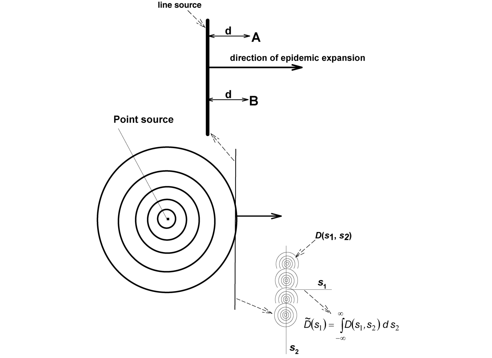{#fig-8-10}

Some papers that deal with two-dimensional models for contact distributions include: Aronson and Weinberger (1978) and Weinberger (1978, 1982). We do not further work with explicit two-dimensional contact distributions in this chapter.

### 8.3.2 Continuous time and more realistic temporal dynamics

{.equation width=60%}

_D s_ ( 1) is known in statistics as the _marginal distribution_ of the bivariate distribution _D_ (_s_ 1, _s_ 2).

Each contact distribution of Table 8.1 can be considered the marginal distribution of some bivariate distribution. Although one can, in principle, determine the marginal distribution for a given bivariate distribution, the opposite is not necessarily true—one cannot necessarily determine the bivariate distribution for a given marginal distribution. For the Gaussian distribution, the relationship is straightforward—the marginal and bivariate forms are both Gaussian (see Johnson and Kotz, 1970).

_8.3.2.1 Model and simulations._ Model equation 8.2 can be extended to represent epidemics with: overlapping disease generations (i.e., with continuous time); latent and infectious periods; dependence of the rates on healthy host density (i.e., for the density-dependent situation, when _H_ (_t_) is not considered fixed at _H_ 0); and healthy hostdensity growth in the absence of disease. These extensions are similar to the way our simplest epidemic progress model (equations 5.2a and 5.2b) was extended in Chapter 5. The H-I-R, H-L-I-R, Vanderplank differential-delay, and the Kermack-McKendrick models can all be extended to allow for an explicit spatial component (Diekmann, 1978, 1979; Thieme, 1977, 1979).

The model equations become:

For brevity, we consider only a spatial extension of the H-L-I-R model discussed in section 5.2.3. The densities of healthy, latent, infectious and removed individuals are now a function of both time, _t_, and position (location) in space, _s_, _H_ (_t_, _s_), _L_ (_t_, _s_), _I_ (_t_, _s_), and _R_ (_t_, _s_), respectively. We now assume that _t_ and _s_ are both continuous variables. The model is given in pseudo-equation form as:

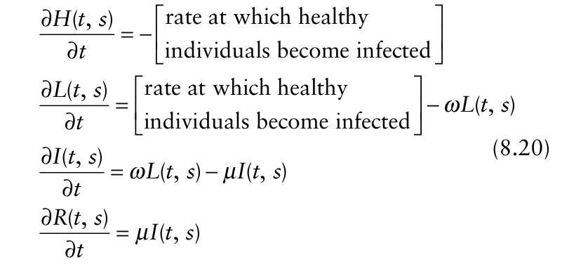{.equation width=60%}

where the ∂/∂ _t_ notation means the _partial_ derivative with respect to time, with the same interpretation as in the differential equation models of Chapter 5. The rate of infection term at position _s_ now depends, as in the discrete-generation equation 8.2, on infectious units (e.g., spores) that are produced by infectious individuals at all possible positions _ξ_. The density of infectious individuals at time _t_ at position _ξ_ is represented by _I_ (_t_, _ξ_). The probability that an infectious unit (e.g., spore) produced by an infectious individual at _ξ_ will contact a host individual at position _s_ is now given by the contact distribution, _D_ (_s_ − _ξ_), multiplied by θ′. Spores may be deposited between plants, for instance. Thus, θ′ reflects the fact that some infectious units never contact a host anywhere. If each infectious individual produces _α_ spores per time unit, the total influx of spores at position _s_ per time unit due to all infectious individuals at position _ξ_ is given by _αI_ (_t_, _ξ_) _D_ (_s_ − _ξ_)θ′. To calculate the total influx rate of spores at position _s_ due to all infectious individual in the crop we need to add up all contributions of all infectious individuals at all possible positions _ξ_. This amounts to integrating over _ξ_ and we have:

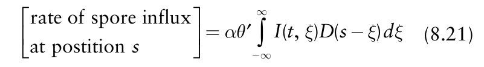{.equation width=60%}

Further, noting that each infectious unit in contact with a host has a probability _ψ_ to cause an infection, and following the same reasoning as for the derivation of the infection term in the H-L-I-R model in section 5.2.3.1, we find that:

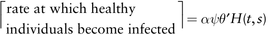

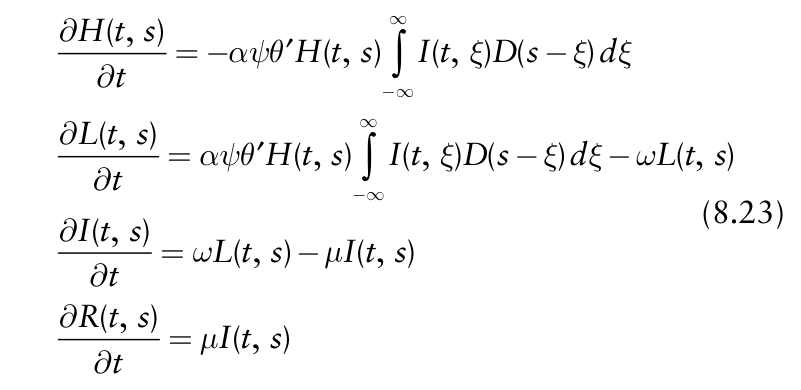{.equation width=60%}

We can simplify the expression by defining the transmission rate as β = _α_ θ′ _ψ_, as done in Chapter 5, and use β in equation 8.23. It is important to note that θ′ may not always be explicitly used in the model formulation. That is, any scaling of the contact distribution simply becomes an implicit part of the transmission parameter (together with sporulation rate and probability of infection).

Note that this model _does_ include density dependence in terms of disease-free host density. Minogue and Fry (1983a, b) analyzed a model including similar extensions of a purely temporal model to a spatio-temporal model, but they used the Vanderplank specification of latent and infectious periods (see equation 5.44). Models for the spatial expansion of epidemics also have been developed to include the more general sporulation (“infectivity”) curve approach of Kermack and McKendrick (1927) for the latent and infectious periods as described in section 5.2.5. These models were first developed and analyzed by Diekmann (1978, 1979) and Thieme (1977, 1979) and were subsequently operationalized by van den Bosch et al. (1988a–c, 1990a, b, 1992, 1999) to analyze biological invasions and the expansion of plant disease foci.

By summing the partial differential equations for latent, infectious, and removed disease states, one can determine the equation for the change in total disease at a given time and location:

{.equation width=60%}

When density of diseased individuals is low, _H_ (_t, s_) is near the initial total host density, _H_ 0 (and we assume here that _H_ 0 does not depend on location). We can thus assume that _H_ (_t, s_) ≅ _H_ 0. Then, equation 8.24 can be approximated by:

{.equation width=60%}

It is helpful to compare equation 8.24 with the one for a purely temporal epidemic given in the previous chapter (section 5.2.3) for the H-L-I-R model. In equation 5.31, the density of new infections at a given time is based on the density of disease-free individuals and infectious

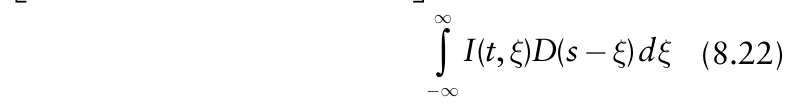{.equation width=60%}

**S PATIAL** **A SPECTS OF** **E PIDEMICS** **—II: A T HEORY OF** **S PATIO** **-T EMPORAL** **D ISEASE** **D YNAMICS** 225 individuals for the entire population, _H_ (_t_) and _I_ (_t_), respectively, with β _H_ (_t_) _I_ (_t_) as the transmission term. In equation 8.24, the density of new infections at a given time at a given location depends on healthy host density at that location, _H_ (_t, s_), and on infectious units over the entire area (all possible _ξ_ values) in which the epidemic occurs. By the nature of contact distributions (see Fig. 8.5), infectious individuals at or near location _s_ contribute more to new infections than infectious units farther away.

The basic reproduction number for this model is, as with the non-spatial situation, defined as _R_ 0 = β _H_ 0/ _μ_. This is because one infected individual in an otherwise disease-free population of _H_ 0 individuals produces a total of _α_ / _μ_ (= _α_ · _ι_) spores (for the example of a sporeproducing fungus) during its infectious period, with _α_ θ′ _H_ 0 / _μ_ spores contacting a host (somewhere), and with _α_ θ′ _ψH_ 0 / _μ_ resulting infections. In other words, the contact distribution does not affect the calculation of _R_ 0.

There is no analytical solution to equation 8.23; rather, numerical solutions must be used, based on use of a computer program such as MATHCAD or MATHEMATICA. Because the epidemic model now involves partial derivatives, the required numerical integration methodology is more involved than that used for numerically solving the ordinary differential equations of Chapter 5. An example solution is shown for selected times as the heavy (thick) curves in Fig. 8.11, based on the double-exponential contact distribution (see Table 8.1). The pattern of disease gradients is very similar to those found for the more descriptive logistic-logistic spatio-temporal model of Chapter 7 (see Fig. 7.14) and, for values of _Y_ not close to _H_ 0, for the non-overlapping generation (and density-independent) epidemic model (Fig. 8.6B). Density of diseased individuals approaches the final disease level, which depends on _R_ 0. When the ordinate is plotted on a log scale, a straight-line relation with distance is seen, except for densities above 100 or so, where the density dependence is most apparent. The simulation also shows an apparent equal distance between the gradient lines at low values of _Y_ (_t, s_), implying that the rate of disease expansion is constant (with this contact distribution). Because we are now dealing with continuous time, we refer to the velocity of disease expansion as _C_ (_t_) instead of as _Cn_, which is equivalent to ∂ _s_ /∂ _t_ discussed in the previous chapter (change in distance where a given level of disease is found with change in time).

When the modified power law distribution is used, a different pattern is found for the gradients (Fig. 8.12). In particular, even when _Y_ (_t, s_) is plotted on a log scale, there is strong curvature, especially at large distances from the source. The pattern is very similar to that found for the non-overlapping generation epidemic model with the same contact distribution (Fig. 8.6D), except for large _Y_. As seen in Fig. 8.6D, there is a very apparent increasing distance between the gradient curves at low values of _Y_ (_t, s_).

_8.3.2.2 Disease expansion rates—traveling waves._ In the temporal models discussed in Chapter 5, we took great care to describe the density of healthy individuals and how this density affects the number of new infections

![Numerical solution of the spatial H-L-I-R epidemic model, based on use of a double-exponential contact distribution (with _σ_ = 1) (see Table 8.1). Vertical axis is disease density, _Y_ (_t, s_), and horizontal axis is distance from the original inoculum source. Thick solid lines are gradients of disease for the density-dependent situation (equation 8.23), at selected times, _t_. Thin dashed lines are disease gradients for the density-independent situation (equation 8.23, with _H_ 0 = 1000 used instead of _H_ (_t, s_)). Note that in the front of the epidemic (large distances with low _Y_ (_t, s_)), the two sets of gradients merge. Disease spread was in both directions from the original source (i.e., for positive and negative _s_), but only positive distances are shown. Other parameter values were: β _H_ 0 = 0.6, _ω_ = 1/7, and _μ_ =1/10.](figures/fig8-img12.png){#fig-8-11}

![Numerical solution of the spatial H-L-I-R epidemic model, based on use of a modified power law contact distribution (with Ψ = λ = 3) (see Table 8.1). Vertical axis is disease density, _Y_ (_t, s_), and horizontal axis is distance from the original inoculum source. Thick solid lines are gradients of disease for the density-dependent situation (equation 8.23), at selected times, _t_. Thin dashed lines are disease gradients for the density-independent situation (equation 8.23, with _H_ 0 = 1000 used instead of _H_ (_t, s_)). Note that in the front of the epidemic (large distances with low _Y_ (_t, s_)), the two sets of gradients merge. Disease spread was in both directions from the original source (i.e., for positive and negative _s_), but only positive distances are shown. Other parameter](figures/fig8-img13.png){#fig-8-12}

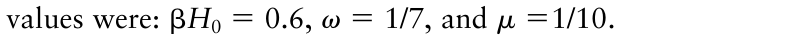{.equation width=60%}

produced per unit area per time unit. This is, of course, for the obvious reason that if the density of healthy individuals decreases during the epidemic, the number of new infections (for a given density of infectious individuals) will automatically also decrease. In other words, there is less opportunity for new infections as _H_ (_t_) declines (e.g., more and more spores land on diseased individuals). The effect of such density dependence on the rate of epidemic expansion has been studied by mathematicians in quite some detail. The work on this goes back to Kolmogorov et al. (1937) and Bramson (1983). Density dependent extensions of model equation 8.2 have been studied in detail by Weinberger (1978, 1982), and continuous-time versions of the model have been studied by Diekmann (1978, 1979), Thieme (1977, 1979) and Mollison (1972).

These studies considered the situation where the tail of the contact distribution falls off faster than exponentially with distance from the source. No particular contact distribution is used, so that general results are valid for _any_ contact distribution with exponentially bounded tails. As we have discussed in section 8.2 for nonoverlapping generations, this type of contact distribution implies that a traveling wave develops when there is no density dependence. A remarkable achievement of these cited theoretical studies is that _the rate of epidemic expansion in the density-dependent models is the_ same _as the rate of expansion calculated from the densityindependent models_. In other words, the results show that _C_ (_t_) approaches a constant velocity (_C_) and this velocity is the same in density dependent and density independent models. All the studies use a similar type of density dependence in the model formulation, which specifies that: the number of new infections produced per infectious individual at places and times where the density dependence matters is always less than when density dependence does not matter. In other words, ∂ _Y_ (_t, s_)/∂ _t_ decreases as _H_ (_t, s_) decreases for a given density of infectious individuals (since there are fewer opportunities for infection at location _s_). Moreover, the mathematical work assumed that the form of the contact distribution is not influenced by the density of healthy, infected and removed individuals. (Actually these authors use an even more general assumption, which we do not deal with here.)

The highly significant result can easily be understood intuitively by returning to Fig. 8.11. Superimposed on the disease density curves generated from densitydependent equation 8.23 are the disease gradients for the density independent case (i.e., with _H_ 0 for _H_ (_t, s_) in equation 8.23), drawn as thin broken lines. Put another way, the thick (heavy) lines are the solutions of more complex equation 8.24, and the thin lines are the solutions of the simpler equation 8.25 for ∂ _Y_ (_t, s_)/∂ _t_. All parameter values are the same for both epidemic models. As expected, the use of the density-independent model ultimately results in meaningless results close to the original inoculum source when, in fact, there is an upper limit to disease density (_H_ 0). In particular, prediction of _Y_ (_t, s_) can exceed _H_ 0, given sufficient time. However, the fronts of the epidemics (i.e., _Y_ values relatively far from the origin) are virtually identical for the two situations.

It may be helpful to the reader to refer back to the theory of polycyclic epidemics described in Chapter 5. Even for models of temporal disease progress for polycyclic diseases, an exponential growth model provided a good approximation when disease density was low. In a general sense, this approximation at low _Y_ carries over to spatio-temporal models, for both the time and space dimensions. That is, because _H_ 0 ≈ _H_ (_t, s_) at small _Y_ (_t, s_), simplifications are possible. So, no matter how complicated the model is for dynamics at moderate or high disease density, much simpler models are applicable far from the original inoculum source. The expanding epidemic is drawn forward through space by the infectious individuals at the forefront of the epidemic. It is exactly in the front of the epidemic where the density of infected individuals is so small that the dynamics of the epidemic is not affected by any (healthy-host) density-dependent process.

Several important mathematical results are obtainable based on the use of a density-independent model (Diekmann, 1978, 1979; Thieme, 1977, 1979) for the epidemic. Without mathematical proof, we emphasize the key ones related to the velocity or rate of disease expansion, _C_ (_t_). A major result is that after an initial period of time, _C_ (_t_) approaches an asymptotic constant velocity (_C_) when the contact distribution is exponentially bounded. As with the model with discrete generations, and as demonstrated in Fig. 8.11 for one set of parameters, an exponentially bounded contact distributions leads to a traveling epidemic wave. In particular, _C_ can be written as an approximate function of _R_ 0:

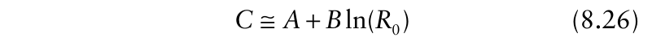{.equation width=60%}

in which _A_ and _B_ are constants. These constants depend on other model parameters, such as σ and _ω_ (1/), but the exact functional dependencies will be influenced by the contact distribution used. We have not derived the relations for various contact distributions here but merely used the close-to-linear relation between _C_ and ln(_R_ 0) seen in Fig. 8.9. Based on equation 8.26, one can see that the farther spores (or other infectious units) travel, as indicated by _σ,_ and the greater the new infections per each infectious unit _,_ as indicated by _R_ 0, the greater the velocity of focus expansion. From a control perspective, one can limit the invasion of a disease into new areas by reducing _σ_ (perhaps with barriers) or by reducing _R_ 0.

An important point is that it does take some time for the constant velocity, _C,_ to be approached. The time period is not easy to define exactly (van den Bosch et al., 1990b), but depends on all model parameters. No estimates of convergence time exist and further work in this area is needed. Observed epidemics confirm that there is a time period before a constant expansion rate is found (Minogue and Fry, 1983b; van den Bosch et al., 1988c).

_8.3.2.3 Disease expansion rates—dispersive traveling waves._ It appears that the density-independent version of equation 8.23 (_H_ 0 used for _H_ (_t, s_)) accurately describes the front of disease expansion also when the contact distribution is not exponentially bounded. This is demonstrated in Fig. 8.12, where the thin broken lines correspond to numerical solutions of the non-density dependent version of equation 8.25. However, the mathematical theory has not been adequately developed for these types of contact distributions to give more detailed results. By referring back to the non-overlapping generation model, one should expect that the increase in _C_ (_t_) is proportional to the scale of contact distance (1/Ψ in root, and λ/Ψ in modified power law distributions). Based on continuous-time results for exponentiallybounded distributions, one would also expect that _C_ (_t_) is inversely related to mean latent period. More research is clearly needed here, because many diseases are often characterized by power-law type gradients (e.g., Sackett and Mundt, 2005a), as discussed and demonstrated in the previous chapter. Consistent with a power law type of gradient, calculated velocities often do increase with time (Cowger et al., 2005; Madden et al., 1990a; Sackett and Mundt, 2005b).

_8.3.2.4 Multi-seasonal epidemic expansion_. van den Bosch et al. (1999) developed a model to describe both the within growing season and the multi-seasonal expansion of plant disease epidemics on a continental scale. We do not give the theory here, but the model describes the dynamics of a polycyclic epidemic during the crop growth season and combines this with a simple description of pathogen survival through the season where no crop host is present.

### 8.3.3 Disease expansion with monocyclic diseases

The basic concepts used here for continuous time and for discrete non-overlapping generations can easily be applied to monocyclic diseases, in which the only infections occur from the primary inoculum (the primary infectious units, such as overwintering spores in the soil or spores produced on weeds on the edge of a field). We consider only the continuous time scenario, and build on a portion of the model introduced in section 5.4 for the situation where primary infectious occur throughout the epidemic. Readers should re-study that section before reading the following material.

We can define _x_ (_t, s_) as the density of primary infectious units available for infection (“released spores”) at time _t_ and location _s_ (with units of 1/time). We can consider _x_ (_t, s_) to be fixed, or to change over time. _θ_ ′ _D_ (_s_ − _ξ_) is the probability that a primary infectious unit originating at _ξ_ comes in contact with a host individual at _s_, and _ψ_ p is the probability that an infectious unit in contact with a host causes an infection. If there are no secondary infections (β = 0), one can write:

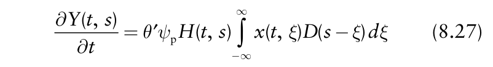{.equation width=60%}

A comparison of this equation with equation 8.24 shows that _x_ (_t, s_) is used here instead of spores produced by infectious diseased individuals [ _αI_ (_t_, _ξ_)]. For the simpler situation where there is a single inoculum source, at

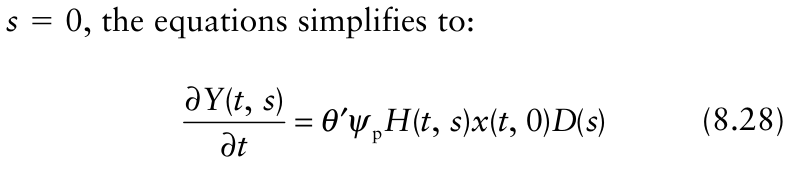{.equation width=60%}

time; that is, the distance between the curves at a single (low) value of _Y_ declines over time.

Because there is an analytical solution for this model, one can readily determine the rate of disease expansion. With the double-exponential contact distribution, a little algebraic manipulation of equation 8.30 results in:

No integration is necessary over space, since inoculum arriving at _s_ can only be coming from _one_ location (_s_ units away). An even simpler model is possible if one can assume that inoculum density does not change, so that _x_ (_t_, 0) is a constant (_x_ 0). Obviously, a fixed density of available inoculum is not to be expected exactly, but it may be quite a reasonable assumption over the time period of concern. Then one can write:

{.equation width=60%}

Equation 8.29 is a spatial expansion of the monocyclic model of Chapter 4 (equation 4.8), in terms of _Y_ (rather than _y_), where _θ_ ′ _ψ_ p _x_ 0 is analogous to the simple-interest rate parameter _r_ M. Minogue (1986) showed how to use and interpret this model in terms of disease expansion. Interestingly, there is an analytical solution for this model with a single inoculum source.

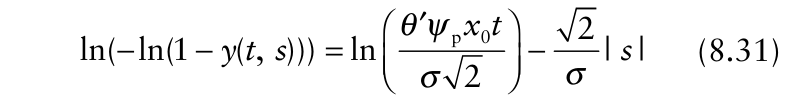{.equation width=60%}

in which _y_ (_t, s_) = _Y_ (_t, s_)/ _H_ 0. The left-hand side of equation 8.31 is the so-called complementary log-log transformation (CLL), which is used more extensively in Chapter 9 for other purposes. The CLL declines with distance, with a slope of 2/ _σ_, and increases with the log of time. To determine _C(t_), one can first define a fixed value of _y_ (_t, s_), say _y_ ′, and find the value of _s_ that gives _y_ ′ (_sy_ ′(_t_), or _s_ ′ for short). This results in an equation for the isopath in relation to time:

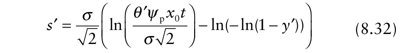{.equation width=60%}

The rate of disease expansion (_C_ (_t_)) can be obtained by determining the partial derivative of _s_ ′ with respect to _t_ (∂ _s_ ′/∂ _t_). For equation 8.32, the partial derivative is given by:

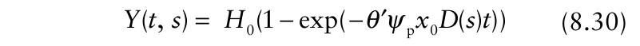{.equation width=60%}

{.equation width=60%}

Equation 8.30 assumes that _Y_ (0, _s_) (= _Y_ 0) is 0 everywhere and the epidemic starts with all inoculum at _s_ = 0. A numerical example is shown in Fig. 8.13 for the doubleexponential contact distribution (see Table 8.1) and one set of parameters. An interesting result is that the rate of disease expansion (_C_ (_t_)) appears to decline over Based on equation 8.33, one can see that _C_ (_t_) is directly proportional to σ, as found for polycyclic diseases (see section 8.2)—the longer the distance traveled by spores, for example, the greater the rate of disease expansion.

{#fig-8-13}

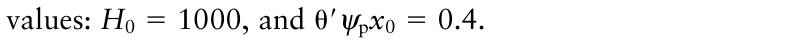{.equation width=60%}

**S PATIAL** **A SPECTS OF** **E PIDEMICS** **—II: A T HEORY OF** **S PATIO** **-T EMPORAL** **D ISEASE** **D YNAMICS** 229 Moreover, _C_ (_t_) is inversely proportional to time since the start of the epidemic. This declining expansion rate makes intuitive sense, because infections do not lead to further infections with monocyclic diseases, and diseased individuals at the front of the epidemic do not move the disease forward in space. In other words, when all infections beyond the origin originate exclusively from inoculum at the origin, there is a decline in expansion over time (even with a fixed inoculum density at the source).

Equation 8.30 is applicable for any of the contact distributions used in this chapter. However, equations 8.31–8.33 are specific for the double-exponential distribution. Other contact distributions will lead to different formulations for _s_ ′ and _C_ (_t_), sometimes with more complicated equations for _C_ (_t_).

The results here should be contrasted with those obtained in Chapter 7. It was found in section 7.6.4 to be challenging to link the monocyclic temporal model with a logical disease-gradient model and obtain an easy-to-use, realistic, and interpretable combined model. By being more realistic in the model formulation, equation 8.30, and using contact distributions consistent with observed dispersal gradients, an interpretable spatio-temporal model is readily obtained.

### 8.3.4 Multiple foci and temporal dynamics

The previous sections of this chapter showed that a considerable understanding of the spread of disease can be obtained using a range of models that capture the essential biological features of epidemics in time and space. Depending on the model formulation, exact or approximate equations can be developed to predict the rate of disease expansion from a single focus. Of course, many epidemics are initiated from several foci instead of one, but, fortunately, the principles of spread expressed in this chapter hold for any number of foci. With multiple original foci, the concept of a simple single expansion rate for the epidemic no longer applies. There is, in fact, expansion of each disease focus, possibly with mergers of originally distinct foci, as well as a resulting “global” expansion rate at the edge of the full spatial extent of the epidemic.

Models such as the spatial H-L-I-R one in equation 8.23 can be numerically solved using mathematics computer programs for any set of initial conditions [ _Y_ (0, _s_)]. For example, infectious individuals can be located at any number of locations over the spatial domain. With multiple foci, graphs of observed disease gradients or predicted disease gradients from equation 8.23 (such as in Figs. 8.11 and 8.12) are of less direct interpretation. This is because there is no longer an unambiguous _s_ = 0 point in terms of the starting conditions with multiple original foci. For this situation, maps of (observed or predicted) disease density at selected times are often produced instead of simple curves of density versus distance. Maps of disease intensity will be considered in detail starting in the next chapter.

One can also use spatio-temporal models (such as equation 5.23) to determine disease progress curves for the _entire_ field or region in which the epidemic is occurring, not just for specific locations, based on any starting conditions. As done in Chapters 4 and 5, we can define _Y_ (_t_) as the total number of diseased individuals over all locations at time _t_. With explicit consideration of space, _Y_ (_t_) is given by:

{.equation width=60%}

One can then explore the effects of temporal parameters [e.g., β (= _α_ θ′ _ψ_), _ω_ (=1/), and _μ_ (=1/ _ι_)], spatial parameters (_σ_ for certain contact distributions), and initial conditions on the disease progress curves. This is demonstrated as line 3 (l3) in Fig. 8.14 for an example epidemic where _s_ ranges from 0 to 60, with one initial focus in the field center. Results are expressed as proportions, _y_ (_t_) = _Y_ (_t_)/ _H_ 0. The double exponential contact distribution was used, and the parameters are the same as used in generating the gradients in Fig. 8.11. Line 1 (l1) is corresponds to the _y_ (_t_) values for predicted based on the aspatial H-L-I-R model of Chapter 5 (equation 5.30) with the same initial density of infected individuals and the same model parameters. With the aspatial model, homogeneous mixing of the infectious units throughout the host population is implied (i.e., contact does not depend on position).

![Total proportion of diseased individuals across all locations, _y_ (_t_) [= _Y_ (_t_)/ _H_ 0], versus time, _t_, for a spatial H-L-I-R model (equation 8.23) with a double-exponential contact distribution (_σ_ = 1; see Table 8.1), or aspatial model (equation 5.30). (**A**) arithmetic scale and (**B**) log scale. Line l1: realization for equation 5.30, which corresponds to homogeneous mixing. Line l2: realization for equation 8.23, with three evenly inoculum line sources. Line l3: realization of equation 8.23, with a single inoculum line source in the center of the spatial range. Total density of diseased individuals at _t_ = 0 was the same for all three epidemics. Other parameter values were: β _H_ 0 = 0.6, _ω_ = 1/7, and _μ_ =1/10.](figures/fig8-img15.png){#fig-8-14}

As seen in the graph, aggregation of disease into a single initial focus results in a slower increase in total disease density (not necessarily at any given location) than when there is homogeneous mixing of inoculum, at least for the chosen value of σ. This is because, for the typical situation of a contact distribution that declines rapidly with increasing distance, infectious units produced by an infectious individual are likely to come in contact with a previously infected individual when the diseased individuals are mostly near each other to start with. Careful evaluation of Fig. 8.14 shows that the difference between the two cases is virtually nonexistent at low _y_ (_t_), since there are many disease-free host individuals at all locations to come in contact with inoculum. Then, the differences in the two cases become apparent as the effect of the declining disease-free hosts is manifested. Ultimately, the same final disease density is reached for both cases. It should be noted that a larger value of σ would diminish the effect shown in the figure. This is because infectious units travel greater distances, on average, resulting is a lower likelihood that an infectious unit will come in contact with a diseased host.

The line 2 (l2) in Fig. 8.14 corresponds to the same situation as the l3 line, but with three evenly separated foci at time 0, instead of one focus. Initial total density of diseased individuals at time 0 was the same. The rate of disease increase was, again, lower than for the aspatial (homogeneous mixing) case (l1), but the difference was not as great as between the aspatial case and the single-focus case. With well separated initially diseased individuals, there is less likelihood that spores will contact diseased host individuals than when all diseased individuals are initially together.

Various efforts have been made to account for some aspects of the spatial component of epidemics using strictly temporal models of disease progress (Gubbins and Gilligan, 1997; Hughes et al., 1997; Liu et al., 1987; Madden and Campbell, 1990; Waggoner and Rich, 1981; Yang and TeBeest, 1992; Zhang et al., 2000b). In particular, the proposed models account for, in principle, the non-homogeneous mixing of the infectious units without explicit consideration of the spatial location of individuals or the contact distribution. Sometimes the equations are called _spatially implicit models_ of disease progress. The basic approach is to replace _I_ (_t_) and _H_ (_t_) in the transmission term (β _I_ (_t_) _H_ (_t_)) in temporal models (e.g., in equation 5.30) with nonlinear functions of infectious (or more simply, infected [ _Y_ (_t_)]) and/or healthy host density, _fI_ (_I_ (_t_)) and _fH_ (_H_ (_t_)), respectively. The equation component for d _H_ (_t_)/d _t_ in the H-L-I-R model would then be written as:

{.equation width=60%}

This type of modification can also be used in models with a dynamic host crop in the absence of disease (see section 6.2 of Chapter 6), as well as in models that include vector dynamics (see section 6.4). The “transmission parameter” is written as β* because it is no longer simply interpreted just as _α_ θ′ _ψ_. Power functions are common choices for _fI_ (_I_ (_t_)) and _fH_ (_H_ (_t_)), such as _I__a_ and _H__b_ (Liu et al., 1987). Then, a special case is when _a_ = _b_ = 1, where the standard (homogeneous mixing) temporal model is obtained. Values of _a_ or _b_ less than 1 are indicative of non-homogeneous mixing. For instance, with _b_ = 0.8, the reduction in healthy plants per unit time (or the increase in infected plants) will be less than when _b_ = 1 (homogeneous mixing), since _H_0.8 < _H_. This would be, in principle, accounting for the fact that there are fewer contacts between infectious units and healthy plants with non-homogeneous mixing than with homogeneous mixing.

More complicated functions can also be used in the transmission expression (see equations 6 and 7 in Hughes et al., 1997). Although equation 8.34 and similar models can provide good fits to observed or simulated disease progress curves, there is no formal quantitative linkage between _a_ and _b_ (or more generally, the explicit functions of _I_ and _H_) and the underlying contact-distribution parameters and the initial spatial conditions (i.e., locations of initially diseased individuals). Thus, this approach should only be considered an approximation to represent the increase in density of diseased individuals for explicit spatio-temporal epidemic processes.

As will be shown in Chapter 9, there are useful alternatives to the methods discussed in this and the previous chapter for characterizing and quantifying the spatial component of epidemics. These approaches are based on _statistical_ models of patterns of disease intensity rather than mathematical models of contact distributions and disease gradients. These statistical models also lead to modifications of temporal epidemic models that are in the same format as general equation 8.34 (Hughes et al., 1997; McRoberts et al., 1996; Waggoner and Rich, 1981) although we do not give more details in this book. The general conclusion from this work is that increasing aggregation of disease leads to slower rates of increase in _Y_ (_t_) over time, as found here based on explicit consideration of the spatial component of the epidemic (Fig. 8.14).

Modification of an H-L-I-R (or similar) model with power functions is analogous to modification of the **S PATIAL** **A SPECTS OF** **E PIDEMICS** **—II: A T HEORY OF** **S PATIO** **-T EMPORAL** **D ISEASE** **D YNAMICS** 231 1 − _y_ term in the logistic equation (equation 4.14) to obtain the Richards growth model (see equation 4.22). By adding one or two parameters to the model, one would expect better fits to the data than obtained without the new parameters. This is, indeed, generally found with experimental data (e.g., Gubbins and Gilligan, 1997; Zhang et al., 2000b). The next research step will be to develop spatially implicit models (which could include modifications of the ones currently in use) that can be more closely related to the parameters of the contact distribution and the initial spatial conditions.

## 8.4 An Application

The effect of mixing two or more cultivars to control plant diseases is well documented (Browning and Frey, 1969; Mundt and Browning, 1985; Wolfe, 1985). In this section, we consider the rate of epidemic expansion in cultivar mixtures to demonstrate an application of the above model. We consider a mixture of a susceptible and a completely resistant cultivar and study how the fraction of the crop consisting of the susceptible cultivar, _φ_, influences the rate of expansion (_C_). We use results for two well-studied pathosystems, stripe rust (caused by _Puccinia striiformis_) of wheat, and rust (caused by _Uromyces appendiculatus_) on bean (van den Bosch et al., 1988c, 1990a; Assefa et al., 1995). For these pathosystems we assume here that the spatial expansion of the disease may be described by a traveling wave (which is consistent with some of the published studies).

In this section, we will derive an equation that relates the fraction of susceptible crop, _φ_, in a mixture of susceptible and completely resistant cultivars, to the rate of focus expansion. It turns out that the other model parameters, such as _R_ 0, σ, and can be condensed into two constants, and that their numerical values are not needed to either derive our hypothesis about the relation between _φ_ and _C_, nor to test the hypothesis we derive.

As indicated above, _C_ for both the Gaussian and the double exponential contact distributions can be predicted by equation 8.26. Suppose that our mixture is a random mixture of susceptible and resistant plants. The infectious units produced by an infectious individual are then distributed over the two cultivars in proportion to their fractions in the mixture. This implies that a fraction _φ_ of the infectious units end up on the susceptible cultivar and a fraction 1 − _φ_ on the resistant cultivar. Only the infectious units on the susceptible cultivar cause infections and, therefore, the basic reproduction number realized in the mixture is:

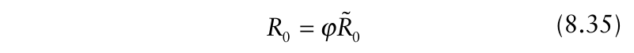{.equation width=60%}

where we use _R_ 0 to represent the basic reproduction number of the disease when the crop consists only of susceptible cultivar. Substituting equation 8.35 into 8.26 gives:

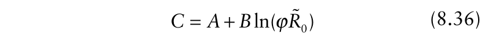{.equation width=60%}

which can also be written as:

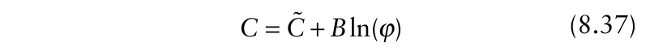{.equation width=60%}

where _C_ = _A_ + _B_ ln(_R_ 0), the (asymptotic) constant rate of expansion when the crop consists of susceptible cultivar only.

Equation 8.37 suggests that the rate of disease expansion is linearly related to the logarithm of the fraction of susceptible cultivar in the crop. This is a hypothesis that can be tested experimentally. Plots have to be established with a range of seed mixtures to cover the range of proportions, from _φ_ = 1 down to _φ_ ≈ 0; a plot with _φ_ equal to 0 provides no information since then there is no epidemic. The center plant of each plot (the center line could also be used) is inoculated by the pathogen to serve as the initial source of infectious units, and the developing epidemic is observed and disease gradients are determined over the time period the disease is spreading through the plot. Using the empirical methods in section 7.6.3 of the previous chapter, one can determine the distance where a small value of disease is found at each time, _Y_ ′(_t, s_ ′). In brief, this can be done by drawing a horizontal line through a gradient graph (as done in Fig. 8.6) at _Y_ ′, and finding the distance where this value occurs at each time. To avoid interpolation, one could also fit an empirical gradient model to the data at each time [making sure to use a gradient model that adjusts for a maximum _y_ of 1 (see section 7.5.2)], and rearrange the prediction equation for distance (_s_ ′). From these maps the rate of epidemic expansion is calculated. If the hypothesis is correct we will find a straight line relation between the rate of expansion and the logarithm of the fraction of susceptible crop (assuming that the contact distribution is exponentially bounded, and that the contact distribution does not depend on _φ_.

Fig. 8.15 shows the results of the experiments of van den Bosch et al. (1999) and Assefa et al. (1995). From the figure we see that the experimental results agree with the hypothesized relation, although there is considerable variation in _C_ values for a given fraction of susceptibles in the mixture. For applications, it is helpful to have rules of thumb telling how certain epidemiological quantities, such as the rate of epidemic expansion, varies with the fraction of susceptible plants in the crop. Generalizing from the theoretical considerations in this section and the experiments done on two different plant pathogen systems we can state the rule of thumb: In a mixture of susceptible and resistant plants, the rate of epidemic expansion increases linearly with the logarithm of the fraction of susceptible plants in the crop.

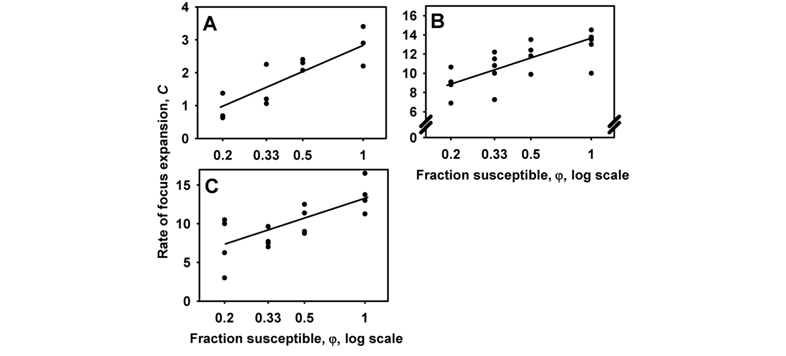

**FIG. 8.15**. Observations on the rate of disease expansion in relation to the fraction of susceptible crop in a mixture. Drawn line is the fit of equation 8.36 based on least squares regression. (**A**) stripe rust of wheat, caused by _Puccinia striiformis_ (data from van den Bosch et al., 1990b). (**B**) and (**C**) bean rust, caused by _Uromyces appendiculatus_ in (**B**) 1990 and (**C**) 1991 (data from Assefa et al., 1995).

Complicating the issue is the fact that there is evidence from other studies (done in other locations) that power law type contact distributions may best describe stripe rust and bean rust disease gradients (Maffia and Berger, 1998; Sackett and Mundt, 2005a, b; see also Figs. 7.11 and 7.13). In particular, Cowger et al. (2005) recently showed that the rate of focus expansion increased exponentially with time for stripe rust, which is consistent with a power-law contact distribution (equation 8.17). Thus, the experimental data supports the epidemiological theory for their pathosystem.

## 8.5 Concluding Remarks

In this chapter we derived a simple model formulation for the spatial expansion of polycyclic (compound interest) plant disease. The model is an integration of: (i) reproduction (in the general sense)—i.e., infections from each infected individual, including the production of infectious units and their probability of causing an infection when in contact with a disease-free host individual—and (ii) the contact distribution, the measure of dispersal of infectious units (equation 8.2 or 8.23). Analyzing the model we found that there are two essentially different types of expansion rates for the front of the epidemic, or for a specified isopath of low disease intensity (_Y_ ′). The categories are determined entirely by the form of the contact distribution. A traveling wave, in which the front moves at constant rate, is found for contact distributions with exponentially bounded tails. A dispersive wave, in which the front moves out with increasing velocity, is found for contact distributions with non-exponentially bounded tails. For dispersive waves, the rate of expansion of dispersive waves (acceleration) can be linear or nonlinear (e.g., exponential) functions of time. In all situations, the expansion rate is a positive function of the basic reproduction number, _R_ 0 The basic results for polycyclic diseases were fairly easy to show using a simple non-overlapping-generation model with no (host) density dependence (equations 8.2 and 8.3). The mathematical complexity increases greatly with consideration of latent and infectious periods, overlapping generations, and density dependence, but various authors have shown that the basic results hold for expansion of the epidemic (Diekmann, 1978, 1979; Thieme, 1977, 1979). In contrast to polycyclic diseases, the mathematical formulation is much simpler for monocyclic (simple interest) diseases, even when there is density dependence. Depending on the contact distribution, it can be shown that the expansion rate may decline with time.

Direct fitting of spatio-temporal models such as equation 8.23 to data is more difficult than fitting of the equivalent purely temporal models. This is because of the partial derivatives instead of ordinary derivatives that must be numerically integrated. For practical purposes, it is probably most useful to estimate model parameters from ancillary studies and then use these parameters to predict _Y_ (_t, s_) for a specific situation using numerical methods. For instance, gradients of disease intensity, especially early in the epidemic, provide the required information for calculating contact-distribution parameters (e.g., σ). Furthermore, _C_ can be estimated by measurements of disease intensity at the front of the epidemic **S PATIAL** **A SPECTS OF** **E PIDEMICS** **—II: A T HEORY OF** **S PATIO** **-T EMPORAL** **D ISEASE** **D YNAMICS** 233 at several times (see Chapter 7). Depending on the contact distribution, _R_ 0 can then be estimated from σ and _C_.

There are several other approaches to model spatial dynamics of populations. Ecologists, theoretical biologists and sometimes plant pathologists use diffusion-type models (e.g., Gilligan, 1995; White and Gilligan, 1998). The basic assumption underlying diffusion equations is that the individuals, or the entities being dispersed (e.g., spores), move randomly through space (Minogue, 1989). This assumption may be a reasonable approximation, at least over certain spatial and temporal scales of interest, especially for animal species. This approach could, for example, be useful to model virus diseases with arthropod vectors, where the vector can reasonably be assumed to move randomly through the crop. A good introduction to the use of diffusion models is found in Okubo (1988). As a general rule, however, a diffusiontype model is unrealistically simplistic for many plant disease epidemics (see discussion in Minogue, 1986; and also Mollison, 1972), so we did not discuss development and applications of this model in the chapter.

Spatial structure can also be incorporated into epidemic models using spatially explicit simulation models (Kampmeijer and Zadoks, 1977; Sackett and Mundt, 2005b). As discussed in regards to temporal models (see section 5.6.3), simulation is especially useful for determining specific outcomes under specific conditions, such as in studying particular profiles of environmental conditions on spatio-temporal dynamics. Simulation is also valuable to explore disease outcomes at all locations and times when there are multiple initial inoculum sources, and also when researchers wish to study stochastic aspects of epidemics. The spatio-temporal stochastic model of Xu and Ridout (1998) is especially useful in this regard. For a more mathematical treatment of spatio-temporal dynamics for a lattice of plants, using stochastic modeling, readers should see Filipe and Gibson (1998) and Filipe and Maule (2003, 2004). Among several other results, Filipe and Maule (2004) developed a spatially implicit epidemic model (see equation 8.34) that is different from the power-function expression explained in section 8.3.4. Keeling (1999) presents an alternate way of addressing the problem of spatial structure of disease in temporal dynamics of epidemics without the need for simulation. Additional valuable references include Durrett and Levin (1993), Park et al. (2001), Stacey et al. (2004), and Gilligan (2002).

Although the rate of focus expansion is determined by the contact distribution, it appears that different contact distributions may be appropriate for the same disease under different circumstances (Assefa et al., 1995; Maffia and Berger, 1998; Sackett and Mundt, 2005a, b; van den Bosch et al, 1988c, 1990a). Results on realized disease gradients, and corresponding contact distributions, may reflect the scale of the experiments used to quantify disease spread. As discussed in Chapter 7, disease intensity must be measured at relatively large distances from the inoculum source in order to clearly distinguish among contact-distribution types. Moreover, based on Aylor (1999), based on physical principles of spore transport, it could be argued that different contact-distribution types may be of most relevance at different distance ranges from the source for a given pathogen. Clearly more research is needed in this area since results have a major consequence on predictions of disease spread into new areas.

Finally, a subject that is widely acknowledged for its importance in the spatial dynamics of populations, but is very little studied, is heterogeneity of the environment. Shigesada and Kawasaki (1997) and Shigesada et al. (1986) are excellent references on this topic.

## 8.6 Selected Readings

- Aylor, D. E. 1986. A framework for examining inter-regional aerial transport of fungal spores. _Agric. For. Meteorol._ 38: 263–288.

- Kot, M., Lewis, M. A., and van den Driessche, P. 1996. Dispersal data and the spread of invading organisms. _Ecology_ 77: 2027–2042.

- Shigesada, N., and Kawasaki, K. 1997. _Biological Invasions: Theory and Practice_. Oxford Series in Ecology and Evolution. Oxford University Press, New York.

- van den Bosch, F., Metz, J. A. J., and Zadoks, J. C. 1999. Pandemics of focal plant disease, a model. _Phytopathology_ 89: 495–505.

- Zadoks, J. C., and van den Bosch, F. 1994. On the spread of plant disease: a theory on foci. _Annu. Rev. Phytopathol._ 32: 503–521.
