# 9 {#sec-ch9}

Spatial Aspects of Epidemics—III: Patterns of Plant Disease _Whenever they appear, I turn to look and my looking excites the patterns._

Pat Cadigan (“Patterns”, 1989)

## 9.1 Why We Look at Spatial Patterns

When plant pathologists look at patterns of pathogens, disease, vectors or other components of pathosystems, it is the outcomes of dispersal processes and the effects of environmental heterogeneity that are being observed. Although it is not usually a good idea to draw conclusions about processes on the basis of outcomes, it is nevertheless true that one of the reasons why so much attention has been devoted to the study of patterns of plant disease is that these patterns are regarded as realizations of underlying dispersal processes of pathogens (see Chapters 7 and 8). Thus, in one of the first epidemiological studies of field-scale spatial patterns of disease, Bald (1937) monitored the incidence of tomato plants showing symptoms of infection with _Tomato spotted wilt virus_ (TWSV). A program of intensive mapping of diseased plants in field plots was undertaken, with the objective of conducting: “… _an ecological survey of incidence, to find out something about the natural dissemination of spotted wilt_.”

The first step in understanding ecological processes is to identify patterns (Fortin et al., 2002). However, when the objective of an analysis of spatial pattern is an explanation of the underlying processes, statistical methods alone may not suffice. Instead, such methods may be used to formulate biological hypotheses that can be investigated by non-statistical means (Diggle, 1983). For example, both Bald (1937) and Cochran (1936), discussing the same TSWV data set, offered biological interpretations of their statistical analyses of pattern in terms of the behavioral ecology of the vector of the virus (see section 9.9). Here, we distinguish between such studies, carried out primarily with the objective of finding a biologically based explanation for observed spatial patterns of disease, and studies in which the primary objective is to make statements about disease intensity, where the pattern of disease is of interest in that it affects the sampling distribution of the intensity estimator (Diggle, 2003). Methods for both types of study are discussed in this chapter.

Spatial analysis in ecology is largely concerned with the identification of patterns at multiple scales, in pursuit of the processes underlying those patterns. Plant pathologists have borrowed freely from the statistical methodology that drives progress in spatial analysis in ecology, and will no doubt continue so to do. However, this chapter does not attempt to review the methodology of spatial analysis in ecology, nor even, in any comprehensive way, provide a catalog of phytopathological applications. For readers interested more generally in spatial analysis in ecology, Ludwig and Reynolds (1988, part II) is a good introduction to the methodology. Fortin et al. (2002) provide an overview of methods for identifying and characterizing the way in which observations from nearby locations are more likely to have similar magnitude than by chance alone, and Dale (1999) covers similar ground in much more detail. Volume 25 of the journal _Ecography_ contains a series of useful articles devoted to spatial analysis in ecology (Liebhold and Gurevitch 2002, Dale et al., 2002, Perry et al., 2002, Legendre et al., 2002, Keitt et al., 2002, Dungan et al., 2002) that, as well as being of interest in their own right, provide an extensive insight into the literature.

The scales of phenomena can only be studied using a range of scales of observation and analysis (Dungan et al., 2002). Inferences about patterns may change dependent on the scales of observation and analysis (e.g., Horne and Schneider, 1995), and most plant pathologists are well aware of this (e.g., Ferrandino, 2005). For example, Hudelson et al. (1997) developed cyclic sampling as a means of obtaining information about pattern at several scales. However, we are not always concerned with the identification of patterns at multiple scales and the underlying processes that give rise to them. For studies in which the primary objective is to make statements about disease intensity in the context of, for example, disease management, there will usually be a particular scale at which disease intensity is of interest that will be the deciding factor in the choice of a scale of observation and analysis. In such cases, the scale-dependence of patterns of disease and of characterizations of those patterns from data need not be a major concern. The pattern of disease is of interest insofar as it affects the sampling distribution of disease intensity at the chosen scale of observation and analysis. Analyses based on the use of statistical probability distributions to provide empirical descriptions of patterns are helpful here.

For plant pathologists, investigation of patterns at different scales often forms part of an attempt to infer the dispersal processes that result in observed patterns. Some of the statistical methods used in an exploratory manner to formulate biological hypotheses are briefly outlined. Of greater interest in this context, perhaps, are recent attempts to use stochastic simulation and modeling to make inferences about dispersal processes from patterns of disease. To some extent, these methods circumvent the need for protracted discussions of scale dependence of spatial statistics by focusing on the qualitatively different kinds of patterns that arise from different dispersal processes.

## 9.2 Terminology

Following Campbell and Madden (1990), we adopt Pielou’s (1977) suggestion that “ _To avoid ambiguity ... it is most desirable to use the word distribution in its statistical sense only. Then a variate has a distribution whereas a collection of organisms has a pattern_.” The term distribution is then reserved for use in the context of statistical probability distributions, while the term _pattern_ is used to describe the dispersion in space of pathogens, diseased or infected plants or other components of pathosystems.

We also need some terminology to be able to refer to the different kinds of pattern that we may encounter. The nature of pathogen dispersal processes means that we frequently observe patterns that are non-random. Specifically, it is often the case that where, say, a plant is diseased, the chance that neighboring plants will also be diseased is increased. We refer to the kind of pattern that results in such cases as _aggregated_. Thus the term aggregation (Ord, 1982) is used to refer to clustering in space, and its use here is synonymous with the terms heterogeneity, overdispersion, clustering, clumping and contagion, when these terms are used in a spatial context in plant disease epidemiology. The kind of pattern that results if the chance that a plant is diseased is independent of the disease status of its neighbors is a _random_ pattern. _Regular_ patterns—rarely encountered in spatial studies of plant disease—may occur if the chance that a plant is diseased is reduced by proximity to other diseased plants.

Most statistical analyses of spatial pattern begin with a test of spatial randomness (Diggle, 2003). The hypothesis of spatial randomness acts as a useful dividing hypothesis to distinguish between patterns that are more aggregated or more regular than random, so a test of randomness can guide the formulation of more interesting hypotheses about pattern. Where the null hypothesis of spatial randomness is not rejected, further formal statistical analysis of pattern is seldom warranted (Diggle, 2003).

Recall that there are different ways in which we can record disease intensity (Chapter 2). The distinctions between different types of data obtained are important when it comes to the analysis of spatial patterns. When whole plants, or parts of plants, are assessed as either “diseased” or “healthy”, the data reflect disease incidence. The term disease incidence is usually used to refer to the number of plants or plant parts diseased expressed as a proportion of the total number assessed. Disease incidence is therefore a discrete variable. When expressed as a proportion, the values of both the numerator and denominator are known. The term disease severity is used to refer to the proportion of host plant tissue that exhibits visual symptoms of disease. Thus, like disease incidence, disease severity is a proportion. However, unlike incidence, severity is a continuous variable, and the value of the denominator of the proportion is not usually known. Disease assessments that are made on the basis of counts of propagules, or of countable symptoms (such as lesions) are, in effect, assessments of population density. Often, assessments of counts made in this way are not distinguished from assessments of disease severity in the phytopathological literature. However, if we assess, say, the number of lesions per leaf, we have a discrete variable taking values 0, 1, 2, … without (at least in theory) a specified upper limit. Such a variable has some different statistical properties to those of disease severity as defined above. For many diseases, we can think of severity as the number of lesions per unit area of leaf multiplied by the average area of an individual lesion.

## 9.3 Spatial Plant Disease Data

In order to collect spatial plant disease data, we must have in mind an appropriate _sampling unit_. The simplest situation is when the sampling unit is an _individual_ (plant or plant part), and the presence or absence of disease or an assessment of the amount of disease is recorded. In the latter case, the amount of disease might comprise a visual assessment of the proportion of plant tissue diseased or a count of visible symptoms (such as lesions). To conduct a _census_, all possible sampling units in the _population_ of interest must be assessed. Only rarely will this be a practical proposition. Usually, therefore, results will be based on a _sample_ of data recorded from an appropriate number of sampling units drawn from the population comprising all possible sampling units. That said, it is undoubtedly the case that published data sets that are, in effect, censuses of plant disease (albeit over a relatively small area) have been instrumental in the development of methods for the analysis and interpretation of spatial plant disease data. Since we are concerned here, for the most part, with relatively smallscale patterns, the population will usually be defined by the scale of a field experiment or perhaps of a commercial crop of particular interest.

A sampling unit may comprise a number of individuals (sometimes generically referred to as elements). For example, a quadrat is a sampling unit containing a number of adjacent plants that may be assessed for disease; a plant may be thought of as a sampling unit containing a number of adjacent leaves (or stems, or roots, or other plant parts) that may be assessed. The choice of an appropriate sampling unit will reflect a number of things, including the objectives of the observer, issues relating to practicability, and the resources available for data collection.

Experiments that comprise one or more plots, in which the disease status of the adopted sampling unit is recorded at one or more times, probably provide the largest body of field-scale spatial data on plant disease epidemics. Adopting the terminology of Schabenberger and Pierce (2002), these may be observational studies involving only the recording of disease in space and time, without imposition of experimental treatments on the plots; or designed experiments, involving the assignment of treatments to plots (using some sort of randomization procedure). There is a special case among designed experiments in which the spatial pattern of diseased plants is itself a treatment. Such experiments typically involve the artificial inoculation of some plants in pre-specified spatial patterns, to enable study of the effects of pattern of disease on dependent variables. In fact, a study involving disease gradients in relation to an introduced inoculum source is a good example of a designed experiment with pattern as the treatment (see Chapter 7). Other examples include experiments on the effects of pattern of disease on crop yield (or yield loss) (Chapter 12; Loomis and Bennett, 1966; Johnson, 1991) and temporal disease progress (for example, Rodriguez-de Gonzalez et al., 1995). For such designed experiments, in which spatial pattern of diseased plants is one of the treatments, it is the effect of the imposed patterns that is of most interest, rather than the patterns themselves.

Although spatial plant disease data may comprise records of incidence, severity, or counts, probably the majority of examples in the phytopathological literature are for disease incidence data. It is also noteworthy that the relative ease with which disease incidence can be assessed has led to its use in making indirect assessments of other measures of disease intensity. Mean count per sampling unit (e.g., lesions per plant) or mean severity may be assessed by collecting disease incidence data and then using a previously established relationship either between mean disease incidence and mean count per sampling unit or between mean disease incidence and mean disease severity, as appropriate, to obtain the required assessment of disease intensity.

### 9.3.1 Data collection

Like Diggle (2003), we distinguish between spatial data collected by sparse sampling and those collected by intensive mapping. For the former, only the disease status of a restricted number of sampling units is recorded. For the latter, both the disease status and location of sampling units are recorded. In the context of epidemiological studies of plant disease, intensive mapping sometimes involves recording the disease status and location of every sampling unit in the population of interest (census data). Methods for the analysis of both types of data were developed in connection with the earliest quantitative studies of spatial pattern of plant disease (Bald, 1937; Cochran, 1936).

The most important distinction between sparse sampling and intensive mapping methods is that in the case of the former, the spatial arrangement of the sampling units is not recorded and so cannot be taken into account in any subsequent data analysis. Information on the location of sampling units cannot be obtained retrospectively from sparsely sampled data. Data collected by intensive mapping, in contrast, include details of the spatial arrangement of the sampling units. This means that data collected by intensive mapping may be analyzed either by methods specifically appropriate for intensively mapped data or, if desired, by methods for sparsely sampled data. However, data collected by sparse sampling may only be analyzed by methods specifically appropriate for such data. Note that in some cases, particularly when plant parts (such as leaves, branches or shoots) serve as the sampling units, it may not be practicable (or even possible) to collect intensively mapped data (see, for example, Madden et al., 1995a).

It is relatively easy to see the spatial component of data collected by intensive mapping. The data collected contain explicit information on spatial locations of sampling units that enables us, if required, to reproduce a representation of the study area in the form of a map. Analyses often entail characterization of the degree of association of disease intensity among neighboring sampling units. However, data collected by sparse sampling contain no information on the spatial locations of sampling units, so we might question the extent to which they can be regarded as spatial data. The analysis of data collected by sparse sampling often entails characterization of the extent of variability in the mean level of disease intensity per sampling unit. Generally, this is of interest where the variability exceeds that predicted on the basis of a baseline model generated on the assumption of spatial randomness. Many studies of aggregation have adopted a sparse sampling approach (Perry, 1994). Although the data are not explicitly spatial, characterizing such excess variability has an important place in the study of plant disease epidemics and in disease management.

There are two main, interrelated approaches to the analysis of spatial pattern with sparsely sampled data: testing the goodness-of-fit of statistical probability distributions to data and calculating indices of aggregation (Gilligan, 1988). The details of data analysis differ for disease incidence (section 9.4) and disease assessments based on counts (section 9.5).

## 9.4 Analysis of Sparsely Sampled Incidence Data

### 9.4.1 Summary statistics

To a large extent, patterns of disease result from the way that the disease status of a plant or plant part depends on the disease status of neighboring plants or plant parts. Spatial data, therefore, arise naturally when disease incidence data are collected from groups of neighboring plants or plant parts, even if the location of the groups is not known or recorded. In the statistical literature, these procedures come under the heading of _cluster sampling_ (Chapter 10). In this terminology, the sampling units are the clusters. Thus, the term “cluster”, as used in this context, has no mechanistic connotations. Sometimes it _is_ the case that a natural cluster (say, leaves on a branch) makes an appropriate sampling unit, but there is no requirement that this should necessarily be so. The clusters that make up the sampling units in cluster sampling are artifacts of the sample design. Analyses of sparsely sampled cluster sampling data relate to spatial pattern at the withinsampling-unit scale. As Nicot et al. (1984) and Ferrandino (1998) have pointed out, convincingly if unsurprisingly, such analyses do not tell us about pattern at a scale larger than that of the sampling unit. To characterize such larger-scale patterns, we require additional information in the form of intensively mapped data for the locations of the sampling units.

The analysis of cluster sampling data is more straightforward if the number of individual elements (denoted _n_) is the same in each sampling unit, and if all _n_ elements in each sampling unit are assessed. For the moment we continue under the assumption that this is the case. Some procedures that are useful when this is not so are dealt with later (section 9.4.9 and Chapter 10). The elements (i.e., plants or plant parts) of each sampling unit are assessed as either “healthy” or “diseased”. The proportion of diseased plants or plant parts in each sampling unit is given by _yi_ = _Yi n_; _i_ = 1, 2, ..., _N_. _N_ is the total number of sampling units inspected (_not_ the total number of elements inspected) and _Yi_ (the number diseased in the _i_ th sampling unit) may take integer values 0, 1, ..., _n_. Then disease incidence, the _mean proportion_ of diseased plants or plant parts, is estimated by: and an unbiased estimate of the variance of the _yi_ values is:

{.equation width=60%}

The estimated variance of the _mean_ proportion, 2 _<u>y</u>_, is _sy_ = _sy_ 2 / _N_, as long as the number of sampling units, _N_, is small relative to the total number of sampling units in the population of interest. When this is not the case, the finite population correction should be applied (see section 10.2.5). The denominator of the variance formula in equation 9.2 (_N_ −1) is the degrees of freedom (_df_). If the number of observations (_N_) is used as the denominator instead, the maximum likelihood estimate of the variance of the _yi_ values is obtained. The estimated standard error of the mean proportion is_s_ _<u>y</u>_ 2 . Note that the mean _number_ of diseased plants or plant parts per sampling unit is estimated by _Y_ = _ny_, the estimated variance of the number per sampling unit is 2 2 2 _sY_ = _n sy_, and the estimated variance of the _mean_ 2 number is_s_ _Y_ = _sY_ 2 / _N_. As noted above, the finite population correction should be applied if _N_ is not small relative to the total number of sampling units in the population of interest. When the mean is expressed as a number rather than as a proportion, the estimated standard error is_s_ _Y_ 2 . It can be shown (Madden and Hughes, 1995) that the maximum variance of the _yi_ values occurs when all diseased individuals are in the smallest possible number of sampling units, with no diseased individuals in the other sampling units. If, for example, the number of sampling units is _N_ = 100, with a total of _n_ = 25 plants in each, there can be no more than 25 diseased plants in any sampling unit. When the total number of diseased plants is 125, the maximum variance of the _yi_ values occurs when five sampling units each have 25 diseased plants, and the remaining 95 sampling units have no diseased plants. The maximum variance is given by_s_ _y_ 2(max) = [ _N_ /(_N_ − 1)] _<u>y</u>_ <u>(1</u> − _<u>y</u>_ <u>). When</u> _N_ is large, this is approximated by_s_ _y_ 2(max) ≈ _<u>y</u>_ <u>(1</u> − _<u>y</u>_ <u>).</u> The minimum variance of the _yi_ values occurs when there is exactly the same number of diseased plants in each sampling unit. In this case, the minimum variance is zero. However, if (as in this example) the number of sampling units is not an exact (integer) multiple of the total number of diseased plants, it is not possible to have the same number of diseased plants in each sampling unit. In this case, the minimum variance the _yi_ values is (slightly) greater than zero.

### 9.4.2 The binomial distribution

Consider a cluster sampling scenario, as follows. For each of _N_ separate sampling units, the number of diseased

{.equation width=60%}

plants is recorded. At this stage, we are still confining attention to the case where all the sampling units contain the same total number of individual elements, denoted _n_. If the probability that an individual plant is diseased, _p_, is constant over the area in question, the statistical probability distribution that should provide a basis for describing the frequency of diseased plants in a sampling unit of _n_ plants is the _binomial distribution_:

{.equation width=60%}

The notation: is shorthand for the number of different combinations of _n_ items taken _Y_ at a time, and _n_ ! is read as “factorial _n_ ” and denotes _n_ × (_n_ − 1) × (_n_ − 2) × ⋯ × 3 × 2 × 1 , _n_ being a positive integer. Pr(_Y_) denotes the probability that a sampling unit contains _Y_ diseased plants out of a total of _n_, (_Y_ = 0, 1, ..., _n_). Disease incidence on a proportion scale, _<u>y</u>_, is usually taken as an estimate of the unobserved probability _p_. The binomial distribution is appropriate when the disease status of one plant in a sampling unit is independent of the disease status of the other plants in the same sampling unit. This is what we take as a working definition of a random pattern of diseased plants at the within-sampling-unit scale. Thus we adopt the binomial distribution as the reference distribution appropriate for the description of a random pattern of disease incidence within sampling units.

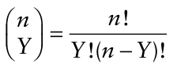

The following example data are taken from Snedecor and Cochran (1989). In _N_ = 40 sampling units (quadrats), each containing _n_ = 9 plants, the numbers of diseased plants were _Yi_ = 2, 5, 1, 1, 1, 7, 0, 0, 3, 2, 3, 0, 0, 0, 7, 0, 4, 1, 2, 6, 0, 0, 1, 5, 4, 0, 1, 4, 2, 6, 0, 2, 4, 1, 7, 3, 5, 0, 3 and 6. Disease incidence on a proportion scale is _<u>y</u>_ = 0.275 (equation 9.1). For a binomial distribution, an unbiased estimate of the variance of the _yi_ values is _s_ bin2 = _<u>y</u>_ <u>(1</u> − _<u>y</u>_ <u>)</u> /(_n_ − 1) . Notwithstanding this, the slightly biased estimate: description of pattern for sparsely sampled disease incidence data and in the development of methods of sampling for disease incidence. Indeed, the ratio_s_ _y_ 2/_s_ bin2 is an example of the “design effect” (or _deff_), an empirical heterogeneity factor used in the sampling literature to characterize the excess variation that arises from nonindependence among elements of a sample (Kish, 1995).

Use of the binomial formula to provide an estimate the variance of the _yi_ values should be preceded by a test of goodness-of-fit to show that the binomial distribution is indeed an appropriate description of the observed frequency distribution of disease incidence. Most widely used spreadsheet programs have a built-in function for calculation of binomial probabilities based on equation 9.3. These probabilities can be converted to expected binomial frequencies by multiplication of Pr(_Y_) by _N_ (the number of sampling units). Fig. 9.1 shows the observed (_O_) and expected (_E_) binomial frequencies for four TSWV disease epidemics reported by Bald (1937). Visually, there appears to be reasonable agreement between the observed and expected frequencies. This can be tested more formally with a χ2 test of goodness-of-fit, calculated as follows:

{.equation width=60%}

The expected values should not be too small in any frequency class, or the test will not be valid (Snedecor and Cochran, 1989). This situation is usually avoided by pooling frequency classes in the tails of the distribution. In general, the guidelines for pooling offered by Snedecor and Cochran (1989) and Mead et al. (1993) have been adopted, with details of specific implementations given in context. In this case, agreement between the observed and expected values is confirmed by the goodness-of-fit tests (Table 9.1). This is evidence to support the view that the pattern of disease incidence is, in this case, indistinguishable from random.

### 9.4.3 The index of dispersion

For disease incidence data collected by cluster sampling, a simple test of deviations from randomness is provided by calculating the _index of dispersion_, _D_ (Fisher, 1925):

{.equation width=60%}

{.equation width=60%}

is the one usually used in practice. Multiplying this variance by _n_2 produces the estimated binomial variance in terms of numbers rather than proportions. For the data 2 above, _s_ bin = (0.275 × 0.725)/9 = 0.022 . Note, however, the variance of the _yi_ values as calculated by equation 9.2 is_s_ _y_ 2= 0.067, considerably larger than obtained by use of the binomial formula. Such _extra-binomial variation_ is typical of aggregated plant disease incidence data. The analysis of this variation has applications in the Note that this index is a ratio of two variances, the observed variance (estimated from data for proportions or numbers per sampling unit) and the variance estimated on the assumption that data have a binomial distribution. Thus, a value _D_ = 1 indicates the two variance estimates are equal, that is to say, the observed variance of the _yi_ values is equal to the theoretical variance aBP, cultivar Burwood Prize; EDR, cultivar Early Dwarf Red; OHS, watered by overhead sprays; T, watered by trenches. b _<u>y</u>_ is estimated from the data, so that the number of degrees of freedom for χ2 is 2 fewer than the number of frequency classes after pooling to ensure that expected frequencies are at least 1. cχ 2 goodness-of-fit statistic with listed degrees of freedom. The significance level is given by _P_ (conventionally, _P_ > 0.05 indicates an acceptable fit). of the reference distribution for a random pattern of diseased individuals within sampling units. When_s_ y2 is at its maximum (see section 9.4.1), _D_ = _n_. Conversely, 2 when _s_ y = 0 , _D_ = 0 (its smallest possible value).

![Frequency distributions of tomato plants with symptoms of _Tomato spotted wilt virus_ disease. The assessments of disease incidence were made on 12 December 1928 and reported by Bald (1937). Four rectangular plots, each containing 360 plants, were divided into 40 quadrats containing nine plants (three rows by three columns). The solid bars represent observed frequencies and the open bars represent expected binomial frequencies. (**A**) Cultivar Burwood Prize watered by overhead sprays. (**B**) Cultivar Burwood Prize watered by trenches. (**C**) Cultivar Early Dwarf Red watered by overhead sprays. (**D**) Cultivar Early Dwarf Red watered by trenches. Goodness-of-fit statistics are given in Table 9.1.](figures/fig9-img02.png){#fig-9-1}

**Table 9.1.** Analysis of the _Tomato spotted wilt virus_ disease incidence data shown in Fig. 9.1. Each plot comprised _N_ = 40 quadrats containing _n_ = 9 plants.

|||**_Binomial distrib_** **_of goodness-_**|**_ution: tests_** **_of-fit_**||**_In_**|**_dex of dispersion_**||
|---|---|---|---|---|---|---|---|
|**_Plot_****_a_**|**_b_** **_y_**|χ**_2 c_**|**_df_**|**_P_**|**_D_**|χ**_2 _****_(39 df)_**|**_P_**|
|BP-OHS|0.881|2.15|2|0.34|0.78|30.4|0.84|
|BP-T|0.933|1.32|1|0.25|0.99|38.6|0.49|
|EDR-OHS|0.633|4.64|4|0.33|1.01|39.4|0.45|
|EDR-T|0.739|2.47|4|0.65|0.96|37.5|0.54|

The index of dispersion (equation 9.6) provides a statistical significance test that is of use in the analysis of sparsely sampled data collected by cluster sampling. The value (_N_ −1) _D_ has a χ2 distribution when the null hypothesis _D_ = 1 is true. To test deviations from randomness, (_N_ −1) _D_ is compared with the tabulated χ2 distribution at _N_ −1 _df_. Table 9.1 shows results for the index of dispersion test for the four TSWV data sets from Fig. 9.1. All test results indicated that the pattern of disease incidence at the within-quadrat scale was indistinguishable from random. Sun and Madden (1997) give an alternative method of testing the null hypothesis _D_ = 1, using a standard normal distribution. For most practical purposes, however, the χ2 test shown here is satisfactory, and sometimes superior.

The two χ2 tests outlined above (index of dispersion and goodness-of-fit) are alternatives. It would not normally be necessary to carry out both tests on the same set of data: this is done here for the sake of illustration. The index of dispersion test is appropriate whether or not the data are given in the form of a frequency distribution, and is especially useful for small numbers of sampling units. The goodness-of-fit test is appropriate when the data are given in the form of a frequency distribution and so can only be used when _n_ does not vary between sampling units.

After compiling a frequency distribution, it is sometimes necessary to pool classes (i.e., when some expected frequencies are small) before carrying out the test. Pooling can be a rather arbitrary procedure, so the fact that this is avoided by the index of dispersion test is an advantage of that procedure. The goodness-of-fit test is most useful when _N_ is large and _n_ is small, so that there are many observations for each class and pooling is not needed.

Readers should note that the two tests are not exactly the same conceptually, although the distinction is rather subtle. The goodness-of-fit test directly evaluates how close the observed frequencies are to theoretical values for a binomial distribution. The test of _D_ compares the estimated (empirical) variance of the _yi_ values with the corresponding estimated (theoretical) variance of a binomial distribution. Presumably, there could be other statistical probability distributions (of no particular relevance in the present context) with the same variance as that of the binomial distribution. Thus, the goodness-offit test is a stricter test of randomness (as defined in terms of a binomial distribution). However, this test can only be performed when all sampling units contain the same total number of individual elements (a requirement for the calculation of expected frequencies).

### 9.4.4 Intra-cluster correlation

We may think of aggregation, as characterized by the analysis of cluster sampling data, as the tendency for elements in a sampling unit to have the same disease status more frequently than we would expect on the basis of spatial randomness. More formally, we can express this in terms of the _intra-cluster correlation coefficient_, ρ (Mak, 1988; Ridout et al., 1999). Mak (1988) showed that the probability (_p_ s) that any two members of the same sampling unit have the same status is given by _p_ s = 1 − 2 _p_ (1 − _p_)(1 − _ρ_). Thus, for any given value of the probability (_p_) that an individual is diseased, _p_ s increases with ρ.

Conceptually, ρ may be thought of as Pearson’s correlation coefficient calculated over all possible pairs of observations that can be constructed within sampling units, though this is not usually the best way to obtain an estimate. Ridout et al. (1999) review methods for estimation of the intra-cluster correlation coefficient from observed data.

If data are collected on the disease status of plants in quadrats (the quadrats being the sampling units, or clusters) an estimated value of the intra-cluster correlation coefficient _ρ_ ˆ of zero indicates that the disease status of any plant in a quadrat is unaffected by the disease status of other plants in the same quadrat. The upper limit of _ρ_ ˆ is one. Positive values 0 < _ρ_ ˆ ≤ 1 (subject to the usual conventions of statistical significance testing) are indicative of a tendency for plants in the same quadrat to have the same disease status.

### 9.4.5 The β-binomial distribution

When plants or plant parts in the same sampling unit tend to have the same disease status, the β _-binomial distribution_ is more likely to provide a description of the frequency distribution of diseased individuals per sampling unit than the binomial distribution. The β-binomial distribution arises as follows (Skellam, 1948). The assumption of constant probability that an individual is diseased is relaxed, and instead this probability is allowed to be a variable, _π_, with a beta probability density given by _f_ (_π_) = (_π α_ −1(1 − _π_)β−1)/(Be(_α_, β)) in which 0 < _π_ < 1, the parameters α and β are positive constants, and Be(α, β) is the beta function. Then, using rules for mixing of distributions (N. L. Johnson et al., 1996), one can write: Pr(_Y_) = _Yn_ _π_ _Y_ (1 − _π_) _n_ − _Y f_ (_π_)d _π_ or:

{.equation width=60%}

As previously, Pr(_Y_) denotes the probability that a sampling unit contains _Y_ diseased plants out of a total of _n_, (_Y_ = 0, 1, ..., _n_). A widely used alternative parameterization of the β-binomial distribution is _p_ = _α_ /(_α_ + β) and _θ_ = 1/(_α_ + β), in which _p_ is interpreted as the average probability of a plant being diseased (instead of the constant probability of a plant being diseased in the binomial distribution, as above) and θ is an index of aggregation (aggregation increases with increasing θ). Then:

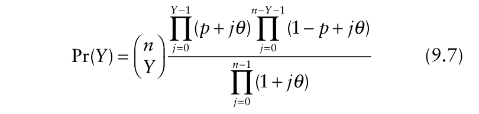{.equation width=60%}

in which _j_ is an index variable and _Y_ takes the values 0, 1, 2, …, _n_.

Estimates of β-binomial parameters _p_ and θ based on summary statistics (“moment estimates”) are, respectively, _<u>y</u>_ and:

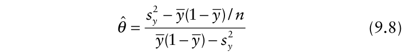{.equation width=60%}

in terms of proportions, or _Y_ and:

{.equation width=60%}

in terms of numbers of diseased individuals per sampling unit.

It is informative to consider the form of the moment estimate of the parameter θ. The numerator is the difference between the observed variance of the _yi_ values (equation 9.8) or _Yi_ values (equation 9.9) and the corresponding theoretical variance for a binomial distribution. The denominator is the difference between the maximum possible variance of the _yi_ values (equation 9.8) or _Yi_ values (equation 9.9) and the corresponding observed variance. The value of _θ_ ˆ becomes indefinitely large as the observed variance of the _yi_ values (equation 9.8) or _Yi_ values (equation 9.9) approaches the maximum possible variance (i.e., as the denominator of the _θ_ ˆ formula approaches zero). When the observed variance of the _yi_ values (equation 9.8) or minimum value of _θ_ ˆ _Y_ occurs, which is _i_ values (equation 9.9) is zero, the _θ_ ˆ = −1/ _n_.

Computer software is available for maximum likelihood estimation of β-binomial parameters and calculation of expected β-binomial frequencies (Smith, 1983; Madden and Hughes, 1994). One advantage of maximum likelihood estimation is that estimated standard errors of the parameter estimates can be obtained. These are useful for comparing two or more data sets. Fig. 9.2 shows the observed and expected binomial and β-binomial frequencies for data from the Dogwood Anthracnose Impact Assessment Program in 1990 and 1991, reported by Zarnoch et al. (1995). The calculations were carried out using the BBD computer program described by Madden and Hughes (1994). In this case, there appears to be poor agreement between the observed and binomial expected values, an impression confirmed by χ2 tests of goodness-of-fit (1990: χ2 = 495.7 (4 _df_), _P_ < 0.001; 1991: χ2 = 1651 (6 _df_), _P_ < 0.001). There is much better agreement between the observed and β-binomial expected values, both visually (Fig. 9.2) and on the basis of χ2 tests of goodness-of-fit (Table 9.2). These results are consistent with the view that in this case, the pattern of disease incidence within sampling units is aggregated.

To calculate expected β-binomial probabilities manually, first calculate the zero term Pr(_Y_ =0), which is the probability that no plants are diseased (out of _n_ in a quadrat):

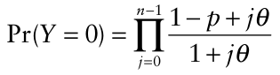

for _Y_ = 1, 2, ..., _n_, calculate recursively:

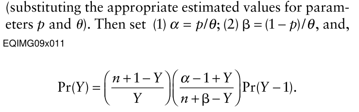

The resulting probabilities can be multiplied by _N_, the number of sampling units, to give the expected β-binomial frequencies. Compared with expected frequencies based on the binomial distribution with the same mean, β-binomial expected frequencies are higher in the tails of the distribution and lower near the mean, and this tendency increases with increasing θ (Fig 9.3).

{#fig-9-2}

**Table 9.2.** Analysis of the dogwood anthracnose disease incidence data shown in Fig. 9.2. Estimates of β-binomial parameters _p_ and θ and their standard errors were obtained by maximum likelihood using the program BBD. Analyses are based on _N_ = 168 (1990) and _N_ = 161 (1991) plots, each containing _n_ =10 trees.

||**_Parameter_** **_(standar_**|**_estimate_** **_d error)_**|**_Goo_**|**_dness-of-fit_**||**_Inde_**|**_x of dispersion_**||
|---|---|---|---|---|---|---|---|---|
|**_Year_**|ˆ**_p_**|ˆθ|χ **_2 a_**|**_df_**|**_P _****_b_**|**_D_**|χ **_2_**|**_P_**|
|1990|0.153|0.522|12.1|8|0.15|3.85|642.7|<0.001|
||(0.016)|(0.087)|||||167_df_||
|1991|0.299|0.998|14.8|8|0.06|5.60|895.4|<0.001|
||(0.025)|(0.136)|||||160_df_||

> a _p_ ˆ and _θ_ ˆ are estimated from the data, so the number of degrees of freedom for χ2 is three fewer than the number of frequency classes (no pooling was required).

> bThe significance level of the χ 2 goodness-of-fit statistic with listed degrees of freedom is given by _P_. Conventionally, _P_ > 0.05 indicates an acceptable fit.

{#fig-9-3}

As an alternative to the index of dispersion test and the χ2 goodness-of-fit test, Tarone (1979) provides a test of the binomial distribution against the specific alternative of the β-binomial, referred to as the _C_ (α) test. The _C_ (α) test is one-sided (in that the alternative is aggregation, not just “non-randomness”) and is based on calculation of a test statistic, _z_, that has an asymptotic standard normal distribution under the null hypothesis. When all the sampling units contain the same total number of plants, denoted _n_, the test statistic is calculated from: in which _S_ = _n N_ ( − 1) _D_ and _D_ is the index of dispersion (equation 9.6). The BBD computer program described by Madden and Hughes (1994) can be used to calculate _C_ (α) test statistics. For the data in Table 9.1, the outcomes of _C_ (α) tests (separately for each plot) support acceptance of the hypothesis of the binomial distribution. For the data in Table 9.2, the outcomes of _C_ (α) tests (separately for each year) support the rejection the hypothesis of the binomial distribution, in favor of the β-binomial alternative.

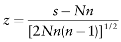

For a β-binomial distribution, the variance of the _yi_ values is estimated by:

{.equation width=60%}

This variance is the product of two terms: the binomial variance of the _yi_ values (equation 9.4) and a “heterogeneity factor” that depends on both _θ_ ˆ and the number of individuals per sampling unit (_n_). When _θ_ ˆ is zero, the β-binomial variance of the _yi_ values (_s_ β2bin) is equal to the corresponding binomial variance (_s_ bin2 ). When _θ_ ˆ is greater 2 2 than zero, _s_ βbin is larger than _s_ bin. At a given value of mean disease incidence, the β-binomial variance of the _yi_ values increases with increasing . Thus, aggregation is _θ_ ˆ indicated when the variance of the _yi_ values is larger than that of the binomial distribution with the same mean. The β-binomial distribution can be bimodal, with peaks in the 0th and _n_ th frequency classes. The binomial distribution can never be bimodal, so can never be a good description of observed frequencies where there is a pronounced tendency for members of the same sampling unit have the same disease status.

Another parameterization of the β-binomial in frequent use is _p_ = _α_ /(_α_ + β) (as before) and _ρ_ = 1/(_α_ + β + 1) (equivalent to _ρ_ = _θ_ /(_θ_ + 1)). Where data are described by the β-binomial distribution, ρ can be interpreted directly as the intra-cluster correlation coefficient. As θ increases indefinitely, ρ approaches a value of one. The smallest possible ρ (obtained when θ = −1/ _n_) is ρ = −1/(_n_ −1). So, although ρ can be thought of as a correlation coefficient, its smallest value is not −1 (as with continuous data), but a value that depends on _n_. In fact, the smallest possible ρ for a given set of conditions (i.e., given _n_ and _N_) may be even larger (i.e., closer to zero) than −1/(_n_ −1) because, as discussed in section 9.4.1, it may not be possible to obtain an exactly equal number of diseased individuals in each sampling unit (Ridout and Xu, 2000). An estimate of the β-binomial variance of the _yi_ values can now be written in terms of _ρ_ ˆ :

{.equation width=60%}

Again, the β-binomial variance formula can be seen as the product of two terms: the binomial variance of the _yi_ values (equation 9.4) and a “heterogeneity factor” that depends, in this case, on both _ρ_ ˆ and the number of individuals per sampling unit (_n_).

The first phytopathological applications of the β-binomial distribution seem to have been in the description of the frequency distribution of rice plants infected with yellow dwarf disease (caused by a mycoplasma-like organism) (Shiyomi and Takai, 1979; Takai and Shiyomi, 1980; Shiyomi, 1981) and in a methodological example given by Qu et al. (1990). Unfortunately, these studies appear to have had little impact on the plant disease epidemiology literature. Hughes and Madden (1993) showed that the use of the β-binomial distribution to characterize the frequency distribution of diseased plants per sampling unit was consistent with an empirical power law relationship between variances (section 9.4.7). Subsequently, a number of studies in which plant disease incidence was recorded (e.g., Gottwald et al., 1998; Madden and Hughes, 1994; Madden et al., 1995a, b; Roumagnac et al., 2004; Shah and Bergstrom, 2002; Scott et al., 2003; Shah et al., 2002; Tanne et al., 1996; Turechek and Madden, 1999a, b; Xu et al., 2001, Zarnoch et al., 1995) show that in cases where the binomial distribution provides an inadequate description of the frequency distribution of diseased plants or plant parts per sampling unit because the data are aggregated, the β-binomial usually provides a significant improvement (see also _Example 9.3_, section 9.9).

The binomial and β-binomial distributions have an important place in the analysis of disease incidence data, but they are not the only statistical probability distributions that are useful in this context. For example, the logistic-normal-binomial distribution is a possible alternative to the β-binomial distribution for the description of aggregated disease incidence data (Hughes et al., 1998; Hughes and Samita, 1998). The hypergeometric distribution has important applications in sampling, particularly when sampling from small populations (Chapters 10 and 11).

### 9.4.6 The index of dispersion revisited

For cluster sampling data, the variance of the _yi_ values (_s_ _y_ 2) can always be written as the corresponding binomial variance (_s_ bin2 ) multiplied by a constant. That is to say, by the incorporation of one additional parameter (representing an appropriate heterogeneity factor), the variance_s_ _y_ 2 can be determined from the binomial variance. Substituting for_s_ _y_ 2 (equation 9.2) with the expression for the β-binomial variance of the _yi_ values from equation 9.11, the following formula for _D_ is obtained:

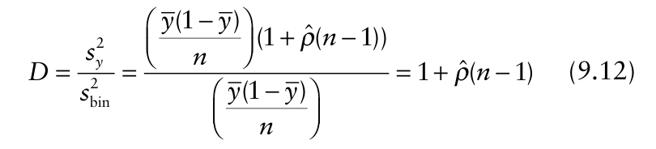{.equation width=60%}

In fact, this ratio of variances can be derived without reference to the β-binomial distribution (see section 6.2 in ˆ Collett, 2003). Equation 9.12, _D_ = 1 + _ρ_ (_n_ − 1),allows several useful results to be summarized. When _D_ = 1 (i.e., when the observed and binomial variances of the _yi_ values are equal), _ρ_ ˆ = 0, as required. When _D_ = _n_ (i.e., 2 ˆ when_s_ _y_ is at its maximum possible value, _<u>y</u>_ <u>(1</u> − _<u>y</u>_ <u>)),</u> _ρ_ = 1, reflecting perfect within-sampling-unit agreement in the disease status of plants. When _D_ = 0 (i.e., when_s_ _y_ 2= 0 , its minimum possible value), _ρ_ ˆ = −1/(_n_ − 1). Finally, note that for cluster sampling data described by the β-binomial distribution, the index of dispersion _D_ (equation 9.12) is a version of the deff (section 9.4.2), as used in the sampling literature (Kish, 1995).

### 9.4.7 A power law relationship

between variances Suppose that, instead of a single disease assessment, resulting in a single frequency distribution of disease incidence, we had a number of such assessments over a range of disease incidences. A typical scenario would be the collection of cluster sampling data at multiple times during an epidemic. One possibility would be to analyze the data from each assessment separately, for example by means of the methods outlined previously in section 9.4. Alternatively, we could start by summarizing the characteristics of the data set as a whole, and relate this subsequently to the properties of statistical probability distributions.

Hughes and Madden (1992) made an empirical investigation of the relationship between the observed variance (_s_ _y_ 2) and mean (_<u>y</u>_ <u>)</u> of the _yi_ values for 16 tobacco virus disease epidemics described by Madden et al. (1987a) and 13 maize dwarf mosaic virus disease epidemics described by Madden et al. (1987b). Good descriptions of the data were provided by the relationships:

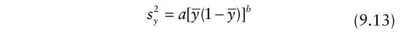{.equation width=60%}

and

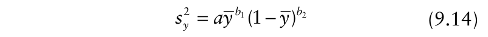{.equation width=60%}

in which _a_ and either _b_ (equation 9.13) or _b_ 1 and _b_ 2 (equation 9.14) are parameters to be estimated from data. The more general equation 9.14 allows for asymmetry in the curve describing the relationship between_s_ _y_ 2 and _<u>y</u>_ <u>(1</u> − _<u>y</u>_ <u>).</u>Logarithmic transformation of equations 9.13 and 9.14 produces the linear models:

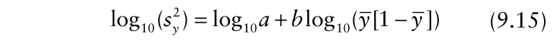{.equation width=60%}

and 1995a, b; Hughes et al., 1996, 2002a; Nault and Kennedy, 1996; Hughes and Gottwald, 1998, 1999; Turechek and Madden, 1999a, b; Shah et al., 2001, 2002; Turechek et al., 2001; Shah and Bergstrom, 2002; Bassanezi et al., 2003; Roumagnac et al., 2004) (Fig. 9.4). Note that when the data used to formulate such power law relationships are based on variable size sampling units, the variance formulae given in section 9.4.9 are required. Detailed stochastic simulations confirm the applicability of the power law relationship between variances for a wide range of epidemiological (e.g., dispersal distance, sporulation rate) and sampling (e.g., quadrat size and shape) conditions (Xu and Ridout, 2000).

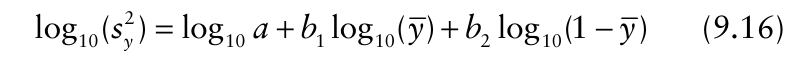{.equation width=60%}

respectively. Since the logarithm of an estimated variance may have a reasonably symmetric sampling distribution with a constant variance, linear least-squares regression may be used to estimate the parameters of equations 9.15 or 9.16. Alternatively, non-linear estimation methods may be used, employing a procedure that allows specification of a non-normal distribution for the response variable. Schabenberger and Pierce (2002) argue that the gamma distribution provides a good description for estimated observed variances.

For the most part, equation 9.13 (usually shown as the linear version, equation 9.15) has provided a satisfactory description of observed disease incidence data. As a result, little effort has gone into evaluating the more general equations 9.14 and 9.16. Equation 9.13 can be rewritten explicitly as a relationship between the observed variance of the _yi_ values and the corresponding variance on the assumption of a binomial distribution:

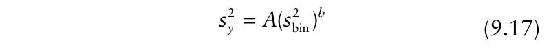{.equation width=60%}

in which _s_ bin2 = _<u>y</u>_ <u>(1</u> − _<u>y</u>_ <u>)</u> / _n_, _A_ = _an b_ (disease incidence _<u>y</u>_ being used as an estimate of the binomial parameter _p_, and _n_ being the total number of plants, or plant parts, per sampling unit, and _a_ and _b_ as in equation 9.13). Again, the parameters _A_ and _b_ can most easily be estimated after logarithmic transformation to 2 2 log10(_s_ _y_) = log10 _A_ + _b_ log10(_s_ bin). Equations 9.13–9.17 represent alternative formulations of a “power law”, analogous to Taylor’s (1961, 1984) power law for count data (section 9.5.5), taking account of the statistical characteristics of disease incidence data. Because incidence at the scale of the individual (e.g., plant) is binary (a plant is either diseased or disease-free; see Chapter 2), the model in equation 9.17 is often referred to as the _binary power law_ (Madden and Hughes, 1995).

Many published cases show that the power law relationship represented by equation 9.17 seems to provide an appropriate empirical description of incidence data (e.g., Madden and Hughes, 1995; Madden et al.,

### 9.4.8 How the power law is related to statistical probability distributions

For incidence data described by a β-binomial distribution, an estimate of the aggregation parameter θ can be written in terms of the power law parameters _A_ and _b_ (equation 9.17) as follows:

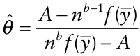

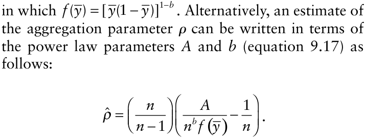

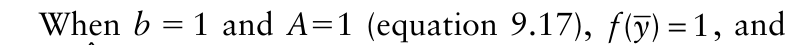{.equation width=60%}

then _θ_ = 0 ˆ(_ρ_ = 0) for all _<u>y</u>_. These parameter values are thus consistent with the binomial distribution as a description of variability within sampling units at all incidence values. These values of _b_ and _A_ are also consistent, on average, with a value _D_ = 1 of the index of dispersion (equation 9.6).

When _b_ = 1 and _a_ > _n_−1 (equation 9.13) (i.e., _A_ > 1, equation 9.17), _θ_ ˆ (or _ρ_ ˆ ) is constant (>0) for all . For _<u>y</u>_ ˆ instance, _ρ_ = (_A_ − 1)/(_n_ − 1) for all _<u>y</u>_ (on average). When data are characterized by _b_ = 1 and _a_ > _n_–1 (_A_ > 1), the observed variance of the _yi_ values exceeds the corresponding binomial variance for all data sets, and, on average, the index of dispersion _D_ = _A_.

When _b_ > 1 and _A_ > 1 (equation 9.17), _θ_ ˆ (or )is not _ρ_ ˆ constant, but increases to a maximum at _<u>y</u>_ = 0.5, then decreases. Most of the published examples of equation 9.17 have estimated values of _A_ > 1 and 1 < _b_ < 2, and thus illustrate a situation in which the pattern of disease incidence is aggregated to greatest extent around _<u>y</u>_ = 0.5, while the pattern when _<u>y</u>_ is close either to 0 or to 1 is indistinguishable from random. If _b_ > 1, then _<u>y</u>_ <u>, the binomial variance of the</u> _yi_ values and the correthe value of _D_ is not a constant, but depends on the sponding variance given by the power law model (equaestimated disease incidence <u>(</u> _<u>y</u>_ <u>). This can be seen on divid-</u> tion 9.17) are equal (with a value ≈1.64 × 10−3 ). In this ing both sides of the equation_s_ _y_ 2 = _A s_ ( bin2 )_b_ by _s_ bin2 , the example, the power law model (equation 9.17) predicts binomial variance of the _yi_ values, which results in a higher variance than that of the corresponding binomial _D_ = _A_ <u>(</u> _<u>y</u>_ <u>(1</u> − _<u>y</u>_ <u>)</u> / _n_) _b_ −1. distribution for disease incidences 0.015 < _<u>y</u>_ < 0.985. At disease incidences _<u>y</u>_ < 0.015 and _<u>y</u>_ > 0.985 the power _Example 9.1_. Here, we demonstrate relationships law predicts a lower variance than that of the corresponbetween the power law model represented by equation ding binomial distribution. Fig. 9.5B shows relationships 9.17 and the intra-cluster correlation coefficient. The between the intra-cluster correlation coefficient ρ and examples presented have been selected for the purpose of disease incidence , _<u>y</u>_ corresponding to the variance relaillustration, so no parameter estimation from data is tionships in Fig. 9.5A. When _b_ > 1, the line for ρ correinvolved. sponding to the power law line in Fig. 9.5A is a curve The power law relationship represented by equation with a maximum value at _<u>y</u>_ = 0.5 and which intersects 9.17 is illustrated in Fig. 9.5A, with _n_ = 9, 9, _b_ = 1.4 and 1.4 and the line ρ = 0 at the values of _<u>y</u>_ that are the solutions of _A_ = 13. The binomial line ( 13. The binomial line (_b_ = 1, 1, _A_ = 1) and the maxi- 1) and the maxi- _<u>y</u>_ 2 − _<u>y</u>_ + _nA_ 1/(1− _b_) = 0. mum-variance line (_b_ = 1, 1, _A_ = _n_) are also shown. It can For any point along the binomial line in Fig. 9.5A, a be seen that the power law and binomial lines cross at a binomial (_n_, _<u>y</u>_ <u>)</u> frequency distribution can be calculow value of the binomial variance. Two values of disease lated. For any point along the power law line in incidence _<u>y</u>_ (the mean proportion of diseased plants) Fig. 9.5A, a β-binomial (_n_, _<u>y</u>_ <u>,</u> _ρ_) frequency distribution give this variance. These values can be found by solving can be calculated. β-Binomial distributions with the quadratic equation _<u>y</u>_ 2 − _<u>y</u>_ + _nA_ 1/(1−− _b_) = 0(_b_ > 1) . In this −1/(_n_ − 1) ≤ _ρ_ < 0 (i.e., with a variance of the _yi_ values example, the two solutions are (correct to 3 decimal smaller than that of the binomial distribution with the places) _<u>y</u>_ = 0.015 and _<u>y</u>_ = 0.985 . At both these values of same mean) can be constructed (e.g., Prentice, 1986)

![Examples of the linear relationship, on logarithmic axes, between observed and binomial variances, for disease incidence data (based on equation 9.17). **(A**) _Citrus tristeza virus_ disease (Hughes and Gottwald, 1998), log10(_s_ _y_ 2) = 0.10 + 1.03 log 10(_s_ bin2 ). **(B)** _Plum pox virus_ disease (Hughes et al., 2002a), . log10(_s_ _y_ 2) = 0.20 + 1.06 log 10(_s_ bin2 ) **(C)** Grape downy mildew (Hughes et al., 1997), . log10(_s_ _y_ 2) = 1.15 + 1.35 log10(_s_ bin2 ) **(D**) Bacterial blight of onion (Roumagnac et al. 2004), log10(_s_ _y_ 2) = 2.71 + 1.48 log 10(_s_ bin2 ).](figures/fig9-img10.png){#fig-9-4}

The power law relationship represented by equation 9.17 is illustrated in Fig. 9.5A, with _n_ = 9, 9, _b_ = 1.4 and 1.4 and _A_ = 13. The binomial line ( 13. The binomial line (_b_ = 1, 1, _A_ = 1) and the maxi- 1) and the maximum-variance line (_b_ = 1, 1, _A_ = _n_) are also shown. It can be seen that the power law and binomial lines cross at a low value of the binomial variance. Two values of disease incidence _<u>y</u>_ (the mean proportion of diseased plants) give this variance. These values can be found by solving the quadratic equation _<u>y</u>_ 2 − _<u>y</u>_ + _nA_ 1/(1−− _b_) = 0(_b_ > 1) . In this example, the two solutions are (correct to 3 decimal places) _<u>y</u>_ = 0.015 and _<u>y</u>_ = 0.985 . At both these values of but are of little practical significance in plant disease epidemiology.

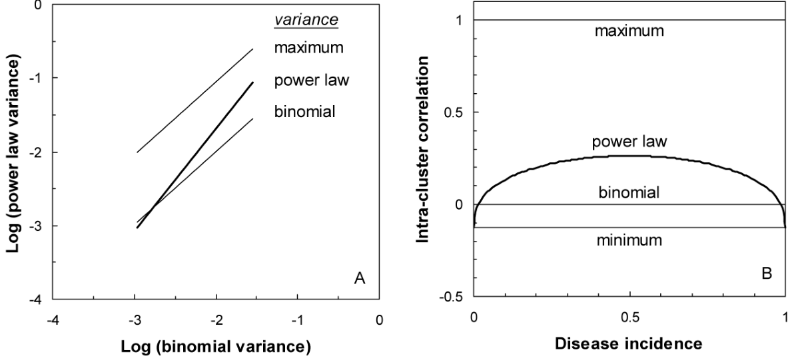

**FIG. 9.5. (A)** The power law relationship represented by equation 9.17 is illustrated, with _n_ = 9, _b_ = 1.4 and _A_ = 13 (plotted on logarithmic axes). The binomial line (_b_ = 1, _A_ = 1) and the maximum-variance line (_b_ = 1, _A_ = _n_) are also shown. **(B)** Relationships between the intra-cluster correlation coefficient ρ and mean disease incidence _<u>y</u>_, corresponding to the variance lines shown in A. The relationship corresponding to the maximum variance line is _ρ_ = 1. The relationship corresponding to the power law variance line is _ρ_ = (_n_ /(_n_ − 1)) _A_ /(_nb_ (_<u>y</u>_ <u>(1</u> − _<u>y</u>_ <u>))1−</u> _b_) − (1/ _n_) . Alternatively, calculate the index of dispersion _D_ (in this case _D_ is a variable) by dividing the power law variance by the binomial variance, then _ρ_ = (_D_ − 1)/(_n_ − 1). The relationship corresponding to the binomial variance line is ρ = 0. The relationship corresponding to the minimum variance line is _ρ_ = −1/(_n_ − 1). The minimum-variance line could not be shown on the logarithmic axes used in A. See _Example 9.1_.

### 9.4.9 Unequal size sampling units

In the cluster sampling scenarios considered so far, it has been assumed that all sampling units have the same number of plants or plant units (denoted _n_). It is convenient when this actually is the case, but important to be able to proceed with an analysis when it is not. Suppose now that data have been collected on the number of diseased plants in _N_ quadrats, and that in the _i_ th quadrat (_i_ = 1, 2, …, _N_) there were _ni_ plants, of which _Yi_ were diseased. The proportion of diseased plants in the _i_ th quadrat is then _yi_ = _Yi_ / _ni_. Disease incidence, as the mean proportion of diseased plants over all _N_ quadrats, is given by _<u>y</u>_ = ∑ _i Yi_ ∑ _i ni_. The mean number of plants per quadrat is _<u>n</u>_ = ∑ _i ni N_. In this case, there is not an (move) exact formula for the variance of the _yi_ values. The following approximate formulae (Cochran, 1977) are useful. The observed variance of the of the _yi_ values is estimated by:

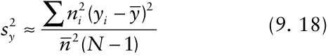

For a binomial distribution, the variance of the _yi_ values is estimated by:

Equations 9.18 and 9.19 are used to formulate power law relationships (section 9.4.7) when the size of the sampling unit varies. The observed variance of the number of diseased plants or plant parts per sampling unit is estimated by:

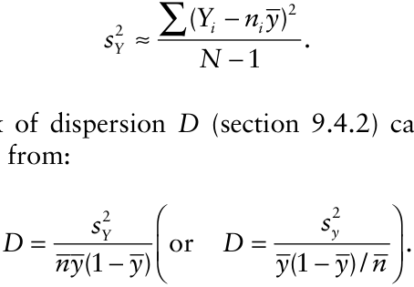

The index of dispersion _D_ (section 9.4.2) can now be calculated from:

The _C_ (α) goodness-of-fit test of the binomial distribution against the specific alternative of the β-binomial (section 9.4.5) can be calculated from:

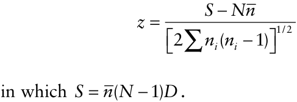

Although these summary statistics can be calculated, it is no longer possible to plot the observed data in the form of a frequency distribution, and generate expected frequencies on the basis of the binomial or β-binomial distribution. Distributional analysis _is_ still of interest, however, if we think in terms of parameter estimation rather than just comparing observed with expected

{.equation width=60%}

frequencies (Madden and Hughes, 1994; Zarnoch et al., 1995). We return to this topic in Chapter 10.

### 9.4.10 Two-stage sampling

Two-stage cluster sampling is the name given to cluster sampling when there is subsampling from the clusters, so that not all the individual elements in each sampling unit are assessed. Cochran (1977) gives a phytopathological example, which is probably based on data that appear in Cochran (1936), and later in this chapter in _Example 9.3_. A similar example follows.

Suppose that a field containing 1440 individual plants is divided into _M_ = 160 quadrats each containing _m_ = 9 plants. A total of _N_ = 40 quadrats is inspected, and in each quadrat, _n_ = 3 plants are assessed for disease. This procedure leads to a frequency distribution of disease incidence.

|**_Number of diseased plants per_** **_quadrat (/3 assessed)_**|**_Frequency_**|
|---|---|
|0|21|
|1|16|
|2|2|
|3|1|

The estimated mean proportion of plants diseased per quadrat is _<u>y</u>_ = 0.192 (equation 9.1). The estimated variance of the _yi_ values has two components: the variance among quadrat means and the variance among individuals within quadrats. The latter arises because only a sample of individuals in each quadrat is assessed. The variance among quadrat means is estimated by _s_ 12 = 0.0563 (equation 9.2) (summations in equations 9.1 and 9.2 are for _i_ = 1, 2, ..., _N_). The variance among individuals within quadrats is estimated by (Cochran, 1977). Here, _s_ 22 = 0.150 . Let _f_ 1 and _f_ 2 be the sampling fractions _N_ / _M_ and _n_ / _m,_ respectively. Here, _f_ 1 = 40/160 = 1/4, and _f_ 2 = 3/9 = 1/3. The variance of the mean proportion of plants diseased per quadrat can then be estimated by (Cochran, 1977). Here:

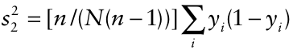

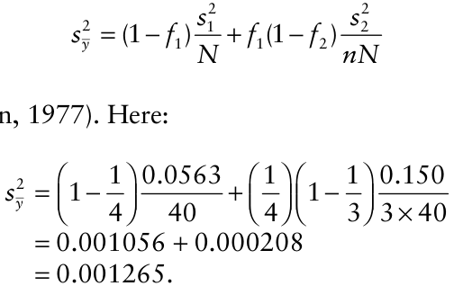

Cochran (1977) gives details of calculations for further levels of subsampling (multistage sampling) and of subsampling when sampling units are of unequal size (which makes things rather more complicated). Note that when only a small fraction of the sampling units in the population is sampled (i.e., when _N_ / _M_ is close to 0) or when a large fraction of the plants in each sampling unit is sampled (i.e., when _n_ / _m_ is close to 1), the within-quadrat variance (_s_ 22) has little effect on the variance of the mean proportion diseased (because _f_ 1(1− _f_ 2) ≈ 0).

## 9.5 Analysis of Sparsely Sampled Count Data

In a plant pathology context, disease data in the form of counts usually relate to the number of infections per sampling unit. Count data are more frequently collected in entomology and weed science (where population densities are probably the most common type of data collected for estimating populations of harmful organisms) than in studies of plant disease. Accordingly, plant pathologists have often applied methods developed in these disciplines (e.g., Bliss, 1958; Marshall, 1988) for characterizing patterns in disease data relating to population counts. Disease data in the form of counts arise in two main ways. Typically, such data are collected by looking at a sequence of individual plants, or plant units, and counting the number of lesions on each. The sampling unit is, in this case, the individual plant or plant unit (often a leaf in the case of foliar pathogens). For example, Waggoner and Rich (1981) reported data relating to number of lesions per plant, per leaf, and per leaflet for a variety of diseases caused by fungal pathogens. Sometimes it is the pathogen population that is assessed, rather than disease symptoms. For example, Charest et al. (2002) measured airborne ascospore concentration in a study of apple scab (caused by _Ventura inaequalis_).

### 9.5.1 Summary statistics

Suppose that the leaf is the sampling unit of interest and that in a sample comprising a total of _N_ leaves, _Yi_ lesions are counted on the _i_ th leaf (_i_ = 1, 2, ..., _N_). The mean number of lesions per leaf is estimated by:

{.equation width=60%}

and an unbiased estimate of the variance of the number of lesions per leaf is given by:

The mean proportion diseased is 0.192 with an estimated standard error equal to 0.036 (= 0.001265).

{.equation width=60%}

2 The estimated variance of _Y_ is_s_ _Y_ = _sY_ 2 / _N_, if the number of sampling units, _N_, is small relative to the total number of sampling units in the population of interest (when this is not the case, the finite population correction should be applied). <u>Then, the estimated standard error</u> 2 of the mean, _Y_, is_s_ _Y_. been estimated from the data (that is, the calculation of the Poisson probabilities was based on ), the number of _<u>y</u>_ degrees of freedom is two fewer than the number of frequency classes after any pooling to ensure that expected frequencies are not too small.

### 9.5.3 The negative binomial distribution

### 9.5.2 The Poisson distribution

As in section 9.5.1, suppose that the leaf is the sampling unit of interest and that counts of lesions per leaf are made. If the presence of a lesion on a leaf makes it no more or less likely that other lesions will occur (i.e., lesion occurrences are independent events), the _Poisson distribution_ may be used to provide a description of the frequency distribution of lesions per leaf:

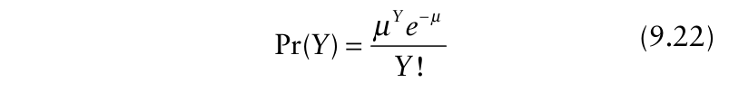{.equation width=60%}

in which _e_ is the base of natural logarithms (_e_ = 2.718, correct to three decimal places). Pr(_Y_) denotes the probability of a sampling unit containing _Y_ infections, _Y_ = 0, 1, 2, ... without a specified upper limit. The observed mean number of infections per sampling unit, _Y_, is usually taken as an estimate of the parameter μ. The estimated variance of the counts for a Poisson distribution is also equal to the mean, that is:

Again suppose that the leaf is the sampling unit of interest and that counts of lesions per leaf are made. If the presence of a lesion on a leaf makes it more likely that other lesions will occur (i.e., lesion occurrences are not independent events), there will be an aggregated pattern of lesions per leaf. A number of statistical probability distributions have been applied by ecologists to provide descriptions of aggregated population data in the form of counts. Southwood (1978) and Krebs (1998) provide useful overviews. The _negative binomial distribution_ has been widely used in plant disease epidemiology to describe aggregated patterns of disease data in the form of counts of infections within sampling units. An early example is provided by Strandberg (1973), who fitted several distributions, including the Poisson and the negative binomial, to data for the number of lesions per plant of cabbage black rot, caused by _Xanthomonas campestris_ pv. _campestris_ infection of cabbage plants.

There are a number of different formulations of the negative binomial distribution. For example:

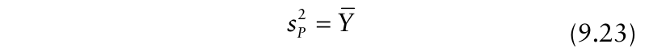{.equation width=60%}

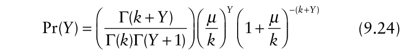{.equation width=60%}

In general, we adopt the Poisson distribution as the reference distribution appropriate for the description of a random pattern of disease data in the form of counts of infections within sampling units.

To calculate expected Poisson probabilities corresponding to observed counts, first calculate the zero term Pr(_Y_ = 0), which is the probability that a sampling unit contains no infections: (substituting the appropriate estimated value of μ). Then, for _Y_ = 1, 2, 3, ... calculate recursively:

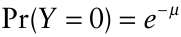

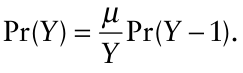

In practice, these probabilities can usually be calculated using a spreadsheet with a built-in function for calculation of Poisson probabilities. Probabilities can be converted to expected Poisson frequencies by multiplication by _N_, the number of sampling units. Agreement between observed and expected Poisson frequencies is tested by a χ2 test of goodness-of-fit (equation 9.5). When μ has in which, as in equation 9.22, Pr(_Y_) denotes the probability of a sampling unit containing _Y_ infections, _Y_ = 0, 1, 2, ... without a specified upper limit, and the mean number of infections per sampling unit, _Y_, is usually taken as an estimate of the parameter μ. The parameter _k_ is an aggregation parameter (_k_ > 0, aggregation at the within-sampling-unit scale increases as moment estimate of _k_ is _k_ ˆ = _Y_ 2 /(_sY_ 2 − _Yk decreases_). Γ(•) represents). The the gamma function. If _k_ is an integer, equation 9.24 may be written:

{.equation width=60%}

Maximum likelihood estimation of negative binomial distribution parameters can be obtained using statistical software such as SAS.

When _k_ is non-integer, mathematical software such as MATHCAD facilitates the calculation of expected negative binomial probabilities based on equation 9.24. To calculate expected negative binomial probabilities using equation 9.25, let _q_ = 1 + (_μ_ / _k_) (substituting the appropriate estimated values of the parameters μ and _k_), then calculate Pr(_Y_ = 0), the probability that a sampling unit contains no infections:

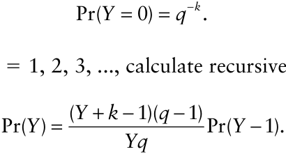

Then, for _Y_ = 1, 2, 3, ..., calculate recursively:

Using a spreadsheet with a built-in function for calculation of negative binomial probabilities usually requires _k_ to be rounded to an integer value. Expected probabilities obtained from either equation 9.24 or 9.25 are multiplied by _N_ to obtain expected negative binomial frequencies.

As the value of _k_ increases, expected negative binomial frequencies increasingly resemble expected Poisson frequencies. Agreement between observed and expected negative binomial frequencies may be tested by a χ2 test of goodness-of-fit (equation 9.5). When μ and _k_ have been estimated from the data (that is, the calculation of the negative binomial probabilities was based on _Y_ and _k_ ˆ ), the number of degrees of freedom is three fewer than the number of frequency classes after any pooling to ensure that expected frequencies are not too small. Two further tests of goodness-of-fit are available. These compare the observed and expected negative binomial variances and the observed and expected third moments of the negative binomial distribution (Anscombe, 1950; Southwood, 1978; Krebs, 1998). The third moment is a measure of skewness of a distribution.

For a negative binomial distribution, the variance of the counts is estimated by:

{.equation width=60%}

From equation 9.26, it can be seen that the negative binomial variance decreases as the estimate of the aggregation parameter increases. Because of this, _k_−1 is sometimes referred to as the aggregation parameter (so that aggregation increases with increasing _k_−1 ). Thus, when referring to the negative binomial aggregation parameter, it is helpful to be explicit as to whether _k_ or _k_−1 is meant. We use _k_ throughout.

Campbell and Noe (1985) and Gilligan (1988) provide useful discussions of the application of statistical probability distributions in the analysis of spatial pattern of disease assessments in the form of counts within sampling units, with particular reference to soil-borne pathogens. In addition to the Poisson and the negative binomial, reference is made to the Polya-Aeppli and Neyman type A distributions, two other discrete distributions that may be used as alternatives to the negative binomial for describing aggregated disease data in the form of counts within sampling units. Xu and Madden (2002) provide an example of the Neyman type A distribution used to characterize patterns of apple powdery mildew lesions (caused by _Podosphaera leucotricha_) over multiple years.

### 9.5.4 The index of dispersion for counts

The index of dispersion test is, as before, based on a comparison of the observed variance of counts with the corresponding theoretical variance of the reference distribution appropriate for the description of a random pattern of disease data in the form of counts of infec2 tions within sampling units. The former is given by_s_ _Y_ (equation 9.21), the latter, for disease data in the form of counts, is the Poisson variance, which is estimated by _Y_ (equation 9.23). Thus, in this case:

{.equation width=60%}

(Fisher, 1925). This is sometimes referred to as the variance-to-mean ratio. Numerous indices of aggregation for count data, based on the relationship between the variance and the mean, have been developed and discussed extensively in the ecological literature. Indeed, the relationship between the variance and the mean has been a cornerstone of the analysis of aggregated count data by population ecologists. Patil and Stiteler (1974), Myers (1978), Taylor (1984), Campbell and Madden (1990), Garson and Moser (1995), Hughes and Madden (1995) and Shiyomi and Yoshimura (2000) are among those who have reviewed work in this area. However, for our main purpose here—the identification of deviations from randomness in connection with the analysis of epidemiological surveys and experiments—the index of dispersion will serve (see Diggle, 2003, p. 32).

_Example 9.2._ Fig. 9.6 shows a frequency distribution representing the observed number of lesions (_Y_) on each of _N_ =100 leaves. For the data in Fig. 9.6, _Y_ = 3.35 and_s_ _Y_ 2= 13.99. The statistical software SAS was used to calculate maximum likelihood parameter estimatesˆ 1 (log(_Y_) = 1.209(SE = 0.055), _k_− = 1.026(SE =0.207)) . Expected Poisson and negative binomial frequencies (Fig. 9.6) were calculated using the mathematical software MATHCAD (the negative binomial aggregation parameter was rounded to _k_ = 1 for this purpose). There is an excess of values in the tails (_Y_ ≤ 1 or _Y_ ≥ 8) of the observed distribution and a deficit near the mean, compared with the Poisson expected frequencies. Such _extraPoisson variation_ is typical of aggregated disease data in the form of counts. Visually, the negative binomial distribution appears to provide a better description of the observed distribution. Support for these impressions is provided by χ2 tests of goodness-of-fit (equation 9.5). For the Poisson distribution, χ2 = 205.74 with 7 _df_ (_P_ < 0.001). For the negative binomial distribution, between the observed variance and mean for count data, in which the variance is proportional to a power of the mean:

{#fig-9-6}

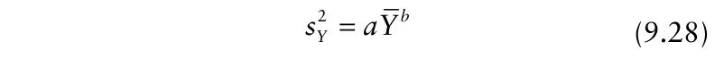{.equation width=60%}

At least part of the motivation for Taylor’s original work was to provide a transformation that would render count data (arising mainly from entomological studies of pest population density) suitable for use of analysis of variance. Subsequently there has been discussion of the biological significance (or otherwise) of equation 9.14 (see, e.g., Anderson et al., 1982; Taylor et al., 1983; Taylor 1984; Keeling, 2000). However, in the present context, this discussion is of little concern. Taylor’s power law provides a useful empirical description of aggregated count data that has been extensively applied by entomologists, although less so by plant pathologists. After logarithmic transformation, equation 9.28 becomes

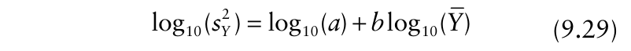{.equation width=60%}

χ2 = 3.41 with 8 _df_ (_P_ = 0.91). It was appropriate in both cases to pool frequency classes until no expected frequencies were less than two. For the Poisson distribution, the number of degrees of freedom is two fewer than the number of frequency classes after pooling. For the negative binomial distribution, the number of degrees of freedom is three fewer than the number of frequency classes after pooling. A negative binomial distribution with a mean of 3.35 and aggregation parameter _k_ = 1 (and _N_ = 100) provides a good description of the observed data.

For the observed data in Fig. 9.6, the value of the index of dispersion _D_ = 13.99/3.35 = 4.176 (equation 9.27). To test the statistical significance of deviations from randomness, (_N_ −1) _D_ = 99 × 4.176 = 413.4 is compared with the tabulated χ2 distribution at _N_ −1 _df_. This gives a significance probability _P_ < 0.001, indicating that the assumption of randomness is not supported in this case. The available evidence from analysis of data from Fig. 9.6 supports the view that there is aggregation of lesions within leaves (the adopted sampling units).

### 9.5.5 Taylor’s power law

Suppose that (as in section 9.4.7, but now thinking of disease data in the form of counts rather than disease incidence), instead of a single disease assessment, resulting in a single frequency distribution of counts per sampling unit, we had a number of such assessments over a range of values of mean count. One possibility would be to analyze the data from each assessment separately, for example by means of the methods outlined in sections 9.5.3 and 9.5.4. Taylor (1961, 1984) provides an alternative approach.

Taylor (1961) described an empirical relationship (which has come to be known as “Taylor’s power law”) from which estimates of _a_ and _b_ may be found by linear regression analysis. Alternative estimation procedures are discussed by Perry (1981) and Schabenberger and Pierce (2002, pp. 393–396). Boivin et al. (1990, Fig. 1) provide a phytopathological example of Taylor’s power law from a study of leaf blight of carrots caused by _Cercospora carotae_.

For fairly obvious reasons, Taylor’s power law is often referred to as a variance–mean relationship. However, it is also possible to interpret Taylor’s power law as a relationship between two variances. Because _Y_ is the estimate of the Poisson variance, equation 9.28 represents a relationship between the observed variance of the counts and the corresponding variance of the reference distribution appropriate for the description of random 2 2 _b_ count data: _sY_ = _a s_ (_P_) . Recall that in section 9.4.7, the 2 2 equation_s_ _y_ = _A s_ ( bin)_b_ was used to represent a relationship between the observed variance and the corresponding variance of the reference distribution appropriate for the description of random disease incidence data. It appears that a power law relationship between the observed variance and the variance of the reference distribution appropriate for the description of random disease data—usually plotted on logarithmic axes to provide a straight line graph—provides a good empirical description of aggregated disease data, both for incidence and for counts.

Because the variance is equal to the mean for a Poisson distribution, a Taylor’s power law analysis of count data characterizing a pattern that was indistinguishable from random should lead to estimates of both _a_ and _b_ equal to one (within the conventional limits of statistical significance testing). The index of dispersion _b_ −1 (equation 9.27) is given by _D_ = _aY_ when Taylor’s power law holds. Thus, when _b_ = 1, _D_ = _a;_ i.e., the index of dispersion is constant, on average, over the entire range of mean count per sampling unit. If _b_ > 1, _D_ must vary with mean count per sampling unit. For a large majority of published analyses, the estimate of _b_ is greater than one, and (when the data are plotted on logarithmic axes) the regression line corresponding to equa2 tion 9.14 crosses the Poisson line (_s_ _Y_ = _Y_) from below at some very low value of mean count per sampling unit at which most sampling units are empty. Aggregated count data lie above the Poisson line. A value of _b_ > 1 is often considered to be indicative of aggregation across all the data sets analyzed.

While there is a simple distributional interpretation of the power law description of aggregated disease incidence data (section 9.4.8), the distributional interpretation of aggregated data that follow Taylor’s power law is less straightforward (see, e.g., Kemp, 1987; Perry and Taylor, 1988). Different statistical probability distributions may describe the frequency distribution of population density at different points along a Taylor’s power law relationship (Taylor, 1984, Fig. 4.I). The Adès distribution (Perry and Taylor, 1985; Holgate, 1989) was introduced specifically in an attempt to provide a statistical probability distribution with Taylor’s power law properties, but as yet has received relatively little attention from plant pathologists. For ad hoc handling of count data, the negative binomial distribution is a reasonable option (Taylor, 1984). If equation 9.28 is substituted into the expression for the negative binomialaggregation parameter, _k_ ˆ = _Y_ 2 /(_sY_ 2 − _Y_), it can be seen that Taylor’s power law is consistent with the negative binomial distribution if the aggregation changes with the mean according to ˆ _k_ ˆ = _Y_ <u>p2</u> arameter/(_aY b_ − _Y_) (subject to the restriction that _k_ > 0) (Taylor et al., 1979).

## 9.6 Relationships between Distributions

The characteristics of four key statistical probability distributions for discrete data have been outlined in this chapter. The binomial and β-binomial distributions are applicable when disease incidence data collected by cluster sampling are being described. The Poisson and negative binomial distributions are applicable when disease data in the form of counts within sampling units are being described. Binns et al. (2000, Chapter 4) give a useful account of the same four distributions as a prelude to discussion of their application in crop protection. A full account of the statistical properties of these distributions can be found in N. L. Johnson et al. (1996).

The four distributions are linked (Leemis, 1986; Qu et al., 1990) (Fig. 9.7). It has already been noted that the β-binomial distribution (appropriate for aggregated incidence data) approaches the binomial (appropriate for random incidence data) as the aggregation parameter _θ_ → 0 (_α_ + β →∑), and that the negative binomial distribution (appropriate for aggregated data in the form of counts) approaches the Poisson (appropriate for random count data) as the aggregation parameter _k_ →∑. In addition, the binomial distribution approaches the Poisson (with the same mean, i.e., _np_ = μ) as the size of the sampling unit _n_ →∑ . The β-binomial distribution approaches the negative binomial (with the same mean, i.e., _np_ = μ, and negative binomial aggregation parameter _k_ = _p_ /θ), as the size of the sampling

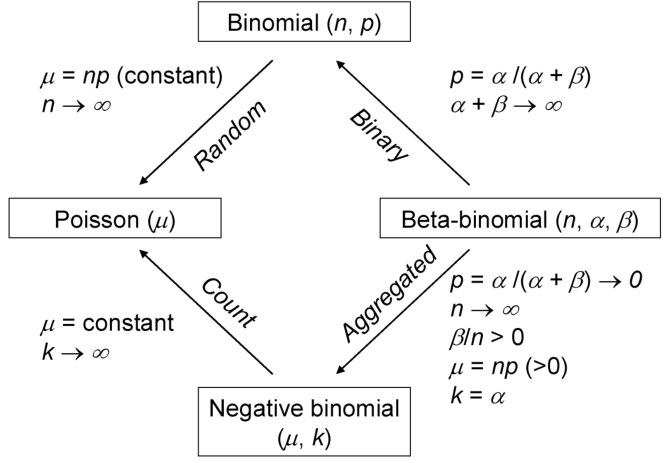{#fig-9-7}

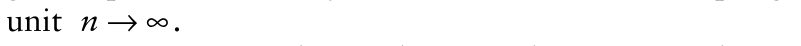{.equation width=60%}

Aggregation at the within-sampling-unit scale is characterized by an observed variance larger than that of the reference distribution for random data for either count data or incidence data, as appropriate. The variance of the negative binomial distribution (_k_ > 0) exceeds that of the Poisson distribution with the same mean and the variance of the β-binomial distribution (θ > 0) exceeds that of the binomial distribution with the same mean.

## 9.7 Spatial Hierarchies

There is a further way in which the statistical probability distributions for discrete data that have been introduced in this chapter may be used in the analysis of spatial pattern, one that has particular application in sampling for disease. Whether the data collected are disease incidence (from cluster sampling) or in the form of counts, they provide information on the magnitude of disease intensity within sampling units. Typically, this is summarized by estimation of the mean, using either equation 9.1 or 9.20 as appropriate. The same data also provide information on whether or not disease is present in sampling units. That is to say, sampling units may be classified as “healthy” if no disease is present or “diseased” if disease is present. This, of course, is an assessment of disease incidence at the scale of the adopted sampling unit. Viewed in this way, the data as a whole comprise a spatial hierarchy (Hughes et al., 1997).

### 9.7.1 Disease incidence in a spatial hierarchy

The probability that an individual element (e.g., plant, leaf) in a sampling unit is diseased is denoted _p_ low. The subscript “low” indicates reference to the within-samplingunit scale. For simplicity, we consider here the case where the s ampling units each comprise the same number of elements, denoted _n_. If the binomial distribution (equation 9.3) is regarded as an appropriate characterization of the frequency distribution of disease incidence at the within-sampling-unit scale, the probability that a sampling unit has no diseased elements is given by the zero term of the distribution, Pr(_Y_ = 0) = (1 − _p_ low)_n_ . If the sampling unit is a quadrat containing _n_ plants, this is the probability that no plants are diseased out of _n_ in a quadrat. The probability that a sampling unit contains at least one diseased element is then 1−Pr(_Y_ = 0):

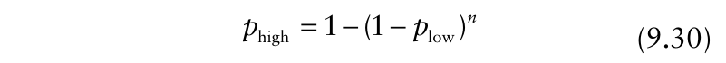{.equation width=60%}

in which the subscript “high” indicates reference to the sampling unit scale.

If the β-binomial distribution (equation 9.7) is regarded as an appropriate characterization of the frequency distribution of disease incidence at the withinsampling-unit scale, the probability that a sampling unit has no diseased elements is (i.e., the zero term of the distribution), in which θ is the β-binomial aggregation parameter. The probability that a sampling unit has at least one diseased element is then:

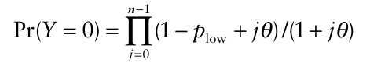

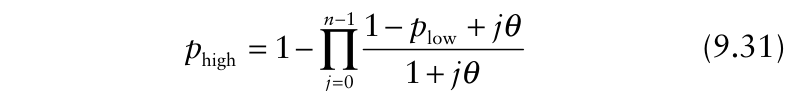{.equation width=60%}

Fig. 9.8 shows relationships between _p_ high and _p_ low based on equations 9.30 and 9.31 for _n_ = 9 and (for the latter equation) a range of values of θ. When _p_ high is plotted against _p_ low, the β-binomial curves (equation 9.31) fall below the binomial curve (equation 9.30). This shows that when there is aggregation at the within-sampling-unit scale, _p_ high is smaller than would be expected for a random pattern, at any specified level of _p_ low. Suppose, for example, we make disease assessments based on recording the individual plants as “healthy” or “diseased” in quadrats each containing _n_ plants. Aggregation of disease incidence at the plant scale results in more quadrats containing no diseased plants than for a random pattern with the same mean proportion of diseased plants per quadrat. Examples of the application of equations 9.30 and 9.31, including use of the power law 2 2_s_ _y_ = _A s_ ( bin)_b_ (equation 9.17) to describe variation of the β-binomial aggregation parameter θ, as described in section 9.4.8, are given in Hughes et al. (1997). Graphical plots of relationships between _p_ high and _p_ low do not provide a useful means of estimating β-binomial or power law aggregation parameters from data.

{#fig-9-8}

As an alternative to the use of equation 9.31 to describe aggregated disease incidence in a spatial hierarchy, Hughes and Gottwald (1999) used:

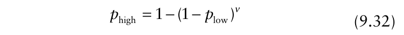{.equation width=60%}

This can be written in the form CLL(_p_ high) = ln(_v_) + CLL(_p_ low), in which CLL(•) denotes the complementary log-log transformation, CLL(•) = ln(−ln(1−•)), and ν is a parameter. From this, an estimate of ν may be made from data, provided that it is reasonable to regard the coefficient of CLL(_p_ low) as being equal to one. Values of ν (equation 9.32) less than the corresponding number of individuals per sampling unit _n_ (equation 9.30) characterize curves that fall below the binomial curve and so are representative of aggregation of disease at the withinsampling-unit scale. Hughes and Gottwald (1999) gave an example with _n_ = 4, ν = 3.3, in a study of _Citrus tristeza virus_ (CTV) incidence when the brown citrus aphid (_Toxoptera citricida_) was the main vector species. Madden and Hughes (1999b) discussed in some detail the use of equation 9.32 and the interpretation of ν as an effective sample size, and provided a graphical method of approximating ν. Hughes et al. (2002a) applied this graphical method for ν in the development of a surveillance program for _Plum pox virus_ (PPV) incidence, and reported _<u>n</u>_ = 3.7, _ν_ = 3.2 .

### 9.7.2 Counts in a spatial hierarchy

Recall that disease data in the form of counts are usually measured as number of infections per sampling unit.

If the Poisson distribution (equation 9.22) is regarded as an appropriate characterization of the frequency distribution of infections per sampling unit, the probability that a sampling unit contains no infections is given by the zero term of the distribution, Pr(_Y_ = 0) = _e_−_μ_ in which μ is the mean number of infections per sampling unit. The probability that a sampling unit contains at least one of whatever is being counted as an infection is

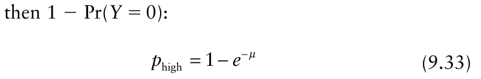{.equation width=60%}

This device—essentially, working out the probability that something has occurred by calculating “one minus the probability that it has not occurred”—was introduced to the study of relationships between disease incidence and disease data in the form of counts by Gregory (1948), citing Thompson (1924) as a precedent in the entomological literature. Equation 9.33 is also Wilson and Room’s (1983) “Model 3”. From rearranging equation 9.33: slope of the linear relationship (=−1.35) is close to −1, indicating conformity with the Poisson distribution.ˆ Note that if the 1 − _p_ high axis had a log10 scale, the slope of the relationship would be given by −log10(_e_1.35 ) = −0.586, close to −0.4343. In contrast, analysis of data for cedar-apple rust of apple (caused by _Gymnosporangium juniperi-virginianae_) gave _a_ ˆ = 0.076 (Gregory, 1948). Thus the slope of the linear relationship (=−0.076) is less steep than −1, indicating that the data do not conform to the Poisson distribution.ˆ Note that if the 1 − _p_ high axis has a log10 scale, the slope of the relationship is given by −log10(_e_0.076 ) = −0.033, which is less steep than −0.4343. This is indicative of deviation from randomness in the direction of aggregation.

Consider the further empirical modification of Equation 9.34 by inclusion of a second parameter _b_, as follows:

{.equation width=60%}

This can be written:

{.equation width=60%}

Thus, the relationship between ln(1− _p_ high) and μ is a straight line with a slope of −1 for this Poisson-based relationship (see Fig 9.9). Equation 9.34 may be empirically modified as follows:

{.equation width=60%}

in which _a_ is a parameter. This is equivalent to writing:

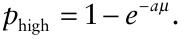

This is Wilson and Room’s (1983) “Model 4”. Consider the effect of _a_ on the relationship _p_ high = 1 − _e_ − _aμ_. Appealing to the Poisson distribution, we know that _a_ = 1 corresponds to a random pattern. If _a_ < 1, then fewer sampling units are infected (i.e., _p_ high is smaller) for any given value of μ than when _a_ = 1. That is to say (for example), that when _a_ < 1, the same number of lesions occupy a smaller number of leaves than if the pattern of lesions per leaf were random, and more leaves have no lesions. Small values of _a_ are thus indicative of deviations from randomness in the direction of aggregation.

Observed data for ˆ(_p_ highˆ , _Y_) may <u>used to estimate</u> _a_. A graphical plot of 1 − _p_ high against _Y_ is indicative of a random pattern of number of infections per sampling unit when the slope of this relationship is ˆ −1 (with the 1 − _p_ high axis on a ln scale) or −0.4343 (=−log10 _e_) ˆ (with the 1 − _p_ high axis on a log10 scale). Analysis of data for late blight of potato (caused by _Phytophthora infestans_) gave _a_ ˆ = 1.35 (Gregory, 1948). Thus the where, as before, CLL(_p_ high) denotes the complementary log-log transformation of _p_ high. This is a linear relationship on a plot of CLL(_p_ high) against ln(μ). It corresponds to the relationship: on a plot of _p_ high against μ (Nachman, 1981). Thus, this represents a two-parameter generalization of the Poisson model (equation 9.33). de Jong (1995) used this model, in a simulation study of sampling for detection of leek rust (caused by _Puccinia allii_), to characterize the relationship between proportion of diseased leek plants and the mean number of uredosori of _P. allii_ per plant. The two-parameter model reduces to Gregory’s (1948) oneparameter model when _b_ = 1, and to the Poisson model

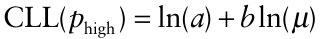

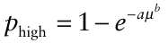

{.equation width=60%}

If the negative binomial distribution (equation 9.11) is regarded as an appropriate characterization of the frequency distribution of infections per sampling unit, the probability that a sampling unit contains no infections is given by the zero term of the distribution, − _k_ Pr(_Y_ = 0) = (1 + (_μ_ / _k_)) , in which μ is the mean number of infections per sampling unit and _k_ is the negative binomial aggregation parameter. The probability that a sampling unit contains at least one of whatever is being counted as an infection is then:

{.equation width=60%}

{#fig-9-9}

Equation 9.35 is (in a re-parameterized form) Wilson and Room’s (1983) “Model 1”. From rearranging equation 9.35:

{.equation width=60%}

This relationship between ln(1− _p_ high) and μ is a curve rather than a straight line (as it is for the Poissonbased relationship) (see Fig. 9.9). There is no simple graphical method of finding an estimate of _k_ from equation 9.36.

When ln(1− _p_ high) is plotted against μ, the negative binomial curves are above the Poisson line (Fig. 9.9). This shows that when there is aggregation at the withinsampling-unit scale, _p_ high is smaller (because 1− _p_ high is larger) than would be expected for a random pattern, at any specified level of μ. Suppose, for example, that the leaf is the sampling unit of interest and that we make disease assessments based on recording the number of lesions on each of _N_ individual leaves. For an aggregated pattern of lesions, the same number of lesions occupies a smaller number of leaves than if the pattern of lesions per leaf were random, and more leaves have no lesions. A precedent from the entomological literature for this analysis is given by Ingram and Green (1972). Waggoner and Rich (1981) and Seem (1984) provide a phytopathological viewpoint.

The negative binomial model can be generalized by using Taylor’s power law to describe variation in the negative binomial aggregation parameter _k_. This is Wilson and Room’s (1983) “Model 2”. First, the parameters in equation 9.35 are replaced by their estimates:

ˆ ˆ ˆ − _k p_ high = 1 −(1 + (_Y_ / _k_)) . Then, substitute for _k_ ˆ using _k_ ˆ = _Y_ 2 /(_sY_ 2 − _Y_) , and substi2 2 _b_ tute for_s_ _Y_ in the result, using_s_ _Y_ = _aY_ (equation 9.28). Then (after some rearrangement): is obtained, which can be written:

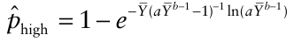

{.equation width=60%}

Boivin et al. (1990) used this model to describe the relationship between the proportion of diseased carrot leaves and the mean number of cercospora leaf blight (caused by _Cercospora carotae_) lesions per leaf.

It is apparent that most of the relationships described here in the context of plant pathology have a precedent in the entomological literature. In economic entomology, relationships between incidence and pest population density form the basis of “binomial sampling”, in which an estimate of pest population density is based on collection of data relating only to a binary assessment (either presence/absence or relative to a tally threshold) of the pest in question from sampling units (Chapter 10).

## 9.8 Sparsely Sampled Disease Severity Data

Just as statistical probability distributions may be fitted to sparsely sampled data for disease incidence and for disease assessments in the form of counts, the same kind of analysis could, at least in principle, be applied to sparsely sampled disease severity data. In fact, little attention has been devoted to the description and analysis of disease severity data in this way. There is probably not a single reason for this, but the fact that there are many different ways of recording severity data (Chapter 2) must be a contributory factor. Much more attention has been paid to the formulation of empirical relationships between disease severity and disease incidence.

### 9.8.1 The severity–incidence relationshipregression models

McRoberts et al. (2003) reviewed regression models for severity–incidence relationships. The most common approach to the analysis of relationships between disease severity and disease incidence is to collect contemporaneous severity and incidence data and prepare a graphical plot of these, before embarking on a statistical analysis. Since neither severity nor incidence can be incontrovertibly said to be the independent (explanatory) variable (Snedecor and Cochran, 1989) for the purpose of regression analysis, there is no general rule about which of the variables appears on which of the axes of graph. Examples in both orientations appear in the literature. Over a wide enough range of severity and incidence values, a graphical plot of the raw data, either as severity against incidence (Fig. 9.10) or incidence against severity, usually shows a curved relationship.

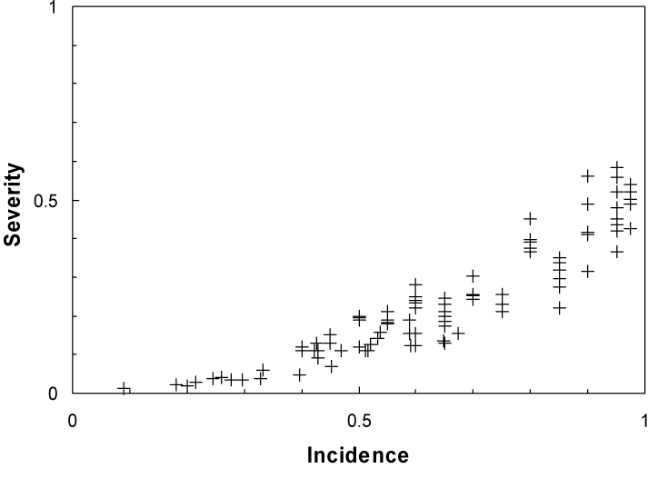{#fig-9-10}

When the severity-incidence data follow a curve, common practice is to seek a transformation of one or both variables that results in a linear graphical plot of the data, as a precursor to least-squares linear regression analysis (see Chapter 3). It is worth bearing in mind at this stage that transformations that provide satisfactory descriptions of observed data may not provide an appropriate description of a severity–incidence relationship if extrapolated beyond the range of the data (see, e.g., Zahareiva et al., 1984). Notwithstanding this, many different formulations of severity–incidence relationships appear in the literature.

In the notation adopted for this discussion, estimated mean severity is denoted _<u>y</u>_ sev and the corresponding estimated mean incidence is _<u>y</u>_ inc . To obtain a value of _<u>y</u>_ sev (using an example of severity at the leaf scale), visual assessments of severity (as a proportion) could be recorded for a number of leaves, and the mean value calculated. The corresponding value of _<u>y</u>_ inc would then be the proportion of leaves diseased (i.e., showing any level of symptoms that can be detected visually). Estimation of the relationship between severity and incidence of course requires an appropriate number of pairs of _<u>y</u>_ sev and _<u>y</u>_ inc data. In the following discussion, arbitrary constants are denoted _a_, _b_, _c_ (as required) for relationships showing severity as a function of incidence, and _a_ ′, _b_ ′, _c_ ′ (as required) for relationships showing incidence as a function of severity.

If logarithmic transformation of both the _<u>y</u>_ sev and the _<u>y</u>_ inc data results in a satisfactory straight line plot, a power curve of the form: is an appropriate description. An example is given by Chuang and Jeger (1987) in a study of banana leaf spot (caused by _Mycosphaerella fijiensis_ var. _difformis_). The authors point out that such a model arises directly if severity and incidence are both increasing exponentially, but at different rates. Of course, disease does not increase indefinitely in an exponential manner (see Chapter 4), but exponential increase may be a reasonable assumption during the early stages of an epidemic. Price and Williams (1990) (working with both incidence and severity as percentages, rather than proportions) used a power curve of the form: in a study of paspalum leaf blight (caused by _Ascochyta paspali_). Presumably, _<u>y</u>_ sev + 1 and _<u>y</u>_ inc + 1 were adopted by the authors in order to avoid problems with the logarithmic transformation (employed for the purpose of parameter estimation by linear least squares regression analysis) when the observed values of severity and/or incidence (on a percentage scale) were zero. For the data 1.8 in Fig. 9.10, the power curve _<u>y</u>_ sev = 0.47(_<u>y</u>_ inc) has an _R_2 value of 0.91 (_R_2 values for this and subsequent fits are given for reference, but should not be taken as an indication of the superiority or otherwise of any particular model, based as they are on a single data set). From the general shape of the relationship between severity and incidence in Fig. 9.10, it appears that a2 polynomial equation in which _~~y~~_ sev is related to, say, ~~(~~ _~~y~~_ inc ) might provide a satisfactory description of the data. Such an example is given by Silva-Acuña et al. (1999) in a study of severity—incidence relationships for coffee rust (caused by _Hemileia vastatrix_):

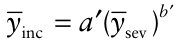

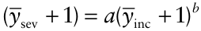

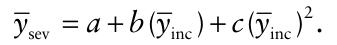

For the data in Fig. 9.10, the polynomial _<u>y</u>_ sev = 0.0234 − 0.0559(_<u>y</u>_ inc) + 0.5442(_<u>y</u>_ inc)2 has an _R_2 value of 0.88. Pataky and Headrick (1988) showed examples of relationships between _~~y~~_ sev and _~~y~~_ inc for common maize rust of sweet corn (caused by _Puccinia sorghi_) described by higher-order polynomials. Filajdic and Sutton (1992) showed relationships between _<u>y</u>_ inc and <u>(</u> _<u>y</u>_ sev )0.5 for Alternaria blotch of apple (caused by _Alternaria mali_). In this case, severity was measured on a six-point scale, at integer intervals from 0 to 5.

James and Shih (1973) discussed use of the restricted (or negative) exponential equation:

_<u>y</u>_ inc = 1 − _e_ −′ _a_ ~~(~~ _<u>y</u>_ sev ) to describe the relationship between incidence and severity of powdery mildew (caused by _Blumeria graminis_ f.sp. _tritici_) and leaf rust (caused by _Puccinia recondita_) of wheat. In this case, disease incidence increases from a lower value (usually taken to be zero) towards an upper value (usually taken to be 100 on a percentage scale or one on a proportion scale) with increasing severity. After some rearrangement of their relationship between _~~y~~_ inc and _~~y~~_ sev , James and Shih (1973) obtained the relationship: _<u>y</u>_ sev = _a_ ln(1 − _<u>y</u>_ inc ). For the data in Fig. 9.10, the relationship _<u>y</u>_ sev = −0.165 − ln(1 _<u>y</u>_ inc) has an _R_2 value of 0.81. Now consider a two-parameter generalization of James and Shih’s (1973) restricted exponential equation:

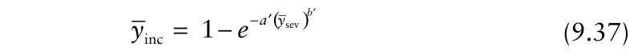{.equation width=60%}

After some re-arrangement, this can be written:

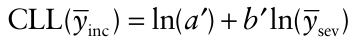

These are relationships between incidence in a spatial hierarchy, of the type discussed by Hughes et al. (1997) and discussed in section 9.7.1.

The assumptions about constant leaf and site size imply that the proportion of leaf surface visibly diseased is the same as the proportion of sites visibly diseased. Consider a particular value of _p_ site, denoted _X_ (0 ≤ _X_ ≤ 1). The corresponding severity, denoted here _~~y~~ X_, may be thought of as the area under a standard uniform [0, 1] distribution between 0 and _X_. The corresponding value of _p_ leaf may be calculated from equation 9.39. This gives a severity <u>(</u> _<u>yX</u>_) –incidence (_p_ leaf) relationship discussed by Daamen (1986). Daamen (1986, Fig. 1) calculated graphs of _<u>yX</u>_ against _p_ leaf for 0 ≤ _X_ ≤ 1 and _n_ = 2_i_ ,

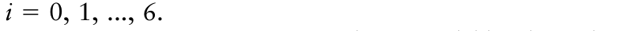{.equation width=60%}

Daamen’s (1986) severity-incidence model has been discussed further by Hughes et al. (2004), as follows. The beta probability distribution is a continuous distribution defined for a random variable _x_, the possible values of which are between 0 and 1 (see Olkin et al., 1980, for details). The two parameters of the beta probability distribution, denoted α and β, are positive numbers. The cumulative distribution function, referred to as the incomplete beta function, is denoted _IX_ (α, β) and written:

Writing this instead as a relationship between severity and incidence (on the transformed scales), we obtain:

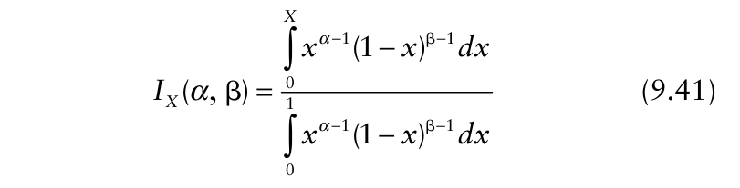{.equation width=60%}

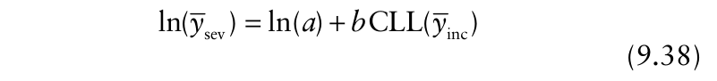{.equation width=60%}

= For the data in Fig. 9.10, the relationship ln(_<u>y</u>_ sev ) −1.742 + 1.022CLL(_<u>y</u>_ inc) has an _R_2 value of 0.88.

9.8.2. The severity–incidence relationship— a mathematical model The starting point for this mathematical model is equation 9.30, based on the binomial distribution. The notation used for this discussion is based on that used in section 9.7.1. In this application, the leaf is the higher of the two spatial scales of interest. The probability that a leaf is diseased is denoted _p_ leaf. Consider a leaf as comprising a number of sites (_n_), each of which may either be fully occupied by a cluster of pustules or unoccupied. If each leaf has the same total area and all sites are the same size, _n_ is constant. The probability that a site is occupied is denoted _p_ site. Assuming that the distribution of occupied sites per leaf is binomial, the probability that a leaf has no occupied sites is then:

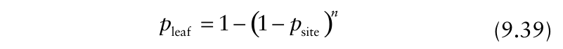{.equation width=60%}

which may be re-arranged as:

(0 ≤ _X_ ≤ 1). When α and β are both positive integers, the denominator of the expression on the right-hand side of equation 9.41 simplifies to [(_α_ − 1)!(β − 1)!]/(_α_ + β − 1)!, and then simplifies further to β−1 if α = 1. As integrals can be interpreted as areas, the format of equation 9.41 indicates that _IX_ (_a_, _b_) represents an area expressed as a proportion of the whole. Thus the incomplete beta function may be thought of as a statistical analogue of disease severity.

As above, assume that the proportion of leaf surface visibly diseased is the same as the proportion of sites visibly diseased. _X_ again denotes a particular value of _p_ site, with a corresponding value of severity _~~y~~ X_ and a corresponding value of _p_ leaf calculated from equation 9.39. Now, note that the standard uniform distribution is a special case of the beta probability distribution, with parameters α = 1 and β = 1 (Olkin et al., 1980), so _<u>yX</u>_ = _IX_ (1, 1). The incomplete beta function _IX_ (1, 1) may therefore be used to calculate a graph of _<u>yX</u>_ against _p_ leaf for 0 ≤ _X_ ≤ 1 and any given value of _n_, replicating Daamen’s (1986) analysis. A practical difficulty with this model is that the value of _n_, the number of sites per leaf, is unlikely to be countable in any straightforward manner. In practice, we are more likely to have estimates of _p_ leaf and _p_ site and to treat _n_ as a parameter to be estimated from data. The relationship between _~~y~~ X_ and _p_ leaf

{.equation width=60%}

is calculated via the assumption that sites may only be occupied fully or unoccupied, and the use of either equation 9.39 or 9.40 (both involving _p_ site).

As an alternative, we can set _n_ = 1, so that a leaf is always thought of as comprising a _single_ site that may be partially occupied (i.e., visibly diseased to some extent). The starting point is now a beta probability distribution with parameters α = 1 (for simplicity) and β = _q_ (0 < _q_ ≤ 1). Now severity, the proportion occupied, is modeled by _<u>yX</u>_ = _IX_ (1, _q_) , in which _q_ is a parameter to be estimated from data and _X_ is an index variable (0 ≤ _X_ ≤ 1). The relationship between severity and incidence is then calculated directly from a graph of _~~y~~ X_ against _p_ leaf, which has the form:

{.equation width=60%}

Then:

{.equation width=60%}

Fitting equation 9.43 to data (Hughes et al., 2004) provides a method of estimating the parameter _q_ of the incomplete beta function _IX_ (1, _q_). The use of the incomplete beta function to represent disease severity has the merit that the statistical description matches the biological variable of interest: both are continuous variables describing an area as a proportion of the whole.

### 9.8.3 Another regression model

An obvious question, but one still of interest, is what happens when equation 9.43 is used as the basis for a regression model for a severity–incidence relationship. Reverting to the notation of section 9.8.1 (and allowing for the coefficient of CLL(_~~y~~_ inc) to be estimated), we can write this model as:

{.equation width=60%}

and use observed data for severity and incidence at the leaf scale to estimate _a_ and _b_. Using this approach with severity and incidence data for Fusarium head blight on wheat (caused by _Fusarium graminearum_), Paul et al. (2005) reported that equation 9.44 was a consistently good description of the observed data. For the data in Fig. 9.10, the relationship CLL(_~~y~~_ sev) = −1.6055 + 1.144CLL(_~~y~~_ inc) has an _R_2 value of 0.89. The estimated value of the coefficient _b_ is slightly greater than one, which appears to be a typical outcome.

### 9.8.4 Overview of the severity-incidence relationship

It would probably be unwise to make too much of one type of severity-incidence relationship or another being preferable on theoretical grounds. In essence, the relationships described can serve as devices for summarizing certain epidemiological data in a way that has found a number of useful applications (Seem, 1984; McRoberts et al., 2003). The main issues in making a choice of one model or another are often likely to be how to obtain estimates of model parameters and how good is the fit of the model to the data under consideration.

Extracting information about patterns of disease from a severity–incidence relationship is less straightforward than for the spatial hierarchies described in section 9.7. Suppose, for example, that an assessment of leaves indicated a mean severity of 25%. Notionally, this value could arise if all leaves were 25% diseased (incidence is 100%) or if 25% of the leaves were 100% diseased (incidence is 25%). These extremes imply very different patterns of disease severity. Of course, the value of incidence corresponding to a particular value of severity will likely lie somewhere between the possible extremes. Linking pattern to the severity–incidence relationship for observed data is an interesting problem (McRoberts et al., 2003). The analysis of severity–incidence relationships specifically in the context of spatial patterns of plant disease deserves further investigation.

## 9.9 Analysis of Intensively Mapped Disease Data

Data collected by intensive mapping include details of the spatial arrangement of the sampling units. There are two main types of intensely mapped plant disease data. For the first, each sampling unit consists of an individual element, such as a plant, that is classified as either disease-free (denoted, for example, “0” or “−” or “H”) or diseased (denoted, for example, “1” or “+” or “D”). Thus, in this case, the variable to be analyzed is binary in form (see Chapter 2). For the second type of intensely mapped disease data, each sampling unit consists of either a count, such as the number of diseased plants out of a total of _n_ (with _n_ > 1) or the number of lesions, or a measurement of some continuous-scale variable, such as visual estimate of disease severity. Methods for both types of intensely mapped disease data are discussed, beginning with the analysis of binary data.

Bald (1937) reported the results of monitoring epidemics of tomato spotted wilt virus (TSWV) disease in experimental crops of tomato near Adelaide in Australia. Fig. 9.11 shows some of the intensively mapped data from this study, as originally presented by Cochran (1936) (i.e., without reference to experimental treatments). Data from two disease assessments are shown, with plants diseased at the first count marked “×” and those diseased at the second count, two weeks later, marked “+”. In relation to the data from the first count, Cochran (1936) concluded that: “… in addition to a gradual increase in the degree of infectivity from the top to the bottom of the field, there is a tendency for diseased plants to congregate in small patches.” Considering further data from the same experiments, the absence of large, aggregated groups of TSWV-infected plants along rows led Bald (1937) to rule out dispersal of the virus by mechanical transmission during crop husbandry operations. TSWV was carried into the plots by adult thrips that had acquired the virus as nymphs, while feeding on infected plant material outside the plots. The existence of small clusters of infected plants indicated, perhaps, that after landing in a plot, infective adult thrips took flight again, but only for a short distance. Secondary spread of the virus within plots was rare, as indicated by the lack of large clusters of diseased plants. There was thought to be little chance of disease spreading from one tomato plant to another in a plot, as thrips larvae do not move from plant to plant, and adults were not thought to become infective by feeding on diseased tomato plants (Bald, 1937). The statistical analyses underlying these biological interpretations represent the first major contribution to the quantitative study of spatial patterns of plant disease. Methods that applied to the data in both sparsely sampled and intensively mapped formats were used.

{#fig-9-11}

_Example 9.3._ Methods for sparsely sampled data described in this chapter so far can be applied to intensively mapped data. In doing so, information on the spatial arrangement of the sampling units is ignored. (Later in this chapter we show how to obtain a finer resolution in our quantification of spatial pattern for this data set.) The frequency distribution of observed number of TSWV-infected tomato plants out of _n_ = 9 in a sampling unit (Fig. 9.12) was obtained by dividing the first-count data from the mapped area shown in Fig. 9.11 into 160 quadrats of three columns by three rows and counting the infected plants (marked “×” in Fig. 9.11) in each quadrat.

{#fig-9-12}

The BBD computer program (Madden and Hughes, 1994) was used to calculate maximum likelihoodˆ parameter estimates <u>(</u> _<u>y</u>_ = 0.181(SE = 0.012), _θ_ = 0.053 (SE = 0.020)) and expected binomial and β-binomial frequencies (Fig. 9.12). There is an excess of values in the tails (_Y_ = 0 or _Y_ ≥ 4) of the observed distribution and a deficit near the mean, compared with the binomial expected frequencies. Such results are typical of aggregated disease incidence data. Visually, the β-binomial distribution appears to provide a better description of the observed distribution. Support for these impressions is provided by χ2 tests of goodness-of-fit (equation 9.5). For the binomial distribution, χ2 = 10.22 with 4 _df_ (_P_ = 0.037). For the β-binomial distribution, χ2 = 0.44 with 4 _df_ (_P_ = 0.98). In both cases, frequency classes were pooled until no expected frequencies were less than one. For the binomial distribution, the number of degrees of freedom is two fewer than the number of frequency classes after pooling. For the β-binomial distribution, the number of degrees of freedom is three fewer than the number of frequency classes after pooling. A β-binomial distribution with a mean of 0.181 and aggregation parameter _θ_ = 0.053, with _n_ = 9 (and _N_ = 160) provides a very close description of the observed data.

{#fig-9-13}

For the observed data in Fig. 9.12, the value of the index of dispersion is _D_ = 1.42 (equation 9.8). To test the statistical significance of deviations from randomness, (_N_ − 1) _D_ is compared with the tabulated χ2 distribution at _N_ −1 _df_. Here χ2 (159 _df_) = 225.55 (_P_ < 0.001). Thus the result here is indicative of aggregation. The value of the _C_ (α) test statistic is 3.89, which is larger than the (one-sided) 5% point of the standard normal distribution. Conventionally, then, we would reject the hypothesis of the binomial distribution for these data in favor of the specific alternative of the β-binomial, on the basis of the _C_ (α) test.

The available evidence from analysis of the firstcount data from Fig. 9.11, using methods for sparsely sampled data, supports the view that there is aggregation of disease within the adopted sampling units. Now, because we have information on the spatial locations of the diseased plants, we have access to additional methods of analysis that cannot be applied to sparsely sampled data.

### 9.9.1 Join-count statistics

_Join-count statistics_ (Cliff and Ord, 1981; Upton and Fingleton, 1985) may be used to analyze spatial associations for disease incidence data (de Jong and de Bree, 1995; Gumpertz, 1997). As in the previous section, this approach is appropriate when each individual plant is a sampling unit. If healthy plants are coded “H” and diseased plants coded “D”, two adjacent (proximal, contiguous) plants may be classified by the type of “join” linking them: H–H, D–D or H–D. In an array of plants, both the type of join to be counted and the orientation(s) of interest are specified. One can consider joins in different orientations: along rows, across rows, diagonally, or a combination of these. Then one simply counts the number of joins of the specified type in the orientation(s) of interest.

This is demonstrated with an example in Fig. 9.13. The 5 × 5 array in the upper part of Fig. 9.13 is taken from the upper left-hand corner of Fig. 9.11 (first- and secondcount data combined). Looking at the first row, there is only one H–D join, between the fourth and fifth plants. There are, however, three D–D joins (between plants one and two, two and three, and three and four). Looking at the first column, there are three H–D joins and just one D–D join. The total number of joins of each type is counted (separately for H–D and D–D joins) for the orientation(s) of interest. Here we are interested in pattern along and across rows, so the number of joins of each type is summed over both the rows and columns of the diagram. Using an analogy with the game of chess, this is usually called the “rook” proximity (or contiguity) case (Cliff and Ord, 1973). We define #HD and #DD, respectively, as the observed number of H–D and D–D join counts. As shown in the upper part of Fig. 9.13, there were 23 H–D joins (#HD = 23) and 7 D–D joins (#DD = 7).

The question then is whether the observed join-count is large (or small) relative to that expected for a random pattern of Hs and Ds. For large sample sizes, the expected number of join-counts can be defined under randomness [denoted _E_ R(#HD), _E_ R(#DD)] and the corresponding standard errors of these expected values can be estimated [ _s_ R(#HD), _s_ R(#DD)] (see Upton and Fingleton, 1985; Gumpertz, 1997). The formulae for expected values depend on some implicit assumptions, and we show here only the equations for the “free sampling” case, which simply means that the number of diseased plants in an array of a given size is assumed to be random, with a fixed probability that any individual is diseased (Gumpertz, 1997). Assuming that the data set is a rectangular array, comprising # _r_ and # _c_ columns, with no missing values, one first defines:

Note that these constants depend only on the physical dimensions of the field and not on the pattern of disease, and that the definitions given here apply _only_ for a rectangular array with no missing values, with the “rook” definition of proximity. Formulae are available for other kinds of array and for other definitions of proximity (Upton and Fingleton, 1985; Gumpertz, 1997). For the diagram in the upper part of Fig. 9.13 (with # _r_ = # _c_ = 5), _S_ 0 = 80, _S_ 1 = 160, and _S_ 2 = 1072. Expected values and their estimated standard errors are given by: where _<u>y</u>_ is, as before, the observed proportion of diseased plants in the array (our estimate of the probability that an individual plant is diseased).

If there is an aggregated pattern of diseased plants, #HD will be less than _E_ R(#HD) because there will be fewer H–D (and D–H) joins than expected on the basis of randomness. With a large enough sample size, this can be tested with a standard normal distribution test statistic:

The subtraction of 0.5 from the numerator is a correction for continuity, applied because join-counts are discrete. A large negative value of the test statistic indicates aggregation of diseased plants. As shown in the upper part of Fig. 9.13, #HD was actually larger than _E_ R(#HD), so the standard normal test clearly indicates randomness in this example. For comparison, consider the array in lower part of Fig. 9.13, which has the same proportion of diseased plants as the array in the upper part, but with all the diseased plants contained in a single patch. In this case, #HD was considerably less than _E_ R(#HD), and the standard normal test statistic was large and negative, indicating an aggregated pattern of diseased plants (_P_ < 0.05). The test for aggregation is one-sided, so values of _z_ < −1.64 (i.e., more negative) are conventionally taken as a basis for rejection of the

{.equation width=60%}

For an aggregated pattern of diseased plants, #DD will be greater than _E_ R(#DD), because there will be many D–D joins. The following standard normal statistic is used to test for aggregation:

Here, the correction for continuity involves addition of 0.5 to the numerator (Gumpertz, 1997). For the example in the upper part of Fig. 9.13, there were actually fewer D–D joins than expected, indicating randomness. For the example in the lower part of Fig. 9.13, with all the diseased plants in a single patch, #DD was considerably larger than expected, producing a test statistic _z_ > +1.64, indicative of aggregation of diseased plants (_P_ < 0.05).

The standard normal test is intended for use with a large number of observations and when disease incidence is not very close to 0 or 1. With small numbers of observations, such as with the 5 × 5 arrays given as examples in Fig. 9.13, randomization methodology (Upton and Fingleton, 1985) is a better procedure. Keeping the same proportions of Ds and Hs as for the observed data, a large number of random arrangements of Ds and Hs are generated to determine how likely the observed arrangement is, compared with typical random patterns. Gumpertz (1997) provides a SAS macro by means of which this randomization methodology may be implemented.

In its simplest form, the join-count statistic only quantifies spatial association between nearest neighbors (adjacent plants, with a specified orientation), thus allowing no assessment of association between more distant neighbors. However, this is not an inherent limitation of the method, and it is possible to define joins to exist between more distant neighbors (Cliff and Ord, 1981). Pethybridge and Madden (2003) and Pethybridge et al. (2004) provide examples using join-counts to analyze spatial scales in their study of spatio-temporal dynamics of virus spread in Australian hop gardens. Ferrandino (1998) also discusses the analysis of spatial associations for disease incidence data with pairs of plants that are not immediately adjacent, based on a different methodology.

The manual calculation of join counts is relatively easy for small data sets such as in those given in Fig. 9.13, but with moderate-sized data sets (such as shown in Fig. 9.11) the analysis would be impracticable without the use of computer software. Fortunately, Gumpertz (1997) wrote _SAS_ programs for many of the required calculations. An alternative, spreadsheet-based approach is described by Sawada (1999). Using a modification of the program written by Gumpertz (1997), we analyzed the full data set mapped in Fig. 9.11 (first assessment), based on the “rook” proximity criterion. There were 798 observed H–D joins (#HD = 798), which was smaller than the expected number under randomness (_E_ R(#HD) = 829.8), suggesting aggregation of disease. With the estimated standard error of _s_ R(#HD) = 39.56, the standard normal statistic was calculated to be _z_ = −0.79. This gives an achieved significance level of _P_ = 0.21. Thus, there was insufficient evidence to reject the null hypothesis of randomness with this analysis.

There is a relationship between join-count analysis and ordinary runs analysis (see, e.g., Madden et al., 1982; Madden and Campbell, 1986). An “ordinary run” is a sequence either of diseased or of healthy plants. For example, the numbers or ordinary runs (# _O_) in the five rows in the upper part of Fig. 9.13 are 2, 4, 4, 3, and 2. Each of these values exceeds by one the corresponding #HD value. Thus, it turns out that ordinary runs analysis is a special case of H–D join-count analysis for a onedimensional array (with # _O_ = #HD + 1). The derivation is different, but the outcome is the same. For ordinary runs analysis of a two-dimensional array, the data must first be transformed into a one-dimensional array, by combining the rows end-to-end. However, there is little reason to use this method, because join-count statistics provide a basis for a two-dimensional analysis that can be calculated directly.

### 9.9.2 The cross-product statistic

Join-count statistics are just one of a number of spatial analyses that can be derived from a general cross-product statistic, denoted here Θ. Mantel (1967) provides the starting point for epidemiological methodology based on the cross-product statistic. Legendre and Legendre (1998) provide a more recent overview of ecological applications. The general cross-product statistic takes the form:

{.equation width=60%}

which we explain by reference to the join-count statistic, and in particular to the 5 × 5 array shown in the upper part of Fig. 9.13. The variable _Wij_ is used to indicate whether two locations in the array are neighbors, according to whatever definition of proximity has been adopted. In its simplest form, _Wij_ = 1 when two locations are defined as neighbors, otherwise _Wij_ = 0 (Table 9.3A). The variable _Uij_ is used to indicate whether or not the disease status _Y_ of two locations in the array is the same. Let _Y_ = 1 for a location denoted D in the upper part of Fig. 9.13, and _Y_ = 0 for a location denoted H. If _Uij_ is defined as _Uij_ = (_Yi_ − _Yj_)2 , then _Uij_ = 0 when both locations have the same disease status, and _Uij_ = 1 when they differ (Table 9.3B). The factor _w_ is a scaling factor, used to control the range of Θ. In this case, _w_ = 0.5, because the arrays in Tables 9.3A and 9.3B are both symmetrical about the main diagonal. All the required information about proximity and agreement or otherwise of disease status is contained in the upper off-diagonal elements (the lower off-diagonal elements are actually redundant). As we now have the appropriate _Wij_ values for the adopted definition of proximity, the appropriate _Uij_ values for counting locations with differing disease status, and an appropriate value of _w_, equation 9.45 can be used to calculate Θ. Evaluation of the term ∑∑ _j jW Uij ij_ requires that the corresponding _Wij_ and _Uij_ values, respectively in Tables 9.3A and 9.3B, are multiplied together _element-by-element_ (matrix multiplication is _not_ required), and the sum of the resulting values is then calculated (the result is 46). Then with _w_ = 0.5, Θ = 23. Because the definition of _Uij_ was appropriate for counting pairs of locations with differing disease status, we have found Θ = #HD as obtained previously in the analysis of join counts.

Other definitions of _Uij_ are possible. For example, still with _Y_ = 1 for a location denoted D in the upper part of Fig. 9.13 and _Y_ = 0 for a location denoted H, let _Uij_ = (_Yi_ × _Yj_). Now, _Uij_ = 0 if both locations are H, or if one location is H and one is D, and _Uij_ = 1 if _both_ locations are D (Table 9.3C). Using equation 9.45 to calculate Θ, with the _Wij_ values from Table 9.3A and _w_ = 0.5 (both as previously), but now with the _Uij_ values from Table 9.3C, gives Θ = 7. Because the definition of _Uij_ in this case was appropriate for counting pairs in which both locations are denoted D, we have found Θ = #DD as obtained previously in the analysis of joincounts.

When _Uij_ = (_Yi_ − _Yj_)2 , Θ increases if there are more H–D joins (within the adopted definition of proximity) and decreases if there are more H–H and D–D joins. When _Uij_ = (_Yi_ × _Yj_), Θ increases if there are more D–D joins (within the adopted definition of proximity) and decreases if there are more H–H and H–D joins. If a different proximity definition were adopted, the calculations would be carried out using a different array of _Wij_ values.

The formula for Θ is simple in form, but direct usage is tedious, mostly because of the way that _Wij_ and _Uij_ variables are used. For instance, for a map of disease consisting of 1440 plants (Fig. 9.11), there are 1,4402 = 2,073,600 values of both _Wij_ and _Uij_. Every plant is

**TABLE 9.3A.** Values of _Wij_ for the “rook” definition of proximity in a 5 × 5 array. Neighboring locations are indicated by _Wij_ =1,

{.equation width=60%}

||**_Row_**|**_1_**|**_1_**|**_1_**||**_1_**|**_1_**|**_2_**|**_2_**|**_2_**|**_2_**|**_2_**|**_3_**|**_3_**|**_3_**||**_3_**|**_3_**|**_4_**|**_4_**|**_4_**|**_4_**|**_4_**|**_5_**||**_5_**|**_5_**|**_5_** **_5_**|
|---|---|---|---|---|---|---|---|---|---|---|---|---|---|---|---|---|---|---|---|---|---|---|---|---|---|---|---|---|
|**_Row_**|**_Column_**|**_1_**|**_2_**|**_3_**||**_4_**|**_5_**|**_1_**|**_2_**|**_3_**|**_4_**|**_5_**|**_1_**|**_2_**|**_3_**||**_4_**|**_5_**|**_1_**|**_2_**|**_3_**|**_4_**|**_5_**|**_1_**||**_2_**|**_3_**|**_4_** **_5_**|
|_1_|_1_|0|**1**|0|0||0|**1**|0|0|0|0|0|0|0|0||0|0|0|0|0|0||0|0|0|0 0|
|_1_|_2_|**1**|0|**1**|0||0|0|**1**|0|0|0|0|0|0|0||0|0|0|0|0|0||0|0|0|0 0|
|_1_|_3_|0|**1**|0|**1**||0|0|0|**1**|0|0|0|0|0|0||0|0|0|0|0|0||0|0|0|0 0|
|_1_|_4_|0|0|**1**|0||**1**|0|0|0|**1**|0|0|0|0|0||0|0|0|0|0|0||0|0|0|0 0|
|_1_|_5_|0|0|0|**1**||0|0|0|0|0|**1**|0|0|0|0||0|0|0|0|0|0||0|0|0|0 0|
|_2_|_1_|**1**|0|0|0||0|0|**1**|0|0|0|**1**|0|0|0||0|0|0|0|0|0||0|0|0|0 0|
|_2_|_2_|0|**1**|0|0||0|**1**|0|**1**|0|0|0|**1**|0|0||0|0|0|0|0|0||0|0|0|0 0|
|_2_|_3_|0|0|**1**|0||0|0|**1**|0|**1**|0|0|0|**1**|0||0|0|0|0|0|0||0|0|0|0 0|
|_2_|_4_|0|0|0|**1**||0|0|0|**1**|0|**1**|0|0|0|**1**||0|0|0|0|0|0||0|0|0|0 0|
|_2_|_5_|0|0|0|0||**1**|0|0|0|**1**|0|0|0|0|0||**1**|0|0|0|0|0||0|0|0|0 0|
|_3_|_1_|0|0|0|0||0|**1**|0|0|0|0|0|**1**|0|0||0|**1**|0|0|0|0||0|0|0|0 0|
|_3_|_2_|0|0|0|0||0|0|**1**|0|0|0|**1**|0|**1**|0||0|0|**1**|0|0|0||0|0|0|0 0|
|_3_|_3_|0|0|0|0||0|0|0|**1**|0|0|0|**1**|0|**1**||0|0|0|**1**|0|0||0|0|0|0 0|
|_3_|_4_|0|0|0|0||0|0|0|0|**1**|0|0|0|**1**|0||**1**|0|0|0|**1**|0||0|0|0|0 0|
|_3_|_5_|0|0|0|0||0|0|0|0|0|**1**|0|0|0|**1**||0|0|0|0|0|**1**||0|0|0|0 0|
|_4_|_1_|0|0|0|0||0|0|0|0|0|0|**1**|0|0|0||0|0|**1**|0|0|0||**1**|0|0|0 0|
|_4_|_2_|0|0|0|0||0|0|0|0|0|0|0|**1**|0|0||0|**1**|0|**1**|0|0||0|**1**|0|0 0|
|_4_|_3_|0|0|0|0||0|0|0|0|0|0|0|0|**1**|0||0|0|**1**|0|**1**|0||0|0|**1**|0 0|
|_4_|_4_|0|0|0|0||0|0|0|0|0|0|0|0|0|**1**||0|0|0|**1**|0|**1**||0|0|0|**1** 0|
|_4_|_5_|0|0|0|0||0|0|0|0|0|0|0|0|0|0||**1**|0|0|0|**1**|0||0|0|0|0 **1**|
|_5_|_1_|0|0|0|0||0|0|0|0|0|0|0|0|0|0||0|**1**|0|0|0|0||0|**1**|0|0 0|
|_5_|_2_|0|0|0|0||0|0|0|0|0|0|0|0|0|0||0|0|**1**|0|0|0||**1**|0|**1**|0 0|
|_5_|_3_|0|0|0|0||0|0|0|0|0|0|0|0|0|0||0|0|0|**1**|0|0||0|**1**|0|**1** 0|
|_5_|_4_|0|0|0|0||0|0|0|0|0|0|0|0|0|0||0|0|0|0|**1**|0||0|0|**1**|0 **1**|
|_5_|_5_|0|0|0|0||0|0|0|0|0|0|0|0|0|0||0|0|0|0|0|**1**||0|0|0|**1** 0|

compared with every other plant, both for proximity and disease status. This means that other approaches to the required calculations are often adopted, while retaining the cross-product statistic as a conceptual basis for the calculation of either a measure of the agreement of disease status in neighboring locations, or a measure of the disagreement. For example, spatial autocorrelation coefficients (section 9.9.3) and semivariances (section 9.9.4) are versions of cross-product statistics.

9.9.3. Spatial autocorrelation If a plant being diseased makes it more (or less) likely that neighboring plants will be diseased, diseased plants are exhibiting _spatial autocorrelation_. For intensively mapped disease incidence data where each individual plant is a sampling unit (such as those shown in Fig. 9.11), join-count statistics provide a basic measure of spatial autocorrelation.

More generally, the principles of spatial autocorrelation analysis have been presented by Cliff and Ord (1981) and Upton and Fingleton (1985). The use of this type of analysis is not restricted to disease incidence data, where each individual plant is a sampling unit.

Provided that the spatial locations of the sampling units are known, any type of disease intensity data can be analyzed using spatial autocorrelation techniques. For instance, the sampling units may be individual plants, and the disease variable may be the number of diseased leaves or number of lesions. Alternatively, the sampling units may be quadrats containing a number of plants, and the disease variable may be the number of diseased plants. Note also that the methods described in this section are applicable to the analysis of continuous data such as disease severity. The minimum requirement for spatial autocorrelation analysis is that the spatial locations and disease status of the sampling units be known. Although data typically consist of a two-dimensional array of sampling units and their disease status, the methodology can easily be illustrated by application to a one-dimensional array, representing data from a transect across a field.

_Example 9.4._ The following data represent a transect of sampling units extracted from Table 11.3 of Campbell and Madden (1990), and show the number _Yi_ (_i_ = 1, …, _N_) of _Macrophomia phaseolina_ propagules per 10 g air-dry soil recorded in _N_ = 16 contiguous quadrats across a field in Edgecombe County, North Carolina.

|**_i_** **_Yi_**|
|---|
|1 41|
|2 60|
|3 81|
|4 22|
|5 8|
|6 20|
|7 28|
|8 2|
|9 0|
|10 2|
|11 2|
|12 8|
|13 0|
|14 43|
|15 61|
|16 50|

{.equation width=60%}

We introduce some new notation here for the variance in order to be consistent with that often adopted in spatial studies that use autocorrelation methods. Note that the denominator used in equation 9.47 is _N_, the number of observations, rather than _N_ −1, the degrees of freedom. Thus, equation 9.47 gives the maximum likelihood estimate of the variance.

The autocovariance between two values of _Yi_ a distance (or _lag_) _j_ apart is estimated by:

{.equation width=60%}

From these data the following quantities may be estimated. The mean:

{.equation width=60%}

and the variance where _Nj_ is the number of _pairs_ of sampling units _j_ units apart (i.e., the number of pairs of _Y_ values on which the calculation of _C_ ˆ( ) _j_ is based). For instance, when the data comprise a one-dimensional array, _Nj_ = _N_ − _j_, and for first-order spatial lags (i.e., immediately adjacent sampling units), _Nj_ = _N_ −1. The _C_ (•) symbol is used to represent covariance. Since the variance is just the covariance of a variable with itself (i.e., the covariance for a spatial lag of zero), _C_ (0) is used for the variance. If the sampling units are not set out in a regular array, the number of pairs of _Y_ values separated by a lag of exactly _j_ may be small. In such circumstances the lag _j_ is usually taken to be a mean distance calculated over some appropriate interval. From equation 9.47, the corresponding autocorrelation coefficient is then estimated by:

**TABLE 9.3B.** Values of _Uij_ defined as _Uij_ = (_Yi_ − _Yj_)2 , with _Y_ = 1 for a location denoted D in the upper part of Fig. 9.13, and _Y_ = 0 for a location denoted H. Then _Uij_ = 0 if both locations have the same disease status, and _Uij_ = 1 if they differ.

||**_Row_**|**_1_**|**_1_**|**_1_**|**_1_**|**_1_**|**_2_**|**_2_**|**_2_**|**_2_**|**_2_**|**_3_**|**_3_**|**_3_**|**_3_**|**_3_**|**_4_**|**_4_**|**_4_**|**_4_**|**_4_**|**_5_**|**_5_**|**_5_**|**_5_**|**_5_**|
|---|---|---|---|---|---|---|---|---|---|---|---|---|---|---|---|---|---|---|---|---|---|---|---|---|---|---|
|**_Row_**|**_Column_**|**_1_**|**_2_**|**_3_**|**_4_**|**_5_**|**_1_**|**_2_**|**_3_**|**_4_**|**_5_**|**_1_**|**_2_**|**_3_**|**_4_**|**_5_**|**_1_**|**_2_**|**_3_**|**_4_**|**_5_**|**_1_**|**_2_**|**_3_**|**_4_**|**_5_**|
|_1_|_1_|0|0|0|0|**1**|**1**|0|**1**|**1**|0|0|**1**|0|**1**|**1**|0|**1**|**1**|0|0|**1**|**1**|**1**|**1**|0|
|_1_|_2_|0|0|0|0|**1**|**1**|0|**1**|**1**|0|0|**1**|0|**1**|**1**|0|**1**|**1**|0|0|**1**|**1**|**1**|**1**|0|
|_1_|_3_|0|0|0|0|**1**|**1**|0|**1**|**1**|0|0|**1**|0|**1**|**1**|0|**1**|**1**|0|0|**1**|**1**|**1**|**1**|0|
|_1_|_4_|0|0|0|0|**1**|**1**|0|**1**|**1**|0|0|**1**|0|**1**|**1**|0|**1**|**1**|0|0|**1**|**1**|**1**|**1**|0|
|_1_|_5_|**1**|**1**|**1**|**1**|0|0|**1**|0|0|**1**|**1**|0|**1**|0|0|**1**|0|0|**1**|**1**|0|0|0|0|**1**|
|_2_|_1_|**1**|**1**|**1**|**1**|0|0|**1**|0|0|**1**|**1**|0|**1**|0|0|**1**|0|0|**1**|**1**|0|0|0|0|**1**|
|_2_|_2_|0|0|0|0|**1**|**1**|0|**1**|**1**|0|0|**1**|0|**1**|**1**|0|**1**|**1**|0|0|**1**|**1**|**1**|**1**|0|
|_2_|_3_|**1**|**1**|**1**|**1**|0|0|**1**|0|0|**1**|**1**|0|**1**|0|0|**1**|0|0|**1**|**1**|0|0|0|0|**1**|
|_2_|_4_|**1**|**1**|**1**|**1**|0|0|**1**|0|0|**1**|**1**|0|**1**|0|0|**1**|0|0|**1**|**1**|0|0|0|0|**1**|
|_2_|_5_|0|0|0|0|**1**|**1**|0|**1**|**1**|0|0|**1**|0|**1**|**1**|0|**1**|**1**|0|0|**1**|**1**|**1**|**1**|0|
|_3_|_1_|0|0|0|0|**1**|**1**|0|**1**|**1**|0|0|**1**|0|**1**|**1**|0|**1**|**1**|0|0|**1**|**1**|**1**|**1**|0|
|_3_|_2_|**1**|**1**|**1**|**1**|0|0|**1**|0|0|**1**|**1**|0|**1**|0|0|**1**|0|0|**1**|**1**|0|0|0|0|**1**|
|_3_|_3_|0|0|0|0|**1**|**1**|0|**1**|**1**|0|0|**1**|0|**1**|**1**|0|**1**|**1**|0|0|**1**|**1**|**1**|**1**|0|
|_3_|_4_|**1**|**1**|**1**|**1**|0|0|**1**|0|0|**1**|**1**|0|**1**|0|0|**1**|0|0|**1**|**1**|0|0|0|0|**1**|
|_3_|_5_|**1**|**1**|**1**|**1**|0|0|**1**|0|0|**1**|**1**|0|**1**|0|0|**1**|0|0|**1**|**1**|0|0|0|0|**1**|
|_4_|_1_|0|0|0|0|**1**|**1**|0|**1**|**1**|0|0|**1**|0|**1**|**1**|0|**1**|**1**|0|0|**1**|**1**|**1**|**1**|0|
|_4_|_2_|**1**|**1**|**1**|**1**|0|0|**1**|0|0|**1**|**1**|0|**1**|0|0|**1**|0|0|**1**|**1**|0|0|0|0|**1**|
|_4_|_3_|**1**|**1**|**1**|**1**|0|0|**1**|0|0|**1**|**1**|0|**1**|0|0|**1**|0|0|**1**|**1**|0|0|0|0|**1**|
|_4_|_4_|0|0|0|0|**1**|**1**|0|**1**|**1**|0|0|**1**|0|**1**|**1**|0|**1**|**1**|0|0|**1**|**1**|**1**|**1**|0|
|_4_|_5_|0|0|0|0|**1**|**1**|0|**1**|**1**|0|0|**1**|0|**1**|**1**|0|**1**|**1**|0|0|**1**|**1**|**1**|**1**|0|
|_5_|_1_|**1**|**1**|**1**|**1**|0|0|**1**|0|0|**1**|**1**|0|**1**|0|0|**1**|0|0|**1**|**1**|0|0|0|0|**1**|
|_5_|_2_|**1**|**1**|**1**|**1**|0|0|**1**|0|0|**1**|**1**|0|**1**|0|0|**1**|0|0|**1**|**1**|0|0|0|0|**1**|
|_5_|_3_|**1**|**1**|**1**|**1**|0|0|**1**|0|0|**1**|**1**|0|**1**|0|0|**1**|0|0|**1**|**1**|0|0|0|0|**1**|
|_5_|_4_|**1**|**1**|**1**|**1**|0|0|**1**|0|0|**1**|**1**|0|**1**|0|0|**1**|0|0|**1**|**1**|0|0|0|0|**1**|
|_5_|_5_|0|0|0|0|**1**|**1**|0|**1**|**1**|0|0|**1**|0|**1**|**1**|0|**1**|**1**|0|0|**1**|**1**|**1**|**1**|0|

**TABLE 9.3C.** Values of _Uij_ defined as _Uij_ = (_Yi_ × _Yj_), with _Y_ = 1 for a location denoted D in the upper part of Fig. 9.13, and _Y_ = 0 for a location denoted H. Then _Uij_ = 0 if both locations are H or if one is D and one is H, and _Uij_ = 1 if both locations are D.

||**_Row_**|**_1_**|**_1_**|**_1_**|**_1_**|**_1_**|**_2_**|**_2_**|**_2_**|**_2_**|**_2_**|**_3_**|**_3_**|**_3_**|**_3_**|**_3_**|**_4_**|**_4_**|**_4_**|**_4_**|**_4_**|**_5_**|**_5_**|**_5_**|**_5_** **_5_**|
|---|---|---|---|---|---|---|---|---|---|---|---|---|---|---|---|---|---|---|---|---|---|---|---|---|---|
|**_Row_**|**_Column_**|**_1_**|**_2_**|**_3_**|**_4_**|**_5_**|**_1_**|**_2_**|**_3_**|**_4_**|**_5_**|**_1_**|**_2_**|**_3_**|**_4_**|**_5_**|**_1_**|**_2_**|**_3_**|**_4_**|**_5_**|**_1_**|**_2_**|**_3_**|**_4_** **_5_**|
|_1_|_1_|**1**|**1**|**1**|**1**|0|0|**1**|0|0|**1**|**1**|0|**1**|0|0|**1**|0|0|**1**|**1**|0|0|0|0 **1**|
|_1_|2|**1**|**1**|**1**|**1**|0|0|**1**|0|0|**1**|**1**|0|**1**|0|0|**1**|0|0|**1**|**1**|0|0|0|0 **1**|
|_1_|3|**1**|**1**|**1**|**1**|0|0|**1**|0|0|**1**|**1**|0|**1**|0|0|**1**|0|0|**1**|**1**|0|0|0|0 **1**|
|_1_|4|**1**|**1**|**1**|**1**|0|0|**1**|0|0|**1**|**1**|0|**1**|0|0|**1**|0|0|**1**|**1**|0|0|0|0 **1**|
|_1_|5|0|0|0|0|0|0|0|0|0|0|0|0|0|0|0|0|0|0|0|0|0|0|0|0 0|
|_2_|_1_|0|0|0|0|0|0|0|0|0|0|0|0|0|0|0|0|0|0|0|0|0|0|0|0 0|
|_2_|2|**1**|**1**|**1**|**1**|0|0|**1**|0|0|**1**|**1**|0|**1**|0|0|**1**|0|0|**1**|**1**|0|0|0|0 **1**|
|_2_|3|0|0|0|0|0|0|0|0|0|0|0|0|0|0|0|0|0|0|0|0|0|0|0|0 0|
|_2_|4|0|0|0|0|0|0|0|0|0|0|0|0|0|0|0|0|0|0|0|0|0|0|0|0 0|
|_2_|5|**1**|**1**|**1**|**1**|0|0|**1**|0|0|**1**|**1**|0|**1**|0|0|**1**|0|0|**1**|**1**|0|0|0|0 **1**|
|_3_|_1_|**1**|**1**|**1**|**1**|0|0|**1**|0|0|**1**|**1**|0|**1**|0|0|**1**|0|0|**1**|**1**|0|0|0|0 **1**|
|_3_|2|0|0|0|0|0|0|0|0|0|0|0|0|0|0|0|0|0|0|0|0|0|0|0|0 0|
|_3_|3|**1**|**1**|**1**|**1**|0|0|**1**|0|0|**1**|**1**|0|**1**|0|0|**1**|0|0|**1**|**1**|0|0|0|0 **1**|
|_3_|4|0|0|0|0|0|0|0|0|0|0|0|0|0|0|0|0|0|0|0|0|0|0|0|0 0|
|_3_|5|0|0|0|0|0|0|0|0|0|0|0|0|0|0|0|0|0|0|0|0|0|0|0|0 0|
|_4_|_1_|**1**|**1**|**1**|**1**|0|0|**1**|0|0|**1**|**1**|0|**1**|0|0|**1**|0|0|**1**|**1**|0|0|0|0 **1**|
|4|2|0|0|0|0|0|0|0|0|0|0|0|0|0|0|0|0|0|0|0|0|0|0|0|0 0|
|4|3|0|0|0|0|0|0|0|0|0|0|0|0|0|0|0|0|0|0|0|0|0|0|0|0 0|
|4|4|**1**|**1**|**1**|**1**|0|0|**1**|0|0|**1**|**1**|0|**1**|0|0|**1**|0|0|**1**|**1**|0|0|0|0 **1**|
|4|5|**1**|**1**|**1**|**1**|0|0|**1**|0|0|**1**|**1**|0|**1**|0|0|**1**|0|0|**1**|**1**|0|0|0|0 **1**|
|5|_1_|0|0|0|0|0|0|0|0|0|0|0|0|0|0|0|0|0|0|0|0|0|0|0|0 0|
|5|2|0|0|0|0|0|0|0|0|0|0|0|0|0|0|0|0|0|0|0|0|0|0|0|0 0|
|5|3|0|0|0|0|0|0|0|0|0|0|0|0|0|0|0|0|0|0|0|0|0|0|0|0 0|
|5|4|0|0|0|0|0|0|0|0|0|0|0|0|0|0|0|0|0|0|0|0|0|0|0|0 0|
|5|5|**1**|**1**|**1**|**1**|0|0|**1**|0|0|**1**|**1**|0|**1**|0|0|**1**|0|0|**1**|**1**|0|0|0|0 **1**|

{.equation width=60%}

Dividing the covariance by the variance has the effect of scaling the autocovariances, so that for continuous data, one obtains a correlation coefficient that lies between +1 and −1. Disease intensity in each sampling unit is often compared with that in the immediately adjacent unit(s), in which case _j_ = 1 and the coefficient is _r_ ˆ(1) obtained. In general, spatial autocorrelation analysis provides a quantitative assessment of whether a large value of disease intensity in a sampling unit makes it more (positive autocorrelation) or less (negative autocorrelation) likely that neighboring sampling units tend to have a large value of disease intensity.

_Example 9.4 continued_. For the transect data, the calculated values of _r_ ˆ( ) _j_ for _j_ = 1, 2, and 3 respectively are 0.625, 0.144, and −0.041. As might be expected, the smaller the distance between sampling units, the stronger is the correlation between their _Yi_ values. The method used in this example comes from Moran (1950) and is usually referred to as “Moran’s _I_ ”. Cliff and Ord (1981) give full details of statistical significance testing. As with join-count statistics, there is a standard normal test for use with a larger numbers of observations, but with small numbers of observations, randomization methodology is preferable. Sawada’s (1999) ROOKCASE software provides both tests for _r_ ˆ(1). In this case, the null hypothesis of no spatial autocorrelation is rejected (_P_ < 0.05).

Gilligan (1988) and, in more detail, Gumpertz and Ristaino (1997) discuss the two-dimensional version of Moran’s _I_ in a phytopathological context. This coefficient is another version of the general cross-product statistic discussed in section 9.9.2. As with the join-count statistic, a two-dimensional analysis requires specification of the orientation(s) in which spatial associations are to be investigated. This allows investigation of _isotropy_. Spatial patterns that do not depend on direction are said to be isotropic. Spatial patterns that depend on direction are anisotropic. Plant pathologists often perform separate directional spatial autocorrelation analyses (e.g., along and across agronomic rows) in order to investigate whether or not patterns are isotropic (e.g., Gottwald and Graham, 1990).

Gottwald et al. (1992) and Reynolds and Madden (1988) have described computer software for spatial autocorrelation calculations. Both programs have been widely used in plant pathology. The program by Gottwald et al. (1992) is based on methodology described by Modjeska and Rawlings (1983), while the program by Reynolds and Madden (1988) is based on the theoretical work of Bennett (1979). Normally, results are presented as a graphical plot of autocorrelation coefficients against spatial lag, which is referred to as an _autocorrelogram_. Sometimes this diagram is simplified to show only the statistical significance probability (usually as _P_ ≤ 0.05 or _P_ > 0.05) of the autocorrelation coefficient at each lag (e.g., Campbell and van der Gaag, 1993). Techniques for modeling the autocorrelogram generally borrow directly from methods developed for time-series analysis (see Madden et al., 1988; Reynolds and Madden, 1988; Reynolds et al., 1988a; Hudelson et al., 1993).

An intensively mapped spatial data set often comprises a single realization of the process underlying the observed pattern of disease. Interpretation of an observed pattern then requires some assumption about the _stationarity_ of the underlying process. In carrying out a spatial autocorrelation analysis and interpreting the results, secondorder stationarity is usually assumed. Essentially, this requires that the mean and variance of the spatial process under investigation do not vary over the study area (i.e., estimated mean and variance do not depend on the location of the sampling units), and that the autocovariance depends only on the distance (and perhaps direction, unless isotropy has been established) between the sampling units. It can be seen from equations 9.47 and 9.48, respectively, that a constant mean has been assumed in calculating the variance and the autocovariance, and that a constant variance has been assumed in calculating the autocorrelation. Autocorrelation coefficients can be calculated for any data set with spatially referenced sampling units, but interpretation of the results, especially in terms of a stochastic modeling process (see Madden et al., 1988; Reynolds et al., 1988a) is based on the assumption of second-order stationarity.

### 9.9.4 Semivariance

Statistical methods for the study of spatial variation first developed in the earth sciences, and hence collectively known as geostatistics, have since found an increasing range of application in the life sciences. The main area of application for geostatistics, at least in their original context, was for continuously distributed spatial data such as soil characteristics. In this way, geostatistics differs from spatial autocorrelation, where distances are usually measured in discrete spatial lags. Geostatistical methods were introduced to the study of spatial patterns of plant disease by Chellemi et al. (1988). Gumpertz et al. (1997) provide a more recent methodological account. A key quantity is the _semivariance_.

_Example 9.4 continued_. Continuing the illustrative example in one-dimensional space, the semivariance at distance _j_ is estimated by:

{.equation width=60%}

where, once again, _Nj_ is the number of pairs of sampling units distance _j_ apart (and for one-dimensional data, _Nj_ = _N_ − _j_). Thus, the semivariance is one half of the variance of the differences (_Yi_ + _j_ − _Yi_), and is another version of a cross-product statistic. For the transect data, calculated values of _γ_ ˆ( ) _j_ for _j_ = 1, 2, and 3 respectively are 258.8, 533.0, and 576.6. For these data, we can see that as the semivariance increases, the autocorrelation (section 9.8.2) decreases. This is generally to be expected, because the geostatistical approach is to look at variability, which is the opposite of correlation. When the distance between two sampling units is small, the sampling units are close together and, usually, variability is low. As the distance increases, so (usually) does the variability.

Normally, results are presented as a graphical plot of semivariance against distance, which is referred to as a _semivariogram_ (or sometimes just a variogram). As in the use of spatial autocorrelation analysis, plant pathologists often decline to assume isotropy and instead present results in the form of directional semivariograms (e.g., Xiao et al., 1997). Under conditions of second-order stationarity, the semivariance is related to the autocovari-ˆ ˆ ance by _γ_ ˆ( ) _j_ = _C_ (0) − _C_ ( ) _j_, and the semivariogram and autocorrelogram are mirror images. Thus, one canˆ ˆ ˆ ˆ ˆ ˆ write _γ_ ( ) _j_ = _C_ (0)(1 − _r_ ( )) _j_ and _r_ ˆ( ) _j_ = (_C_ (0) − _γ_ ( ))/ _j C_ (0). However, calculation and interpretation of the semivariance does not require the same assumption about stationarity as for spatial autocorrelation analysis. Instead, the assumption is that the variance of the difference between disease intensities in two sampling units depends on the distance between them. If the assumption of stationarity is likely to be problematic, an analysis based on semivariances is a useful alternative to spatial autocorrelation.

The semivariogram has a terminology all of its own, used to classify generic types of plots that are often obtained from semivariance analysis, and to relate the different parts of the plot to the characteristics of the spatial data from which it was derived. Burrough (1987) provides a comprehensive guide. The main characteristics of the semivariogram of interest are the _nugget_, the _range_ and the _sill_ (Fig. 9.14). Calculated directly from equation 9.50, the value of _γ_ ˆ( ) _j_ when _j_ = 0 would be equal to zero, because the numerator of the expression on the righthand side of equation 9.50 is zero when _j_ = 0. However, if the analysis is approached from the point of view of modeling the semivariogram, it is possible that the curve representing the relationship between semivariance _γ_ ˆ( ) _j_ and distance _j_ may indicate a small positive value when _j_ = 0. This value is termed the nugget. It may be thought of as indicating the existence of spatial variability at scales smaller than the distance between sampling units, or variability arising from measurement errors.

{#fig-9-14}

The distance _j_ at which _γ_ ˆ( ) _j_ no longer continues to increase with increasing _j_ is termed the range. Sampling units separated by distances greater than the range may be treated as spatially independent. For the value of _j_ that characterizes the range, the corresponding value of _γ_ ˆ( ) _j_ is termed the sill. Various statistical models have been used to describe generic types of semivariogram. The approach is entirely different to that usually used for modeling autocorrelograms. Estimates of the nugget, range and sill are usually based on an appropriate (nonlinear) model fitted to the data points representing the semivariogram (see Chapter 3 for more details on nonlinear modeling). However, not all generic types of semivariogram exhibit all three of these characteristics.

Once a suitable model has been fitted to the data, it can be used to derive interpolated values of attributes for unsampled locations, a process known as _kriging_. Munkvold et al. (1993), Larkin et al. (1995), Xiao et al. (1997) and Wu et al. (2001) are among those reporting examples of semivariance analysis applied in plant pathology. Gottwald et al. (2002) and Roumagnac et al. (2004) have used kriging to identify disease foci. Detailed accounts of geostatistical methods are given by Cressie (1993, Part I) and Schabenberger and Pierce (2002, Chapter 9).

### 9.9.5 Spatial analysis by distance indices

Spatial analysis by distance indices, usually referred to by the acronym SADIE, provides an alternative approach to the autocorrelation- and semivariance-based methods of analysis for intensively mapped spatial data outlined in sections 9.9.3 and 9.9.4. The SADIE literature is increasing rapidly, but the properties of the analysis have not yet been as thoroughly characterized as those of autocorrelation- and semivariance-based methods. A useful introduction to the main aspects of the methodology is provided by Perry (1998) and Perry et al. (1999). The former article provides a brief comparison of SADIE methodology with the geostatistical approach to spatial analysis. More details on some of the mathematical properties can be found in Xu and Madden (2005). Phytopathological applications of SADIE include Turechek and Madden (1999a,b), Shah et al. (2001), Thackray et al. (2002), and Dallot et al. (2003). Here, the use of SADIE methodology for the analysis of counts at spatially referenced sampling units (e.g., quadrats) is outlined. Spatial associations between two sets of count data can also be tested using SADIE (Perry and Dixon, 2002). Phytopathological examples include Turechek and Madden (2000), Thackray et al. (2002) and Pethybridge and Turechek (2003). Downloadable software is available, and has been used for the SADIE examples calculated here.

The starting point for the analysis is usually a twodimensional array of sampling units, for each of which the co-ordinates locating it in the array and the associated count of individuals have been recorded. Intuitively, it can be seen that if the counts for individual sampling units are scattered widely around the mean value, the pattern will be more irregular than if most sampling units have counts close to the mean count per sampling unit. The basis for the SADIE method is to quantify pattern by calculating the minimum total distance, denoted _Da_, that individuals must be moved from the starting point defined by the observed counts to the end point at which there is the same number of individuals in each sampling unit, and the pattern of counts per sampling unit is therefore as regular as possible.

Since the application here is for observed counts of diseased plants, there is no actual movement of individuals; rather, this is a conceptual device used to quantify the extent of non-randomness in terms of the minimum “distance to regularity”. If the original data are highly aggregated, the distance to regularity will be large, because many moves will be required in order to reach regularity. If the data are close to regular to start with, the distance to regularity will be smaller. The total distance moved depends not only on the pattern of observed counts per sampling unit, but also on number of individuals (i.e., diseased plants) and the size of the intensively mapped array of sampling units. Because of this, _Da_ is standardized, using a randomization procedure. For each of a large number of random rearrangements of the observed counts per sampling unit, the total distance to regularity is determined. The mean of these values, denoted _Ea_, is then calculated. Because it is the counts per sampling unit that are randomized (_not_ the individual diseased plants), the within-sampling-unit scale characteristics (mean, variance, aggregation indices) are the same for each randomization as for the observed data set. Thus, statistics calculated using the _SADIE_ methodology have the desirable property of being conditioned on the small-scale pattern.

Although it is the distance to regularity that is calculated, the null hypothesis of interest is that the observed pattern is random. Regularity is used as the basis for the calculation because this can be unambiguously defined in terms of numbers of individuals per sampling unit. An index of aggregation denoted _Ia_, is defined as _Da_ / _Ea_. When _Ia_ = 1, randomness is indicated. A value _Ia_ > 1 indicates aggregation and a value _Ia_ < 1 indicates regularity. Hypothesis testing is based on the randomization procedure. For example, when _Ia_ > 1, the proportion of randomizations in which the distance to regularity is greater than the value of _Da_ calculated for the original data can be determined. This proportion is an estimate of the significance probability for a null hypothesis of randomness, with an alternative hypothesis of aggregation.

Perry et al. (1999) extended the SADIE methodology to be able to quantify the contribution of each sampling-unit count to the observed pattern. Of interest is whether a particular large count occurs in isolation or is located close to other large counts, and whether a particular small count occurs in isolation or is located close to other small counts. In the terminology of SADIE, a “cluster” may be either a region of relatively large counts close to one another (termed a “patch”) or a region of relatively small counts close to one another (termed a “gap”). SADIE methodology permits the calculation of a dimensionless clustering index for each sampling unit.

For a given sampling unit with more than the mean number of diseased plants for the data set as a whole, the number of (conceptual) moves to regularity involves a net outflow of individuals. The clustering index is determined by first calculating a weighted average distance of outflow from the sampling unit, the weights being the magnitudes of the individual outflows. This distance value is then standardized, again using the randomization procedure, to produce a dimensionless clustering index (_υPi_, by convention a positive number). The index _υPi_ measures the degree to which a particular sampling unit contributes clustering as a member of a patch. For a sampling unit containing less than the mean number of diseased plants, a clustering index is calculated in corresponding fashion. In this case, the number of (conceptual) moves to regularity involves a net inflow of individuals. The resulting clustering index (_υPi_ ˆ, by convention a negative number) measures the degree to which a particular sampling unit contributes to clustering as a member of a gap. Values of the clustering indices greater than 1.5 in absolute value are considered large (Perry et al., 1999). Mean values of these indices can be calculated for a data set. For a random pattern, _<u>υPi</u>_ = − _<u>υGi</u>_ = 1. Tests of spatial randomness are obtained by determining the proportion of randomizations with _<u>υPi</u>_ greater than the _<u>υPi</u>_ for the observed data, or the proportion of randomizations with _<u>υGi</u>_ less than the _<u>υGi</u>_ for the observed data. Of potentially greater value than such tests is a plot of the clustering indices for individual sampling units in a contour map format. Patches and gaps may be more easily recognized and quantified than from a map of the individual sampling units themselves.

_Example 9.4 continued_. Although the starting point for a SADIE analysis is usually a two-dimensional array of sampling units, the analysis can also be conducted for a onedimensional transect of observations. For illustration of the method, a SADIE analysis of the transect data previously used to illustrate spatial autocorrelation and semivariance analyses gives _Ia_ = 1.49. A value of _Ia_ of 1.5 or higher is regarded as fairly large, but in this case the significance probability (based on 5967 randomizations of the data) was _P_ = 0.11, conventionally a value not small enough to reject the hypothesis of randomness. With only 16 sampling units in the example, the power of the test for non-randomness is expected to be low. Mean cluster indices were _<u>υPi</u>_ = 1.55 and _<u>υGi</u>_ = −1.33 (0.10 < _P_ < 0.15). The transect counts are repeated here, together with the cluster indices for individual sampling units (positive values denote υ _Pi_, negative values denote υ _Gi_).

|_i_|_Yi_|υ_i_|
|---|---|---|
|1|41|2.0|
|2|60|2.8|
|3|81|1.4|
|4|22|−1.1|
|5|8|−0.7|
|6|20|−1.0|
|7|28|1.0|
|8|2|−2.0|
|9|0|−1.8|
|10|2|−2.2|
|11|2|−1.0|
|12|8|−1.3|
|13|0|−0.7|
|14|43|1.2|
|15|61|1.0|
|16|50|1.5|

The gap around locations 8–13 is easily identified with negative individual clustering index values, and the patches near the edges are identified with positive individual clustering index values. It should be emphasized that the individual clustering index values indicate more than just magnitude of the counts (otherwise, the counts themselves would be just as satisfactory for representing the pattern). Consider the two zero counts, for sampling units 9 and 13. Sampling unit 9 has a υ _Gi_ much larger (in absolute value) than the sampling unit at position 13. This is because sampling unit 9 is located within a gap (i.e., surrounded by small counts), whereas sampling unit 13 is adjacent to a patch (with relatively large counts). Likewise, the sampling units in positions 1 and 14 had similar counts (41 and 43, respectively), but had rather different cluster indices. The smaller index occurred at position 14, where a relatively high count occurred next to a gap. The use of clustering indices in this way is more advantageous with analyses of spatially mapped data in a two-dimensional array of counts.

_Example 9.5._ The top left part of Fig. 9.15 shows an array representing a single realization of a model epidemic produced by a stochastic simulator (Xu and Ridout, 2000). The array shows the number of diseased plants (out of a total of _n_ = 100) in each of _N_ = 144 spatially mapped quadrats in a field. The model epidemic started with four randomly placed diseased plants. Because the data are counts with a natural denominator, summary statistics as described in section 9.4 can be calculated, as follows: _Y_ = 27.85, _<u>y</u>_ = 0.279,_s_ _Y_ 2= 954 , _D_ = 47.4, and _ρ_ ˆ = 0.47. These are indicative of aggregation at the within-sampling-unit scale.

In this example, the quadrat data from the simulated epidemic, shown in the array in the top left part of Fig. 9.15, are used to provide a comparative demonstration of the spatial analyses discussed in sections 9.9.3 − 9.9.5. Two cautionary notes precede these analyses. First, slightly different results may be obtained, dependent on the choice of computer software, if different programs employ different estimation procedures. Second, although it is true that it can be useful to employ more than one method when analyzing spatial data (Madden, 1989; Perry et al., 2002) that is not the point here. This example is an illustration of three methods that extract similar information from the data.

For the quadrat data in the array in the top left part of Fig. 9.15, a semivariogram was calculated using the VARIOGRAM procedure in SAS (shown in the top right part of Fig. 9.15). The default condition, under which variability in all directions is considered, was retained. The _γ_ ˆ( ) _j_ values increased with distance _j_, up to about _j_ = 8. The increases in _γ_ ˆ( ) _j_ were greatest over distances 1 − 4. At the larger distances (_j_ ≥ 8), there was a scatter of values. Although there is an apparent tendency for decreasing semivariance at distances _j_ ≥ 9, we avoid giving detailed interpretations of slight increases and decreases in _γ_ ˆ( ) _j_ when _γ_ ˆ( ) _j_ is large. This is because the variance of the estimated semivariance is (as an approximation) proportional to the square of the semivariance and inversely proportion to _Nj_ (which declines with increasing _j_), and the precision of the estimated semivariance is therefore lower at larger distances.

![Top left: the data are number of diseased plants per quadrat (out of a total of _n_ = 100 plants in each) in _N_ = 144 quadrats, based on an epidemic generated using the stochastic simulator of Xu and Madden (2004). Top right: a plot of semivariance against distance lag for the simulated epidemic data, with a fitted exponential model. Bottom left: spatial autocorrelations for 12 distance lags for the simulated epidemic data. Bottom right: map of cluster indices for the simulated epidemic data, calculated using SADIE software. See _Example 9.5_.](figures/fig9-img42.png){#fig-9-15}

The approach most frequently adopted for characterizing spatial pattern based on the semivariogram is to fit a statistical model. Here, an exponential model of the form: was fitted to the data (_R_2 = 0.92), in which αn, αr, and αs are the nugget, range, and sill, respectively. Distance, _j_, is not restricted to integer values. Because _γ_ ˆ( ) _j_ is a random variable (an estimate of the true semivariance), there is uncertainty about its value. The formula for the variance of _γ_ ˆ( ) _j_ is complicated, but as an approximation this variance can be estimated by 2 _γ_ ˆ 2( )/ _j N j_. The reciprocal of this variance is the appropriate weight for use when fitting the model by weighted least squares. The fitted model is shown as a curve in top right part of Fig. 9.15. For the exponential model, the sill is approached asymptotically; thus, there is no exactly determined range. For this model, αr is considered to be the _practical_ range, the distance at which the predicted semivariance is 95% of the sill. In this example, the estimated practical range was 9.4 (arbitrary distance units) (SE = 1.34). Thus (assuming that the model is appropriate), the data are considered to be spatially independent at distances of 9.4 or larger. The estimate of the nugget was 0. The estimate

{.equation width=60%}

The spatial autocorrelation analysis of the quadrat data in the array in the top left part of Fig. 9.15 was also based on the VARIOGRAM procedure in SAS. This means that spatial lags were interpreted as distances (i.e., continuous), as in the semivariance analysis, rather than as being discrete, as would be the case if the spatial autocorrelation analysis were calculated using, for example, LCOR2 (Gottwald et al., 1992). The default condition of considering variability in all directions was retained. The nearest analogous proximity rule for a spatial autocorrelation analysis based on discrete spatial lags is the “queen” case, again using a chess-based analogy (Cliff and Ord, 1981). However, the difference between spatial lags calculated as a continuous distances and spatial lags calculated as discrete numbers of sampling units means that the correspondence is not exact. Use of the SAS VARIOGRAM procedure provides estimates of autocovariance over all distances. Dividing these by the variance gives the autocorrelogram in the lower left part of Fig. 9.15, showing _r_ ˆ( ) _j_ values for 12 distance lags (_j_ = 1, …, 12). For the first distance lag, _r_ ˆ(1) = 0.71, _s r_ ˆ((1)) ≈ 0.045. The standard error estimate given here is 1/2 based on an approximation, _s r_ ˆ(( )) _j_ ≈ _N j_− , that is valid only for large numbers of observations. In this example, there were _N_ 1 = 506 pairs of sampling units 1 distance unit apart.

The semivariogram and the autocorrelogram based on the quadrat data in the array in the top left part of Fig. 9.15 yield the same conclusion. The rapid increase in the former over distance lags 1 − 4 is mirrored by a similarly rapid decrease in the latter. Both analyses indicated that adjacent sampling units tended to have similar numbers of diseased plants, either high (as on the right-hand side and in the lower left-hand corner) or low (as in the upper left-hand corner and the center) in magnitude. This similarity between sampling units decreased with increasing distance between them.

A SADIE analysis of the quadrat data in the array in the top left part of Fig. 9.15 was indicative of aggregation, with _Ia_ = 2.83 (_P_ < 0.001), and mean clustering indices of _<u>υPi</u>_ = 2.48 and _<u>υGi</u>_ = −2.58 (_P_ < 0.001) (based on 5967 randomizations of the data). A map of the individual clustering indices (in the lower right part of Fig. 9.15) shows the patch of high disease intensity along the right-hand side and a minor patch in the lower left-hand corner (much smaller than anticipated from the raw counts). The gaps in the upper left-hand corner and the center of the map are also apparent. The map of clustering indices is useful for the identification of patches and gaps. However, particularly for large data sets, summary statistics on which comparisons can be based are also required.

The overall results from the three spatial analyses are in good agreement, as expected. Turechek and Madden (1999a, 2000) have also shown agreement between results of spatial autocorrelation and SADIE analyses of pattern for strawberry leaf blight (caused by _Phomopsis obscurans_) and strawberry leaf spot (caused by _Mycosphaerella fragariae_). Simulation studies by Xu and Madden (2003, 2004) confirm that SADIE statistics and spatial autocorrelations measure some common properties of patterns, but also reveal differences. Recall that the starting point for a SADIE analysis is usually a two-dimensional array of sampling units, for each of which the co-ordinates locating it in the array and the associated count of individuals has been recorded. Xu and Madden (2003, 2004) show that SADIE statistics are affected not just by the relative positions of the sampling-unit counts (i.e., using spatial autocorrelation terminology, the spatial lags), but also by the actual positions of counts in the array (i.e., nearer the center or nearer an edge). Hence care should be taken when comparing _Ia_ (or related) values across data sets.

## 9.10 Spatial Patterns and Dispersal Functions

### 9.10.1 Simulation models

As mentioned at the outset of this chapter, making inferences about dispersal has been a recurring theme from the beginnings of spatial pattern analysis in plant disease epidemiology (Cochran, 1936; Bald, 1937) to the present (e.g., Del Ponte et al., 2003; Ristaino and Gumpertz, 2000; Thackray et al., 2002). Dispersal gradients are typically characterized by a graphical plot of disease intensity, or of some assessment of the pathogen population density, against distance from a localized inoculum source (Chapter 7). Two empirical descriptions have been widely used to describe such graphical plots; one in which disease intensity or pathogen population density decreases exponentially as distance from the source increases, and one in which disease intensity or pathogen population density is inversely proportional to some power of distance from the source (Minogue, 1986; Fitt et al., 1987). These two descriptions explicitly correspond to the (negative) exponential and inverse power law dispersal functions of Chapter 7 (see equations 7.1 and 7.4, respectively), and the corresponding exponential and Pareto contact distributions (equations 7.8 and 7.9, respectively). At large distances from the source, an inverse power dispersal function decreases more slowly than a negative exponential dispersal function with the same mean, resulting in a higher probability of longer-distance dispersal (Minogue, 1989; Shaw, 1994,1995) (see sections 7.3.3, 7.3.4, and 8.2.2).

With experimental data, it is sometimes difficult to choose between these empirical descriptions of dispersal functions solely on the basis of how well a regression line fits the observations. Notwithstanding this, the choice between a negative exponential dispersal function and an inverse power dispersal function has a large impact on the outcome of stochastic simulations that generate spatial patterns of epidemics (Minogue, 1989; Shaw, 1994,1995). This is illustrated by Fig. 9.16, which shows the outcome of two stochastic simulations produced using the DISPPROJECT software written by M.W. Shaw. Fig. 9.16A shows the outcome of a simulation based on a negative exponential dispersal function. Dispersal has essentially resulted in a single expanding focus of disease. Longer-range dispersal, far beyond this focus, is not in evidence. Fig. 9.16B shows the outcome of a simulation based on an inverse-square dispersal function. In this case, a single expanding focus is not apparent. Instead, disease is widely spread in an apparently heterogeneous pattern. Patterns resulting from stochastic simulations of disease based on dispersal functions using an inverse power formulation “look ‘natural’” (Shaw, 1995) and were described as “impressively realistic” by Minogue (1989).

In Chapters 7 and 8, we also showed that the form of the dispersal function or contact distribution has a qualitative effect on the rate of disease focus expansion. For an exponential-type of dispersal function, focus expansion is constant (“wave-like”), but for a power-type of function, the rate increases with time. In the latter case, the further disease spreads from an original inoculum source, the greater the rate of spread into new (previously disease free) areas. The stochastic simulation results in Fig. 9.16 demonstrate a possible mechanism for the increasing expansion rate: formation of “daughter” foci at relatively large distances from the source.

{#fig-9-16}

### 9.10.2 Inference of dispersal from pattern using stochastic models

Instead of starting with a dispersal function, generating a spatial simulation, and then facing the problem of characterizing the extent to which the outcome is realistic/natural, think instead of starting with observed data, such as those in Fig. 9.11. Disease incidence increased between the first and second counts. What, if anything, is possible to infer about dispersal from such data? Gibson and Austin (1996) developed a likelihood-based method for fitting spatio-temporal stochastic models for the spread of plant disease to field-scale experimental observations of patterns. Here, the starting point is a temporal sequence showing intensively mapped disease incidence on at least two occasions. The time interval between “maps” needs to be long enough to allow secondary dispersal, so that newly infected individuals could have become infected as a result of dispersal of inoculum from those already infected. Gibson and Austin (1996) used an example taken from Marcus et al. (1984) showing the pattern of trees infected with CTV in 1981 and 1982. The objective of Gibson and Austin (1996) was to compare models based on different contact distributions (see section 7.3.4). In “model 1”, the “infective pressure” (of plants already infected on those previously disease-free) decreased exponentially with distance. Infective pressure is essentially just a scaled version of the contact distribution, in which the probability of inoculum contact with a host and the probability of infection are combined. In “model 2” the infective pressure decreased in inverse proportion to a power of distance. On the basis of simulated patterns, Gibson and Austin (1996) were able to conclude that model 2 was more likely than model 1 “to produce an epidemic which exhibits aggregation similar to the CTV epidemic, given the assumption that an epidemic starts from a small number of randomly placed infections.” In this case, the comparisons of simulated patterns with patterns based on observed data were based both on visual impressions of maps and on analysis of maps: join-count statistics (section 9.9.1), intra-cluster correlation coefficients (section 9.4.3), and β-binomial aggregation parameters (section 9.4.4) were calculated. The importance of Gibson and Austin’s (1996) work is that it provides a direct method of inferring dispersal from the spatial pattern of disease, using information extracted from temporal sequences of intensively mapped disease incidence data.

Gibson (1997a, b) developed the methodology further. The following account is a brief descriptive outline of the analysis and its interpretation. Consider a population of plants set out in a rectangular array (as in Fig. 9.11). Here, equal spacing between the rows and columns of the array is assumed, and distances are normalized so that this distance is equal to one. Plants in the array are either healthy or infected, and those that are healthy are susceptible to infection. The model is stochastic, so the acquisition of disease by susceptible plants is probabilistic. Stochastic models are especially useful when one is concerned with the individuals within a population and their characteristics, such as, in the present context, the disease status of individual plants, and the spatial locations of the diseased and healthy individuals in a field. For a plant at location _i_ that is susceptible at time _t_, the probability of becoming infected in the following (short) time interval depends on the length of the interval and the locations of previously infected plants in the population. In the model, the probability that the plant at location _i_ becomes infected in the following time interval is proportional to _a_ 1 + ∑ | _j_ − _i_ |−2 _a_ 2 , in which | _j_ − _i_ | represents Euclidean distance between locations _j_ and _i_ (and so between the plants at those locations) and _a_ 1 and _a_ 2 are

{.equation width=60%}

Parameter _a_ 1 characterizes the probability with which an uninfected plant acquires disease from “background” sources (i.e., outside the host population represented by the plants in the array). For the purpose of parameter estimation (and presentation of results), the transforma′ 1/2 tion _a_ 1 = [ln(1 + _a_ 1)] is applied. As _a_ 1 (or_a_ 1′ ) increases, background sources increasingly become the dominant factor in the acquisition of disease by susceptibles. Thus, when _a_ 1 (or_a_ 1′ ) is large, the position of newly infected plants is effectively independent of the position of previously infected plants in the population, and the pattern of diseased plants appears random. Parameter _a_ 2 characterizes the probability with which an uninfected plant at location _i_ acquires disease from “local” sources (i.e., previously infected plants in the host population). In most published examples of this type of analysis, the infective pressure exerted by these local sources is assumed to decrease in inverse proportion to a power of distance between the susceptible and the source (as shown above), but exponential decrease of infective pressure with distance is available as an alternative assumption. The overall rate at which an uninfected plant at location _i_ acquires disease from local sources is obtained by summing over all previously infected plants in the host population. Low values of _a_ 2 characterize shallow dispersal gradients, increasing the chance that disease can be spread over long distances. If _a_ 2 = 0, any diseased plant in the array affects all susceptibles equally, regardless of distance, and the pattern of diseased plants appears random. As _a_ 2 increases, the dispersal gradient becomes steeper, in which case disease spread is increasingly localized to susceptible near-neighbors. At large values of _a_ 2 (_a_ 2 ≥ 3), disease spread is restricted almost entirely to immediately adjacent susceptible plants.

Following parameter estimation, results are typically shown as a contour plot of (normalized) parameter densities. The region of highest density on the contour plot indicates the most probable values of the parameters, given the data. An example is given in Fig. 9.17. Fig. 9.17A shows a rectangular array representing CTV-infection of citrus plantings in eastern Spain over three sequential assessments. The data were first described by Gottwald et al. (1996), then analyzed further by Gibson (1997a). The corresponding plot of parameter densities (Fig. 9.17B) is strongly indicative of dispersal involving both long-range background transmission and short-range local transmission of infection. The parameter values that maximize the ′ density in Fig. 9.17B are _a_ 1 = 1.0, _a_ 2 = 3.5 . The region of parameter space rejected at a significance probability _P_ corresponds to the region outside the contour for the _P_ th percentile on the normalized density plot (as discussed by Gibson, 1997a).

{#fig-9-17}

{#fig-9-18}

{.equation width=60%}

A second example is given in Fig. 9.18. Fig. 9.18A shows a rectangular array representing incidence of bacterial blight of onion (caused by _Xanthomonas axonopodis_ pv. _allii_) in part of an experimental plot in La Réunion. The data originate from experimental work reported by Roumagnac et al. (2004). The corresponding plot of parameter densities (Fig. 9.18B) is indicative of dispersal involving only local transmission of infection between plants. The parameter values that maxi′ mize the density in Fig. 9.18B are _a_ 1 = 0.0, _a_ 2 = 1.4. In this case, the contour plot of parameter densities provides strong evidence against long-range transmission from background sources of infection.

Further examples of this kind of analysis can be found in Gottwald et al. (1999) (for CTV epidemics in Costa Rica and the Dominican Republic), and Pethybridge and Madden (2003) and Pethybridge et al. (2004) (for viruses in Australian hop gardens). Gottwald et al. (1999) were able to demonstrate convincing differences in model parameters estimated from two data sets originating from CTV-infected citrus plots between which there were major differences in the assemblage of aphid vector species. Pethybridge and Madden (2003) found evidence of local transmission of virus infection to susceptible near-neighbors combined with varying degrees of background transmission.

Fig. 9.19 shows a contour plot of parameter densities obtained by applying the analysis described by Gibson (1997a) to Cochran’s (1936) intensively mapped TSWV data (Fig. 9.11). For computational reasons, randomly

{#fig-9-19}

{.equation width=60%}

sampled areas from the map shown in Fig. 9.11, rather than the whole map, were analyzed. Fig. 9.19 is a representative example of the results obtained. The example shows that a straightforward interpretation of results is not always possible. The parameter values that maximize ′ the density in Fig. 9.19 are _a_ 1 = 1.150, _a_ 2 = 0.875, suggesting a role for both local and background transmission of infection. As the interval between the two assessments recorded in Fig. 9.11 was short, the mechanism of local spread is most likely to have been shortrange movement of viruliferous vectors within the plot. This would be in agreement with the way that Bald (1937) characterized the dispersal process (see section 9.9). Overall, however, the contour plot of parameter densities by itself does not, in this case, provide a basis for unequivocally characterizing the mechanism(s) of disease spread. Either local transmission with a shallow dispersal gradient coupled with a low rate of background ′ infection (_a_ 2 < 1, _a_ 1 ≈ 0), or local transmission with a steeper dispersal gradient coupled with a higher rate of background infection (_a_ 2 > 1, 1 < _a_ 1′ < 1.5) are viable explanations for the observed pattern. Nor is it possible to rule out (at _P_ = 5%) purely random patterns (_a_ 2 low or_a_ 1′ high) of TSWV-infection. However, the low parameter density in the bottom right-hand corner of the contour plot (_a_ 2 high,_a_ 1′ low) is strong evidence against a combination of local transmission with a steep dispersal gradient and a low rate of background infection.

The methodology described by Gibson (1997a, b) requires at least two sets of intensively mapped disease incidence data in order to permit estimation of parameters relating to spatial spread of disease. Keeling et al. (2004) outline an alternative approach to the estimation of spatial parameters that requires only a single intensively mapped disease incidence data set, provided that one is prepared to make some assumptions regarding the extent to which a single “snapshot” of an epidemic provides a comprehensive description of the spatial dynamics. Keeling et al. (2004) illustrate their analysis using spatial data taken from Marcus et al. (1984), previously analyzed by Gibson and Austin (1996).

## 9.11 Distance-Based Methods

### 9.11.1 Events and intervals

So far, the description of spatial patterns of disease has focused on “events”. That is to say, descriptions of pattern have been based on observations of diseased host plants or of pathogen population density. Here, instead, descriptions of pattern based on intervals in space (i.e., distances) between events are considered. For simplicity of illustration, we begin with a one-dimensional space. To make it seem more realistic, the one-dimensional space in this example could be thought of as an agronomic row in a field, although for the purpose of the theoretical development, it has to be an indefinitely long such row. If the events of interest occur at random, it is expected that the number of events per unit length of row would follow a Poisson distribution (section 9.5.2). What, then, is the corresponding distribution of intervals between events?

In this section, the symbol _d_ is used to refer to distance, in order to avoid the notation clash that would have occurred had _s_ (used to denote distance in Chapter 7, but used extensively to denote estimated standard errors in the current chapter) been adopted. Let the true mean number of events in a length of row _d_ (with appropriate distance units) be μ = _λd_, in which _λ_ is the true mean number of events per unit length of row. In the terminology of distance-based spatial analysis, _λ_ is the _intensity_ of the pattern (not to be confused with disease intensity). From the Poisson distribution, the probability that no event occurs within a distance d of a chosen event is exp(− _μ_) = exp(− _λd_). This is the same as the probability that the distance from a chosen event _i_ to the first neighboring event (the distance denoted _di_) is greater than _d_. Thus, the probability that the distance from a chosen event to the first neighboring event is less than or equal to _d_ is given by Pr(_d_ _i_ ≤ _d_) = 1 − exp(− _λd_). This is a cumulative distribution function, from which the probability density _f_ (_d_) is obtained as follows: _f_ (_d_) = d (1 − exp(− _λd_)) = _λ_ exp(− _λd_) (_d_ ≥ 0). d _d_ This is the _exponential distribution_, which describes the probability distribution of intervals between successive independent events. Because the intervals can be of any length, this is a continuous distribution (unlike the Poisson, which is discrete). This exposition here gives a link between discrete distributions for organisms and contact distributions for (continuous) distance of spread of diseases that was considered in detail in previous chapters. The expected value of the mean interval between two successive events is obtained from: which is consistent with the definition of _λ_ given above. The lower limit of integration is zero in this case, because we are only considering intervals in one direction in the one-dimensional space. As pointed out by Minogue (1989), the exponential distribution of intervals underlies the empirical use of decreasing exponential functions as descriptions of dispersal gradients (see Chapter 7). In the present context, however, there is no assumption required that a particular individual is the source of infection from which, following dispersal, others are infected.

### 9.11.2 Neighbors

In practice, the starting-point for use of distance-based methods of pattern analysis is usually an intensively mapped area showing the locations of all individuals of interest (not just the locations of sampling units (e.g., quadrats each containing a number of individuals)). This is often referred to by statisticians as a _spatial point pattern_, sometimes by epidemiologists as a “dot map” (Barreto, 1993). Ecological studies of point patterns based on distances between individuals began with Clark and Evans’ (1954) analysis of distance to nearest neighbor. Good introductions to the methodology are provided by Krebs (1989, Chapter 4) and in Upton and Fingleton (1985). Essentially, these are accounts of methods used to describe spatial point patterns, usually in terms of deviations from spatial randomness. This is also the focus of the outline that follows. There is, in addition, an extensive literature on the statistical methodology for investigating and modeling the stochastic mechanisms (or spatial point _processes_) that underlie observed patterns. This topic is not pursued here. Cressie (1993, Part III) and Diggle (2003) provide excellent statistically orientated accounts.

Using the same notation as above (section 9.11.1), but now with d as the radius of a circle rather than distance along a line and intensity _λ_ having units of number of events per unit area, the probability that the distance d _i_ from a chosen event _i_ to the first neighboring event is less than or equal to d is given by Pr(_d_ _i_ ≤ _d_) = 1 − exp(_λπd_ 2), from which the probability density _f_ (_d_) is obtained as follows:

The expected value of the mean distance to nearest neighbor is now obtained from:

The variance of the distance to nearest neighbor is (4 − _π_)/ 4 _πλ_. These formulae, derived by Clark and Evans (1954), provide a description of nearest-neighbor distances for a random pattern of events. In this context, “random” means that the intensity of the pattern does not vary over the study area and that there are no interactions between neighbors.

The intensity _λ_ may be estimated from the number of events in the study area divided by the size of the study area (in appropriate units). Observed nearest-neighbor distances may be obtained directly from the mapped data and averaged. Edge effects can influence this calculation, because the nearest neighbors of some individuals in the study area may not themselves be located in the study area. This can be overcome by including a boundary strip around the study area for the purpose of correctly locating the nearest neighbors of those individuals that are located in the study area, but near its extremities (Krebs, 1989). The ratio of the expected value of distance to nearest neighbor for a random pattern to the observed mean distance will be equal to one for a random pattern of individuals, less than one (with a lower limit of zero) for an aggregated pattern and greater than one (with an upper limit of about 2.15) for a regular pattern. Clark and Evans (1954) provide a test of randomness based on calculation of a standard normal deviate. In addition to distance to nearest neighbor, distances to second, third, and further neighbors may also provide useful information about pattern. Thompson (1956) provides the required generalization of Clark and Evans’ (1954) nearest-neighbor approach, and Krebs (1989) again gives a useful summary. From a practical point of view, the use of distances to neighbors beyond the nearest is likely to increase the influence of edge effects, unless an appropriately wide border strip is included around the study area.

### 9.11.3 The _K_ (distance) function

Average distances to nearest and further neighbors are not, by themselves, an adequate summary of pattern. It is not difficult to imagine two quite different patterns for which the average nearest-neighbor distance is the same. For example, a pattern comprising patches, within which there is a high density of individuals and among which there are a few widely scattered individuals, may have a combination of short and long nearest-neighbor distances leading to the same _average_ distance as for a random pattern. In addition to expected mean distances between neighbors, the extent of spatial dependence between neighbors also requires investigation. One way to investigate spatial dependence between neighbors is to consider the entire distribution of distances (Bartlett, 1964) rather than just the mean. We could, for example, compile the cumulative frequency distributions of observed distance to nearest neighbor, second-nearest neighbor, third-nearest neighbor and so on, and examine their properties. An alternative (or additional) procedure is to calculate the function _K_ (_d_) (Ripley 1976, 1977, 1979), now a widely used method for the analysis of spatial point patterns. Dixon (2002) provides a useful introductory account.

The function _K_ (_d_) is a sort of cumulative distribution function. Consider an arbitrary (i.e., randomly chosen) event in a point pattern. The expected mean number of events within a distance _d_ of this event is equal to _λK d_ ( ). A random pattern of events is the realization of a homogeneous Poisson (i.e., stationary, isotropic) process. In this particular case, the expected mean number of events within a distance _d_ of an arbitrary event is equal to _λπ d_ 2, since the Poisson parameter λ is the mean number of events per unit area and _π d_ 2 is the area of the circle, radius _d_, centered on the arbitrary event. Then:

A useful linear transformation is: (see discussion following Ripley, 1977). For a random pattern of events, a graphical plot of _L_ (_d_) against _d_ is a straight line with a slope of one, passing through the origin. This provides a useful baseline for a test of randomness. An alternative to this is the graphical plot of _L_ (_d_) − _d_ against _d_ (Fig. 9.20), which is a horizontal line equal to zero for a random pattern of events.

For a point pattern where _N_ is the observed number of events and _λ_ ˆ is the estimated mean intensity, an estimate _K d_ ˆ( ) can be calculated from: in which _di_, _j_ is the distance between the _i_ th and _j_ th events and _Id_ is an indicator function,_I_ _d_= 1 for _di_, _j_ ≤ _d_; _Id_ = 0 otherwise. With this estimator, edge effects arise when events within a distance _d_ of an event in the study area are not themselves in the study area. This could be overcome by mapping a boundary strip around the study area (see discussion following Ripley, 1977), but more usually the calculation of _K d_ ˆ( ) is adjusted to take account of edge-effects (Ripley, 1976; Haase, 1995; Ward and Ferrandino, 1999). Once a satisfactory adjustment has ˆ ˆ been applied to the calculation of _K d_ ˆ( ), _L d_ ( ) = _K d_ ( )/ _π_ can be calculated.

![Spatial pattern of oak mortality, Marin County, California, 2000. On a graphical plot of _L_ (_d_) − _d_ against _d_ (in this case the distance scale is calibrated in meters), a random pattern of mortality is represented by a horizontal line equal to zero. Upper and lower bounds for this line were generated using Monte Carlo methods to produce a simulation envelope representing a 95% confidence interval (shown as dotted lines). The estimated values of _L d_ ˆ( ) − _d_ (shown as a solid line) were greater than zero (and beyond the upper bound of the simulation envelope) at all distances up to about 1200 m, indicating aggregation of oak mortality at these distances. Figure courtesy of N. M. Kelly and Q. Guo.](figures/fig9-img54.png){#fig-9-20}

It is of interest to compare the estimate _L d_ ˆ( ) with the expected value for a random pattern, _L_ (_d_) = _d_. For an aggregated pattern, for example, an excess of short distance observations would be expected, leading to _L d_ ˆ( ) > _L d_ ( ) when _d_ is small. This can be seen as _L d_ ˆ( ) − _d_ > 0 on the graphical plot of _L_ (_d_) − _d_ against _d_ (Fig. 9.20). Significance testing of such deviations from randomness is usually based on randomization procedures. Estimation and significance testing are facilitated by the availability of specialist computer software such as S + SPATIALSTATS. As mentioned above (section 9.11.2), a simple test of deviations from randomness could be followed by the formulation and fitting of an appropriate stochastic model, consistent with observed deviations from randomness. In this way, it is possible to go from description of an observed pattern to inference of a possible underlying spatial process.

The more or less regular layout of most field crops (as in Fig. 9.11) lends itself to the use of quadrat-based methods of analysis. As a result, epidemiologists whose interests are either clinical (Elliot et al., 2000; Lawson, 2001) or veterinary (Pfeiffer and Morris, 1994; Durr and Pfeiffer, 2002 and the following articles in Volume 56 of the journal _Preventive Veterinary Medicine_) have used distance-based spatial methods more than plant pathologists have. The notable exception is in the study of landscape-scale pathology (see Holdenrieder et al., 2004; Lundquist, 2005), where the impact of forest diseases is often a major concern (Reich and Lundquist, 2005). In cases where patterns over a wide range of spatial scales may be of interest, the availability of global positioning system (GPS) receivers that can process satellite signals has greatly facilitated the collection of the necessary data. Geographical information systems (GIS) have similarly enhanced our ability to extract and present the required information subsequent to data collection (Kelly and Tuxen, 2003). Studies by Brooks (2002) of brown root rot disease (caused by _Phellinus noxius_) in the tropical rain forests of American Samoa, by Gottwald et al. (2002) of citrus canker (caused by _Xanthomonas axonopodis_ pv. _citri_) in the citrus tree population of metropolitan Miami, and by Kelly and Meentemeyer (2002) of Sudden Oak Death (caused by _Phytophthora ramorum_) in the oak population of China Camp State Park in California illustrate potential applications of the _K_ (_d_) function in plant disease epidemiology.

## 9.12 Conclusions

Patterns of disease are complex and multifaceted. The simulation studies of X.-M. Xu and colleagues (Xu and Ridout, 1998, 2000, 2001; Xu and Madden, 2004) make clear the nature of the challenge facing plant pathologists who seek to describe and explain observed patterns of disease. Spatial statistics may be influenced by many factors related to sampling, environment, and initial epidemic conditions. To meet the challenge, a range of statistical techniques, mostly borrowed from related disciplines such as ecology and entomology, is available to plant pathologists. The choice of technique for any particular analysis must take into account the nature of the available spatial data and the objectives of the analysis. When there are many questions, it is most unlikely that a single spatial summary statistic will provide all the answers.

Many phytopathological studies have been carried out with the aim of making inferences about the dispersal mechanism (i.e., the spatial process) that underlies an observed spatial pattern. Such studies involve the collection of intensively mapped spatial data. Statistical methods are often used in an exploratory manner to arrive at a _description_ of pattern; then, a biologically based _explanation_ of how such a pattern could have arisen is developed. The work of Gibson (1997a, b) represents a real advance for the investigation of dispersal mechanisms on the basis of observed patterns, although the lack of widely available software is a restriction on the uptake of this methodology. Ripley’s _K_ (_d_) function has been used to describe deviations from randomness in patterns of diseased trees over a range of spatial scales. However, in a case where the pattern of all trees (diseased and healthy) in the population of interest could not be assumed to be homogeneous, such analysis would reveal rather little.

Diggle and Chetwynd (1991) discuss an alternative, specifically motivated by the analysis of spatial data in an epidemiological context, in which the test is essentially whether the diseased individuals can be regarded as a random sample from the population of all individuals. There is then the possibility of being able to characterize the pattern of diseased individuals as more aggregated (or perhaps more regular) than that of the whole population.

Sparsely sampled spatial data are most frequently associated with applications in disease management. A statistical description of the frequency distribution of quadrat counts underlies the development of sampling strategies (Krebs, 1989), as discussed further in Chapter 10. We re-iterate the importance of matching the type of spatial data collected to the properties of the statistical probability distribution used as a basis for description.

Analysis of intensively mapped data on the basis of either an autocorrelogram or a semivariogram provides information on patterns at scales above that of the sampling unit. Analysis on the basis of fitting statistical probability distributions to quadrat count data provides information on pattern at the within-sampling-unit scale. The two kinds of analysis characterize patterns in terms of spatial correlation or spatial variability (depending on one’s point of view) of disease _between_ sampling units or _within_ sampling units. The outcome is a descriptive summary of the extent to which the occurrence of disease at a location influences the occurrence of disease at other specified locations. When the mapped units are individual plants, additional analyses are available to provide an even finer resolution of the pattern of disease status over a continuum of spatial scales (Ferrandino, 1998; Pethybridge and Madden, 2003). Madden (1989) discusses the use of a combination of methods to characterize patterns of disease intensity between sampling units and between individuals within sampling units. Since no single method can be expected to identify all of the spatial characteristics in data, the use of several statistical techniques—as recommended by Perry et al. (2002)—is becoming more common. Madden et al. (1995b), Gottwald et al. (1998), Turechek and Madden (1999a, b; 2000), Xu et al. (2001) and Scott et al. (2003) provide examples of the application of this approach in particular plant pathosystems. Care is required: it is not enough merely to subject a data set to the catalog of spatial analyses for which computer software has been made available, in the hope that the results will somehow be more meaningful because more effort has been expended. We need to be clear about the purpose of each analysis in the overall scheme of an investigation.

The analysis of pattern is an active area of statistical research. New methods should be given a cautious welcome by those interested in phytopathological applications. The primary concern relating to the application of spatial statistics should be the extent to which the scope for answering interesting questions about plant disease epidemics is extended.

## 9.13 Suggested Readings

Binns, M., Nyrop, J. P., and van der Werf, W. 2000. Distributions. _Sampling and Monitoring for Crop Protection Decision Making_. Chapter 4. CAB International, London. Cochran, W. G., 1936. The statistical analysis of field counts of diseased plants. Supplement to _J. R. Stat. Soc._ 3: 49–67. Gottwald, T. R., Gibson, G. J., Garnsey, S. M., and Irey, M. 1999. Examination of the effect of aphid vector population composition on the spatial dynamics of citrus tristeza virus spread via stochastic modeling. _Phytopathology_ 89: 603–608. Madden, L. V., and Hughes, G., 1995. Plant disease incidence: distributions, heterogeneity, and temporal analysis. _Annu. Rev. Phytopathol._ 33: 529–564.

- Ristaino J. B., and Gumpertz M. L. 2000. New frontiers in the study of dispersal and spatial analysis of epidemics caused by species in the genus _Phytophthora_. _Annu. Rev. Phytopathol._ 38: 541–576.
