# Estimating Plant Disease by Sampling {#sec-ch10}

_Statistics are facts; the rest is opinion._ Craig Brown (in an interview; _The Guardian_, 16 Nov. 1999)

## 10.1 Why We Sample for Epidemiological Data

Sampling provides the data that link epidemiological theory to the solution of problems involving plant disease in fields, forests, and elsewhere. Without sampling, there are no data, and without data, our theories can only provide us with qualitative pictures of the dynamics of plant disease in time and space. Such qualitative pictures are useful in providing a strategic overview, but the extent to which this can contribute to practical problem-solving is limited if it is not eventually accompanied by quantitative data.

At the outset we need to specify whether we are sampling to estimate the value of a population parameter, such as mean disease incidence, or to classify a population relative to a threshold level of some epidemiological significance. The current chapter is concerned with various aspects of sampling for estimation. Sampling for classification in the context of crop protection decision making has been advanced by recent research in economic entomology (Pedigo and Buntin, 1994; Binns et al., 2000). We return to this topic in Chapter 11.

What follows is only a summary of some aspects of sampling likely to be of interest to those involved in collecting plant disease data. Texts by Cochran (1977) and Kish (1995) are essential reference sources for those who require further details of statistical aspects of sampling theory. Other useful resources include Southwood (1978, Chapter 2) and Krebs (1999, Chapters 7–9), both of which provide discussions on sampling in an ecological context. Perry (1994) provides an interesting overview of the development of sampling applications in pest and disease management.

## 10.2 Sampling Preliminaries

### 10.2.1 Terminology

The idea of the _sampling unit_ was introduced in section 9.3. To reiterate briefly, a sampling unit contains the individual elements—often whole plants or parts of plants—on which (in the present context) disease assessments are made. Sampling units must not overlap, so individual elements may only belong to one sampling unit. The _sample_ comprises those sampling units that are actually inspected, drawn from the _population_ comprising all possible sampling units of interest. The sample data are used as a basis for calculating _estimates_ of population characteristics. Since the whole population is not assessed, there is uncertainty attached to these estimates. In some circumstances, the amount of uncertainty can be controlled by calculating a sample size that will provide estimates with a specified degree of _reliability_. The term “reliability” is used here to refer to the extent of the deviations that would occur if a quantity were to be repeatedly estimated using the same sampling procedure. Cochran (1977) refers to this as _precision_. _Accuracy_ refers to deviations between the true value of a quantity and estimates of that value based on sampling. Sample estimates that consistently deviate from the true value are _biased_. These definitions of the terms reliability and accuracy are consistent with their usage in the context of survey sampling. For details on the use of these terms in measurement science, see Chapter 2.

### 10.2.2 Sample size

Sample size may be calculated before sampling, based on some pre-specified requirement for reliability. Alternatively, it is possible to sample until a pre-specified “stop” condition has been met. The latter approach is discussed in sections 10.11 and 10.12.

The main issues to be addressed when calculating a sample size ahead of sampling are summarized in the following brief example. For a sample mean _<u>y</u>_, assumed normally distributed (at least to a reasonable approximation), the 95% confidence interval is _<u>y</u>_ ± 2 _σ_ 2 <u>/</u> _N_. The quantity _σ_ 2 / _N_ is the standard error (SE) of , in _<u>y</u>_ which σ2 is the variance of the population of the individual _y_ values, _N_ is the number of observations on which the calculation of _<u>y</u>_ is based and ±2 is a reasonable approximation of the values cutting off 2.5% in both the upper and the lower tails of the standard normal distribution.

To be precise, a two-sided 100(1 − _α_)% confidence interval is constructed using the 100(1 − _α_ / 2)th percentile of the standard normal distribution, which is 1.96 when _α_ = 0.05. For _N_ < 30, one would normally use the 100(1 − _α_ /2)th percentile of the _t_ -distribution with _N_ − 1 degrees of freedom (_df_), in place of the value from the standard normal distribution. Specifying the size of the confidence interval is one way of defining reliability. Let _h_ be the half-width of this interval, in which case _h_ = 2 _σ_ 2 / _N_, and so _N_ = 4 _σ_ 2 / _h_ 2. This tells us that in order to calculate _N_, the required sample size in this case, we need to specify _h_ and have an initial estimate of σ.

In general, in order to calculate sample sizes, we need to adopt a suitable definition of reliability and to obtain a description of variability in the quantity of interest. Often the latter will take the form of an appropriate statistical probability distribution and estimates of the parameter(s) for the situation in which sampling is to be performed (section 10.2.4). The need to supply anticipated values of the unknown parameter(s) of interest is often a stumbling block, since it may appear that would-be samplers are being asked to supply information that they wish to obtain from the survey, as a prerequisite for properly conducting the survey. Krebs (1999) provides some guidance on this. Essentially, the required information may be obtained:

- by sampling in two steps and using the information from the first step to estimate the required parameters (and then the size of the second step),

- by conducting a pilot survey,

- by reference to previous sampling of a similar population, and

- by informed guesswork.

“Informed guesswork” is the use of information that a subject-matter specialist might be able to provide, based on their expertise and experience in relation to the plant pathosystem of interest. The problem is how to formulate this implicit expert knowledge in such a way that it will be of use in calculating sample sizes. The process of constructing a statistical description of implicit expert knowledge is known as _elicitation_. Elicitation may involve a subject-matter specialist, a psychologist and a statistician. The first has the required information, but not in a form appropriate for the objectives at hand (here, sample size determination); the second is concerned with how best to obtain that information; and the third is concerned with processing the information obtained so that it is rendered available in an appropriate form. Winkler (1967) discusses many of the issues involved in these processes. In practice, elicitation procedures are not always elaborate. However, even simple procedures need to observe “good practice”. A useful list of guidelines is provided by Kadane and Wolfson (1998). Hughes and Madden (2002) demonstrate some elicitation methods in the context of sampling for plant disease.

The statement, at the beginning of the example, that the sample mean was “assumed approximately normally distributed” was an appeal to the central limit theorem. In particular, as sample size increases, the distribution of sample means increasingly resembles a normal distribution. Thus, if sample sizes are large enough, the estimated means will be approximately normally distributed. Leaving aside for now the question of how large is large enough, use of an appropriate sample design (section 10.2.3) based on probability sampling provides a formula based on sampling theory for estimating the standard error of the sample mean. This statistic is instrumental in sample size calculations.

### 10.2.3 Sample design

Sample design is the procedure for working out how sampling units will be selected for inspection. The purpose of sample design is to ensure that the sample is properly representative of the population from which it is drawn. The number of available designs is large, and a comprehensive discussion is beyond the scope of this chapter. We concentrate on a few designs that have proved useful in plant disease epidemiology. Reference sources (Cochran, 1977; Kish, 1995) should be consulted for details of other designs and the circumstances in which their use may be appropriate.

Wherever possible, some form of _random sampling_ is recommended. Use of random selection of sampling units is the means by which the large body of theory concerned with probability sampling may be accessed as a basis for analysis of sample data. The essential idea underlying probability sampling is that each sampling unit is assigned a probability of selection. The sample is then drawn from the population, using a procedure for random selection of sampling units that is consistent with the pre-assigned probabilities of selection. Calculation of estimates from the sample data then takes into account the pre-assigned probabilities of selection. In order to be able to accomplish all this, we must, at least in principle, be able first to make a list of all possible sampling units in the population of interest. In the sampling literature, this list is known as the frame. Those who solicit public opinion via survey sampling may make use of lists such as electoral registers or telephone directories as their frame. While it is not difficult to see that such lists may be inaccurate both in terms of their original purpose and as representations of a particular population of interest, it is probably the case that relatively few plant pathologists have earned the right to criticize by constructing a good frame prior to their own field sampling. Random sampling is attractive in that it removes the possibility of bias, conscious or otherwise, on the part of whoever carries out the sampling. Without a frame, however, even the intuitively straightforward prospect of selecting plants at random in an agricultural field may prove to be a difficult practical proposition.

If all sampling units are assigned an equal chance of selection and the sampling unit is the individual (plant, for example), the sample design is referred to as _simple random sampling_. If all sampling units are assigned an equal chance of selection but the sampling unit is a group of neighboring individuals, the sample design is referred to as _cluster sampling_. Different procedures are required for analysis because individuals in the same cluster (plants in the same quadrat, for example) cannot be regarded as independent. If cluster sampling involves assessment of all the individuals in each sampling unit selected for inspection, the sample design may be referred to as single-stage cluster sampling. If cluster sampling is carried out, but there is subsampling from clusters so that not all individuals in selected sampling units are inspected, the sample design is referred to as two-stage cluster sampling (section 9.4.10).

It is not a requirement that all sampling units have an equal chance of selection. The population of all sampling units may be divided into non-overlapping sub-populations. These sub-populations are referred to as strata, and the sample designs associated with this approach are known as _stratified sampling_. Each stratum is sampled separately, using an appropriate form of probability sampling within strata. Different probabilities of selection may be assigned to the sampling units in the different strata. As long as these different probabilities are known, they can be compensated for by the assignment of appropriate weights when calculating estimates relating to the whole population from the sample data from the different strata. Snedecor and Cochran (1989) and Krebs (1999) give formulae and illustrative examples.

The requirement for some form of random selection of sample units is often at odds with the practicalities of sampling for disease. In agricultural fields, for example, it is inevitable that sampling units are selected along a path traversed through the field by the sampler. There have been comparative investigations of various sampling paths. Field data may be collected along different paths and the results compared (e.g., Basu et al., 1977). Alternatively, different paths may be simulated on field data (Hau et al., 1982; Punja et al., 1985; Mihail and Alcorn, 1987) or on simulated data (Lin et al., 1979). A simulation approach provides the chance to compare a result based on sampling with the population value. As might be expected, the results indicate that there is not a single type of sampling path that is the best for every situation. Among the few generalities that seem to come out of these studies is that sampling paths that cause the sampler to draw sampling units from sites more widely distributed over a field appear to perform relatively well, compared both with paths where sites are less widely distributed and with sites selected at random, particularly when the spatial pattern of disease is patchy.

If a starting point for a sampling path is selected at random, but sampling units thereafter are selected at regular intervals along the path (the interval chosen so that a sample of a particular size is drawn), this is known as _systematic sampling_. There is no doubt that this procedure violates the assumptions of probability sampling, the most serious consequence of which is that there is no sampling theory leading to a reliable method of estimating the standard error of the sample mean (Snedecor and Cochran, 1989). The practical implications of this violation are less clear. Krebs (1999, Chapter 8), Binns and Nyrop (1992) and Binns et al. (2000, Chapter 6) have all discussed this issue and concluded, broadly speaking, that there is a place for systematic sampling of biological populations. Krebs (1999) provides the following helpful advice: “…if you have a choice of taking a random sample or a systematic one, always choose random sampling. But if the cost and inconvenience of randomization are too great, you may lose little by sampling in a systematic way.” Sampford (1962, Chapter 5) has a detailed discussion of the advantages and disadvantages of systematic sampling.

### 10.2.4 Variability

In Chapter 9, disease incidence data (sections 9.4.3 and 9.4.5) and disease data in the form of counts (sections 9.5.2 and 9.5.3) were described by reference to statistical probability distributions. These distributions, and related power law relationships between variances (sections 9.4.7 and 9.5.4), provide descriptions of variability needed for developing sample size formulae. Initial values for the parameters of these statistical probability distributions or of power law relationships are required—these are not obtained from the sample that is to be drawn, they are a prerequisite to drawing a sample of the appropriate size. These initial values are themselves estimates. We follow current practice in sampling plant populations damaged by pests, pathogens or weeds, by not correcting sample size calculations for uncertainty in the initial estimate of variability. For a brief discussion of this topic, see Julius (2004).

### 10.2.5 Population size

Recall that in section 10.2.2 the sample size formula was based on specification of a 95% confidence interval by 2 _h_ = 2 _σ_ / _N_. In practice σ2 will be replaced by a previously obtained sample estimate _s_2 . The formula is rearranged so that _N_ is a function of reliability (defined by _h_) and variability (defined by _s_2 ). We now regard the sample size calculated from this as an initial value _N_ 0, 2 2 i.e., _N_ 0 = 4 _s_ / _h_. If the initial value _N_ 0 is greater than 10% of the population size, the estimated standard error _s_ 2 / _N_ should be replaced by (_s_ 2 / _N_) 1 − _f_, in which _f_ is the sampling fraction (i.e., the sample size expressed as a proportion of the population size). The factor 1 − _f_ is the _finite population correction_ (Cochran, 1977). Now, writing _M_ for population size, _h_ = 2 _s_ 2 / _N_ 1 − (_N_ / _M_) , and solving this for _N_ gives (after some rearrangement):

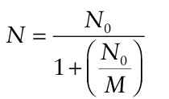

It can be seen that when _M_ is large relative to sample size, _N_ 0 will be a good approximation of _N_. When _M_ is comparatively small, the effect of ignoring the finite population correction is to overestimate the standard error and so inflate the required sample size. For the sake of simplicity of presentation, the finite population correction is not routinely included in sample size formulae, but it should still be applied wherever appropriate. Conventionally, this is done when the required sample size is more than about 10% of the population size.

### 10.2.6 Reliability of the estimated sample mean

Karandinos (1976) gave definitions of reliability considered meaningful in practice and showed how they could be used in developing sample size formulae. Reliability was defined either in terms of coefficient of variation of the sample mean, _CV_: or in terms of the half-length of the required confidence interval for the sample mean, _zα_ 2 _s_ 2 / _N_ in which _z_ α/2 is the 100(1 − _α_ /2)th percentile of the standard normal distribution, used to construct a two-sided 100(1 − _α_)% confidence interval. If reliability is defined by setting the half length of the required confidence interval of the sample mean equal to a fixed _proportion_ of the mean, _H_:

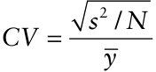

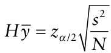

If reliability is defined by setting the half length of the required confidence interval of the sample mean equal to a fixed positive number _h_: (using a previously obtained sample estimate of the variance, _s_2 , instead of the population value σ2 as specified in section 10.2.2). Thus, all three definitions of reliability are based <u>on the</u> estimated standard error of the sample mean, _s_ 2 / _N_. Note, again, that the variance estimate _s_2 , used to characterize variability, must be supplied before calculating sample size. In practice, it is usually preferable to control the size of _s_ 2 / _N_ relative to _<u>y</u>_ rather than in absolute terms. On this basis, the coefficient of variation of the estimated mean, _CV_, is often used in sample size calculations. For instance, to achieve _CV_ = 0.20 (i.e., 20%), _s_ 2 / _N_ would need to be 0.1 when _<u>y</u>_ = 0.5 and 0.01 when _<u>y</u>_ = 0.05. Values of _CV_ of 0.2 or 0.1 are typically considered as representative of appropriate levels of reliability for field studies in plant disease epidemiology.

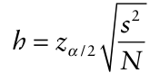

The development of sample size formulae as described by Karandinos (1976) involves rearranging the formulae given above so that _N_ is on the left-hand side and the quantities characterizing reliability and variability are on the right-hand side. On carrying out this rearrangement, the variance appears in the numerator of the right-hand side, and the mean (when a definition of _relative_ reliability is adopted) appears in the denominator. This tells us that in general, the sample size required for a given level of relative reliability increases with increasing variability and decreases as the mean increases.

## 10.3 Simple Random Sampling for Disease Incidence Data

In simple random sampling, the sampling units are individual plants or plant parts. A specified number of such units is selected from the population in such a way that every unit has an equal chance of being chosen. The selection of a unit does not affect the chances of selection of other units.

The binomial distribution is the appropriate model when sampling _with replacement_. The scenario is as follows. A sample comprising _N_ individual elements (plants, for example) is randomly drawn from a population size _M_ in which _X_ plants were “diseased” and _M_ − _X_ were “healthy”. Sampling with replacement means that _M_ and _X_ do not change as the sample is drawn, plant by plant. The binomial probability of _Y_, the number of plants diseased (out of a total of _N_), is given by:

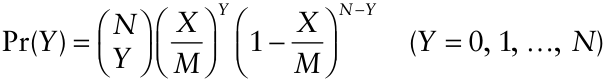

Since, in practice, sampling is usually _without replacement_ (i.e., no sampling unit is allowed to be observed more than once), use of the binomial distribution requires a brief justification. The hypergeometric distribution is the appropriate model when sampling without replacement. Sampling without replacement means that the population size and the number of diseased plants both change as the sample is randomly drawn, plant by plant. So if a plant is randomly drawn without replacement from a population size _M_ (in which _X_ plants are diseased and _M_ − _X_ are healthy), the population size for the second plant to be drawn is _M_ −1. If that first plant drawn were diseased, the population size _M_ −1 would comprise _X_ −1 diseased plants and _M_ − _X_ healthy plants.

The hypergeometric probability of _Y_, the number of plants diseased (out of a total of _N_), is given by:

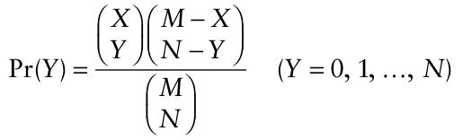

The two distributions have the same mean (= _X_ / _M_). This is estimated by the proportion of sampling units assessed as diseased (i.e., mean disease incidence):

### 10.3.1 Sample size calculations

We are now in a position to develop formulae for sample size calculation based on the binomial distribution, as described by Karandinos (1976). For a simple random sample comprising a total of _N_ sampling units, the estimated standard error of the sample mean is_s_ _<u>y</u>_ = _<u>y</u>_ <u>(1</u> − _<u>y</u>_ <u>)</u> / _N_. If reliability is defined by the coefficient of variation of the sample mean, _CV_:

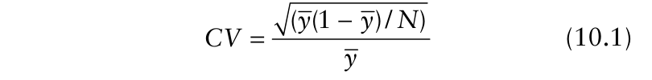{.equation width=60%}

{.equation width=60%}

in which _N_ is the total number of sampling units, _i_ is an index variable for the sampling units (_i_ = 1, 2, …, _N_) and _Yi_ = 0 for a sampling unit assessed as healthy or _Yi_ = 1 for a sampling unit assessed as diseased. The variance of _<u>y</u>_, the sample mean, is estimated as follows:

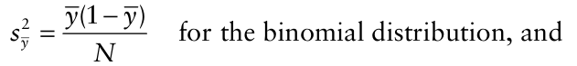

If reliability is defined by setting the half length of the required confidence interval of the sample mean equal to a fixed proportion of the mean, _H_:

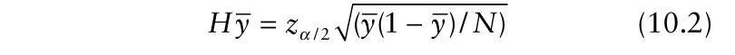{.equation width=60%}

If reliability is defined by setting the half length of the required confidence interval of the sample mean equal to a fixed positive number _h_:

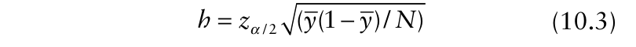{.equation width=60%}

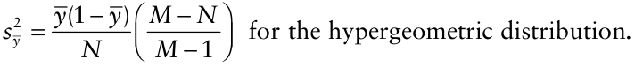

Thus, the estimated standard error of _<u>y</u>_ based on the binomial distribution differs from the estimated standard error of _<u>y</u>_ based on the hypergeometric distribution by a factor of (_M_ − _N_)/(_M_ − 1) ≈ (_M_ − _N_)/ _M_ = 1 − (_N_ / _M_), which we recognize as the finite population correction (section 10.2.5). The finite population correction is close to one if _N_ is small relative to _M_. In such circumstances we may use the binomial distribution even if sampling without replacement. If _N_ is not small relative to _M_, we may still use the binomial distribution, but should apply the finite population correction. Preference for use of the binomial distribution over the hypergeometric is based largely on the fact that the former is easieroften much easierto handle than the latter in some calculations.

Table 10.1 shows each of equations 10.1–10.3 rearranged so as to provide an expression for _N_, the sample size. As noted in section 10.2.2, all sample size calculations require a suitable definition of reliability and an appropriate description of variability. In this case, the variance of the distribution is completely specified by the mean, so an initial estimate of disease incidence, _<u>y</u>_, is all that is needed to fulfill the requirement for a description of variability. Fig. 10.1 shows how _N_ varies with , using _<u>y</u> CV_ = 0.2 as a definition of the required level of reliability. _N_ decreases with increasing _<u>y</u>_. Inverse sampling (section 10.11) or sequential sampling (section 10.12), in which the sample size is not fixed ahead of sampling, may be preferable if the initial estimate of disease incidence, _<u>y</u>_, is small. Alternatively, Rahme and Joseph (1998) describe an approach to sample size calculation for the binomial, avoiding use of the normal approximation.

**Table 10.1.** Formulae for sample size calculations for disease incidence data collected by simple random sampling, with three different definitions of reliabilitya .

|||**_Reliability defined by:_** **_Half-width of confide_**|**_nce interval equal to:_**|
|---|---|---|---|
|**_Description of variability_**|**_Coefficient of variation, CV_**|**_Proportion of mean, H_**|**_Fixed positive number, h_**|
|Random (binomial distribution)|(1 )/( CV) _N_ _y_ _y_ = −|2 / 2 [(1 )/ ]( / ) _N_ _y_ _y z_ _H_ _α_ = −|2 / 2 (1 )( / ) _N_ _y_ _y z_ _h_ _α_ = −|

> a _N_ is the number of sampling units required for a pre-specified level of reliability, _<u>y</u>_ is an initial estimate of disease incidence and _z_ α/2 is the 100(1 − α / 2)th percentile of the standard normal distribution. The formulae omit the finite population correction.

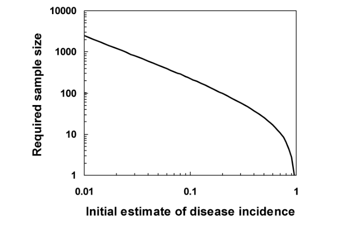{#fig-10-1}

_Example 10.1._ It is required to estimate disease incidence in a batch of _M_ = 480 seedlings, using _CV_ = 0.2 as definition of the required level of reliability. An initial estimate indicates that about 15% of the seedlings are diseased. 2 From Table 10.1, _N_ = 0.85/(0.15 × 0.2 ) = 142 . Since 142 represents about 30% of the population in this case, the finite population correction is applied. Then _N_ 0 = 142, and the revised _N_ is given by

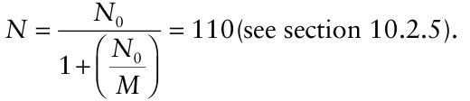

### 10.3.2 Inspection errors

Thus far we have made the unstated assumption that the disease status of the inspected individuals is determined without error. However, there exists the possibility that assessments of disease incidence may result in some diseased individuals being recorded as healthy, and some healthy individuals being recorded as diseased. For laboratory-based tests, procedures for defining a threshold on the scale of the test output variable in such a way as to control the rates at which these errors are made are discussed by Sutula et al. (1986). For visual assessments of disease incidence, especially where a number of assessors are involved, acceptable rates for these errors could be defined and assessors trained so as to be able to achieve these rates as a minimum performance standard. Either way, suppose we now can provide values (between zero and one) for ζ (the proportion of diseased individuals erroneously recorded as healthy) and δ (the proportion of healthy individuals erroneously recorded as diseased). Thus, the quantities (1 −ζ) and (1 −δ) represent, respectively, the proportion of diseased individuals correctly determined, and the proportion of healthy individuals correctly determined. In the present context, we note that what we record as _<u>y</u>_ is the frequency of positive tests (i.e., the result of the test is “diseased”):

{.equation width=60%}

in which _p_ is the true disease incidence. This value of _<u>y</u>_ can be a badly biased estimate of _p_ (Rogan and Gladen, 1978). Instead, the estimator

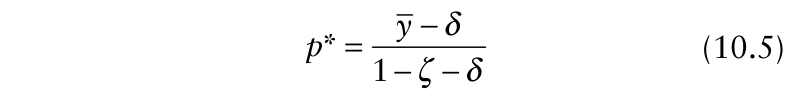{.equation width=60%}

is preferable to the use of _<u>y</u>_ as an estimator of _p_. Recalling that _p_ lies in the interval [0, 1], it can be seen from equation 10.4 that equation 10.5 provides an estimator of _p_ that is applicable for _δ_ < _<u>y</u>_ < 1 − _ζ_. Otherwise, if _<u>y</u>_ ≤ _δ_, _p_ * = 0 and if _<u>y</u>_ ≥ 1 − _ζ_, _p_ * = 1. Rahme and Joseph (1998) consider the implications of using equation 10.5 for sample size calculations. If reliability is defined by setting the half the length of the required confidence interval of the sample mean equal to a fixed positive number _h_, the sample size _N_ is given by:

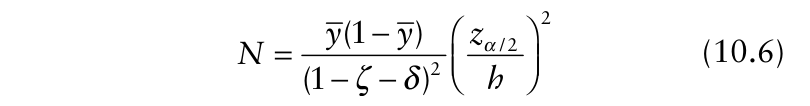{.equation width=60%}

where _<u>y</u>_ is given by equation 10.4, based on ζ, δ and _p_. Since _p_ is unknown, in practice one must calculate values of _N_ for a range of likely values of _p_ in order to select an appropriate final sample size. From equation 10.6, it can be seen that if disease assessments are errorfree (i.e., ζ and δ are both equal to zero) the binomial sample size formula is retrieved (Table 10.1). For 0 < (ζ + δ) <1, the required sample size is larger than that calculated from the binomial formula. If ζ + δ = 1, the required sample size is indefinitely large and so the required confidence interval cannot be constructed, however many data are collected. If we do not know (or assume) values of ζ and δ, and ζˆ and _δ_ ˆ have instead been estimated from data, dealing with inspection errors is less straightforward. Rogan and Gladen (1978) give details of the required procedure in this eventuality.

### 10.3.3 Exact binomial confidence intervals

In section 10.3.1, the simplest approximate confidence interval, _<u>y</u>_ ± _zα_ /2<u>(</u> _<u>y</u>_<u>(1</u> − _<u>y</u>_ <u>)</u> / _N_) was used in sample size calculations. The basis for this was mentioned in section 10.2.2: if samples are large enough, the means estimated from them are approximately normally distributed, whatever the distribution of the observations. So, what is large enough? Unfortunately, there is no simple answer.

The easiest way to see the deficiencies of the approximate binomial confidence interval based on the normal distribution is by comparison with an alternative. Here, we compare this approximate confidence interval with the so-called “exact” confidence interval based on calculations of tail areas for the binomial probability distribution (Clopper and Pearson, 1934; Santner and Duffy, 1989). The term “exact” is qualified because for discrete statistical probability distributions it is not always possible to calculate exact values that cut off, say, 2.5% of the area under the distribution function in the upper and lower tails (as it is in the case of the normal distribution). Because of this, the construction of confidence intervals for discrete distributions such as the binomial is not a straightforward matter (Blaker, 2000). The Clopper– Pearson intervals for binomial proportions, although widely used, are actually rather conservative. A number of different guidelines exist for deciding what is an appropriate confidence interval for a binomial proportion (Samuels and Lu, 1992; Newcombe, 1998). Here, we restrict our attention to Clopper–Pearson intervals, values of which can conveniently be obtained from tables (Diem and Lentner, 1970; Fisher and Yates, 1963) or by use of statistical software such as MINITAB.

Suppose that one diseased plant is observed in a sample of 10. Then disease incidence _<u>y</u>_ = 0.1, and the resulting approximate normal two-sided 95% confidence interval given by MINITAB is −0.086 to 0.286. This interval is calculated using _zα_ /2 = 1.96; if the corresponding value from the _t_ -distribution with 9 _df_ (= 2.26) were used instead, the resulting interval would be −0.115 to 0.315. Either way, this confidence interval is obviously unsatisfactory, since we know that the true disease incidence cannot be negative. Setting the lower limit to zero would avoid that problem, but if we have to arbitrarily adjust the lower limit, might we not also question the authenticity of the upper limit? In this case, the Clopper–Pearson 95% interval (the default calculation in MINITAB) is 0.0025–0.445. The lower limit is positive, as required, and the upper limit is considerable larger than that given by the approximate normal formula (even if the _t_ -distribution is used to calculate the interval). The interval is asymmetric about _<u>y</u>_ = 0.1. The interpretation is that there is a 95% probability that the calculated interval contains the population parameter _p_.

Now consider a sample of _N_ plants, in which no diseased plants are observed. Obviously, disease incidence is zero, but in this case the resulting approximate normal confidence interval (±0) is not helpful. The lower limit to the interval, equal to zero, is what we would expect. However, the fact that disease incidence in the sample is zero does not necessarily mean that disease incidence in the population is zero, and we would like the upper limit to the interval to reflect this. In this situation, a one-sided Clopper–Pearson 100(1 − _α_)% interval can be calculated, for which the lower limit is zero and the upper limit is denoted _p_ U, such that Pr(_Y_ = 0) = _α_ = (1 − _p_ U) _N_. Then: _p_ U = 1 − _α_ 1/ _N_ (Selvin, 1996). For example, if no diseased plants are observed

{.equation width=60%}

For the situation in which no diseased plants are observed in a sample, size _N_, and a one-sided 95% Clopper–Pearson interval is required, a useful approximation for the upper limit is provided by the “Rule of Three”:

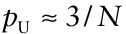

(Selvin, 1996; Jovanovic and Levy, 1997). The derivation is based on a Taylor series expansion of _α_1/_N_ , leading to _p_ U ≈−ln(_α_)/ _N_, and the further approximation −ln(0.05) ≈3. Similar approximate rules for other onesided Clopper–Pearson intervals are _p_ U ≈ 2.3/ _N_ (onesided 90% interval), _p_ U ≈ 4.6/ _N_ (99%), _p_ U ≈ 5.3/ _N_ (99.5%) and _p_ U ≈ 7/ _N_ (99.9%) (Selvin, 1996; Jovanovic and Levy, 1997). The accuracy of these approximations increases with increasing _N_. Interested readers will find more information on a Taylor series expansion in Chapter 12 (section 12.7.3).

Jovanovic and Zalenski (1997) give: for the Rule of Three. The reasoning behind this version of the rule relies on a Bayesian approach to the problem (as discussed in Jovanovic and Levy, 1997), but since numerical results show that the outcome is a uniformly better approximation than the original version of the rule, non-Bayesians can choose to adopt it on these grounds, without feeling guilty.

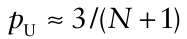

Bayesian analysis of one-sided confidence intervals for empty samples, based on binomial probabilities, is discussed by Louis (1981), Nicholson and Barry (1995), Jovanovic and Levy (1997) and Winkler et al. (2002). We do not pursue this here, except to state one useful result for combining results from sequence of samples. In its simplest form, this depends on the adoption of a uniform distribution (a special case of the beta probability distribution) as the prior distribution for _p_. If the first sample, size _N_ 1, is an empty sample, _p_ U = 1 − _α_ 1/(_N_ 1 +1). Following a second empty sample, size _N_ 2, _p_ U = 1 − _α_ 1/(_N_ 1 + _N_ 2 +1), and after _K_ empty samples: 1 (Σ _iK_ =1 _Ni_ +1) _p_ U = 1 − _α_ The corresponding Rule of Three approximation for the upper limit of a one-sided 95% confidence interval after _K_ empty samples is: 3 _p_ U ≈ _K_. ∑ _Ni_ + 1 _i_ =1 The corresponding Rule of Three approximation for the upper limit of a one-sided 95% confidence interval after _K_ empty samples is:

If the summation term in the denominator is large (e.g., following a long sequence of empty samples): is usually adequate.

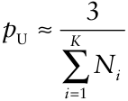

## 10.4 Simple Random Sampling for Count Data

Formulae for calculation of sample size for use in simple random sampling of count data are given by Karandinos (1976), Ruesink (1980), Wilson and Room (1982), Ives and Moon (1987), and Campbell and Madden (1990). The Poisson distribution, the negative binomial distribution, and Taylor’s power law, all introduced in Chapter 9, provide descriptions of variability for disease assessments based on counts. Initial estimates of parameters are required as prerequisites for sample size calculations. Reliability is defined in section 10.2.6, based on the estimated standard error of the mean.

### 10.4.1 The Poisson distribution

The single parameter of the Poisson distribution (section 9.5.2) is _μ_, estimated by _Y_, the mean count per sampling unit (for example, mean number of lesions per leaf). For a Poisson distribution, the variance of the counts is also estimated by . Thus, for a sample comprising a total of _Y N_ sampling units, the estimated standard error of the sample mean is _Y_ / _N_. If reliability is defined by the coefficient of variation of the sample mean, _CV_:

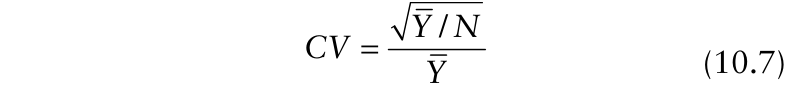{.equation width=60%}

If reliability is defined by setting the half the length of the required confidence interval of the sample mean equal to a fixed proportion of the mean, _H_:

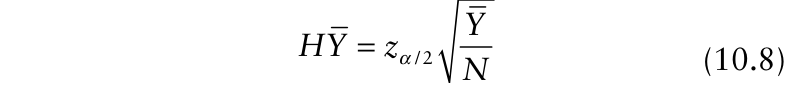{.equation width=60%}

If reliability is defined by setting the half the length of the required confidence interval of the sample mean equal to a fixed positive number _h_:

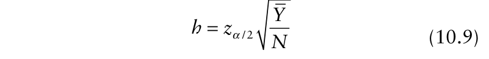{.equation width=60%}

Table 10.2 shows each of equations 10.7–10.9 rearranged so as to provide an expression for _N_, the sample size. Sample size calculation requires choice of a definition of reliability and an initial estimate of the mean, _Y_ (since this specifies the variance).

### 10.4.2 The negative binomial distribution

The two parameters of the negative binomial distribution (section 9.5.3) are denoted μ and _k_. The parameter μ can be estimated by _Y_, the mean number of counts per sampling unit (for example, mean number of lesions per leaf). For a negative binomial distribution, the vari-ance of the counts can be estimated by _Y_ + (_Y_ 2 / _k_ ˆ) . Thus, for a sample comprising a total of _N_ sampling units, the <u>estimated standard error of the sample mean is</u> (_Y_ + (_Y_ 2 / _k_ ˆ))/ _N_. If reliability is defined by the coefficient of variation of the sample mean, _CV_:

{.equation width=60%}

If reliability is defined by setting the half the length of the required confidence interval of the sample mean equal to a fixed proportion of the mean, _H_:

{.equation width=60%}

If reliability is defined by setting the half the length of the required confidence interval of the sample mean equal to a fixed positive number _h_:

{.equation width=60%}

**Table 10.2.** Formulae for sample size calculations for count data collected by simple random sampling, with three different definitions of reliabilitya .

|||**_Reliability defined by:_** **_Half-width of confide_** |**_nce interval equal to:_** |
|---|---|---|---|
|**_Description of variability_**|**_Coefficient of variation, CV_**|**_Proportion of mean, H_**|**_Fixed positive number, h_**|
|Random (Poisson distribution)|2 1/( ) _N_ _YCV_ = |2 / 2 (1/ )( / ) _N_ _Y z_ _H_ _α_ =|2 / 2 ( / ) _N_ _Y z_ _h_ _α_ = |
|Aggregated (negative binomial distribution)|2 ˆ ((1/ ) (1/ ))(1/ ) _N_ _Y_ _k_ _CV_ = + |2 / 2 ˆ ((1/ ) (1/ ))( / ) _N_ _Y_ _k_ _z_ _H_ _α_ = + |2 2 / 2 ˆ ( ( / ))( / ) _N_ _Y_ _Y_ _k_ _z_ _h_ _α_ = + |
|Aggregated (Taylor’s power law)|ˆ 2 2 ˆ / _b_ _N_ _aY_ _CV_ − =|ˆ 2 2 / 2 ˆ ( / ) _b_ _N_ _aY_ _z_ _H_ _α_ − =|ˆ 2 / 2 ˆ ( / ) _b_ _N_ _aY z_ _h_ _α_ =|
|a_N_is the number of sampling units pling unit, and_z_α/2is the 100(1− negative binomial aggregation par population correction.|required for a pre-specified level α/2)th percentile of the standard ameter or the Taylor’s power ˆ( ) _k_|of reliability, is an initial estim normal distribution. For aggregate law parameters , are require ˆ ˆ( , ) _a b_ _Y_|ate of the mean count per sam- d data, an estimate of either the d. The formulae omit the finite|

Table 10.2 shows each of equations 10.10–10.12 rearranged so as to provide an expression for _N_, the sample size. Sample size calculation requires choice of a definition of reliability, and initial estimates of the mean, _Y_, and aggregation as characterized by the negative binomial _k_ ˆ (since the variance is specified by _Y_ and _k_ ˆ). The negative binomial _k_ ˆ usually varies with the mean, _Y_, so it is unlikely that a single value of _k_ ˆ will be appropriate for sample size calculation over a wide range of _Y_ values. One way to circumvent this difficulty is to characterize aggregation in terms of Taylor’s power law instead of the negative binomial distribution. 10.4.3 Taylor’s power law Taylor’s power law describes a relationship between the observed variance and mean for count data, in which the variance of the counts is proportional to a power of the mean (section 9.5.5). The variance of the counts is esti2 _b_ mated by_s_ _Y_ = _aY_. Estimated values of the coefficients must be obtained from a previous data analysis. For a sample comprising a total of _N_ sampling units, the esˆ timated standard error of the sample mean is _aY_ ˆ _b_ / _N_. If reliability is defined by the coefficient of variation of the sample mean, _CV_:

{.equation width=60%}

If reliability is defined by setting the half the length of the required confidence interval of the sample mean equal to a fixed proportion of the mean, _H_:

{.equation width=60%}

If reliability is defined by setting the half the length of the required confidence interval of the sample mean equal to a fixed positive number _h_:

{.equation width=60%}

Table 10.2 shows each of equations 10.13–10.15 rearranged so as to provide an expression for _N_, the sample size. Sample size calculation requires choice of a definition of reliability, a previously calculated Taylor’s power law relationship for the pathosystem in question and an initial estimate of the mean _Y_. The sample size formulae arising from rearrangement of equations 10.13 and 10.14 have the quirk that ing _Y_ for _b_ ˆ < 2 but increases with increasing _N_ decreases with increas-ˆ _Y_ for _b_ ˆ > 2 (Buntin, 1994). In practice, values _b_ > 2 are uncommon, but when they do occur, caution should be exercised in adopting them as the basis for sample size calculations.

### 10.4.4 Sample size calculations

Fig. 10.2 shows how required sample size _N_ varies with _Y_ when Taylor’s power law provides a description of variability (Boivin et al., 1990), using _CV_ = 0.2 as a definition of the required level of reliability. For comparison, the variation of _N_ with _Y_ when the Poisson distribution provides a description of variability is shown, again using _CV_ = 0.2. In both cases, _N_ decreases with increasing _Y_, but _N_ is higher for Taylor’s power law (aggregated data) than for the Poisson distribution (random data) as a description of variability, except at very low density.

_Example 10.2._ The arrays labeled Field 10.2.1 and Field 10.2.2 represent counts of lesions per plant in **FIELD 10.2.1** _(Continued)_

||**_Freque_** |**_ncy (number of p_** |**_lants)_** |
|---|---|---|---|
|**_Number_**|**_Sample_**|**_Sample_**|**_Sample_**|
|**_of lesions_**|**_10.2.1_**|**_10.2.2a_**|**_10.2.2b_**|
|**_per plant_**|**_(N_**=**_20)_**|**_(N_**=**_20)_**|**_(N_**=**_40)_**|
|0|0|1|2|
|1|1|0|4|
|2|1|1|2|
|3|3|2|3|
|4|2|4|1|
|5|1|2|2|
|6|5|3|7|
|7|1|2|7|
|8|4|0|2|
|9|1|1|1|
|10|1|1|3|
|11|0|0|1|
|12|0|0|0|
|13|0|1|1|
|14|0|1|1|
|15|0|0|1|
|16|0|1|0|
|17|0|0|2|

{#fig-10-2}

|0|5||1|3|5||1|4|2||8|4|5||7|4|7||2|3|7||3|6|6|3|8|4|5|8||4||5|5|5|5|
|---|---|---|---|---|---|---|---|---|---|---|---|---|---|---|---|---|---|---|---|---|---|---|---|---|---|---|---|---|---|---|---|---|---|---|---|---|---|
|5|6||6|1|1||5|8|4||4|2|4||3|9|4||1|1|4||2|5|5|3|4|10|6|2||4||6|8|3|5|
|3|5||5|12|9||6|8|5||5|3|4|1|1|5|8||8|5|9||5|7|5|4|9|7|3|6||4||4|7|6|6|
|1|7||7|6|5||7|8|5||4|7|5||9|8|9||6|6|7||7|3|8|4|6|2|8|9||6||6|9|4|4|
|4|3||4|2|3|1|2|3|6||6|6|7||8|10|5||4|6|7||6|9|3|7|5|5|1|6||2||4|5|7|5|
|12|3||4|4|5||4|2|7||6|3|7||5|5|5||7|6|3||7|5|8|7|2|6|4|8||5||4|8|4|7|
|2|5||2|10|2||7|7|2||6|4|6||5|4|6||6|6|5||2|6|6|8|4|6|5|7||4||9|10|8|7|
|9|3||6|7|5|1|0|5|7||8|6|6||3|6|3||5|5|7||3|4|4|3|8|7|6|7||1||8|4|11|6|
|6|6||9|3|3||2|5|5||5|8|3||4|7|8||7|8|3|1|0|7|5|7|3|7|7|7||2||7|4|3|6|
|6|5|1|1|3|8||1|3|2||3|3|5||9|8|4|1|0|5|8||5|5|6|5|9|5|5|9||9||3|8|6|3|
|6|0||7|3|7||7|4|10||5|2|9||8|10|6||3|7|5||2|9|5|5|6|9|6|6||7||4|7|5|7|
|10|2||2|8|10||9|3|3||5|2|6||5|10|5||3|7|10||4|8|5|9|2|8|3|3||4||1|8|8|6|
|4|4|1|0|8|4||8|8|5||9|4|2||3|10|5||6|9|6|1|0|6|11|5|4|7|7|9||6|1|1|4|3|1|
|6|7||3|10|4||5|3|1||2|7|6||8|2|4||2|7|5||7|5|3|3|1|3|4|4||7||8|5|4|6|
|3|5||9|8|4||5|5|5||9|7|6||9|9|2||4|5|6||6|5|3|7|1|5|3|9||7||2|7|6|4|
|6|7||3|6|1||7|7|10||3|9|3||3|3|9||4|3|9||4|6|6|4|1|10|4|4||8|1|0|7|5|8|
|7|4|1|0|2|4|1|0|5|3||5|3|6||9|5|3||3|4|9||7|7|5|2|4|6|6|4||9||3|7|8|6|
|3|7||6|4|6|1|0|8|6|1|0|8|6||1|6|9||7|3|5||4|3|4|7|3|6|7|4||9||9|5|7|6|
|9|4||0|8|8|1|1|5|6||8|7|6|1|0|5|6||6|7|6||4|5|6|1|2|3|3|7||4||5|3|7|3|
|10|2||8|4|7||7|3|4||6|8|6||7|7|5||4|7|2||8|8|4|1|3|5|0|7||7||1|3|5|9|
|5|4||6|7|3||3|4|5||5|1|6||2|5|6||8|2|7|1|1|5|5|7|3|3|8|14||6||3|1|5|8|
|5|5||4|4|6||5|3|5||7|7|9||6|4|8||7|7|11||5|4|3|4|5|8|3|1||6||9|3|6|5|
|7|4|1|0|8|3||5|9|4||4|2|6||4|5|5||5|7|4||7|7|10|5|5|3|3|5||4||3|11|6|9|
|6|6||3|2|7||4|4|5||7|6|5||8|5|7||3|6|5||7|4|5|4|10|6|3|6||4||9|2|9|4|
|3|2||5|2|3||5|3|7||4|7|2||4|3|2||8|10|9||5|9|3|3|6|7|5|2||2||5|6|4|2|
|6|9||7|6|11||7|4|8||3|8|5||5|3|6||3|9|4||6|7|2|6|12|4|4|4||4||7|8|11|4|
|2|11||3|4|4||5|2|2||5|5|6||4|9|7||2|5|5||5|6|10|6|6|6|9|3|1|3||6|2|1|6|
|4|5|1|0|1|5||5|2|9||4|3|8||6|5|4||6|6|9|1|0|3|5|7|6|3|8|3||4||9|5|4|4|
|4|5||6|6|4||6|5|5||2|4|4||7|6|8||5|9|7||9|5|10|3|2|7|3|4||7||2|7|7|6|
|5|5||5|5|8||9|6|6||5|2|6||5|4|8||3|6|10||4|4|4|3|5|4|7|4|1|0|1|1|4|8|11|

|**FIELD**|**1**|**0.2**|**.**|**2**|||||||||||||||||||||||||||||||||||||||||||
|---|---|---|---|---|---|---|---|---|---|---|---|---|---|---|---|---|---|---|---|---|---|---|---|---|---|---|---|---|---|---|---|---|---|---|---|---|---|---|---|---|---|---|---|---|---|---|
|2||1||4|3||4||8||7||1|1|2|5|3||5|5|7|1|0||8|1|2||8||1||5|6|1|2||8|4|2|1|0||1|6|1 2|
|5||4||5|6||6||7||6||5||7|17|2||3|3|4|1|5||0||7||1||2||4|3|1|1||8|5|6|1|6||1|4|7 1|
|13||0||9|5||6||3||4|1|6||3|9|14||7|3|4||4||1||3||5||7|1|1|9|2|||2|4|11||0||8|7|6 2|
|5||6||4|6||7||0||5||6||2|5|5||1|6|6||1||4||1||2||1||8|9|0|||2|8|6||2||6|8|3 3|
|4|1|1||3|14|1|0||7||5||7||1|4|8||7|2|7||4||1||6||8||1||5|5|11|||2|2|2||3|1|0|7|5 5|
|3||3||2|4||8|||1|7||9||4|7|6||5|4|9||8||7||1||4||6||2|2|6|||3|6|10||8||6|10|5 6|
|4|1|2||8|6||5||0||9||5||4|3|0||1|2|10||5||5||5||8||7||5|5|2|||6|8|15||0||5|3|19 8|
|4|1|2||4|14||8||1||3||8||9|1|17||7|5|8|1|7||2||0|2|1||6||6|12|2|||3|2|1||7||4|11|7 7|
|8||1|1|0|2||9||9||1||5||4|7|3||3|8|9||7||2||8||5||4||8|2|6|||1|7|6|1|0||1|1|1 5|
|7||7||7|8||2||9||7||0||8|1|8||4|4|7||9|1|1||2||5||8||8|5||0||2|2|2||4||5|7|3 5|
|8|1|6||7|2||2|1|2||2||7||1|5|0||2|2|5||6||7||3||2||7||4|1|5|||4|6|4||5|1|0|10|4 2|
|23||5||1|2||7|1|1||8|1|5||4|3|4||4|5|4||1||6||2|1|2||4||8|5|5|||2|7|4|1|0||4|8|11 1|
|1|1|0||2|0||3||5||2||2||0|4|2||2|12|5||2||1||3||1||4|1|7|4|1|||4|5|9||6||5|8|6 2|
|5||5||3|2||4|1|4||1||1||3|10|0||3|2|12|1|9||7||5||6||5|1|2|0|2|||8|17|10|1|2||2|1|7 5|
|4||5||5|10||0||8||4||2||8|6|3||0|19|12||2||4||3||2||5|1|0|5||3||1|4|0||5||5|1|1 0|
|1||1||2|3||4||1||3|1|6|1|0|2|8||3|3|9||5|1|0||4||1||6||4|2||2||2|3|4||7||5|5|7 9|
|6||7||7|3||9||5|1|4||2|1|8|4|0||4|5|4||2||8||3|2|1||3||1|7||6||7|4|2||0||7|4|2 6|
|9||7||4|10||1||6||8||0||5|5|3||7|3|9||2||2||7||4||7||8|10|2|||9|8|13|1|0||4|14|3 3|
|0||9||4|6||5||6||5||1||1|8|7||1|15|6||8|1|3|1|3|1|3||4||3|4|3||1|0|13|2||2||8|2|1 12|
|9||3||5|3||9|1|0|1|1||5||9|7|8||5|3|6||8||6||7||4|1|4||3|22|6|||3|9|5||4||1|1|8 12|
|5||1||3|6||3||3||0||6|1|2|5|8||3|12|7||2||2||6||4||1||6|9|1||1|3|4|10||1|1|4|3|3 16|
|5||1||2|8||4||6||2||3||6|6|0|1|0|10|4||2||3||4||3||5||0|5|5|||3|7|8||0|2|0|5|8 5|
|3||1||9|6||9||2||5|1|2||7|4|7||2|4|4||2||9||4||7||1||3|5||8||8|0|4||5|1|3|3|5 1|
|6||2||1|9||8||2||9||4||9|7|2|1|1|3|11|1|4||2|1|5||2||1||2|10|3||1|0|6|2||4||4|10|6 5|
|3||4||3|17||5||3|1|5||7||3|9|28||5|5|8||1||5||6||6||1||3|5|3|||4|6|13||9||4|8|5 4|

**FIELD 10.2.2** Continued. disease-infected crops. Initially, a random sample of 20 plants was recorded from each field (Samples 10.2.1 and 10.2.2a, respectively). Later, a second sample (Sample 10.2.2b) was recorded from Field 10.2.2. Interested readers can repeat the following calculations, as an exercise, using their own samples drawn from Fields 10.2.1 and 10.2.2.

|2 13|1|7 1|0||4|8|1|1|4|10|6|8|1||5|7|0|7|2|4|8|10|1|0|5|1|0|3|6||6 1|7|7 6|
|---|---|---|---|---|---|---|---|---|---|---|---|---|---|---|---|---|---|---|---|---|---|---|---|---|---|---|---|---|---|---|---|---|---|
|3 8|3|3|9||2|8|1|5|11|6|3|5|4||7|4|2|5|1|2|1|4||3|2||6|1|0||7|1|4 2|
|1 8|8|6|8|1|5|10||3|6|9|3|5|5|1|1|6|7|3|0|9|5|0||5|2||7|11|4|1|5|3|11 9|
|1 13|4|7|8||4|7||0|4|5|1|5|6|1|1|4|2|9|6|2|2|12||4|12||9|1|14||4|2|5 2|
|6 11|2|7|3||5|7||1|3|6|6|7|12||9|12|7|6|2|6|6|12||7|3||4|4|1||7|5|3 11|

The following summary statistics can be calculated (section 9.5.1):

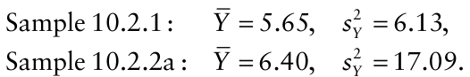

For Sample 10.2.1, the estimated standard error of _Y_ is 6.13/20 = 0.55 and the coefficient of variation of the sample mean, _CV_ ≈ 10%. For Sample 10.2.2a, the estimated standard error of _Y_ is 17.09/20 = 0.92 and _CV_ ≈ 14%. Although the estimates of mean lesion number per plant are similar for the two fields, the two means have been estimated with different levels of reliability.

To understand why this has happened, look again at the arrays representing the two fields. In Field 10.2.1, relatively few plants have lesion numbers very far from the mean. In Field 10.2.2, there are more plants with few lesions, and more with large numbers of lesions. This is an indication that the pattern of lesion number per plant in Field 10.2.2 is more aggregated (at the spatial scale at which the data are shown, i.e., the plant scale) than the pattern in Field 10.2.1. This affects the amount of sampling required to achieve a particular specified level of reliability. To see how this works, consider the two samples of 20 plants (Samples 10.2.1 and 10.2.2a), to be pilot samples that allow us to obtain some information that can be used in subsequent sampling. Since, for Field 10.2.1, the variance of the sample (6.13) is close to the mean (5.65), we could reasonably make the assumption that the Poisson distribution was an appropriate description of the frequency distribution of lesions per plant. For Field 10.2.2, where the variance of the sample (17.09) is larger than the mean (6.40), we could instead assume a negative binomial distribution for the frequency distribution oflesions per plant, with _k_ ˆ = _Y_ 2 /(_sY_ 2 − _Y_) ≈ 4. Suppose _CV_ = 0.1 (or 10%) is set as the required level of reliability for the sample mean. The formulae for sample size calculations are given in Table 10.2. For Field 10.2.1, the required number of sampling units 2 (plants, in this case) is _N_ = 1/(5.65 × 0.1 ) ≈ 18. As expected, this is quite close to the value _N_ = 20 used for the pilot sample, which provided a value of _CV_ ≈ 0.1.

For Field 10.2.2, the required number of sampling units 2 is _N_ = ((1/6.4) + (1/ 4))(1/0.1 ) ≈ 40. Recall that aggregation increases with ˆ _decreasing k_ ˆ so that if the value _k_ = 4 were too large (relative to the true value), this calculated sample size would be too small. Conversely, ifˆ _k_ = 4 were too small, the calculated sample size would be too large.

Here, we see that even for a quite a moderate level of aggregation (as characterized by the negative binomial ), _k_ ˆ the required number of sampling units is approximately double than that for a field with the same mean number of lesions per plant but a random pattern, if the same level of reliability (_CV_ = 0.1) is to be achieved. A random sample of _N_ = 40 plants (Sample 10.2.2b) was recorded from Field 10.2.2. For Sample 10.2.2b, the summary statistics are _Y_ = <u>6.60,</u>_s_ _<u>Y</u>_ 2= 19.37. The estimated standard error of _Y_ is 19.37 / 40 = 0.70 and the sample provides the required level of reliability, with _CV_ ≈ 0.1.

### 10.4.5 Exact Poisson confidence intervals

The simplest approximate Poisson confidence interval, _Y_ ± _zα_ /2 _Y_ / _N_, as used in sample size formulae (section 10.4.1), has the same potential deficiencies as the approximate binomial confidence interval (section 10.3.1). For example, if a single lesion is observed in a sample of _N_ = 10 plants (a plant is a sampling unit), the approximate 95% confidence interval for the mean (_Y_ = 0.1 lesions per plant) extends from −0.096 to 0.296. This is calculated using _zα_ /2 = 1.96; if the corresponding value from the _t_ -distribution with 9 _df_ (=2.26) were used instead, the resulting interval would be −0.126 to 0.326. This confidence interval is unsatisfactory, since the true mean count cannot be negative. Garwood (1936) derives “exact” Poisson confidence intervals analogous to the Clopper–Pearson binomial confidence intervals. Tables are provided by Fisher and Yates (1963) and Diem and Lentner (1970).

The tables refer to the _total_ number of counts in the _N_ sampling units. In this example, the total number of lesions on _N_ = 10 plants is equal to one. The Clopper– Pearson-type 95% confidence interval is given as 0.025 to 5.57. This can be converted to an interval around the mean by dividing these limits by 10 (in this case). Thus, the Clopper–Pearson-type 95% confidence interval for the mean (_Y_ = 0.1 lesions per plant) extends from 0.0025 to 0.557. The lower limit is positive, as required, and the upper limit is considerably larger than that given by the approximate normal formula (even if the _t_ -distribution is used to calculate the interval). Note that the interval is asymmetric about the mean. As in the case of the binomial distribution, Clopper–Pearson-type intervals are conservative. An alternative (less conservative) interpretation of “exact” Poisson confidence intervals is provided by Crow and Gardner (1959). For larger samples, and where the mean count is not close to zero, the approximate confidence interval based on the normal distribution is usually adequate.

Now consider a sample of _N_ plants, in which the total number of lesion counts is zero (i.e., no disease is observed). As for disease incidence, a one-sided 100(1 − _α_)% interval can be calculated, for which the lower limit is zero and the upper limit is denoted _p_ U. In this case the upper limit is determined such that Pr(_Y_ = 0) = _α_ = e− _Np_ U. This leads directly (without the need to use a Taylor series expansion) to _p_ U = − ln(_α_)/ _N_,the formula on which the Rule of Three and various other approximations for _p_ U are based (section 10.3.3). A one-sided 95% ClopperPearson-type confidence interval (i.e., with _α_ = 0.05) for the mean number of lesions per sampling unit in a sample, size _N_, in which no disease is observed thus extends from 0 to _p_ U ≈ 3/ _N_. For example, no lesions are recorded in a sample of _N_ = 10 plants (so that the mean is _Y_ = 0 lesions per plant). The Clopper–Pearson-type 95% confidence interval for the mean extends from 0 to _p_ U ≈ 3/ _N_ = 0.333. Note that the Clopper–Pearson-type 95% confidence interval for the total number of lesions in the 10 sampling units (no lesions having been observed) extends from 0 to _Np_ U = −ln(_α_) = 2.996 ≈ 3.

Tables for “exact” negative binomial confidence intervals are not readily available. The calculations required to obtain an interval based on tail areas of the negative binomial distribution are outlined by Gozé et al. (2003). Alternatively, Krebs (1999) provides a method (not based in any obvious way on the calculation of tail areas) using rather complicated transformations of estimated parameters.

For a sample, size _N_, in which no disease is observed, a one-sided 100(1 − _α_)% interval can be calculated, for which the lower limit is zero and the upper limit is denoted − _k p_ U, in this case such that Pr(_Y_ = 0) = _α_ = (1 + _μ_ / _k_) with _μ_ = _Np_ U. This leads to _p_ U = _k_ (_α_ −1/ _k_ − 1)/ _N_. Of course, when no disease has been observed, an estimate of _k_ cannot be calculated from the sample data. Instead, one would have to assume a value, or use a value from a previous sample. Note that: assessment of leaves on a plant, or of plants in a quadrat, are typical cluster sampling procedures. This is often convenient from a practical point of view.

In Chapter 9, the binomial distribution was used to characterize cluster-sampling data when the disease status of one individual in a sampling unit was independent of the status of the other individuals in the same unit (section 9.4.2). For plant disease incidence data collected by cluster sampling, it is often the case that the disease status of one individual in a sampling unit depends of the status of the other individuals in the same unit, such that there is a tendency for individuals in the same unit to have the same disease status. We see this in data as extra-binomial variation, where the variance of the observations is larger than the corresponding binomial variance (section 9.4.2). In a phytopathological context, this is often referred to as aggregation. Methods of characterizing aggregation, as discussed in Chapter 9 (sections 9.4.3–9.4.7) and in Madden and Hughes (1999a), provide a basis for developing sample size formulae for disease incidence data collected by cluster sampling (taking into account the extent to which the disease status of one member of a sampling unit depends on the status of other members of the same unit).

### 10.5.1 The binomial distribution

Suppose that a sample comprises _N_ quadrats (sampling units), in each of which there are _n_ plants. In each quadrat, all _n_ plants are assessed, and recorded individually as either “healthy” or “diseased”. When the binomial distribution provides an appropriate description of the frequency distribution of number of disease plants per quadrat, the sample mean disease incidence on a proportion scale is denoted _<u>y</u>_ (equation 9.1) and the variance of the proportions (the _yi_ values) is estimated by _s_ bin2 = _<u>y</u>_ <u>(1</u> − _<u>y</u>_ <u>)</u> / _n_ (see equation 9.4). <u>The estimated standard error of the sample mean is</u> _<u>y</u>_ <u>(1</u> − _<u>y</u>_ <u>)</u> / _nN_. If reliability is defined by the coefficient of variation of the sample mean, _CV_:

{.equation width=60%}

If reliability is defined by setting the half the length of the required confidence interval of the sample mean equal to a fixed proportion of the mean, _H_:

{.equation width=60%}

{.equation width=60%}

so that if _k_ is thought to be large, the Poisson formula for _p_ U is available as an approximation.

## 10.5 Cluster Sampling for Disease Incidence Data

If reliability is defined by setting the half the length of the required confidence interval of the sample mean equal to a fixed positive number _h_:

In cluster sampling, a sampling unit comprises a group (i.e., cluster) of neighboring plants or plant parts. A disease

{.equation width=60%}

Table 10.3 shows each of equations 10.16–10.18 rearranged so as to provide an expression for _N_, the sample size. Sample size calculation requires choice of a definition of reliability and an initial estimate of mean disease incidence, _<u>y</u>_, which fully specifies the variance. The binomial distribution is the appropriate description of variability when the disease status of one individual in a sampling unit is independent of the disease status of the other members of the same unit. This will rarely be the case. More often, there is a tendency for individuals in the same sampling unit to have the same disease status. Kish’s (1957) account (although not phytopathologically orientated) gives a very clear view of the consequences of ignoring this tendency in a sampling context.

If reliability is defined by setting the half the length of the required confidence interval of the sample mean equal to a fixed proportion of the mean, _H_:

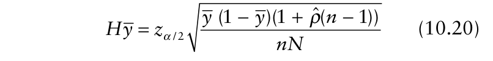{.equation width=60%}

If reliability is defined by setting the half the length of the required confidence interval of the sample mean equal to a fixed positive number _h_:

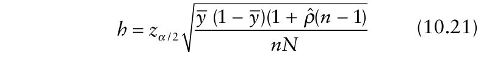{.equation width=60%}

### 10.5.2 The β-binomial distribution

The β-binomial distribution may be used to characterize aggregated disease incidence data (see section 9.4.5). Suppose a sample comprises _N_ quadrats, in each of which there are _n_ plants. In each quadrat, all _n_ plants are assessed, and recorded individually as either “healthy” or “diseased”. When the β-binomial distribution provides an appropriate description of the frequency distribution of number of disease plants per quadrat, the sample mean disease incidence on a proportion scale is denoted _<u>y</u>_ and the estimated aggregation parameter is denoted ˆ ˆ _ρ_ ˆ ( = _θ_ /(_θ_ + 1)) . The variance of the proportions (the _yi_ values) is estimated by _sβ_ 2 bin = <u>(</u> _<u>y</u>_ (1 − _<u>y</u>_ <u>)</u> / _n_)(1 + _ρ_ ˆ (_n_ − 1)) (see equation 9.11). <u>The estimated standard error of the sample mean is</u> ˆ _<u>y</u>_ (1 − _<u>y</u>_ <u>)(1</u> + _ρ_ (_n_ − 1)) / _nN_. If reliability is defined by the coefficient of variation of the sample mean, _CV_:

{.equation width=60%}

ˆ We can think of 1 + _ρ_ (_n_ − 1) as a β-binomial heterogeneity factor. Alternatively, the index of dispersion,_s_ _y_ 2 / _s_ bin2 , calculated from a preliminary sample, may be used as an empirical heterogeneity factor. This is a version of the deff (section 9.4.6), as defined by Kish ˆ (1995). To a good approximation, deff = 1 + _ρ_ (_n_ − 1) for cluster-sampling data described by the β-binomial distribution. In this case, sample size calculation requires choice of a definition of reliability, and initial estimates the mean disease incidence, _<u>y</u>_, and aggregation as characterized by the β-binomial _ρ_ ˆ or the deff. Table 10.3 shows each of equations 10.19–10.21 rearranged so as to provide an expression for _N_, the sample size. The equations are written in terms of the deff because, in practice, it is more likely that a value of the deff will be available than a value of . _ρ_ ˆ The β-binomial usually varies with mean disease inci- _ρ_ ˆ dence, _<u>y</u>_. Use of the β-binomial _ρ_ ˆ from a single disease assessment may therefore be misleading if applied over a wide range of mean incidence. Instead, a power law relationship between the observed and binomial variances is likely to provide a better guide to the required sample size.

**Table 10.3.** Formulae for sample size calculations for disease incidence data collected by cluater simpling, with three different definitions of reliabilitya .

|||**_Reliability defined by:_**||
|---|---|---|---|
|||**_Half-width of confidenc_**|**_e interval equal to:_**|
|**_Description of variability_**|**_Coefficient of variation, CV_**|**_Proportion of mean, H_**|**_Fixed positive number, h_**|
|Random (binomial distribution)|2 (1 )/( ) _N_ _y_ _nyCV_ = −|2 / 2 [(1 )/ ]( / ) _N_ _y_ _ny z_ _H_ _α_ = −|2 / 2 [( (1 ))/ ]( / ) _N_ _y_ _y_ _n z_ _h_ _α_ = − |
|Aggregated (β-binomial distribution or deff)b|2 [(1 )(deff)]/( ) _N_ _y_ _nyCV_ = −|2 / 2 [((1 )(deff))/ ]( / ) _N_ _y_ _ny z_ _H_ _α_ = − ˆ ˆ |2 / 2 [( (1 )(deff))/ ]( / ) _N_ _y_ _y_ _n z_ _h_ _α_ = − |
|Aggregated (power law)|ˆ ˆ 2 2 ˆ ( (1 ) )/( ) _b_ _b_ _b_ _N_ _Ay_ _y_ _n CV_ − = −|2 2 / 2 ˆ [( (1 ) )/ ]( / ) _b_ _b_ _b_ _N_ _Ay_ _y_ _n_ _z_ _H_ _α_ − = −|ˆ 2 / 2 ˆ [( ( [1 ]) )/ ]( / ) _b_ _b_ _N_ _A y_ _y_ _n_ _z_ _h_ _α_ = −|

> a _N_ is the number of sampling units, each containing _n_ individuals, required for a pre-specified level of reliability, _~~y~~_ is an initial estimate of disease incidence, and _z_ α/2 is the 100(1 − α/2)th percentile of the standard normal distribution. For aggregated data,ˆ ˆ ˆ ˆ ˆ an estimate of either the beta-binomial aggregation parameter _ρ_ = _θ_ /(_θ_ + 1)) or the power law parameters (_A_, _b_) , are required. The formulae omit the finite population correction.

> bdeff = 1 + _ρ_ ˆ (_n_ − 1).

Such a relationship can be regarded as a β-binomial sampling curve, but one in which _ρ_ ˆ varies with mean incidence. More work is required, initially, to establish such a relationship, but resulting formula for sample size determination has the advantage of being equally applicable over a wide range of disease incidence. 10.5.3 The power law Just as Taylor’s power law provides a means of summarizing variability in count data from several data sets, an analogous relationship between the observed variance of the _yi_ values and the corresponding binomial variance may be used to summarize variability in several disease incidence data sets (section 9.4.7). The variance of the _yi_ values is 2 2 estimated by_s_ _y_ = _A s_ ( bin)_b_ (see equation 9.17). Estimated values of the coefficients must be obtained from a previous data analysis. If this power law relationship is calculated from samples comprising quadrats (sampling units) each containing _n_ plants, the estimated standard error of a sample mean based on _N_ quadrats is (_A_ ˆ (_<u>y</u>_ <u>(1</u> − _<u>y</u>_ <u>))</u> _b_ ˆ)/ _nb_ ˆ _N_.

If reliability is defined by the coefficient of variation of the sample mean, _CV_:

{.equation width=60%}

If reliability is defined by setting the half the length of the required confidence interval of the sample mean equal to a fixed proportion of the mean, _H_:

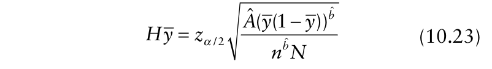{.equation width=60%}

If reliability is defined by setting the half the length of the required confidence interval of the sample mean equal to a fixed positive number _h_:

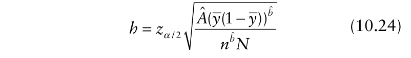{.equation width=60%}

Table 10.3 shows each of equations 10.22–10.24 rearranged so as to provide an expression for _N_, the sample size. Sample size calculation requires choice of a definition of reliability, a previously calculated power law relationship for the pathosystem in question and an initial estimate of mean disease incidence, _<u>y</u>_. With equations 10.22 and 10.23, caution should be exercised inˆ adopting values _b_ > 2 as the basis for sample size calculations (although such values are, in practice, uncommon).

### 10.5.4 Sample size calculations

The sample size formulae in Table 10.3 show _N_, the required number of sampling units, as a function of the estimated mean and (where appropriate) aggregation parameters, as well as the size of the sampling unit, _n_. The total number of individuals to be assessed to meet the required level of reliability is _nN_. The assumption made in presenting the formulae with _N_ on the left-hand side is that any parameters needed for the sample size calculation will have been estimated using sampling units size _n_. Thus, the issue of dependence of parameter values on the size of the sampling unit is circumvented.

Generally, the number of sampling units for a required level of reliability falls as mean disease incidence increases, and is larger when there is an aggregated pattern of disease incidence. Fig. 10.3 shows how required sample size _N_ varies with disease incidence _<u>y</u>_ when the powerlaw relationship log10(_s_ 2 _y_) = 1.15 + 1.35log10(s2 bin) (see Fig. 9.4C) provides a description of variability, using _CV_ = 0.2 as a definition of the required level of reliability. For comparison, the variation of _N_ with _<u>y</u>_ when the corresponding binomial distribution provides a description of variability is shown, again using _CV_ = 0.2. In both cases, _N_ decreases with increasing _<u>y</u>_, but _N_ is higher for the power law (aggregated data) than for the binomial distribution (random data) as a description of variability, except at very low incidence (_<u>y</u>_ < 0.01).

_Example 10.3._ The arrays labeled Field 10.3.1 and Field 10.3.2 represent counts of diseased plants per quadrat (out of a total of _n_ = 9) in disease-infected crops. Initially, a random sample of 25 quadrats was recorded from each field (Samples 10.3.1 and 10.3.2a, respectively). Later, a second sample (Sample 10.3.2b) was recorded from Field 10.3.2. Interested readers can repeat the following calculations, as an exercise, using their own samples drawn from Fields 10.3.1 and 10.3.2.

|**_Nb f_**|**_Freque_**|**_ncy (number of q_**|**_uadrats)_**|
|---|---|---|---|
|**_umer o_** **_diseased_**|**_Sample 10.3.1_**|**_Sample 10.3.2a_**|**_Sample 10.3.2b_**|
|**_plants_**|**_(_**_N_ =**_25)_**|**_(N_**=**_25)_**|**_(N_**=**_56)_**|
|0|1|4|10|
|1|6|4|12|
|2|4|7|6|
|3|7|1|10|
|4|5|4|7|
|5|1|4|7|
|6|1|1|4|
|7|0|0|0|
|8|0|0|0|
|9|0|0|0|

The following summary statistics can be calculated (sections 9.4.1 and 9.4.2): 2 2 Sample 10.3.1: _<u>y</u>_ = 0.293, _sy_ = 0.0266, _s_ bin = 0.0230 2 2 Sample 10.3.2a: _<u>y</u>_ = 0.280, _sy_ = 0.0423, _s_ bin = 0.0224 From Sample 10.3.1, the index of dispersion _D_ = 1.16 andχ2 (24 _df_) = 27.74 (_P_ = 0.27). This is evidence in support of the view that in Field 10.3.1, the pattern of diseased plants at the quadrat scale is indistinguishable from random (section 9.4.3). On this basis, a sample size (number of quadrats) to achieve a reliability defined by the coefficient of variation of the sample mean of _CV_ = 0.1 is given by

|**FIELD 1**|**0.3.1**|||||||||||**FIELD 1**|**0.3.**|**2**|||||||||
|---|---|---|---|---|---|---|---|---|---|---|---|---|---|---|---|---|---|---|---|---|---|---|
|3|3|2|3|2|5|2|2|3|3|1|2|2|0|5|5|5|1|4 |3|2|2|1 3|
|3|1|2|3|3|3|2|2|5|3|1|2|4|4|0|7|3|3|1 |2|5|3|4 1|
|1|4|3|2|3|5|3|4|3|3|3|4|1|2|5|5|0|1|0 |2|1|1|1 5|
|1 |2 |3 |3 |1 |3 |2 |5 |1 |2 |3 |3 |0|1|2|0|0|6|1 |3|3|1|4 0|
|5 |2 |4 |2 |3 |2 |2 |2 |1 |4 |4 |1 |5|4|0|1|5|0|0 |5|0|5|0 8|
|3 |1 |5 |2 |1 |2 |2 |5 |1 |5 |4 |4 |3|1|1|2|0|5|1 |2|3|0|8 1|
|0 |0 |3 |1 |1 |2 |4 |3 |3 |4 |0 |3 |7 |3 |4 |1 |0 |2 |3   |5 |2 |0 |1 1   |
|0 |3 |1 |3 |4 |0 |1 |4 |3 |3 |3 |2 |9 |8 |2 |6 |2 |4 |4   |1 |2 |3 |1 4   |
|1 |2 |5 |2 |2 |1 |4 |1 |2 |3 |3 |2 |1 |1 |2 |2 |4 |4 |4   |6 |4 |0 |1 3   |
|2 |3 |3 |3 |0 |3 |4 |2 |1 |3 |5 |4 |6 |3 |3 |4 |4 |0 |6   |3 |1 |2 |0 3   |
|1|1|3|3|2|3|1|4|3|1|1|1|1|2|4|4|0|6|3 |2|4|1|3 2|
|4|2|2|3|2|5|4|3|2|4|4|3|4|4|2|4|4|0|1 |0|2|3|3 5|
|2|1|0|2|5|5|2|2|2|5|4|1|1|1|3|6|0|1|1 |2|4|1|2 5|
|2|2|5|2|3|2|2|2|2|3|4|3|2|4|0|1|7|2|5 |1|3|5|6 2|
|3|3|4|1|1|2|5|4|6|1|2|2|4|2|2|4|2|4|7 |6|6|6|4 6|
|2|2|3|5|4|3|2|2|0|5|2|5|1|3|2|3|7|2|6 |2|2|1|2 4|
|1|5|5|4|2|5|4|3|3|1|2|4|0|4|1|2|4|1|2 |0|0|5|3 2|
|3 |3 |5 |1 |2 |4 |3 |6 |3 |2 |2 |1 |1|4|4|2|7|2|2 |2|0|1|2 0|
|4 |1 |2 |3 |2 |3 |3 |5 |2 |1 |0 |2 |0 |2 |6 |1 |2 |4 |3   |3 |5 |0 |1 4   |
|2 |3 |4 |5 |3 |1 |1 |0 |3 |3 |3 |1 |2 |5 |6 |4 |2 |1 |1   |2 |3 |5 |1 2   |
|4|2|1|3|3|2|3|4|4|1|4|1|1|4|0|0|6|5|3 |4|1|5|3 5|
|3|3|3|5|2|3|4|1|2|6|3|3|0|2|3|4|2|0|1 |4|5|3|6 3|
|1|3|2|3|2|3|1|2|3|1|3|3|1|0|1|7|4|1|2 |4|4|0|6 7|
|1|2|3|3|4|4|3|2|3|2|3|2|3|7|3|1|8|3|2 |3|7|0|0 1|
|2|3|3|2|3|3|3|4|3|3|3|2|1|0|1|1|4|5|2 |4|2|7|0 2|
|2|4|5|3|4|2|3|3|3|2|2|3|1|4|4|0|5|1|3 |0|5|4|2 0|
|5|5|3|0|2|5|3|0|4|3|1|5|3|2|3|2|2|0|1 |5|2|0|8 1|
|2|3|3|2|3|4|2|4|3|5|5|1|1|1|2|5|2|4|6 |6|4|6|1 3|
|3|2|4|4|3|5|3|2|1|1|5|2|4|0|8|1|2|2|2 |5|1|2|6 7|
|4 |1 |2 |3 |2 |1 |3 |4 |3 |1 |1 |4 |7|0|0|1|2|0|6 |5|3|4|2 3|
|3|2|3|4|1|1|4|4|1|4|2|2|5|1|0|3|5|2|0 |2|7|3|5 4|
|5 |1 |0 |5 |3 |2 |3 |4 |3 |3 |3 |1 |1 |0 |1 |1 |1 |0 |6   |5 |2 |3 |4 1   |
|0|4|1|0|1|6|3|1|3|4|4|4|2|4|3|0|3|1|5 |1|2|4|3 6|
|1|1|4|3|3|1|1|4|3|3|5|3|3|1|5|2|2|3|0 |1|2|1|3 2|
|3|4|3|6|4|6|1|4|0|3|2|2|4|3|1|1|5|1|3 |2|3|3|1 4|
|4|2|5|6|0|2|0|3|2|5|6|2|6|0|2|6|2|2|2 |7|6|2|0 1|
|1|3|2|3|6|1|3|1|3|2|3|4|0|3|2|4|1|2|4 |4|2|2|2 0|
|4|2|1|3|2|4|2|1|2|4|1|2|2|1|3|1|7|2|2 |1|2|3|7 3|
|2|1|2|5|3|3|5|0|3|2|2|1|2|2|0|4|6|1|6 |3|3|5|4 0|
|2|4|3|2|1|1|4|3|1|2|3|3|3|0|0|3|0|0|1 |1|6|0|2 2|
|5|4|6|3|5|3|2|4|4|1|4|6|2|5|1|5|5|1|5 |0|1|1|2 3|
|1 |2 |2 |6 |3 |2 |4 |4 |3 |1 |4|3 |1|2|2|2|1|6|5 |3|2|2|2 4|
|4|4|4|2|0|2|2|4|2|4|5|1|2|1|3|4|2|8|0 |2|0|1|3 0|
|2|2|3|2|3|6|1|2|5|2|4|3|5|1|0|2|6|4|3 |2|3|1|1 3|
|1|4|3|2|2|1|4|3|3|3|2|6|0|4|0|5|3|2|5 |5|3|0|2 2|
|0|6|3|3|1|2|4|3|2|4|2|2|9|5|2|2|1|1|0 |3|4|1|5 2|
|5|2|1|3|3|4|5|4|2|2|2|3|2|4|2|6|2|5|2 |4|1|2|4 2|
|2|4|3|2|3|2|3|1|2|3|2|2|0|0|0|2|3|1|0 |2|4|2|4 4|
|5|3|3|2|2|1|1|4|4|4|3|2|5|3|5|3|5|4|3 |2|6|0|6 6|
|4|3|3|4|3|4|1|4|0|1|5|2|1|4|5|2|2|7|5 |1|1|2|0 1|

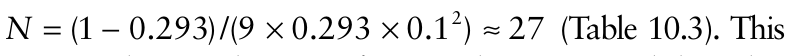{.equation width=60%}

is quite close to chosen _N_ for Sample 10.3.1, and the value of _CV_ for this sample is _CV_ = 0.0266/25 /0.293 ≈ 0.1 (equation 10.16), as required.

It is clear from the summary statistics calculated from Sample 10.3.2a that a different approach will be required for Field 10.3.2. The index of dispersion _D_ = 1.89 and χ2 (24 _df_) = 45.3 (_P_ = 0.005). This is evidence in support of the view that the pattern of diseased plants at the quadrat scale is aggregated. A previously-calculated power law relationship for the pathosystem in question is2 2 ˆ ˆ available,_s_ _y_ = _A s_ ( bin)_b_ , with _A_ = 9.0, _b_ = 1.4. With these values, and the initial estimate of mean disease incidence, _<u>y</u>_ = 0.280, a sample size (number of quadrats) to achieve a reliability defined by the coefficient of variation of the sample mean of _CV_ = 0.1 is given by _N_ = (9.0 × 0.280–0.6 × (1–0.280)1.4 )/(91.4 × 0.12 ) ≈ 56 (Table 10.3), about double the size of the initial sample. Sample 10.3.2b consists of a random sample of 56 quadrats recorded from Field 10.3.2. For this sample, the following summary statistics can be calculated: _<u>y</u>_ = 0.280 , _s_2 _y_= 0.0453. Then the value of_CV_for this

{#fig-10-3}

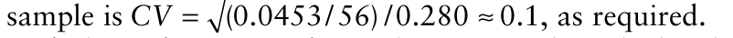{.equation width=60%}

If the information from the previously calculated power law relationship was not available, an alternative would be to use the index of dispersion (or deff) calcu2 2 lated from Sample 10.3.2a,_s_ _y_ / _s_ bin = 1.89, as an empirical heterogeneity factor. For cluster-sampling data described ˆ by the β-binomial distribution, deff = 1 + _ρ_ (_n_ − 1), at least to a good approximation. Then, using the appropriate sample size formula from Table 10.3, _N_ = ((1 − 0.28) × 1.89)/(9 × 0.28 × 0.012 ) ≈ 54. Thus a sample size that will meet the adopted reliability requirement is calculated.

### 10.5.5 Exact confidence intervals for cluster-sampling data

Wypij and Santner (1990) discuss the calculation of both Clopper–Pearson-type “exact” confidence intervals and a less conservative alternative, for β-binomial data. Wypij and Santner’s BBDCI3 computer program was used to calculate Clopper–Pearson-type 95% confidence intervals for some examples of cluster-sampling data given previously in Chapter 9. For comparison, the corresponding approximate normal 95% confidence intervals were calculated. The results are shown in Table 10.4.

When the binomial distribution provides an appropriate description of variability (e.g., Bald’s TSWV data from Table 9.1), the interval calculated by Wypij and Santner’s BBDCI3 computer program is the “exact” Clopper–Pearson interval for a sample size _n_ × _N_, which may be obtained directly from statistical tables. The number of sampling units inspected (_N_) is large enough here for use of the approximate normal confidence intervals to be considered reasonable, and the approximate normal confidence intervals are indeed similar to the “exact” intervals (Table 10.4).

When the β-binomial distribution provides an appropriate description of variability, aggregation is relatively low, the number of sampling units is large and disease incidence is not too low (TSWV data from _Example 9.3_), the Clopper–Pearson-type interval calculated using Wypij and Santner’s BBDCI3 computer program and the approximate normal interval are again similar (Table 10.4). However, when the β-binomial distribution provides an appropriate description of variability but aggregation is higher (dogwood anthracnose data from Table 9.2), there are noticeable discrepancies between the Clopper–Pearson-type intervals and the approximate normal intervals, in spite of the large number of sampling units and disease incidence not too low. In passing, note that the confidence intervals for mean dogwood anthracnose disease incidence for 1990 and 1991 do not overlap. This is consistent with Zarnoch et al. (1995), who showed that there was a difference between the means for the two years (while noting that this finding was subject to the caveat that the data for the two years were not independent).

**Table 10.4.** Summary statistics and “exact” Clopper–Pearsontype and approximate normal confidence intervals for various disease incidence data sets.

|**_Source_**|**_y_**|ˆ_ρ_|**_n_**|**_N_**|**_C-P-type _** **_95%_** **_interval_**|**_Approximate_** **_95%_** **_interval_**|
|---|---|---|---|---|---|---|
|_TSWV data_|_from T_|_able 9.1_|||||
|BHP-OHS|0.881|–|9|40|0.843,|0.848,|
||||||0.913|0.914|
|BP-T|0.933|–|9|40|0.902, 0.957|0.907, 0.959|
|EDR-OHS|0.633|–|9|40|0.581, 0.683|0.583, 0.683|
|EDR-T|0.739|–|9|40|0.690, 0.783|0.694, 0.784|
|_Dogwood a_ |_nthracn_ |_ose data_ |_fro_ |_m Tab_ |_le 9.2_ ||
|1990|0.153|0.343|10|168|0.126, 0.198|0.118, 0.188|
|1991 _TSWV data_|0.299 _from E_ 0.181|0.499 _xample_ 0.050|10 _9.3_ 9|161 160|0.259, 0.365 0.158, 0.206|0.247, 0.351 0.157, 0.205|

Chen and Tipping (2002) suggest an alternative procedure for obtaining “exact” confidence intervals for aggregated cluster-sampling data, using the index of dispersion as an empirical heterogeneity factor. From the data collected, the following quantities are calculated: the index of dispersion (or deff) _D_ = _s_2 _y_/_s_ bin,2the total number of diseased elements in all sampling units inspected ∑ _Y_, and the total number of elements in all sampling units inspected, _n_ × _N_. When the index of dispersion _D_ = 1, the interval calculated using Chen and Tipping’s (2002) procedure is the “exact” Clopper–Pearson interval for a sample size _n_ × _N_, which may be obtained directly from statistical tables.

The lower endpoint of the required 100(1 − _α_)% confidence interval is then calculated from the _α_ / 2 point of the inverse cumulative beta distribution with parameters The upper endpoint of the interval is calculated from the 1− _α_ / 2 point of the inverse cumulative beta distribution with parameters The calculations are facilitated by mathematical software such as MATHCAD. Table 10.5 shows intervals calculated using Chen and Tipping’s (2002) procedure for the dogwood anthracnose data from Table 9.2 (Zarnoch et al., 1995) and for the TSWV data from _Example 9.3_ (Cochran, 1936). The calculated intervals are close to those calculated using Wypij and Santner’s (1990) procedure (Table 9.4). Possible advantages of Chen and Tipping’s (2002) procedure are that it does not depend on assumption of a particular distributional model and that it might be considered easier to calculate.

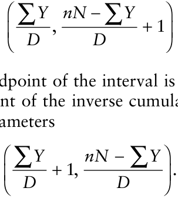

**Table 10.5.** “Exact” confidence intervals for various disease incidence data sets, obtained using Chen and Tipping’s (2002) method.

|**_Source_** **_D_**|_Y_ ∑|**_nN_**|**_Chen and Tipping_** **_95% interval_**|
|---|---|---|---|
|_Dogwood anthracnos_|_e data from_|_Table 9._|_2_|
|1990 3.85|269|1680|0.127, 0.198|
|1991 5.60|500|1610|0.258, 0.368|
|_TSWV data from Exa_|_mple 9.3_|||
|1.42|261|1440|0.158, 0.206|

Chen and Tipping’s (2002) procedure also provides a convenient way of finding the upper limit of a one-sided Clopper–Pearson-type 100(1 −α)% confidence interval for mean disease incidence when all the sampling units are empty (i.e., _<u>y</u>_ = 0 ). In this case, ∑ _Y_ = 0 and the upper limit of the interval, denoted _p_ U, is calculated from the 1 − _α_ point of the inverse cumulative beta distribution with parameters (1, _nN_ / _D_) . If _D_ = 1 (i.e., for binomial data), this is identical to _p_ U = 1 − _α_1/_nN_ . If _D_ > 1 (i.e., for aggregated data), this is identical to _p_ U = 1 − _α__D_/_nN_ . For instance, with _α_ = 0.05, _n_ = 10 and _N_ = 5, _p_ U = 0.06 for the binomial case (_D_ = 1) and _p_ U = 0.17 for aggregated data with _D_ = 3.

Another approach for the _<u>y</u>_ = 0 situation is to use the fact that the negative binomial is a good approximation to the β-binomial distribution at small _p_ (the usual situation when all sampling units are empty), with μ = _np_ and _k_ = _p_ / _θ_ (see section 9.6). Madden et al. (1996) showed that the upper limit of a one-sided Clopper–Pearson-type 100(1 − _α_)% confidence interval for mean disease incidence is approximated by _p_ U = − _θ_ ln(_α_)/[ _N_ ln(1 + _nθ_)] , with _θ_ = (_D_ − 1) / (_n_ − _D_). For example, when _D_ = 3, _p_ U = 0.13 is obtained, a somewhat smaller value than obtained using Chen and Tipping’s (2002) approach.

## 10.6 Regression Analysis of Disease Incidence Data

Disease incidence data may be collected by cluster sampling in a number of distinct areas, with the objective of making a comparison between areas. For normally distributed variables, analysis of variance (ANOVA) provides a basis for the analysis of data where comparison of sample means is the objective (see, for example, Gilligan, 1986). This approach presents some difficulties for the analysis of disease incidence data, because data in the form of proportions may fail to satisfy some of the assumptions of ANOVA (Garrett et al., 2004). The difficulties are more formidable when the proportions are based on different sample sizes (but see Cochran, 1943; Reimer, 1959). One way to face these difficulties is to adopt a generalized linear model (GLM) (McCullagh and Nelder, 1989) approach to analysis. A GLM approach accounts for important properties of non-normal data by means of an appropriate transformation (link function) to achieve a linear model, together with an explicit specification of an appropriate distribution for the response variable.

An important aspect of a GLM approach is the direct link it provides with descriptive methods for disease incidence data collected by cluster sampling, based on the binomial and β-binomial distributions. For this reason, we concentrate here on the use of logistic regression and β-binomial regression as methods for comparing disease incidence data from cluster sampling. There are, however, a number of other methods in use for the analysis of proportions. Anderson (1988), Schabenberger and Pierce (2002) and Collett (2003) present clear reviews of the available methodology from a statistical point of view. Readers should note that GLMs were introduced in Chapter 3 and used a little in Chapter 4.

### 10.6.1 Logistic regression

For binomial proportions, _logistic regression_ (the linear logistic model) is often an appropriate starting point, in which case the logit link function and the binomial distribution are usually specified. Collett (2003) gives a full and clear account of the statistical background, very much abbreviated in what follows.

Suppose that disease status is recorded as a binary response, so that plants are assessed as either “healthy” or “diseased”, in a 22 factorial arrangement of plots. A logistic regression model containing terms for each of the factors and for the two-factor interaction is:

{.equation width=60%}

in which _pij_ is the probability that a plant exposed to the _i_ th level of factor _A_ and the _j_ th level of factor _B_ (_i_ = 1, 2; _j_ = 1, 2) is diseased. The term _C_ 0 is a constant. In equation 10.25, the linear systematic component of the model, given in this case by _ηij_ = _C_ 0 + _Ai_ + _Bj_ + (_AB_) _ij_, is referred to as the _linear predictor_ and its estimated value is denoted _η_ ˆ . The logit link function relates the linear component to the value of _p_. Whereas _p_ is restricted to values between zero and one, logit(_p_) may lie anywhere between ±±. Once _η_ ˆ _ij_ has been estimated, the estimated probability that a plant is diseased can be obtained from ˆ ˆ ˆ _pij_ = exp[ _ηij_]/(1 + exp[ _ηij_]) . In practice, a sequence of models can be fitted. For 22 factorial arrangements, as above, this sequence (starting with the simplest model) is as follows:

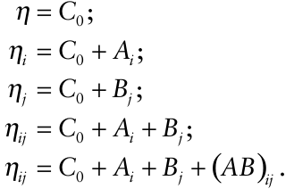

We need to be able to assess how good (or bad) is the fit of each of these models to a set of data, in order to help decide on the appropriate terms to include in the linear predictor. Typically, the models are fitted by maximum likelihood. To compare models, a quantity known as the _deviance_ is defined as minus twice the logarithm of the ratio of the maximized likelihoods of a particular model in question and a model with as many unknown parameters as there are observations (the “full” model). Thus the deviance is large, indicating a poor fit, when the maximized likelihood of the model in question is small relative to that of the full model. On the other hand, the deviance is small, indicating a good fit, when the maximized likelihood of the model in question is relatively close to that of the full model.

_Example 10.4._ Consider the data shown in Fig. 9.1 (taken from Bald, 1937). The 22 factorial arrangement involved two tomato cultivars (Burwood Prize (BP), _A_ 1; Early Dwarf Red (EDR), _A_ 2) and two irrigation methods (overhead sprays (OHS), _B_ 1; trenches (T), _B_ 2). The binary response variable is TSWV-infection of tomato plants. Plots comprised 40 quadrats, each of nine plants. The observed frequencies are given in Table 10.6.

A sequence of logistic regression models is now fitted to these data. The required calculations can be carried out using most widely-available general purpose statistical software packages. The analysis as described here was carried out using EGRET for Windows (Cytel Software Corporation, Cambridge, MA).

|**_Model_**|**_Terms fitted in model_**|**_Deviance_**|**_df_**|
|---|---|---|---|
|10.4_a_|Constant term|294.600|159|
|10.4_b_|Constant term, cultivar|181.374|158|
|10.4_c_|Constant term, irrigation method|280.606|158|
|10.4_d_|Constant term, cultivar, irrigation method|166.238|157|
|10.4_e_|Constant term, cultivar, irrigation method, cultivar×irrigation method|166.013|156|

The table shows the deviance after fitting each of a sequence of logistic regression models with terms included as indicated. When a logistic regression model provides a satisfactory fit, the deviance has an approximateχ2 distribution, with degrees of freedom equal to the number of observations minus the number of parameters to be estimated in the particular model of current interest. Formally, this can be tested by comparing the deviance with the tabulatedχ2 distribution at the appropriate _df_ (informally, the deviance of a model that is a good fit will be approximately equal to its _df_). We look first at model 10.4 _e_, for which theχ2 test gives _P_ = 0.28. If the deviance after fitting this model were large (conventionally, large enough to result in a significance probability _P_ < 0.05), this would be an indication that the binomial distribution provides an inadequate description of withinplot variability for the TSWV data in question. We may, instead, be dealing with extra-binomial variation, referred to as aggregation in the present context. The repercussions of this are taken up in section 10.6.2. In this case, the significance test indicates that the binomial distribution provides an acceptable description of within-plot variability. Of course, this is not surprising given what we already know about these data from Table 9.1.

**Table 10.6.** TSWV data from Bald (1937). The disease assessments were made on 12 December 1928.

|**_Number of_** **_plants_**|**_C_**|**_ultivar–ir_**|**_rigation meth_**|**_od_**|
|---|---|---|---|---|
|**_diseased (/9)_**|**_BP–OHS_**|**_BP–T_**|**_EDR–OHS_**|**_EDR–T_**|
|0|0|0|0|0|
|1|0|0|0|0|
|2|0|0|0|0|
|3|0|0|2|0|
|4|0|0|6|3|
|5|0|0|13|3|
|6|3|0|6|12|
|7|7|6|7|12|
|8|20|12|6|7|
|9|10|22|0|3|

It still remains to decide on the appropriate model. Comparisons of nested models are made using the _likelihood ratio statistic_ (LRS). The LRS is simply a difference between two deviances. For two nested models, the deviance for the model with a larger number of terms is subtracted from the deviance for the model with a smaller number of terms: this is the LRS. The degrees of freedom for the model with a larger number of terms is subtracted from the degrees of freedom for the model with a smaller number of terms: this is the _df_ for the calculated LRS. Since the deviance for each model has an approximateχ2 distribution, the difference between the two deviances will also be approximatelyχ2 (Collett, 2003).

_Example 10.4 continued._ For the TSWV data shown in Table 10.6, likelihood ratio statistics are tabulated below. Such tables are sometimes referred to as _analysis of deviance_ tables. In the table below, the upper stratum is obtained, identical in form, whether the analysis is based on the full data set of 160 observations or just on the overall proportions from the four plots. This part of the table refers to between-plot variability, the plots being the experimental units to which the treatments were applied. In this experimental design, the cultivar × irrigation method term in the upper stratum of the table is equivalent to the residual. The lower stratum is obtained from an analysis of all 160 observations of number of infected plants out of nine. This part of the table refers to within-plot variability, the quadrats of nine plants being the sampling units.

|**_Source_** **_of variation_** **_Models compared_**|**_LRS_**|**_df_**|**_P_**|
|---|---|---|---|
|_Upper stratum_ _(between plots)_  ||||
|Cultivar 10.4_a_, 10.4_b_|113.226|1|<0.001|
|Cultivar 10.4_c_, 10.4_d_ |114.368|1|<0.001|
|(adjusted for irrigation method)||||
|Irrigation method 10.4_a_, 10.4_c_|13.994|1|<0.001|
|Irrigation method 10.4_b_, 10.4_d_ |15.136|1|<0.001|
|(adjusted for cultivar)||||
|Cultivar× irrigation 10.4_d_, 10.4_e_ method (adjusted for cultivar and irrigation method)|0.225|1||
|_Lower stratum_||||
|(_within plots_)|166.01|156|0.28|

The cultivar effect may be tested either taking into account the effect of irrigation method (i.e., the “adjusted” comparison of model 10.4 _c_ with 10.4 _d_) or ignoring it (i.e., the “unadjusted” comparison of model 10.4 _a_ with 10.4 _b_). Similarly, the irrigation method effect can be tested taking into account the effect of cultivar or ignoring it. Having noted this, we will present only the adjusted comparisons in similar analyses that follow. Significance is tested by comparison of the LRS with the tabulatedχ2 distribution at the appropriate _df_. Parameter estimates (on a logit scale) and standard errors after fitting model 10.4 _d_ are given here. aEGRET sets the estimates corresponding to the first level of each factor to zero and provides an estimate of the difference in response between the two levels of each factor and the standard error of that difference. bEGRET tests the significance of estimated parameters by reference to the standard normal distribution. These tests provide useful guidance on the importance of parameters, but should not be regarded as providing exact _P_ values.

|**_Model term_**|**_Estimate_****_a_**|**_Standard error_**|**_P_****_b_**|
|---|---|---|---|
|C0|2.039|0.140|<0.001|
|Cultivar|−1.510|0.152|<0.001|
|Irrigation method|0.534|0.138|<0.001|

Disease incidence is higher in cultivar Burwood Prize than in cultivar Early Dwarf Red (_P_ < 0.001), and higher when irrigation is by trenches compared with overhead sprays (_P_ < 0.001). The estimated linear predictors are then:

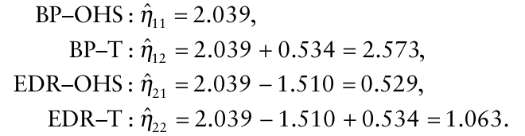

Fitted probabilities can then be calculated fromˆ ˆ ˆ _p ij_ = exp[ _η ij_]/(1 + exp[ _η ij_]) as follows: BP–OHS, 0.885; BP–T, 0.929; EDR–OHS, 0.629; EDR–T, 0.743. Comparison of these fitted values with the calculated proportions shown in Table 9.1 shows good agreement.

### 10.6.2 β-Binomial regression

Zarnoch et al. (1995) analyzed data on dogwood anthracnose infection (caused by _Discula destructiva_) in the south-eastern United States. The 1991–1992 data show the total number of dead trees per plot, and the number dead where there was evidence that dogwood anthracnose was the likely cause, in North Carolina (39 plots) and in Virginia (20 plots) (Table 10.7). Straight away, we note that the sampling units (plots) are of variable size; that is to say, the binomial denominators (the _n_ s in the table) are not constant and so expected frequencies cannot be generated to test goodness-of-fit usingχ2 . However, separate _C_ (α) goodness-of-fit tests of the binomial distribution against the specific alternative of the β-binomial (section 9.4.7) for the North Carolina and Virginia data give a significance probability _P_ < 0.001 in each case. While we therefore realize from the outset that an analysis of the data in Table 10.7 will have deficiencies if it is based on the binomial distribution as a description of within-plot variability of dogwood anthracnose infection, we will proceed step-by-step through the analysis and describe (and mitigate) those deficiencies along the way.

_Example 10.5._ For the dogwood anthracnose data in Table 10.7, all the trees assessed were dead, and the binary response variable is “dead and infected with

**Table 10.7.** Data from the North Carolina–Virginia dogwood anthracnose survey, 1991–1992 (Zarnoch et al., 1995)a .

|**_North C_**|**_arolina_**|**_North C_**|**_arolina_**|**_Virg_**|**_inia_**|
|---|---|---|---|---|---|
|**_Y_**|**_n_**|**_Y_**|**_n_**|**_Y_**|**_n_**|
|2|3|0|7|4|9|
|0|2|3|9|18|20|
|0|5|12|13|0|12|
|5|7|6|20|2|7|
|8|14|2|10|11|20|
|3|3|4|14|4|10|
|0|1|0|8|13|18|
|8|8|0|4|8|14|
|1|1|0|3|2|14|
|10|10|6|6|14|20|
|7|7|10|15|3|15|
|0|15|2|7|1|5|
|1|11|13|20|5|12|
|0|7|0|8|7|20|
|4|10|0|6|2|9|
|3|20|7|15|7|16|
|0|9|0|5|12|20|
|0|9|8|14|7|15|
|5|9|1|7|1|10|
|0|4|||7|12|

> a _n_ is the number of dead dogwood trees on a plot, _Y_ is the number of dead dogwood trees infected by dogwood anthracnose.

dogwood anthracnose” or “dead but not infected with dogwood anthracnose”. The single explanatory variable is “state”, a factor with two levels (North Carolina and Virginia). Of interest here is whether the proportion of overall dogwood mortality due to dogwood anthracnose differs between the two states.

The starting point is the same as in _Example 10.4_. A sequence of logistic regression models is fitted to the data:

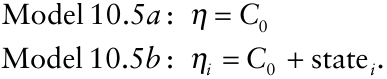

The deviances on fitting logistic regression models to the dogwood anthracnose data in Table 10.7 (from Zarnoch et al., 1995) are then tabulated, as follows.

|**_Model_**|**_Terms fitted in model_**|**_Deviance_**|**_df_**|
|---|---|---|---|
|10.5_a_|Constant term|282.37|58|
|10.5_b_|Constant term, state effect|278.12|57|

On the basis of Models 10.5 _a_ and 10.5 _b_, the effect of state is tested by calculating the LRS (the difference between the deviances) which is compared with the tabulatedχ2 distribution at the appropriate _df_. The comparison of Model 10.5 _a_ with Model 10.5 _b_ gives LRS = 4.25, 1 _df_, _P_ = 0.04, indicative of a difference between North Carolina and Virginia in proportion of dogwood mortality due to dogwood anthracnose infection. The maximum likelihood estimates based on Model ˆ 10.5 _b_ are: North Carolina, logit(_p_) = − 0.50 , SE = 0.11;

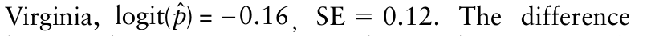{.equation width=60%}

between the two estimates (on a logit scale) is 0.34, with a standard error of 0.16 (_P_ = 0.04). Conventionally, the evidence would lead us to infer a difference in between the two states. The problem with this analysis is that after fitting Model 10.5 _b_, the deviance is significantly large, at 278.1 with 57 _df_ (_P_ < 0.001). This may be an indication that the binomial distribution provides an inadequate description of within-plot variability of dogwood anthracnose infection.

Since the standard errors of the parameter estimates from Model 10.5 _b_ (quoted above) are based on the assumption that the within-plot variability in dogwood anthracnose infection follows a binomial distribution, the detection of extra-binomial variation would indicate that these standard errors were too small. Thus, in such circumstances, the use of the binomial distribution to describe variability tends to exaggerate artificially the significance of comparisons. However, before embarking on an analysis of extra-binomial variation, other possible reasons for a large deviance should be investigated. These include the omission of one or more important explanatory variables from the model, and data that include particularly unusual or influential observations. Collett (2003, Chapter 5) gives details of model checking procedures. In the case of the logistic regression analysis based on the data in Table 10.7, there are no additional explanatory variables available for inclusion. Deltabeta statistics provide a means of ascertaining the influence of each individual observation on the fit of a model (for details, see Collett, 2003). A delta-beta is an approximation of the amount that an estimated regression parameter would change if a given observation was omitted from the regression fit. Observation no. 41 (Virginia, _Y_ = 18, _n_ = 20) has a relatively large (negative) delta-beta (Fig. 10.4), but there is no evidence in Zarnoch et al. (1995) to support the omission of this observation from the data. We therefore proceed with an analysis that takes account of extra-binomial variation. β-Binomial regression (Williams, 1975; Crowder, 1978) allows us to fit regression models in a similar fashion to logistic regression, but instead of the assumption that the within-plot variability in dogwood anthracnose infection follows a binomial distribution, a β-binomial distribution (section 9.4.5) is assumed.

_Example 10.5 continued._ The sequence of regression models fitted to the data can now be extended by inclusion of the β-binomial aggregation parameter θ (section 9.4.5):

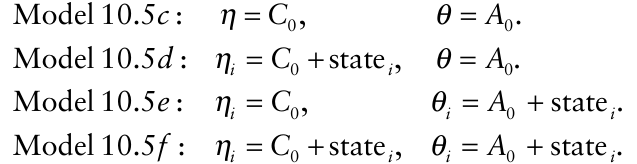

The term _A_ 0 is a constant. The deviances on fitting β-binomial regression models to the dogwood anthracnose data in Table 10.7 (from Zarnoch et al., 1995) are then tabulated, as follows.

|**_Model_**|**_Terms fit_** **_Factor(s)_**|**_ted in model_** **_Aggregation_** **_parameter(s)_**|**_Deviance_**|**_df_**|
|---|---|---|---|---|
|10.5_c_|Constant term|Common|163.56|57|
|10.5_d_|Constant term, state effect|Common|162.49|56|
|10.5_e_|Constant term|Separate|152.80|56|
|10.5f|Constant term, state effect|Separate|152.10|55|

First, we investigate the outcome of including the β-binomial aggregation parameter. The comparison of Model 10.5 _b_ with Model 10.5 _d_ gives LRS = 115.63, 1 _df_, _P_ < 0.001. Thus, the inclusion of a single aggregation parameter, common to both states, brings about a significant reduction in deviance. Note that the LRS for inclusion of a single θ into a previous model that had no aggregation parameter(s) is not tested as a value ofχ2 , but by treating (LRS) <u>as a standardized normal deviate</u> Thus, in this case, (115.63) = 10.75 is tested as a standardized normal deviate.

The comparison of Model 10.5 _d_ with Model 10.5 _f_ gives LRS = 10.39, 1 _df_, _P_ = 0.001, indicating a further reduction in deviance is achieved if a separate aggregation parameter is included for each state. We note that the deviance after fitting Model 10.5 _f_ is still significantly large, indicating that there is variability in these data that is not characterized by the β-binomial aggregation parameter(s).

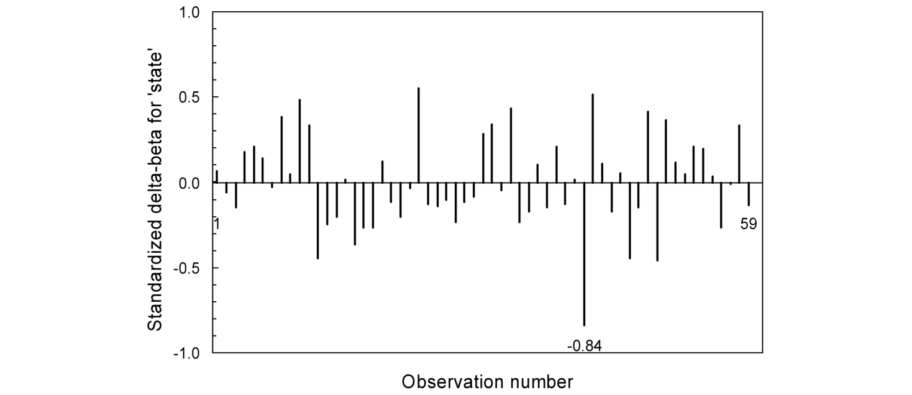{#fig-10-4}

{.equation width=60%}

We are now in a position to test the state effect, having taken extra-binomial variation into account by means of the β-binomial model. The comparison of Model 10.5 _e_ with Model 10.5 _f_ gives LRS = 0.70, 1 _df_, _P_ = 0.40. On this basis, no significant reduction in deviance is achieved by the inclusion of state as a factor in the model, if a separate aggregation parameter is included for each state. We note that for the dogwood anthracnose data under discussion here, the same result is obtained if a single aggregation parameter, common to both states, is included. In this case, the relevant comparison is of Model 10.5 _c_ with Model 10.5 _d_ (LRS = 1.07, 1 _df_, _P_ = 0.30). Parameter estimates (on a logit scale) and standard errors after fitting Model 10.5 _d_ are as follows. aEGRET sets the estimates corresponding to the first level of each factor to zero and provides an estimate of the difference in response between the two levels of each factor and the standard error of that difference. bEGRET tests the significance of estimated parameters by reference to the standard normal distribution. These tests provide useful guidance on the importance of parameters, but should not be regarded as providing exact _P_ values.

|**_Model term_**|**_Estimate_****_a_**|**_Standard error_** **_P_****_b_**|
|---|---|---|
|_Between-states stratum_|||
|_C_0|−0.635|0.233 0.006|
|State|0.369|0.356 0.300|
|_Within-states stratum_|||
|_A_0|0.546|0.141|

On the basis of Model 10.5 _d_, there is no difference between North Carolina and Virginia in proportion of dogwood mortality due to dogwood anthracnose infection (_P_ = 0.30). This conclusion differs from that reached on the basis on Model 10.5 _b_, which took no account of extrabinomial variation. Because the dogwood anthracnose infection data in Table 10.7 are in fact significantly aggregated, the standard errors of parameter estimates from Model 5 _b_ are artificially small, leading to an erroneous attribution of statistical significance. The maximum likelihood estimates based on Model 10.5 _d_ are: North Carolina,

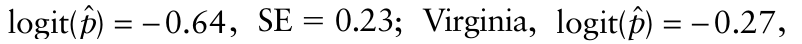{.equation width=60%}

SE = 0.27. The difference between the two estimates (on a logit scale) is 0.37, with a standard error of 0.36 (_P_ = 0.30). The most important effect of taking into account extrabinomial variation is not on the parameter estimates themselves but on their standard errors, which are inflated relative to those obtained using logistic regression.

Hughes and Madden (1998) give another example of β-binomial regression, applied to the formulation of management recommendations for black spruce (_Picea mariana_) seed orchards in Ontario (Bruhn et al. 1996). As an alternative, Hughes and Samita (1998) and Hughes et al. (1998) approach the analysis of extra-binomial variation in disease incidence data by application of logistic normal binomial (LNB) regression. To illustrate the difference between the two approaches, we first refer back to equation 10.25, for a logistic regression model containing terms for each of two factors, _A_ and _B_, and for the twofactor interaction: logit(_pij_) = _C_ 0 + _Ai_ + _Bj_ + (_AB_) _ij_, in which _pij_ is the (constant) probability that a plant exposed to the _i_ th level of factor _A_ and the _j_ th level of factor _B_ is diseased. Aggregation can be modeled by relaxing the assumption that the response probability for the _i_ th level of factor _A_ and the _j_ th level of factor _B_ is a constant. Then, different assumptions about the form of the variability in the response probabilities lead to different models. For example, if it is assumed that the actual response probabilities vary about a mean value and that the variability can be described by a beta distribution, this leads to the β-binomial model (see section 9.4.5). The LNB model is based, instead, on the assumption that the _logit_ -transformed response probabilities vary about a mean value, and that the variability can be described by a normal distribution. That is to say, if variability in the response probabilities is described by a logistic normal distribution (Aitchison and Shen, 1980), this leads to the LNB model. Both approaches are useful for the analysis of disease incidence data. One advantage of the LNB regression approach is that it can easily be extended to the analysis of multiple scales in a hierarchy, where data are available, for example, for plots, quadrats within plots, plants within quadrats and leaves within plants. For more details, readers are referred to Madden et al. (2002) and Piepho (1999).

### 10.6.3 Logistic regression with deff-transformed data

Rao and Scott (1992) suggested an alternative approach to the analysis of extra-binomial variation in cluster-sampling data. The method involves a simple transformation of the observed data, using the index of dispersion (which they refer to as the deff; section 9.4.2). The data must be classified by a single factor. Essentially, the transformation involves calculation, for each sampling unit, of _Y_ * = _Y_ /deff , _i n_ * = _n_ /deff _i_ (with _i_ denoting the level of the single factor in question), following which the transformed variables _Y*_, _n*_ are used in logistic regression. In passing, note that the quantity _n_ /deff is a version the _effective sample size_ as used in the sampling literature (Kish, 1995). For aggregated data, deff > 1. Dividing _n_ by the deff results in an effective sample size < _n_. This reflects the reduction in the amount of information obtained from a group of _n_ individual plants or plant parts in a sampling unit, when proximity (i.e., membership of the same sampling unit) results in a tendency for individuals to have the same disease status.

For the dogwood anthracnose data in Table 10.7 (from Zarnoch et al., 1995), the deffs are equal to 4.458 and 3.239 for the North Carolina and Virginia data respectively. Using the statistical software GENSTAT, a sequence of logistic regression models is fitted to the deff-transformed data:

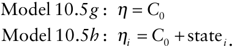

The deviances are then tabulated, as follows.

|**_Model_**|**_Terms fitted in model_**|**_Deviance_**|**_df_**|
|---|---|---|---|
|10.5_g_|Constant term|69.29|58|
|10.5_h_|Constant term, state effect|68.17|57|

The comparison of Model 10.5 _g_ with Model 10.5 _h_ gives LRS = 1.12, 1 _df_, _P_ = 0.29. The maximum likelihood estimates based on Model 10.5 _h_ are: North Carolina,

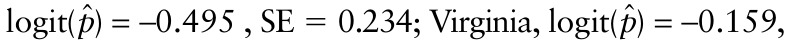{.equation width=60%}

SE = 0.217. The difference between the two estimates (on a logit scale) is 0.337, with an estimated standard error of 0.319 (_P_ = 0.29). Conventionally, the evidence would not lead us to infer any difference in between the two states in proportion of dogwood mortality due to dogwood anthracnose infection. After fitting Model 10.5 _h_, the deviance is 68.17 with 57 _df_ (_P_ = 0.15). Thus the deff transformation of the data appears to have dealt with the problem of extra-binomial variation in a satisfactory manner. Compared with the previous logistic regression analysis of the dogwood anthracnose data (section 10.6.2, _Example 10.5_), the parameter estimates are similar but the standard errors are inflated. As with β-binomial regression analysis, the outcome is that an erroneous attribution of statistical significance relating to the difference between states is avoided. Possible advantages of the deff-transformation approach are that it does not depend on assumption of a particular distributional model and that it can easily be carried out with generalpurpose statistical software. On the other hand, the β-binomial approach—as well as the generalized linear mixed modeling approach which involves the logisticnormal-binomial distribution (not covered here)— provides a direct link between the use of statistical probability distributions in data analysis and in the description of spatial patterns of disease, and is applicable to experimental data classified by more than a single factor.

### 10.6.4 Fitting statistical probability distributions

In sections 9.4.2 and 9.4.5, the binomial and β-binomial distributions were fitted to data as a way of describing frequency distributions of disease incidence. In case it is not already obvious, we now state explicitly that the methodology described in sections 10.5.1 and 10.5.2 achieves exactly the same outcome, albeit using a different parameterization. Thus we have seen, in section 10.5.1, how the use of logistic regression resulted in binomial parameter estimates for each of the four frequency distributions of TSWV disease incidence shown in Fig. 9.1.

In section 10.5.2, the use of β-binomial regression resulted in β-binomial parameter estimates for the dogwood anthracnose data from each of two states (because the _n_ s differed among sampling units, no frequency distribution can be drawn). Had we approached the analysis with the objective of simply describing the data from each state, a summary such as that shown in Table 10.8 could be prepared.

While Model 10.5 _d_ was adequate for a comparison between the two states based on β-binomial regression, it is Model 10.5 _f_ that provides the analysis analogous to that shown in Table 10.8. The analysis for Model results are obtained. For North Carolina,10.5 _f_ is shown in Table 10.9, from which the followinglogit(_p_ ˆ) = −0.568,

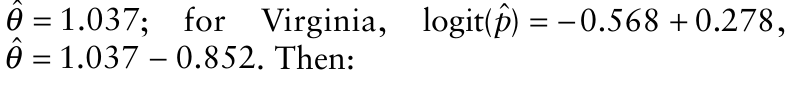{.equation width=60%}

**Table 10.8.** Output after analyses of the dogwood anthracnose data in Table 10.7 (from Zarnoch et al., 1995) using the BBD computer program (Madden and Hughes, 1994). Only an abbreviated summary is given here. Various test statistics calculated by the software are not shown.

|β**_-Binomial parameter_** **_estimates_**|**_North Carolina_**|**_Virginia_**|
|---|---|---|
|ˆ_p_|0.362|0.428|
|SE ˆ( ) _p_|0.058|0.052|
|ˆ_θ_|1.037|0.185|
|SE ˆ( ) _θ_|0.332|0.081|

**Table 10.9.** Output (an abbreviated summary) after analyses of the dogwood anthracnose data in Table 10.7, based on Model 10.5 _f_.

|**_Model term_** **_Estimate_****_a_**|**_Standard err_**|**_or_** **_P_****_b_**|
|---|---|---|
|_Between-states stratum_|||
|_C_0 −0.568|0.253|0.025|
|State 0.278|0.331|0.402|
|_Within-states stratum_|||
|_A_0 1.037|0.337||
|State −0.852|0.347|0.014|

aEGRET sets the estimates corresponding to the first level of each factor to zero and provides an estimate of the difference in response between the two levels of each factor and the standard error of that difference. bEGRET tests the significance of estimated parameters by reference to the standard normal distribution. These tests provide useful guidance on the importance of parameters, but should not be regarded as providing exact _P_ values.

ˆ = exp(−0.568) = for North Carolina, _p_ 0.362, 1 + exp(−0.568) ˆ _θ_ = 1.037, ˆ = exp(−0.568 + 0.278) = for Virginia, _p_ 0.428, 1 + exp(−0.568 + 0.278) ˆ _θ_ = 1.037 − 0.852 = 0.185.

Thus Tables 10.8 and 10.9 represent alternative parameterizations of the same analysis. This makes clear the point that descriptions of aggregated disease incidence data based on statistical probability distributions provide the basis for making comparisons when more than one data set is collected.

## 10.7 Regression Analysis of Count Data

In much the same way that the binomial and β-binomial distributions provide a basis both for analyzing spatial patterns and for statistical modeling of disease incidence data, the Poisson and negative binomial distributions can be applied to disease data in the form of counts. Since relatively few disease data are collected in the form of counts we provide only an abbreviated summary here. A full description of the methodology from a statistical viewpoint is provided by Cameron and Trivedi (1998).

### 10.7.1 Poisson and negative binomial regression

Count data present similar difficulties to those noted for incidence data (section 10.6) when comparison of sample means is the objective. Poisson regression provides a way of circumventing problems arising from the nonnormality of count data, which limits the applicability of ANOVA. In this case, the natural logarithm (ln) is the link function used to achieve a linear model and the Poisson distribution is specified for the response variable. However, if Poisson regression analysis is carried out on aggregated count data, the standard errors of the estimated linear predictors, and of differences between them, are likely to be too small and so may lead to unwarranted claims of statistical significance. Negative binomial regression is one method of analyzing aggregated count data in a way that takes account of extraPoisson variation.

_Example 10.6._ For this example, we return to the data from the North Carolina–Virginia dogwood anthracnose survey, 1991–1992 (Zarnoch et al., 1995) shown in Table 10.7. In the previous _Example 10.5_, the analysis related to the proportion of dogwood mortality that was due to anthracnose infection. In the present example, the analysis relates to the _number_ of tree deaths due to anthracnose infection. That is, the analysis is now based just on _Y_, the number of dead dogwood trees infected by dogwood anthracnose. Because there is, in fact, an upper limit to tree mortality in a plot (since no more than _n_ trees can die), the previously described analysis of the data as proportions is more appropriate. In order to justify the use of an analysis based on the number of dead trees, we would need to have values of _Y_ that were low relative to the corresponding values of _n_. The main purpose of this example is to illustrate some methods for analyzing count data.

As before, the single explanatory variable is “state”, a factor with two levels (North Carolina and Virginia). The analysis described below was carried out with _SAS_ statistical software. Table 10.10 shows the results of three regression models fitted to the data for number of dead dogwood trees infected by dogwood anthracnose (_Y_). Model 10.6 _a_ is based on a Poisson regression analysis. The difference between states (on a ln scale) is 0.645, with SE = 0.124 (_P_ = 0.001), but the deviance is significantly large (257.99 with 57 _df_), indicative of aggregation (extra-Poisson variation).

Model 10.6 _b_ is based on a negative binomial regression analysis, incorporating a single aggregation parameter common to both states. The difference between states (on a ln scale) is 0.645 as before, but now with SE = 0.314 (_P_ = 0.045). The deviance is now a satisfactory 68.21 with 57 _df_. At this stage we could conclude that there is evidence at about the 5% significance level for a difference between states in mean dogwood mortality per plot due to dogwood anthracnose. Probably, however, we would want to check the results of the negative binomial regression analysis incorporating a separate aggregation parameter for each state, if only to see whether a firmer attribution of statistical significance (relative to the conventionally adopted 5% significance level) could be made, one way or the other.

Model 10.6 _c_ is based on a negative binomial regression analysis, incorporating a separate aggregation parameter for each state. The difference between states (on a ln scale) is 0.645 as before, but now with SE = 0.293 (_P_ = 0.032). The deviance is now 64.00 with 57 _df_. Thus we

**Table 10.10.** Parameter estimates for three regression models fitted to the data for number of dead dogwood trees infected by dogwood anthracnose (Table 9.2).

|||**_P_** **_Linear_** |**_arameter_**|**_estimat_** ˆ|**_es_**|
|---|---|---|---|---|---|
|**_Model_**|**_State_**|**_predictor_**|**_SE_**|_k_|**_SE_**|
|10.6a|North Carolina|1.212|0.087|–|–|
||Virginia|1.856|0.088|–|–|
|10.6b|North Carolina|1.212|0.189|{0.909|0.238}a|
||Virginia|1.856|0.251|||
|10.6c|North Carolina|1.212|0.230|0.566|0.183|
||Virginia|1.856|0.181|2.000|0.863|

> aIn Model 10.6 _b_ there is a single estimate of _k_ of the negative binomial distribution, common to both States.

conclude that there is evidence for a difference between states in mean dogwood mortality per plot due to dogwood anthracnose. Recall that the analysis in _Example 10.5_ led us to conclude that there was no difference between states with respect to the _proportion_ of dogwood mortality attributable to dogwood anthracnose.

From Table 10.10, we can see that Model 10.6 _c_ has provided an improved description of aggregation. The common aggregation parameter fitted in Model 10.6 _b_ was rather too large for the North Carolina data (i.e., the data were more aggregated than as characterized by Model 10.6 _b_). In contrast, common aggregation parameter fitted in Model 10.6 _b_ was rather too small for the Virginia data (i.e., the data were less aggregated than as characterized by Model 10.6 _b_). These differences in aggregation between states are reflected Model 10.6 _c_ in the increase in the standard error of the linear predictor for North Carolina (relative to Model 10.6 _b_) and a decrease in the standard error of the linear predictor for Virginia (again relative to Model 10.6 _b_).

## 10.8 Group Testing with Incidence Data

Disease incidence may be estimated by means of a simple random sample (section 10.3). Suppose that the assessment of infection is made by use of a laboratory-based assay. If the units of plant material collected by sampling are tested individually, an unbiased estimate of incidence is the proportion of units infected, _<u>y</u>_ = ∑ _Yi_ / _N_, in which _N_ is the total number of units, and _Yi_ = 0 for a unit assessed as uninfected or _Yi_ = 1 for a unit assessed as infected (_i_ = 1, 2, …, _N_) (for the sake of simplicity, we assume here that the assay provides assessments that can be regarded as error free). The proportion of units infected, _<u>y</u>_, is taken as an estimate of the probability that an individual unit is infected.

Alternatively, the individual units of plant material may be combined into groups, and the groups tested. Testing groups is an intuitively appealing option when few individual units are thought to be infected, and when the cost of testing is non-negligible. Less obvious, perhaps, is that a good _statistical_ case for testing groups can be made (see, for example, Loyer, 1983). Using the same notation as in section 9.7.1, the probability that an individual unit is infected is denoted _p_ low (the subscript “low” indicates reference to the individual unit scale). If groups of units from the sample are formed at random in the laboratory prior to testing, the probability that a group of _n_ units has no infected units is given by the zero term of the binomial distribution, Pr(_Y_ = 0) = (1 − _p_ low)_n_ . The probability that a group of _n_ units contains at least one infected unit is then _p_ high = 1 − Pr(_Y_ = 0) = 1 − (1 − _p_ low)_n_ , in which the subscript “high” indicates reference to the group scale. On rearranging this, is obtained. An estimate of _p_ high is _p_ low _p_ ˆ high = 1= ∑ − _Y_ (1 _i_ /− _Np_ high(_N_)1/ is_n_ now the total number of groups (i.e., the number of tests), and _Yi_ = 0 for a group that tests negative for infection or _Yi_ = 1 for a group that tests positive (_i_ = 1, 2, …, _N_)). The maximum likelihood estimate of _p_ low is:

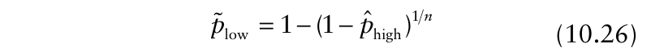{.equation width=60%}

in which the “tilde” indicates that the estimate is obtained from data at a different scale (so in this case, an estimate at the unit scale is obtained from data at the group scale). An approximate variance can be formulated using the method outlined by Colquhoun (1971):

{.equation width=60%}

Or, writing as a function of _p_ low :

{.equation width=60%}

An estimated standard error for _p_ low is then given by _SE p_ ( low) = _v_ low / _N_. Use of equation 10.26 to estimate a proportion is often referred to as _group testing_. The statistical methodology of group testing has a long association with the study of disease in human, animal and plant populations. Dorfman’s (1943) early work was concerned with developing a method of classifying individuals in a population as either infected or not when testing every individual was deemed inefficient because infection was rare (the term _Dorfman screening_ is sometimes used as a synonym for group testing). Here, we are concerned with group testing for estimation, and in particular with the estimation of the proportion of individual units infected. Particular examples of the application of group testing where infection in plant populations has been studied include Moran et al. (1983, 1985), Rodoni et al. (1994) and Block et al. (1999). An important phytopathologically related area for the application of group testing is in studies of infection in populations of vectors of plant diseases (e.g., Smith and Lea, 1946; Swallow, 1985; Romanow et al., 1986; Tebbs and Bilder, 2004). Use of group testing to estimate incidence (proportion of individuals infected) requires consideration of the properties of the estimator _p_ low and of the choice of group size _n_. On both counts, Swallow (1985) is essential reading for plant pathologists contemplating the application of group testing methodology.

### 10.8.1 The estimator _p_ low

As an estimator of _p_, the true but unknown proportion of individuals infected, _p_ low is biased when _n_ > 1. Swallow (1985) gives the following relationships:

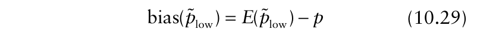{.equation width=60%}

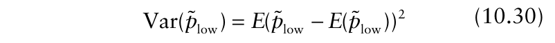{.equation width=60%}

MSE(_p_ low) = _E p_ ( low − _p_)2 = Var(_p_ low) + (bias(_p_ low)) 2

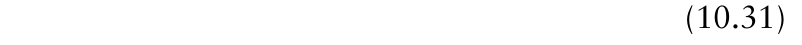{.equation width=60%}

based on standard statistical theory, in which _E_ (•) denotes expected value and Var(•) denotes variance. The bias is the difference between the expected (i.e., average) value of the estimator _p_ low and the true value _p_, and the mean squared error (MSE) is the average squared deviation of _p_ low from _p_. For an unbiased estimator, the expected value is equal to the true value _p_ and the mean squared error is equal to the variance. To make use of equations 10.28–10.30, formulae for the expected value and the variance of the estimator are needed. These are given by Swallow (1985):

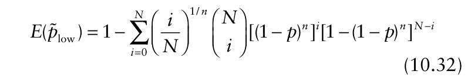{.equation width=60%}

Now, for specified values of _N_ (number of groups) and _n_ (number of units per group), bias (_p_ low ) and MSE (_p_ low ) can be calculated as functions of _p_. Swallow (1985) discusses a scenario where the number of groups remains constant and the group size is increased, and concludes that choosing too large a group size should be avoided. For example, Figs. 10.5 and 10.6 are based on _N_ = 150 groups, with group sizes _n_ = 5, 10, 25 and 50. Fig. 10.5 shows a sequence of graphs of _E p_ ( low) against _p_, based on this scenario. When all units are tested individually (_n_ = 1), _E p_ ( low) = _p_ and the estimator _p_ low is unbiased. As _n_ increases, the extent to which the estimator is upwardly biased increases and the range of _p_ for which the bias may be regarded as negligible decreases. Fig. 10.6 shows a sequence of graphs of MSE (_p_ low ) against _p_, based on the same scenario. Note that there is a range of _p_ for which MSE (_p_ low ) is below the MSE of the unbiased estimator (which is equal to the variance), but that this range decreases as _n_ increases. Burrows (1987) discussed an alternative estimator with superior bias and MSE properties, but this has not been widely adopted.

### 10.8.2 Choice of group size

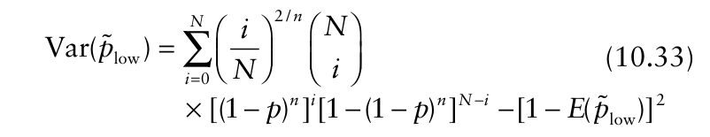{.equation width=60%}

From section 10.8.1, we have already seen that use of large groups increases the extent to which the maximum likelihood estimate _p_ low is biased. Large group size is also undesirable because—as Block et al. (1999) found—it increases the chance that all groups test positive. In such cases, there is little useful that can be concluded about the incidence of infection of individual units (Bhattacharayya et al., 1979). In addition to statistical considerations, the choice of group size must also take into account the characteristics of the assay used to detect infection. Specifically, the assay must be capable of discriminating between a positive group and a negative group when only one out of _n_ units in the positive group is infected. This can be demonstrated by an experimental dilution series made up from plant material of known infection status (e.g., Hughes and Gottwald, 1998). A further issue concerning the assay used to detect infection is the possibility of misclassification errors (Chen and Swallow, 1990). If the only positive unit in a large group is not detected, the group is erroneously declared negative. The impact on _p_ low may be large. These non-statistical factors also weigh against the use of large groups.

![Group testing with disease incidence data. The figure shows a sequence of graphs of the expected value of the estimator, _E p_ ( low ) , against _p_, the true but unknown proportion of individuals infected. The number of groups is _N_ = 150 in each case. = For an unbiased estimator, _E p_ ( low ) _p_ (represented by a thin straight line between (0, 0) and (1, 1) shown on the graphs). This is the case when all units are tested individually (_n_ = 1). When group size _n_ > 1, _p_ low is a biased estimator of _p_. As _n_ increases, the extent to which the estimator is upwardly biased increases and the range of _p_ for which the bias may be regarded as negligible decreases. (**A)** _n_ = 5; (**B)** _n_ = 10; (**C)** _n_ = 25; (**D)** _n_ = 50.](figures/fig10-img24.png){#fig-10-5}

![Group testing with disease incidence data. The figure shows a sequence of graphs of the mean squared error of the estimator _p_ low , MSE (_p_ low ), against _p_, the true but unknown proportion of individuals infected. The number of groups is _N_ = 150 in each case. For an unbiased estimator, the MSE of the estimator is equal to the variance (represented by a parabola with a peak at _p_ = 0.5 shown on the graphs). This is the case when all units are tested individually (_n_ = 1). When group size _n_ > 1, _p_ low is a biased estimator of _p_. There is a range of _p_ for which MSE (_p_ low ) is below the MSE of the unbiased estimator. This range decreases as group size _n_ increases. (**A)** _n_ = 5; (**B)** _n_ = 10; (**C)** _n_ = 25; (**D)** _n_ = 50.](figures/fig10-img25.png){#fig-10-6}

It is desirable to adopt a group size that results in some groups testing negative and some testing positive. Various guidelines exist. Chiang and Reeves (1962) gave: based on an equal chance of a negative or a positive test, and translated this formula into a table of “standard” group sizes. Thompson (1962) suggested choosing _n_ on the basis of minimizing the asymptotic variance of _p_ low, but the disadvantages of this procedure are apparent from Swallow’s (1985) discussion. Swallow (1985, Table 1) adopts instead the criterion of minimizing MSE (_p_ low ) and gives the optimum values of _n_ for a range of values of _N_ and _p_ low. Swallow (1987) discussed group size based on minimizing the cost per unit information. In this case, optimum values of _n_ for given values of _N_ and _p_ low were smaller than when based on minimizing MSE (_p_ low ). All these guidelines for choice of group size depend on being able to provide an initial estimate of the unknown incidence of infection in individual units. If a likely range can be specified with reasonable confidence, Swallow (1985) suggests that group size _n_ is adopted on the basis of the upper value of this range. This has the desirable outcome that group size is conservatively small.

It is _not_ a prerequisite for group testing that all groups are the same size. Studies by Moran et al. (1985) and Rodoni et al. (1994) both used a sequential series of group sizes in estimating the incidence of virus infection in carnations. If so little is known in advance that even _n_ = log(1/2) − log(1 _p_ low) specifying a likely range for _p_ presents difficulties, this procedure has particular advantages. Chen and Swallow (1990) give an estimator for _p_ for use when groups are of unequal size. Hepworth (1996) discusses in some detail the statistical aspects of the procedure adopted by Rodoni et al. (1994).

### 10.8.3 Sample size calculations

Equipped with an initial estimate of the incidence of infection in individual units and an appropriate choice of group size, the number of groups that must be tested (_N_) to estimate _p_ low with a pre-specified level of reliability may be calculated using the methods outlined in section 10.2.6 and the mean and variance formulae given in section 10.8.1. In equations 10.34–10.36 below, the initial estimate of the incidence of infection in individual units is given in terms of _φ_ = (1 − _p_ low) and _n_ is the chosen group size. If reliability is defined by the coefficient of variation of the sample mean, _CV_:

{.equation width=60%}

If reliability is defined by setting the half the length of the required confidence equal to a fixed proportion of the mean, _H_:

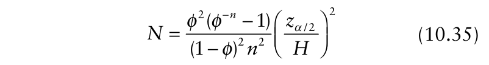{.equation width=60%}

If reliability is defined by setting the half the length of the required confidence interval of the sample mean equal to a fixed positive number _h_:

{.equation width=60%}

as in Worlund and Taylor (1983).

For example, if _p_ low = 0.05, _n_ = 25, _CV_ = 0.1, equation 10.34 gives _N_ = 150 as the number of groups to be tested (for a total of _Nn_ = 3750 individuals). If, instead, we put _n_ = 1, then _N_ = 1900 (all other things being equal). We note in passing that the sample size _N_ = 1900 can also be obtained from the formula _N_ = (1 − _<u>y</u>_ <u>)</u> / _<u>yCV</u>_ 2 (Table 10.1) when _<u>y</u>_ = 0.05, _CV_ = 0.1. In this example, group testing requires about double the number of units, but only about eight per cent of the number of tests, compared with testing individual units.

### 10.8.4 Exact confidence intervals

Moran et al. (1983) investigated virus infection in potato crops using group testing. For one certified seed crop of cv. Sebago, groups comprised _n_ = 100 leaflets, and five out of _p_ ten groups tested positive for ˆ high = 0.5, and, from equation 10.26, _Potato virus Xp_ low = (PVX). Thus 6.91 × 10−3. Moran et al. (1983) gave the “exact” 95% confidence interval for this _p_ low as extending from 2.07 × 10−3 to

{.equation width=60%}

Chiang and Reeves (1962) and Worlund and Taylor (1983) both give details of the required (iterative) calculations for “exact” confidence intervals for a binomial proportion estimated by group testing (with equal group sizes). In addition, the former article provides a series of figures from which 95% and 99% confidence intervals for _p_ low can be read off, for various combinations of _p_ ˆ high and _n_, and the latter provides a table of 90% confidence intervals for _p_ low, for various combinations of _N_ and _n_. Reading off Fig. 5 in Chiang and Reeves (1962) gives an “exact” 95% confidence interval for _p_ low in the specific example above of 2.1 × 10−3 to 16.7 × 10−3 , in good agreement with Moran et al. (1983). The easiest way to calculate an “exact” confidence interval for a value of _p_ low calculated from equation 10.26 is first to obtain the Clopper–Pearson interval, as in section 10.3.3, for _p_ ˆ high. The upper and lower limits of this interval are then substituted into equation 10.26 in turn, and the resulting values are the limits of the corresponding interval for _p_ low. Using MINITAB, the 95% Clopper–Pearson interval for _p_ ˆ high in the specific example above extends from 0.187086 to 0.812914. Substituting these limits in turn into equation 10.26, the limits of the corresponding interval for _p_ low extend from 2.07 × 10−3

{.equation width=60%}

When unequal group sizes are used, as in Rodoni et al. (1994), the above calculations for “exact” confidence intervals are no longer appropriate. In this case, Hepworth (1996) gives details of the required procedure.

### 10.8.5 Group testing using generalized linear models

Farrington (1992) puts group testing for estimation into a GLM framework. The starting point is _p_ high = 1−(1 − _p_ low)_n_ (section 10.8.1), from which CLL(_p_ high) = ln(_n_) + CLL(_p_ low), where CLL(•) denotes the complementary log-log transformation (section 9.7.1). Consider a data set comprising _M_ assessments of infection. For the _j_ th assessment (_j_ = 1, …, _M_), the group size is _nj_, and there are _Nj_ groups, of which _Yj_ test positive for infection. Table 10.11 shows such a data set, comprising all the data (17 assessments) on PVX infection of cv. Sebago certified seed potato crops given in Tables 4 and 5 of Moran et al. (1983). The data as presented here, for illustration, pose two problems. First, there are two different group sizes (different group sizes were used in each of two seasons for which data are reported). Second, the proportion of groups testing positive varies widely between assessments, raising the prospect that an analysis of virus infection over assessments may be influenced by extra-binomial variation.

**Table 10.11.** Group-testing data from 17 assessments of PVX infection for cv. Sebago certified seed potato crops, extracted from Tables 4 and 5 of Moran et al. (1983).

|**_Number of_** **_assessments_**|**_Number of_** **_groups_**| **_Group size_**|**_Number (proportion)_** **_of groups testing_** **_positive_**|
|---|---|---|---|
|3|20|50|0 (0.00)|
|7|10|100|0 (0.00)|
|1|20|50|1 (0.05)|
|1|20|50|2 (0.10)|
|1|10|100|1 (0.10)|
|1|20|50|4 (0.25)|
|1|20|50|9 (0.45)|
|2|10|100|5 (0.50)|

Both problems are resolved using the approach outlined by Farrington (1992).

The data in Table 10.11 were fitted to a GLM with binomial errors and the complementary log-log link function, with the coefficient of ln(_n_) set equal to one (referred to as an “offset” in GLM terminology) and with no explanatory variables. As in Farrington (1992), the analysis was carried out using the statistical software GLIM. The estimated value of CLL (_p_ high) is −6.386, with an estimated standard error of 0.1927. These results can be transformed back to an incidence scale as follows: and after using standard methodology to obtain the approximate variance of a function (see, e.g., Colquhoun, 1971):

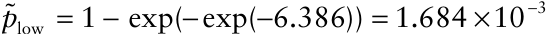

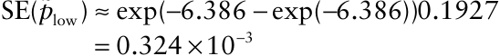

However, the resulting deviance of 69.7 (16 _df_) is significantly large, indicating extra-binomial variation. This is readily accounted for by means of so-called quasi-likelihood methods (Williams, 1982; Bennett, 1989), as described by Farrington (1992). The estimated value of CLL (_p_ high) is then −6.400, with an estimated standard error of 0.4248. The resulting deviance of 14.5 (16 _df_) is satisfactory. The results, transformed back to an incidence scale, are then as follows:

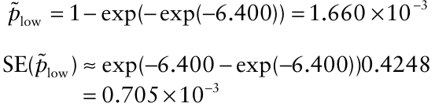

The estimate _p_ low is little changed, but its estimated standard error is inflated from the artificially small value obtained from the initial analysis. An approximate 95% confidence interval for _p_ low then extends from 0.028 × 10−3 to 3.041 × 10−3 .

In a group-testing scenario, the quasi-likelihood methodology adopted here provides a more straightforward way of analyzing aggregated disease incidence data than distribution-based methodology. The quasi-likelihood methodology introduced by Williams (1982) can also be used as an alternative to the distribution-based methodology for the regression analysis of aggregated disease incidence data collected by cluster sampling, discussed in section 10.6.2. Hughes and Madden (1995) give a phytopathological example of the application of Williams’ methods to such data.

## 10.9 Binomial Sampling for Count Data

Recall that in section 10.4 the estimated mean number of infections per sampling unit (_Y_) was obtained by counting all the infections in each sampling unit inspected. The idea behind _binomial sampling_ is that a relationship between the estimated mean number of infections per sampling unit and the proportion of sampling units with more than a _tally threshold_ of _T_ infections can be used to avoid the need for a full count of the number of infections. Instead, only the proportion of sampling units with more than _T_ infections need be obtained by sampling. Most applications of binomial sampling have been in economic entomology (e.g., Jones, 1994b) and weed science (e.g., Gold et al., 1996). Furthermore, binomial sampling for insect pests and for weeds is often used in sequential sampling plans, and where the objective is classification rather than estimation. The statistical properties of estimates obtained by binomial sampling have been discussed by Binns et al. (2000). Here we restrict our attention to the estimation of mean number of infections per sampling unit from a sample of prespecified size. A special case of binomial sampling is when _T_ = 0 and sampling units are simply recorded as either uninfected or infected. However, this is rarely optimal in practice.

### 10.9.1 Binomial sampling based on probability distributions

For a Poisson distribution with mean _μ_, the proportion of sampling units with more than _T_ infections is given by:

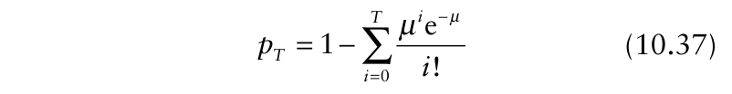{.equation width=60%}

to for _pi T_ ==0, 1, 2, …, _p_ high = 1 − e− _Tμ_. If (equation 9.33). In this particular _T_ = 0, equation 10.37 reduces − case we can rearrange equation 10.37 to _μ_ = −ln(1 _pT_). Then, on obtaining an estimate of the proportion of sampling units with more than _T_ infections ˆ(_pT_), the mean number of infections per sampling unit is estimated byˆ _Y_ = −ln(1 − _pT_) . Unfortunately, there is no general rearrangement of equation 10.37 leading to _Y_ = _f_ ˆ(_pT_) for _T_ > 0. Normally, then, a binomial sampling estimate of mean number of infections per sampling unit is obtained by numerical solution of: and _p_ ˆ _T_ = 15/28, gives _Y_ = 5.89. The realized value of _CV_ for this sample is given by:

{.equation width=60%}

for , for a given _Y T_ and an estimate _p_ ˆ _T_ obtained by sampling. The question then becomes one of an appropriate choice of tally threshold _T_. The lower is the value of _T_, the easier is the process of data collection by sampling. However, this is not the only criterion for selecting a value of _T_, as we shall see.

_Example 10.2 continued_. The task here is to estimate the mean number of lesions per plant in Field 10.2.1 (section 10.4.4) by binomial sampling. As before, _CV_ = 0.1 is set as the required level of reliability for the sample mean, and a preliminary sample estimate of the mean of 5.65 lesions per plant is available.

An approximate binomial sampling variance for the counts of lesions per plant is given by:

(Binns et al., 2000) in which _p_ ˆ _T_is formulated as in equa- _T_ − _Y_ tion 10.38 and _dp_ ˆ _T_ / _dY_ = _Y_ e / _T_ ̃ ! Then the required sample size (number of sampling units to be inspected) _N_ is given by:

(Binns et al., 2000). _N_ can be calculated for a range of values of _T_, using the required level of reliability for the sample mean (_CV_ = 0.1) and a mean of 5.65 lesions per plant (from the preliminary sample). The following results are obtained.

|_T_|0|1|2|3|4|5|6|7|
|---|---|---|---|---|---|---|---|---|
|_N_|888|182|73|43|32|28|28|32|

Clearly the choice of tally threshold _T_ has an important influence on the amount of sampling required to meet the required level of reliability. On the basis of these results, a value of _T_ = 5 is selected, so _N_ = 28. This is larger than the value _N_ = 18 (see section 10.4.4) required when all lesions are to be counted, but it may require less effort to record plants only as having either ≤5 or >5 lesions, during sampling.

In a random sample of _N_ = 28 plants drawn from Field 10.2.1, 15 plants had five or fewer lesions. Numerical solution of equation 10.38 for , with _Y T_ = 5 so the mean number of lesions per plant, as estimated by binomial sampling, has the required level of reliability.

For aggregated count data, it is possible—at least in principle—to use a similar approach, based on the negative binomial distribution rather than the Poisson (e.g. Jones, 1994b). By analogy with equation 10.37, we can write: _pT_ = 1 − ∑ _T_ Γ(_k_ + _i_ <u>)</u> _<u>μ</u> i_ 1 + _<u>μ</u>_ <u></u> ~~~~ −(_k_ + _i_) _i_ =0 Γ(_k_)Γ(_i_ + 1) _k k_ − If _T_ = 0, this reduces to _p T_ = _p_ high = 1 − (1 + (_μ_ / _k_))_k_ (equation 9.35). In this particular case the equation can be rearranged to _μ_ = _k_ ((1 − _p T_) −1/ _k_ − 1) . Then (supplied with a previously-determined estimate of the negative binomial aggregation parameter _k_), on obtaining an estimate of the proportion of sampling units with more than _T_ infections estimated by ˆ(_pT_), the mean number of infections per sampling unit is _Y_ = _k_ ˆ ((1 − _p_ ˆ _T_) −1/ _k_ ˆ − 1). As in the case of the Poisson-based analysis, there is no general rearrangement leading to _Y_ = _f_ (_p_ ˆ _T_) for _T_ > 0. Note that the estimate _Y_ (whether obtained analytically for _T_ = 0 or numerically for any _T_) depends on the adopted value for the negative binomial aggregation parameter. This means that the adopted value of the negative binomial aggregation parameter affects the estimate _Y_ in terms of both bias and precision. When all infections are counted, the estimated mean _Y_ (equation 9.20) is unbiased, and the adopted value of the negative binomial aggregation parameter affects only the precision of this estimate.

### 10.9.2 Binomial sampling based on empirical models

As an alternative to the use of relationships based on statistical probability distributions, empirical models have been used to characterize relationships between the mean number of infections per sampling unit and the proportion of sampling units with more than a tally threshold of T infections. A number of such relationships have been described in the phytopathological literature, where it is normally the case that T = 0 is adopted. These are therefore relationships between mean number of infections per sampling unit and dis-(_Y_) ease incidence at the scale of the sampling unit (_p_ ˆ high ) . In what follows, _a_, _b_, and _c_ represent arbitrary constants, used to characterize these relationships.

Dillard and Seem (1990) used a logarithmic relationship of the form:

ˆ ln(_Y_) = _a_ + _bp_ high to characterize a relationship between the number of uredinia per leaf and the percentage of diseased leaves in their study of common maize rust (caused by _Puccinia sorghi_) on sweet corn. Polynomial relationships of the form: have also been investigated. In studies by Seem and Gilpatrick (1980) and Silva-Acuña et al. (1999), _c_ = 2 was adopted. In Beresford and Royle (1991), _c_ = 3 was adopted. Such relationships provide a basis for prediction of mean number of infections per sampling unit from sample data for disease incidence at the scale of the sampling unit. As far as applications in binomial sampling are concerned, the most widely studied relationship between the mean number of infections per sampling unit and the proportion of sampling units with more than a tally threshold of T infections is:

{.equation width=60%}

In economic entomology, this is often referred to as the Kono–Sugino (or K–S) equation, after the early work of Kono and Sugino (1958) (published in Japanese). Another early application of equation 10.39 is given by Gerrard and Chiang (1970). This is now the model of choice for applications of binomial sampling in the management of insect pests (e.g., Binns et al., 2000). For the particular case of _T_ = 0, equation 10.39 can be obtained by rearrangement of the two-parameter generalization of the Poisson model discussed in section 9.7.2.

Once a K–S equation has been established as a suitable model for a particular pathosystem, data for _p_ ˆ _T_ may be collected by sampling, and used to predict . There has been _Y_ a considerable amount of discussion in the entomological literature relating to the calculation of an appropriate variance for this estimate. Binns and Nyrop (1992) provide a useful summary. Important components of the variance estimate for _Y_ are the sampling variance of the estimate _p_ ˆ _T_ and the variances of the estimated parameters of the fitted model. In this context, Snedecor and Cochran (1989, section 9.9) provide a statistical discussion of the use of regression models for prediction.

Organisms being what they are, however, there would be some variation about the model even in a perfect world, resulting in a biological variance that has nothing to do with sampling error. Schaalje et al. (1991) argue that this biological variance needs to be estimated, and the variance estimate for _Y_ reduced accordingly. A particularly clear account of this rather complicated issue is given by Jones (1994b). Hepworth and MacFarlane (1992) discuss the implications of non-random sampling for the variance estimate for _Y_. Current practice for applications of the K–S equation for binomial sampling economic entomology is outlined by Binns et al. (2000), who note that “ _it has not yet been fully resolved_.” Plant pathologists have yet to make much use of the K–S equation, but for those interested in its application, the extensive documentation in the entomological literature is a valuable resource.

## 10.10 Estimation of Disease Severity

If we are prepared to assume that mean disease severity <u>(</u> _<u>y</u>_ sev ) is approximately normally distributed, sample size calculations for estimation of _<u>y</u>_ sev by simple random sampling may be based on the formulae given by Karandinos (1976) (section 10.2.6). _N_ is the number of sampling units (plants or plant parts) to be inspected to meet a pre-specified level of reliability for this estimate. If reliability is defined in terms of coefficient of variation of the sample mean, _CV_:

{.equation width=60%}

If reliability is defined by setting the half the length of the required confidence interval of the sample mean equal to a fixed proportion of the mean, _H_:

{.equation width=60%}

If reliability is defined by setting the half the length of the required confidence interval of the sample mean equal to a fixed positive number _h_:

{.equation width=60%}

Thus, before the sample size for the required level of reliability can be calculated, a preliminary estimate for _s_2 is required, and also (where relative reliability is specified) a preliminary estimate for _<u>y</u>_ sev. As noted by James and Shih (1973), a method of predicting severity from data for disease incidence could be of practical importance because it would simplify the process of obtaining disease severity assessments. While most plant pathologists would agree with this, little seems to have been done as yet to develop the application of relationships between disease severity and disease incidence for sampling purposes. Various relationships between severity and incidence have been formulated (section 9.8; McRoberts et al., 2003), including, in equation 9.38, an analogue of the K–S equation (equation 10.39). However, important issues for prediction of severity from sample data for incidence remain to be addressed. In particular, the development of binomial sampling in the context of economic entomology has shown the importance of careful consideration both of tally thresholds other than zero, and of the formulation of the variance of the predicted mean. Paul et al. (2005) have recently addressed some aspects of prediction of disease severity from samples of incidence based on methodology originally developed in economic entomology.

′ ′ _p_ = _n_ / _N_, is biased (the bias is only large when _n_ ′ and _N_ are small). An unbiased estimate of the variance of _p_ ′, _s_2 (_p_ ′)is:

{.equation width=60%}

## 10.11 Inverse Sampling for Disease Incidence

Suppose we are to estimate disease incidence by simple random sampling (section 10.3), and that our view ahead of sampling is that disease incidence is low. The required level of reliability for the sample estimate of incidence is that the half-length of the 95% confidence interval is equal to a fixed proportion of the mean, _H_ = 0.5. From Table 10.1, initial estimates of disease incidence of 0.01, 0.02 and 0.05 lead, respectively, to calculated sample sizes of 1522, 753 and 292. Two points emerge. First, the calculated sample sizes are large. Second, a small change in the initial estimate of disease incidence makes a big difference to the calculated sample size. With an initial estimate that is only slightly too small, we may do much more sampling than is really needed. With an initial estimate that is only slightly too large, we may do far too little sampling to meet the required level of reliability. In such circumstances, we may consider _inverse sampling_. In inverse sampling, the sample size is not fixed ahead of sampling. Instead, sampling continues until a predetermined number of “positives” has been recorded. In plant pathology, it is likely that the positive/negative status of sampling units would be determined on the same basis as usual for incidence, i.e. the presence/absence of disease. However, if required, the positive/negative status of sampling units could be determined by reference to a tally threshold, as is more often the case in economic entomology. The following discussion is restricted to inverse sampling when individual plants, or plant parts, constitute the sampling units. For a discussion of inverse sampling in a cluster sampling scenario, see Madden et al. (1996).

### 10.11.1 How many positives?

The statistical basis for inverse sampling was provided by Haldane (1945). A useful, agriculturally-orientated account is given by Sampford (1962). Bennett (1981) discusses applications in epidemiology. An unbiased estimate of incidence is:

{.equation width=60%}

in which _n_ ′ is the number of positives (i.e., identified as infected) and _N_ is the total size of the sample (positives plus negatives). The estimate often used in practice, (ignoring the finite population correction). Progress then depends on finding an appropriate approximation for the estimated standard error, based on the variance estimate given in equation 10.44. From Lui (1995):

{.equation width=60%}

Equation 10.45 may be used to formulate equations for the number of positives (_n_ ′) needed in the sample to meet the required level of reliability of the estimate _p_ ′, under the different definitions of reliability given in section 10.2.6. If reliability is defined by the coefficient of variation of the sample mean, _CV_:

{.equation width=60%}

If reliability is defined by setting the half the length of the required confidence equal to a fixed proportion of the mean, _H_:

{.equation width=60%}

If reliability is defined by setting the half the length of the required confidence interval of the sample mean equal to a fixed positive number _h_:

{.equation width=60%}

Suppose that, as above, the required level of reliability for the sample estimate of incidence is that the halflength of the 95% confidence interval is equal to a fixed proportion of the mean. Here, _H_ is specified as 0.5 and, for a 95% confidence interval, _z_ α/2 = 1.96. Now, provided with an initial estimate of incidence, we can use equation 10.47 to calculate the number of positives (_n_ ′)needed in the sample to meet the required level of reliability (as defined by _H_) of the estimate _p_ ′. For example:

|Initial_p_′|0.01|0.02|0.05|0.10|0.15|0.20|
|---|---|---|---|---|---|---|
|Required_n_′|16|16|15|14|14|13|

The values of _n_ ′ obtained from equation 10.47 are rounded up to the next integer above. Note that _n_ ′ is not very sensitive to the initial _p_ ′ in this case, because _p_ ′ is low and so in equation 10.47, the term 1 − _p_ ′≈1. As an example, suppose that the initial estimate of incidence was taken to be _p_ ′ = 0.02. We would then sample until _n_ ′ = 16 diseased individuals had been recorded. If this number were reached when _N_ = 300 individ- The extra sampling carried out as the price of not providing an initial value of _p_ ′ means that a confidence interval rather narrower than actually required is obtained, especially with larger values of _p_ ′. However, for values _p_ ′ ≤ 0.05, the difference between use of equation 10.47 and of equation 10.50—in terms of the amount of sampling required and the realized values of _H_ —is not large.

### 10.11.2 Exact confidence intervals

{.equation width=60%}

what larger than the initial estimate. Then, from equation 10.45, SE(_p_ ′) = 0.0122, and the realized value of _H_ is equal to 0.48, close to the required value of 0.50.

Sampford (1962), with an extra approximation, obtains an alternative formula for the standard error:

{.equation width=60%}

′ ′ If we start with _H p_ = _zα_ /2 _SE p_ ( ) and use equation 10.49, after some rearrangement:

{.equation width=60%}

In this case, the required _n_ ′ does not depend on any assumption about _p_ ′, other than that it is small. For _H_ = 0.5 and _z_ α/2 = 1.96, _n_ ′ = 17. The price paid for the extra assumption required to obtain equation 10.49 is some extra (unnecessary) sampling.

Realized values of _H_ obtained after use of equation 10.47 to calculate _n_ ′ (for various realized values of _p_ ′, and with _z_ α/2 = 1.96) are as follows:

|**_n_**′|**_Realized p_**′|**_Realized H_**|
|---|---|---|
|16|0.01|0.488|
|16|0.02|0.485|
|15|0.05|0.493|
|14|0.10|0.497|
|14|0.15|0.483|
|13|0.20|0.486|

Note that results given by Lui (1995) based on equation 10.47 relate to the _whole_ length of the confidence interval, not the half-length as here. If, instead, equation 10.50 is used to calculate _n_ ′ (again with _z_ α/2 = 1.96), realized values of _H_ are as follows:

|**_n_**′|**_Realized p_**′|_Realized H_|
|---|---|---|
|17|0.01|0.473|
|17|0.02|0.470|
|17|0.05|0.463|
|17|0.10|0.451|
|17|0.15|0.438|
|17|0.20|0.425|

In section 10.3.3, the example of a simple random sample in which one diseased plant is observed in a sample of _N_ = 10 plants was considered. In that case, the Clopper–Pearson 95% interval extended from 0.0025 to 0.445. Consider now the situation in which nine healthy plants are observed and then one diseased plant, at which point sampling is halted. George and Elston (1993) discuss the special case of Clopper–Pearson-type confidence intervals based on the first occurrence of an event. From George and Elston (1993, Table 1), the 95% confidence interval for the point estimate 1/ _N_ extends from 0.0025 to 0.336.

Lui (1995) generalizes the approach of George and Elston (1993) to cover calculation of Clopper–Pearsontype confidence intervals when sampling continues until the required number of positives in the sample (_n_ ′) is obtained, for _n_ ′ ≥ 1. These intervals apply to the (biased) maximum likelihood estimate of incidence, _p_ ′ = _n_ ′′ _N_. For example, for _p_ ′ = 0.01, _n_ ′ = 16, the 95% Clopper– Pearson-type confidence interval extends from 0.0057 to 0.015. For _p_ ′ = 0.1, _n_ ′ = 14, the 95% interval extends from 0.056 to 0.155.

In early work by Finney (1947, 1949), it was pointed out that tables used to obtain “exact” (Clopper–Pearson) binomial confidence intervals (Diem and Lentner, 1970; Fisher and Yates, 1963) could also be used to obtain Clopper–Pearson-type confidence intervals with inverse sampling. If inverse sampling results in _n_ ′ positives in a sample of total size _N_, the lower limit of a two-sided 100(1 − α)% confidence interval for incidence is the same as the lower limit of the 100(1– α)% binomial confidence interval for a simple random sample with _n_ ′ positives in a total of _N_. The upper limit of a two-sided 100(1 − α)% confidence interval for incidence is the same as the upper limit of the 100(1 − α)% binomial confidence interval for a simple random sample with _n_ ′ − 1 positives in a total of _N_ − 1.

### 10.11.3 The geometric series

Finney (1949) points out that since inverse sampling data are usually collected sequentially, the data can also provide evidence on whether the condition of independence of successive observations is fulfilled. If successive observations are independent of one another, infected plants should occur at random intervals throughout the sample. Non-independence, such as long sequences of diseased plants, would increase the frequency of both longer and shorter intervals between infected plants. If a statistical significance test were indicative of deviations from randomness of intervals between infected plants, this in turn would indicate that the standard error (equation 10.45 or 10.49) and approximate confidence intervals based on it were not applicable.

Cochran (1936) considered tests of this kind in connection with the analysis of data such as those illustrated in Fig. 9.11. Consider the actual plot rows to be joined end to end in one continuous “row”. It is the number of “runs” of diseased plants (_Nr_) that is counted. The geometric series test can be conceptualized as follows. Proceed along the row until a diseased plant is reached: if each plant has an equal and independent probability of becoming infected (denoted _p_), the probability that the next _Yr_ −1 plants are diseased, and the following one healthy (a run of _Yr_ diseased plants), follows a geometric series. The distribution of the number of runs of _Yr_ diseased plants (i.e., runs of length _Yr_) is given by: in which _Yr_ =1, 2, …, without limit. The observed proportion of diseased plants (_<u>y</u>_ <u>)</u> provides an estimate of _p_, and the resulting probabilities are multiplied by _Nr_ to give expected frequencies. The observed and expected frequencies of runs of length _Yr_ for the first-count data in Fig. 9.11, given by Cochran (1936, page 59), are as follows.

|**_Length of run_** **_(no. of diseased_**|**_Observed_** **_frequency_**|**_Expected_** **_geometric series_**|
|---|---|---|
|**_plants, Yr)_**|**_(O)_**|**_frequency (E)_**|
|1|164|169.5|
|2|33|30.7|
|3|9|5.6|
|4|1|1.0|
|5|0|0.2|

Cochran (1936) gives the following test of independence. One estimate of _p_ is the observed proportion of diseased plants <u>(</u> _<u>y</u>_ = 261/1440 = 0.181). The quantity: in which _Nr_ (=207) is the observed number of runs and ∑ _Y_ (= 261) is the number of diseased plants in these runs, is also an estimate of _p_ and is greatest when there are many long runs (Cochran, 1936). In this case, Comparison of with its estimated standard error [ _<u>y</u>_ <u>(1</u> − _<u>y</u>_ <u>)2</u> ]/ _Nr_ = 0.024 does not provide evidence to suggest that the occurrence of diseased plants along rows is anything other than at random. Further examples of the application of this analysis to plant disease data are given in Bald (1937). Cochran (1936) also discusses versions of the analysis appropriate when runs of both healthy and diseased plants are being counted, and when there is neighbor infection (i.e., when disease spreads from an infected plant to its immediate neighbors with a specified probability).

Tests based on the geometric series can be affected by the assumption that a plot is a single long row, because we consider some plants to be adjacent that are actually not so (Cochran, 1936). If there is higher infection at the edges of the plot, artificially long runs of diseased plants may be created by the joining of plot rows. In such circumstances, Cochran (1936) suggests data from the edges of the plot be kept aside when making the test. Clearly this also needs to be borne in mind when inverse sampling.

## 10.12 Sequential Estimation of Disease

The statistical basis for _sequential estimation_ is discussed by Anscombe (1953), but the application of sequential methods in the study of biological populations is based largely on two articles by Kuno (1969, 1972). As with inverse sampling, the main motivation for sequential sampling is that the need to provide an initial estimate of (in the present context) disease intensity is avoided. Instead, a “stop” condition is specified such that sampling is halted when an estimate of the required reliability has been obtained. In general, the stop condition is specified by noting that mean intensity per unit can be written as the accumulated total intensity divided by the accumulated number of units assessed. Thus mean intensity can be replaced in the sample size formulae given in Tables 10.1–10.3 by an expression for accumulated total intensity divided by the accumulated number of units assessed. If the resulting formulae can be rearranged so that accumulated total intensity is on the left-hand side, we will have formulae that indicate the accumulated total intensity required for an estimate of mean intensity with a pre-specified level of reliability. Where sample size calculations depend on having estimates of additional parameters (such as, for example, the aggregation parameters of statistical probability distributions), these must still be supplied ahead of sampling.

We denote the accumulated total intensity required for an estimate of mean intensity with a pre-specified level of reliability as _TN_. In most cases, the formulae for sequential estimation obtained from the sample size formulae given in Tables 10.1–10.3 are of the form _TN_ = _f_ (_N_).

The practical implication of this is that knowing when to stop sampling requires more than just a simple count of sampling units inspected. Instead, a cumulative record of disease intensity is kept during sampling, on a chart that shows the _stop line_ as a graphical plot of _TN_ against _N_. Sampling is halted when the cumulative record of disease intensity intersects the stop line. Contrast this with inverse sampling, where the total number of units observed does not determine when to halt sampling—only the number of positive units is involved. When discrete data such as disease incidence are collected, sequential estimation necessarily involves an approximation. The stop condition is represented by a continuous variable, so it will not be met exactly by the cumulative record of a discrete variable. Instead, sampling will be halted when the cumulative record of disease has overshot the stop condition.

In deriving formulae for sequential estimation of disease from the formulae in Tables 10.1–10.3, we omit the finite population correction. This omission requires some consideration. In the case of fixed sample size formulae, there is an opportunity for revision, before sampling, if the required sample size is too large relative to the size of the population being sampled (section 10.2.5). In the case of sequential estimation, the sample size is not specified before sampling, so at the outset it is not known whether or not the finite population correction is needed. If a small population is being sampled using sequential estimation methodology, the best policy is to build the finite population correction into the function _TN_ = _f_ (_N_), representing the stop line, from the outset. Kuno (1969) discusses this issue and gives some examples of stop lines formulated using the finite population correction. The effect of incorporating the finite population correction is that the resulting stop line will result in an earlier cessation of sampling than the corresponding stop line for a large population.

### 10.12.1 Sequential estimation of disease incidence from simple random sampling

Kuno (1969) and Jones (1994b) discuss the sequential estimation of proportions. The sample size formulae in Table 10.1 are all of the form _N_ = _f_ <u>(</u> _<u>y</u>_ <u>, reliability)</u> , in which _N_ is the number of sampling units (individual plants or plant parts in the case of simple random sampling) and _<u>y</u>_ is disease incidence expressed as a proportion. Here, we substitute using _TN_ / _N_ = _<u>y</u>_ and then solve for _TN_. The resulting stop line equations are given in Table 10.12. When sampling from large populations, the stop line equations for reliability defined by the coefficient of variation of the sample mean, _CV_, or by setting the half the length of the required confidence equal to a fixed proportion of the mean, _H_, increase towards upper 2 2 asymptotes of _TN_ = 1/ _CV_ and _TN_ = (_zα_ /2 / _H_) , respectively, as _N_ increases (so that 1/ _N_ ≈ 0).

If the finite population correction is included, the stop line equation for reliability defined by the coefficient of variation of the sample mean, _CV_, is: in which _M_ is the population size. The corresponding stop line equation for reliability defined by setting the half the length of the required confidence equal to a fixed proportion of the mean, _H_, is:

Both these formulae specify stop lines that reach a maximum value of _TN_ at some intermediate value of _N_, following which _TN_ decreases with further increases in _N_.

If reliability is defined by setting the half the length of the required confidence interval of the sample mean equal to a fixed positive number, _h_, the formula given in Table 10.3 specifies two stop lines. On a graphical plot of _TN_ against _N_ (_N_ ≥ 0), these two lines intersect to form a closed loop (Jones, 1994b). The lines intersect at

**Table 10.12.** Stop line equations for sequential simple random sampling for disease incidence data, with three different definitions of reliabilitya .

|||**_Reliability defined_**|**_by:_**|
|---|---|---|---|
|||**_Half-width of c_**|**_onfidence interval equal to:_**|
|**_Description of variability_**|**_Coefficient of variation, CV_**|**_Proportion of mean, H_**|**_Fixed positive number, h_**|
|Random (binomial distribution)|2 1/( (1/ )) _N_ _T_ _CV_ _N_ = +|2 / 2 1/[( / ) (1/ )] _N_ _T_ _H z_ _N_ _α_ = +|2 2 / 2 / 2 ( / 2) 1 4 / _N_ _T_ _N_ _z_ _h N z_ _α_ _α_ = ± − ( ( ))|

> aThe cumulative number of diseased plants or plant parts, _TN_, is shown as a function of the number of sampling units (individual plants or plant parts), _N_. The term _z_ α/2 is the 100(1 – α/2)th percentile of the standard normal distribution. The formulae omit the finite population correction.

2 _N_ = 0 and at the maximum sample size, _N_ = (_zα_ /2 /2 _h_) . If the finite population correction is included, the two stop line equations again intersect to form a closed loop, with the maximum sample size reduced to 2 2 _N_ = 1/[(4 _h_ / _zα_ /2) + (1/ _M_)] . In practice, once the appropriate stop condition has been satisfied, estimated disease incidence _<u>y</u>_ and its standard error are obtained using the formulae given in section 10.3, taking _N_ as the sample size. While recognizing that this may produce a biased estimate, the extent of this bias is usually small enough not to be of practical significance.

### 10.12.2 Sequential estimation for count data

The sample size formulae in Table 10.2 are adapted for sequential estimation by substituting _TN_ / _N_ = _Y_ and then solving for _TN_. The resulting stop line equations are given in Table 10.13. Formulae for sequential estimation of count data are discussed by Kuno (1969), Green (1970), Binns (1975), and Hutchison (1994). By far the majority of applications of sequential sampling for count data are in economic entomology (Hutchison, 1994), but Strandberg (1973) gives a phytopathological example for estimation for cabbage black rot (caused by _Xanthomonas campestris_ pv. _campestris_), using a stop line based on the negative binomial distribution.

_Example 10.2 continued_. The task, as before, is to estimate the mean number of lesions per plant in Fields 10.2.1 and 10.2.2 (section 10.4.4), but this time using sequential sampling. _CV_ = 0.1 is again set as the required level of reliability for the sample mean. For Field 10.2.1 we use our previous information that the Poisson distribution is an appropriate description of 2 variability. Then, from Table 10.13, _TN_ = 1/0.1 = 100. This stop line is shown in Fig. 10.7. In this case, since _TN_ is constant, we are, in effect, inverse sampling for counts, with the stop condition specified as an accumulated count of 100 lesions. If we were to take into consideration the finite population correction, the stop line equation would be:

![Sequential estimation for count data. _CV_ = 0.1 is set as the required level of reliability for the sample mean. For Field 10.2.1, the Poisson distribution is an appropriate description of variability. Then, from Table 10.13, the stop line is _TN_ = 1/0.12 = 100 (shown as a thin horizontal line on the graph). A random sample of plants is inspected, and the number of lesions recorded, plant by plant, until the line for the cumulative number of lesions (shown as a line joining the sample data points on the graph) intersects the stop line. Following this procedure for Field 10.2.1, sampling was halted when 102 lesions had been observed after inspection of 17 plants.](figures/fig10-img39.png){#fig-10-7}

**Table 10.13.** Stop line equations for sequential simple random sampling for count data, with three different definitions of reliabilitya .

|||**_Reliability define_** **_Half-width of_** |**_d by:_** **_confidence interval equal to:_** |
|---|---|---|---|
|**_Description of variability _**|**_Coefficient of variation, CV _**|**_Proportion of mean, H_**|**_Fixed positive number, h_**|
|Random (Poisson distribution) Aggregated (Negative binomial distribution)b Aggregated (Taylor’s power law)|2 1/ _N_ _T_ _CV_ = 2 ˆ 1/[ (1/ )] _N_ _T_ _CV_ _kN_ = − ˆ ˆ ˆ 2 1/( 2) ( 1)/( 2) ˆ ( / ) _b_ _b_ _b_ _N_ _T_ _CV_ _a_ _N_ − − − =|2 / 2 ( / ) _N_ _T_ _z_ _H_ _α_ = ˆ ˆ ˆ 2 2 1/( 2) ( 1)/( 2) / 2 ˆ ( / ) _b_ _b_ _b_ _N_ _T_ _H_ _z_ _a_ _N_ _α_ − − − = 2 / 2 ˆ 1/[( / ) (1/ )] _N_ _T_ _H z_ _kN_ _α_ = −|2 / 2 ( / ) _N_ _T_ _hN zα_ = 2 2 2 / 2 /2 ˆ ˆ ˆ ( / 2) 4 / _N_ _T_ _N_ _k_ _z_ _k_ _h kN z_ _α_ _α_ = − ± + ˆ ˆ ˆ 2 2 1/ ( 1)/ / 2 ˆ ( / ) _b_ _b_ _b_ _N_ _T_ _h_ _z_ _a_ _N_ _α_ + = )) ( (|

> aThe cumulative number of lesions (for example), _TN_, is shown as a function of the number of sampling units (plants or leaves, for example), mate of either the negative binomial aggregation parameter _N_. The term _z_ α/2 is the 100(1−α/2)th percentile of the standard normal distribution. For aggregated data, an esti-ˆ(_k_) or the Taylor’s power law parameters ˆ(_a_, _b_ ˆ), are required. The formulae omit the finite population correction.

> bOnly the positive values of _N_ that yield a positive value of the corresponding _TN_ are of interest in the present context.

On a graphical plot of _TN_ against _N_, this is a straight line −2 that intersects the _TN_ axis at _TN_ = _CV_ and the _N_ axis

{.equation width=60%}

A random sample of plants is inspected, and the number of lesions recorded, plant by plant, until the line for the cumulative number of lesions intersects the stop line. Sampling is then halted. Following this procedure for Field 10.2.1, sampling was halted when 102 lesions had been observed after inspection of 17 plants. The individual plant counts were 7, 5, 10, 6, 8, 7, 2, 8, 6, 4, 13, 3, 6, 5, 6, 3, and 3. The corresponding cumulative counts are shown in Fig. 10.7. The estimate _Y_ = _TN_ / _N_ is biased, but is nevertheless the one usually used in practice (Kuno, 1972). Thus, we have _Y_ = 102/17 = 6.00.The variance is _s_ 2 = 7.75, so the realized reliability level is

{.equation width=60%}

For Field 10.2.2 we use our previous information that a negative binomial distribution with _k_ ̃ = 4 is an appropriate description of variability. Then, from Table 10.13, for _N_ > 1/(_CV_ 2 ˆ _k_) = 25, _TN_ = 1/(0.12 -(1/ 4 _N_)). This stop line is shown in Fig. 10.8. If we were to take into consideration the finite population correction, the stop line equation would be: 1 − _N TN_ = _CV_ 2 − 1ˆ _M_ 1− _N_ for _N_ > _CV_ 2 _k_ ˆ1+ _M_ −1 . _Nk M_ A random sample of plants is inspected, and the number of lesions recorded, plant by plant. When the line for the cumulative number of lesions intersects the stop line, sampling is then halted. For Field 10.2.2, sampling was halted when 245 lesions had been observed after inspection of 43 plants. In this case, the individual plant counts were 0, 4, 15, 7, 1, 7, 1, 2, 11, 8, 9, 13, 5, 6, 10, 1, 9, 4, 3, 5, 4, 9, 2, 4, 7, 0, 14, 1, 8, 3, 1, 5, 15, 5, 1, 2, 2, 2, 15, 0, 6, 15, and 3. The corresponding cumulative counts are shown in Fig. 10.8. 2 For this sample, _Y_ = 5.70, _sY_ = 21.36 , and the realized reliability level is therefore _CV_ = 0.12.

![Sequential estimation for count data. _CV_ = 0.1 is set as the required level of reliability for the sample mean. For Field 10.2.2, a negative binomial distribution with _k_ = 4 is an appropriate description of variability. Then, from Table 10.13, the stop line is _TN_ = 1/(0.12 − (4 _N_)− 1) (shown as a smooth curve in the upper right-hand part of the graph). A random sample of plants is inspected, and the number of lesions recorded, plant by plant, until the line for the cumulative number of lesions (shown as a line joining the sample data points on the graph) intersects the stop line. Following this procedure for Field 10.2.2, sampling was halted when 245 lesions had been observed after inspection of 43 plants.](figures/fig10-img41.png){#fig-10-8}

Binns and Nyrop (1992) provide a useful discussion of sequential sampling for estimation of counts. The adopted definition of reliability specifies an average long-run requirement rather than a criterion that will be met each and every time a sample is taken. If a sequential sampling plan is used many times, the estimates obtained generate a distribution that has a mean and variance of its own. These statistics characterize the overall reliability of the plan, rather than the reliability of an individual estimate. Evaluation techniques based on pre-existing data sets and on simulated data can be used to establish this overall reliability as part of the process of developing a sequential sampling plan (Hutchison, 1994).

### 10.12.3 Sequential estimation of disease incidence from cluster sampling

Formulae for estimation of disease incidence from sequential cluster-sampling data were developed by Madden et al. (1996). The sample size formulae in Table 10.3 are adapted for sequential estimation by substituting _TN_ / _nN_ = _<u>y</u>_ and then, where possible, solving for _TN_. The resulting stop line equations are given in Table 10.14. If reliability is defined by setting the half the length of the required confidence interval of the sample mean equal to a fixed positive number _h_, all the stop lines are of the “closed loop” type (section 10.12.1). In some cases, specifically where a definition of relative reliability is adopted and the power law (section 9.4.7) is the appropriate description of variability, there is no simple formula for _TN_ as a function of _N_. In this situation, a stop line can be determined numerically (Madden et al., 1996). Again, the long-run performance of a sequential sampling plan is of interest, and can be investigated using pre-existing data sets and simulated data (Madden et al., 1996). Turechek and Madden (1999b) and Turechek et al. (2001) have developed sequential estimation methods for diseases of strawberry. Detailed accounts of the spatial analyses underlying the sampling plans and of the evaluation methods used establish the long-run characteristics of the plans are given.

_Example 10.3 continued_. Here, we will estimate disease incidence in Fields 10.3.1 and 10.3.2 (section 10.5.4) using sequential sampling. As before, _CV_ = 0.1 is set as the required level of reliability for the sample mean. For Field 10.3.1 we use our previous information that the binomial distribution is an appropriate description of variability. From Table 10.14, the stop line is described by 2 −1 _TN_ = 1/(0.1 + (9 _N_) ) (Fig. 10.9). This stop line sets a low limit when _N_ is low. For example, when _N_ = 1, _TN_ = 8.25, which may be exceeded if the first quadrat inspected had all nine plants diseased. Halting sampling after inspection of a very low number of sampling units is usually regarded as undesirable, so inspection of a specified minimum number of sampling units (five, for example) is often part of sequential sampling plans based on stop lines that, like this one, have low values of _TN_ at low _N_.

**Table 10.14.** Stop line equations for sequential cluster sampling for disease incidence data, with three different definitions of reliabilitya .

|**_Description_**|**_Reliability defined by:_** **_Coefficient of_** **_Half-width of confidence_**|**_interval equal to:_**|
|---|---|---|
|**_of variability_**|**_variation, CV_** **_Proportion of mean, H_**|**_Fixed positive number, h_**|
|Random (binomial distribution)|2 / 2 1/[( / ) (1/ )] _N_ _T_ _H z_ _nN_ _α_ = + 2 1/( (1/ )) _N_ _T_ _CV_ _nN_ = +|2 2 / 2 / 2 ( / 2) 1 4 / _N_ _T_ _nN_ _z_ _h nN z_ _α_ _α_ = ± − ( ( ))  |
|Aggregated (β-binomial distribution or deff)b|2 2 / 2 1/[( / ( deff)) (1/ )] _N_ _T_ _H_ _z_ _nN_ _α_ = + 2 1/[( / deff) (1/ )] _N_ _T_ _CV_ _nN_ = +|2 2 / 2 / 2 ( / 2) 1 deff 4 /( deff) _N_ _T_ _nN_ _z_ _h nN_ _z_ _α_ _α_ = ± − ( ( ))  |
|Aggregated (power law)c|ˆ ˆ 2 3 2 2 1 ˆ ( / ) _b_ _b_ _N_ _CV_ _A n_ _N_ _γ_ − − = ˆ ˆ 2 2 3 2 2 1 / 2 ˆ ( / ) _b_ _b_ _N_ _H_ _z_ _A n_ _N_ _α_ _γ_ − − =|ˆ 2 2 1/ / 2 ˆ ( / 2) 1 1 4 ( / ) _b_ _N_ _T_ _nN_ _n h N z_ _A_ _α_ = ± − ( )|
|aThe cumulativ containing_n_ i tion. For aggre , are req cThere is no si terms of_CV_o numerically (s ˆ ˆ ( , ) _A b_ b ˆ deff 1 ( _n_ _ρ_ = + |e number of diseased plants or plant parts,_TN_, is shown as a f ndividuals (plants or plant parts)). The term_z_α/2 is the 100(1−α gated data, an estimate of either theβ-binomial aggregation par uired. The formulae omit the finite population correction. mple formula for_TN_ as a function of_N_ with the binary power l r_H_. The left-hand side of the formula is written ee Madden et al., 1996). ˆ ( ) _b_ _N_ _N_ _N_ _f T_ _T_ _γ_ = = 1). −|unction of the number of sampling units,_N_ (each / 2)th percentile of the standard normal distribu- ameter or the power law parameters aw for the situations when reliability is defined in and the stop line is then determined  ˆ 2 ( )  _b_  _N_ _nN_ _T_ − − ˆ ˆ ˆ ( /( 1)) _ρ_ _θ θ_ = +|

A sequential random sample of quadrats (each containing _n_ = 9 plants) is inspected, and the cumulative number of diseased plants recorded, quadrat by quadrat, until the stop line is intersected, whereupon sampling is halted. Following this procedure for Field 10.3.1, sampling was halted when 68 diseased plants had been observed after inspection of 23 quadrats. The individual quadrat values were 3, 1, 5, 4, 0, 5, 5, 1, 2, 2, 4, 1, 5, 3, 3, 2, 4, 5, 2, 3, 1, 5 and 2. The corresponding cumulative values are shown in Fig. 10.9. The estimated mean and variance (based on equations 9.1 and 9.2 respectively) are _<u>y</u>_ = 0.329 and_s_ _y_ 2= 0.032, so the realized reliability level is _CV_ = 0.11. The estimates are biased (because they are based on a sequential sample), but in practice this is usually ignored. For Field 10.3.2, we have a previously calculated power law relationship, _s_ 2y = _A_ (_s_ bin2 ) _b_ with _A_ ̂ =9.0, _b_ ̂ = 1.4 on which to base a stop line for sequential sampling. Since no stop line equation of the form _TN_ = _f_ (_N_) can be written down, numerical methods must be used. For each of an appropriate range of values of _N_, the corresponding _TN_ value is the one that minimizes the difference between _γ N_ = (_CV_ 2/ _A n_ ˆ ) 3 _b_ ˆ −2 _N_ 2 _b_ ˆ −1 and _γ N_ = _f_ (_TN_) = _TNb_ ˆ −2(_nN_ − _TN_) _b_ ˆ (Table 10.14), for given values of _A_, ̂ _b_, _CV_2 , and _n_ (Fig. 10.10). _TN_ has low values at low values of _N_, so it would be appropriate to set a minimum of five sampling units to be inspected.

![Sequential estimation of disease incidence from cluster sampling. _CV_ = 0.1 is set as the required level of reliability for the sample mean. For Field 10.3.1, the binomial distribution is an appropriate description of variability. Then, from Table 10.14, the stop line is _TN_ = 1/(0.12 + (9 _N_)− 1) (shown as a smooth curve on the graph). A sequential random sample of quadrats (each containing _n_ = 9 plants) is inspected, and the number of diseased plants is recorded until the line for the cumulative number diseased (shown as a line joining the sample data points on the graph) intersects the stop line. Following this procedure for Field 10.3.1, sampling was halted when 68 diseased plants had been observed after inspection of 23 quadrats.](figures/fig10-img42.png){#fig-10-9}

Again a sequential random sample of quadrats (each containing n = 9 plants) is inspected. Sampling continues until the cumulative number of diseased plants, recorded quadrat by quadrat, intersects the stop line, whereupon sampling is halted. Following this procedure for Field 10.3.2, sampling was halted when 145 diseased plants had been observed after inspection of 53 quadrats. In this case, the 53 individual quadrat values were recorded as follows: 4, 2, 2, 6, 0, 3, 4, 2, 6, 2, 4, 6, 2, 0, 2, 2, 2, 2, 2, 2, 0, 1, 3, 3, 6, 1, 4, 3, 7, 1, 2, 0, 5, 1, 2, 5, 0, 1, 2, 3, 2, 5, 1, 3, 2, 2, 2, 4, 5, 4, 0, 5, and 5. The corresponding cumulative values are shown in Fig. 10.10. The estimated mean and variance (based on equations 9.1 and 9.2 respectively) are _<u>y</u>_ = 0.304 and_s_ _y_ 2= 0.041, so the realized reliability level in this case is _CV_ = 0.09. Again, bias in the calculated estimates is ignored (because it is usually small).

![Sequential estimation of disease incidence from cluster sampling. _CV_ = 0.1 is set as the required level of reliability for the sample mean. For Field 10.3.2, a power lawrelationship,_s_ _y_ 2 = _A s_ ( bin2 )_b_ with _A_ ˆ = 9.0, _b_ ˆ = 1.4 , is an appropriate description of variability. Since no stop line equation of the form _TN_ = _f_ (_N_) can be written down in this case, numerical methods must be used. For each of an appropriate range _γ_ of values of of minimizes the difference between _N A_ =ˆ , _fb_ ˆ(, _TCVN_) =2 _T_ and _NNb_ ˆ, the corresponding −2(_nnN_ (the resulting stop line is shown as a curve− _TN_) _b_ ˆ (Table 10.14), for given values _γ N T_ = _N_ (_CV_ value is the one that2 / _A n_ ˆ ) 3 _b_ ˆ −2 _N_ 2 _b_ ˆ −1 and on the graph). A sequential random sample of quadrats (each containing _n_ = 9 plants) is inspected, and the number of diseased plants is recorded until the line for the cumulative number diseased (shown as a line joining the sample data points on the graph) intersects the stop line. Following this procedure for Field 10.3.2, sampling was halted when 145 diseased plants had been observed after inspection of 53 quadrats.](figures/fig10-img43.png){#fig-10-10}

## 10.13 Conclusions

Sampling consumes resources, so it is important that the epidemiological data obtained by sampling meet our requirements in terms of reliability while making efficient use of the resources available. To achieve these ends, sampling needs careful planning, a process that draws on the statistical descriptions of disease data discussed in Chapter 9. A knowledge of the distribution of disease, or an equivalent description of variability, is the starting point for the development of formulae for calculating sample sizes needed to achieve an estimate of disease intensity with a desired level of reliability. This desired level of reliability will not necessarily be achieved in any individual sample—it is an average level of reliability to which we aspire in the long run.

Disease data in the form of proportions are important in clinical epidemiology (Lui, 2004) and the medical literature contains a substantial amount of sampling methodology of direct relevance to plant pathologists collecting disease incidence data. Data in the form of counts are collected by economic entomologists and weed scientists. Entomologists, in particular, have developed a large body of sampling methodology (Kuno, 1991a, b; Pedigo and Buntin, 1994) that is directly applicable in plant pathology when count data are collected. The economic entomology literature is also of interest in that it provides more general guidelines for the development sampling methods in crop protection. Such guidelines can contribute to new developments in sampling in plant pathology. In this context, given the importance of disease severity as a measure of the impact of plant pathogens on their hosts, further research on sampling methods for the efficient collection of reliable severity data is a priority.

Detection methodology has developed rapidly in the era of molecular biology, but near-perfect (or even perfect) detection of disease at the level of the sampling unit is not by itself enough to deliver a high level of reliability at the population level. The estimation of disease in plant populations depends on the deployment of detection methodology in a sampling plan devised to deliver estimates of known reliability. Careful thought is needed to make the best use of new developments in detection methodology. For example, improved pathogen detection methods may make possible the use of large group sizes in group testing. This may be attractive in terms of resource use but is usually undesirable for the purpose of estimation, from a statistical point of view.

Hutchison (1994) writes, “ _In general terms, sequential sampling is advantageous because it provides an estimate of population intensity with predetermined acceptable levels of precision at minimum cost._ ” Developments in sampling methodology such as group testing, binomial sampling, inverse sampling, and sequential sampling can all be seen as being motivated by the need to make efficient use of resources devoted to sampling. Plant pathologists have yet to make extensive use of these and other developments in sampling methodology, but Turechek and Madden (1999b) and Turechek et al. (2001) provide examples that show how detailed attention to the statistical description of variability of plant disease can lead directly to efficient sampling procedures for application in disease management.

## 10.14 Suggested Readings

- Collett, D. 1991. Overdispersion. In: _Modelling Binary Data_. Chapman & Hall, London (chapter 6).

- Lui, K.-J. 2004. Population proportion or prevalence. In: _Statistical Estimation of Epidemiological Risk_. John Wiley & Sons, New York (chapter 1).

- Madden, L. V., and Hughes, G. 1999. Sampling for plant disease incidence. _Phytopathology_ 89: 1088–1103.

- Perry, J. 1994. Sampling and applied statistics for pests and diseases. _Aspects Appl. Biol._ 37: 1–14.

- Snedecor, G. W., and Cochran, W. G. 1989. Sample surveys. In: _Statistical Methods_ (8th edition). Iowa State University Press, Ames (chapter 21).
