# Decision Making in the Practice of Plant Disease Management {#sec-ch11}

_It was that rarity, an easy decision._

Conrad Metcalf (“Gun, with Occasional Music” by Jonathan Lethem)

## 11.1 Decision Making in Disease Management

The long and close association between agriculture and the study of plant disease epidemics has meant that disease management has been a prevailing theme in plant disease epidemiology. The landmark of Vanderplank’s (1963) book _Plant Diseases: Epidemics and Control_ is an example of the way in which epidemiologists have sought to show how the basic principles of suppression of plant disease are derived from the knowledge of epidemiology. Crops grown in agriculture are exposed to the risk of attack by pathogens, the outcome of which may be economic loss resulting from reductions in the quantity and quality of crop yield (see Chapter 12). Here, we are interested in quantifying the level of risk to which a crop is exposed as a basis for deciding whether or not intervention aimed at disease suppression is justified. Of course, the details of this process differ from pathogen to pathogen, from crop to crop, and from place to place (e.g., Hardwick, 1998). However, the main theme of this chapter is the identification of generic aspects of the decision making process as practised in plant disease management. Throughout this chapter, the emphasis is on short-term crop protection problems involving a binary (yes/no) decision in relation to a single pathogen and a single host.

In the practice of disease management, the challenges faced by decision makers are many and various. In this chapter, therefore, we cannot hope to be comprehensive. Instead, we outline two approaches to evidence-based decision making that have application in disease management. First, sampling as a basis for decision making is discussed. The purpose of sampling is to gather information on disease intensity. This information is the evidence on which a decision about the need for some appropriate control action can be based. Sampling a crop for the purpose of deciding whether or not treatment is required entails classification of observed disease intensity in relation to some pre-specified critical intensity (threshold). This is not the same as sampling a crop for the purpose of estimating disease intensity (as described in Chapter 10). The theory of sampling for the purpose of classification has been developed most extensively in the area of statistical quality control (e.g., Guenther, 1977; Wetherill, 1977; Hald, 1981). Developments in the context of crop protection have been pioneered by M.R. Binns and J. P. Nyrop and their colleagues (e.g., Nyrop and Binns, 1991; Binns and Nyrop, 1992; Binns, 1994; Binns et al., 2000). In this chapter, we concentrate our discussion on methodology for sampling disease incidence data, because sampling for counts is already so widely discussed in the economic entomology literature.

Binns et al. (2000) draw a distinction between crop protection that is based on curative action and crop protection based on preventative action. Without necessarily wishing to adhere rigidly to this dichotomy, it is nevertheless clear that in some cases (mainly the former), sample data are the most important components of the information on which decision making is based. In others (mainly the latter), data relating to the host and the environment often play a more important role, and the evidence on which a decision is made about the need for some appropriate control action is therefore likely to be more wide ranging. Thus, the second part of this chapter is devoted to a discussion of the prediction of plant disease, using the conceptual basis of diagnostic decision making already widely applied in evidence-based medicine (e.g., Friedland, 1998). The concept of classification is again important, although the requirements for quantification of the level of risk to which a crop is exposed now go beyond the collection of sample data on disease intensity. Note that in this chapter, the calculation of risk exposure is based on empirical models, rather than the analytical models of disease progress of the type discussed in Chapters 4 and 5 (although, in principle, analytical models could also be used for this purpose).

## 11.2 Acceptance Sampling Preliminaries

_Acceptance sampling_ is the generic term used to describe sampling when the objective is classification rather than estimation. Much of the terminology used in connection with acceptance sampling is borrowed from the lexicon of statistical quality control (e.g., Grant and Leavenworth, 1996; Montgomery, 1997).

### 11.2.1 Probability and likelihood

In Chapter 10, we faced the problem of estimating population parameters (e.g., _p_, μ). The solution involved drawing a sample from the population in question. Based on the sample data, a parameter estimate and a confidence interval could be calculated. For a 95% confidence interval, for example, this enables us to make a statement to the effect that there is a 95% probability that the calculated interval contains the true value of the population parameter. That is to say, given the sample data, we have made a probability-based statement about the population parameter of interest.

We now face a different problem. In the generic terminology, we wish to classify a _lot_ as either acceptable or unacceptable, according to some predetermined standard defined in terms of one or more population parameters. For crop protection purposes, we can think of a lot as, for example, a field for which a decision on control action for a crop is to be made. The predetermined standard is then a parameter that applies not just to a particular field, but generally to fields in which the same type of crop is being cultivated under similar conditions. The solution to this problem involves drawing a sample from the lot. In this case, the parameter is given (in the form of the predetermined standard), and we wish to make a probability-based statement about the sample data. Specifically, we are interested in the probability that the sample data have been drawn from a lot that conforms to the standard. If this probability is sufficiently high, the lot may be deemed acceptable (i.e., the crop in the field does not require control action). On the other hand, if this probability is low, the lot may be deemed unacceptable (i.e., the crop in the field requires control action). The probability, for any given value of the parameter, of obtaining the actual data observed, is usually referred to as a likelihood in the statistical literature, following R. A. Fisher’s terminology (e.g., Box, 1978). However, in accounts of applications of acceptance sampling, a notational distinction between likelihoods and probabilities is not usually drawn, and this guides our own use of terminology here.

### 11.2.2 Thresholds

Zadoks and Schein (1979) defined disease management as “the total of all actions, intentional or not, that serve to regulate disease levels so that they remain below the economic threshold level…”. The idea behind the _economic threshold_ (Stern, 1973) is, in essence, to facilitate identification of the circumstances in which it is economically advantageous to adopt certain crop protection measures. In its most widely used form, the economic threshold is a discrete choice threshold: the only options open to the grower are to apply crop protection measures or to withhold them.

Although the economic threshold is a familiar concept to most practitioners of disease management, we will follow Binns et al. (2000) in not being specific about the precise basis of the threshold that is used to guide decision making. Thus we will refer to a critical incidence, _p_ CRIT _,_ as a generic threshold, recognizing that economic advantage is only one of a number of different factors that may motivate a decision maker.

### 11.2.3 The operating characteristic curve

In the acceptance sampling literature, variables assessed on a presence/absence basis, such as disease incidence for an individual plant, are referred to as _attributes_. In acceptance sampling for attributes, an _operating characteristic_ (OC) _curve_ is a graphical plot of the _probability of acceptance_, Pr(_A_), against the _proportion of defectives_, _p_, in a lot. In an ideal world, the OC curve would be:

{.equation width=60%}

A version of this OC curve is illustrated in Fig. 11.1. It represents a situation in which all lots at or below the adopted decision threshold would be accepted, while all lots above the threshold would be rejected. Unfortunately, we could only hope to achieve such an OC curve if every individual plant were assessed for disease, and no errors were made in the individual assessments.

More realistically, suppose that we have decided on the appropriate critical incidence to use as a decision threshold and now wish to use it to guide our decision making. A simple random sample of _N_ plants is assessed for disease, and disease incidence on a proportion scale, _<u>y</u>_, calculated. The decision to be made is a binary one, either _not_ apply control measures (if _<u>y</u>_ is at or below the adopted threshold), or to proceed with the application (if _<u>y</u>_ is above the adopted threshold). While, in an ideal world, we would be certain that a value of _<u>y</u>_ (based on the sample) at or below the adopted threshold meant that _p_ ≤ _p_ CRIT, we must recognize that there is in fact a chance that _p_ > _p_ CRIT (in which case the lot would be wrongly accepted on the basis of the sample). Similarly, we would like to be certain that a value of _<u>y</u>_ above the adopted threshold meant that _p_ > _p_ CRIT, but must recognize that there is a chance that _p_ ≤ _p_ CRIT (in which case the lot would be wrongly rejected on the basis of the sample). No sampling plan provides a guarantee that such misclassification errors will not occur.

{#fig-11-1}

We note that there is an analogy here with hypothesistesting procedures as used in experimental plant pathology. In that context, we formulate an appropriate null hypothesis about a population parameter of interest, and a corresponding alternative hypothesis. To test the null hypothesis, data are collected (using, for example, a random sampling procedure) to be able to calculate an appropriate test statistic. However, based on the sample data, there exists a chance that a null hypothesis that is really true might be rejected (a Type I error) and a chance that a null hypothesis that is really false might not be rejected in favor of the alternative (a Type II error).

For our purposes here, the OC curve shows the average probability of a decision, based on sampling, _not_ to apply control measures, as a function of the true disease incidence. In disease management decision making, the OC curve can be applied in combination with the decision threshold, denoted here _p_ CRIT. Up to and including the adopted decision threshold, the decision not to apply control measures is a correct one. Above the threshold, however, the decision not to apply control measures would be incorrect. Qualitatively, a typical OC curve changes in a smooth fashion, with Pr(_A_) near 1 when _p_ is much smaller than _p_ CRIT, Pr(_A_) near 0.5 when _p_ is near _p_ CRIT, and Pr(_A_) near 0 when _p_ is much larger than _p_ CRIT (Binns and Nyrop, 1992). Quantitatively, OC curves can be derived from the cumulative distribution functions of appropriate statistical probability distributions. Comparison of such an OC curve with Fig. 11.1 then serves as a qualitative indication of the extent to which a sampling plan departs from the ideal. When acceptance sampling for attributes (such as disease incidence) using simple random sampling, the binomial and the hypergeometric distributions are applicable.

### 11.2.4 The binomial distribution

For the most part, we restrict our attention here to decisions on the acceptance or rejection of a lot based on one sample drawn from that lot. In the acceptance sampling literature, this is referred to as _single sampling_. The size of this single sample and the acceptance criterion together comprise a _sampling plan_. In acceptance sampling, the acceptance criterion is usually given as an acceptance number, _C_, so that a sampling plan is characterized as (_N_, _C_). A lot is then acceptable if there are _C_ or fewer defectives in a sample size _N_ (_N_ and _C_ are both integers). If all we want to do is describe a sampling plan, we can simply take _C_ / _N_ = _p_ CRIT.

As noted in Chapter 10, the binomial distribution is the appropriate statistical model when sampling with replacement. In practice, however, it is often used in sampling without replacement, when the population size is sufficiently large (relative to the size of the sample) for the issue of replacement of sampling units not to be of major concern. The same is true in acceptance sampling. Suppose a sample comprising _N_ individual elements (plants, for example) is randomly drawn from a population size _M_ in which _X_ plants were “diseased” and _M_ − _X_ were “healthy”. Sampling with replacement means that _M_ and _X_ do not change as the sample is drawn, plant-by-plant, so we can write _p_ = _X_ / _M_ for the true disease incidence in the population. The binomial probability of _Y_, the number of plants diseased (out of a total of _N_), is then given by:

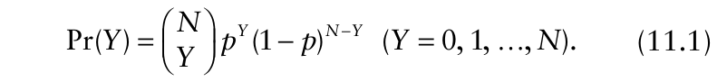{.equation width=60%}

Jones (1994a) discusses a decision guideline for fungicidal control of eyespot disease of wheat (at the time, the causal pathogen was referred to as _Pseudocercosporella herpotrichoides_). Treatment was thought likely to be worthwhile if ≥20% of tillers were affected at growth stage 30–31 (Jones, 1994a, Table 11). Accordingly, the advice was that a sample of tillers was to be collected at the appropriate growth stage and a decision on treatment then made on the basis of the percentage of tillers affected by eyespot disease in the sample, in relation to the specified threshold criterion. In practice, decision making was based on a two-stage cluster sampling procedure (section 9.4.10), used to collect a sample of 50 tillers (Goulds and Polley, 1990). Here, the example just serves to motivate a general discussion of disease control decision making based on sampling. What follows is not intended to relate to eyespot disease management.

We consider, in the first instance, a random sample of _N_ = 10 tillers. We will assume here that disease assessments of individual tillers are carried out without error, and that the plant population is sufficiently large that calculations can be based on the binomial distribution. In this example, with sample size of _N_ = 10 and an acceptance number _C_ = 2, a crop will be left untreated if there are two or fewer affected tillers in the sample, and will be treated if there are more than two affected tillers in the sample. This is therefore a (10,2) sampling plan. The probability of acceptance, Pr(_A_), is the probability that the observed number of infected tillers, _Y_, is less than or equal to _C_. The OC curve for the plan is then:

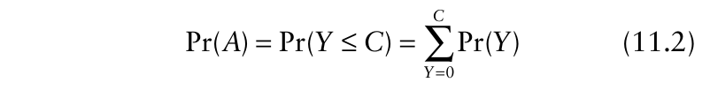{.equation width=60%}

where Pr(_Y_) is based on the binomial distribution (equation 11.1). This is illustrated in Fig. 11.2.

Fig. 11.2A shows the binomial OC curve for a (10,2) sampling plan. Fig. 11.2B–D exemplify the calculations on which this OC curve is based. Fig. 11.2B shows the binomial distribution (equation 11.1) with _N_ = 10 and _p_ = 0.1. For this distribution, Pr(_Y_ = 0) = 0.35, Pr(_Y_ = 1) = 0.39 and Pr(_Y_ = 2) = 0.19. Therefore, Pr(_Y_ ≤ 2) = 0.35 + 0.39 + 0.19 = 0.93, and this is the probability of acceptance, Pr(_A_), when _p_ = 0.1 in Fig. 11.2A (point marked B). At this point, _p_ < _p_ CRIT and Pr(_A_) is fairly close to one. Fig. 11.2C shows the binomial distribution (equation 11.1) with _N_ = 10 and _p_ = 0.2. For this distribution, Pr(_Y_ = 0) = 0.11, Pr(_Y_ = 1) = 0.27 and Pr(_Y_ = 2) = 0.30. Therefore, Pr(_Y_ ≤ 2) = 0.11 + 0.27 + 0.30 = 0.68, and this is the probability of acceptance, Pr(_A_), when _p_ = 0.2 in Fig. 11.2A (point marked C). At this point, _p_ = _p_ CRIT and Pr(_A_) is fairly close to 0.5. Fig. 11.2D shows the binomial distribution (equation 11.1) with _N_ = 10 and _p_ = 0.4. For this distribution, Pr(_Y_ = 0) = 0.01, Pr(_Y_ = 1) = 0.04 and Pr(_Y_ = 2) = 0.12. Therefore, Pr(_Y_ ≤ 2) = 0.01 + 0.04 + 0.12 = 0.17, and this is the probability of acceptance, Pr(_A_), when _p_ = 0.4 in Fig. 11.2A (point marked D). At this point, _p_ > _p_ CRIT and Pr(_A_) is fairly close to zero.

It can be seen (Fig. 11.2A) that the OC curve defined by equation 11.2 characterizes Pr(_A_) as a decreasing function of _p_. In this particular example, with a binomial (10,2) acceptance sampling plan, it is approximately the case that Pr(_A_) ≥ 0.93 when _p_ ≤ 0.1, and Pr(_A_) ≤ 0.05 when _p_ ≥ 0.5. Thus there is a high probability of lot acceptance at low values of _p_ and a low probability of lot acceptance at high values of _p_, which is as we require it. We can be confident that we are making the right decision to accept a lot (i.e., not apply control measures) when the sample estimate of _p_, _<u>y</u>_, is less than or equal to 0.1 (i.e., the sample of 10 tillers has zero or one diseased), and that we are making the right decision to reject a lot (i.e., apply control measures) when _<u>y</u>_ is greater than or equal to 0.5 (i.e., the sample of 10 tillers has five or more diseased). For sample values 0.1 < _~~y~~_ < 0.5, we cannot be as confident that we are making the right decision. The decision rule is that a crop will be left untreated if there are two or fewer affected tillers in the sample, and will be treated if there are more than two affected tillers in the sample. However, the probabilities of erroneously accepting a lot (i.e., not applying control measures where they were actually required) or of erroneously rejecting a lot (i.e., applying control measures where they were actually not required) are higher in this intermediate range of _<u>y</u>_ (where the sample of 10 tillers has two, three or four diseased).

![Derivation of an operating characteristic curve, illustrated for a (10,2) sampling plan based on the binomial distribution. **(A)** The OC curve for a (10,2) sampling plan. The probability of acceptance, Pr(_A_), is the probability that the observed number of infected tillers (out of 10 in the sample), _Y_, is less than or equal to the acceptance number _C_ = 2. **(B)** The binomial distribution (equation 11.1) with _N_ = 10 and _p_ = 0.1. For this distribution, Pr(_Y_ = 0) = 0.35, Pr(_Y_ = 1) = 0.39 and Pr(_Y_ = 2) = 0.19. Therefore, Pr(_Y_ ≤ 2) = 0.35 + 0.39 + 0.19 = 0.93, and this is the probability of acceptance, Pr(_A_), when _p_ = 0.1 in Fig. 11.2A (point marked B). **(C)** The binomial distribution (equation 11.1) with _N_ = 10 and _p_ = 0.2. For this distribution, Pr(_Y_ = 0) = 0.11, Pr(_Y_ = 1) = 0.27 and Pr(_Y_ = 2) = 0.30. Therefore, Pr(_Y_ ≤ 2) = 0.11 + 0.27 + 0.30 = 0.68, and this is the probability of acceptance, Pr(_A_), when _p_ = 0.2 in Fig. 11.2A (point marked C). **(D)** The binomial distribution (equation 11.1) with _N_ = 10 and _p_ = 0.4. For this distribution, Pr(_Y_ = 0) = 0.01, Pr(_Y_ = 1) = 0.04 and Pr(_Y_ = 2) = 0.12. Therefore, Pr(_Y_ ≤ 2) = 0.01 + 0.04 + 0.12 = 0.17, and this is the probability of acceptance, Pr(_A_), when _p_ = 0.4 in Fig. 11.2A (point marked D).](figures/fig11-img02.png){#fig-11-2}

An OC curve based on a cumulative distribution function (e.g., equation 11.2) characterizes the average performance of a sampling plan. An OC curve simulation can be used to provide a graphical plot of Pr(_A_) against _p_ that illustrates the likely extent of variability around the average. Using MATHCAD software, a simple small-scale simulation of the (10,2) sampling plan discussed above was carried out (Fig. 11.3). The OC curve for the (10,2) sampling plan calculated using equation 11.2 characterizes the average performance of sampling carried out according to this plan.

![Simulation of a (10,2) sampling plan. A sample comprised 10 numbers drawn from a binomial distribution (equation 11.1) with _N_ = 1 and a specified value of _p_. Thus, the numbers drawn were either 0 or 1. For each specified value of _p_, 100 such samples were drawn and the proportion of samples for which the sum of the numbers drawn was ≤2 calculated, as an estimate of Pr(_A_). This procedure was repeated five times, so that at each specified value of _p_ there were five values of Pr(_A_), each based on 100 samples of 10 random numbers. The specified values of _p_ were 0.1, 0.2, 0.3, 0.4, 0.5, 0.6, 0.7, 0.8, and 0.9. The results show the correspondence between the OC curve for the (10, 2) sampling plan calculated using equation 11.2 (the solid line) and the results of the simulation based on the same plan (shown as data points).](figures/fig11-img03.png){#fig-11-3}

The results of the simulation of sampling based on the same plan illustrate typical performance of the plan in application.

Note that although the OC curve for the (10,2) sampling plan has Pr(_A_) near 1 when _p_ is much smaller than _p_ CRIT and Pr(_A_) near 0 when _p_ is much larger than _p_ CRIT, the proximity of Pr(_A_) to 0.5 when _p_ = _p_ CRIT (= _C_ / _N_) could be questioned. For binomial OC curves, Pr(_A_) is not necessarily equal to 0.5 when _p_ = _p_ CRIT (= _C_ / _N_) because _C_ and _N_ are both integers and the binomial is a discrete probability distribution. It is possible to design acceptance sampling plans based on discrete distributions that meet the criterion that Pr(_A_) = 0.5 when _p_ = _p_ CRIT, at least to a reasonable approximation (sections 11.3.2 and 11.3.3). However, such plans will not, in general, have the property _C_ / _N_ = _p_ CRIT.

### 11.2.5 The hypergeometric distribution

The binomial distribution is often appropriate as a basis for acceptance sampling plans for disease incidence. However, if we are in a situation that involves sampling from small populations (e.g., Hughes and Gottwald, 2001), we have recourse to the hypergeometric distribution. As noted in Chapter 10, the hypergeometric distribution is the exact statistical model when sampling without replacement. The hypergeometric probability of _Y_, the number of plants, or plant parts, diseased (out of a total of _N_), is given by:

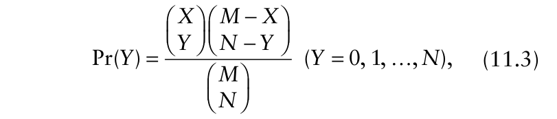{.equation width=60%}

where the notation is as in section 11.2.4. If desired, Pr(_Y_) can be written as a function of _p_ by substituting _Mp_ (rounded to an integer value if necessary) for _X_ (the actual number diseased in the population) in the expression on the right-hand side. As before, the probability of acceptance, Pr(_A_), is the probability that the observed number of infected plants or plant parts, _Y_, is less than or equal to the acceptance number, _C_. The OC curve is given by equation 11.2:

{.equation width=60%}

but now with Pr(_Y_) based on the hypergeometric distribution (equation 11.3). If the sample size, _N_, is less than about 10% of the population size, _M_, the difference between the hypergeometric- and binomial-based OC curves for a given (_N_, _C_) plan is small.

Fig. 11.4 shows OC curves for three hypergeometric sampling plans with the property _C_ / _N_ = _p_ CRIT = 0.2: (10,2) with population size _M_ = 50, (20,4) with _M_ = 100, and (100, 20) with _M_ = 500. For all three plans, the sample size (_N_) is the same proportion of the population size (=0.2). The important point to note is that sampling plans that have sample sizes set as a constant proportion of a varying population size do _not_ have the same OC curve. If the objective were to sample from a series of small populations in such a way that the same (average) rate of misclassification errors occurred as population size varied, keeping sample size as a constant proportion of population size would not be an appropriate method of achieving this. The calculation of sample sizes for sampling plans that fulfill this objective is discussed in section 11.3.

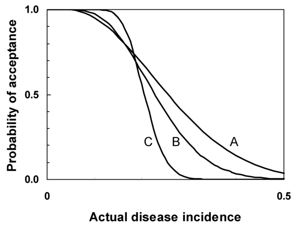{#fig-11-4}

### 11.2.6 Inspection errors in simple random sampling

Misclassification errors occur when control measures are withheld from a crop that really required them, or when they are applied to crops that really did not require them. Inspection errors occur when an individual plant or plant part is wrongly assessed. Plants that are healthy may be assessed as diseased, and plants that are diseased may be assessed as healthy (section 10.3.2). Here, however, we consider only the latter type of inspection error. The analysis is based on the hypergeometric distribution (section 11.2.5), but now there is a proportion of diseased individuals, denoted ζ, erroneously recorded as healthy. As before, _Y_ is the number of plants, or plant parts, diseased out of a total of _N_ in the sample. Now, however, the number of plants assessed as diseased in the sample (_Z_) is not the same as _Y_ (unless ζ = 0). The probability distribution of _Z_ is:

(_Z_ = 0, …, _N_) (Johnson et al., 1980). Although quite tedious to work with using a calculator, equation 11.4 is easy to utilize with MATHCAD and similar mathematics computer programs. The probability of acceptance, Pr(_A_), is the probability that the observed number of plants assessed as diseased, _Z_ (including those actually diseased and those erroneously assessed as diseased), is less than or equal to the acceptance number, _C_. The OC curve is given by:

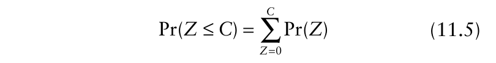{.equation width=60%}

with Pr(_Z_) based on equation 11.4.

Fig. 11.5 shows OC curves for two (50,2) sampling plans, both with _M_ = 100, one based on equation 11.3 (i.e., the hypergeometric distribution with no inspection errors) and the other based on equation 11.4 (i.e., a “faulty inspection” distribution incorporating a proportion, ζ = 0.05, of diseased individuals erroneously recorded as healthy). The OC curve based on equation 11.4 is shifted to the right, compared with the OC curve based on equation 11.3. This is discussed further in section 11.3.3. Johnson et al. (1991) give a comprehensive account of the analysis of inspection errors in attributes such as disease incidence (including more details of statistical probability distributions), and Suich (1990) discusses the impact of inspection errors on the OC curve. Hughes et al. (2002b) provide a phytopathological example.

## 11.3 Designing a Sampling Plan with a Specified OC Curve

Up to now, we have used OC curves to describe sampling plans, given the sample size and acceptance number

{#fig-11-5}

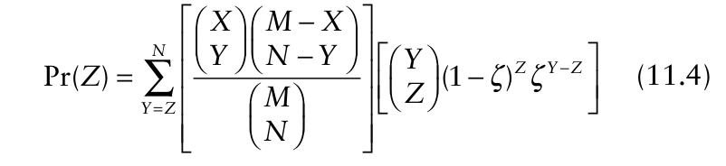{.equation width=60%}

(or critical incidence) of the plan in question (and if necessary, the population size). Of greater interest, possibly, is the problem of designing an acceptance sampling plan with a specified OC curve, such that the sample size and the acceptance number can be calculated and used in practical decision making (Hamaker, 1949). In this section we consider sampling plans that have an acceptance number _C_ ≥ 1. Sampling plans with _C_ = 0 are a special case, and are discussed separately in section 11.4.

### 11.3.1 Plans based on the producer’s and consumer’s risks

We have already used the term risk colloquially, to refer to the chance of a crop suffering damage or loss as the result of pathogen attack. As used here, a _risk_ is synonymous with a probability, carrying the connotation that the probability in question is that of an undesirable outcome. The use of the term risk in this way has the advantage of being consistent with usage both in the acceptance sampling literature (e.g., Montgomery, 1997) and in epidemiology (e.g., Selvin, 1996; Lui, 2004). However, we recognize that our adopted usage carries a risk that followers of, for example, Kammen and Hassenzah (1999) may be somewhat disorientated.

A single point—a value of _p_ CRIT and the corresponding value of Pr(_A_)—is not sufficient to specify an OC curve, but two such points will do. The specification of an OC curve based on two points is an approach often used in industrial quality control. We think this approach has relatively little application in crop protection decision making, but nevertheless include a brief outline for reference. Any two points can be used for the specification, but typically, the points of view of a notional producer and a notional consumer are adopted. The idea is that the producer is concerned only that the acceptable lots (those with a [low] true proportion defective of _p_ 1 or less) are accepted with high probability, denoted here 1 −α (thus α is a [low] rate of misclassification of acceptable lots as unacceptable, referred to as the _producer’s risk_). On the other hand, the consumer is concerned only that unacceptable lots (those with a [high] true proportion defective of _p_ 2 or more) are accepted with low probability, denoted here β (thus β is a [low] rate of misclassification of unacceptable lots as acceptable, referred to as the _consumer’s risk_). Using the binomial OC curve as an example, the two risk points can be specified:

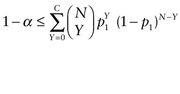

{.equation width=60%}

Because the binomial is a discrete probability distribution, the specification must be given in terms of inequalities, otherwise there may be no corresponding OC curve. The task then is to find an _N_ and a _C_ that satisfy these inequalities, for given α, β, _p_ 1, and _p_ 2 (Hald, 1967, Guenther, 1973). However, this is not the most straightforward way to apply acceptance sampling methodology in disease management decision making when using a fixed sample size. In plant health decision making for field crops, (implicit) reference is usually made to a single risk point on the OC curve, where Pr(_A_) = 0.5. For plant health decision making in a quarantine context, where an exporter (producer) and an importer (consumer) are involved, acceptance sampling plans based on two agreed risk points may find application. Even here, however, the usual tendency is to adopt one point of view or the other (e.g., Baker et al., 1990; Harte et al., 1992; Cannon, 1998).

### 11.3.2 Plans based on the indifference quality level

In the terminology of acceptance sampling, the _indifference quality level_ (IQL) is the point on the OC curve at which Pr(_A_) = 0.5. Specification of a value of _p_ CRIT for which the corresponding value of Pr(_A_) = 0.5 is analogous to the specification of a decision threshold in disease management (see section 11.2.3), so this approach is likely to be more widely applicable than the two-point method outlined in section 11.3.1. However (again using the binomial OC curve as an example), the specification: is not enough, by itself, to enable us to find values of _N_ and _C_ for an acceptance sampling plan with a particular OC curve. Additionally, the relative slope of the OC curve at the IQL can be specified (Hamaker, 1950; Chakraborty, 1990). While this would be enough to enable values of _N_ and _C_ to be calculated for an acceptance sampling plan with a particular OC curve, specification of a value for the relative slope of the OC curve at the IQL is not a task for which many plant pathologists are equipped.

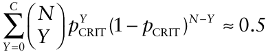

Here, we will adopt the IQL approach to specify a value of _p_ CRIT for which the corresponding value of Pr(_A_) = 0.5, but not aim to define values of _N_ and _C_ for an acceptance sampling plan with a particular OC curve. Instead, we will specify a range of values of _C_ and calculate the corresponding range of values of _N_. This approach yields a family of OC curves, for all of which Pr(_A_) ≈ 0.5 at the adopted decision threshold, while the (negative) slope of the OC curve at the decision threshold increases with sample size. We apply here some useful approximation formulae, details of which can be found in Hald (1981). Remember that the sample size _N_ and acceptance number _C_ must be integers, so solutions to equations may require rounding. In sample size calculations, non-integer values of _N_ are usually rounded up to the nearest whole number above.

For a binomial OC curve:

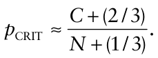

In practice, this is usually further approximated to:

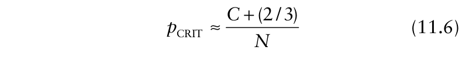{.equation width=60%}

from which, given values of _p_ CRIT and _C_, values of _N_ can be found from: increases. Thus, as sample size increases, the OC curve for the sampling plan resembles more closely the ideal OC curve (Fig. 11.1). A sampling plan that produces relatively few misclassification errors is characterized by an OC curve with a steeper (negative) slope at the adopted decision threshold. In acceptance sampling, a reduction in misclassification errors is thought of as an increase in accuracy. Thus increasing sample size has the effect of increasing accuracy, which is a natural result.

For a hypergeometric OC curve:

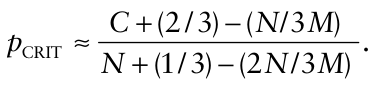

In practice, this is usually further approximated to:

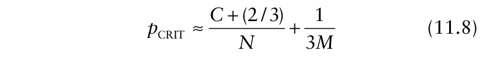{.equation width=60%}

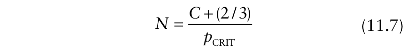{.equation width=60%}

For example, the sample sizes for binomial sampling plans with _p_ CRIT = 0.05 and _C_ = 1, 2, 3, 4, and 5 are calculated as _N_ = 34, 54, 74, 94, and 114, respectively. The OC curves for the binomial sampling plans (34,1), (74,3), and (114,5) are shown in Fig. 11.6. The design criterion that Pr(_A_) = 0.5 at the adopted decision threshold of _p_ CRIT = 0.05 is observed, at least to a reasonable approximation. It can be seen from Fig. 11.6 that as the sample size increases, the (negative) slope of the OC curve at the adopted decision threshold from which, given values of _M_, _p_ CRIT and _C_, _N_ can be found from:

{#fig-11-6}

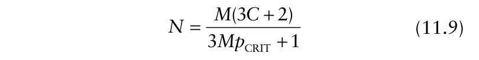{.equation width=60%}

For example, the sample sizes for hypergeometric sampling plans with _M_ = 100, _p_ CRIT = 0.05 and _C_ = 1, 2, 3, and 4 are calculated as _N_ = 32, 50, 69, and 88, respectively. The sample sizes for hypergeometric sampling plans with _M_ = 200, _p_ CRIT = 0.05, and _C_ = 1, 2, 3, 4, and 5 are calculated as _N_ = 33, 52, 71, 91, and 110, respectively. Thus, the calculated hypergeometric sample sizes (for finite population size) are somewhat smaller than those calculated for an indefinitely large population size, based on the binomial distribution, as one would expect. Note that equations 11.7 and 11.9 indicate that lower values of _p_ CRIT lead to higher values of sample size, _N_, other things being equal.

A question of particular interest is how to sample from different size lots yet keep the same OC curve (so that Pr(_A_) = 0.5 at the adopted decision threshold, and the rate of misclassification errors does not change). Hamaker (1959) provides a simple approximate solution, based on equations 11.6 and 11.8. The notation is expanded here, so that a binomial sampling plan is characterized by its sample size and acceptance number as (_N_ b, _C_ b) and a hypergeometric sampling plan is similarly characterized by (_N_ h, _C_ h). If we equate the right hand sides of equations 11.6 and 11.8, and solve for _N_ h, we obtain, for given _N_ b, _C_ b, and _M_:

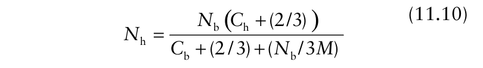{.equation width=60%}

If _C_ h is chosen such that _N_ h > _MN_ b /(_M_ + _N_ b) (it is the smallest such _N_ h that is of interest), we can use equation 11.10 to calculate sample sizes for different size lots while maintaining (to a reasonable approximation) the same OC curve. For example, the hypergeometric sampling plans (32,1) for _M_ = 100, (52,2) for _M_ = 200, and (53,2) for _M_ = 300, 400, and 500 all have OC curves close to the OC curve for a binomial (54,2) sampling plan (with Pr(_A_) ≈ 0.5 at the adopted decision threshold of _p_ CRIT = 0.05) (Fig. 11.7). In the case of the hypergeometric (32,1) sampling plan for _M_ = 100, _N_ h = 32 is slightly smaller than _MN_ b /(_M_ + _N_ b) ≈ 35, but visual inspection shows the OC curve to be acceptable.

### 11.3.3 Finding a sampling plan by iteration

An interactive spreadsheet-based approach to the formulation of sampling plans with specified OC curves is presented by Ng (2003). Hughes and Gottwald (2001) used an iterative searching routine (using MATHCAD software) to calculate hypergeometric sample sizes. For IQL sampling plans, this involves finding values of _N_ such that:

{.equation width=60%}

for specified values of _M_ and _p_ CRIT, with _X_ = _Mp_ CRIT (taking the integer part). The acceptance number is specified as _C_ = _Np_ CRIT (again taking the integer part), which has the effect of restricting solutions to those where the incidence of infection in the sample is less than or equal to the incidence of infection adopted as the decision threshold, _p_ CRIT. TOL is some suitably small tolerance

{#fig-11-7}

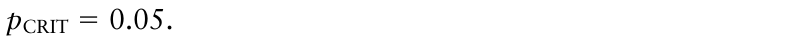{.equation width=60%}

level for deviations of realized values of Pr(_A_) from the required value of 0.5. To apply this method to calculate binomial sample sizes, we find values of _N_ such that:

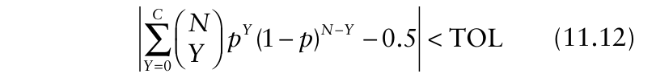{.equation width=60%}

in which _p_ is disease incidence in the population. The sample sizes calculated from equations 11.11 and 11.12 on setting _p_ CRIT = 0.05 and TOL = 0.01, so that all the resulting sampling plans have 0.49 ≤ Pr(_A_) ≤ 0.51 at the adopted decision threshold, are shown in Table 11.1. Sample sizes for population sizes up to and including 500 were calculated from the hypergeometric formula (equation 11.11), while sample sizes for the indefinitely large population were calculated from the binomial formula (equation 11.12). The values of _N_ (in the body of the table) are all close to the values calculated by the approximate methods given in section 11.3.2 (right after equation 11.9). Each column in Table 11.1 yields a family of (_N_, _C_) sampling plans that all maintain the same OC curve as population size changes, at least to a reasonable approximation. A family of sampling plans based on larger sample sizes (i.e., use of columns for higher acceptance numbers) will have an OC curve with a steeper (negative) slope at the adopted decision threshold than a family based on smaller sample sizes (i.e., use of columns for lower acceptance numbers). Note that maintaining the same OC curve as population size increases does not require the sample size to increase in proportion to population size (see Montgomery, 1997).

The value of the method outlined here is that it can be used when the cumulative distribution function on which the OC curve is based is known, but an approximate formula for _p_ CRIT as a function of _N_ is not available. For example, we may need to calculate the appropriate sample size when it is known that there is a aSample sizes for population sizes up to and including 500 were calculated from the hypergeometric formula (equation 11.11), while sample sizes for the indefinitely large population were calculated from the binomial formula (equation 11.12). proportion of diseased plants erroneously recorded as healthy. In this case, we find values of _N_ such that:

**Table 11.1.** Sample sizes, _N_ (in the body of the table), calculated from either equation 11.11 or 11.12, with _p_ CRIT = 0.05 and TOL = 0.01, for a range of sampling plans characterized by population size (_M_) and acceptance number (_C_)a .

|**_Plti_**||**_Acce_**|**_ptance nu_**|**_mber, C_**||
|---|---|---|---|---|---|
|**_opuaon_** **_size, M_**|**_1_**|**_2_**|**_3_**|**_4_**|**_5_**|
|100|31|50|69|87|–|
|200|32|51|71|90|109|
|300|32|52|71|91|110|
|400|33|52|72|91|111|
|500|33|52|72|92|111|
|±|33|53|73|93|112|

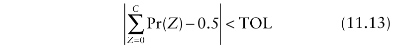{.equation width=60%}

with Pr(_Z_) given by equation 11.4, for specified values of _M_, _p_ CRIT and ζ (the proportion of diseased plants wrongly assessed as healthy). The acceptance number is specified as _C_ = _Np_ CRIT, and _X_ = _Mp_ CRIT (taking the integer parts of the right-hand sides of each expression). Setting _M_ = 200, _p_ CRIT = 0.05, ζ = 0.05 and TOL = 0.01, yields the following sampling plans: (34,1), (54,2), (74,3), (95,4), and (115,5). Thus with faulty inspection, larger sample sizes are required than for the corresponding sampling plans for error-free disease assessment, shown in Table 11.1.

It is of interest to consider these sample sizes for faulty inspections further, along lines suggested by Winkler (1985) and Pham-Gia and Turkkan (1992). The proportion of plants assessed as diseased (including both correct and incorrect assessments), denoted _<u>y</u>_, is related to the true proportion diseased, _p_, as follows: in which δ denotes the proportion of healthy plants wrongly assessed as diseased, assumed equal to zero in calculations here. (Estimation of disease incidence with inspection errors was previously discussed in section 10.3.2.) With an estimate _<u>y</u>_ based on a sample size _N_, _δ_ < _<u>y</u>_ < 1 − _ζ_, the maximum likelihood estimate of _p_ is:

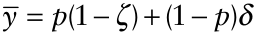

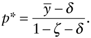

The sample size that would be required if disease assessment were error-free is denoted _N_ *, and the relationship between _N_ * and _N_, the required sample size taking account of inspection errors, is:

{.equation width=60%}

in which _k_ 1 = _δ_ /(1 − _ζ_ − _δ_), _k_ 2 = _ζ_ /(1 − _ζ_ − _δ_) and _N_ > _N_ *. Now, _N_ * can be thought of as an effective sample size (Cussens, 1996), taking into account the possibility of faulty inspections in disease assessment. In effect, we can calculate what our sample size _N_ is “worth” in terms of the size of a corresponding sample of error-free assessments. We find, in this case, that with _M_ = 200, _p_ CRIT = 0.05, and ζ = 0.05, the sample sizes _N_ of the (_N_, _C_) sampling plans (34,1), (54,2), (74,3), (95,4), and (115,5) have _N_ * values of 32, 51, 70, 90 and 109, respectively. These are (to a good approximation) the sample sizes of the (assumed error-free) hypergeometric sampling plans for _M_ = 200, _p_ CRIT = 0.05, given in Table 11.1.

If we specify a hypergeometric sampling plan for incidence of diseased plants, but disease assessment is not error-free, the OC curve of the actual plan in practice will be shifted to the right of that for the plan as specified. Suppose, for example, that a (50,2) plan is specified for _M_ = 100, so that _p_ CRIT = 0.05 when Pr(_A_) = 0.5 (Table 11.1). However, if there is a probability ζ = 0.05 that a diseased plant will be erroneously assessed as healthy, _p_ CRIT = 0.05 when Pr(_A_) = 0.55 (Fig. 11.4). The probability of acceptance has inadvertently been increased, with the outcome that more crops above the decision threshold will (wrongly) not be treated. The specified OC curve can be retrieved if the sample size calculated taking account of inspection errors is substituted for the calculated hypergeometric sample size. In the case of the example given in Fig. 11.4, the iterative solution of equation 11.13 for _N_, with _M_ = 100, _p_ CRIT = 0.05, _C_ = _Np_ CRIT (taking the integer part), and ζ = 0.05, is _N_ = 53. We then find from equation 11.14 that these 53 observations are worth 50 error-free observations. If the OC curve for a (53,2) sampling plan is calculated using equation 11.5 with _M_ = 100, _p_ CRIT = 0.05, _C_ = _Np_ CRIT (taking the integer part), and ζ = 0.05, it is indistinguishable from the original hypergeometric (50,2) plan specified for _M_ = 100, so that _p_ CRIT = 0.05 when Pr(_A_) = 0.5, as shown in Fig. 11.5.

## 11.4 Zero Acceptance Number Sampling Plans

Sometimes a low level of disease intensity carries a disproportionately high risk. Examples include some diseases of horticultural crops, where even a small amount of cosmetic damage can result in a large loss in value (e.g., de Jong, 1995), some diseases that are known to spread rapidly from initially low levels (e.g., Seem et al., 1985), and some diseases that are so destructive as to warrant strict regulatory control (e.g., Clayton and Slack, 1988). In such cases, control action is triggered by the detection of disease at any level in the sample. In acceptance sampling terms, the sampling plan has an acceptance number _C_ = 0. Squeglia (1994) discusses zero acceptance number acceptance sampling plans in an industrial quality control context, and Venette et al. (2002) include some discussion of the topic, from an entomological point of view, in their review. The main issue in designing sampling plans with _C_ = 0 is not what happens when a defective item is detected in the sample. Rather, it is what happens if the sample contains no defectives. If we think of individual plants in a crop being sampled for disease incidence under a zero acceptance number sampling plan, then finding a single diseased plant triggers whatever is the appropriate control action.

However, if disease incidence in the sample is zero, this does not necessarily mean that the crop is disease free.

### 11.4.1 The operating characteristic curve

The ideal, but unachievable, OC curve for a zero acceptance number sampling plan is characterized by:

{.equation width=60%}

It represents a situation in which all lots with zero defectives would be accepted, while all lots with any defectives at all would be rejected. Being realistic, we recognize that there is a chance that we may draw a sample such that _<u>y</u>_ = 0 (leading to acceptance of the lot) even when _p_ > 0, in which case the acceptance would be erroneous. Note that with a _C_ = 0 acceptance sampling plan, in the absence of inspection errors (specifically, healthy plants wrongly assessed as diseased) we cannot draw a sample that will lead us erroneously to reject a lot.

The OC curve for a _C_ = 0 acceptance sampling plan based on the binomial distribution is provided by equation 11.2 with _C_ = 0 and Pr(_Y_) from equation 11.1:

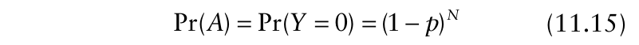{.equation width=60%}

Note, in passing, that this equation was used previously (section 10.3.3) as the basis for calculating a one-sided confidence interval for disease incidence for the situation in which no diseased plants are observed in a sample of size _N_. Fig. 11.8 shows OC curves calculated from equation 11.15 with three different sample sizes, _N_ = 400, 800, and 4800. This is essentially the same as Fig. 1a in Clayton and Slack (1988), where an extra curve (for _N_ = 1200) is shown. Because, in zero acceptance number sampling, any acceptance of a lot with _p_ > 0 is erroneous, Clayton and Slack (1988) refer to Pr(_A_) as the “probability of erroneous acceptance” (_PEA_). Clayton and Slack (1988) use the Poisson approximation for the zero term of the binomial distribution, − ≈ − _N_ exp(_Np_) (1 _p_) (reasonable for small _p_), and plot PEA = exp( − _Np_) as a function of _p_. When the acceptance number _C_ = 0, the OC curve has a different shape compared with OC curves for C > 0 (section 11.3). When _C_ = 0, there is no point of inflexion in the OC curve. Pr(_A_) decreases monotonically with increasing _p_. As the sample size, _N_, increases, the OC curve represented by equation 11.15 increasingly resembles the

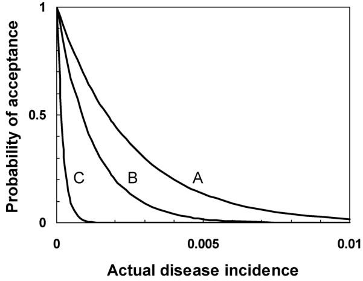{#fig-11-8}

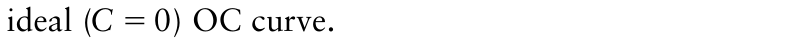{.equation width=60%}

If population size is such that a _C_ = 0 acceptance sampling plan should be based on the hypergeometric distribution, the OC curve is provided by equation 11.2 with

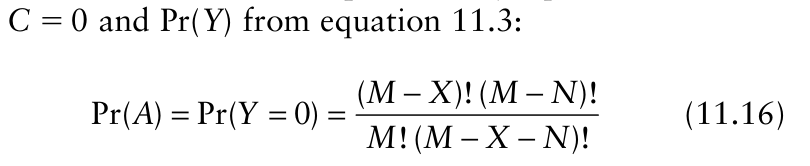{.equation width=60%}

in which _X_ = _Mp_ (rounded to an integer value if necessary). The OC curve for a _C_ = 0 acceptance sampling plan when inspection errors occur (such that a proportion of defective units are erroneously assessed as acceptable) is provided by equation 11.5 with _C_ = 0 (see, for example, Hughes et al., 2002b).

### 11.4.2 Sample size calculations

As we have noted, we cannot, on the basis of a sample in which no infected plants are found, say that there are no infected plants in the crop. Instead, what we would like to be able to do when no infected plants are found in a sample is make a statement that there is only a (small) specified probability that actual disease incidence exceeds a (low) specified level of incidence. Once we have decided on the specifications, we need to be able to calculate the sample size, _N_, that will enable us to make this statement when sampling is undertaken and no infected plants are found.

Equation 11.15 can be rearranged as:

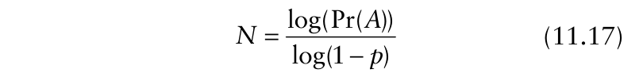{.equation width=60%}

in which Pr(_A_) and _p_ now represent particular specified values and _N_ is the corresponding sample size required to be able to make the statement that there is only a small probability Pr(_A_) that actual disease incidence exceeds the low specified level _p_. A phytopathological example is discussed by Clayton and Slack (1988), in relation to the problem of sampling for bacterial ring rot of potato (caused by _Clavibacter michiganensis_ subsp. _sepedonicus_). It is assumed here that disease assessments of individual tubers are carried out without error, that the population of tubers is sufficiently large so that calculations can be based on the binomial distribution and that the tubers inspected constitute a simple random sample of the population. It is desired that if the actual incidence of bacterial ring rot is 0.001, the probability that it will wrongly be concluded, on the basis of sampling, that a population of tubers is disease-free is at most 0.01. Then, using equation 11.17, _N_ = log(0.01)/log(1 − 0.001) = 4603 . The approximation Pr(_A_) = exp( − _Np_) , which is slightly conservative (i.e., results in a slightly larger sample size),

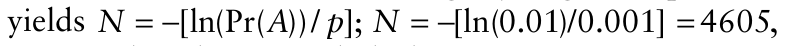{.equation width=60%}

as given by Clayton and Slack (1988).

Because equation 11.16 is difficult to manipulate, an approximation formula is usually used when a sample size is required for a hypergeometric _C_ = 0 acceptance sampling plan. Yamamura and Sugimoto (1995) give:

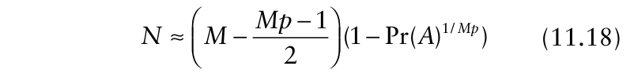{.equation width=60%}

which is slightly conservative compared to the exact result, while Kuno (1991b) gives:

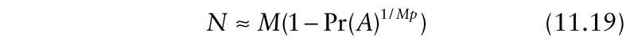{.equation width=60%}

which is slightly more conservative yet. In either case, to calculate a required sample size, _N_, we set a specified low probability that actual disease incidence exceeds a specified low level. With specified values Pr(_A_) = 0.01 and _p_ = 0.001, sample sizes calculated from both equation 11.18 and equation 11.19 for a range of population sizes, _M_, are given in Table 11.2. The sample size for an indefinitely large population (again with specified values Pr(_A_) = 0.01 and _p_ = 0.001) is based on equation 11.17. Note that equations 11.17, 11.18, and 11.19 all imply that specification of smaller values of Pr(_A_) and _p_ leads to larger values of _N_, the required sample size. In Table 11.2, the sample sizes based on equation 11.18 are the same as those given in Clayton and Slack (1988, Table 1).

**Table 11.2.** Sample sizes for some _C_ = 0 acceptance sampling

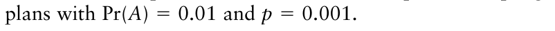{.equation width=60%}

|**_Population_** **_size, M_**|**_Sample size, N_** **_(equation 11.18)_**|**_Sample size, N_** **_(equation 11.19)_**|
|---|---|---|
|5000|3009|3010|
|10,000|3689|3691|
|25,000|4204|4206|
|100,000|4499|4501|
|500,000|4582|4585|
|1,000,000|4593|4595|
|±||4603a|

aBased on equation 11.17.

All the sample sizes in Table 11.2 produce the same OC curve (at least to a reasonable approximation), with Pr(_A_) = 1 when _p_ = 0, then decreasing monotonically towards the horizontal axis with increasing _p_, passing through the point Pr(_A_) = 0.01, _p_ = 0.001. It can be seen from Table 11.2 that although sample size increases with population size, the required sample size is not a constant proportion of the population size. As with sampling plans where _C_ ≥ 1 (section 11.2.5), it is important to bear in mind that calculating sample sizes as a constant proportion of a varying population size does _not_ maintain the same OC curve.

Sample size for a zero acceptance number sampling plan when inspection errors occur (such that a proportion of defective units are erroneously assessed as acceptable) is calculated in the same way as for a _C_ ≥ 1 sampling plan with inspection errors (section 11.3.3). A larger sample size is required, to compensate for the effect of inspection errors, but this can be calculated from equation 11.13 with _C_ = 0 (see, for example, Hughes et al., 2002b). Equation 11.14 allows calculation of the effective size (i.e., the corresponding number of error-free assessments) of a sample, taking into account the effect of inspection errors.

### 11.4.3 The mailroom problem

Mullin (1990), like Clayton and Slack (1988), discusses the problem of sampling for bacterial ring rot of potato. Mullin (1990) takes an extreme view (which, it turns out, is not very helpful) of the zero tolerance scenario. Consider a lot comprising _M_ = 200,000 potato tubers in which just one tuber is infected with ring rot (_X_ = 1). What is the probability that the infected tuber will be among a sample of _N_ = 500 tubers, drawn at random, without replacement, from the lot? Intuitively, this probability is simply the sampling fraction _N_ / _M_ = 500/200,000 or 0.0025. Working from the hypergeometric distribution (equation 11.3) with _M_ = 200,000, _N_ = 500, _X_ = 1 and _Y_ = 0, we have: or using equation 11.16:

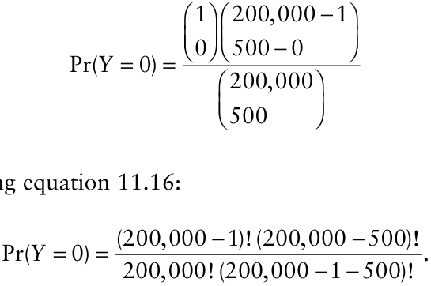

Either way, we obtain Pr(_Y_ = 0) = 0.9975. Since this is the probability that the sample does _not_ contain the infected tuber, the probability that the sample contains the infected tuber is equal to 1 − 0.9975 = 0.0025.

Further examples of the calculation of Pr(_Y_ = 0) for the hypergeometric distribution with _X_ = 1 are given by McSorley and Littell (1993, Table 1).

Now consider the problem a little more generally. We wish to test the null hypothesis that one or more tubers in the lot is infected, the alternative being that none are infected. We assume that no inspection errors occur. What sample size is required so that the probability that we will wrongly reject the null hypothesis is less than or equal to some (small) specified level, denoted α? In passing, note that we cannot wrongly accept the null hypothesis in the situation as described. Now, to calculate the required sample size, we must consider the worst case scenario, that there is indeed only _X_ = 1 infected tuber in the lot. Then, given a lot size _M_, we need a sample size _N_ such that:

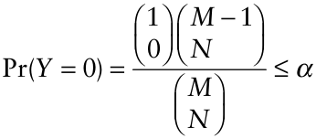

It turns out (see Wright, 1990) that this reduces to:

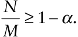

In practical terms this means that if α = 0.01 is specified, in order that we may state with 100(1 − _α_) = 99% confidence that the null hypothesis is rejected and the alternative accepted (no infected tubers having been found in the sample), we must sample 99% of the lot. This kind of sampling problem achieved some prominence when it became necessary to inspect distribution facilities of the US Postal Service for anthrax contamination, as discussed by Levy et al. (2002). The hypothesis testing scenario is unusual. Because of the undesirable consequences of not detecting infected tubers (or anthrax spores), we take the conservative null position that there are some infected tubers, and place the burden on the data to lead us to the conclusion that this is unlikely to be the case.

The large sample sizes required for high confidence or, alternatively, the low confidence obtained from small sample sizes, led Mullin (1990) to note, rather pessimistically, “the futility of relying on sampling inspection methods for quarantine disease control.” As we have already noted, no sampling plan provides a guarantee against misclassification errors. However, using acceptance sampling methods such as those discussed by Clayton and Slack (1988) and McSorley and Littell (1993), it is possible to formulate a plan that enables us to make a statement that there is only a specified small probability that actual disease incidence exceeds a specified low level of incidence, no infected units having been found in the sample (see section 11.4.2).

## 11.5 Sequential Sampling for Classification

Suppose we have a decision rule such that (ideally) crops with true disease incidence _p_ greater than a critical incidence _p_ CRIT will be treated (i.e., the generic terminology, these are unacceptable lots), and those with a true disease incidence of _p_ or less will not be treated (these are acceptable lots). From what we know about the general shape of OC curves for C ≠ 0 (e.g., Fig. 11.6), we might expect that if the true disease incidence is either substantially below or substantially above the adopted critical incidence, a relatively small sample would be sufficient to classify a crop accurately (i.e., with only a small chance of misclassification). The advantage of sequential classification methods is that they allow us to avoid the unnecessary sampling effort that may arise if a fixed sample size plan is applied to a crop where true disease incidence is either substantially below or substantially above the adopted critical incidence (Madden and Hughes, 1999a).

The widest use of acceptance sampling methods in the context of crop protection is, without doubt, in economic entomology. The methodology has been refined to facilitate the classification of pest population density in relation to decisions about the use of control measures using sequential binomial sampling for count data. This methodology is not without interest for plant pathologists (see, for example, Boivin et al., 1990), but we do not pursue it here. Instead, we refer interested readers to Binns et al. (2000) for a comprehensive account of the topic. Here, we describe sequential sampling applied to the classification of disease incidence data.

As with sequential estimation methods (section 10.12), sequential classification methods do not require specification of sample size ahead of sampling. Instead, sampling continues until a pre-specified stop condition has been met. In crop protection, the two methods of specifying stop conditions most widely used are based on Iwao (1975) (see, for example, Vincelli and Lorbeer, 1987; Gaunt and Cole, 1992; Copes et al., 2001), and on the sequential probability ratio test (SPRT) devised by Wald (1947). Binns (1994) gives a comparative account of the two methods. Here, we restrict our attention to the SPRT-based method, which is the basis for most of the modern applications of sequential classification both in crop protection and also in the wider context of statistical quality control.

### 11.5.1 Sequential classification with simple random sampling data

In section 11.2.3, we briefly drew attention to the analogy between sampling for classification and hypothesis testing. Consider classification based on a fixed sample size. In the case of a decision rule such that crops with true disease incidence _p_ greater than a critical incidence _p_ CRIT will be treated, and those with a true disease incidence of _p_ or less will not be treated, for instance, we observe the appropriate number of sampling units and then use the data to test the null hypothesis _H_ 0: _p_ ≤ _p_ CRIT against the alternative hypothesis _H_ 1: _p_ > _p_ CRIT. When _p_ CRIT ≠ 0, the test holds the possibility of two kinds of erroneous decisions: a Type I error (wrongly rejecting _H_ 0 when it is true) and a Type II error (wrongly accepting _H_ 0 when it is false).

Now, with sequential sampling for classification, a choice between _three_ possible decisions is required. After each sampling unit has been observed, we can either: (i) cease sampling and accept the null hypothesis; (ii) cease sampling and accept the alternative hypothesis; (iii) observe another sampling unit. To put this in hypothesis-testing terms, two new constants, _p_ 1 and _p_ 2 are invoked, such that _p_ 2 > _p_ 1 and (_p_ 1 + _p_ 2)/2 = _p_ CRIT . Then the null hypothesis is _H_ 0: _p_ = _p_ 1 and the alternative is _H_ 1: _p_ = _p_ 2. Acceptance of the null hypothesis is interpreted as _p_ ≤ _p_ CRIT, while acceptance of the alternative is interpreted as _p_ > _p_ CRIT. In the present context, sampling units are observed sequentially, and the cumulative total of those assessed as infected is recorded. The formulae for the stop conditions (i.e., the criteria for cessation of sampling) can be written in terms of _p_ 1 and _p_ 2 and two further constants, denoted α and β, that affect the characteristics of the OC curve (and so the rates of Type I and Type II errors, as discussed in more detail below). The OC curve of the sampling plan can be described in terms of _p_ 1, _p_ 2, α _,_ and β. Additionally, in sequential sampling for classification, it is of interest to know the _average sample number_ (ASN) of the sampling plan (because _N_ is not a fixed quantity). In the present context, the ASN curve is a graphical plot of the average number of sampling units required to reach a decision (i.e., to reach one of the specified stop conditions) for any true value of _p_. The ASN curve can also be described in terms of _p_ 1, _p_ 2, α _,_ and β.

OC and ASN curves based on Wald’s (1947) SPRT are approximations of the curves corresponding to sequential sampling plans as usually implemented in crop protection. Wald’s (1947) SPRT is based on an assumption that sampling stops when one of the specified stop conditions is reached _with no overshoot_. Since simple random sampling for disease incidence yields discrete data (the number of plants or plant parts diseased), and the stop conditions are specified in terms of numbers that are not necessarily integers (as discussed in the following paragraph), we cannot expect this assumption to be satisfied by a practical sequential sampling plan for disease incidence. The same is true, of course, for any sequential sampling plan that involves collection of discrete data. Another source of approximation arises because Wald’s (1947) SPRT was derived under the assumption that a sampling plan specifies neither an arbitrary minimum nor an arbitrary maximum number of sampling units to be observed. Most practical sequential sampling plans used in crop protection do in fact specify such limits. Realized OC and ASN curves and error rates for particular practical sequential sampling plans can be calculated by simulation (Binns et al., 2000). Here, we continue with the SPRT-based versions of OC and ASN curves, in order to illustrate some generic characteristics of sequential sampling plans.

For disease incidence data, the cumulative total number of sampling units assessed as infected is denoted _TN_. Sampling continues if, after observation of the previous sampling unit, _I_ low + _SN_ < _TN_ < _I_ high + _SN_ (see Binns, 1994, for a derivation) in which _I_ low, _I_ high, and _S_ are functions of _p_ 1, _p_ 2, α _,_ and β (Table 11.3, binomial distribution). _N_ is the number of sampling units assessed. Alternatively, the expressions on either side of the inequality can be thought of as formulae for two parallel straight lines on a graphical plot of _TN_ against _N_. These _stop lines_ represent the criteria for cessation of sampling (Fig. 11.9). If the lower line (_TN_ = _I_ low + _SN_) is intersected by a line representing the observed sample data, the appropriate decision is to cease sampling and accept the null hypothesis. If the upper line (_TN_ = _I_ high + _SN_) is intersected by a line representing the observed sample data, the appropriate decision is to cease sampling and accept the alternative hypothesis. Otherwise, sampling continues. Suppose that sampling commences and each sampling unit assessed in sequence is uninfected. Sampling would cease at the value of _N_ defined by the intersection of _TN_ = 0 and _TN_ = _I_ low + _SN_, that is, when _N_ ≥− _I_ low _S_.

**Table 11.3.** Calculation of the sequential probability ratio test stop criteria for sequential classification with simple random sampling data, for both the binomial and the normal distributiona .

|**_Distribution_**|**_S_**|**_I_low**|**_I_high**|
|---|---|---|---|
|Biil|1 2 (ln( / )) _q_ _q_|ln( /(1 )) _α_ β −|ln((1 )/ ) _α_ −β|
|noma|2 1 1 2 (ln( / )) _p q_ _p q_|2 1 1 2 ln( / ) _p q_ _p q_|2 1 1 2 ln( / ) _p q_ _p q_|
|Normal|1 2 ( ) _μ_ _μ_ +|2 ln( /(1 )) _Y__s_ _α_ β −|2 ln((1 )/ ) _Y__s_ _α_ −β|
||2|2 1 ( ) _μ_ _μ_ −|2 1 ( ) _μ_ _μ_ −|

> aThe cumulative total of sampling units assessed as infected is denoted _TN_. Sampling continues if, after observation of the previous sampling unit, _I_ low + _SN_ < _TN_ < _I_ high + _SN_ in which _I_ low, _I_ high, and _S_ are functions (as given in the table) of the appropriate constants that characterize the OC curve (as described in the text) and _N_ is the number of sampling units assessed. _q_ 1 = 1 − _p_ 1, _q_ 2 = 1 − _p_ 2.

![Sequential classification for simple random sampling data. For disease incidence data, the cumulative total number of sampling units assessed as infected is denoted _TN_. _N_ is the cumulative total number of sampling units assessed. Sampling units are observed sequentially, and the cumulative total of those assessed as infected is recorded. The criteria for cessation of sampling are characterized by two parallel straight lines (the stop lines). If the lower stop line (_TN_ = _I_ low + _SN_) is intersected by the line drawn for the observed data, the appropriate decision is to cease sampling and accept the null hypothesis (interpreted as _p_ ≤ _p_ CRIT). If the upper stop line _TN_ = _I_ high + _SN_ is intersected by the line drawn for the observed data, the appropriate decision is to cease sampling and accept the alternative hypothesis (interpreted as _p_ > _p_ CRIT). Otherwise, sampling continues. _I_ low, _I_ high, and _S_ are functions of _p_ 1, _p_ 2, α _,_ and β (Table 11.3, binomial distribution). The stop lines shown here correspond to an SPRT-based sequential sampling plan for disease incidence data, collected by simple random sampling, with _p_ 1 = 0.05,](figures/fig11-img18.png){#fig-11-9}

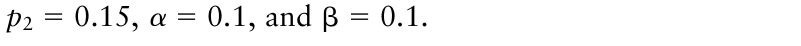{.equation width=60%}

If each sampling unit assessed in sequence is infected, sampling would cease at the value of _N_ defined by the intersection of _TN_ = _N_ and (_TN_ = _I_ high + _SN_), that is, when Thus, for an SPRT-based sequen- _N_ ≥ _I_ high(1 − _S_). tial sampling plan for disease incidence data collected by simple random sampling, a decision to cease sampling cannot be reached while _N_ is less than the minimum of − _I_ low/ _S_ and _I_ high/(1 − _S_) (Guenther, 1977). The corresponding OC and ASN curves may be calculated from the formulae given for the binomial distribution in Table 11.4. A dummy variable (denoted here _j_) is given values at intervals over a range between about −4 and +4 (note that different formulae are applicable when _j_ ≠ 0 and when _j_ = 0). Use of more values (i.e., shorter intervals) leads to smoother realizations of the OC and ASN curves. For a sequential sampling plan that involves collection of disease incidence data by simple random sampling, the formulae for the binomial distribution in Table 11.4 can be used to plot the OC curve (a graphical plot of OC(_j_) [the probability of acceptance] against _p_ (_j_)) and the ASN curve (a graphical plot of ASN(_j_) against _p_ (_j_)). The stop lines shown in Fig. 11.9 correspond to an SPRT-based sequential sampling plan for disease incidence data, collected by simple random sampling, with _p_ 1 = 0.05, _p_ 2 = 0.15, α = 0.1, and β = 0.1. The corresponding OC curve and ASN curve for this plan are shown in Fig. 11.10. The OC curve (Fig. 11.10A) shows that the probability of acceptance is high when _p_ < _p_ 1 and low when _p_ > _p_ 2. For values of _p_ between _p_ 1 and _p_ 2, the OC curve declines with increasing _p_. The probability of acceptance has a value ≈0.5 when _p_ = _p_ CRIT = (_p_ 1 + _p_ 2)/2 = 0.1. The ASN curve (Fig. 11.10B) shows that the average number of sampling units required for a decision to be reached is low when _p_ < _p_ 1 and when _p_ > _p_ 2. Between _p_ 1 and _p_ 2 the average number of sampling units required for a decision to be reached is higher. The maximum of the ASN curve (at 40 sampling units, for this example) occurs close to _p_ = _p_ CRIT = 0.1. The ASN curve shows the value of sequential classification: on average, relatively little sampling effort is required when _p_ is substantially below or above the critical incidence adopted as a threshold value.

A sampling plan for sequential classification can be fine-tuned by altering the specified values of α and β. For example, the stop lines shown in Fig. 11.11 correspond to an SPRT-based sequential sampling plan for disease

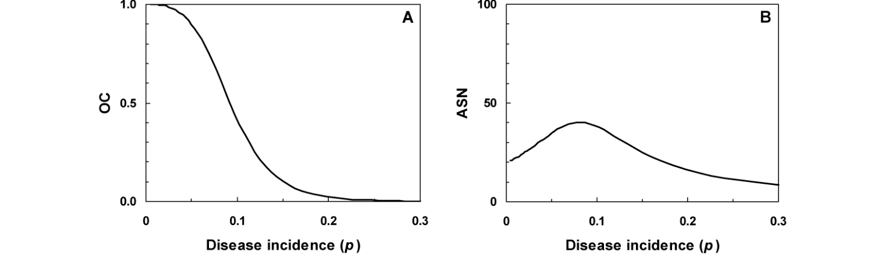{#fig-11-10}

**TABLE 11.4**. Sequential probability ratio test formulae for disease incidence (_p_), operating characteristic (OC), and average sample number (ASN) based on the binomial and normal distributionsa .

|**_Distribution_**|**_Disease incidence_**|**_OC curve_**|**_ASN curve_**|
|---|---|---|---|
|Binomial|2 1 (1 ( / ) ) () _j_ _q_ _q_ _pj_ − =|((1 )/ ) 1 OC() _j_ _j_ _α_ −β − =|ln( /(1 ))OC( ) ln((1 )/ )(1 OC( )) ASN( )       _j_ _j_ _j_ _α_ _α_ β − + −β − =|
||2 1 2 1   (( / ) ( / ) ) _j_ _j_   _p_ _p_ _q_ _q_  −| [((1 )/ ) ( /(1 )) ] _j_ _j_  _α_ _α_  −β −β −|2 1 1 2 2 1   ( )ln( / ) ln( / )  _p j_ _p q_ _p q_ _q_ _q_ +|
||1 2 (ln( / )) (0) _q_ _q_ _p_ =|ln((1 )/ ) OC(0) _α_ −β =|ln((1 )/ )ln( /(1 )) ASN(0) _α_ _α_ − −β β − =|
||2 1 1 2  (ln( / ))  _p q_ _p q_ |ln((1 )/ ) ln( /(1 )) _α_ _α_  −β − β −|2 1 1 2  ln( / )ln( / ) _p_ _p_ _q_ _q_|
|Normal|2 1 2 1 ( ( )) () _j_ _j_ _μ_ _μ_ _μ_ _μ_  + − − =|[((1 )/ ) 1] OC() _j_ _j_ _α_ −β − =|ln( /(1 ))OC( ) ln((1 )/ )(1 OC( )) ASN( ) _j_ _j_ _j_ _α_ _α_ β − + −β − =  |
|| 2  _μ_ | [((1 )/ ) ( /(1 )) ] _j_ _j_  _α_ _α_  −β −β −|2 2 1 1 2   [( 2 ( ))( )]/ 2 _Y_  _j_ _s_ _μ_ _μ_ _μ_ _μ_ _μ_   + − −  |
||2 1 ( ) (0) 2 _μ_ _μ_ _μ_ + =|ln((1 )/ ) OC(0) ln((1 )/ ) ln( /(1 )) _α_ _α_ _α_ −β = −β − β −|2 2 2 1 ln((1 )/ )ln( /(1 )) ASN(0) ( ) / _Y__s_ _α_ _α_ _μ_ _μ_ − −β β − = −|

> a _j_ is a dummy variable taking values at intervals over a range between about −4 and +4 (note that different formulae are applicable when _j_ ≠ 0 and when _j_ = 0). For a sequential sampling plan that involves collection of data by simple random sampling, the formulae can be used to plot the OC curve (a graphical plot of OC(_j_) against _p_ (_j_)) and the ASN curve (a graphical plot of ASN(_j_) against _p_ (_j_)). The various constants required to characterize the curves are described in the text. _q_ 1 = 1 − _p_ 1, _q_ 2 = 1 − _p_ 2.

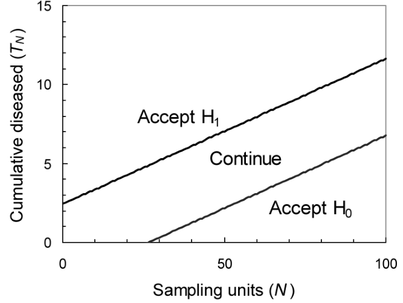{#fig-11-11}

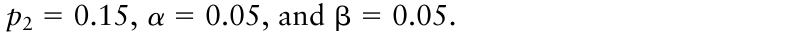{.equation width=60%}

incidence data, collected by simple random sampling, with _p_ 1 = 0.05, _p_ 2 = 0.15, α = 0.05 and β = 0.05. By comparison with Fig. 11.9, it can be seen that the effect of decreasing α and β is to widen the gap between the two stop lines (_p_ 1 and _p_ 2 being unchanged). The corresponding OC curve and ASN curve for the plan characterized by the stop lines shown in Fig. 11.11 are shown in Fig. 11.12. Both curves are qualitatively similar to those shown in Fig. 11.10, but differ in the quantitative detail. For values of _p_ between _p_ 1 and _p_ 2, the OC curve in Fig. 11.12A declines more steeply with increasing _p_ than the OC curve in Fig. 11.10A, and the ASN curve in Fig. 11.12B is higher than the ASN curve in Fig. 11.10B. For the example in Fig. 11.12B, the maximum of the ASN curve is at 71 sampling units. The overall effect of decreasing the specified values of α and β is to produce a sampling plan with, on average, decreased rates of misclassification errors that requires, on average, a larger sample size.

The constants α and β do not have to have the same value; their values can be altered independently. The effects of decreasing α while β remains unchanged are mainly (but not exclusively) to increase _I_ high (and so raise the upper stop line), and to raise the part of the OC curve where _p_ < _p_ CRIT (and so reduce the rate of Type I errors). The effects of decreasing β while α remains unchanged are mainly (but not exclusively) to decrease (i.e., make more negative) _I_ low (and so lower the lower stop line), and to lower the part of the OC curve where _p_ > _p_ CRIT (and so reduce the rate of Type II errors). Decreasing either α or β (or both) raises the maximum of the ASN curve.

### 11.5.2 Sequential classification with cluster sampling data

Disease incidence data are often collected by cluster sampling (section 10.5). For sequential classification in a cluster sampling scenario, the cumulative total of sampling units assessed as infected is, as before, denoted _TN_. Sampling continues if, after observation of the previous sampling unit, _I_ low + _SnN_ < _TN_ < _I_ high + _SnN_ in which _N_, as before, is the number of sampling units and _n_ is the number of elements per sampling unit (Madden and Hughes, 1999a). The simple random sampling scenario (section 11.5.1) is, in effect, cluster sampling with a cluster size of _n_ = 1. The expressions on either side of the inequality can be thought of as formulae for two parallel straight lines (slope _Sn_) on a graphical plot of _TN_ against _N_ (not _nN_). When the binomial distribution is an appropriate description of variability, _I_ low, _I_ high, and _S_ are functions of _p_ 1, _p_ 2, α _,_ and β as given (for the binomial distribution) in Table 11.3.

More often, disease incidence data collected by cluster sampling are aggregated, and the β-binomial distribution (section 9.4.5) and the power law (section 9.4.7) usually provide a better description of variability than the binomial distribution. β-Binomial-based formulae for SPRT stop lines are not available (Binns et al., 2000).

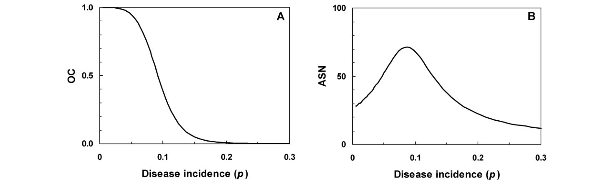{#fig-11-12}

Faced with this deficiency, Hoffman et al. (1996) and Nault and Kennedy (1996) used the binomial-based SPRT stop lines (for given values of _p_ 1, _p_ 2, α _,_ and β) and investigated the effect of aggregation using simulated β-binomial cluster sampling data. More aggregated data tended to generate less steep OC curves (i.e., more misclassification errors) and lower ASN curves (i.e., smaller sample sizes). This might be regarded as rather unsatisfactory: it happens because the binomial-based stop lines yield a “continue sampling” region on the graphical plot of _TN_ against _N_ that is too narrow for use with data that are, in fact, aggregated.

Instead, Madden and Hughes (1999a) developed SPRT stop lines for aggregated disease incidence data by assuming that mean disease incidence is (at least to a reasonable approximation) normally distributed. The formulae for SPRT stop lines based on the normal distribution (Table 11.3) can then be applied (with _μ_ 1 = _np_ 1 and _μ_ 2 = _np_ 2), provided an appropriate variance can be specified. Madden and Hughes (1999a) used a variance formula based on the power law (section 9.4.7):

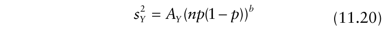{.equation width=60%}

in which_s_ _Y_ 2 is an estimate of the variance of the number of infected elements per sampling unit and _AY_ is related 2−2 _b_ to _A_ in equation 9.17 by _AY_ = _An_ (and _b_ is the same as _b_ in equation 9.17). The approximate β-binomial stop lines, based on the SPRT for the normal distribution (Table 11.3) and the power law variance formula (equation 11.20 with _p_ = _p_ CRIT) are then given by _TN_ = _I_ low + _SN_ and _TN_ = _I_ high + _SN_, in which:

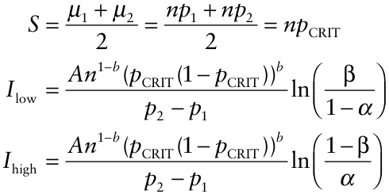

Note that if we wish to retain the same format as for the stop line formulae based on the binomial distribution with cluster sampling data (above), with _TN_ = _I_ low + _SnN_ and _TN_ = _I_ high + _SnN_, we write instead _I_ low and _I_ high are unaffected here. An example is shown in Fig. 11.13. Either way, for aggregated cluster sampling data (characterized by _A_ > 1, _b_ ≥ 1), these stop lines yield a “continue sampling” region on the graphical plot of _TN_ against _N_ that is wider than that provided by stop lines for random cluster sampling data (characterized by _A_ = 1, _b_ = 1) with the same values of _p_ 1, _p_ 2, α _,_ and β.

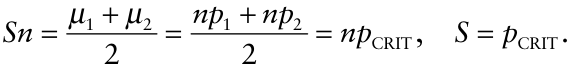

The effect of decreasing the specified values of α and β is to produce a sampling plan with, on average, decreased rates of misclassification errors that requires, on average, a larger sample size. This can be seen by reference to OC and ASN curves for the sampling plans in question. OC and ASN curves may be calculated from the formulae given for the normal distribution in Table 11.4, with_s_ _Y_ 2 specified as in equation 11.20. However, the analytical formulae for SPRT-based OC curves and ASN curves (Table 11.4) are not generally used for particular applications in crop protection (Binns et al., 2000). Instead, simulation is usually used to obtain these curves, based on the assumed (discrete) distribution of disease.

### 11.5.3 The need for simulation

One reason for the use of simulation methods to obtain OC and ASN curves is that for data that are discrete, formulae based on the normal distribution are approximations. Even when formulae for SPRT-based OC curves and ASN curves are based directly on an appropriate (discrete) statistical probability distribution, certain assumptions on which the derivations of the formulae are based can be difficult to justify in practice (see, e.g., Fowler and Lynch, 1987). It is also the case that in applications of SPRT-based methods in crop protection, decisions are usually based on a comparison of discrete data with continuous stop lines, and arbitrary stop conditions are often specified in addition to the SPRT-based stop lines (to prevent sampling either being stopped at a very small sample size, or being continued at very large sample sizes without prospect of stopping). The analytical formulae for SPRT-based stop lines, OC curves, and ASN curves given in Tables 11.3 and 11.4 therefore represent approximations of the characteristics of practical sampling plans. Simulation methods are usually used to derive and, where necessary, adjust practical sampling plans for sequential classification. Binns et al. (2000, Chapter 5) provide a step-by-step outline of an algorithm by which such simulation methods could be implemented.

Turechek et al. (2001) give details of development and implementation of a sequential sampling plan for classification of incidence of Phomopsis leaf blight of strawberry, including evaluation by means of simulation. The raw material for such a simulation comprises an appropriate statistical description for the disease data that will be collected by sampling (see Chapter 9) including, where necessary, adopted values of aggregation parameters. For disease incidence data, this will usually involve the binomial (section 9.4.2) or the β-binomial (section 9.4.5) distribution, or the empirical power law that relates observed and binomial variances (section 9.4.7). Together with the four constants _p_ 1, _p_ 2, α _,_ and β (section 11.5.1), the adopted statistical description for the disease data allows construction of initial SPRT-based stop lines (see Table 11.3). The simulation procedure itself involves specification of an appropriate range of (in the present context) true mean disease incidence. Random data sets are then generated, using the adopted statistical description (e.g., β-binomial), such that a large number of replicate data sets are obtained at each specified point in the range of (simulated) true mean disease incidence. Each random data set generated is a simulated sequential sample from a distribution with known characteristics (mean and, where necessary, aggregation parameters). Thus the approximation introduced by using the normal distribution to describe mean disease incidence is avoided.

![Sequential classification for cluster sampling data. The example here is based on previously determined power law parameters for Phomopsis leaf blight of strawberry (caused by _Phomopsis obscurans_): _AY_ = 2.48 (_A_ = 6.57) and _b_ = 1.18, with _n_ = 15 leaflets per sampling unit (Turechek et al., 2001). The stop lines were calculated with _p_ 1 = 0.2 and _p_ 2 = 0.3 (so that _p_ CRIT = 0.25). From these values, _S_ = 15 × 0.25 = 3.75, and the intercepts _I_ low and _I_ high are ±16.5 for α = β = 0.05 and ±12.5 for α = β = 0.10. One example data set is illustrated, where the first 10 observations obtained by sampling were 2, 0, 2, 3, 4, 3, 0, 2, 3, and 0 diseased leaflets per sampling unit. The corresponding cumulative values are shown in the upper part of the figure (as open circles), along with both pairs of stop lines. The cumulative total number of diseased leaflets exits the “continue sampling” region at _N_ = 7 for stop lines based on α = β = 0.10, leading to acceptance of the null hypothesis (i.e., _p_ ≤ 0.25). With the example data set, a decision would have been reached and sampling halted after the first seven sampling units had been observed, in sequence, in this case. However, for stop lines based on α = β = 0.05, the cumulative total number of diseased leaflets does not exit the “continue sampling” region until 10 sampling units had been observed, in sequence (again the appropriate decision is acceptance of the null hypothesis). The OC and ASN curves (lower left and lower right, respectively) were determined based on simulations from the β-binomial distribution with θ predicted by the binary power law parameters, and a minimum _N_ of 3 was imposed. As expected, the ASN curve was higher overall, and considerably higher near _p_ CRIT, for α = β = 0.05 than for α = β = 0.10. At values of _p_ below _p_ CRIT , the OC curve was higher for α = β = 0.05 than for α = β = 0.10; above _p_ CRIT, the converse was found. Thus, the (average) error rates were lower, as expected, when using α = β = 0.05 than when using α = β = 0.10 in deriving the stop lines, with the largest differences around _p_ 1 and _p_ 2. In such cases, a judgement would have to be made on whether the magnitude of the reduction in error rates justified the cost of the extra sampling required.](figures/fig11-img24.png){#fig-11-13}

Taking into account any arbitrary stop conditions additional to the specified stop lines, each simulated sequential sample is analyzed. The number of sampling units assessed in order to classify a sample, and the nature of the classification are recorded. At each specified point in the range of true mean disease incidence, the average number of sampling units assessed in order to classify a sample provides a point on the realized ASN curve. The number of times that disease incidence is classified as less than or equal to _p_ CRIT, expressed as a proportion of the total number of replications, provides a point on the realized OC curve.

The characteristics of the realized OC and ASN curves of the sampling plan can now be checked and, if necessary, adjusted to obtain a sampling plan that, on average, provides an acceptable combination of error rates and sample size. If the realized ASN curve is regarded as too high, α and/or β could be increased. This has the effect of narrowing the “continue sampling” region on the graphical plot of _TN_ against _N_ so that, on average, fewer sampling units are required for classification (at the cost of an increase in misclassification errors). If the realized OC curve is regarded as allowing too many misclassification errors, α and/or β could be decreased. This has the effect of widening the “continue sampling” region on the graphical plot of _TN_ against _N_ so that, on average, fewer misclassification errors are made (at the cost of more sampling units being required for classification). This is illustrated in Fig. 11.13.

Simulation provides a means of evaluating sampling plans for sequential classification based on Wald’s (1947) SPRT. This is an important aspect of the use of SPRT-based sequential methods in crop protection, since it overcomes discrepancies between theory and practice in sampling. We should not, however, lose sight of the fact that the simulation methodology itself requires assumptions, important among which are the statistical description adopted for the disease data to be sampled and the choice of critical incidence, _p_ CRIT. None of the preceding discussion of sequential classification methodology tells us whether an adopted value of _p_ CRIT is in fact the appropriate one for a particular crop protection decision making problem. Nyrop et al. (1998) discuss this issue with reference to OC and ASN curves.

## 11.6 Risk Algorithms as a Basis for Decision Making

“Disease forecasting”, “disease prediction”, and the development of “disease warning systems” are activities familiar to plant disease epidemiologists (see, e.g., Zadoks, 1984; Madden and Ellis, 1988; Campbell and Madden, 1990 [Chapter 15]; Hardwick 1998). It is clearly of interest, having identified the factors that lead to epidemics, to seek to use this information to provide a basis for the management of plant disease. However, in this section we do not review or evaluate any particular disease warning systems, the details of which tend to be pathosystem specific. Instead, we describe a generic approach to the decision making process as practised in plant disease management and introduce aspects of decision theory applicable to the problem.

### 11.6.1 Risk factors

So far, discussion of the decision making process has taken only a single _risk factor_ —disease intensity (assessed in some appropriate fashion)—into account when classifying a crop as requiring protection measures, or not. However, the level of risk to which a crop is exposed may be influenced by many factors, some beyond the control of those involved in crop production, and some that are integral components of crop production systems. Meteorological factors are the most obvious example of the former (e.g., D. A. Johnson et al., 1994), while Fry (1982) lists choice of crop and cultivar, sowing date and method, rate of fertilizer application, pesticide use, tillage type and frequency, irrigation method and frequency, harvesting method, and crop storage as examples of the latter.

The first step in the formulation of disease management strategy for any particular cropping system is to identify the most important risk factors among those on the long list of possible candidates. This is facilitated by basic epidemiological studies of pathogen life cycles, and an understanding of the way in which weather and cropping factors affect the level of initial inoculum and the rate at which progress through the life cycle proceeds. To be able to identify risk factors, we need information both on the candidate risk factors and on the definitive status of the crops in which they are studied. In the widely used terminology in such analyses, a crop that definitively required treatment is referred to as a _case_, one that definitively did not is referred to as a _control_. Note that the classification into cases and controls must be made independent of the risk factors that might be used as a basis for decision making. Typically, during the development stages of management strategies in crop protection, this is a retrospective classification of untreated crops based on yield or an end-of-season disease assessment.

_Example 11.1_. _Potato late blight_. D. A. Johnson et al. (1996, 1998) analyzed relationships between weather factors and epidemics of potato late blight (caused by _Phytophthora infestans_) in south-central Washington State. Their objective was to develop a forecasting model to aid in disease management at the regional scale. Using retrospective data from the study area over the period 1970–1994, D. A. Johnson et al. (1996, model 2) identified important risk factors for potato late blight in south-central Washington as follows: whether or not the previous year was an outbreak year; the number of days on which rain fell during April and May; and the total precipitation during May when the daily minimum temperature was ≤5°C. Any year in the study period in which late blight was confirmed in any field in the study area was classified as an outbreak year (these are the cases), otherwise a year was classified as a non-outbreak year (these are the controls). The procedures outlined for distinguishing between outbreak years and non-outbreak years are assumed to have been free of error.

_Example 11.2_. _Sclerotinia stem rot of oil seed rape_. Researchers at the Swedish University of Agricultural Sciences (Yuen et al., 1996; Twengström et al., 1998) analyzed relationships between weather, crop, and disease factors and epidemics of Sclerotinia stem rot of spring sown oil seed rape (caused by _Sclerotinia sclerotiorum_) in Sweden. Their objective was to develop a forecasting model to predict the need for fungicide applications, working at the field scale. Stepwise logistic regression procedures were used to identify risk factors. Twengström et al. (1998) identified six important risk factors for Sclerotinia stem rot of spring sown oil seed rape in Sweden, as follows: number of years since the previous oilseed rape crop; percentage disease incidence in the previous host crop; plant population density; rainfall in the previous two weeks; weather forecast; and regional risk for apothecium development.

Recall that the economic threshold (section 11.2.2) may be used to identify circumstances in which it is economically advantageous to adopt crop protection measures. The economic threshold is a discrete choice threshold: the only options are to apply crop protection measures or to withhold them. However, the choice between these two options must be made before it is known for sure whether or not a crop will sustain economic loss resulting from reductions in the quantity and quality of crop yield. In fact, the threshold that is actually of interest is the _economic injury level_ (Stern et al., 1959; Pedigo et al., 1986). In the present context, we can think of this as the lowest level of risk to which a crop is exposed that will result in economic damage. Unfortunately, by the time that economic damage can be measured directly, it is beyond prevention. The economic threshold is the level of risk exposure at which crop protection measures should be applied, in order to prevent the economic injury level from being reached. The economic threshold may be used as a basis for deciding whether or not crop protection measures are required, at a time when it is still possible to keep damage below the economic injury level. In the Sclerotinia stem rot study, data from about 800 fields, untreated with fungicide, were collected over a period of 10 years and used in the analysis. Retrospectively, the fields were divided into two groups: those with >25% diseased plants (these are the cases) and those with ≤25% diseased plants (these are the controls), 25% diseased plants having been identified as the economic injury level. Because a sampling procedure was used to assess % diseased plants, there is uncertainty attached to the classification of cases and controls. For this illustration we will, however, assume that cases and controls have been classified definitively and correctly.

### 11.6.2 Risk algorithms

Once the important risk factors have been identified, we need a way of combining them so that we can use data on risk factors to make a prediction of whether or not crop protection measures are required. We use the term _risk algorithm_ to refer to a calculation that combines data on identified risk factors in order to make an assessment of the need for crop protection measures. When such a calculation is based on statistical procedures, the term _statistical prediction rule_ (Swets et al., 2000) is synonymous. When the calculation is carried out by means of dedicated computer software, the term _decision support system_ is sometimes used. Risk-based disease warning methods such as BLITECAST (for potato late blight) and Mills tables (for apple scab) are examples of risk algorithms developed in plant disease epidemiology.

A risk algorithm characterizes the relationship between a binary response variable (i.e., the requirement for crop protection measures or otherwise) and one or more risk factors (i.e., the explanatory variables). Typically, a risk algorithm is formulated from a data set where the requirement for crop protection measures, or otherwise, has been assessed retrospectively (and so definitively) for a number of crops for which various risk factors thought likely to be related to disease intensity and/or crop yield reduction have also been measured. Formulation of a risk algorithm need not necessarily be based on a statistical analysis of the data, although it is increasingly the case that statistical analysis is used. Statistical methods used in the construction of risk algorithms include logistic regression analysis and discriminant function analysis.

The disease management decision-making problem can now be outlined as follows. We wish to classify crops as requiring protection measures, or otherwise. Because the objective is to use the crop protection measures to prevent disease from becoming a problem (e.g., to prevent the economic injury level being reached), we cannot measure this requirement directly. Instead, we predict the requirement, using data relating to the important risk factors, combined via a risk algorithm. The risk algorithm generates an _indicator variable_ (or, for brevity, simply an indicator) that provides a basis for a yes-or-no decision on the need for crop protection measures. Many decision-making problems in science, industry, and society can be characterized in this way (Swets et al., 2000).

_Example 11.1 continued_. _Potato late blight_. For the years of the study period 1970–1994, Table 11.5 shows values of the identified potato late blight risk factors: D. A. Johnson et al. (1996) used two different statistical methods, discriminant function analysis and logistic regression analysis, to combine these data. Press and Wilson (1978) provide a statistically orientated discussion of these methods. One advantage of logistic regression is that it is appropriate when there are risk factors that are discrete variables (i.e., not normally distributed) (Johnson et al., 1998). We reproduce both the analyses here, using MINITAB statistical software (Table 11.5).

A diagnostic test (or, for brevity, a test) comprises an indicator variable (or a set of indicator variables combined in some appropriate way) and a classification rule. For example, two tests are illustrated in Table 11.5. The first test is based on the linear discriminant functions for the non-outbreak years (DF1) and outbreak years (DF2). aLinear discriminant functions were calculated for the non-outbreak years (DF1) and outbreak years (DF2). A logistic regression analysis was calculated with the binary outcome variable _Outbreak Year_ (Yes or No) and the risk factors PYO, NDR _,_ and TPM. The estimated probability that a year is an outbreak year is _p_ ˆ. b DF1 = − 4.428 + 2.052 PYO + 0.863 NDR + 0.052 TPM. c DF2 = − 11.884 + 6.191PYO + 1.462 NDR − 0.033 TPM. d logit (_p_ ˆ) = − 7.554 + 3.556 PYO + 0.62 NDR − 0.0895 TPM . e _p_ ˆ = [1[+exexp(p( − 7.554− 7.554+ +3.5563.556PYOPYO+0.629+ 0.629NDRND R− 0.0895 TPM− 0.0895 TPM)])] .

**Table 11.5.** Risk factors for potato late blight as identified by D. A. Johnson et al. (1996): whether or not the previous year was an outbreak year (PYO, yes = 1, no = 0), the number of days rain during April and May (NDR), and the total precipitation (mm) during May when the daily minimum temperature was ≤5°C (TPM)a .

|**_Year_**|**_PYO_** **_0_**=**_No_** **_1_**=**_Yes_**|**_NDR_** **_(days)_**|**_TPM_** **_(mm)_**|**_DF1_** **b**|**_DF2_** **c**|**_DF2_**>**_DF1_** **_0_**=**_No_** **_1_**=**_Yes_**|**d** ˆ **_logit(p)_**|**e** ˆ**_p_**|**_0_**=**_No_** **_1_**=**_Yes_** ˆ > **_p_** **_0.5_**|**_Outbreak_** **_Year_** **_0_**=**_No_** **_1_**=**_Yes_**|
|---|---|---|---|---|---|---|---|---|---|---|
|1970|0|8|5.84|2.78|−0.38|0|−3.05|0.05|0|0|
|1971|0|9|6.86|3.69|1.04|0|−2.51|0.08|0|0|
|1972|0|9|47.29|5.79|−0.28|0|−6.13|0.00|0|0|
|1973|0|6|8.89|1.21|−3.41|0|−4.58|0.01|0|0|
|1974|0|16|7.37|9.76|11.26|1|1.84|0.86|1|1|
|1975|1|10|6.08|6.57|8.72|1|1.74|0.85|1|1|
|1976|1|12|3.30|8.15|11.74|1|3.25|0.96|1|1|
|1977|1|10|11.44|6.84|8.55|1|1.26|0.78|1|1|
|1978|1|11|14.99|7.89|9.89|1|1.57|0.83|1|0|
|1979|0|8|4.06|2.68|−0.32|0|−2.89|0.05|0|0|
|1980|0|13|37.84|8.75|5.87|0|−2.77|0.06|0|0|
|1981|0|8|18.54|3.44|−0.80|0|−4.18|0.02|0|0|
|1982|0|15|7.87|8.92|9.78|1|1.17|0.76|1|1|
|1983|1|9|11.86|6.00|7.07|1|0.60|0.65|1|1|
|1984|1|17|9.15|12.77|18.85|1|5.87|1.00|1|1|
|1985|1|5|11.43|2.53|1.24|0|−1.88|0.13|0|0|
|1986|0|8|8.13|2.90|−0.46|0|−3.25|0.04|0|0|
|1987|0|5|4.83|0.14|−4.73|0|−4.84|0.01|0|0|
|1988|0|15|11.93|9.13|9.65|1|0.81|0.69|1|0|
|1989|0|12|13.70|6.64|5.20|0|−1.24|0.22|0|0|
|1990|0|12|19.04|6.91|5.03|0|−1.71|0.15|0|1|
|1991|1|11|13.71|7.83|9.93|1|1.69|0.84|1|1|
|1992|1|12|0.51|8.00|11.83|1|3.50|0.97|1|1|
|1993|1|20|18.29|15.83|22.94|1|6.94|1.00|1|1|
|1994|1|16|25.15|12.73|16.87|1|3.81|0.98|1|1|

Using these discriminant functions and the values of the risk factors for the individual years, each year was classified either as an outbreak year (if DF2 > DF1) or a non-outbreak year (if DF2 ≤ DF1). The second test is based on a logistic regression analysis. The binary outcome variable was _Outbreak Year_ (Yes or No) and the risk factors were those given in the Table 11.5. Using the calculated logistic regression equation and the values of the risk factors for the individual years, each year was classified either as an outbreak year (ifor a non-outbreak year (if _p_ ˆ ≤ 0.5). Both tests correctly _p_ ˆ > 0.5 ) identified 11/12 outbreak years (cases) and 11/13 nonoutbreak years (controls). Results of this kind are often shown in a two-way table, as follows.

|**_Predicted status_****_a_**|**_True_** **_Outbreak_** **_year (cases)_**|**_status_** **_Non-outbreak_** **_year (controls)_**|
|---|---|---|
|Outbreak year ˆ 0.5 _p_> |11|2|
|Non-outbreak year ˆ 0.5 _p_≤|1|11|
|Total|12|13|
|aUsing logistic regression not|ation.||

In this example, whichever of the two methods of formulating a diagnostic test is used, most outbreak years are correctly classified (these are true positives) and so are most non-outbreak years (these are true negatives).

However, a small number of misclassification errors arise. Outbreak years wrongly classified as non-outbreak years are false negatives, while non-outbreak years wrongly classified as outbreak years are false positives. The true positive proportion (TPP) characterizes the proportion of outbreak years correctly classified. The true negative proportion (TNP) characterizes the proportion of non-outbreak years correctly classified. The false negative proportion is FNP = 1 − TPP, and the false positive proportion is FPP = 1 − TNP.

In this particular example, it turns out that discriminant function analysis and logistic regression analysis result in the same classification of years as either outbreak or non-outbreak, but such complete agreement is not inevitable. For the potato late blight data set, both methods of formulating a diagnostic test discussed above give TPP = 11/12 = 0.92 (FNP = 1/12 = 0.08) and TNP = 11/13 = 0.85 (FPP = 2/13 = 0.15). TPP is often referred to as the _sensitivity_ and TNP as the _specificity_ of a test. In the context of evaluation of a diagnostic test, sensitivity and specificity represent two kinds of accuracy, respectively, for cases and controls. Sensitivity (the number of true positives as a proportion of the total number of cases) and specificity (the number of true negatives as a proportion of the total number of controls) are independent of the proportions of cases and controls in a data set and can therefore be viewed as properties of a diagnostic test based on a risk algorithm. However, overall accuracy, calculated as the overall proportion (or percentage) of correct decisions, is _not_ an inherent property of the test. Except when sensitivity and specificity are equal, overall accuracy depends on the proportions of cases and controls in a data set: overall accuracy = TPP × proportion of cases + TNP × proportion of controls. For the potato late blight data in _Example 11.1_, over-

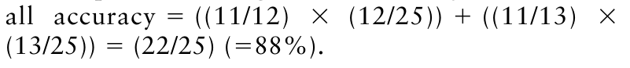{.equation width=60%}

_Example 11.3. Eyespot disease of wheat_. Jones (1994a) reported the results of trials carried out between 1983 and 1989 to investigate the efficacy and cost effectiveness of fungicidal control of eyespot disease of wheat. In an analysis of the properties of the indicator of requirement for fungicide application, data from crops at 58 sites were presented. The case and control subgroups were identified on the basis of the increase in yield resulting from prochloraz treatment at GS 30-31. For cases, this increase was ≥0.2 t/ha; for controls, this increase was <0.2 t/ha. The data set comprised 41 cases and 17 controls. In this example, this indicator variable is eyespot incidence at GS 30-31, with the threshold set so that the decision was to treat when ≥20% of tillers were affected, and not to tr eat when <20% of tillers were affected. Of the 41 cases, 28 had ≥20% tillers affected, so sensitivity is 28/41 = 0.68. Of the 17 controls, 7 had <20% of tillers affected, so specificity is 7/17 = 0.41. Overall accuracy, calculated from the overall proportion of correct decisions, was (28 + 7)/(41 + 17) or 60%. However, the assessment of accuracy from the proportion of correct decisions is problematic because in this case, the test is more accurate for cases than for controls (i.e., sensitivity > specificity), and there are more cases than controls in the data set. For comparison, consider the following hypothetical example. Of 58 crops, 19 are classified as cases and 39 as controls. Of the 19 cases, 13 are correctly identified by the test, so sensitivity is 13/19 = 0.68. Of the 39 controls, 16 were correctly identified by the test, so specificity is 16/39 = 0.41. This hypothetical data set thus comprises the same number of crops as the data set of Jones (1994a), and the sensitivity and specificity are the same as in that example. However, in this case, the overall accuracy is only (13 + 16)/(19 + 39) or 50% (compared with 60% above), because the proportion of cases in the hypothetical data set is lower than in the data set of Jones (1994a).

_Example 11.2 continued_. _Sclerotinia stem rot of oil seed rape_. Risk algorithms for Sclerotinia stem rot were based on logistic regression analysis (Yuen et al., 1996; Twengström et al., 1998). The binary outcome variable was “% Diseased Plants” (≤25% or >25%) and the risk factors were number of years since the previous oilseed rape crop (>6, 3–5, 1–2), percentage disease incidence in the previous host crop (0, 1–10, 11–30, 31–100), plant population density (low, normal, high), rainfall (mm) in the previous 2 weeks (<10, 10–30, >30), weather forecast (high, variable, or low pressure) and regional risk for apothecium development (0–5, 6–10, 11–100 apothecia per 100 sclerotia). The fitted logistic regression equation could be used to estimate the probability of exceeding the economic injury level (25% diseased plants). However, to enhance ease of use of the risk algorithm, the estimated regression coefficients were multiplied by six and then rounded to multiples of five (Twengström et al., 1998), to provide a simplified risk points scale (Table 11.6).

The risk points accruing to each individual crop may be accumulated to provide a risk score, and frequency distributions of risk scores plotted separately for crops with >25% diseased plants (cases) and crops with ≤25% diseased plants (controls) (Fig. 11.14). There is overlap between the two distributions in the range 25–60 risk points. This means that as an indicator variable for the need for fungicide application for Sclerotinia stem rot, the risk score does not provide perfect discrimination between the cases (crops retrospectively identified as requiring fungicide application) and the controls (crops retrospectively identified as not requiring fungicide application). Two questions arise.

**Table 11.6.** Risk factors for Sclerotinia stem rot of oil seed rape as identified by Twengström et al. (1998).

|**_Risk factor_**|**_Levels_**|**_Risk points_**|
|---|---|---|
|Number of years since |>6 years|0|
|previous oil seed|3–6 years|5|
|rape crop|1–2 years|10|
|Disease incidence in|None|0|
|previous host crop|Low (1–10%)|5|
||Moderate (11–30%)|10|
||High (31–100%)|15|
|Plant population|Low|0|
|density|Normal|5|
||High|10|
|Rainfall in previous|<10 mm|0|
|two weeks (mm)|10–30 mm|5|
||>30 mm|10|
|Weather forecast|High pressure|0|
||Variable|10|
||Low pressure|15|
|Regional risk for|0–5 apothecia|0|
|apothecium develop-|6–10 apothecia|10|
|ment (apothecia per 100 sclerotia)|11–100 apothecia|15|

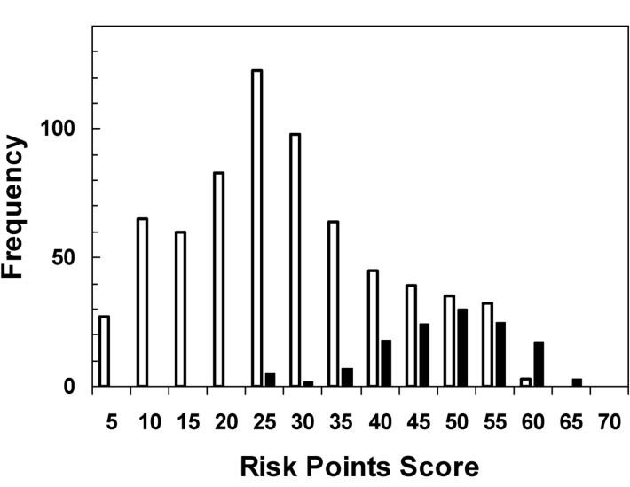{#fig-11-14}

- When there is not perfect (or near-perfect) discrimination between cases and controls (as will generally be the case), how can the usefulness of an indicator be evaluated?

- When there is overlap between the frequency distributions of the indicator variable for cases and controls, how can we decide what value of the indicator

variable should be adopted as a critical threshold that, if exceeded, will invoke the application of crop protection measures?

11.6.3. The receiver operating characteristic curve Following the logistic regression analysis of the potato late blight data in Table 11.5, the natural classification rule (as adopted by D. A. Johnson et al., 1996) is to assign a year to the outbreak group if _p_ ˆ > 0.5 and to the non-outbreak group if _p_ ˆ ≤ 0.5. In this particular case, this rule provides simultaneously high values of sensitivity and specificity, and there is little reason to consider alternatives. More generally, however, other classification rules may also be considered. D. A. Johnson et al. (1998) point out that if priority were given to the correct identification of cases, a critical threshold lower than _p_ ˆ = 0.5 could be adopted. This would have the effect of increasing sensitivity, but at the expense of decreasing specificity.

For the Sclerotinia stem rot data shown in Fig. 11.14, the choice of a threshold value on the risk points scale is not so straightforward. The extent of the overlap between frequency distributions for cases and controls means that there is no unequivocal “best” choice of threshold for distinguishing between crops with >25% diseased plants and crops with ≤25% diseased plants. For example, the outcomes of choosing threshold risk scores of 35, 40 and 50 points are shown in Tables 11.7 and 11.8. Table 11.7 shows the numbers of true positive, false negative, false positive, and true negative predictions achieved with each of these different choices of threshold risk score. Table 11.8 summarizes these data in terms of sensitivity and specificity. What can be seen is that if a relatively low threshold risk score is adopted, this yields a test with higher sensitivity (TPP is increased, FNP decreased) and a lower specificity (TNP is decreased, FPP increased). Conversely, adopting a relatively high threshold risk score yields a test with higher specificity (TNP is increased, FPP decreased) and a lower sensitivity (TPP is decreased, FNP increased). Note that there is no way of altering the threshold such that both FNP and FPP are simultaneously decreased.

Suppose now that instead of restricting the choice of threshold to one, two, or three values of the indicator score, we allow the threshold indicator score to vary over the whole range of possible indicator scores. A graphical plot of TPP (sensitivity) against FPP (1–specificity), known as a _receiver operating characteristic (ROC) curve_, then provides a useful summary of the characteristics of the indicator in question. ROC curves are widely used in clinical chemistry for the evaluation of diagnostic tests (e.g., Metz, 1978a; Zweig and Campbell, 1993; Swets et al., 2000). An overview of ROC curves in an ecological context is provided by Murtaugh (1996). Phytopathological applications of ROC curves have been pioneered by Jonathan Yuen and colleagues (e.g., Yuen et al., 1996; Twengström et al., 1998; Yuen, 2002). Madden (2006) provides another application of ROC curves and decision theory for disease management.

**Table 11.7.** Sclerotinia stem rot of oil seed rape: the numbers of true positive (TP), false negative (FN), false positive (FP) and true negative (TN) predictions achieved with each of three different choices of threshold risk score.

|**_A: Threshold_**=**_35_** |**_True st_**|**_atus_**|
|---|---|---|
|**_risk points_** **_Predicted status_**|>**_25% diseased_** **_plants_** **_(cases)_**|≤**_25% diseased_** **_plants_** **_(controls)_**|
|>25% diseased plants|117 (TP)|154 (FP)|
|≤25% diseased plants|14 (FN)|520 (TN)|
|Total|131|674|
|**_B: Threshold_**=**_40_** |**_True st_**|**_atus_**|
|**_risk points_** **_Predicted status_**|>**_25% diseased_** **_plants_** **_(cases)_**|≤**_25% diseased_** **_plants_** **_(controls)_**|
|>25% diseased plants|99 (TP)|109 (FP)|
|≤25% diseased plants|32 (FN)|565 (TN)|
|Total|131|674|
|**_C: Threshold_**=**_50_**|**_True st_**|**_atus_**|
|**_risk points_**|>**_25% diseased_** **_plants_**|≤**_25% diseased_** **_plants_**|
|**_Predicted status_**|**_(cases)_**|**_(controls)_**|
|>25% diseased plants|45 (TP)|35 (FP)|
|≤25% diseased plants|86 (FN)|639 (TN)|
|Total|131|674|

It is instructive, at the outset, to consider the ROC curves for two special cases: one for a hypothetical indicator that provides a test with perfect discrimination between cases and controls, the other for a hypothetical indicator that provides no discrimination at all. Fig. 11.15A shows frequency distributions of indicator scores (in arbitrary units) for cases and controls where there is no overlap between the distributions of scores for cases and controls. In this case, it is possible to choose a threshold indicator score above which fall all the cases and below which fall all the controls. Note that is normally the case that the indicator score (denoted _I_) is calibrated so as to be positively correlated with the perceived risk. In Fig. 11.15A, if the threshold is placed on the vertical axis (i.e., the adopted threshold indicator score _I_ CRIT = 0), everything is declared positive (i.e., all the indicator scores are above the threshold). This classification is correct for all the cases, so aThe true positive proportion (TPP, sensitivity) expresses the number of true positives as a proportion of the total number of cases (i.e., the proportion of outbreak years correctly classified). The true negative proportion (TNP, specificity) expresses the number of true negatives as a proportion of the total number of controls (i.e., the proportion of non-outbreak years correctly classified). The false negative proportion is FNP = 1 − TPP, and the false positive proportion is FPP = 1 − TNP.

**Table 11.8.** Sclerotinia stem rot of oil seed rape, summarizing the data presented in Table 11.7 for three different choices of threshold risk scorea .

|**_Threshold_**|**_TPP_**|**_TNP_**|||
|---|---|---|---|---|
|**_risk score_**|**_(Sensitivity)_**|**_(Specificity)_**|**_FNP_**|**_FPP_**|
|35|117/131=0.89|520/674=0.77|0.11|0.23|
|40|99/131=0.76|565/674=0.84|0.24|0.16|
|50|45/131=0.34|639/674=0.95|0.66|0.05|

TPP = 1. However, it is wrong for all the controls, so FPP = 1. Thus, when _I_ CRIT = 0, the corresponding point on the ROC curve (Fig. 11.15B) is (1,1), in the extreme top right-hand corner of the plot. As the threshold indicator score is increased over the range _I_ CRIT = 1, 2, 3, 4, FPP decreases (because more controls are correctly classified) but, for the hypothetical indicator in this example, TPP remains unchanged. Thus, the ROC curve follows a horizontal line from the point (1,1) towards the point (0, 1), in the extreme top lefthand corner of the plot. When _I_ CRIT = 5, FPP = 0 (so all the controls are correctly classified) and still TPP = 1 (so all the cases are correctly classified) and the adoption of this value of the indicator score as the threshold provides a test with perfect discrimination. On the ROC curve (Fig. 11.15B) this is the point (0,1) where, simultaneously, sensitivity and specificity are both equal to one. As the threshold indicator score is increased further, over the range _I_ CRIT = 6, 7, 8, 9, FPP now remains unchanged (its lower bound is zero) while TPP decreases (because more cases are wrongly classified). Thus, the ROC curve follows a vertical line from the point (0,1) down towards the point (0,0), in the extreme bottom left-hand corner of the plot. When _I_ CRIT = 10, everything is declared negative (i.e., all the indicator scores are at or below the threshold). This classification is wrong for all the cases, so TPP = 0. However, it is correct for all the controls, so FPP = 0 (TNP = 1). Thus, when _I_ CRIT = 10 (in this example), the corresponding point on the ROC curve (Fig. 11.15B) is at the origin, (0,0).

Fig. 11.15C shows frequency distributions of indicator scores (in arbitrary units) for cases and controls for a hypothetical indicator that provides no discrimination. The frequency distributions of indicator scores for cases and controls are identical, so whatever threshold indicator score is chosen, TPP = FPP. As a result, the corresponding ROC curve (Fig. 11.15D) follows a straight line (the “no discrimination” line) along the diagonal between the points (1,1) (low threshold, TPP = FPP = 1) and (0,0) (high threshold, TPP = FPP = 0). In passing, note that an ROC curve that falls below this no-discrimination line suggests that the indicator in question is giving consistently wrong results. Such an indicator has some discriminatory capability insofar as useful predictions could be made by inverting the results obtained by its application.

![Receiver operating characteristic (ROC) curves. **(A)** There is no overlap between the frequency distributions of indicator scores (in arbitrary units) for cases and controls. **(B)** The corresponding ROC curve follows a horizontal line from the point (1,1) towards the point (0,1), in the extreme top left-hand corner of the plot, then follows a vertical line from the point (0,1) down towards the point (0,0), in the extreme bottom left-hand corner of the plot. **(C)** There is complete overlap between the frequency distributions of indicator scores (in arbitrary units) for cases and controls. **(D)** The corresponding ROC curve follows a straight line (the “no discrimination” line) along the diagonal between the points (1,1) and (0,0).](figures/fig11-img26.png){#fig-11-15}

Fig. 11.14 shows frequency distributions of risk point scores for cases and controls for the Sclerotinia stem rot data of Twengström et al. (1998) discussed in _Example 11.2_. There is partial overlap between the two distributions, so we should expect to see an ROC curve that falls somewhere between the ROC curve corresponding to Fig. 11.15C (complete overlap) and the ROC curve corresponding to Fig. 11.15A (no overlap)and preferably rather closer to the latter. This is indeed the case. Fig. 11.16 shows the ROC curve derived from Fig. 11.14, with a curvature away from the no discrimination line towards the top left-hand corner of the plot.

The ROC curve shown in Fig. 11.16 is typical of a useful indicator. Thus, plotting an ROC curve provides a way of answering the first of the two questions posed at the end of section 11.6.2, relating to evaluation of an indicator. Sometimes the area under the ROC curve is calculated, as a summary (e.g., Hanley and McNeil, 1982). The area under the ROC curve for a perfect indicator (Fig. 11.15B) is equal to one, while the area under the ROC curve for an indicator with no discriminatory capability is equal to 0.5 (Fig. 11.15D). For a useful indicator, the area under the ROC curve will be somewhere between these two extremes. In the case of Fig. 11.16, the area under the ROC curve is equal to 0.847. While values closer to the upper limit are generally preferable, the area under the ROC curve, as a summary statistic, does not convey any detail relating to the trade-off between sensitivity and specificity that is involved in choosing an appropriate threshold. This brings us to the second of the two questions posed at the end of section 11.6.2.

![Sclerotinia stem rot of oil seed rape. The ROC curve (solid line) corresponding to the frequency distributions of risk point scores shown in Fig. 11.14, with a curvature away from the no discrimination line towards the top left-hand corner of the plot. Points on the curve represent thresholds corresponding to different accumulations of risk point scores from 5 points (in the top right hand corner of the plot) to 70 points (in the bottom left hand corner) in increments of 5 points. The dotted line is the “no discrimination” line.](figures/fig11-img27.png){#fig-11-16}

An indicator that has an ROC curve with a curvature towards to the top left-hand corner of the plot has desirable sensitivity and specificity characteristics, in that relatively high values of both can be achieved simultaneously with an appropriate choice of threshold indicator score. For a given choice of threshold, Youden’s index _J_ = sensitivity + specificity − 1 (=TPP − FPP) (Youden, 1950), characterizes the overall nonerror rate of the corresponding test. _J_ is equal to one for a test that enables perfect discrimination and is equal to zero for a test that provides no discrimination. For example, for the ROC curve in Fig. 11.16, a threshold of 35 risk points provides the test with the maximum value of Youden’s index for the indicator in question (_J_ = 0.66). Youden’s index may be useful as long as the decision maker regards the two types of erroneous decision, false negatives (crops that really need treatment wrongly classified as not needing treatment) and false positives (crops that really do not need treatment wrongly classified as needing treatment) as equally undesirable. More generally, however, the trade-off between sensitivity and specificity involved in the choice of an appropriate threshold depends on the view taken by the decision maker of the relative costs the two possible erroneous decisions, as in the following qualitative account.

Choosing a threshold that falls on the ROC curve towards the top right-hand corner of the plot would mean that a high relative cost is attributed to false negative decisions, so a low threshold indicator score is set in order to reduce these. A threshold on the ROC curve at the extreme top right-hand corner of the plot (TPP = FPP = 1; or FNP = TNP = 0) means that false negative decisions would not be tolerated at all, and so crops would always be treated, whatever the circumstances (in which case forecasting is not required). in order to reduce these. A threshold on the ROC curve at the extreme bottom left-hand corner of the plot (TPP = FPP = 0) means that false positive decisions would not be tolerated at all, and so a crop would never be treated under any circumstances (in which case forecasting is not required).

The ROC curve for an indicator provides both an overview of its usefulness in discriminating between cases and controls, and a means by which a decision maker can evaluate the consequences, in terms of the trade-off between sensitivity and specificity, of adopting a particular threshold indicator score. For a more quantitative treatment of this trade-off (albeit not in a phytopathological application), see Hughes and Madden (2003).

### 11.6.4 Sensitivity and specificity as conditional probabilities

Sensitivity (TPP) and specificity (TNP) can be written in the form of conditional probabilities, as follows.

- TPP is an estimate of the conditional probability Pr(_I_ > _I_ CRIT | _D_ +)

(read as “the probability of an indicator score above the adopted threshold value (denoted _I_ > _I_ CRIT), given that the true status of the crop was a case (i.e., requiring treatment, denoted _D_ +)”).

- TNP is an estimate of the conditional probability Pr(_I_ ≤ _I_ CRIT | _D_ −)

(read as “the probability of an indicator score at or below the adopted threshold value (denoted _I_ ≤ _I_ CRIT), given that the true status of the crop was a control (i.e., not requiring treatment, denoted _D_ −)”). Similarly:

- FNP is an estimate of the conditional probability Pr(_I_ ≤ _I_ CRIT | _D_ +)

- • FPP is an estimate of the conditional probability Pr(_I_ > _I_ CRIT | _D_ −) .

### 11.6.5 Likelihood ratios

Sensitivity and specificity are characteristics of a diagnostic test. An alternative formulation of these characteristics is provided by the calculation of two _likelihood ratios_, as follows (Go, 1998). The likelihood ratio of an indicator score above the adopted threshold value is defined as:

Choosing a threshold that falls on the ROC curve towards the bottom left-hand corner of the plot would mean that a high relative cost is attributed to false positive decisions, so a high threshold indicator score is set

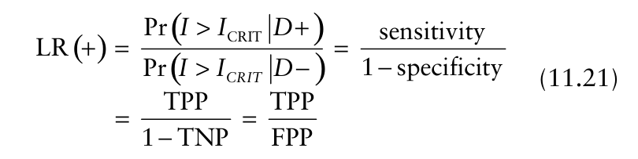{.equation width=60%}

LR(+) is a shorthand notation for LR (_I_ > _ICRIT_). The likelihood ratio of an indicator score below the adopted threshold value is:

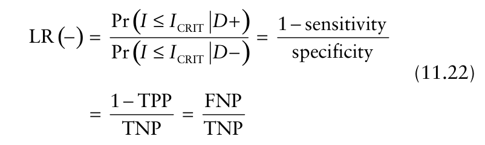{.equation width=60%}

LR(−) is a shorthand notation for LR (_I_ ≤ _I_ CRIT) . Usage of the term “likelihood ratio” here follows the standard terminology for the analysis of diagnostic tests (e.g., Biggerstaff, 2000).

Biggerstaff (2000) gives a geometrical interpretation of the two likelihood ratios and their relationship to the sensitivity and specificity of a diagnostic test. Fig. 11.17 shows a likelihood ratios graph based on the test described in Table 11.7A and Table 11.8, with sensitivity (TPP) equal to 0.89 and specificity (TNP) equal to 0.77 (_Example 11.2_). The false positive proportion is FPP = 1 − TNP = 0.23 _,_ and the false negative proportion is FNP = 1 − TPP = 0.11. The likelihood ratio of a positive prediction, LR(+), is estimated by TPP/FPP. In this case, LR(+) = 0.89/0.23 = 3.87. The likelihood ratio of a negative prediction, LR(−), is estimated by (1 − TPP) / (1 − FPP) = FNP/TNP. In this case, LR(−) = 0.11/0.77 = 0.14. For a (hypothetical) perfect test (i.e., one with TPP = TNP = 1), the likelihood ratios are LR(+) = +± and LR(−) = 0 (Go, 1998). For a (hypothetical) test with no discriminatory power, both LR(+) and LR(−) are equal to one (Go, 1998). LR(+) > 1 and LR(−) < 1 are the minimum requirements of a useful test. Ideally, we would like to have LR(+) as large as possible and simultaneously have LR(−) as small as possible (Biggerstaff, 2000). For the potato late blight indicator described in _Example 11.1_, the test with TPP = 0.92 and TNP = 0.85 has the corresponding likelihood ratios LR(+) = 6.13 and LR(−) = 0.09. For the eyespot indicator described in _Example 11.3_, the test with TPP = 0.68 and TNP = 0.41 has the corresponding likelihood ratios LR(+) = 1.15 and LR(−) = 0.78.

![Sclerotinia stem rot of oil seed rape. A likelihood ratios graph based on the test described in Table 11.7A and Table 11.8, with true positive proportion (TPP, sensitivity) equal to 0.89 and true negative proportion (TNP, specificity) equal to 0.77 (●) (see _Example 11.2_). The likelihood ratio of a positive prediction, LR(+), is estimated by TPP/FPP (the slope of the solid line). In this case, LR(+) = 3.87. The likelihood ratio of a negative prediction, LR(−), is estimated by (1 − TPP) / (1 − FPP) = FNP/TNP (the slope of the dashed line). In this case, LR(−) = 0.14.](figures/fig11-img28.png){#fig-11-17}

## 11.7 Predicting the Need for Treatment

### 11.7.1 Bayes’ theorem

The discussion so far has not been concerned directly with the problem of predicting whether or not a crop requires treatment. When sensitivity and specificity are written as conditional probabilities (section 11.6.4), it can be seen that the conditionality is such that the probability of the test result is given, conditional on the true disease status (case or control) of the crop in question. When we are forecasting plant disease, we do not know the true disease status of the crop in question. Assuming we have developed an appropriate test, and applied it, what we know is the test result (_I_ ≤ _I_ CRIT or _I_ > _I_ CRIT) and what we wish to do is calculate the probability of a crop’s requirement for treatment, conditional on this test result. In order to accomplish this, we need to know the sensitivity and specificity of the test (written as conditional probabilities, section 11.6.4) and the unconditional (pre-test) probability of a crop’s requirement for treatment, denoted Pr(_D_ +), based in some appropriate way on our previous experience. _Bayes’ theorem_ is the means by which these quantities are combined to calculate the conditional probability Pr(_D_ + | _I_ > _I_ CRIT) (read as “the probability that a crop requires treatment, given a positive test result [i.e., an indicator score above the adopted threshold value]”) (Yuen, 2002, 2003; Yuen and Hughes 2002). The calculation is:

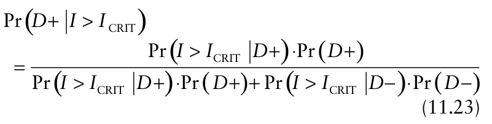{.equation width=60%}

in which Pr(_I_ > _I_ CRIT | _D_ +) is the sensitivity,Pr(_I_ > _I_ CRIT | _D_ −) is 1 − specificity, and Pr(_D_ −) is the unconditional (pretest) probability that a crop does _not_ require treatment, equal to 1 − Pr(_D_ +). In Bayesian terminology, Pr(_D_ +) is the _prior probability_ of the requirement for treatment and Pr(_D_ + | _I_ > _I_ CRIT) is the corresponding _posterior probability_ of the requirement for treatment given that there has been a prediction of this requirement. In essence, Bayes’ theorem facilitates the updating of a prior probability, using evidence from risk factors, to a posterior probability.

_Example 11.1 continued_. _Potato late blight_. Outbreaks of potato late blight were identified in 12 of 25 years in commercial potato fields in south-central Washington between 1970 and 1994 (D. A. Johnson et al., 1996). About half the years in the study period were outbreak years. We therefore take Pr(_D_ +) = 0.5 to be a reasonable estimate of the prior probability of an outbreak. We have previously (section 11.6.2) calculated the sensitivity (=0.92) and specificity (=0.85) for a test based on the data in Table 11.5 (giving details of risk factors associated with outbreaks), so using equation 11.23, the posterior probability is given by:

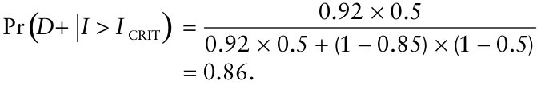

Before using the predictor, the evidence means that outbreaks are about as likely to occur as not to occur. However, if the test results in a prediction of an outbreak year, use of equation 11.23 shows that the probability of an outbreak is increased to 0.86. The conditional probability Pr(_D_ + | _I_ > _I_ CRIT) is often referred to as the _positive predictive value_ (_PPV_). We can also use Bayes’ theorem to calculate the conditional probability, Pr(_D_ − | _I_ ≤ _I_ CRIT) the _negative predictive value_ (NPV), as follows:

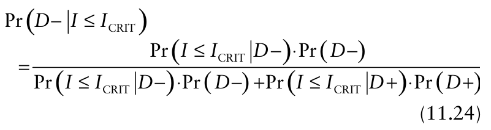{.equation width=60%}

in which Pr(_I_ ≤ _I_ CRIT | _D_ −) is the specificity and Pr(_I_ ≤ _I_ CRIT | _D_ +) is 1 − sensitivity. NPV is the posterior probability of (in this context) a non-outbreak year, given that there has been a prediction of an non-outbreak year. In this example, we have:

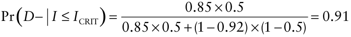

Before using the predictor, it appears that outbreaks are about as likely to occur as not to occur but, if the test results in a prediction of an non-outbreak year, use of equation 11.24 shows that the probability of an nonoutbreak year is increased to 0.91. Note that PPV and NPV are not inherent properties of a test, since they depend on Pr(_D_ +). Rather, they relate to application of the test in a particular context.

Equations 11.23 and 11.24 can be written is a simpler format. To enable this we first define the _odds_ of an event as: i.e., Now, after some rearrangement of equation 11.23:

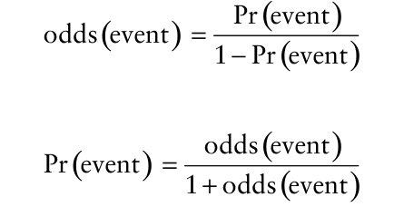

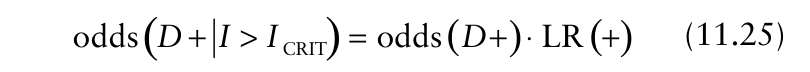{.equation width=60%}

and after some rearrangement of equation 11.24:

{.equation width=60%}

Using the scenario of _Example 11.1_, the re-statement of Bayes’ theorem given in equation 11.25 is used to move from the _prior odds_ of an outbreak year to the _posterior odds_ of an outbreak year, given a prediction of an outbreak year. Using the data from _Example 11.1_ above: and then, if required, Similarly, equation 11.26 is used to move from the prior odds of a non-outbreak year to the posterior odds of a non-outbreak year, given a prediction of a nonoutbreak year. Using the data from _Example 11.1_ above: effect of a test that provides a prediction that treatment will not be required is to increase the posterior odds that treatment will not be required, relative to the prior odds. It is now clear why LR(+) > 1 and LR(−) < 1 are the minimum requirements of a useful indicator (section 11.6.5).

Other potentially useful statements of Bayes’ theorem as applied in the context of disease management decision making are available. The posterior odds of requirement for treatment following a prediction that treatment will not be required is:

**Table 11.9.** Using data from Tables 11.7 and 11.8 (Sclerotinia stem rot of oil seed rape), values of the likelihood ratio of an indicator score above the threshold value LR(+) and the corresponding positive predictive (PPV) values for risk score thresholds of 35, 40, and 50 points.

|||**_Need fo_**|**_r treatmen_**|**_t_**|
|---|---|---|---|---|
|||**_Prior_**|**_Posterior_**||
|**_Threshold risk score_**|**LR****_(_**+**_)_**|**_odds_**|**_odds_**|**_PPV_**|
|35|3.87|0.19|0.74|0.42|
|40|4.75|0.19|0.90|0.48|
|50|6.80|0.19|1.30|0.56|

{.equation width=60%}

When converted to a probability, this is equal to 1 − NPV. The posterior odds that treatment will not be required following a prediction that treatment will be required is:

{.equation width=60%}

which is equal to 1 − PPV when converted to a probability.

_Example 12.2 continued_. _Sclerotinia stem rot of oil seed rape_. A 20-year average for the frequency of need for control measures for Sclerotinia stem rot of oil seed rape in Uppland, east-central Sweden, is 16% (Yuen and Hughes, 2002). We, therefore, take Pr(_D_ +) = 0.16 as the prior probability of need for fungicide application (so the prior odds is odds(_D_ +) = 0.19). Different threshold values of the risk score give different values of sensitivity and specificity (Tables 11.7 and 11.8). These data can now be combined, via Bayes’ theorem, to characterize predictive values.

Table 11.9 shows values of LR(+) [= sensitivity/(1 − specificity)] and the corresponding positive predictive values for risk score thresholds of 35, 40, and 50 points. A threshold of 50 points provides the largest value of LR(+). Adopting this threshold (from among those tabulated) leads to the largest posterior probability of need for fungicide application following a forecast of this need (PPV). Note that even following a prediction of the need for fungicide application, this probability (= 0.56) is not much greater than 0.5. This kind of result is discussed further in section 11.7.2. Table 11.10 shows values of LR(−) [=(1 − sensitivity)/specificity] and the corresponding negative predictive values for risk score thresholds of 35, 40, and 50 points. In this case, a threshold of 35 points provides the smallest value of LR(−). Adopting this threshold (from among those tabulated) leads to the largest posterior probability that fungicide application is not required following a forecast that application is not needed (NPV).

None of the thresholds discussed is superior overall. A threshold of 50 points is the best for confirming the need for fungicide application but the worst for confirming that fungicide application is not needed. A threshold of 35 points is the worst for confirming the need for fungicide application but the best for confirming that fungicide application is not needed. A threshold of 40 points is intermediate between the other two from both points of view. In the case of Sclerotinia stem rot of oil seed rape, values of the likelihood ratios are such that useful forecasts can be made. However, decision makers must prioritize their requirements, in terms of seeking an increase in the odds of need for treatment following a positive prediction, or an increase in the odds of no need for treatment following a negative prediction, or otherwise opting for a compromise between these two positions.

**Table 11.10.** Using data from Tables 11.7 and 11.8 (Sclerotinia stem rot of oil seed rape), values of the likelihood ratio of an indicator score below the threshold value LR(−) and the corresponding negative predictive values (NPV) for risk score thresholds of 35, 40, and 50 points.

|||**_No need_**|**_for treatmen_**|**_t_**|
|---|---|---|---|---|
|||**_Prior_**|**_Posterior_**||
|**_Threshold risk score_**|**LR****_(_**−**_)_**|**_odds_**|**_odds_**|**_NPV_**|
|35|0.14|5.25|36.75|0.97|
|40|0.29|5.25|18.38|0.95|
|50|0.69|5.25|7.56|0.88|

### 11.7.2 Predicting unusual events is problematic

The advantages of being able to predict correctly the occurrence of particularly rare events, or the non-occurrence of particularly common ones, hardly need spelling out. However, such eventse.g., diseases that occur very frequently or very infrequentlypose a problem from the point of view of forecasting. For example, suppose that a review of the available evidence in relation to the occurrence of a disease leads to the conclusion that the prior probability of need for fungicide application (or another appropriate control measure) is Pr(_D_ +) = 0.05 (odds (_D_ +) = 0.05 / (1 − 0.05) ≈ 0.053). Suppose also that we have a test (risk algorithm) with both high sensitivity (=0.9) and specificity (=0.9), so LR(+) = 0.9/(1−0.9) = 9. After a prediction of need for fungicide application, the posterior probability of this need (PPV) is Pr(_D_ + | _I_ > _I_ CRIT) = 0.32 (using Bayes’ theorem). The posterior probability of need for a fungicide application exceeds the prior probability by about a factor of six (0.32 compared with 0.05) following a prediction of this need. However, the end result is that about two-thirds of the predictions of a requirement for fungicide application will be for crops that do not actually require it, since Pr(_D_ − | _I_ > _I_ CRIT) = 1 − Pr(_D_ + | _I_ > _I_ CRIT) = 0.68. It can be seen that when the prior probability is low, most predictions of a requirement for fungicide application will be for crops that do not actually require it, unless the test used is one with a very low FPP. This is often the scenario in screening programs related to medical decision making. In that case, when disease incidence is low, FPP must be small, otherwise most positives will be false positives, causing an unnecessary burden on both the health care system and on individual patients (Metz, 1978a).

A similar problem arises in trying to predict the nonoccurrence of a frequently occurring disease. In this case, non-occurrence is the unusual event and we would like to be able predict when fungicide application (or another appropriate control measure) is _not_ required. A test with high sensitivity and specificity will provide an increase in posterior probability that fungicide is not required (NPV) over a low prior probability, following a prediction that fungicide application is not required. However, this posterior probability may still be such that most of the predictions that fungicide application is not required will be for crops that actually do require the application.

The point is that it is difficult to make useful forecasts where rare events are concerned. For a prior probability that is very low, or very high, it is difficult to provide posterior probabilities that will change a decision maker’s view (based on this prior probability), even if a test with good sensitivity and specificity characteristics is available. In contrast, a test with lower sensitivity and specificity can provide useful predictions in cases when prior probabilities are neither very low nor very high. For one example, using a test with sensitivity = 0.75 and specificity = 0.75, Pr(_D_ +) = 0.33 is increased to Pr(_D_ + _I_ > _I_ CRIT ) = 0.60 following a positive prediction. For another, Pr(_D_ −) = 0.4 is increased to Pr(_D_ − _I_ ≤ _I_ CRIT ) ≈ 0.6 following a negative prediction based on a test with sensitivity = 0.7 and specificity = 0.7. These are the kinds of probability revision (expressed in terms of the posterior probability compared with the prior probability) that may influence a decision maker’s initial view. This analysis has important implications for the deployment of resources in solving disease management decision making problems (Yuen, 2003). Predictions are likely to be most useful in cases where the prior probabilities are neither very low nor very high. Thus, some formal consideration of prior probabilities is an important component of the development process for useful predictors of plant disease.

## 11.8 Conclusions

In economic entomology, sampling—particularly sequential sampling—has become the cornerstone of crop protection decision making. Binns (1994) is unequivocal: “For decision making, sequential sampling is often the only method to be seriously considered because it allows sampling to cease as soon as it becomes obvious which decision should be made.” The methods of acceptance sampling developed for use in control of insect pests have found little direct application in the management of plant disease. This may be because lesion counts—the phytopathological equivalent of the data most frequently collected in economic entomology—are only infrequently collected in disease management. Notwithstanding the paucity of direct applications, _Sampling and Monitoring in Crop Protection_ by Binns et al. (2000) is nothing less than required reading for anyone who wants to understand the theoretical basis for applications of acceptance sampling in the context of crop protection. The basis of these applications is Wald’s (1947) sequential probability ratio test. This is applicable directly with disease incidence data collected by simple random sampling and by means of a normal approximation with disease incidence data collected by cluster sampling (Madden and Hughes, 1999a; Turechek et al., 2001).

Fixed sample size applications of acceptance sampling are most likely to be found in regulatory plant pathology, or when the determination of disease status of each observation is done after the sampling has ended (e.g., when using ELISA in a laboratory to determine disease incidence of a sample of leaves collected in the field). Zero acceptance number sampling plans, in particular, have been used in quarantine situations. In this context, the objective is to be able to make a statement that there is only a small specified probability that actual disease incidence exceeds a low specified level of incidence, when no infected plants are found in a sample. Sample sizes can be calculated to meet particular specifications. Note that the smaller is the specified probability that actual disease incidence exceeds a low specified level of incidence, and the lower is that level of incidence, the larger will be the required sample size.

It is more common in plant pathology than in economic entomology to base crop protection decision making on evidence beyond that provided by a sampling the harmful organism population directly (or indirectly, via its effects on the host). Prominent among the reasons for this is the fact that visual inspections of crops for disease do not generally detect latent (or pre-symptomatic) infections, which may comprise the majority of infections early in an epidemic (see Chapter 5) when control measures are likely to be most efficacious. Sampling may still have a role, but a wider range of risk factors may also be considered. A risk algorithm is any calculation that uses observations of identified risk factors from the host crop, the pathogen population and the environment to make an assessment of the need for crop protection measures. Usually data on the various risk factors are combined using an appropriate statistical method, such as logistic regression, but this is not a requirement. If an estimate of the pathogen population, or of disease intensity, is just one of a number of factors used in the risk algorithm, this estimate is obtained using sampling methods for estimation (Chapter 10), not the acceptance sampling methods outlined in this chapter. Acceptance sampling methods are appropriate when decision making is based only on the outcome of sampling the population in question, without taking other risk factors into account. The accuracy of risk algorithms (i.e., their sensitivity and specificity) can be assessed by means of receiver operating characteristic curves. Using Bayes’ theorem, sensitivity and specificity are combined with information on the prior probability of, for example, the need for disease control measures, to calculate the corresponding posterior probability of the need for control measures, given the evidence related to risk factors. There is inevitably an element of uncertainty built into this process, because we want to act in order to prevent a loss (which we may express in terms of crop yield or revenue) that we think may occur in the future if we do not act. Thus, in crop protection, we need to make decisions based on predictions of their consequences.

The Bayesian analysis can be taken further to account explicitly for the costs and benefits of different decisions relating to disease management. Carlson (1970), for example, gave an economic analysis of decision making in relation to peach brown rot (caused by _Monilinia fructicola_) in California. Carlson (1970) concluded that decision theory procedures appear to be applicable when disease control costs are high relative to the product price, when the intensity of damage is highly variable from year to year and when epidemics can be predicted with some reliability. Of course, the cost of control relative to the product price may be influenced by, for example, regulatory policies or consumer demand. Shtienberg (2000) mentions the imposition of strict regulations on levels of pesticide residues in marketable products and consumer willingness to pay premiums for minimally treated produce as mechanisms that may lead to wider implementation of decision theory procedures as the basis for disease management.

Shtienberg (2000) suggests that the potential value of a crop, the destructiveness of the pathogen and the cost of disease management relative to the likely loss in revenue resulting from pathogen attack are foremost in influencing growers’ perceptions concerning disease management. When the value of the crop is low, the cost of spraying relative to the likely loss in revenue resulting from pathogen attack is high, especially if the pathogen in question is only moderately destructive. Growers in this position may be motivated to avoid false positive decisions, i.e., erroneous decisions to spray a crop. When the value of a crop is high, the cost of spraying relative to the likely loss in revenue resulting from pathogen attack is low, especially if the pathogen in question is highly destructive. In such circumstances, growers may seek to avoid false negative decisions by spraying frequently, whether or not it is actually necessary. Shtienberg (2000) cites his own experience with growers of high value crops in Israel, and that of MacKenzie (1981) with potato growers in the USA, as examples of this scenario. As Shtienberg (2000) points out, putative aids to decision making that do not take the growers’ perceptions of the need to apply or withhold crop protection measures are unlikely to be implemented. In effect, then, predictors require some form of operational validation in addition to the statistical validation that most are subjected to during the development process. Altman and Royston (2000) provide a useful discussion of this issue, in a clinical context, and Hughes and Madden (2003) discuss in a different context how costs of decisions (correct or incorrect) can be formally linked to ROC curves for choosing action thresholds.

As discussed here, disease management confronts us with a problem in diagnostic decision making. Because the scale at which the vast majority of plant diseases are treated is that of the population (crop) level rather than the individual (plant) level, that is the scale at which we must make our diagnosis. Thus we can think of risk algorithms and sampling plans that classify crops as requiring treatment or otherwise as population-scale diagnostics. We assume that, where diagnosis at the individual plant scale forms a component of populationscale diagnosis, the plant-scale diagnosis is effectively error-free. With immunological and molecular diagnostic techniques, this may be reasonable. For plant-scale diagnosis based on an assessment of visual symptoms, it is almost certainly not.

New and more powerful diagnostic technology will continue to become available for disease assessment at the plant scale. To be able to take maximum advantage of this technology in disease management decision making, we need to deploy new diagnostics in risk algorithms and sampling plans for population-scale diagnosis. Research in the deployment of new diagnostic technology has recently lagged behind research in the development of the technology. Ultimately, however, the continuing requirement for improved decision making in the practice of disease management means that plant-scale and population-scale diagnosis must be seen as complementary aspects crop protection.

## 11.9 Suggested Readings

- Binns, M., Nyrop, J. P., and van der Werf, W. 2000. Sequential sampling for classification. In: _Sampling and Monitoring for Crop Protection Decision Making_. CAB International, London (Chapter 5).

- Clayton, M. K., Slack, S. A. 1988. Sample size determination in zero tolerance circumstances and the implications of stepwise sampling: bacterial ring rot as a special case. _Am. Potato J._ 65:711–723.

- Go, A. S. 1998. Refining probability: an introduction to the use of diagnostic tests. In: _Evidence-Based Medicine: A Framework for Clinical Practice_ (D. J. Friedland, editor). Lange Medical Books/McGraw-Hill/Appleton & Lange, New York, pp. 11–33.

- Madden, L.V., Hughes, G. 1999. Sampling for plant disease incidence. _Phytopathology_ 89:1088–1103.

- Yuen, J. 2003. Bayesian approaches to plant disease forecasting (Online). _Plant Health Progress_ (DOI:10.1094/PHP2003-1113-06-RV).
