# Epidemics and Crop Yield {#sec-ch12}

_Relating the yield of crops to varying levels of plant disease has remained a complex task both in theory and in practice._

B. M. Cooke

## 12.1 Introduction

Botanical epidemics are studied, in part, because of the many costs attributed to plant diseases in agriculture and forestry, including the costs of yield reduction (James and Teng, 1979). Many researchers, including those who have never attempted to quantify the relationship between disease intensity and yield at the population level, find a strong motivation for their work from the published accounts of the economic (and social) impact of plant diseases. The major pandemics of history—ergot in Medieval Europe, coffee rust in Sri Lanka, late blight in Ireland (and elsewhere), chestnut blight and southern corn (maize) leaf blight in the U.S., and African cassava mosaic in Africa, to name just a fewserve as a reminder of the worst-case consequences of plant disease epidemics for society as a whole (Schumann, 1991; Chapter 2 in Campbell and Madden, 1990; Horsfall and Cowling, 1978a). However, every year in every part of the world, epidemics occur that affect crop yield, or would affect yield if (often costly) controls were not being utilized. It is always hoped that increasing our understanding of epidemics will lead to a reduction in the effects of diseases on yield or to the development of more efficient and effective controls, or both.

Despite the economic importance of plant diseases, the relationship between epidemic development and resulting yield was not studied rigorously for many diseases until recent decades. Nearly 90 years ago, Lyman (1918) lamented that we had few accurate measures of crop loss. James and Teng (1979) believed this lack of crop loss information retarded the progress of plant protection as much as any other single factor. In their poetic language, Horsfall and Cowling (1978b) summarized their view of the situation:

“Although it can see the dying elms along the streets, society in general is only vaguely aware of how much damage it suffers from the depredations of other plant pathogens. That is because we have not told society about the losses, and that is because we do not know, and that is because we have not researched it very well.”

We would argue that plant pathologists _have_ researched it well in the last 30+ years or so, and have a much better understanding of how plant diseases affect yield. Vanderplank (1963) clearly identified the importance of the disease:yield relationship in evaluating the outcome of epidemics, and showed results of some early empirical studies. The 1970s and 1980s were especially productive for this field of research, with many pioneering contributions by W. Clive James, Paul Teng, and others. Their work led to the development of several concepts and principles for relating epidemics to crop yield, and formulation of empirical models of the underlying processes. We review several of these concepts and principles in this chapter.

The term _crop loss assessment_ is often used for the study of the relationship between attack by harmful organisms and the resulting yield (or yield loss) of crops. The disease:yield relationship falls within the study of crop loss assessment, as do the effects of infestations of insect pests and weeds on crop yields. As will become apparent in the following sections, the relationship between epidemic development and crop yield is complicated, and can depend on more variables than those typically measured when just quantifying disease increase in time and spread in space. Thus, in agreement with Lyman, we still do not adequately know what the precise losses are to various diseases. Even when a precise and repeatable functional relationship has been established between disease intensity (in the broad sense) and yield, losses for a region or country may still be uncertain. This is because, due to lack of funds or labor, we do not routinely obtain precise estimates of disease incidence or severity by sampling in commercial fields on a large scale and on a regular basis. Chapters 10 and 11 of this book cover many important issues related to sampling for plant disease intensity.

There are multiple uses for information on crop yield in relation to disease intensity. For instance, in addition to determining if a (potential) disease control method reduces disease intensity or the rate of disease increase, one can determine if the control has an effect on yield.

In an extreme case, it is possible that a control reduces disease severity but does not change crop yield very much. Related to this, one can attempt to make optimal disease management decisions based on the cost of the controls and the benefit obtained from the controls (reduced yield loss and, thus higher income) (Funt et al., 1990; Gould, 1989; Main, 1977). One can also use this information to make predictions of yield for a given location or region, which is of benefit to crop producers and the individuals and groups who purchase the commodities. The relationship between yield and disease can furthermore be used to determine the economic importance of a given disease in a given region. Through risk assessment, one can use the information to assess the threat of a non-indigenous pathogen to a region or country (NRC, 2002). Some excellent reviews and books give a great deal more information (Cooke, 1998; James, 1974; James and Teng, 1979; James et al. 1991; Nutter, 2002b; Savary et al., 2006; Teng, 1985; Chapter 8 in Zadoks and Schein, 1979).

The production of biomass by a plant, and the allocation of a portion of this biomass into the seed or other harvested plant component, are physiological processes that are influenced, at a minimum, by the environment, by diseases and other stress-causing agents (e.g., insects), and by competing plants (Johnson, 1987, 1992). In fact, a considerable understanding of crop yield production has been obtained from mechanistic modeling using physiological principles (Batchelor et al., 1993; Boote et al., 1983; Johnson and Teng, 1990). It is possible to link physiological models to population dynamic models for diseases, which generally requires the use of computer simulation and a large number of component equations, but such modeling is not necessarily needed (or desirable in some cases). Just as the complex physiological processes involved over the time span from spore penetration to the production of new spores are reduced to a single parameter representing the inverse of mean latent period (see Chapter 5), summary parameters can be used to relate the physiological processes of yield production and loss to disease (or variables that are related, directly or indirectly, to disease intensity).

We demonstrate the approach of using summary physiological parameters to model crop loss later in the chapter. But we first discuss general concepts of crop losses and the principles of data collection, followed by a presentation of the more empirical approaches to modeling that have been very popular over the last few decades. In the spirit of model parsimony, we show that a considerable understanding of crop losses can be obtained based on relatively simple models of yield in relation to epidemic and crop variables. In particular, we demonstrate how spatial heterogeneity of disease affects observed disease:yield relationships, and how temporal dynamics of disease increase can be linked to crop yield production.

## 12.2 Definitions and Concepts

### 12.2.1 Yield

Before discussing relations between yield and disease, it is helpful to present some definitions and discuss some concepts about crop loss. We base the presentation on the useful texts by Chiarappa (1971) and Zadoks and Schein (1979). Of course, as is typical in plant pathology, other authors may use the terms differently. A _crop_ is a unit of plants grown to provide food, fiber, stimulants, or other products. _Yield_ is the measurable produce of a crop. The produce may be seed, fruit, leaves, roots, or tubers, depending on the crop species.

It is helpful sometimes to consider different potential levels of yield for a crop. Fig.12.1 is based on Fig. 8.2 in Zadoks and Schein (1979). _Primitive yield_ is the yield of landraces of crop plants in primitive agriculture (i.e., without the use of modern crop protection practices). For grain crops, primitive yields are around 1 MT/ha of dry weight. In contrast, _theoretical yield_ is the yield obtained under ideal conditions, generally in small plots (e.g., experimental crops) with high levels of pesticides, fertilizers, other chemicals, and with the adoption of crop husbandry practices that could not be justified economically in full-scale modern commercial agriculture. Theoretical yield, which is sometimes called potential yield, could be considered the genetic maximum possible yield for a crop species, although this may be unknown. For grain crops, theoretical yield may be in the range of 10–20 MT/ha of dry weight. It is expected that our knowledge of theoretical yield of crops will continue to increase over time as we learn more about plant growth and development.

Between primitive and theoretical yields are attainable and actual yields. _Attainable yield_ is the yield obtained when a full-scale commercial crop is grown using the full range of modern agricultural technology. Generally, this requires that a crop is grown with optimum use of pesticides, fertilizers, and so on. Attainable yield may or may not be affordable, depending on whether or not the costs of production outweigh than the income obtained from the crop. _Actual yield_ is the crop yield obtained by a given set of crop husbandry practices. Actual yield generally is less than or equal to attainable yield. The difference between attainable yield and primitive yield is a loss that is avoidable, in the sense that (at least in principle) there are measures—including crop protection measures—available that could be used to raise yield from the primitive to the attainable level. In practice it will rarely be justifiable in economic terms to use the full range of modern agricultural technology. Instead, selected measures will be used to achieve an actual yield that is less than the attainable yield. In so doing, the loss corresponding to the difference between actual yield and primitive yield has been avoided. In general, the difference between attainable and actual yield can be then considered crop loss (or yield loss) (Fig. 12.1).

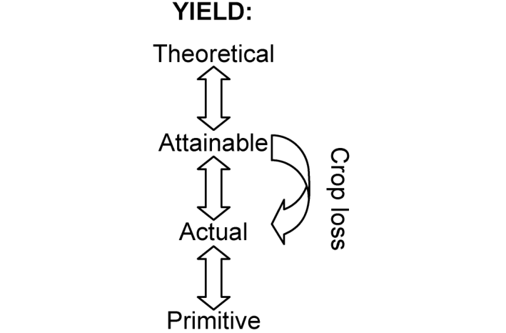{#fig-12-1}

This conceptualization is broader in scope than the consideration of yield in relation to disease. Obviously, many factors influence yield, and reduce yield from that attainable, including a wide spectrum of harmful organisms and other environmental stress factors (e.g., lack of moisture). We are mostly concerned about the yield of crops in relation to disease epidemics in this book. Thus, as an operational definition, we consider _crop loss_ to be the difference between actual yield and yield obtained in the absence of disease. The latter yield value is analogous to (but not the same as) attainable yield in the more general setting. The actual yield may be for a plant, plot, commercial field, region, or larger area (e.g., country). Depending on the particular scenario of interest, “absence of disease” may be in reference to the absence of a single disease or of a number of diseases. We use crop loss and yield loss as synonyms in this text.

There are variations on the meaning of crop loss. One common definition is: reduction in either quantity and/or quality of yield brought about by crop damage (Campbell and Madden, 1990). Crop damage here implies injuries from biotic or abiotic agents that, collectively, result in a measurable loss of yield. The general definition of the previous paragraph for crop loss does not depend, however, on use of terms such as “injury” and “damage” to represent plant disease effects on yield. Readers can refer to Main (1977) for a nice early presentation on the concepts of “injury”, “damage”, “stress”, and “loss”.

It is important to note that crop loss (or yield loss) does not imply that the harvested portion of the crop is directly reduced by a given disease during a given epidemic. Some diseases actually reduce or eliminate the harvested produce of a crop _after_ the harvested portion is produced. Examples would be post-harvest diseases or other diseases where fruit become infected after being produced. Most plant diseases limit the formation of harvested produce rather than removing the previously formed produce. Some have argued that “crop loss” or “yield loss” are not appropriate terms for the consequences of most plant diseases (Cook, 1985). However, with the definition used here, crop loss applies to both the removal of previously formed produce (due to rotting, for instance) and for the unrealized gain in harvestable produce over time in a crop.

### 12.2.2 Impacts of disease on crops

For some purposes, it is convenient to convert yield and yield-loss values into economic terms, and to quantify the effects of diseases in terms of costs. In fact, one can explicitly quantify and study economic loss as well as biological loss (Nutter, 2002b). The reduction in quantity of yield is clearly one important cost of crop disease (James and Teng, 1979). Reduction in quality of yield is an additional cost. Blemishes on fruit and toxins in grain are two examples of quality reductions.

There are several other costs attributed to plant diseases that are outlined here. Cost of control is of major importance. This includes short-term costs, such as the cost of pesticides (e.g., fungicides for fungal diseases and insecticides for the vectors of some viral diseases), as well as the cost of applying the pesticide (including time and labor). Other short-term costs include screening of seed and plant material (transplants) for the presence of some pathogens. There can be extra costs of harvesting and grading of produce (e.g., sorting fruit) when a disease is present. Sometimes, a crop has to be replanted due to preor post-emergence damping off, and sometimes a crop cannot be planted due to the presence of a pathogen. Although crop rotation has many long-term benefits, there may be a short-term cost if the most desirable crop cannot be planted in a given year of the rotation. Longer term costs include breeding for resistance and developing new pesticides, and the development and testing of other controls. One potentially large cost is in trade disruptions. If the pathogen causing disease is of quarantine significance, its presence in an area can result in the (total) loss of export markets (Madden and Wheelis, 2003), even if the yield in the field is little affected by the disease. For pathogens that produce certain toxins, there is also a cost in terms of human and animal health. There can also be a cost in terms of higher food prices or unavailable foods in a region.

Some of these costs are borne directly by the grower. Others costs are paid by industry, or society as a whole. In fact, a grower could benefit from higher food prices, although society would have to bear this cost. These costs due to plant disease can be partitioned in various ways to better understand the impact of disease. Using the term “loss” for what we generally refer to as cost in this section, Zadoks and Schein (1979) developed an interesting classification system. Direct losses are experienced on the farm (i.e., directly in the agricultural sector). In contrast, indirect losses are generally experienced off the farm, by society as a whole. The direct losses can be divided into primary and secondary ones. Direct primary losses involve reductions in quantity and quality of yield as well as immediate control costs. In contrast, direct secondary losses are long term, incurred beyond the current year or growing season. These can be due to weakening of perennials and build-up of inoculum in the soil, both of which can reduce yield in future years.

It is extremely difficult to estimate the total actual cost of plant diseases to a region or a country, although Pimentel and colleagues have made valiant attempts over the years to quantify the costs due to all pests, including plant pathogens (Pimentel et al., 2000; Pimentel, 2002). Using data from the U.S. Bureau of Census and other sources, they estimate a total cost of plant disease to the U.S. alone to be over $30 billion per year. This value includes more than just the reduction in quantity of yield. Large scale estimates of costs like this require substantial extrapolation and are based on numerous assumptions about the agricultural and nonagricultural business sectors. In fact, the Pimentel estimate is larger than that obtained by James et al. (1991), although the later authors were more specific in the types of costs considered. However, even as a rough approximation, the analyses make clear the large economic importance of plant diseases.

It is useful for readers to have an appreciation for the many costs incurred due to plant diseases. However, as is common in botanical epidemiology, we focus in this chapter on reductions in quantity of yield in relation to disease development. This is the area where we can most directly show, either empirically or, in some cases, mechanistically, how the spatio-temporal dynamics of disease impacts the production of yield by crops. Some aspects of costs in disease management are covered in Chapter 11.

## 12.3 Data and Relationships

### 12.3.1 Graphs of yield and disease

Fig. 12.2 shows examples of the relationship between crop yield and some representations of the disease epidemic. It is sometimes convenient to refer to the graph of yield (or yield loss) versus disease as a “damage curve”. The examples were chosen from a wide collection of pathosystems to demonstrate the typical relationships observed. The most common way of showing the impact of the epidemic on yield is to plot yield (or yield loss) versus disease intensity (_y_ or _Y_) at one time during the epidemic. One could also show disease-free intensity instead of _Y_. Sometimes the yield (or yield loss) is presented in “yield units” (e.g., kg/ha); alternatively a proportion or percentage of a disease-free control yield can be calculated. The single time may be at the end of the growing season, or a time that is “known” or thought to be critical for yield production of a crop (see below). Yield can also be related to disease intensity at multiple times, often summarized by the area under the disease progress curve (AUDPC; equation 4.42). Time to reach a certain intensity of disease or the rate of disease increase can also be used as representations of the epidemics.

![Examples of crop yield [in relative (_w_) or absolute (_W_) units] in relation to disease intensity or area under the disease progress curve (AUDPC). Data were obtained from Vanderplank (1963) for stem rust of wheat, Madden et al. (1981a) for leaf spot of peanut, Culbreath et al. (1997) for tomato spotted wilt (with separate lines for different cultivars), Pataky et al. (1998) for northern corn (maize) leaf blight, Schoeny et al. (2001) for take all of wheat, and Ferrandino (1989) for potato late blight.](figures/fig12-img02.png){#fig-12-2}

Consider the graph in Fig. 12.2 for stem rust of wheat, obtained from a field study in 1937 and described in Greaney et al. (1941). The data were also used by Vanderplank (1963; p. 148) to show possible impacts on yield of reductions in initial disease intensity and rate of disease increase. The data show only minor variation around a straight line. However, as other graphs in Fig. 12.2 show, there is not necessarily a straight-line relation, and there can be very large variation around a bestfitting line (curve). As will be seen later, sometimes there is no significant relationship between measured disease intensity (as a proportion) at any time and yield (or loss), even though disease is affecting yield.

The practical goal of many crop loss studies is to characterize the relationships shown in Fig. 12.2, and to compare the relationships for different cultivars, treatments, locations, and so on. To do so requires measurements of yield and disease at one or more times in several experimental or sampling units and the fitting of models to the obtained data. Next we review some of the approaches for obtaining the data.

### 12.3.2 Obtaining data from a range of epidemics

Ideally, a data set should have a wide range of yield and disease values if one wants to characterize the yield (or loss) response to epidemic development. The principles and methods of measuring disease intensity and crop properties (such as leaf area index), as presented in Chapter 2, apply here, as do the approaches for characterizing disease development over time, as presented in Chapter 4 (and later chapters). The required data can be obtained in either of two basic ways: from conventional field (or greenhouse) experiments; or from surveys of fields with naturally occurring epidemics.

For conventional field experiments, one imposes treatments that will, in principle, result in different epidemics (e.g., differences in _y_ 0, _r_ *, and _K_; see Chapter 4), and possibly different crop yields (if the disease in question has a yield effect). There are different types of treatments that can be used for this purpose. The first is through inoculations. One can inoculate plots with different inoculum densities, or at different number of times during the season. A single inoculation can be done either early or late. Use of inoculation treatments is most desirable when only low disease intensity would occur without inoculations. Typically, this works best when overwintering inoculum is low, or there are few infected alternate hosts in the area. An additional advantage of inoculations is that one can impose a spatial pattern to the initial infections (see Chapter 9) to relate disease intensity and pattern simultaneously to resulting yield (see section 12.7).

The second type of treatment is the use of protectants, such as fungicides for fungi and insecticides and stylet oils for insect-transmitted viruses. The use of biocontrol agents would also fit in this setting. By varying the number of pesticide applications, their timing, type of chemical, or level of active ingredient, a wide range of epidemics may be achieved. This approach works best when disease intensity would normally be high without the use of protectants, such as when there is high inoculum density in the soil or many infected alternate hosts in the region. It is possible, of course, to combine the inoculation and protection methods. Whenever possible, one should test the fungicides in the absence of disease to make sure the chemicals do not affect yield directly.

There are other ways of obtaining different epidemics in different plots. One could use different genotypes of the host, preferably isolines or near-isolines, which vary in susceptibility. One could also manipulate the environment, for instance, by using irrigation as a treatment to influence disease increase (for those diseases affected by surface wetness and/or atmospheric moisture). Or, one could use location as a treatment factor; that is, having plots in different locations. Of course, the environment may (will) vary among locations, and there may be interactions of location and genotype with disease in terms of yield response. One should be cautious in the interpretation of crop loss results based on the use of cultivars or locations to obtain different values of disease and yield. For instance, differences in yield between two near-isolines (that happen to differ in disease intensity) may be due to genetic traits independent of disease. Likewise, yield differences obtained at different locations, or with different imposed environmental conditions, may be due more to the location or environment effects than the disease effect.

Inoculation and protection are the two most useful ways of obtaining different epidemics in planned experiments. In fact, the different cultivars (genotypes) and locations (or environments in general) are utilized specifically to determine how they influence crop losses, rather than as ways of simply obtaining different epidemics and yield. In section 12.5, we show one way to quantify the effects of factors such as cultivar on disease-yield relationships. As suggested by James (1974) and Madden (1983), it is highly desirable to obtain data over a few years, at more than one location, and with a range of commonly used cultivars in order to understand and characterize crop losses. Of course, it is often not possible, because of the lack of funds or labor, for example, to obtain such comprehensive data.

In contrast to conventional experiments, by definition, one does not impose any treatments with surveys of naturally-occurring epidemics. Instead, one determines disease and yield data for fields selected by an accepted survey-sampling procedure (such as simple random sampling; see Chapter 10). This is discussed more in the next section in the context experimental and sampling units.

### 12.3.3 Experimental and sampling units

_12.3.3.1 Planned experiments._ Epidemic and yield data can be obtained from different types of experimental or sampling units. In a planned experiment, say, with different inoculation treatments, the typical experimental unit is a relatively small plot. There will be a number of replicate plots for each treatment. Depending on the pathosystem, the plot may be one or a few rows wide and a few meters long. For trees, or even other plant species, the experimental unit may be a single plant. Unless the plots are very small, disease intensity (and other variables) are observed/measured, either visually or with electronic approaches (Nutter, 2002b), in several samples; the principles and methods in Chapter 10 are applicable here. Yield can be determined for each sample (and generally expressed as a mass or volume per unit area), permitting a quantification of disease and yield at the sampling-unit scale. However, it is very common to determine a single (total or mean) yield measurement for the plot (but expressed per unit area). This necessitates the calculation of mean disease intensity (or other variable) from the samples. Then, the relationship between mean yield and mean disease intensity (or other epidemic property) is quantified. The implication of using means is addressed in section 12.7.

As an alternative to averaging the values within plots, one can directly measure disease and yield for individual plants within the plots, and utilize the individual values in later analysis. Even when the average disease intensity is very low (or very high) for a plot, there may still be a wide range of individual observations (see Chapter 9), and possibly a corresponding wide range of values for yield/plant. This approach, sometimes called the “single plant” method, has the advantage of giving a wide range of values of the response (yield) and predictor variables (e.g., disease intensity at the end of the season), which aids in the identification of the functional relationship (if one exists). However, if the single plants are located relatively close together, use of standard least squares model fitting (see Chapter 3) would be problematical, because this form of data analysis requires independent values (at least with the usual standard statistical assumptions). Moreover, to account more fully for both sampling variability (variation in yield between samples within plots) and experimental variability (variation between plots treated in the same way), any statistical model would require two error terms, one for sampling error and one for experimental error. This can be done using linear or nonlinear mixed models (Littell et al., 1996, 2006; Schabenberger and Pierce, 2002). This complexity is, unfortunately, often ignored in practice.

An alternative to the conventional plot is the microplot (Francl et al., 1987; Navas-Cortés, et al., 2000), especially common for soil-borne pathogens. As the name implies, this is a very small plot, often representing a single plant; there may also be barriers in the soil separating the plants. The microplot is different from the “single plant” sampling unit because the microplot _is_ the experimental unit, not a sample within plots. (Of course, the distinction between a small plot and a microplot can be arbitrary). Microplots allow fine control over the conditions experienced by the individual plant, which may be very useful for understanding how disease and other variables affect the yield response. However, there may be high variability among microplots receiving the same treatment, and this type of experimental unit could be too artificial, if one is attempting to relate disease to yield in commercial fields.

The issue of number of replications of either plots or microplots deserves some consideration. The typical approach is to use three or four replications, as is commonly done for other field experiments. However, Teng and Oshima (1983) argue in favor of more treatments (to give more distinct epidemics) and fewer replications (when the total number of experimental units is fixed). For instance, assume that a researcher can afford 20 plots. A typical experiment might consist of five treatments (a control and four different fungicide regimes), with four replications each. This may be quite adequate to determine if the treatment has a significant effect on disease or yield. However, in crop loss experiments, the treatment is often not of direct interest, but is used to get different levels of disease and yield. A wider range of epidemics and yields may be obtainable with 10 treatments and two replications each, or even 20 treatments with one (!) replication. Obviously, the precision of any measurement goes down as the number of replications goes down. But, this approach might provide a fuller representation of the entire disease:yield relationship (although the uncertainty of each datum may be high). We feel that giving up all replication may be a bit extreme, but using fewer replications than in standard crop experimentation may be of benefit if this means that more treatments can be imposed (potentially giving more distinct epidemics).

_12.3.3.2 Surveys._ When one obtains data from a survey, rather than from a planned experiment, fields (orchards, etc.) are selected as samples or sampling units, based on the objectives of the investigator, and a number of sub-samples typically are obtained for disease (and other predictor variables) within each sample. The fields may be commercial ones or may even be found on university and government research facilities. Composite yield and disease values for each sample (e.g., field) are typically obtained, although yields for each sub-sample could also be obtained. The sub-samples here correspond to the samples within treatment plots in conventional experiments (with imposed treatments) or within single fields in observational studies (see Chapters 10 and 11). Often, mean disease and yield are used for each field (i.e., each sample) in the analysis.

The approach based on survey samples sometimes is known as the synoptic approach, especially when multiple variables are measured or observed for each sample (Stynes, 1980). This approach can result in a wide range of yield and disease values, which is desirable for quantifying relationships, and may reveal relationships not determined in conventional experiments, because the “right” treatments were not evaluated in the planned situation. Moreover, because the data are collected in “natural” agricultural conditions, results have the potential to be more “realistic” than found for small experimental plots (e.g., at a research center).

Since there is no control over the conditions in which the data are obtained in a survey (because no treatments are imposed), results could be misleading. For instance, there may be a negative relationship between yield and final disease intensity, but also a positive relationship between both yield and disease intensity and soil moisture content. Thus, without a wide range of realized values, it is possible that a positive relation between yield and disease intensity will be observed (because in this example, yield increases more with increasing moisture than does disease intensity). Specifically, the correlations of the observed or measured variables can be influenced by other (unmeasured) variables. For this reason, results from surveys are probably best used to _suggest_ relations rather than to characterize relations. Moreover, it is seldom affordable or practical to obtain measurements of disease (or other variables) at multiple times during an epidemic in several sampled fields; thus, an investigator would not be able to evaluate AUDPC or other seasonlong summaries of epidemics as predictors of yield (or loss). Nevertheless, the survey approach may be the only practical way of obtaining data for some pathosystems.

### 12.3.4 Yield per unit area

So far, we have discussed yield and yield measurements in the general sense, without any details. A little elaboration is warranted at this point. Readers may have noticed by now that this chapter is a little different from most of the rest of the book in one respect. That is, the measurements or observations used elsewhere mostly dealt with disease intensity. Direct measurements of the crop (such as LAI; Chapter 2), if taken at all, were used to provide a basis for the calculation of disease intensity. Now, we also use measurements of crop yield in addition to disease intensity, and the portion of the crop measured as yield typically is separate from the portion of the crop infected. Of course, some diseases directly affect the harvested portion (e.g., seed diseases and fruit rots), but many of the most costly diseases do not infect the harvested portion of the crop.

For the most part, we link or relate a single yield value to each epidemic. However, crop yield can be partitioned into components, and sometimes the components are directly determined. This is demonstrated with yield of wheat. Yield can be represented as, for example, 0.5 kg/m2 or 5 MT/ha. This total is actually the product of the number of seeds produced per unit area and the average weight per seed. A given disease could reduce total yield by reducing the number of seeds, or the individual seed weight, or both. These _yield components_ can be further subdivided. That is, total yield can be represented as the product of number of plants/m2 , number of spikes/plant, number of spikelets/spike, number of seeds/spikelet and individual seed weight (Slafer, 2003). These components are often negatively correlated with each other; thus, a disease that reduces the number of plants per unit area by, say, 20%, does not automatically reduce the total yield by this percentage.

Starting in section 12.4, we primarily deal with the quantification of a single (total) crop yield value associated with each epidemic. Analysis of the components of yield requires some additional multivariate and univariate statistical methods not discussed here. Interested readers should refer to Madden (1983), Hau (1990), and Stynes (1980).

### 12.3.5 Expert opinion

Obtaining data from planned experiments or surveys under a wide range of environments and cropping systems is expensive and time consuming, and it is unlikely that sufficient information is available for every disease of concern. As an alternative to experiments and surveys, one can obtain estimates of crop losses from experts (such as extension specialists) for a particular crop in a given region. The expert’s opinion would reflect years of experience with a given crop and disease (or diseases), and be based on a combination of previous experiments, surveys and interactions with crop producers, crop advisors and consultants, and others. This approach has been formalized for some crops, such as soybeans in the U.S. (e.g., Wrather et al., 2001, 2003).

In this book, we are more concerned with characterizing crop losses using direct observations of disease and yield, so we do not deal further with the use of expert knowledge. However, it must be acknowledged that use of expert opinion will likely remain important in obtaining estimates of losses and costs of diseases for regions and countries (e.g., Pimentel et al., 2000). One area that deserves more research is an evaluation of the methodology for eliciting quantitative information from experts, for use use in either estimation of losses or in decision making. Methods considered for eliciting disease incidence information from experts (Hughes and Madden, 2002) are relevant here.

## 12.4 Modeling Yield in Relation to Disease

### 12.4.1 Notation and general concepts

We assume that there is a relation, at least potentially, between crop yield and one or more representations of an epidemic. We primarily consider in this section the situation where the relevant epidemic components consist of disease intensity at one or more times during a growing season, or summary statistics based on these disease intensities. In section 12.6, we broaden this pool of predictor variables by viewing crop yield in a more physiological manner.

As elsewhere in this book, we use _Y_ for disease intensity in absolute units (e.g., area of diseased leaves) and _y_ for intensity in relative units (e.g., proportion of leaf area diseased). Likewise, _H_ is used for disease-free intensity (e.g., healthy leaf area) and _h_ for disease-free intensity in relative units. Thus, _Y_ + _H_ = _M_, _y_ = _Y/M_, _h_ = _H/M_, and _y_ + _h_ = 1, where for convenience here, _M_ is the total host crop “size”. The variables could be averages of several observations (samples or sub-samples) from a plot or field, or individual values. For simplicity, we do not use bar notation for averages here, since it is unnecessary for the current presentation of the concepts.

The yield of a crop per unit area under a given set of conditions (in absolute units) is represented by _W_. For example, _W_ could be 5 metric tons per hectare (5 MT/ha), 500 g/m2 , 250 fruits/m2 , and so on. It is a density measurement in typical usage—if one records yield per plant, it is useful to convert the value to yield per unit area for subsequent analyses. _W_ 0 is used to represent yield in the absence of the disease of interest, with the same units as _W_. Relative yield (_w_) is then given by: _w_ = _W/W_ 0. Loss in yield (_L_) is given by: _L_ = _W_ 0 − _W_. Loss in yield relative to the disease-free yield is given by:

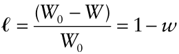

Relative yield (or loss) and disease as a proportion are unitless (dimensionless) variables. However, it is important to note that there is a fundamental difference between _w_ (or ℓ) and _y_. The variable _y_ is determined from a _single_ plant individual (e.g., proportion of leaf, root, or plant diseased) or from a sample of a _single_ population (e.g., proportion of diseased plants in a plot or field, or average proportion of plants diseased in a plot or field), since both _Y_ and _H_ are definable for a single individual or population. For instance, a plant may have 100 cm2 of diseased leaf area and 100 cm2 of disease-free area, giving _y_ = 100/(100 + 100) = 0.5. In contrast, _w_ (or ℓ ) is determined from two _different_ individuals or samples from two different populations, one with a given epidemic and one without disease. A plant population (e.g., field) can be characterized by a yield, _W_, but loss in absolute units (_L_), as well as relative yield and relative loss (_w_ and ℓ), can only be defined in comparison to another population (e.g., field) without the disease epidemic.

A difficulty with use of _L_, _w_, and ℓ, is that sometimes (often, in fact) there are no disease-free plots in a planned and replicated experiment. For practical matters, mean yield from plots with very low _Y_ can be used as an approximation for _W_ 0. Sometimes, modeling (see below) provides another approach to dealing with this problem (by allowing the prediction of _W_ 0 based on the observed data). With surveys, the problem is more challenging, even if fields with no disease are observed. This is because the fields with no disease might differ from those with disease in terms of other agronomic attributes, some or all of which may not be known to the investigator. For instance, the yield may be unusually high (or low) for reasons that have nothing to do with the level of disease intensity.

Despite the difficulties mentioned here, it is common to express loss, relative yield, or relative loss, in relation to disease intensity (either _y_ or _Y_) (see Fig. 12.2). This may be because of the appeal of thinking of the impact of plant disease in relative terms, or difference from a “standard”, rather than in terms of a given level of yield for a given epidemic situation. In recent years, however, there has been increasing use of _W_ (instead of _L_, _w_, or ℓ) as the response variable in crop loss studies. This is partly because of the relevance of yield in absolute units in physiological modeling of crops (see section 12.6).

In a broad sense, we can consider yield, _W_, to be a function of the disease epidemic. This can be written generally as: _W_ = _g_ (epidemic variables; parameters), where _g_ (•) is a linear or nonlinear function (see Chapter 3). For ease of expression, equations of this type can be referred to as crop loss or yield loss models, in addition to yield models, even when the response variable is yield. How the epidemic is summarized—that is, which epidemic variables are utilized in _g_ (•) and in what form—serves as a useful classification system for crop loss models. We use a hybrid model classification, based on Teng (1985) and Madden and Nutter (1995).

### 12.4.2 Single point models

_12.4.2.1 Linear models._ The simplest, and perhaps most practical, empirical description of crop loss is obtained by use of a single measurement of disease intensity during the epidemic and a linear model. One version of the equation is written as:

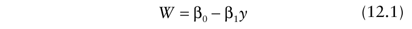{.equation width=60%}

in which β0 and β1 are parameters. In other words, _g_ (•) is specifically expressed as:

{.equation width=60%}

Disease intensity in absolute units (_Y_) could also be used (if the data were available) in the function _g_ (•). The values of _y_ (or _Y_) are usually based on visual measurements of symptoms, but electronic measurements (i.e., percentage reflectance of solar radiation) can also be used (e.g., Newton et al. 2004). One could also express loss (_L_) as a function of _y_, or relative yield (_w_) or loss (ℓ) as a function of _y_, using the interrelationships presented above. Equation 12.1 is known as a _single-point model_ because _y_ from a single time in the epidemic is used. Fig 12.2A is an example of a situation where a single point model is appropriate. When needed for clarity, a subscript can be added to _y_ to indicate the time during the epidemic. The time might be arbitrary, such as the end of the season, or the time can be chosen more formally based on statistical analyses. For some crops, it has been found that a certain time period, corresponding to key growth (phenological) stages (see Chapter 2), is especially critical in yield formation, and that disease severity at this time is often (highly) correlated with yield (James, 1974; Teng, 1985; Madden and Nutter, 1995). For grain crops, the critical time period is around Feeke’s growth stages 10.5. Single point models can be called critical point models for this reason.

In equation 12.1, the intercept term, β0, can be thought of as expected yield when _y_ = 0 (under a given set of crop production and environmental conditions). Thus, the intercept is a yield property of the cultivar in a given environment when the disease of interest is not affecting the crop. In this case, one could use _W_ 0 instead of β0 in the model; that is, _W_ = _W_ 0 −β1 _y._ As shown below, this interpretation of β0 depends on equation 12.1 being appropriate over the _entire_ range of possible _y_ values (0–1), not just for the observed range of _y_ values. Thus, we prefer here not to use _W_ 0 for the intercept term. The slope parameter β1 in equation 12.1 represents the change in yield with change in disease intensity at the particular (single, critical) time of interest during the epidemic. If crop-loss results are being compared across cultivars, β1 represents, in a sense, the tolerance of a given cultivar to a given disease. For instance, if two cultivars have the same _W_ 0, then the one with the smaller β1 (closer to 0) will have higher yield at a given level of disease intensity. This can be seen graphically from lines “a” and “b” in Fig. 12.3, where line “a” represents the more tolerant cultivar. In contrast, line “c” can represent a lower yielding cultivar (lower β0) compared with cultivars “a” and “b”, but which is also more tolerant than the others to disease (lower β1). There is a value of _y_ at which cultivar “c” has a higher yield than cultivar “b” in this hypothetical situation.

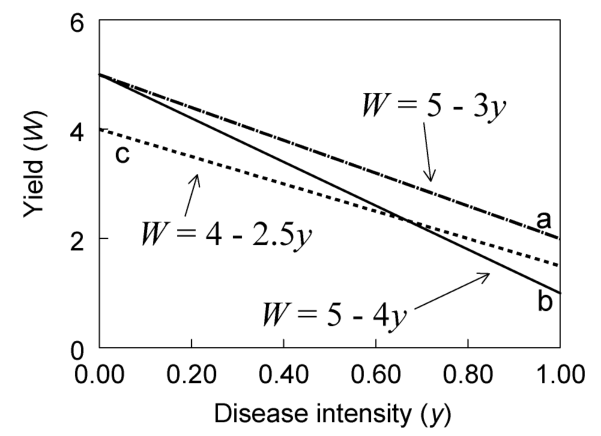{#fig-12-3}

The above discussion was in terms of cultivar comparisons. However, one can take the same approach to compare the yield response over two or more years, or, in general, two or more environments. Differences in β0 reflect differences in effects of environment on yield in the absence of disease. Differences in β1 reflect the differential effects of environments on yield response to disease.

An example of a single-point model is the one developed by Bissonnette et al. (1994) for oat yield in relation to crown rust (caused by _Puccinia coronata_). where yield is expressed as metric tons per hectare (MT/ha) and _y_ is proportion of disease at oat growth stage 75. The _R_2 value was 0.8. In the absence of disease, expected yield is 4 MT/ha. For each increase in _y_ by 0.01 (i.e., 1%), there is a decrease in yield of 0.057 MT. If equation 12.1 is taken as being valid for all values of _y_ (so that βˆ 0 = _W_ 0), one could write the equation for loss, ˆ _L_, as: _L_ = 4.0 − _W_ = 5.7 · _y_. The relative yield equation ˆ would be given by: _w_ = (4.0 − 5.7 · _y_)/ 4.0 = 1 −1.425 · _y_, and the relative loss equation would be given byˆ ℓ =In practice, there is no real reason to expect a straight-1.425 · _y_. line relationship between _W_ and _y_ (see Fig. 12.2 for examples). In fact, there are some theoretical reasons for a nonlinear relationship, as will become apparent below. Various authors have used linear and nonlinear models to characterize yield (or loss) in relation to intensity. For linear models (i.e., linear in the parameters), the simplest approach to capture curvature in the _W:y_ line is to use a transformation of _y_, _y_ *, as the predictor variable. The single-point model can then be written as:

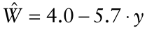

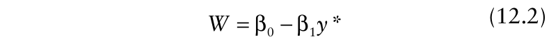{.equation width=60%}

Useful transformations include the square root and log (Romig and Calpouzos, 1970; Large and Doling, 1962; Teng et al., 1979). In equation 12.2, β1 is the change in yield with change in _y*_, not with change in _y_. The “intercept” β0 represents expected yield when _y_ * is equal to 0, not when _y_ is equal to 0. For instance, consider the situation when _y*_ = ln(_y_). Then _y*_ = 0 when _y_ = 1; thus, β0 represents expected yield when _y_ = 1. Following with this example, with disease intensity, _y,_ represented as a proportion, β0 is the expected yield when _y_ is at its highest possible value (i.e., 1), rather than its lowest (i.e., 0). For β0 to represent yield of disease-free plants in equation 12.2, _y*_ must equal 0 when _y_ is equal to 0. With _y_ as a proportion (the standard representation in this book), the transformation _y*_ = ln(_y_ + 1) meets this criterion.

_12.4.2.2 Nonlinear models._ As discussed in Chapter 3, many biological phenomena are best described by nonlinear models. These kinds of models are especially useful when there are thresholds, when the response variable approaches an asymptote, and when it is desired that the same model describes different shapes for the curves of _W_ versus _y_. Several nonlinear models have been proposed to describe crop loss data (Madden and Nutter, 1995; Madden, 1983), and we show one utilized by Hughes (1988) as an example. Yield can be written as:

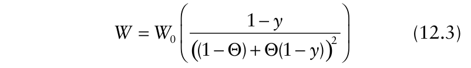{.equation width=60%}

in which _W_ 0 and Θ (Θ ≤ 1/2) are parameters. As above, _W_ 0 is the expected yield when _y_ = 0. Θ is an indication of the rate of decline in _W_ with increase in _y_ and the shape of the curve; however, for this model, there need not be a straight-line decline. Fig. 12.4A demonstrates theoretical values of _W_ for three choices of Θ in equation 12.3. When Θ is positive (0 < Θ ≤ 0.5; curve II), there is initially little decline in _W_ with increasing _y_, and the rate of decline in _W_ increases as _y_ increases. Mathematically, the second derivative (_d_2 _W/dy_2 ) is negative when Θ is between 0 and 0.5. When Θ is negative (Θ < 0; curve I), there is initially a rapid decline in _W_ with increasing _y_, and the rate of decline decreases as _y_ increases; _d__2_ _W/dy__2_ is positive when Θ < 0. When Θ = 0, there is a straight-line relation; that is, equation 12.3

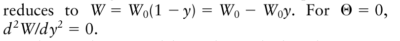{.equation width=60%}

Other nonlinear models can be used when there is evidence of a threshold (i.e., a value of _y_ below which no loss occurs, denoted here _a_) or a lower nonzero limit to yield [i.e., a maximum possible loss (less than _W_ 0) that is reached or approached at the highest possible _y_; denoted here _W_ min)] (Madden, 1983; Madden and Nutter, 1995). These concepts are displayed in Fig. 12.5. Curve 1 is the simple situation of no disease threshold (_a_ = 0) and _W_ min = 0. Curve 2 is similar to curve 1, except that _W_ min = 1 (i.e., no lower value of _W_ than _W_ min). Curve 3 also is based on _W_ min = 1, but with a disease threshold of _a_ = 0.2 (20% severity).

{#fig-12-4}

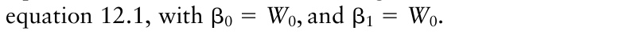{.equation width=60%}

{#fig-12-5}

{.equation width=60%}

We show here a framework for a general crop loss model incorporating these (and other) ideas. A disease:yield relationship can be written as:

{.equation width=60%}

in which _S_ (_y_) is a function of disease intensity (or, more broadly, the predictor variable) that ranges from 0 to 1 over the full range of possible _y_ values. _S_ (_y_) has been called a switching (switch-off or switch-on) function (Schabenberger and Pierce, 2002) because it switches (either slowly or quickly) between 0 and 1 as _y_ goes from its minimum to maximum (or maximum to minimum). Note that the threshold _a_, and generally other parameters, are part of _S_ (_y_). The nonlinear function in parentheses after _W_ 0 in equation 12.3 is a switch-off function (for certain Θ values); thus, equation 12.3 is a special case of the general equation 12.4, with _W_ min = 0 and no disease threshold (i.e., _a_ = 0). A useful choice for _S_ (_y_) is one minus the cumulative distribution function for a unimodal continuous random variable. Although not based on any biological mechanisms, such a choice ensures that _S_ (_y_) is limited by 0 and 1. Using the Weibull cumulative distribution function (Madden et al., 1981a), one can write the switch-off expression as:

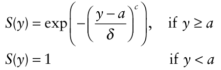

Then, equation 12.4 is written as:

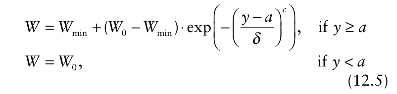{.equation width=60%}

There are five parameters, _W_ 0 and _W_ min (both for yield), _a_ (threshold of disease intensity on horizontal axis), δ (a measure of steepness of the _W-y_ curve), and _c_ (a unitless measure of curve shape). The concept of a shape parameter was discussed at some length in Chapter 4. All the curves in Fig. 12.5A were obtained with equation 12.5.

Other distribution functions certainly can easily be chosen for _S_ (_y_). Schabenberger and Pierce (2002) and Gregorie and Schabenberger (1996) discuss switching functions at some length for modeling other biological phenomena. It should be noted that even the simple linear model of equation 12.1 is a form of the general equation 12.4, if constraints are placed on the β1 parameter. This can be seen by using _W_ 0 for β0 as described above, and re-writing equation 12.1 as:

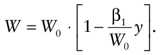

This is a version of equation 12.4, with _S_ (_y_) = 1 − (β1/ _W_ 0) _y_, no disease threshold (_a_ = 0), and a minimum _W_ of 0 (_W_ min = 0) occurring at _y_ = 1. Clearly, _S_ (0) here is equal to 1. However, for _S_ (1) to be equal to 0 (i.e., for the switch-off function to be 0 at _y_ = 1), β1 must equal _W_ 0. It is rare to find the slope and intercept of equation 12.1 to be equal when fitted to crop loss data. This is because _W_ min is generally not 0 (_W_ min > 0), or the minimum yield does not occur at _y_ = 1, or there is a threshold (_a_ > 0). Thus, investigators may not explicitly consider these complicating issues. In fact, the actual _W_ min may occur only at a value of _y_ beyond the largest observed _y_, and _W_ 0 may occur at a value of _y_ smaller than the smallest observed _y._ In these cases, there may be little evidence of a relationship other than a straight (or curved) line over the observed range of _y_ values.

To better understand the use of equation 12.4 for yield–disease relationships, we demonstrate the model with a more general switch-off function, which is still a straight line. If the cumulative uniform distribution function (Johnson et al., 1995) is utilized for _S_ (_y_), one can write the switch-off function as: in which _a_ is the threshold _y_ below which no yield reduction occurs (as already defined), and _b_ is an upper value of _y_, above which no further decrease in yield occurs. The model for _W_ can then be written as:

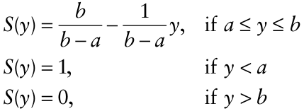

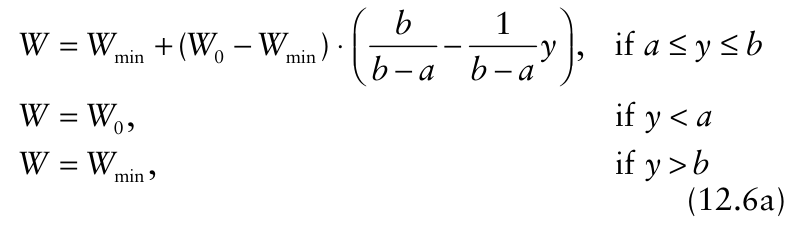{.equation width=60%}

The thick solid line in Fig. 12.5B is an example of the yield-disease relation based on equation 12.6a, showing the maximum and minimum yields, and the values of _y_ where these occur. Unlike the situation with the Weibull function used for _S_ (_y_), there is an abrupt transition from _W_ to _W_ min. With both the Weibull and uniform functions, however, the transitions from _W_ 0 to _W_ are abrupt. For values of _y_ between _a_ and _b_, one can rewrite equation 12.6a as:

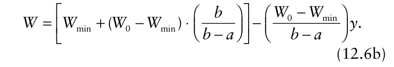{.equation width=60%}

which is, of course, a straight line function with slope given by (_W_ 0 − _W_ min)/(_b_ − _a_). Note that equations 12.6a and 12.6b are nonlinear in the parameters, as discussed in Chapter 3. Although a portion of the model can be considered linear (i.e., for _a_ < _y_ < _b_), the fact that _a_ and _b_ are unknown makes this model nonlinear. Readers should return to section 3.5 for more information.

For the case with a minimum yield of 0 occurring at _y_ = 1 (_W_ min = 0; _b_ = 1) and maximum yield occurring at _y_ = 0 (_a_ = 0), the slope is _W_ 0, as indicated above when the simple linear equation 12.1 is appropriate for the entire range of disease intensities and there is a zero minimum yield. In the more general sense, the slope depends on the difference between the upper and lower possible yields (_W_ 0− _W_ min), and the range in disease intensities where yield varies with disease (_b_ − _a_).

A little algebra will show that equation 12.6b predicts yield values of _W_ 0 when _y_ = _a_ and _W_ min when _y_ = _b_, as required based on equation 12.6a. However, using equation 12.6b (with no constraints) would be misleading at disease intensities outside of this disease range (_y_ < _a_, or _y_ > _b_). This could happen in practice if all the observations of _y_ are between the true values of _a_ and _b,_ and equation 12.1 appears appropriate. Then, the intercept would actually not be _W_ 0, but be given by:

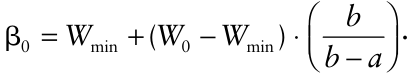

This can be seen by the extrapolated (thin) line extending to the _W_ axis in Fig. 12.5B. A similar type of error would be made in determining the minimum yield. If all observations are between _a_ and _b_, there is no way (from a single data set) to know the values of _a_ or _b_, and corresponding values of _W_ min and _W_ 0, without making additional assumptions.

It is useful to consider the oat rust equation equation of Bissonette et al. (1994). With _y_ = 1 in the fitted equation, one obtains _W_ = −1.7 , a meaningless value. If there is no lower disease threshold (_a_ = 0), then _W_ = 4. This means that the slope (5.7) is equal to (4− _W_ min)/ _b_. If one can assume that _W_ min = 0, then 4/ _b_ = 5.7 (the experimentally derived slope). Rearrangement shows that _b_ is then estimated as 0.7. If these assumptions hold for this example, all disease intensities above 0.70 result in no oat yield.

The point of this discussion here is to make it clear that interpretation of model parameters depends on the appropriateness of the model over the range of disease intensities where interpretation is desired. Typically, there are observations of disease intensity near 0 (Fig. 12.2), which means that estimates of _a_ are obtainable. When there are low values of observed disease intensity and no evidence of a leveling off of _W_, then it is very reasonable to assume that _a_ = 0 and that the intercept term is _W_ 0. Most of the data sets plotted in Fig. 12.2 are consistent with _a_ ≈ 0. However, there are clear examples of thresholds in other systems (Madden et al., 1981a) coupled with curvature of the _W:y_ relation above the disease threshold. A bigger challenge is to determine minimum yield, since observed disease intensities may not be large enough to determine this. In situations where there is a nonlinear relationship between _W_ and _y_, it may be more useful to use versions of S(_y_) with smooth transitions to _W_ min because then there is no _b_ parameter to estimate.

Other choices for _S_ (_y_) can be utilized, but we do not discuss this aspect further. More complicated functions may be needed for more complicated _W_: _y_ relationships. For instance, as discussed by Teng (1985), low levels of _y_ may actually promote plant growth and yield production per unit area, so that there is an actual increase in _W_ with increase in _y_ (when _y_ is small).

_12.4.2.3 Model fitting._ The single-point models are generally fitted to data using either linear or nonlinear least squares methodology (Neter et al., 1983; Schabenberger and Pierce, 2002), although maximum likelihood could also be used. The methodology of Chapter 3 is relevant for this empirical modeling. The approach for a linear model is demonstrated in section 12.5.

### 12.4.3 Some considerations regarding the response and predictor variables in single-point (and other) models

Before considering alternatives to single-point models, it is useful to consider consequences of alternative expressions for the yield and disease variables used in the models. These concepts apply to the models that are presented in later sections. We consider only the situation for a linear switch-off function, with _a_ = 0 and _b_ = 1 in equation 12.6b, so that there is a straight-line relation between _W_ and _y_ over the full range of disease values. This means we can use equation 12.1 for the yield-disease relation, with _W_ 0 for the intercept (β0) and (_W_ 0− _W_ min) for the slope (β1). Two examples are shown in Fig. 12.6A, which differ in the disease-free yield (β0) but not in the rate of decline of yield with increasing disease (β1). The two lines could, for instance, represent two different cultivars.

As mentioned above, it is fairly common to relate relative yield to disease intensity. This is done by dividing _W_ by the disease-free yield. As usual, we use lower-case _w_ for relative yield (i.e., _w_ = _W/W_ 0). To obtain _w_ in practice (from experiments or surveys), one would divide each _W_ by the mean yield for observations (plots, commercial fields, etc.) with no disease, or by predicting _W_ 0 from a regression of _W_ on _y_, and then dividing by this intercept value (assuming no disease threshold). By dividing each _W_ by _W_ 0, one is forcing the relative yield at _y_ = 0 to be 1. Conversion from _W_ to _w_ has implication in interpretation in the yield-disease model.

For instance, using _W_ 0 for β0 in equation 12.1, the model for relative yield is:

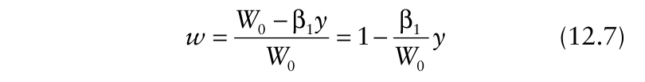{.equation width=60%}

In equation 12.7, the slope of relative yield versus disease is an inverse function of the disease-free yield, and the intercept is independent of disease-free yield. This is demonstrated in Fig. 12.6B, which shows the corresponding relative yield versions of the absolute yield relationships shown in Fig. 12.6A. When the slopes for two groups (cultivars, years, locations, etc.) are the same in terms of absolute yield, the slopes must be different in terms of relative yield, if the value of _W_ 0 used in obtaining _w_ is not the same for all groups. In particular, the larger the disease-free yield, the smaller the slope (closer to 0) for relative yield versus disease intensity.

Figures 12.6A and 12.6B showed how equal slopes on one scale can become different slopes on another scale. The converse can also happen. Fig. 12.6C demonstrates a situation where the slopes (and intercepts) are not the same for the model of _W_ in relation to _y_ for two groups _._ As shown in Fig. 12.6D, conversion to relative yield now results in equal slopes for the two groups (because of the chosen values of intercepts and slopes in Fig. 12.6C). Thus, as seen in Fig. 12.6, comparison of groups and interpretation of parameter estimates will be affected by the choice of _W_ or _w_ for the response variable. This is not an issue if the same _W_ 0 is used for all groups in obtaining _w_ values. In this case, the differences of slopes for _W_: _y_ models are maintained with _w_: _y_ models. However, simply using a single _W_ 0 across all groups when the data suggest different maximum yields for the different groups could be misleading, since the intercept would then not necessarily correspond to the diseasefree yield (for some of the groups).

{#fig-12-6}

Researchers do not always present crop loss results in terms of yield (relative or absolute) versus disease intensity, although we mostly express the relationship in this manner for internal consistency in the book. It is helpful for the reader to see some alternative representations, in order to avoid confusion in interpretation of published graphs. We demonstrate this for equations 12.1 and 12.3 (with two different values of the Θ parameter) by returning to the four panels of Fig. 12.4. We already considered Fig. 12.4A for our typical presentation of _W_ versus _y_. This decreasing relation between _W_ and _y_ is reversed when yield loss (_L_ = _W_ 0− _W_) is plotted versus _y_ (Fig. 12.4B). This is obvious, of course. What may not be as obvious is that the shapes of the curves (other than the straight lines) are also “reversed” when _L_ is used rather than _W_.

For reasons that should become clear in section 12.6, it is becoming more common to quantify crop losses in terms of disease-free crop leaf area (“disease-free intensity”, _H_ or _h_; see also Chapter 5) instead of disease intensity. Figs. 12.4C and 12.4D show the relationship between _W_ and _h,_ and _L_ and _h_, respectively, all based on the original curves in Fig. 12.4A. For all the curves in Fig. 12.4, we leave it to the reader to work through the algebra, starting with equation 12.3 (as an example), to determine the expressions for _L_ in relation to _y_, and for both _W_ and _L_ in relation to _h_. All of the relations shown in Fig. 12.4 for yield or loss in absolute units can also be expressed for relative yield (_w_) and relative loss (_l_). Careful consideration of the abscissa and ordinate in crop loss curves can thus avoid confusion in presentation and comparison of results.

### 12.4.4 Multiple-point models

Single-point models could be criticized because they are based on only a small portion of a disease progress curve. For instance, consider the three generated disease progress curves in Fig. 12.7. One might hypothesize that the epidemic depicted by curve “a” has the lowest yield since _y_ is higher than the other epidemics early in the season. Or, if _t_ = 90 (for instance) is a critical time for yield production, one could hypothesize that the epidemic depicted by curve “c” has the lowest yield since _y_ is higher than the other epidemics at the end of the season. However, if a single-point loss model was developed based on _y_ at _t_ = 75 (_y_ 75), then all three epidemics would have the same estimated/predicted yield because _y_ 75 is identical for all three epidemics. Of course, if 75 days post planting _is_ the critical time for yield formation (and the only time of relevance, hypothetically), then the model based on _y_ 75 _is_ the appropriate one, and yield would truly be the same for all three cases.

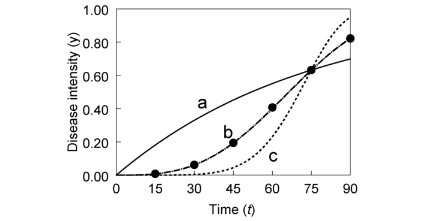{#fig-12-7}

In general, it is not expected that a very narrow time window will be satisfactory for relating yield to the disease epidemic. Thus, a more general framework for relating yield to disease is needed. The remaining subsections of section 12.4 deal with this requirement.

_Multiple-point models_ relate yield (or loss) to disease intensity at two or more times during an epidemic. The multiple-point models typically used are linear, but this is not a requirement. An example is:

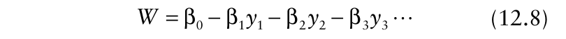{.equation width=60%}

in which the subscripts on the _y_ values are labels to indicate different times during the epidemic (not necessarily three consecutive assessment times), or different growth stages, and the βs are parameters. For instance, the _y_ values could correspond to the points (•) on curve “b” in Fig. 12.7. The concept behind a multiple point model goes back at least to Kirby and Archer (1927) who showed that yield estimates of wheat could be improved by using more than one assessment of stem rust. More formal consideration of models of this type can be dated to the important papers by Burleigh et al. (1972) and James et al. (1972).

The multiple-point model can also be formulated in terms of loss (_L_) or as relative yield (_w_) or relative loss (ℓ). Moreover, disease intensity can be in relative or absolute units, but the former is more common. The minus signs in equation 12.8 will become plus signs in the model versions with _L_ or ℓ as the response variable, because loss typically increases with increasing disease intensities. Another variation of the model is to use _change_ in disease intensity between times instead of actual measurements of disease at individual times. For instance, one could use Δ _y_ 1 and Δ _y_ 2 as predictor variables in the model, where Δ _y_ 1 is the change in _y_ between times 1 and 2, and Δ _y_ 2 is the change in _y_ between times 2 and 3. The parameters then are usually considered to be weights given to each disease value, or change in disease value between times, in influencing yield.

An example multiple-point model, shown with estimated parameters, is one developed for relative loss of peanut yield in Egypt in relation to Cercopora leaf spot severity (Madden et al., 1981b):

ˆ ℓ = 0.06 + 4.21Δ _y_ 1 − 0.24Δ _y_ 2 + 1.33Δ _y_ 3 in which the three predictor variables are changes in disease severity over 14-day periods. The coefficient of determination was 0.78. In this example, the estimated β2 parameter is negative (−0.24), which implies that, all other things being equal, that the higher the incremental increase in disease between the two dates, the lower the relative loss. Estimates of parameters with the opposite sign of that expected are not uncommon with multiplepoint models that are based on _y_ or Δ _y_ (e.g., Burleigh et al., 1972; Teng et al., 1979). Although it is possible for yield to increase somewhat with increasing disease severity (at low mean severities), a much more likely explanation for unexpected parameter values is _bias_ of the estimates caused by correlation of the _y_ values.

As shown in Chapter 4, _y_ at a given time is correlated with _y_ at the previous time—this is a consequence of the cumulative population-dynamic process that generates typical disease progress curves. When the predictor variables in any regression model are correlated, the estimated parameter for a variable (e.g., β2), and its standard error, depend on what other predictor variables are in the model (Neter et al., 1983). Thus, each disease predictor variable is not providing as much information as might be implied by just looking at the fitted equation.

In practice, disease data are obtained at multiple times for several epidemics and models are fitted by using least squares (multiple) regression (or possibly maximum likelihood) analysis (see Chapter 3; Madden, 1983). Because of the high correlation of _y_ s across times, it is likely that some of the predictor variables will not be significant contributors (in a statistical sense) to the multiple regression equation, even if they are all significantly related when considered individually (and biologically relevant). In other words, a subset of the _y_ variables will probably be able to provide as much information for yield estimation as all the _y_ variables do when taken together. The subset of the _y_ values can be chosen using formal or informal stepwise regression methods (Neter et al., 1983), as discussed at some length by Madden (1983). Appraisal of the residual plots can suggest transformations of the predictor or response variables. Modeling is empirical in nature for multiple point models (see Chapter 3) and sometimes very good fits to the data are obtained. However, both the estimated parameters and the significant variables can differ among studies, or even among years in a single study, making it difficult to draw general conclusions, especially since the direct interpretation of the β values is hindered by the correlation of the predictors. Plus, it is difficult to obtain measurements of disease intensity at the exact same time in different studies, making it challenging to compare results across studies. For these reasons, multiple point models are not used as often as one might initially think. In fact, it is quite possible for a single-point model to provide as good a fit (in terms of _R_2 ) as a multiple-point model (e.g., Madden et al., 1981b).

Nevertheless, there is a valuable concept underlying multiple-point models: the entire epidemic potentially influences crop yield, and the importance of a given intensity of disease (in relative or absolute units) depends (at least in part) on the time during the season when that given disease intensity occurs. Fortunately, there are alternatives to multiple point models that are consistent with this concept.

### 12.4.5 Integral models

The area under the disease progress curve (AUDPC) is commonly used as an overall synthesis of polycyclic and monocyclic diseases. This area can be written as:

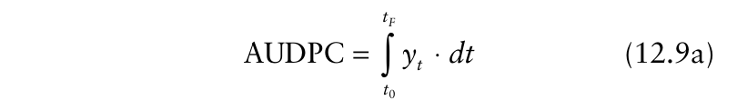{.equation width=60%}

in which _t_ 0 and _tF_ are the times of first and last disease assessments, respectively. As shown in Chapter 4 (section 4.7.2.6), the epidemic parameters _r*_ and _y_ 0, together with the time duration of the epidemic (i.e., _tF_ − _t_ 0), can be used to determine AUDPC. In general, increasing values of _r*_, _y_ 0, and _tF_ − _t_ 0 lead to increasing areas. Even when a particular disease progress model is not fitted to the epidemic data, it is easy to approximate AUDPC of equation 12.9a using equation 4.42. In fact, the most common way of obtaining AUDPC is with equation 4.42 rather than based on a fitted growth model to the disease progress curve. It is also possible to define an area under the curve for disease intensity in absolute units (_Y_), or for disease-free intensity (_h_ or _H_); one simply substitutes the variable of interest for _y_ in equation 12.9a (or equation 4.42). One can standardize for duration of the epidemic by dividing AUDPC by _tF_ − _t_ 0 (to obtain AUDPC*).

Vanderplank (1963) may have been the first to suggest that AUDPC is related to crop yield. Many investigators have since found this variable to be quite useful in predicting yield or loss (as reviewed in, for example, Teng, 1985; Madden, 1983; Nutter, 2002b). Some of the graphs in Fig. 12.2 show yield in relation to AUDPC. A simple linear model is written as:

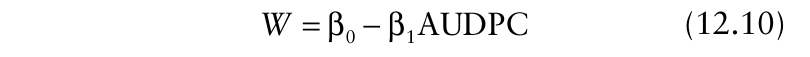{.equation width=60%}

That is, _y_ in equation 12.1 is replaced by AUDPC. As with single-point models, transformations of the predictor variable can be used (e.g., √AUDPC), if plots of _W_ versus AUDPC, or the residual plot from a regression analysis (see Chapter 3), indicate that a transformation is needed. Moreover, AUPDC can be used in nonlinear models (e.g., equations 12.3 and 12.5) instead of _y_ at a single time (Madden and Nutter, 1995). In general, the models in section 12.4 can be use to relate yield (or loss) to AUDPC. We call models such as equation 12.10 and others that use AUDPC as _integral models_, or simply AUDPC models.

A recent example of an integral model, shown with estimated parameters, is one developed for the effects of Stagonosporpora blotch on wheat yield (MT/ha) in Australia (Bhathal et al., 2003): which had an _R_2 of 0.83. We show the coefficient of AUDPC based on measurements of _y_ on a proportion scale (but note that the authors used _y_ on a percentage scale).

By using AUDPC, the entire epidemic (from _t_ 0 to _tF_) is utilized in predicting _W_. Because of the cumulative aspect of the area, high (or even moderate) values of _y_ early in the epidemic result in a higher area than high values of _y_ only late in the epidemic. For instance, the AUDPC values for the three curves in Fig. 12.7 are 38, 25, and 21, for curves a, b, and c, respectively. If equation 12.10 is appropriate, then the lowest yield would, indeed, correspond to epidemic “a”.

In one sense, an integral model uses the same information to predict _W_ (or _w_ or _L_ or ℓ) as does a multiplepoint model. However, the integral model does this with (considerably) fewer parameters. In a statistical sense, an integral model is more parsimonious than a multiplepoint one. Instead of having a parameter for the _y_ value at each time point, there is one parameter (β1 in equation 12.10) for all disease intensities. This is especially advantageous when one does not have a large number of data points to be used in model development. Of course, it is still quite possible that all _y_ values should not be given equal weight in determining an integral variable. For instance, it is possible (for some diseases) that very late season severity has no (or little) effect on yield. One can calculate a new area defined as:

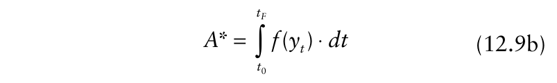{.equation width=60%}

where _f_ (_yt_) is some function of _y_ (Shaw and Royle, 1987; Shtienberg et al., 1990). A simple example for the function is _f_ (_yt_) = ω _t_ · _yt_, in which ω _t_ is a weight for the given time. Unlike the situation with multiple-point models, the weights are chosen prior to modeling _W_ in relation to _A*_. Two possibilities would be ω _t_ = _t_ and ω _t_ =1/ _t_, to account for increasing and decreasing importance over time, respectively, of _y_ in determining yield. From an empirical modeling perspective, one could calculate _A*_ with different weight functions, and determine which one provides the best predictions of _W_. This is analogous to evaluating _y_ and transformations of _y_ in single-point loss models.

As indicated above, AUDPC has been found to be very useful for characterizing the effects of plant diseases on crop yield in several studies. By generalizing the integral variable from AUDPC to _A*_, one clearly increases the flexibility of linear and nonlinear crop loss models. However, the modeling approach is still empirical, and does not necessarily account for known physiological aspects of yield production by crops (see section 12.6). Nevertheless, it is important to re-emphasize the important general principle of using models with an integral-type variable to characterize the cumulative effects of disease on yield. Several later sections of the chapter will make this clear.

### 12.4.6 Other predictor variables in empirical models

So far we have focused on the relationship between disease intensity at one or more times, or its integration (summation) over time (e.g., AUDPC), and the resulting crop yield (or loss). Other terms, however, can be used to summarize an epidemic. One could use an estimate of the rate parameter (_r*_) for an appropriate population growth model or the secondary infection rate (i.e., transmission) parameter of a more complicated compartmental model (e.g., equation 5.30), as well as time until a certain level of disease intensity is reached (_ty_ ′). An example of the latter is the time until first symptoms are observed—the basic premise is that the longer it takes to reach the specified disease value, the higher the yield. When the model contains only one predictor variable, it may still be called a single-point model (see section 12.4.2), even if the predictor is not an estimate of disease intensity obtained at a single time. However, we mostly use this model label when the predictor variable is disease intensity.

An example model is the one developed by BejaranoAlcázar et al. (1997) for Verticillium wilt of cotton. Number of bolls/plant, relative to the disease-free control, can be predicted with:

{.equation width=60%}

where _X_ 1 is the log of the time (measured as physiological time or growing degree days) to first symptoms and _X_ 2 is the log of the rate of increase of disease intensity. The _R_2 was 0.68. As expected, the parameter for time to disease was positive and the parameter for rate of increase was negative. Because the predictor variables involved logs, the estimated intercept term represents predicted relative yield when the logs of the time and rate terms are 0, well outside the range of actual predictor values. Thus, the intercept has no biological meaning here.

As demonstrated in Chapter 4, the time to reach any value of _y_ is directly related to _y_ 0 (initial disease intensity) and _r*_. Of course, _y_ at any time is also a function of these same parameters. Moreover, AUDPC is determined directly from _y_ 0, _r*_, and the time between the first and the final disease assessments (_tF_ − _t_ 0). So, AUDPC captures many of the features of epidemics that are of relevance in determining yield, a likely reason behind its popularity in empirical models of crop losses.

With some pathosystems, it may still be beneficial to use some of these epidemic components individually in crop loss models. This could be the case when there is a precise (and possibly linear) relation between _W_ and _r*_, for example, but there is a less precise and nonlinear relation between _W_ and AUDPC. This essentially involves use of multiple regression equations, such as equation 12.8, with the different epidemic components substituted for the _y_ variables on the right-hand side.

Multiple linear regression models also provide a way of incorporating other variables (unrelated–at least directly–to disease) of possible significance in determining yield. For instance, fertilizer concentrations and summary weather variables (e.g., rainfall) could be incorporated into models. A model could be written as:

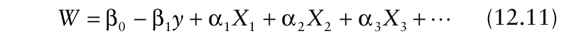{.equation width=60%}

in which the _X_ s refer to variables other than disease intensity or AUDPC, and the αs are parameters. This approach is of benefit for data collected in surveys of commercial fields, because many factors (soil nutrition, weather) cannot be controlled or, because of lack of randomization, cannot be discounted in terms of characterizing the impact of plant diseases on yield (or loss). In addition to use of classical linear regression-type models, more elaborate univariate and multivariate models can be used, based on methods such as: path analysis (vanBruggen and Arneson, 1986), correspondence analysis (Savary and Zadoks, 1992b; Savary et al., 1995), principal components (Hau and Kranz, 1990; Shane, 1987), or discriminant analysis (Francl et al., 1987). We do not pursue this subject here, but refer readers to these cited articles as well as more general articles on analysis by Madden (1983), Madden and Nutter (1995), and Hau and Kranz (1990).

## 12.5 An Example Analysis

We demonstrate the fitting of empirical models to crop loss data here, based on some of the results reported in Navas-Cortés et al. (2000) for the effects of Fusarium wilt on chickpea yield. For each of three planting dates, two different cultivars (“P-2245” or “PV-61”) were grown in microplots infested with three different densities of either race 0 or 5 of _Fusarium oxysporum_ f.sp. _ciceris_. We consider the data for one of the growing seasons (1987/88) studied. The modeling performed by Navas-Cortés et al. (2000) mostly involved relative yield, but we consider the actual yield (g/microplot row) here for demonstration purposes. Relative yield was determined based on diseasefree yields, which varied with planting date.

Disease intensity was estimated throughout the epidemics, and the Richards model (equation 4.23a) was fitted to the disease progress data. The rate of disease increase was summarized with the weighted mean rate of increase (ϖ; equation 4.50), which adjusts for different shapes of the curves. Other variables were also calculated, including AUDPC and the time to initial symptoms. The means across four replications are shown in Fig. 12.8 for the one data set considered here. There was, as expected, a decrease in _W_ with increasing final disease intensity (_yF_), AUDPC, and the estimated rate parameter. Only the _W_: _yF_ relationship appeared to be linear. There was also a positive relationship between _W_ and time to symptoms; this is expected based on the other graphs, since there is a known negative relationship between the rate parameter of a disease progress model and time to reach a certain disease value (see Fig. 4.10). We show the analysis only for the relationship _W_: _yF_. The data are shown in Fig. 12.9 in the form of a SAS program. More details on the use of SAS are found in sections 4.6 and 4.7 of Chapter 4, and also in Chapter 7. The analyses described here can be done by many statistical programs.

{#fig-12-8}

Values of yield extended from about 300 g/microplot row at _y_ ≈ 0 down to 0 at _y_ ≈ 1, so there was no evidence of a nonzero minimum yield (i.e., we can take _W_ min = 0 and _b_ = 1, see equation 12.6a). Moreover, there was no evidence of _W_ leveling off at a maximum value for some level of disease intensity above 0; that is, there was no (low) level of disease intensity below which there was no apparent yield response to disease intensity (as seen in Fig. 12.5), and, thus, no disease threshold for a yield response. This corresponds to _a_ = 0 in equation 12.6a. So, we first fittedusing ordinary least squares regression analysis (see Chapter 3)the statistical version of linear equation 12.1 (same as equation 12.6b with _a_ = 0, _W_ min = 0, and _b_ = 1) to the data. This is:

{.equation width=60%}

in which the subscript _i_ refers to the individual observations. Without a threshold of disease, β0 is the same as _W_ 0 in equation 12.4 (the maximum disease). The data are graphed in Fig. 12.10, with different symbols for the cultivars and pathogen races. Estimated parameters (with standard errors in parentheses) were: βˆ 0 = 277.8 (14.3) and βˆ 1 = 280.9 (20.3). The _R_2 value was 0.85. The fitted line is shown in Fig. 12.10A. (Note that the SAS program in Fig. 12.9 does not fit this simple model, but the more complicated one discussed below. Readers should refer to Fig. 4.14 for information on use of the REG procedure of SAS). For linear models, regression procedures assume that there are additions separate analysis for each combination of cultivar and race, and then compare the estimated parameters with t- tests, but we do not pursue this here. For one thing, for some combinations of cultivar and race (e.g., “P-2245” and race 5), there was a very limited range of _W_ and _yF_ values, making it difficult to obtain reasonable estimates of the slope and intercept from the small number of data points available. Instead, we take a more formal overall approach, and conduct a covariance analysis, with _yF_ as the continuous variable, and cultivar (_C_) and race (ℜ) as class or factor variables. This approach was taken in sections 4.7.1 and 4.7.2 for comparing disease progress curves. It is very important that readers understand those sections, because we do not repeat the details or background here.

{#fig-12-9}

{#fig-12-10}

In pseudo-equation form, we can write an equation for yield as:

The intercept (in this case, maximum yield in the absence of disease) is given by CONSTANT + CULTIVAR + RACE, and the slope is given by DISEASE + (CULTIVAR × DISEASE) + (RACE × DISEASE), where the factor variables take on different values depending on the cultivar and race. As a covariance model, we expand equation 12.12 to write:

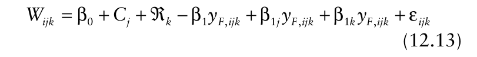{.equation width=60%}

between terms, but we have written the linear models for yield with a subtraction between the intercept term and the disease term so that β1 is a positive number when there is a decline in _W_ with increase in _y_. Thus, the output from a regression program lists the slope as −280.9 rather than as a positive value. To be consistent with the model presentations in this chapter, one simply changes the sign.

As discussed previously, when equation 12.6b is appropriate, the slope is _W_ 0− _W_ min, or just _W_ 0 when _W_ min = 0. For the model fitted to the example data, the slope and intercept were both around 280, consistent with the theory. A plot of the residuals (not shown here) indicated that a linear relationship was appropriate. However, there was some evidence of residual variability being dependent on _W_ (or _yF_), with higher variation at large _W_ (small _yF_) and low variation at small _W_ (large _yF_). We re-fit the model using weighted least squares, with weights equal to (_W_ + 1)−1/2 (for a strictly empirical analysis). Estimated parameters (and standard errors)

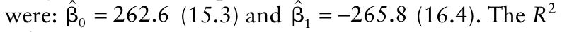{.equation width=60%}

value was 0.886.

The analysis so far ignored the effects of cultivar and pathogen race. As the next step, one could conduct a in which: β0 is a constant, _Cj_ is the effect of the _j_ th cultivar (_j_ = 61, 2245) and ℜ _k_ is the effect of the _k_ th race (_k_ = 0, 5) on the intercept (_W_ at _yF_ = 0); β1 is (as before) a slope for _yF_; and β1 _j_ is the effect of the _j_ th cultivar and β1 _k_ is the effect of the _k_ th race on the slope. The subscript _i_ refers to the specific individual observation (different planting dates and inoculum densities, which are not being explicitly modeled here). We do not include the interactions of cultivar and race on the intercept or slope, since we felt there was not sufficient number of observations to estimate these terms precisely. Plus, this would have returned us to the problem of having a very limited range of observations for some combinations of cultivar, race, and disease intensity.

The MIXED procedure of SAS (Fig. 12.9) fits equation 12.13 to the data, and a portion of the output is shown in Fig. 12.11. The F-tests of fixed effects indicate that both factors affected the intercept (e.g., _F_ = 6.12 for cultivar) and slope (e.g., _F_ = 5.93 for interaction of disease and cultivar). Thus, the height of the lines and their slopes were affected by the experimental factors. The estimated parameters are shown as the solution for fixed effects. The estimated intercept and slope for each combination of cultivar and race are determined from the displayed estimated parameters (_solution_) _._

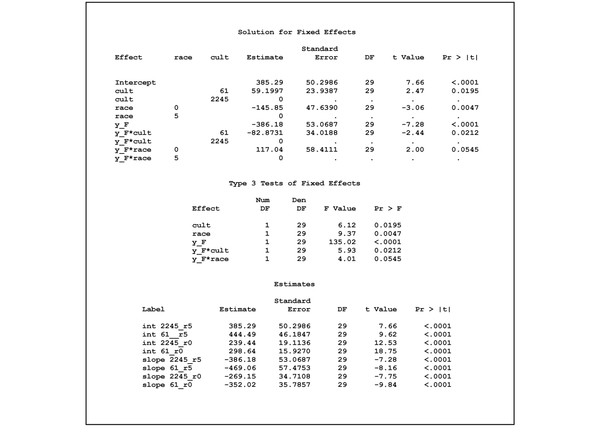{#fig-12-11}

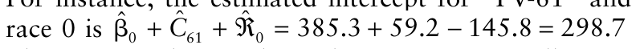{.equation width=60%}

The program listing shows how to estimate all intercepts and slopes. As discussed in section 4.7, the parameterization utilized by SAS is to specify the last level of a factor as 0. Thus, some of the estimate statements are redundant with the solution portion of the output, although they are shown to help the reader see the process of determining the values. For example, the intercept for “P-2245” and race 5 is just βˆ 0 = 385.3 + 0 + 0 = 385.3 (which is displayed directly as the Intercept in Fig. 12.11). Note that the displayed slopes are negative, because of the assumed addition signs between terms in linear models.

With only two cultivars, significant F-tests for the main effect and interaction with disease intensity indicate that “PV-61” and “P-2245” differ in terms of disease-free yield and the for the rate of decline in yield with increasing disease. In particular, disease-free yield is 59.2 g/microplot row higher with “PV-61” than with the other cultivar, but the decline in yield with disease is 82.9 g (per unit disease) steeper. With more than two cultivars, contrasts would be needed (see Fig. 4.16) to determine which pairs of cultivars were different. The predicted lines for the combinations of pathogen race and host cultivar are shown in Fig. 12.10. In contrast to the situation where the experimental factors were not considered, a residual plot did reveal a need to use weights. The MIXED procedure does not calculate an _R_2 value. One trick (for linear models with no randomeffect terms, other than the residual) is to square the correlation between observed and predicted _W_ values (done outside of the procedure). This produces an _R_2 of 0.92.

The reader is reminded that the analysis done here is based on means across replications. With the individual replicate data, one could more fully assess the effects of the experimental factors, by fitting a model that also includes random effects appropriate for the split-plot (Schabenberger and Pierce, 2002) type of design used by Navas-Cortés et al. (2000). Additional modeling could be done for AUDPC and other predictor variables, both for yield and relative yield as the response variable. Navas-Cortés et al. (2000) should be consulted for detailed analysis of relative yield.

## 12.6 Mechanistic Approaches to Crop Loss Assessment

Over the last decade or so, considerable effort has been made to develop models that (1) provide a more mechanistic characterization of crop losses in relation to disease, and (2) are simple enough to be useful for description and comparison of results for different diseases and host crops. We present some of these key concepts in the following sections.

### 12.6.1 General considerations based on crop physiology

“Yield is the final outcome of crop growth and development processes occurring throughout the growing season” (Slafer, 2003). Photosynthetically active leaf area is a major determinant of crop yield. More than a half century ago, Watson (1947) stated that yield is directly related to the leaf area index (LAI; see Chapter 2) integrated over time during a season. In a casual way, this is the basis for the empirical loss models of section 12.4. That is, for a fixed LAI for all observations, and a necrotic disease (such as a leaf spot), a field with _y_ = 0.5 for severity will have half the disease-free LAI as one with _y_ = 0.0; presumably, the former field will have a lower yield than the latter, depending on the plant and pathogen species, and current environment.

If the observations (fields, plots, rows, plants, etc.) have different LAI values, then there is a difficulty with the above scenario. For instance, suppose (as an extreme example) that the field with _y_ = 0.5 (e.g., 50% of foliage is covered by lesions) had a total LAI of 8 and the field with _y_ = 0.0 had a total LAI of 4. Then the disease-free LAI is the same in both fields, even though there is a substantial difference in disease intensity as a proportion. The most direct way to overcome this difficulty is to express disease in absolute units. With _y_ as the proportion of LAI that is diseased, then absolute disease severity is _Y_ = _y_ · LAI. Likewise, disease-free or healthy LAI is simply _H_ = (1 − _y_) · LAI. By definition, _Y_ + _H_ = LAI for diseases of foliage when disease is determined as a proportion of leaf area. With the idealized example here, one would expect both fields to have the same yield if the only impact of the disease is to reduce disease-free LAI, and diseased LAI makes no contribution to yield.

It is possible to measure _Y_ directly using visual, electronic, or other methods (see Chapter 2). With a measurement or estimate of LAI, one can then obtain _H_ from LAI− _Y_. It is more common, however, to obtain _H_ from measurements of (total) LAI and proportion diseased. In the crop loss assessment literature, _H_ (when determined in units of leaf area density) is often known as HLAI [i.e., healthy leaf area index; HLAI = _H_ = (1 − _y_) · LAI]. Depending on the circumstances, _H_ can be used more broadly than HLAI; for instance, number of healthy roots, area of healthy roots, number of healthy plants, and number of healthy fruits (see Chapter 5). Note, the calculation of HLAI as (1 − _y_) · LAI is applicable only when _y_ is _not_ representing defoliation. Sometimes defoliation is included as disease severity, and sometimes it is not. HLAI can be defined in either case, but its calculation depends on how disease is estimated.

Just as _y_ is integrated over time to determine AUDPC, HLAI can be integrated over time to obtain another type of area. One simply substitutes HLAI for _f_ (_y_) in equation 12.9b to obtain so-called _healthy area duration_ (HAD). One could then characterize crop losses by modeling yield (or yield loss) as a function of HAD instead of as a function of AUDPC (or _A_ * in general) (e.g., Parker et al., 2004). Only when LAI is constant for all observations (all plots or fields) is there an exact (negative) relationship between AUDPC and HAD. As demonstrated with Fig. 12.4, the direction of the relationship between _W_ and the predictor variable is reversed when the predictor is representing disease-free intensity instead of disease intensity. Thus, one expects a positive relationship between _W_ and HAD if the disease of interest is reducing yield.

As an aside, we point out that we used algebraic notation in equations for most of the book, with singlecharacter letters for variables and parameters. A major exception was the use of AUDPC for area under the disease progress curve. However, in the crop loss assessment literature dealing with physiological approaches to characterize yield, it is very common to use mnemonics such as HLAI, HAD, and other multiple-character terms to be defined below, instead of single-character symbols. We have tended to partly follow this convention in this section of the book. Thus, whereas _M_ was used for total plant population “size” (_M_ = _Y_ + _H_) elsewhere in this book, here we use LAI instead of _M_ to explicitly refer to total leaf area.

Coupled with the differences in LAI (and HLAI) between fields, is the fact that total LAI (even without disease) is not constant within a field during the growing season (e.g., Béasse et al., 2000). Since “yield is formed continually from sowing to harvest” (Slafer, 2003), one must account for the dynamics of LAI to adequately relate this variable to yield. Foliar diseases obviously affect HLAI, but some diseases (both foliar and root, as well as systemic ones) may affect total LAI through the production of new HLAI over time and the loss of diseased (or healthy) LAI through disease-caused defoliation (Johnson, 1992). In Chapter 6 we dealt with some of the issues related to disease progress when total host size (e.g., represented here by LAI) is not fixed during the course of the epidemic. Below we address the topic in terms of crop losses.

Monteith (1977) greatly refined Watson’s (1947) concept of yield by indicating that dry matter or biomass production of a crop is a direct function of the radiation interception by the crop canopy integrated over time. The key parameter of this function is the efficiency (rate) at which the radiation is converted into biomass. In the Monteith approach, LAI only matters because it can be used to determine how much solar radiation is intercepted by the crop. In a highly significant paper, Waggoner and Berger (1987) applied Monteith’s general approach to plant diseases, and presented ways to model crop loss within the radiation-interception framework. In a follow-up article, Johnson (1987) elaborated on the Waggoner and Berger approach and showed how different types of diseases (or pests, in general) can affect crop losses in terms of the radiation interception and use of the radiation, and also showed some of the limitations of the method. Several authors have since used this valuable approach to characterize the impact of diseases and pests on yield (see the many references in Bergamin Filho et al., 1997).

### 12.6.2 Radiation interception and yield

The growth and development of all plants, including the production of the harvested plant portion (i.e., yield) of crop plants, is powered by radiant energy originating from the sun. Not all wavelengths of solar radiation matter in driving plant growth (Lee, 1978; see also section 2.4.3 of this book). Radiation in the wavelengths from around 400 to 800 nm, known as photosynthetically active radiation (PAR), is most important. As a rule of thumb, PAR comprises about half of the total solar short-wave radiant energy incident at the Earth’s surface. The amount of radiant energy incident per unit area per unit time is known as _irradiance_ (or insolation) (_R_, MJ.m−2 .day−1 ). Irradiance at the Earth’s surface is affected by many factors, including time of year and time of day, latitude, topography (e.g., aspect), and atmospheric conditions. However, irradiance at the surface is generally between 50 and 80% of the irradiance at the top of the atmosphere, and varies little from day to day during a growing season (Lee, 1978).

In studies of crop growth (and crop loss) we are usually interested in the amount of incident radiation that is intercepted by a crop canopy. The calculation of daily radiation interception (RI, MJ.m−2 .day−1 ) uses the fact that fractional radiation interception (Ψ, a dimensionless proportion) is a function of LAI (Monteith, 1977):

{.equation width=60%}

in which _k_ is a positive parameter (a type of “extinction coefficient”), generally taking values from 0.3 to 1, depending on the canopy architecture. In canopies with flat, overlapping leaves, _k_ is close to 1, and in canopies with erect (vertical) leaves, _k_ is about 0.3. One can statistically estimate _k_ if one has experimental data for the radiant energy flux density (obtained with a radiometer) both immediately above and under crop canopies over a range of LAIs. However, for crop loss studies, it is more common to use published values of _k_ for the type of canopy being studied. Given a value of _k_ and the current LAI, daily radiation interception is RI = Ψ· _R_. Since _R_ is multiplied by a unitless value to obtain RI, RI is also known as an irradiance (radiant energy per unit area and time); however, it is quite common to refer to RI simply as radiation interception.

In meteorology, equation 12.14 is known as Beer’s Law, but readers of this book should recognize it as being equivalent to the monomolecular equation for _y_ (see equation 4.10, with LAI for time, and _k_ for _r_ M), and as one minus the zero term of the Poisson distribution (equation 5.2b). An obvious property of Beer’s Law is that the curve for Ψ is concave to the LAI axis. The fraction intercepted rises rapidly at first, but the magnitude of the increase in Ψ decreases with increasing LAI. Depending on the value of _k_, there is very little increase in Ψ at LAI values above ∼4. Equation 12.14 is graphed in Fig. 12.12.

Assuming that crop biomass production, in general, or yield production, in particular, is a direct function of RI (Monteith, 1977), the curves shown in Fig. 12.12 have major implications for plant diseases. If the main effect of a disease is to reduce LAI (say, through defoliation), then a given disease would not have much of an impact on yield if LAI is normally high in the absence of disease. This is especially true if _k_ is high. For instance, with _k_ = 0.9 and an LAI of 7 without the disease, Ψ is 0.998, meaning that virtually all incident radiations are intercepted. If the disease reduced LAI by half to 3.5, Ψ would be 0.957, indicating that virtually all the incident radiation is still intercepted by the foliage. For this scenario, a discernable change in yield would only occur when LAI is reduced by much more than 50%. With a lower _k_, corresponding to a more erect foliage, the changes in LAI needed to have an effect on Ψ (and hence RI) would not have to be as large.

We use _WT_ to indicate the total biomass (as dry matter, DM) produced by a crop per unit area (e.g., g DM.m–2 , kg DM.ha–1 ) by the end of the season. The moisture content is quite different in different crops (potato tubers versus wheat seed versus apple fruits at harvest, for instance), so conversion to dry matter is useful for comparing results from different systems. The essential concept underlying Monteith’s analysis is that biomass is a function of daily radiation interception integrated (i.e., summed) over the growing season. The model can be written as: _tF tF WT_ = RUE· RI · _dt_ = RUE·[ _R_ ·(1 − exp(−· _k_ LAI))] · _dt_

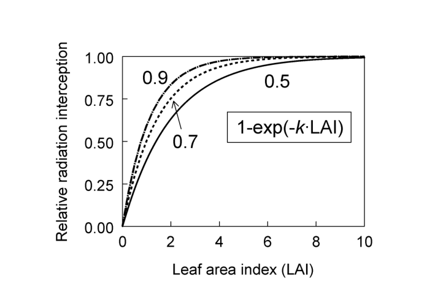{#fig-12-12}

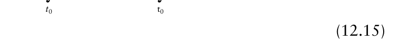{.equation width=60%}

in which RUE is a term known as the _radiation use efficiency_ (g DM.MJ–1 ). RUE may be a constant or a variable (see below), reflecting the rate at which radiation intercepted by the crop canopy is converted into crop biomass through photosynthesis. Clearly, RUE would not be the same at every day of a growing season; however, it turns out that a constant works well in equation 12.15 in predicting biomass, at least in some circumstances (notably for crops growing in good agronomic conditions). When RUE is a constant, it can be moved to the left-hand side of the integration symbol in equation 12.15. Then:

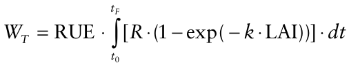

The integral gives the amount of radiation intercepted by the crop canopy, accumulated over an appropriate time interval such as the growing season (units of MJ.m–2 ), and _WT_ then has the appropriate units of g DM.m–2 . Not all crop biomass produced is converted into harvestable yield. Early in the season, photosynthate is incorporated into roots, stems, shoots, and leaves, and vegetative parts in general. Later, photosynthate is incorporated into fruit, seeds, or other harvestable products. Harvested yield biomass (_W_) often can be determined as a simple fraction of _WT_ (often called the _harvest index_).

One way to account for the impact of foliar disease on intercepted radiation is to multiply the total daily radiation interception (RI) by the proportion of disease-free leaf area; that is, one can define the daily _healthy radiation interception_ (HRI) as:

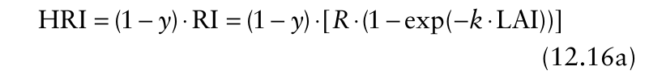{.equation width=60%}

where _y_ is specifically (here) the proportion of current LAI affected by disease (not total severity, if defoliation is included for total), and _R_ is, as before, the irradiance immediately above the crop canopy. In other words, the daily radiation interception by _all_ foliage is determined (RI), and this value is then reduced as a linear function of the area of foliage that is currently disease-free. An alternative for estimation of HRI would be to modify the fractional radiation interception (Ψ) by a direct function of HLAI; that is, one could use:

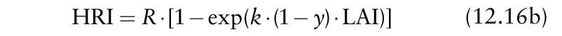{.equation width=60%}

Waggoner (1990) did not believe the latter expression would properly account for the shading of lower leaves by upper ones in determining HRI. Most investigators working on crop losses in relation to plant disease simply use equation 12.16a, and we use this equation below.

Fig. 12.13 demonstrates these concepts of leaf area and intercepted radiation for fixed values of _k_ and _R_, with a dynamic LAI, and logistic progress for _y_. For the situation without disease, one can see that daily radiation interception (RI) stays relatively constant from about 20 to 60 days (“0” curve in Fig. 12.13C), even though LAI is changing quite a bit. This is a consequence of Beer’s law when LAI is high. With disease, both LAI and RI are reduced in direct proportion to _y_ at any time, based on the definitions of HLAI and HRI used here. The situation (and thus the curves in Fig. 12.13) can be more complicated if disease also reduces total LAI (through defoliation), which is not shown here.

![(**A**) Progress of disease severity (_y_; proportion scale) based on logistic model (equation 4.15a) at rate values (_r_ L) of 0.1 and 0.2/day (indicated on the graph). (**B**) Healthy leaf area index [HLAI = (1 − _y_) · LAI] versus time for the two epidemics depicted in (A) and for the case without disease (“0”). LAI was generated based on a generalized logistic model consisting of a cubic function for time. In this example, disease did not affect LAI, so that _y_ includes only diseased leaf area (so there is no disease-caused defoliation). (**C**) Healthy radiation intercepted [HRI; equation 12.16a, with _k_ = 0.7 and incident radiation (_R_) of 15 MJ.m−2 day−1 ) versus time corresponding to the curves in (B).](figures/fig12-img22.png){#fig-12-13}

The basic premise of Waggoner and Berger (1987) is that total biomass of a crop in the presence of a foliar disease can be determined by simply substituting HRI for RI in equation 12.15:

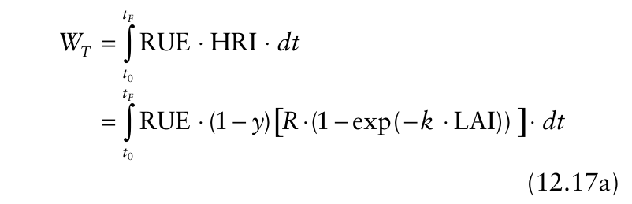{.equation width=60%}

yield of the crop. Yield in published papers may or may not be converted to dry matter (or some other standard moisture content), and irradiance values presented may be total solar short wave radiation per unit area and time or it may be just photosynthetically active radiation (PAR) per unit area and time. Thus, readers should be careful in comparing published results among studies.

When RUE* is (or is taken to be) constant over the growing season, the term can be moved outside the integral. Equation 12.17b can be written as:

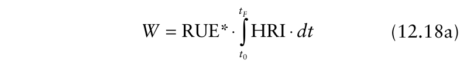{.equation width=60%}

The integral term was called _healthy area absorption_ (HAA = ∫ HRI · d _t_; MJ.m−2 ) by Waggoner and Berger, and this label is fairly common. Equation 12.18a can be written as:

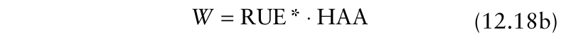{.equation width=60%}

In other words, intercepted radiation drives photosynthesis, which in turn determines biomass production. Photosynthesis (in the model) occurs only where the disease does not occur, thus, only some of the intercepted radiation is utilized by the plant (depending on the severity of disease). With less intercepted radiation to utilize (HRI < RI, if _y_ > 0), the biomass production is lower than in the absence of disease. So, one (mechanistic) way that plant diseases reduce yield is to reduce the interception of radiation available for photosynthesis, via a reduction in the area of photosynthetically functioning leaf tissue. The other way that diseases may affect yield (or plant biomass in general) is to reduce the efficiency at which HRI is converted into biomass. Many diseases (including systemic, foliar, and root diseases) affect the photosynthesic efficiency of the plant, even in parts of the plant where the pathogen is not present (see section 12.6.4). Of course, a given pathogen can affect both RI and RUE in a given host crop.

One can think of equation 12.15 as a special case of 12.17a because, when there is no disease, HRI and RI are identical. To express actual yield specifically (and not total biomass) in terms of RI and RUE, one can write: which is an equation for a straight-line relationship between _W_ and HAA, with slope of RUE* and intercept of 0.

In principle, use of equation 12.7b, 12.18a, or 12.18b can result in a much more mechanistic characterization of crop losses than models based on disease intensity at individual times or integrated over time (AUDPC). Biomass production in general, and yield production in particular, are determined by how much radiation is intercepted by the crop and the efficiency at which the radiation is utilized. Leaf area only matters in that it affects the interception of radiation. In this context, diseases only matter in that they can:

1. Change the healthy radiation interception (HRI), which is done by lowering healthy leaf area, either by

- i. directly reducing _total_ LAI (such as through defoliation), or by

- ii. “occupying” (i.e., replacing) some or all of the healthy leaf area with lesions;

2. Alter the efficiency at which the crop utilizes intercepted radiation, specifically for the production of harvestable yield.

It is possible, of course, for some diseases to affect both RUE (or RUE*) and HRI.

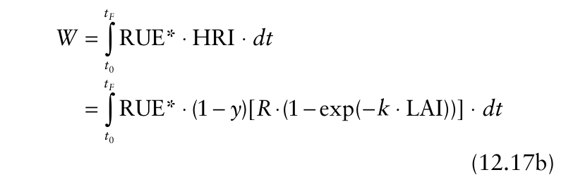{.equation width=60%}

in which RUE* is a scaled version of RUE. That is, RUE* equals RUE multiplied by a factor to reflect the fraction of total biomass that represents the harvested

### 12.6.3 Characterizing crop losses in relation to HAA and RUE

In the last few years there has been considerable interest in using equation 12.18b for modeling crop yield (and hence loss) for various pathosystems. Bergamin Filho et al. (1997) cite many of the articles. In Fig. 12.14 there is an example taken from part of the study by Bergamin Filho. Data are for angular leaf spot of _Phaseolus_ beans, caused by _Phaeoisariopsis griseola_. Mean irradiance was determined to be 12.4 MJ.m−2 day−1 , and leaf area at the weekly sampling times was estimated indirectly from measurements of the maximum width of the central leaflet of observed plants. For _k_ (equation 12.14), a value of 0.7 was assumed. As shown in Fig. 12.14A, there was no discernable relationship between yield and AUDPC for this data set. Yield was expressed as weight of seeds (at 12% moisture) per unit area (g m−2 ). This was a situation with very low mean disease severity. However, there was a clear positive relationship between yield and both HAD and HAA (Fig. 12.14B,C). Although some authors find a nonlinear relationship between yield and HAD, in this case a linear model appeared satisfactory to characterize these data. However, the relationship between yield and HAD varied among data sets for the tested bean cultivar (Bergamin Filho et al., 1997).

![Relationship between yield (g m−2 ) of Phaseolus beans and: (**A**) area under the disease progress curve (AUDPC), for angular leaf spot (caused by _Phaeoisariopsis griseola_); (**B**) Healthy area duration [HAD; see equation 12.9b, with HLAI for _f_ (_y_)]; and (**C**) Healthy area absorption [HAA; see equation 12.18b, with 12.16a for HRI]. Results from Bergamin Filho et al. (1997) for the May planting of cultivar “Carioca” in Paraná, Brazil.](figures/fig12-img23.png){#fig-12-14}

There was a linear relationship between yield and HAA (Fig. 12.14C). This indicates that RUE* was constant over the time period when HLAI measurements were being taken (see equations 12.18a, b), or that deviation of RUE* from a constant value was not great enough to result in any observed curvature in the relationship (given the inherent measurement and sampling variation in disease intensity, yield, and HAA). Based on linear regression analysis (equation 12.18b, but with an additional intercept term; see Chapter 3), the estimate of RUE* was 0.73 g MJ−1 (_SE_ = 0.052) and the estimate of the intercept was −80 g m−2 (_SE_ = 20.6). _R_2 was 0.70. Note that the minimum observed value of HAA was 212 MJ.m−2 ; thus, one must be very cautious in interpreting the intercept (_W_ at HAA = 0) in a physical sense. A little algebra shows that the regression results indicate a predicted yield of 0 at −(−80)/0.73 = 109.6 MJ.m−2 , roughly half the smallest observed HAA. One would actually need to have observed HAA and yield values at and below 110 to confirm that no yield is produced at low (but nonzero) HAA. If this were found, a more general model for _W_ in relation to HAA could be justified, possibly using equation 12.4, with _S_ (HAA) as the switching function.

Although not shown here, the estimate of RUE* (0.73 g MJ−1 ) was consistent for different experiments with the same cultivar. Note that the estimated RUE* is for harvested seed (not total biomass) at 12% moisture content. As shown in Bergamin Filho et al. (1997), conversion of RUE* to RUE (i.e., adjusting for moisture content and total _dry_ matter production, not just the harvested portion) results in an RUE of ∼1.6 g DM MJ−1 , typical of many crop species (Russell et al., 1989).

To see the theoretical relationships between yield and radiation interception, curves were generated based on equation 12.17a for a situation where LAI does not depend on _y_ (although, of course, HLAI does depend directly on _y_). Predicted yield was plotted versus HAD (not used to generate yield) and also HAA. As shown in Fig. 12.15A, when equation 12.17a with a constant RUE* is appropriate (so that equations 12.17a and 18b are identical), a wide diversity of lines are produced when _W_ is plotted against HAD (lines “a” to “d”), and the lines are only straight when LAI is constant (a and b). However, these lines all collapse to a single straight line when _W_ is plotted versus HAA (Fig. 12.15). Thus, a wide range of yield responses to disease (as determined by HAD) “disappear” when yield is related directly to intercepted radiation by healthy plant tissue integrated over time (when the model is appropriate).

Curve “e” in Fig. 12.15 represents the same situation as curve “d”, except that RUE* depends on the rate of disease increase (see figure legend). That is, here the value of RUE* is 0.7 when no disease is present, and decreases as the rate parameter of the disease progress model increases. This is a more complicated scenario than when RUE* takes two values (with and without disease). With a nonconstant efficiency term (across the different epidemics), or over time for each epidemic (not shown in graph), there is curvature to the _W_:HAA line, as expected.

![Relationship between yield (_W_; g m−2 ) and (**A**) healthy area duration (HAD; days), and (**B**) healthy area absorption (HAA; MJ.m−2 ). Lines were generated using equation 12.17b, with _k_ = 0.9, _R_ = 15 MJ.m−2 day−1 , and except for line “e”, RUE* = 0.7 g MJ−1 . Lines correspond to a constant low (“b”) or high (“a”) leaf area index (LAI), or a dynamic LAI that increases to a low (“c”) or high (“d”) maximum, and then declines towards 0. Disease intensity (_y_) increased according to the logistic model (see equation 4.15a), and total LAI at a given time was not affected by _y_ (so that there is no disease-caused defoliation). For “e”, RUE* was a function of exp(− _r_ L); that is, the efficiency decreased with increasing rate parameter for the logistic disease progress curves. Equation 12.17b was solved numerically by the MATHCAD program.](figures/fig12-img24.png){#fig-12-15}

### 12.6.4 Virtual lesions

The previous sections discussed a model for crop loss based on the premises that: (1) diseased leaf area (i.e., LAI−HLAI) does not contribute to yield production by a crop; (2) yield production (or biomass production in general) is driven by intercepted radiation (quantified by HRI integrated over time); and (3) the efficiency of conversion of radiation into biomass by disease-free leaf area may be affected (reduced) by the presence of the disease anywhere in the plant units (quantified by RUE). In reality, of course, there may still be some photosynthesis occurring in diseased areas, and the RUE may be a function of proximity of the healthy area relative to the diseased areas (i.e., lower RUE for the healthy parts of a leaf with some lesions, by comparison with a totally disease-free leaf).

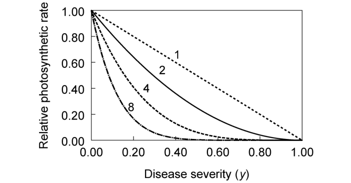{#fig-12-16}

There are alternatives to the Monteith/Waggoner/ Berger approach for characterizing yield in relation to disease, and we present one approach here based on direct measurements of photosynthesis (typically under controlled-environment conditions). Bastiaans (1991) showed that a curvilinear relation is obtained when one plots photosynthetic rate of leaves versus disease severity of leaves. Fig. 12.16 is an example of the typical relations found by Bastiaans and others (e.g., Bassanezi et al., 2001; Lopes and Berger, 2001; Robert et al., 2004, 2005). Observations are obtained by electronically measuring photosynthetic rate for a large number of leaves (or other plant units) and estimating the corresponding proportion of leaf area covered by lesions. Here, the rate is standardized by dividing the photosynthetic rate for a given leaf with a given severity (_Py_) by the mean rate for disease-free leaves (_P_ 0). The curves are based on the model:

{.equation width=60%}

in which φ is a unitless parameter. The derivation of this model is explained in Bastiaans (1991). When φ = 1, equation 12.19 can be written as _Py_ / _P_ 0 = 1− _y_, or _Py_ = _P_ 0 _− P_ 0 _y_, meaning that photosynthesis declines linearly with increasing disease severity. In other words, when φ = 1, the disease-free portion of the leaf tissue (based on symptoms) is not affected by the disease (at least in terms of photosynthesis). This is analogous to the situation discussed above when RUE is not affected by disease.

In the majority of cases studied, the standardized photosynthetic rate declines faster with increasing _y_ than predicted by equation 12.19 with φ = 1. In particular, _Py_ / _P_ 0 is smaller than 1− _y_, or equivalently, _Py_ is smaller than _P_ 0 _− P_ 0 _y_. This corresponds to a value of φ > 1. For some diseases, values of φ as high as 8 or higher have been found (e.g., Bassanezi et al., 2004; Lopes and Berger, 2001). This means that the photosynthetic rate of the apparently disease-free leaf tissue is affected by the disease, and that the reduction in photosynthesis of the disease-free portion of the leaf depends on the magnitude of (estimated) disease severity. In terms of the Monteith/Waggoner/Berger approach, this corresponds to situations where diseases reduce RUE, with RUE dependent on the magnitude of disease intensity (i.e., where RUE is not constant).

Bastiaans has shown how one can view 1−(_Py/P_ 0) (with equation 12.19 for _Py/P_ 0) as a “virutal lesion size” or “virtual lesion area” (on a proportion scale). Virtual lesion size is greater than the observed lesion size when φ > 1. We call the virtual lesion size _yv_ (_yv_ ≥ _y_). One can write this as:

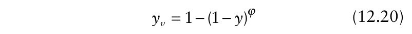{.equation width=60%}

The concept is that the total photosynthetic rate for a leaf can be thought of as being determined by the fraction of the total leaf that is unaffected by disease (the virtual disease-free area), and that the photosynthetic rate for this fraction is the same as what would occur if the disease was not present at all. So, instead of thinking of no photosynthesis where visible lesions are present and a reduced average level of photosynthesis per unit area in the symptomless portion of a diseased leaf, one can think of a larger-than-observed (virtual) lesion area, and a smallerthan-observed (virtual) disease-free area. Photosynthesis rate per unit area is then conceived to be zero for the entire virtual lesion area, and be unaffected (same as with a healthy leaf) by disease in the virtual disease-free area. This is a conceptual approach and is not essential to the use of equation 12.19. That is, one can interpret equation 12.19 directly as showing how relative photosynthetic rate is affected by the visibly diseased area.

The virtual lesion concept can be applied to both controlled-environment and field studies. With the supposition, discussed above, that crop yield is dependent on the rate of biomass production per unit of intercepted radiation (RUE*), which is determined, in part, by photosynthetic rate per unit of leaf area, the curves in Fig. 12.16 for φ > 1 would suggest that RUE will be affected by many diseases (see sections 12.6.2 and 12.6.3). Moreover, one would also expect that RUE is not just reduced by many diseases, but that the degree of reduction depends on disease severity. This would give a curve, rather than a straight line, when yield is plotted against HAA. Nevertheless, it is common to find that equation 12.18b is satisfactory for representing crop yield. This may be due to the “averaging” of many heterogeneous factors affecting crop yield over time and space in the epidemics, leading to equation 12.18b as a parsimonious (albeit simplified, by definition) description of crop losses.

One useful approach for incorporating the results on photosynthetic rate on crop loss is to substitute _yv_ for _y_ in equation 12.17a (or simplified equation 12.18b for a fixed RUE*). In other words, 1− _y_ is replaced by (1− _y_)φ , where _y_ is determined from visual assessments of disease severity in the field and φ is determined from separate studies (i.e., is specified before HAA is determined). Bassanezi et al. (2001) took this approach for three different pathosystems, and found that the fit of equation 12.18b to yield data when using (1− _y_)φ was as least as good as when using (1− _y_).

More studies clearly are needed to determine how well this approach works for other crops in other environments. It should be pointed out that Robert et al. (2005) have recently shown in a very thorough study that virtual-lesion results can be strongly influenced by the disease-assessment approach. In particular, the relationship between photosynthetic rate and leaf rust of wheat (in controlled experiments) depended on whether disease severity was measured as just sporulating lesion area, sporulating + necrotic lesion area, or sporulating + chlorotic + necrotic lesion area (total diseased area), with the later resulting in φ values close to 1 and the other measurements giving much larger values of φ. Care must be taken, therefore, in comparing results (especially the estimates of φ) among studies with the same pathogen and host, if different investigators are measuring different components of total visible disease severity.

### 12.6.5 Type I and Type II curves

The HLAI/HRI/RUE approach to crop loss characterization definitely leads to some valuable insights in the relationships between crop yield and disease intensity. As mentioned above, for crops with high LAI and a disease that impacts yield primarily (only?) through reductions in LAI, increasing disease intensity will only have an appreciable affect on yield when intensity is high. This is because small-to-moderate changes in LAI will have little impact on fractional radiation interception when LAI is high (see Fig. 12.12). Only at high intensities will the reduction in LAI be large enough for HRI to be markedly affected. In principle, this may result in the socalled Type II curve shown in Fig. 12.4 when yield is plotted versus disease intensity (or AUDPC). Here, disease intensity includes both lesions (or other symptoms) and defoliation.

As discussed in section 12.6.4, diseases often affect photosynthetic rate and the resulting RUE of the apparently disease-free leaf tissue. For diseases that impact yield primarily through reductions in RUE, the impact of disease on yield is apparent even at small intensity. In principle, this may result in the so-called Type I curve shown in Fig. 12.4 when yield is plotted versus disease intensity (or AUDPC). Of course, it can be expected that diseases will affect both HRI and RUE, resulting in intermediate types of curves.

The labels (Type I and Type II) for the shapes of crop loss curves are originally due to Mumford and Norton (1987). Hughes (1988), Ferrandino (1989), and Johnson (1987) explore crop loss relationships in the context of these two fundamental relations in Fig. 12.4. Although the two curve types can be motivated by HLAI/ HRI/RUE concepts, the curves can also be hypothesized based on ecological arguments (Hughes, 1988; Hughes et al., 1989). If there is compensation for the removal of LAI by diseases, such as by the increased RUE in plants (or plant parts) not infected, a Type II curve may result. In contrast, if there is substantial intraspecific competition within the pathogen population (so that the impact of individual infections decreases as the number of infections increases), a Type I curve may result. Some ecological factors, such as spatial patterns of disease (see Chapter 9), can also alter the shape of these curve types, as explained below in section 12.7.

Despite the arguments made here about the relationship between crop-loss curve type and underlying mechanism driving crop losses, one should be very cautious in (over-) interpreting observed relationships between yield and disease intensity (or AUDPC, or other predictor variables derived from epidemics). First of all, a disease may reduce yield by lowering RUE and have absolutely no affect on LAI (and hence HRI) (see discussion in Johnson, 1987). In this situation, there is _no_ range in disease intensities (as characterized in terms of visible symptoms such as lesions), and hence no meaning to a plot of _W_ versus _y_ (or _Y_ or HLAI). Furthermore, the linkage between HLAI/HRI/RUE and the Type I/II curves works better for short-term and recognizable damage to crops (such as mechanical defoliation) than for cumulative processes operating over the length of a growing season. This can be seen with a hypothetical example depicted in Fig. 12.17. The true relationship between _W_ and disease intensity at a particular time (_yt_), or AUDPC, is a straight line in each of the frames of Fig. 12.17; the labels indicate the true predictor variable for each curve. Consider the graph in Fig. 12.17C. The line marked “50”corresponds to the yield model:

{.equation width=60%}

For the lines (curves) marked “30”, “70”, and “AU” in Fig. 12.17C, the model was of the same form, but the predictor variable was _y_ 30, _y_ 70, and AUDPC, respectively (although yield was plotted versus _y_ 50). In all situations, the _y_ values on the horizontal axis were generated using the logistic model with different rates (i.e., the different values of the predictor variable were obtained from epidemics with the same _y_ 0 and _K_ values, but different _r_ L values).

In Fig. 12.17C, _W_ predicted by the four models is plotted versus _y_ 50. A straight line is found, as expected, only for the case where _W_ truly is a linear function of _y_ 50. If the true relationship was a straight line between _W_ and _y_ 30, an approximate Type II curve would result when _W_ is plotted versus _y_ 50 (see “30” in Fig. 12.17C). If the true relationship was a straight line between _W_ and _y_ 70, an approximate Type I curve would result when _W_ is plotted versus _y_ 50 (see “70” in Fig. 12.17C). A more complicated curve would result when the true relationship was a straight line between _W_ and AUDPC. The other frames of Fig. 12.17 show the same kind of result when the chosen variable for the horizontal axis does not correspond to the actual predictor variable generating the response values. The converse can also be expected to be true: if the true relationship was a Type I (or II) curve at a particular time, an approximate straightline relationship may be found when _W_ is plotted versus a predictor variable that did not generate the yield values (i.e., _y_ at a different time).

![Theoretical relationships between yield (_W_) and either disease intensity at a particular time (_yt_) or area under the disease progress curve (AUDPC). The true relationship is a linear (straight-line) relation between _W_ and: disease intensity at one of the three labeled times (_y_ at _t_ = 30, 50, or 70) or AUDPC. In each frame, the straight line is obtained when _W_ is plotted versus the _correct_ (or true) predictor variable. The other curves correspond to plotting _W_ versus an _“incorrect”_ predictor. In all cases, epidemics were generated with a logistic model (equation 4.15a) with different _r_ L values (with fixed _y_ 0 and _K_ = 1).](figures/fig12-img26.png){#fig-12-17}

The problem is that an investigator would not know the true predictor variable ahead of time, and may plot _W_ versus _y_ at different times, or versus AUDPC, and develop empirical models for the relations. This could result in incorrect interpretation of the underlying process [e.g., giving a mechanistic interpretation to a type I curve when, in reality, the true relationship was a straight line (but for a different time)]. As shown here, the shape of the curve can vary considerably over the course of the epidemic, even if the underlying process is not changing. Moreover, the investigator may not have measurements of disease intensity at the “correct” time(s).

The reason for the results in Fig. 12.17 is the nonlinear nature of disease progress curves. If one plotted _y_ 30 versus _y_ 70 for different epidemics (corresponding to different _r_ L values of the logistic model, all with the same _y_ 0 and _K_), for example, one would obtain a curve and not a straight line. The reader can easily do this with equation 4.15a at a fixed value of _y_ 0 (e.g., 0.005). For _r_ L from 0.01 up to 0.4/day, one can obtain two columns of _y_ data for plotting, one for _t_ = 30 and one for _t_ = 70. As can be seen in the different frames of Fig. 12.17, a wide range of curve shapes for yield versus disease can be obtained even when the true relationship was a straight line (i.e., generated by model that was linear in the parameters and variables). Of course, epidemics are never exactly logistic, there can be (considerable) heterogeneity in disease intensity and yield, and we do not expect _W_ to be a simple straightline function of _y_ or AUDPC, based on the arguments made in the previous sections. Thus, there is typically considerable variation in _W_ in relation to _y_ (or to AUDPC), and unambiguous functional relations may not be found. The point of the graphs in Fig. 12.17 is to show that considering only temporal slices of epidemics may result in misleading interpretations, because of the complex dynamics of disease progress over time. As we pointed out in the previous sections, plots of _W_ versus AUDPC can be misleading if the true relation involves HAD (and LAI is not fixed). Nevertheless, if one’s goal is to simply predict or describe crop loss, enabling the comparison of treatments (cultivars, control methods, and so on), then highly precise results may (but not necessarily will) be obtained using disease intensity at particular times.

### 12.6.6 Time of infection

In the above presentation, the crop could be considered analogous to a factory, with sunlight providing the energy used to drive the factory. Mathematically, we could consider the crop “size” (e.g., LAI, HLAI) as a continuous random variable, converted to HRI with a nonlinear function (using Beer’s law), which when multiplied by a scaling factor (RUE) and integrated over time, resulted in a prediction of yield (equation 12.17b). Here, an alternative approach is presented that may be appropriate for systemic diseases of plants, such as those caused by viruses, phytoplasmas, spiroplasmas, and some soil-borne pathogens. For these types of diseases, time of infection is often a good determinant of final yield (or yield loss). For instance, with controlled inoculations of plants, the impact of infection on yield often declines with increasing time during the season when plants are inoculated (Fargette and Vié, 1995; Madden and Nutter, 1995; Madden et al., 2000a). Plants infected early in the season may have a very low yield (perhaps 0), but plants infected late may have the same (or nearly the same) yield as plants not infected at all. Theoretical curves for _w_ and ℓ versus time of infection are shown in Fig. 12.18, based on results in Madden et al. (2000a). In terms of the HLAI/HRI/RUE approach, one can think of RUE as being a function of time of infection—the later the infection, the less that RUE is affected by disease. It is straightforward to model crop yield in terms of time of infection when investigators control the infection time through inoculations, so that all plants become infected at the same time in experimental units (e.g., plots). Simple exponential functions, such as used in Fig. 12.18, are effective for this. However, plants do not all become infected at the same time in a field during a natural epidemic (see Chapters 4–5). Indeed, the time of infection of individual plants is seldom known; rather, the total number or proportion of plants diseased at selected times is often recorded. Readers of earlier chapters know how to characterize epidemics with fairly simple (e.g., the logistic) or more complicated (e.g., the coupled differential equation of Chapter 5) models. To complete the model for crop loss of a population, we require the proportion of _new_ infections over a small time interval at each time during the epidemic, given by (_dy/dt_). _dt_.

![(**A**) Relative yield (_w_ = _W/W_ 0; left-hand axis and thin curves) and relative loss (ℓ; right-hand axis and thick curves) versus time of infection (_t_). Based on equation 12.22c, with _W_ min = 0 and two values of γ displayed on the curves. (**B**) relative yield for a population based on equation 12.23, with logistic disease increase and fixed _y_ 0 (see equation 4.15a), with three values of γ indicated on the curves (0.01, 0.03, and 0.05). The case with γ = 0.01 and a 90% reduction in _y_ 0 (“0.01, _y_ 0/10”) is also shown.](figures/fig12-img27.png){#fig-12-18}

Madden et al. (2000a) and Madden and Nutter (1995) showed how to link models for disease progress and yield-response to time of infection to characterize crop loss for systemic diseases of the type discussed here. For model development, we can start with a version of equation 12.4 for yield of individual plants (or groups of plants all infected at the same time), but expressed in terms of time of infection rather than in terms of _y_.

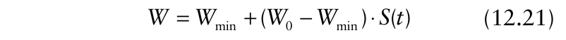{.equation width=60%}

Here, the switching function, _S_ (_t_), ranges from 0 at time 0 (i.e., when plants are infected at _t_ = 0) to 1 at large _t_ (when plants become infected late in the epidemic). In other words, _S_ (_t_) is now a switch-on function since _W_ increases as time of infection increases. For convenience, we use the cumulative exponential distribution function, _S_ (_t_) = 1 − exp(−γ _t_), where γ is a parameter with units of 1/time. By dealing with disease incidence, we are not (too) concerned with changing host size during the epidemic, so it is easier to deal with proportions diseased and fractional yield (_w_ = _W/W_ 0) and yield loss (ℓ = 1− _w_). Dividing equation 12.21 by _W_ 0, and then subtracting from 1 (to obtain relative loss), one obtains (after some algebra) the expression:

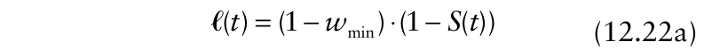{.equation width=60%}

in which _w_ min is _W_ min/ _W_ 0 (relative minimum yield). We added an explicit _t_ to the loss function to make it clear that it is defined in this section in terms of time and not disease intensity. For the chosen expression for _S_ (_t_), this can be written as:

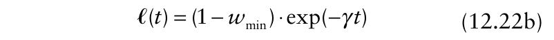{.equation width=60%}

This was called the “zeta” function [ζ(_t_)] by Madden et al. (2000a), with α used for 1− _w_ min, the maximum possible loss (on a relative scale). Relative yield for infection at time _t_ is simply written as:

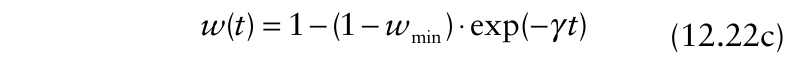{.equation width=60%}

The values of _w_ min and γ indicate how the crop tolerates infection. Loss is high (or yield is low; see Fig. 12.18) when γ is low (near 0), so that infections late in an epidemic have (nearly) the same effect as infections early. A small _w_ min indicates that loss is high (or yield is low) when plants are infected early.

To determine the relative yield for a crop with an epidemic in which plants become infected at different times (starting at _t_ = 0), one multiplies equation 12.22a by the number of new infections over short time spans at each time [(_dy/dt_) _dt_ on a proportion scale]. Then, integrating over time and subtracting the result from 1 gives:

{.equation width=60%}

in which ϑ0 is a constant that specifies the loss occurring from the initial infection event [at _t_ = 0; ϑ0 equals 1− _w_ min times initial _y_ (_y_ 0)]. If there is no increase in _y_ over time (_dy/dt_ = 0), then _wC_ = 1 −ϑ0. Note that we place a _C_ subscript on _w_ here to indicate the relative yield for the entire crop, when plants are (potentially) infected at different times. Instead of writing _dy/dt_ as a function of _y_, it is more useful in this context to write the rate as a function of _t_. For instance, _dy/dt_ for the simple logistic model is obtained by taking the derivative of equation 4.15b with respect to _t_; this is written as:

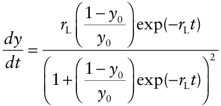

Interestingly, there may not be an analytical solution to equation 12.23 for many simple disease progress models. Fortunately, with computer programs like MATHCAD or MATHEMATICA, it is straight-forward to solve this equation numerically. Fargette and Vié (1995) used a version of this approach in a more complicated simulation model to explore the impact of sanitation and resistance on epidemics of cassava mosaic virus in the multiple-year cassava cropping cycle.

The lower frame of Fig. 12.18 shows the crop yield (on a relative scale) obtained from epidemics with logistic disease progress, in which each epidemic started with _y_ 0 = 0.005 (0.5% infected at time 0). One can see the impact of different rates of disease increase and three different “tolerance” values (γ ) on final yield. At very low _r_ L, meaning that only a small proportion of plants become infected, relative yield is high for all values of γ. At larger epidemic rates, however, the effects of γ become quite obvious, with large reductions in yield when γ is close to 0. Among other things, one can use graphs such as this one to develop strategies for control—is it more effective in a given system, for instance, to reduce rate of disease increase or to select (or breed for) cultivars that are more tolerant of disease (measured here by γ )?

The curve marked “0.01 _, y_ 0/10” is based on the same condition as the one marked “0.01”, except there is a 10-fold reduction in initial incidence for all epidemics. One can see the impact of controlling the initial disease level for polycyclic diseases on crop yield is minor compared with changing the rate of increase or γ . This is consistent with the results in Chapter 4 on the relative importance of _r_ L and _y_ 0 for compound interest diseases.

It is quite possible to use other functions for _S_ (_t_) (and hence ℓ _)_ and d _y/_ d _t_ in equation 12.23, and to expand the model to accommodate the more complicated linked differential equation models for disease dynamics (see Chapter 5). In such cases, results almost always will be based on numerical solutions rather than analytical ones. Fitting equation 12.23 to field data is challenging because the model must be numerically solved (in the general case) for any set of parameters. Madden et al. (2000a) developed a protocol for iteratively estimating parameters and found that the model provided reasonable fits to observed crop loss data for soybean mosaic virus.

### 12.6.7 Discussion

Crop growth and development, and the production of biomass that is harvested as yield, are complicated phenomena. We have shown that some basic considerations of crop physiology can lead to an interpretable representation of crop yield in relation to plant disease epidemics. In particular, the HLAI/HRI/RUE model provides a useful foundation for determining the effects of plant disease on crop yield. With this approach, diseases can be seen to affect intercepted radiation by the healthy leaf area [i.e., through a reduction in LAI and/or increase in proportion of the leaf area covered by lesions], or the utilization of the intercepted radiation [through alteration of physiological processes involved in photosynthesis and the transport of photosynthates (RUE)]. Some diseases will likely affect both HRI (a nonlinear function of LAI and disease intensity; equation 12.17b) and RUE. This approach to modeling is especially useful when total LAI changes considerably during the epidemics and when disease affects the total LAI (e.g., through defoliation), and not just the proportion diseased.

The integration of disease intensity over time, in the form of AUDPC, is a popular and useful variable when characterizing crop losses. The HLAI/HRI/RUE approach builds on the AUDPC model by integrating RUE × HRI over time. When RUE* is constant, the predictor variable HAA can be constructed for use with a crop loss model (see equation 12.18b) with a parameter equal to RUE*. Although this conceptualization is useful for many types of plant diseases, there also are specialized approaches of value for some types of diseases. In particular, for systemic diseases, the time of plant infection may be the major determinant of yield, partly because this determines the RUE for the plant from this point on.

In standard use of the RUE:HRI approach in plant pathology, it is typically assumed that RUE (or RUE*) is constant, so that the variable HAA can be constructed and used in a linear model for yield (with slope of RUE*). Clearly, the efficiency at which radiant energy is converted into biomass and ultimately into the harvested portion of the crop is not constant throughout an entire season, and only a portion of the total growing season may be relevant for yield formation (Johnson, 1987, 1992). Moreover, all portions of the plant, or even all portions of the disease-free leaf area do not contribute equally to formation of yield (Batchelor et al., 1993; Béasse et al., 2000). For example, the top (flag) leaf of a wheat plant is especially important in the yield of the crop (James and Teng, 1979). The environment certainly varies over time and over space in a field (e.g., because of fertility and soil-moisture gradients), likely affecting yield. At best, one can think of RUE* as roughly constant, at least for the purpose of analysis. This is no different from considering a fixed _r_ L for logistic growth or fixed β _H_ 0 in the coupled differential-equation model for epidemics. These population-dynamic values are not exactly unvarying, but use of constants often works well for a parsimonious description of epidemics. Likewise, a constant RUE* does seem to work well in some systems. However, there is empirical evidence that a constant RUE* is not always appropriate (e.g., Bergamin Filho et al., 1997). Moreover, published results on relative photosynthetic rate (and virtual lesion sizes) would suggest that diseases not only affect RUE* (assuming that photosynthetic rate determines, at least in part, radiation use efficiency), but that the magnitude of RUE* may depend on the magnitude of _y_ (or _Y_)—in other words, that RUE _*_ is a variable.

There are various mechanistic models for crop growth and yield production (e.g., Batchelor et al., 1993; Johnson and Teng, 1990; Termorshuizen and Rouse, 1993). These are usually of the simulation type, with numerous variables and parameters, typically constructed based on a reductionist philosophy of breaking down the system into many components and subcomponents. These models can be quite useful when one is interested in the underlying processes controlling yield. We do not discuss these here because we are much more concerned about the population dynamics of diseases. One very important concept has emerged from the detailed modeling and analysis of crop physiology that is of relevance. In particular, Boote et al. (1983) have concluded that pests in general, and pathogens in particular, affect crop growth and development, and yield formation, in seven possible ways. Pests and pathogens act as:

1. Tissue consumers;

2. Leaf senescence accelerators;

3. Stand reducers;

4. Light stealers;

5. Photosynthetic rate reducers;

6. Assimilate sappers; and 7. Turgor reducers.

Of course, a given pathogen may cause detrimental effects through several of these actions. The value of this classification is that physiological models can be used to account for these processes within crop simulators. Interestingly, as pointed out by Johnson (1987), the first four actions primarily affect LAI (or HLAI), and the last three primarily affect RUE. Thus, the approach in the previous sections is fully consistent with a more reductionist (and detailed) consideration of crop loss.

Johnson (1992) further extended the linkage between the HLAI/HRI/RUE and the more detailed physiological considerations by developing and testing of a multiplepest computer simulator based directly on the principles of radiation interception and use for potatoes. To quote from Johnson’s article:

“A principal advantage of the RI/RUE approach is that physiologic detail can be minimized while at the same time maintaining mechanistic integrity. This advantage also allows for closer ties to theoretical approaches [population dynamics of disease] and for more effort to be directed towards epidemiologic consideration of integrating and understanding disease and insect effects on crop growth.”

## 12.7 Spatial Heterogeneity

The average yield and disease severity per row or per plot, or some other group of individual plants, is usually used to determine the relation, if any, between yield and disease intensity. Averaging could even be carried out over larger scales, such as would be done to determine the mean yield per state or country. Even when the data points correspond to individual plants, some (implicit) averaging or totaling likely occurs. For instance, the yield and disease severity of an individual grape vine actually consist of the total weight of harvested berries from all shoots of that vine, and the average disease severity across shoots for that vine, respectively.

At first it might seem that the only effect of averaging is to reduce the variation around the line (curve) for the yield-disease relationship. As we show in the next section, however, the averaging may actually change the shape of the curve.

### 12.7.2 Models

For ease of presentation, we assume that _W_ (the response variable) is affected by disease intensity at a single time (_y_; the predictor variable), or that _W_ can be predicted by just one predictor variable, _y_. All the points discussed here apply to any predictor variable, including AUDPC, _rL_, time to symptoms, HAD, and HAA. In general notation, we can write _W_ = _g_ (_y_) for the functional relationship between _W_ and _y_. For reasons that will become soon apparent, we expand the model notation of section 12.4 and write this as:

{.equation width=60%}

to make it clear that _W_ is a function of _y_. As an example, we assume that _g_ (_y_) is given by the right-hand side of equation 12.3, that is,

### 12.7.1 General concepts

So far, we have virtually ignored the effects of spatial heterogeneity of disease on crop loss in this chapter. As mentioned in Chapters 9 and 10, plant disease intensity is usually heterogeneous in fields or other areas of interest, and this spatial heterogeneity can have a large influence on the precision of estimated parameters (such as means) and on predictions of responses. We do not readdress the precision issue here, other than to remind the reader that the more variation of the random variable (disease or yield, for instance), the less precise is the estimate of the mean (or other population parameter). In this section we discuss another important effect of heterogeneity of disease on crop loss results.

A diversity of crop loss relations, in the form of yield versus a measure of the epidemic (such as _y_ at a single time or AUDPC), is shown in Fig. 12.2. The individual data points in graphs of this type can consist of the yield and disease (or disease free) value for individual plants; however, usually some averaging is first performed.

{.equation width=60%}

Any expression could be used for _g_ (_y_) that characterizes the change in _W_ with change in _y_. In terms of the general formulation of equation 12.4, the choice here of _g_ (_y_) means that _W_ min = 0, _b_ = 1, _a_ = 0, and the switching function is:

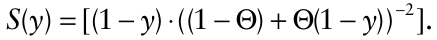

Suppose now that this expression for _g_ (_y_) is the fundamental one at the lowest hierarchical scale (e.g., that of the individual plant) of interest, but that we want to express the relationship at a higher scale (e.g., that of the plot or field). We add an _i_ subscript to indicate specific values of disease and yield (over which averaging occurs), and write equation 12.24 as:

= _W_ (_yi_) _g_ (_yi_)

More specifically for this demonstration, we assume that _y_ and _W_ take on only a finite set of values (i.e., that the variables are discrete), and _i_ is the label for the different values (not the different sampling units). Mean values of _y_ and _W_ are given by:

The relationship between these ways of considering yield [ _W_ (_y_) versus _W_ <u>(</u> _<u>y</u>_ <u>)]</u> can be understood by considering a mathematical approximation for a function, as shown in the next section.

### 12.7.3 An approximation (but a good one)

{.equation width=60%}

where Pr(_yi_) is the probability of the specific _yi_. With data in the form of a sample of _yi_ values from a population of interest, these probabilities are estimated by the fraction of _yi_ values with the particular (discrete) value of disease intensity _i_ (for each value of _i_). These equations for means are equivalent to equation 9.1, but with the data in categories or classes. Chapter 9 includes details of how to calculate these probabilities for some common statistical distributions used in plant disease epidemiology. If equation 12.25 is appropriate, one might naturally then want to see how actual mean yield [ _W_ (_y_)] is related to the yield that would be predicted by using _<u>y</u>_ in equation 12.24 [ _g_ <u>(</u> _<u>y</u>_ <u>)]</u> . One might initially think that _W_ (_y_) = _g_ (_<u>y</u>_ <u>).</u> However, this would not necessarily be correct, as shown by Hughes (1988) and Hughes et al. (1989).

Consider the situation where _W_ 0 = 5 (in appropriate units, such as g/m2 ) and Θ = 0.5 in equation 12.25. Suppose we have the following six pairs of observations [ _y_, _W_ (_y_)]: (0.2, 4.94) (0.2, 4.94), (0.4, 4.69) (0.4, 4.69), (0.6, 4.08), (0.6, 4.08), where the yield values come directly from equation 12.25. Since there are three unique _y_ values, in equal fraction, Pr(_yi_) = 1/3 for all classes. The calculated averages, based on equations 12.26a, b, are:

A function of a variable [ _g_ (_y_)] can be written as a Taylor series expansion of the function around a particular value (μ). The expansion is written as:

{.equation width=60%}

where _g_ ′ and _g_ ″ represent the first and second derivatives of the _g_ (•) function, evaluated at _y_ = μ [e.g., g′(μ) = d _g_ (μ)/d _y_]. Sometimes μ is called the solution locus. First derivatives were used frequently throughout the book, such as in the form of d _y/_ d _t_ in Chapter 4 and d _y/_ d _s_ in Chapter 8. The second derivative represents the change in the first derivative with unit increase in the predictor variable (_y_ in this case). We take μ to be the mean of the population of _y_ values. The series increases to indefinitely high order (powers), but typical usage involves using only the first three terms, as shown here. Thus, a Taylor series expansion is an approximation for a function, and the accuracy of the approximation depends on the form of the function and the value μ being used. Taylor series expansions are of great value in many mathematical and statistical applications. Ferrandino (1989) utilized this approach in crop loss modeling. Allen (1988) used this methodology for modeling biological responses to a variable environment.

One can use the rules of expectations (Stuart and Ord, 1994) and take expectations of both sides of equation 12.27:

{.equation width=60%}

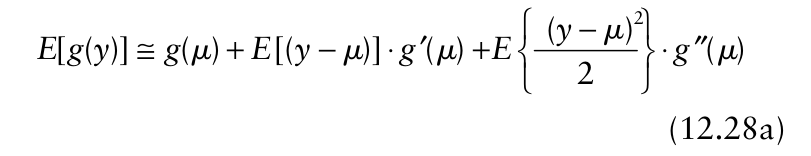{.equation width=60%}

and However, the predicted _W_ based on use of _<u>y</u>_ in equation 12.25, _g_ <u>(</u> _<u>y</u>_ <u>),</u> is 4.687. To distinguish this value from the actual mean of the yields, we write _W_ <u>(</u> _<u>y</u>_ <u>)</u> = _g_ (_<u>y</u>_ <u>)</u> = 4.687. The values 4.57 and 4.687 are similar, but not identical. The difference between the results of the two calculations of _W_ arises because the chosen crop loss function is not a straight-line function (it is nonlinear in the variables and parameters; see Chapter 3). In mathematical terms (noting that the mean is an expectation), a function of an expectation of a variable [ _W_ <u>(</u> _<u>y</u>_ <u>)]</u> is not equal to the expectation of the function of a variable [i.e., _W_ (_y_)], unless the function in question is linear.

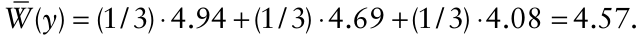

We note that the expectation of a constant (such as μ) is just the constant, and the expectation of a function of a constant (not a variable) is just the function of the constant. It can be shown that _E_ [(_y_ −μ)] = 0 when μ is the mean of a variable; that is, the average difference between a random variable and its mean is always 0. Furthermore, _E_ [(_y_ −μ)2 ] is, by definition, the variance of _y_; that is, _E_ [(_y_ −μ)2 ] = σ2 . Thus, one can write equation 12.28a as:

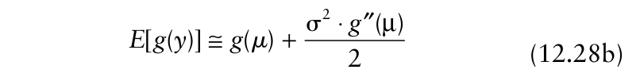{.equation width=60%}

In practice, the parameters μ and σ2 are unknown and one uses their estimates _<u>y</u>_ and _s_2 , respectively, in the equation. The mean of the _g_ (_y_) values, _<u>g</u>_ <u>(</u> _y_), used above, is equivalent to _E_ [ _g_ (_y_)]. So, we can now write:

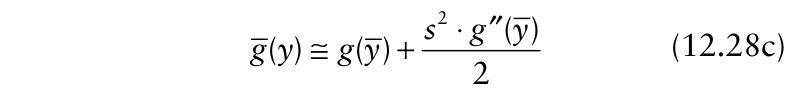{.equation width=60%}

This can be put in terms of crop yield by noting from section 12.7.2 that _W_ (•) = _g_ (•). Thus, equation 12.26b for mean or expected yield can be _approximated_ as:

{.equation width=60%}

in which _W_ ′′(_<u>y</u>_ <u>)</u> is the second derivative. Based on this equation, mean or expected yield (say, for a crop row, plot, field, etc.) equals the predicted (or estimated) yield at the mean value of _y_ <u>(</u> _<u>y</u>_ <u>)</u> , plus the product of the variance of _y_ (not the variance of _W_) divided by 2 and the second derivative of the crop loss function.

If _W_ (_y_) is given by equation 12.25, then one finds that the second derivative is:

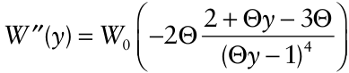

Of course, every different function for _W_ will have a different second derivative. For the six _y_ values in the example, _s_2 = 0.032 (which the reader can confirm on their own). For reasons we do not go into here, it may be more appropriate to use the maximum likelihood estimate of the variance rather than the moment (or least squares) estimate shown here. The maximum likelihood estimate is given by (_N_ − 1)/ _N_ times the moment estimate; obviously, this will only have a noticeable effect at small _N_. The maximum likelihood estimate is (5/6)·0.032 = 0.0267. The estimated second derivative

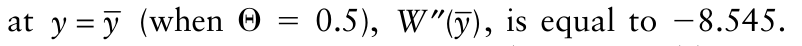{.equation width=60%}

Using equation 12.29, we estimate the mean yield as: which is the same as the directly calculated mean yield. In the example, the mean yield is less than that predicted by use of _<u>y</u>_ <u>.</u> Mathematically, this is because the second derivative is negative in this example. The magnitude of the difference between _W_ (_y_) (the correct value in this context) and _W_ <u>(</u> _<u>y</u>_ <u>)</u> depends on the size of the second derivative and the variance of the disease values. The larger the variance, the larger the discrepancy between (true) mean yield and that predicted based just on _<u>y</u>_ <u>.</u> If all values of _y_ are the same, the variance is 0, and _W_ (_y_) = _W_ (_<u>y</u>_ <u>).</u> The second way that _W_ (_y_) = _W_ (_<u>y</u>_ <u>)</u> is when the second derivative is 0; this only happens for a straight-line function (such as _W_ = _b_ 0− _b_ 1 _y_). So, only with an underlying straightline relationship is there no effect of heterogeneity on the realized _W:y_ line.

Some of the effects of spatial heterogeneity are demonstrated in Fig. 12.19, which is based on the use of equation 12.25 for yield, with Θ = 0.5 (Type II curve) or −0.5 (Type I curve). For demonstration purposes, we assume that disease incidence is used as the measure of intensity. Based on the material in Chapter 9, the reader should note that _s_2 can be defined in terms of estimated mean _y_. In the figure, three values for _s_2 were used:

- 0 (i.e., no variation; _y_ is fixed at all locations—the original situation),

- _<u>y</u>_ <u>(1</u> − _<u>y</u>_ <u>)</u> / _n_ [i.e., random situation (“ran.”; _y_ is represented by a binomial distribution, with _n_ = 10 individuals per sampling unit; and

- <u>(</u> _<u>y</u>_ <u>(1</u> − _<u>y</u>_ <u>)</u> / _n_) ·(_n_ /2) [i.e., one-half the maximum possible variance at all _<u>y</u>_ (“1/2”)]. In this last case, the index of dispersion (_D_) is equal to _n_ /2 (=5 here).

As can be seen in Fig. 12.19, increasing heterogeneity causes increasing deviation from the original relationship, whether the curve is convex or concave to the disease axis. As shown by Ferrandino (1989), the effects of increasing heterogeneity is to “straighten the line” (when _s_2 is a constant proportion of the random case). Ferrandino gave clear examples of the effect with different data sets.

These mathematical results are consistent with ecological or crop growth considerations. If a Type II curve is obtained because of compensation effects of the plants, then aggregation of disease will decrease the magnitude of compensation, and hence reduce yield. This is because plant damage occurs in patches when there is spatial heterogeneity, so there may be fewer (or no) neighboring plants to compensate for a diseased individual. If a Type I curve is obtained because of intraspecific competition of the pathogen, then aggregation of disease will increase the magnitude of the competition (since more pathogen or disease “individuals” will be found on the same plants or plant units (e.g., leaves). Thus, yield at a given mean disease intensity will be increased by comparison with the homogeneous disease situation.

![Yield (_W_) in relation to disease intensity, based on equation 12.29, with _W_ <u>(</u> _<u>y</u>_ <u>)</u> given by equation 12.25. Labels refer to magnitude of the estimated variance of disease intensity, _s_2 [“0” for a zero variance; “ran.” for binomial (random) given by equation 9.4); and 1/2 of maximum possible variance of disease incidence with _n_ = 10 plants per sampling unit]. Numbers in boxes with refer to Θ values of the yield model and the category of yield-disease curve (type I or II).](figures/fig12-img33.png){#fig-12-19}

To conclude this section, we note that the problem can be addressed from the opposite perspective. So far, we have emphasized how averaging can change observed relationships compared with the underlying relationship. Most data sets analyzed are based on some averaging (or summing). Thus, if there is any curvature to the observed relationship between yield and disease, it is likely that the underlying relationship at the individual level (e.g. plant) exhibits even stronger curvature.

## 12.8 Discussion and Conclusions

James and Teng (1979) believe that the lack of information on crop losses has hindered the progress of plant protection as much as any other single factor. The lack of information has two causes: (1) lack of precise estimates of disease intensity, which is really a problem with inadequate resources applied to determining disease intensity in regions, states, or provinces, and countries; and (2) inadequate understanding of the relationship between disease intensity and yield. This chapter dealt with issues related to the second item.

Although plant disease epidemics usually result in a reduction in yield compared to the no-disease situation, characterizing the relationship between the epidemic and crop yield (or loss), in either absolute or relative units, is challenging. For descriptive and comparative purposes (such as comparing treatments, cultivars, years, and so on), a range of empirical linear or nonlinear models have been used to great advantage over the last several decades. Models based on AUDPC (or a function of integrated disease or disease-free intensity over time) are especially appealing since they summarize the entire epidemic effect on yield with a small number of parameters.

As many researchers have observed, the relationship between epidemic characteristics such as AUDPC and yield is often quite variable, making it difficult to develop a general understanding of crop loss using purely empirical models. Among other things, spatial heterogeneity of disease intensity and the selected times during epidemics at which disease is assessed can influence results, as well as the form that yield is represented (absolute or relative units). When LAI is not constant, it may be beneficial to relate yield to integral variables that directly use LAI, such as HAD. In many circumstances, it may be even more beneficial to relate yield to healthy radiation interception integrated over time. With a constant efficiency of radiation use (RUE), a summary predictor variable, HAA, can be constructed to predict yield. Results of work on relative photosynthetic rate (Bastiaans, 1991) of diseased leaves suggest, however, that a constant RUE cannot be assumed.

For systemic diseases, such as those caused by many viruses, explicitly coupling time of infection to disease dynamics may be of value in understanding crop loss processes. Of course, simulation modeling can also be undertaken if sufficient information is available about the crop and disease in question.

Combinations of _y_ 0 and _r_ L can be found that give a relative yield of _w_. Fig. 12.20 shows this for several indicated values of _w_ (0.95, 0.90, 0.80, 0.60, and 0.40) when β1 = 1. For example, if _y_ 0 = 0.01, a relative yield of 0.90 is obtained with _r_ L = 0.032/day. As shown for polycyclic diseases in earlier chapters, high initial disease intensity is only tolerable if _r_ L is very low. At moderate or higher _r_ L, _y_ 0 must be very low to achieve the goal of a relative yield no lower than _w_. As the selected yield value decreases, higher _y_ 0 and _r_ L are acceptable. This approach can be adapted for other disease progress models and generalized for other crop loss models, including those based on integral predictor variables (HAD and HAA). In some cases, it may be necessary to iteratively determine the epidemic parameters that give the desired yield value(s).

{#fig-12-20}

A considerable amount of research still lies ahead for those who are concerned about crop loss assessment. Among other things, additional work is needed on: exploring linkages between virtual-lesion results and the HLAI/HRI/RUE models for yield; a more thorough evaluation of the linkages between time-of-infection and disease dynamics; and an evaluation of the value and usage of crop loss models for Bayesian decision making in the framework presented in Chapter 11. Although not dealt with here in any detail at all, assessment and modeling of economic losses is far from adequate in general. As shown by Paveley et al. (2001), it should be possible to use HLAI/HRI/RUE models to develop optimal control decisions (in an economic sense).

One further topic not discussed in this chapter, other than in very general terms, is the situation with multiple diseases and other pests. Clearly, plant populations are affected by multiple diseases at the same time, and there certainly can be interactions of diseases in terms of crop yield. Various authors have dealt with this subject in some detail (e.g., Johnson, 1992; Francl et al., 1987; Robert et al., 2004; Savary and Zadoks, 1992a,b; Teng, 1987). From a strictly empirical approach, linear models such as equation 12.11 can be utilized. At the other extreme, mechanistic simulation models offer the most potential for developing an understanding of the physiological processes involved (Johnson, 1992), although it is unlikely that sufficient data bases of physiological results will be obtained for most crops and diseases to allow this type of modeling as a general approach for characterizing crop losses. It is noteworthy, however, that the virtual lesion and HLAI/HRI/RUE models allow direct extension to multiple diseases, although the specific approach for handling multiple diseases is not unambiguous (Johnson, 1987, 1992; Lopes and Berger, 2001; Paveley et al., 2001).

## 12.9 Suggested Readings

- Cooke, B. M. 1998. Disease assessment and yield loss. In: _The Epidemiology of Plant Diseases_ (D. G. Jones, editor). Kluwer, Dordrecht, pp. 42–72.

- Francl, L. J., and Neher, D. A. 1997. _Exercises in Plant Disease Epidemiology_. APS Press, St Paul, MN (chapters 28–31).

- James, W. C., Teng, P. S., and Nutter, F. W., Jr. 1991. Estimated Losses of Crops From Plant Pathogens. in: _CRC Handbook of Pest Management in Agriculture_ (D. Pimentel, editor). CRC Press, Boca Raton, FL, pp. 15–51.

- Johnson, K. B. 1992. Evaluation of a mechanistic model that describes potato crop losses caused by multiple pests. _Phytopathology_ 82: 363–369.

- Madden, L. V., G. Hughes, and M. E. Irwin. 2000. Coupling disease-progress-curve and time-of-infection functions for predicting yield loss of crops. _Phytopathology_ 90: 788–800.

- Teng, P. S., editor 1987. _Crop Loss Assessment and Pest Management_. APS Press, St Paul, MN.
